# 02 Research - seamless tiles and baking

**What this guide is for, in one sentence:** how to turn a procedural material made of Blender nodes into square texture pictures that repeat with no visible seam (colour, height, normal, roughness, metallic, ambient occlusion) and how to save those pictures correctly.

Written on 19 October 2026 for Blender 5.2.2 LTS (Cycles, CPU). Everything marked **TESTED** was run here and the numbers are real; everything marked **NOT TESTED** is only what a source says. All experiment scripts and pictures are in `experiments_seamless_tiles_and_baking/` next to this file.

Words used in this guide (one word for each thing):
- **recipe**: a short Python file that builds the node group for one surface (what the project's tools call a recipe).
- **UV**: the coordinates painted on a surface; for our flat square, u runs 0 to 1 left to right and v runs 0 to 1 upward.
- **tile**: one square picture that is meant to be repeated left, right, up and down.
- **seam**: the visible line where the right edge of one tile meets the left edge of the next (or top meets bottom).
- **photograph**: the project's way of making a picture: a flat square, a camera straight above it, an emission shader that shows exactly one channel (what `lib/bake_harness.py` does).
- **bake**: Blender's own Bake button (Cycles) that writes a shader result into a picture.
- **height map**: grey picture, white = high, black = low. **normal map**: blue-violet picture where each pixel's colour says which way the surface tilts. **Normal** is the word Blender uses; **OpenGL** and **DirectX** are the two ways of storing it.

---

## 0. The short version (read this if nothing else)

1. **Blender's textures do NOT tile by themselves.** A web page (the SeamlessTex add-on documentation, 2026) says "Noise / Voronoi / Wave wrap on integer UV boundaries". That is **false**. TESTED: plain Noise at Scale 5 has a seam ratio of 20 (1.0 = no seam), Voronoi 35, Wave 24. (Section 1.)
2. **Noise and Voronoi tile exactly if you sample them in 4D on a "donut"** (the trick already in `lib/recipe_tools.py`). TESTED: seam ratio 0.87 and 1.07; moving the coordinates by whole tiles changes the picture by 0.00000. Costs about 30% more time than plain 3D noise.
3. **Other patterns tile only if you obey a size rule.** Brick: whole numbers of bricks and rows (and the random brick colours still break, see 1.4). Wave: Scale = k x pi/10. Magic: Scale = k x 2 pi/5. Checker: an even Scale. Gradient, Wave rings, Gabor: not at all. (Table in 1.2.)
4. **To keep a pattern tiling while bending it, bend the coordinates with a tileable noise before the pattern** (a "domain warp"). TESTED with Wave and Brick.
5. **Do not fix seams afterwards if you can avoid it.** Fixing a picture (cross-fade, periodic-plus-smooth) works on cloudy patterns and fails on brick-like patterns (ghost bricks). Mirror tiling is seamless but always symmetric, and a mirrored normal map needs its red or green channel flipped in the mirrored copies (TESTED: error 0.12 if you forget).
6. **Photograph or bake? Both give the same pixels.** TESTED: the Cycles Bake (Emit) of colour equals the photograph within 0.0011; Cycles Bake > Roughness within 0.00001; Cycles Bake > Normal equals the photographed Bump-node normal within 0.00008. Use the photograph (fast, no UV or image-node setup) for flat tiles; use Cycles Bake only when the surface is real geometry or an object with its own UV map.
7. **Colour space is the commonest silent mistake.** Roughness baked into an image set to sRGB comes out 0.74 instead of 0.51. Colour baked into a Non-Color image comes out too dark. A brand-new Blender scene uses the AgX view transform, which ruins data pictures (0.5 becomes 0.667). Use Standard for colour, Raw for data. (Section 2.3.)
8. **Cycles Bake > Diffuse turns metal black** (brightness 0.007 instead of 0.59). Use the emission trick: send the base colour into an Emission shader and bake Emit. **Ambient occlusion cannot see a Bump node** (plain white picture); it needs real geometry.
9. **Height maps want 16 bits.** 8-bit heights give stair steps (TESTED: 18% of neighbouring pixels exactly equal, normal map error 0.0068 versus 0.0000; Cubic interpolation only reduces it).
10. **The reference normal maps were made from their 8-bit height maps by a plain slope filter with whole-number strengths: brick 6, slate 7, wood 8, metal 5, mud 9, gravel 10** (average error 0.5 of an 8-bit step, i.e. identical apart from rounding). (Section 3.3.)
11. **To tell OpenGL from DirectX:** in OpenGL the green channel points up the picture (Blender). TESTED: a one-line test on the map alone gives -1.00 for all six OpenGL reference maps and +1.00 for all six DirectX uploads. (Section 3.4.)
12. **A small script checks a finished set in plain words:** `check_texture_set.py` (Section 5). **Another proves a recipe tiles exactly:** `recipe_tiling_test.py`.

---

## 1. Making each kind of pattern tile exactly

### 1.1 What "tiles" means, and how to see it

A tile is seamless when the picture, repeated, shows no line at the joins. Two ways to look, both TESTED:

- **The half-shift picture.** Move the picture half a tile to the right and half a tile down (wrapping around). Any seam is now a cross in the middle. Every sheet in this guide is drawn this way. If you see no cross, the tile joins well.
- **The seam ratio** (the project's own number in `lib/texture_compare.py`): jump across the wrap-around edge divided by the usual jump between neighbouring pixels. 1.0 means no seam; above about 3 a seam shows.

**The seam ratio can be fooled by hard edges. TESTED:**
- A Checker with an even Scale (8) tiles perfectly but scores **72.98** (there is a real square edge exactly at the tile border).
- A Checker with Scale 7 has a doubled-up square at the border (a visible fault) but scores **0.17**.
- A sawtooth Wave tiles perfectly but scores **92**.
- The project's own reference tiles, which do tile, score between **1.14 and 2.49** (brick 2.22, slate 1.69, wood 2.24, metal 2.02, mud 2.30, gravel 2.49), because they have hard painted edges.

So: **always also look at the half-shift picture.** And for a recipe (not just a picture) use the exact test below.

**The exact test (`recipe_tiling_test.py`, TESTED).** A pattern that repeats every 1.0 must look identical if its coordinate is moved by one whole tile. The script photographs the recipe five times (unmoved, +1 right, +1 up, both, and -3 / +2) and prints the difference. On the project's smoke recipe (seamless noise) it printed `PASS: repeats exactly` for all four outputs; on a deliberately broken recipe (plain 3D noise) it printed `FAIL` for colour (average difference 0.060) and height (0.084). Limits found by testing: (a) a recipe that is only defined between 0 and 1 (the cross-fade repairs, Gradient, which clamps) cannot pass but may still look seamless; (b) whole bricks that never touch the tile edge get a new random colour when moved by a tile, so this test is stricter than your eyes.

### 1.2 What we tested: every pattern, with its rule

All pictures are 512 x 512, 16-bit, photographed with the harness settings. "Shift test" is the exact test above. Full table: `experiments_seamless_tiles_and_baking/out/pattern_table.txt`. Contact sheet: `out/patterns_seam_sheet.png` (shifted by half, so seams are crosses).

| Pattern and setting | Seam ratio | Shift test | Verdict and rule |
|---|---|---|---|
| Noise, plain 3D, Scale 5 | 20.5 | fails | **Not seamless.** Integer scale does not help. |
| Noise, 4D donut, Scale 5, Detail 4 | 0.87 | passes (0.00000) | **Seamless.** |
| same, with Distortion 1 | 1.02 | passes | **Still seamless** (the distortion is part of the 4D sample). |
| Voronoi, plain 3D, Scale 6 | 34.6 | fails | **Not seamless.** |
| Voronoi, 4D donut, Scale 6 | 1.07 | passes | **Seamless.** |
| Voronoi, 4D donut, Scale 2 | 0.52 | passes | Seamless, but cells are visibly stretched (see 1.3). |
| Brick, Scale 4 (defaults), **mortar mask (Factor)** | 0.03 | passes | **Seamless**: the mortar lines tile. |
| Brick, Scale 4, **Colour** output | 2.43 (peak 5.2) | fails | Mortar tiles, **random brick colours break** at the half bricks (1.4). |
| Brick, Scale 4.3 | 13 to 17 | fails | **Everything breaks.** Scale / Brick Width and Scale / Row Height must be whole numbers. |
| Brick, Squash 0.62 every 3rd row | 1.6 to 1.9 (peak 4) | fails | **Rows of different brick width break.** Squash x width must also divide the tile into whole bricks. |
| Brick, Scale 3, Squash 0.75, Squash Frequency 3 (mask) | 0.05 | passes | Seamless (whole bricks in every row type, 12 rows is a multiple of 2 and 3). |
| Brick, mask, warped by a tileable noise | 0.36 | passes | **Seamless** (1.6). |
| Hand-made bricks, wrapped random value (1.4) | 0.03 | passes | **Seamless, including the random colours.** |
| Wave, bands, Scale 3 | 24.4 | fails | Not seamless. |
| Wave, bands, **Scale = 3 x pi/10** (0.942) | 0.08 | passes | **Seamless**: Scale = k x pi/10 puts k whole bands across the tile. |
| Wave, same, **Distortion 2** | 6.7 (peak 52) | fails | Wave's built-in distortion uses ordinary noise: **breaks**. |
| Wave, same, warped by a **tileable** noise instead | 0.37 | passes | **Seamless** (1.6). |
| Wave, saw profile, Scale 3 x pi/10 | 92 (false alarm) | passes | Seamless; the seam ratio is fooled by the saw tooth's own jump. |
| Wave, rings | 54.6 | fails | **Never tiles** (rings spread from one centre). |
| Gradient, linear | 470 | fails | Jumps from white to black at the join. |
| Gradient, linear + Math PingPong | 0.16 | n/a (Gradient clamps) | Looks seamless (a mirror: triangle wave). |
| Gradient, spherical or radial | 508 | fails | Never tiles. |
| Magic, depth 2, Scale 2 | 72 | fails | Not seamless. |
| Magic, depth 2, **Scale = 2 x 2 pi/5** (2.513) | 0.73 | passes | **Seamless**: Scale = k x 2 pi/5. |
| Gabor, 2D, Scale 6 | 13.9 | fails | Not seamless; no tiling trick found (it is 2D or 3D only, not 4D). Use a cross-fade (1.7). |
| Checker, Scale 8 | 73 (false alarm) | passes | **Seamless**: Scale must be even. |
| Checker, Scale 7 | 0.17 (false pass) | fails | Doubled square at the join. |

Why the Wave and Magic rules (explained, then checked above): Wave's bands are a sine of `x * Scale * 20`, so one band is 2 pi / 20 long; Scale = k x pi/10 fits k whole bands in the tile. Magic uses sines of `x * Scale * 5`, so Scale = k x 2 pi/5. Both were then confirmed by test.

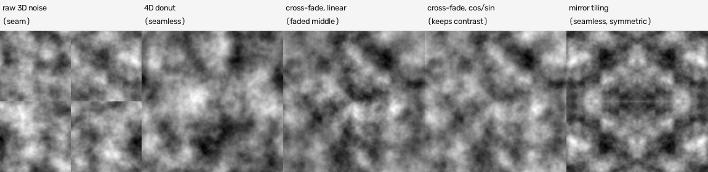

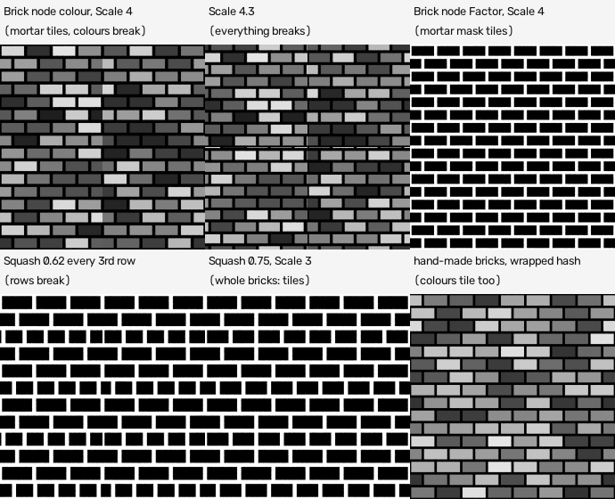

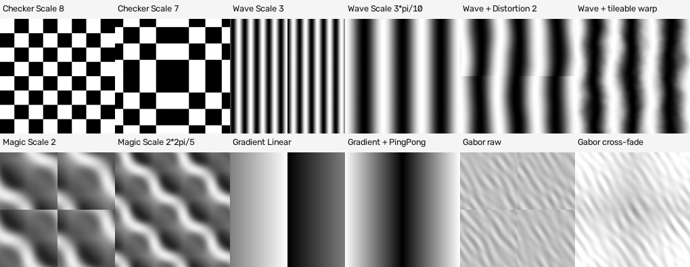

### 1.3 Noise and Voronoi: the 4D donut

**What it does in one sentence:** it turns the flat tile (u, v) into a point on a donut-shaped surface in 4-dimensional space and samples 4D noise there, so walking off the right edge brings you back at the left edge.

**Example first.** Take u = 0 and u = 1. On a normal 3D noise they are two different places. On the donut, u is an angle: `cos(2 pi u)` and `sin(2 pi u)` have the same value at u = 0 and u = 1, so the noise there is the same place. The same is done for v with a second pair.

**The node chain** (already built as `tileable_noise_group()` and `tileable_voronoi_group()` in `lib/recipe_tools.py`; TESTED):
1. Texture Coordinate > UV > Separate XYZ gives u and v.
2. Multiply u and v by 2 pi, then Cosine and Sine of each.
3. Combine XYZ with X = cos u, Y = sin u, Z = cos v; this is the **Vector**. The sin v goes to the noise's **W** input.
4. Multiply the Vector and W by a radius R = Scale / (2 pi). (The circumference is then exactly Scale: Scale = how many noise features fit round the tile.)
5. Add a Seed number to W (changes the pattern).
6. Noise Texture with Dimensions **4D**, Type fBM, Normalize on, its own Scale = 1; Detail, Roughness, Lacunarity, Distortion pass through.

**What to know (TESTED unless marked):**
- **Any setting tiles.** Detail, Roughness, Lacunarity and Distortion do not break it, because every octave is still a function of the two angles. Distortion 1 was tested: tiles exactly.
- **Cost.** 1254 x 1254, Detail 8, 2 threads: plain 3D noise 2.5 s (4 samples), 8.7 s (16), 34.9 s (64); 4D donut 3.2 s, 12.1 s, 46.5 s. So about 30% more.
- **Low Scale stretches the pattern.** A straight line through the 4D donut is shorter than the path along its surface when a cell is a large part of the circle. Seen in `voronoi_donut_s2` (cells look long and soft). **By arithmetic, not measured separately:** for two points one noise feature apart the straight distance is shorter by about 1% at Scale 12, 4.5% at Scale 6 and 36% at Scale 2 (the ratio is sin(a/2)/(a/2) with a = 2 pi / Scale). Use Scale 4 or more for Voronoi.
- **It is not the same random pattern as plain Noise**, so numbers (thresholds, ramps) may need small re-tuning.
- **One radius for both directions, so use square tiles.** A non-square tile needs different radii for u and v. NOT TESTED.
- **Old sources:** the idea (to tile in N directions you need 2N-dimensional noise) comes from an old OpenGameArt forum post and an Urho3D wiki page that did it with OSL on a "Clifford torus" in Blender 2.7x. Blender 5.2's own Noise node has a 4D mode, so no OSL is needed; confirmed by the 5.2 manual ("4D: evaluate the noise in 4D space at the input Vector and the input W as the fourth dimension").

### 1.4 Bricks

**What the Brick Texture node does:** draws rows of bricks with mortar between them, with a random shade per brick.

**The whole-number rule, with an example.** In the node, Scale 4 with Brick Width 0.5 and Row Height 0.25 gives 4 / 0.5 = **8 bricks across** and 4 / 0.25 = **16 rows**: whole numbers, so the mortar lines wrap. Scale 4.3 gives 8.6 bricks and everything breaks (seam ratio 13 to 17). General rule (TESTED, from the node's formula and the pictures):
- Scale / Brick Width must be a whole number, and Scale / Row Height must be a whole number.
- The number of rows must be a multiple of the Offset Frequency (default 2) and of the Squash Frequency (default 2), so the row pattern repeats.
- If Squash is not 1, the squashed rows have width Brick Width x Squash, and Scale / (Brick Width x Squash) must also be whole. Squash 0.62 broke the tile; Squash 0.75 with Scale 3 worked.

**The colour trap (TESTED).** Even with whole numbers, the Colour output **breaks** (seam ratio 2.43, peak 5.2). Reason: every brick gets its random shade from its number. With Offset 0.5 the brick that straddles the tile edge is number 0 on the left piece and number 8 on the right piece, so the two halves get different shades; the mortar still joins. Brick has no output for the brick number, so you cannot fix this inside the node. Three ways out:
1. **Use only the Factor (mortar mask) from the Brick node** and get colour variation from a tileable noise or Voronoi (seamless, but the shades are not tied to bricks).
2. **Offset 0** (no half bricks): no brick touches the tile edge, so no visible seam (the mortar halves match). Looks like a stack, not a wall.
3. **Build the bricks by hand with a wrapped brick number** (TESTED: seam ratio 0.03, shift test passes, random colours included). The chain, for 8 bricks across and 16 rows:
   - y = v x 16; row = Floor(y); fy = Fract(y)
   - shift = Floored Modulo(row, 2) x 0.5
   - x = u x 8 + shift; col = Floor(x); fx = Fract(x)
   - **col_wrapped = Floored Modulo(col, 8); row_wrapped = Floored Modulo(row, 16)**
   - random = White Noise Texture (3D) with Vector = Combine XYZ(col_wrapped, row_wrapped, any seed number), Value output
   - distance to the nearest brick edge in tile units: dx = Minimum(fx, 1 - fx) / 8; dy = Minimum(fy, 1 - fy) / 16; edge = Minimum(dx, dy)
   - mask = Greater Than(edge, mortar_half_width) (for example 0.006)
   - brick value = mask x (0.2 + 0.7 x random)
   The half brick on the right edge now has the same number as the one on the left edge, so the same shade. Build code: `build_brick_wrapped()` in `exp1_pattern_seams.py`.

**Ready-made and tested: `tileable_pattern_groups.py`** (in the experiments folder) turns the chain above into a node group, `tileable_bricks_group()`, with inputs Vector, Bricks across, Rows, Offset, Mortar width, Seed and outputs Brick mask, Random (one value per brick), Edge distance, Local x, Local y, Brick number, Row number. Set Offset 0 for a plain grid of tiles (floor tiles, planks without stagger). Its twin `tileable_wave_group()` makes wavy bands with a whole number of bands bent by a tileable noise (1.6). TESTED with `recipe_tiling_test.py` on `test_recipes/bricks_and_wave_recipe.py`: Colour, Roughness, Metallic and Height all print `PASS: repeats exactly` (average difference 0.00000 to 0.00001); the colour picture's seam ratio is 0.14.

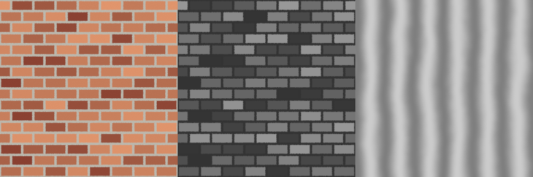

Note for a plank wall: rows are planks and "Bricks across" is the number of plank lengths per tile; plank ends then staggered by Offset. Rows must be even when Offset is not 0 (NOT TESTED with an odd number; the half-brick row pattern would not repeat).

### 1.5 Wave, Magic, Gradient, Checker, Gabor

- **Wave** (bands): Scale = k x pi/10 and Distortion 0. (Rings never tile.) To bend the bands anyway, see 1.6.
- **Magic**: Scale = k x 2 pi/5.
- **Gradient**: never use the plain output at the tile border. For a repeating ramp use a sine of 2 pi u (not tested) or a ping-pong (looks like a mirror).
- **Checker**: even Scale only.
- **Gabor** (bands of random direction): no seam-free setting found. TESTED: seam ratio 13.9; after the cross-fade (1.7) 1.09.
- **White Noise** (random value per input): not a picture pattern; useful as a per-cell random number if you wrap the cell number first, as in 1.4.

### 1.6 Bending a pattern without losing the tiling: the domain warp

**One sentence:** if a pattern repeats every 1.0 and you add a value that also repeats every 1.0 to its coordinate, the result still repeats every 1.0.

**Example (TESTED):** Wave bands (Scale 3 x pi/10) with the x coordinate replaced by `u + 0.15 x (tileable_noise(u, v) - 0.5)`: wavy bands, seam ratio 0.37, shift test passes. The same warp on the Brick mask: seam ratio 0.36, shift test passes (the mortar lines meander but still join). Compare Wave's own Distortion setting: it uses plain noise inside, so it breaks (seam ratio 6.7, peak 52). The Blender manual says exactly this about Wave: distortion can be reproduced by adding a centred noise to the coordinates; do it with the tileable noise.

### 1.7 Repair inside a recipe: the cross-fade (offset and blend)

**What it does in one sentence:** it mixes four copies of any (non-tiling) pattern, each shifted by one tile, with weights that hand over smoothly from one copy to the next so the left edge equals the right edge.

**Formula (TESTED).** With f(u, v) the pattern evaluated at any point:
`g(u,v) = sum over a, b in {0,1} of  wu_a(u) x wv_b(v) x ( f(u-a, v-b) - 0.5 )  +  0.5`
At u = 0 only the copy with a = 0 counts and at u = 1 only the copy with a = 1 counts, and f(1-1) = f(0), so g(0) = g(1); the same for v.
- **Linear weights** (1-u, u) lose contrast in the middle: spread of the result 0.048 versus 0.069 for the original (-30%), seam ratio 1.41.
- **Cos/sin weights** (cos(pi u / 2), sin(pi u / 2)) keep the contrast because cos squared plus sin squared is 1: spread 0.072, seam ratio 1.09. **Use these.**
- **Cost:** four copies of the pattern. **Limit:** only valid between 0 and 1, so it fails the shift test even though the picture is seamless; the ghosting of two different patterns mixed in the middle is visible on structured patterns, fine on cloudy ones. Works for Gabor (1.09).

### 1.8 Repairing a finished picture (when the recipe cannot be changed)

`repair_seams_in_pictures.py` (TESTED on four non-tiling pictures). The pictures may only be used for analysis in this project; this is for understanding limits.

| Method | Noise (seam 20.5 before) | Voronoi (34.6) | Bricks (16.8) | Gabor (13.9) | Side effects |
|---|---|---|---|---|---|
| Offset and blend (shift half a tile, blend the original over it) | 1.03 | 1.41 | 0.09 | 1.16 | Ghost double bricks in the middle band; fine for noise |
| Periodic plus smooth (Moisan 2011: subtract one very smooth correction picture) | 0.77 | 0.67 | 0.96 | 0.71 | Keeps detail but brightens and darkens large patches; bricks get wobbly lighting |
| Mirror 2 x 2 (shrunk back) | 0.00 | 0.00 | 0.00 | 0.00 | Perfectly seamless but **perfectly symmetric** (mirror tell 1.00 versus 0.0 to 0.4) |

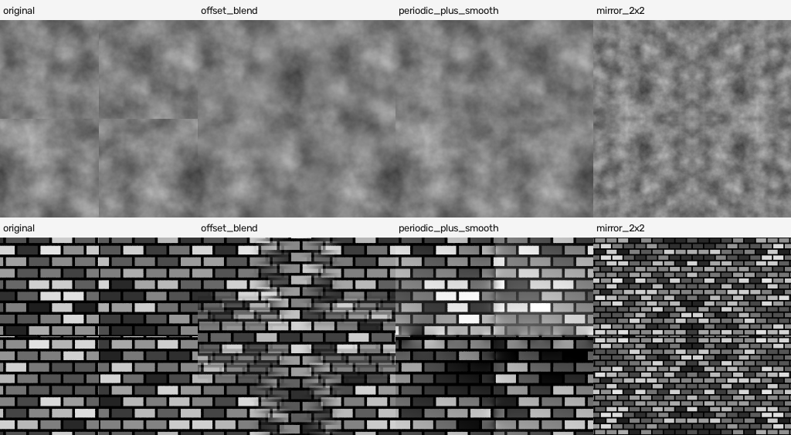

### 1.9 Mirror tiling and why people avoid it

**Mirror tiling** folds the picture so each edge meets its own mirror image. It is the one repair that is guaranteed seamless (the SeamlessTex add-on offers it as "Mirror Tile" and says it uses four times the memory). Reasons artists avoid it (TESTED where a number is given):
1. **It is symmetric.** The picture equals its own mirror image (correlation 1.00; the cloudy tiles tested scored -0.2 to 0.4; brick patterns score higher, 0.6 to 1.0, because a brick wall looks alike when flipped, so this number is a useful tell for cloudy patterns only). Repeated, it shows a kaleidoscope of identical shapes, easy for the eye to spot.
2. **It doubles the size** of the picture for the same detail (or halves the detail).
3. **Structured patterns look wrong** (bricks are mirrored, all lines doubled).
4. **A mirrored normal map is wrong if you just mirror the picture.** TESTED (`mirror_normal_pitfall.py`): in the left-right mirrored copy the red channel is off by 0.1196 on average, in the up-down mirrored copy the green by 0.1113 (blue is fine). The normal must be rebuilt from the mirrored height, or red / green inverted in the mirrored copies.

### 1.10 How to choose

- Cloudy surfaces (soil, rust patches, clouds, stone grain): **4D donut noise.**
- Cells (stones, cracks, scales): **4D donut Voronoi, Scale 4 or more.**
- Regular structure (bricks, planks, tiles): build it from whole numbers; take colour variation from a wrapped brick/plank number (1.4) or a tileable noise.
- Wavy lines (wood grain): **Wave with Scale k x pi/10 and a tileable-noise warp** (1.6), never Wave's own Distortion.
- Anything else: tile at the source with a cross-fade (1.7); repair the picture only as a last resort (1.8).

---

## 2. Getting maps out of Blender: the four routes

| Route | What it is | Good for | Tested result |
|---|---|---|---|
| **A. Photograph** (what `bake_harness.py` does) | emission shader shows one channel, flat orthographic camera renders it | flat tiles made from nodes | equals Cycles Bake within 0.0011 (colour) / 0.00001 (roughness) |
| **B. Cycles Bake** | Render properties > Bake, into an Image Texture node | surfaces with real geometry or a UV layout; high-poly to low-poly | works; the traps are in 2.2 to 2.6 |
| **C. Geometry Nodes Bake node** | caches nodes' data | speeding up node trees | **does not make pictures** (inspected; 2.8) |
| **D. Compositor** | image nodes shift and combine pictures | height to normal map | equals numpy exactly (3.2) |

### 2.1 Route A: photograph (the project's route)

Settings that matter (all TESTED, defaults of `bake_harness.new_bake_scene`):
- Orthographic camera, ortho scale 1.0, straight above a 1 x 1 square with UV 0..1.
- **View transform Raw** for data (height, roughness, metallic, normal) and **Standard** for colour. A fresh Blender scene is **AgX**: a photographed 0.5 became **0.667** (AgX), **0.696** (Filmic), **0.737** (Standard; the sRGB curve) and only **0.500** with Raw (16-bit error 0.0005, 8-bit 0.005).
- **Pixel filter Box 1.0 px** (the new-scene default is Blackman-Harris 1.5 px). See 2.4.
- **16-bit PNG for data** (TESTED: the file really is `uint16`; an 8-bit gentle ramp holds 54 levels where 16-bit holds thousands).
- **Samples**: the harness uses 4. See 2.4: 16 or more for hard-edged channels.

### 2.2 Route B: Cycles Bake (Blender's Bake button)

**What the Bake panel offers in 5.2 (TESTED by listing):** Combined, Ambient Occlusion, Shadow, Position, Normal, UV, Roughness, Emit, Environment, Diffuse, Glossy, Transmission. **There is no Metallic and no Height bake type.**

**Setup (manual, 5.2):** the mesh needs a UV map; the material needs an **Image Texture node with a new picture, selected and active** (not connected to anything); Render Engine Cycles; Render > Bake > Bake Type; Bake. Cycles uses the scene's sample settings (default 4096: **lower them**; we used 8 to 16). Defaults in 5.2 (TESTED): Margin 16 px, Margin Type Adjacent Faces, Clear Image on, Normal Swizzle +X +Y +Z (that is OpenGL).

**What each type gives (TESTED, 256 px test material: Principled BSDF with tileable-noise colour, roughness, metallic (40% metal) and a Bump node):**

| Want | How | Result against the photograph |
|---|---|---|
| Base colour (no metal) | Bake Type **Diffuse**, tick only **Color** (untick Direct and Indirect) | mean error 0.011 |
| Base colour (with metal) | Diffuse: **the metal comes out black**: brightness 0.0069 where the photograph has 0.59 | broken |
| Base colour, any surface | put the colour into an **Emission shader**, bake **Emit** (the "emission trick") | mean error 0.0011, max 0.0078 (one 8-bit step) |
| Roughness | Bake Type **Roughness** (tested on a Principled BSDF) | mean error 0.00001 |
| Metallic | no bake type: emission trick with the metallic value as colour, into a **Non-Color** picture | NOT TESTED separately (it is the same emission trick that matched for colour) |
| Normal | Bake Type **Normal**, Space Tangent, swizzle +X +Y +Z | equals the photographed Bump node within 0.00008; the numpy Sobel differs by 0.0030 |
| Normal, DirectX | same, but set **G to -Y** | green = 1 minus the default green (difference 0.00002) |
| Ambient occlusion on a flat square with a Bump node | Bake Type AO | **plain white (min 1.0, max 1.0)**: AO ignores Bump |
| Ambient occlusion on real geometry | same, on the displaced or high-poly mesh | min 0.84, average 0.988, correlation with height 0.49 (World > Ambient Occlusion Distance 0.05) |
| Height | no bake type: emission trick with the height as colour (Non-Color, float/16-bit), or Position Z from geometry (2.7) | via emission as route A |

**Tangent space or object space for the normal map.** The manual: **Tangent** (the default) is "the right choice in most cases" because the map still works when the object moves or deforms; **Object** space sticks to the surface when the object is moved but not when it is deformed. TESTED: on a flat square facing +Z (our tile) the two are identical (difference 0.0000, mean colour (0.5, 0.5, 0.9955)). On a curved or rotated surface a tangent-space map depends on the UV layout: it must be used with the same UV map it was baked with (the Normal Map node has a UV Map setting). NOT TESTED on curved surfaces.

The Blender community knows the diffuse-metal trouble: a Blender bug report (#95973) says a 100% metallic surface bakes black while 99.99% still bakes some, and a CG Cookie thread recommends baking base colour through Emit when metal is involved. Both confirmed by our test.

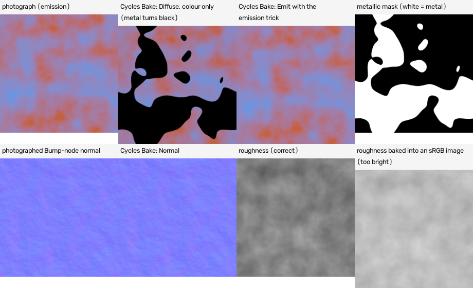

### 2.3 Colour space, bit depth, view transform (where data silently goes wrong)

Results of `exp2a` and `exp2b`:

| What you do | What comes out (true value 0.511 mean roughness, or 0.5 test value) |
|---|---|
| Bake Roughness into an image set to **Non-Color** (byte or float) | 0.5113 (error 0.001 byte, 0.0 float): **correct** |
| Bake Roughness into an image set to **sRGB** (byte **or** float) | **0.7422**: Blender encodes the baked value with the sRGB curve (error 0.23) |
| Bake Emit colour into an **sRGB** image | correct (error 0.0011 to 0.0014) |
| Bake Emit colour into a **Non-Color** image | too dark (error 0.27): colour stays linear in a file that viewers read as sRGB |
| `image.save()` of a float image holding 0.5 | 0.5 in the file, whatever the colour space |
| `image.save_render()` with Standard or AgX, **sRGB** image | converts: 0.498 (Standard), 0.498 (AgX); with **Raw**: 0.2157 (sRGB image) |
| `image.save_render()`, **Non-Color** image, any view transform | 0.5 (8-bit 0.502): Non-Color data skips the view transform |

Rules that follow (TESTED): **colour pictures: sRGB image, saved as 8-bit PNG (or 16). Data pictures (height, roughness, metallic, ambient occlusion, normal, packed ORM): Non-Color image, saved with 16 bits.** In the Image Texture node of a material, set colour space Non-Color for data (Node Wrangler's Principled setup does this automatically: it sets `is_data` for everything except the base colour).

Poly Haven's rule says "All maps should be 16-bit sRGB PNGs"; read that as "PNG files, 16 bits"; data maps are still data (Non-Color in the material).

### 2.4 Anti-aliasing: samples and the pixel filter

**TESTED** on a hard diagonal edge (64 x 64), error = average distance from the exact pixel coverage on the edge pixels:

| Setting | Photograph (render) | Cycles Bake |
|---|---|---|
| Box 1 px, 1 sample | 0.516 (pure black or white pixels: jagged) | 0.516 |
| Box 1 px, 4 samples (the harness setting) | 0.171 | 0.171 |
| Box 1 px, 16 samples | 0.062 | 0.061 |
| Box 1 px, 64 samples | 0.027 | 0.029 |
| Blackman-Harris 1.5 px (the default of a new scene), 4 samples | 0.171 **and 63 pixels away from the edge are blurred** | n/a |
| Gaussian 1.5 px, 64 samples | 0.029 but **259 pixels** touched by blur | n/a |

- **The render's pixel filter blurs data pictures** (default Blackman-Harris 1.5 px). Use Box 1.0.
- **A Cycles Bake ignores the pixel filter completely** (Blackman-Harris 16 samples gave exactly the same error as Box 16 samples). Only the sample count matters.
- **The harness's 4 samples leave staircase edges** (error 0.17). 16 samples cut it to 0.06; 64 to 0.03. Cost at 1254 x 1254 (detail-8 noise, 2 threads): 8.7 s per picture at 16 samples and 34.9 s at 64 (3D); 12.1 s and 46.5 s (4D donut). Smooth patterns (noise) do not need more than 4 to 8; **hard edges (bricks, outlines, stones) deserve 16 to 32.**

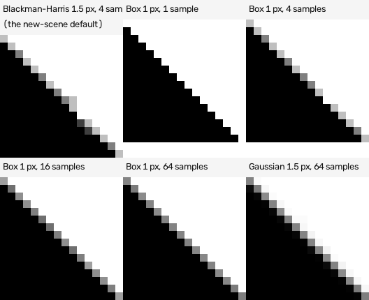

### 2.5 Margin (bleed), UV scaling, which coordinate

- **Margin** matters only when the UV island does not fill the picture. TESTED with an island covering the middle 25% of the picture: Margin 0 fills exactly 25% of the pixels; **Margin 8, Extend** fills 8 more pixels all round (31.4%); **Margin 32** fills 53%; **Adjacent Faces** fills only where a neighbouring face exists (29.0% for margin 8, because the lone island has no neighbours). For a tile whose UV covers 0..1 exactly, margin is irrelevant.
- **UV scale** (what the UV layout does to resolution): a UV island that covers only part of the picture wastes pixels (an island half as wide as the picture gets half the pixels across), and a UV layout stretched in one direction bakes stretched pixels. The margin test above is the only part of this that was run; the stretch is NOT TESTED. For a tile: unwrap to exactly 0..1 in both directions with no stretch.
- **Which texture coordinate (TESTED, 256 px, 3D noise):** UV and Object coordinates gave identical pictures on the 1 x 1 square (difference 0.0000) and, when the square was stretched to 2 x 1 by its Object scale, still the same pattern (0.0016): Object means the object's own local coordinates, so object scale does not change it. **Generated gave a different picture (difference 0.075)**, a different slice of the 3D noise (we did not check which z value a flat plane gets). **Rule: use UV for everything that will be baked.** Do not use World coordinates, which move with the object (NOT TESTED, expected).
- **Image Texture Extension must be Repeat** when a baked picture is reused in a Bump node. TESTED on a picture that tiles: normal-map seam ratio **0.46 with Repeat**, **1.43 with Extend and with Mirror**, **105.9 with Clip**.

### 2.6 High-poly to low-poly (selected to active)

TESTED with a bumpy surface of known exact normals (a sum of waves; 256 x 256 vertices; 256 px picture): Cycles Bake > Normal, bumpy mesh selected, flat UV square active, "Selected to Active" on, Cage off: error 0.0017 (the photographed geometry gave 0.0008), 0.2 s.

**Two settings must be right, found by breaking them (TESTED):**

| Extrusion | Max Ray Distance | Pixels left flat | Normal error |
|---|---|---|---|
| 0.0 (the default) | 0 | **50%** | 0.032 |
| 0.01 | 0 | 19% | 0.013 |
| **0.1** (more than the bumps are high) | **0** (unlimited) | 0% | **0.0017** |
| 0.1 | 0.01 or 0.05 | **100%** | 0.063 |

**Extrusion** is how far above the low mesh the rays start; it must exceed the tallest bump. A **Max Ray Distance** of 0.05 with an Extrusion of 0.1 left 100% of the pixels flat, so the limit seems to be counted from where the ray starts (inferred from this result, not read in the manual): keep it larger than the extrusion plus the bump height, or leave it at 0 (no limit). (Manual: with Cage off, use Extrusion and Max Ray Distance; with Cage on, Cage Extrusion.)

### 2.7 Geometry: photograph it, and one trap

For a surface made of real geometry (stones, rivets, planks from Geometry Nodes, curves, modifiers) the harness building blocks work from above: an emission shader showing `Geometry > Normal` (x 0.5 + 0.5) gives a normal map; `Geometry > Position > Z` gives a height map.

**TESTED against an exact formula (256 px):**

| Mesh | Normal error |
|---|---|
| 64 vertices across the tile | 0.0088 |
| 128 | 0.0025 |
| 256 (one vertex per pixel) | 0.00078 |
| 512 (two per pixel) | 0.00042 (but 3.0 s instead of 0.8 s) |
| 256, mesh reaching 6% past the tile edge | 0.00077; two-pixel border 0.00078 (vs 0.0013 when the mesh stops exactly at the edge) |
| height from Position Z (256, past the edge) | 0.00074 of the full height range |

**Rule: at least one vertex per pixel, and let the mesh reach a little past the tile edge** (the edge vertices' normals are one-sided).

**The Geometry Nodes trap (TESTED, a real failure first):** a mesh made **from nothing** in Geometry Nodes (a Grid node) **ignores the material in the object's data slot**. The photograph came out black (normal error 0.659). Two fixes both worked (error 0.00077): add a **Set Material** node inside the node group, or set the object's material slot to link **Object** instead of Data.

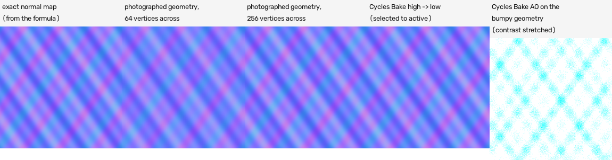

Ambient occlusion: bake it on the bumpy geometry (or the high-poly), not on a flat square with a Bump node (2.2).

### 2.8 The Geometry Nodes Bake node

**What it is, in one sentence:** it saves the result of a part of the node tree (geometry, attributes, other data) so it need not be recomputed. It does **not** write a texture picture. INSPECTED (not run): the node's inputs are a Geometry plus extra "bake items"; the manual says "The Bake node allows saving and loading intermediate geometries"; bake items list socket types including Image as a datablock reference, not pixels. To turn Geometry Nodes output into pictures, use route A or B above.

### 2.9 Route D: the compositor

**TESTED** (height picture in, normal map out, in the node editor only): Image node (Non-Color) > four **Translate** nodes (shift by one pixel with **Extension X and Y = Repeat**, Interpolation Nearest) > Math nodes for the central slope and the length > Combine Color > Group Output. Result: **identical to numpy** (average error 0.00000 against the Sobel normal map of strength 5.33). Things found by failing:
- In 5.2 the compositor defaults to **GPU** and **crashed** on this machine without a graphics card ("Couldn't open libEGL.so.1"). Set `scene.render.compositor_device = 'CPU'` and `compositor_precision = 'FULL'` (AUTO may use half-float).
- Translate options in 5.2 are **menu sockets** named `Interpolation`, `Extension X`, `Extension Y` (values like 'Nearest', 'Repeat'), not node properties.
- **Sign trap:** Translate moves the picture, not the sample point: X = +1 puts the pixel's **left** neighbour under it, Y = +1 puts the neighbour **below** under it. My first attempt had red and green both inverted (error 0.021); the corrected version has error 0.00000.
- `CompositorNodeMath` no longer exists; the ordinary shader Math node works in compositor trees.
- The compositor's **Filter** node has only an Image input, a Factor and a Type menu and one output picture; its Sobel type very probably gives one unsigned edge-strength picture, which could not make a normal map. NOT TESTED (not run).

---

## 3. Height to normal, OpenGL versus DirectX, displacement

### 3.1 The Bump node (what Blender does for you)

**What it does in one sentence:** it makes a tilted surface direction from a height value by comparing the height at the pixel with the height at two nearby points.

Inputs (manual, 5.2): **Strength** (0 = no bump, 1 = full bump; above 1 it keeps multiplying, tested up to 5), **Distance** (multiplier of the height; default 0.001), **Filter Width** (in pixels; default 0.1), Height, Normal; property **Invert**.

**TESTED:**
- **Distance is how tall a height of 1.0 is, measured in tile widths** (the tile is 1 wide). Example: Distance 0.02 on a 256-pixel picture gives the same normal map as the plain slope filter of strength 0.02 x 256 = 5.12 (the best fit was 5.46). General rule, TESTED: on a picture of N pixels, the Bump node with Distance d equals a plain slope filter of strength s = d x N within 4 to 8%: fitted s / (d x N) = 1.043 at 512 px, 1.066 at 256, 1.082 at 128 (the node samples the true function a fraction of a pixel away, the filter uses neighbouring pixels). The harness uses `bump_distance = strength / size`.
- **It does not depend on the picture size.** A normal map made at 512 px, shrunk to 128, differs from one made at 128 by only 0.0007.
- **Strength multiplies Distance** for gentle slopes: Distance 0.04 / Strength 1 versus Distance 0.02 / Strength 2: difference 0.0001; Distance 0.1 / Strength 1 versus Distance 0.02 / Strength 5: 0.0007.
- **Invert** is an exact mirror of red and green about 0.5.
- **Filter Width** acts like a bevel on hard edges (the release notes of 4.5 say so). On brick edges: width 0.1 gives edges 13 pixels wide that tilt at most 41 degrees; width 1.0 gives 24 pixels and 78 degrees; width 2.0 gives 40 pixels and 75 degrees (mean tilt 4.1, 17.8, 29.5 degrees). Keep 0.1 unless you want a bevel.

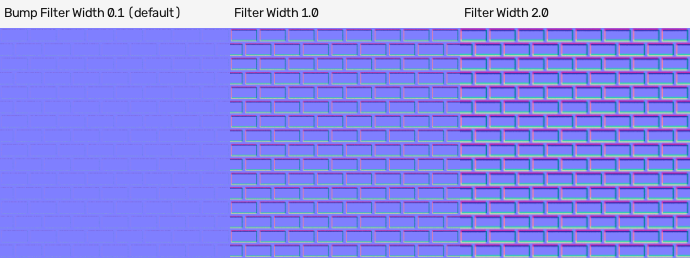

### 3.2 Three ways, same result

| Way | How | Matches |
|---|---|---|
| Bump node, photographed | `bake_harness.show_channel_material(group, 'NormalBump', d)` (Section 2.1) | equals Cycles Bake > Normal within 0.00008 |
| numpy, slope filter | `nx = -s dh/dx`, `ny = +s dh/dy_down`, `nz = 1`, normalised; per-pixel central differences with wrap-around | the project's `normal.png` |
| Compositor (2.9) | Translate + Math | exactly the numpy one |

In the project's numpy convention: `dh/dx` = (right neighbour minus left neighbour) / 2 and `dh/dy_down` = (below minus above) / 2 on a 0..1 height, then `n = normalize(-s dx, +s dy_down, 1)`, stored as `n x 0.5 + 0.5`. Rows run top to bottom, so "up the picture" is minus the row direction; that is why green gets a plus sign.

### 3.3 What strength did the reference maps use?

`reference_normal_recipe_fit.py` (TESTED, all six surfaces). Each reference `normal.png` was rebuilt from its **8-bit `height_as_uploaded.png`** with the central-difference filter above and the strength searched for:

| Surface | Best strength | Average error (8-bit steps) |
|---|---|---|
| brick | **6.00** | 0.52 |
| slate | **7.02** | 0.53 |
| wood | **7.99** | 0.51 |
| metal | **5.00** | 0.52 |
| mud | **9.00** | 0.51 |
| gravel | **9.99** | 0.51 |

An error of 0.5 steps is rounding to 8 bits: **the reference normal maps are the slope of their uploaded 8-bit height maps with whole-number strengths 6, 7, 8, 5, 9, 10.** The 3 x 3 Sobel kernel fits worse (error 1.6 to 3.3 steps). With the smoothed 16-bit `height.png` the fitted strengths are 7.3, 8.2, 9.7, 5.9, 10.6, 11.6 and the agreement is only 0.96 to 0.98, because smoothing changes the slopes. **Consequence for the builders:** a height map with the same 0..1 contrast as `height_as_uploaded.png` and the strengths above will reproduce the reference normal maps; the harness's search for a strength from the slope spread finds the equivalent number for a different height contrast.

### 3.4 OpenGL versus DirectX: how to tell

**One sentence:** in OpenGL (Blender, Unity, Maya, Marmoset) the green channel is brighter where the surface tilts toward the top of the picture; in DirectX (Unreal, 3ds Max, many game exports) it is the other way round.

Three ways, all TESTED on the six references and on our own maps (`normal_map_tools.py`):

1. **With the height map next to it** (best): correlate green with the height's slope down the picture. OpenGL gives about **+0.94** (and red about -0.94); DirectX gives -0.94. All six references: `normal.png` = OpenGL (+0.93 to +0.95), `normal_as_uploaded_directx.png` = DirectX (-0.93 to -0.95).
2. **From the normal map alone** (no height): real slopes obey "slope in x changes down the rows exactly as slope in y changes along the columns", with a sign set by the green convention. The correlation of those two changes is **-1.00 for OpenGL and +1.00 for DirectX**: tested on all six reference pairs (-1.00 and +1.00 exactly), on the Bump node maps (-0.78 at 128 px, -0.83 at 256, -0.96 at 512), the Cycles Bake (-0.82), the compositor map (-1.00). It says "cannot tell" for flat or noisy maps. **Blind spot (found by testing):** it only sees red versus green. A map with **both** red and green flipped (a sunken instead of raised surface) reads as OpenGL. Keep the height map to check that.
3. **By eye**: a raised feature (a brick, a rivet, a bump) has a light-green upper edge and a darker lower edge in OpenGL. NOT TESTED by a person here (the maths above is the automated version).

**Doing something about it:**
- Blender 5.2 Normal Map node has a **Convention** property (OPENGL by default, or DIRECTX; TESTED by listing, confirmed in the manual: "Blender uses the OpenGL convention by default for rendering and baking... DirectX can be used for normal maps from other software"). Older versions needed Separate Color, 1 minus Green, Combine Color (from a search summary; not checked).
- Flip a file: green = 1 minus green (`pack_pbr_channels.py flipgreen`, TESTED round trip: exact).
- Bake DirectX directly: Bake > Normal swizzle **G = -Y** (TESTED).
- **Node Wrangler** (Principled Texture Setup, Shift-Ctrl-T) skips normal-map files whose name contains `dx` or `directx` (read in the 5.2 source), so name DirectX files `..._nor_dx.png` and OpenGL ones `..._nor_gl.png`.

### 3.5 Displacement, Bump, or both in Cycles

**Where the setting lives:** Material Properties > Settings > Surface > **Displacement** (`material.displacement_method`): **Bump Only** (default!), **Displacement Only**, **Displacement and Bump**. Connecting a Displacement node does nothing visible until you change it from the default Bump Only.

**TESTED (low-angle render of a noisy surface, 512 x 512 grid):**

| Method | How bumpy is the far silhouette (pixels) | Shading spread | Time |
|---|---|---|---|
| Bump | 0.16 (straight) | 0.098 | 3.6 s |
| Displacement | 3.1 | 0.098 | 2.1 s |
| Both | 3.1 | 0.100 | 3.6 s |

Bump changes only the shading; only true displacement moves the outline and gives self-shadowing (manual: "Surface silhouettes will not be accurate and there will be no self-shadowing"). Both = coarse displacement plus bump for fine detail; once the mesh is very fine the manual says use Displacement only.

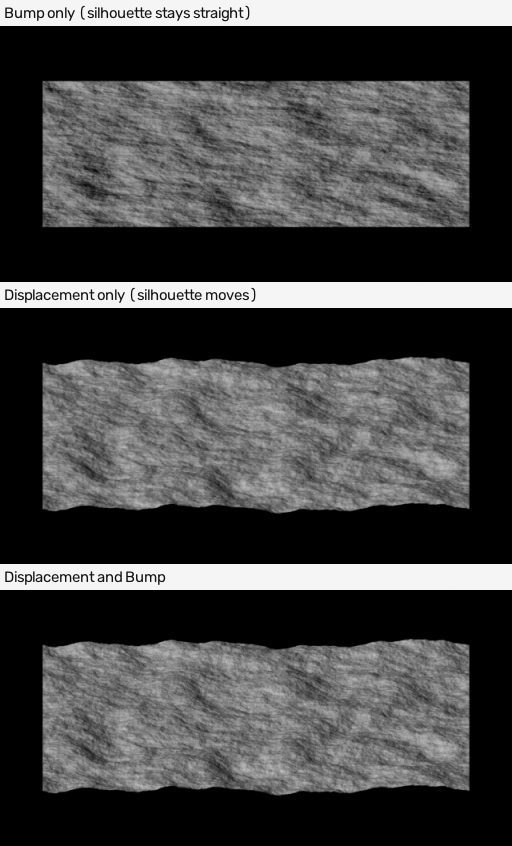

**Midlevel, Scale and Space (TESTED, edge-on measurements within 0.0004):** displacement distance along the normal = **(Height - Midlevel) x Scale**. Height 0 or 1 with Midlevel 0.5, Scale 0.1: -0.0498 and +0.0502. Midlevel 0: 0.0002 and 0.1003. Midlevel 1: -0.0998 and 0.0002. Scale 0.2: -0.0998 and +0.1003. Defaults: Midlevel 0.5, Scale 0.01. **Space = Object** scales the displacement with the object (object stretched x2 in z: +-0.1 instead of +-0.05); **World** ignores the object's scale (+-0.05). Midlevel is "the grey that means no displacement"; a map normalised to 0..1 (Poly Haven's rule) with Midlevel 0.5 sinks and raises equally; Midlevel 1.0 (white = flush) makes the surface only sink.

**How fine must the mesh be (TESTED, fine noise, 640 px render; the inside shading spread is the detail kept):**

| Mesh | Detail kept (shading spread) | Time |
|---|---|---|
| static grid 16 x 16 | 0.038 | 1.8 s |
| 64 x 64 | 0.109 | 1.9 s |
| 256 x 256 | 0.160 | 2.1 s |
| 1024 x 1024 (1 million faces) | 0.164 | 3.9 s |
| **adaptive subdivision**, Dicing Rate 8 | 0.131 | 1.8 s |
| adaptive, Dicing Rate 2 | 0.1615 | 2.2 s |
| adaptive, Dicing Rate **1** (the render default) | 0.1635 | 2.9 s |
| adaptive, Dicing Rate 0.5 | 0.1627 | 5.2 s |

**Adaptive subdivision in 5.2:** tick **Adaptive Subdivision** on the object's **Subdivision Surface** modifier (Cycles only; since Blender 5.0 it is no longer an Experimental feature; 5.0 also added an Object-space edge-length option next to Pixel Size). Render > Subdivision: **Dicing Rate Render 1.0** px (viewport 8.0), Offscreen Scale 4, Max Subdivisions 12 (TESTED defaults). A plain 2 x 2 quad plane with the modifier reached the detail of a 1-million-face grid at about the same time. Dicing Rate 8 loses detail; 2 is nearly as good as 1; 0.5 doubles the time for no gain. `Material.max_vertex_displacement` (default 0) is the largest distance a vertex may move; the API says "displacements over this threshold may cause visibility issues" (NOT TESTED).

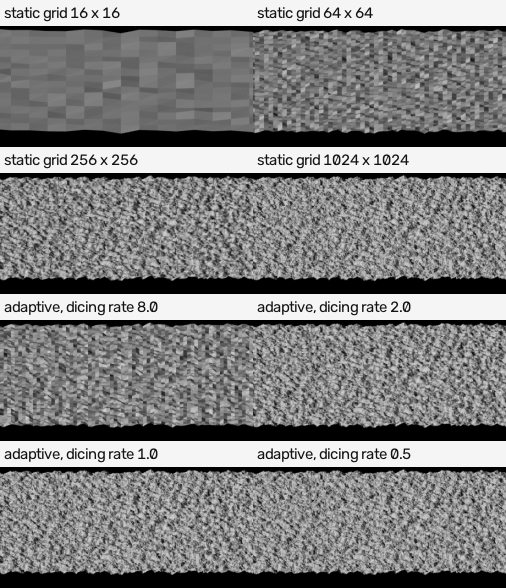

**8-bit height images (TESTED):**
- A gentle ramp that uses only 40% to 60% of the grey range gives **54 grey levels in 8 bits** and thousands in 16 bits.
- **Bump normal map from an 8-bit picture:** 53% of pixels have exactly zero x tilt (terraces) versus 1.4% for a float picture and 0.9% for a 16-bit one; average error 0.0086 (Linear), 0.0074 (**Cubic**), 0.0092 (Closest) versus 0.0028 for 16-bit. The manual's advice "use Cubic interpolation to avoid stepping artifacts" is **partly true**: flat pixels fell from 53% to 32%, not to 1%. The real fix is a 16-bit or float picture.
- **A numpy normal map from an 8-bit height** (strength 30): 18.1% of pixels with zero horizontal slope versus 0.1%, error 0.0068 versus 0.0000.
- **True displacement from an 8-bit ramp** (Scale 2): the displaced edge shows steps (distance from a smooth curve 0.82 px against 0.43 px for 16-bit). Terraces matter when the height uses a small part of the range with a large Scale; the manual says 16- or 32-bit float for true displacement.

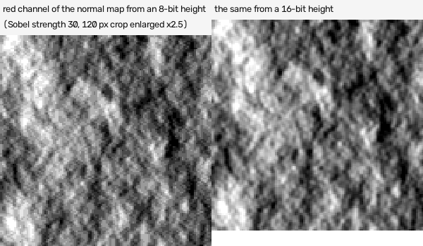

**Normal Map node and displacement (release notes, NOT TESTED):** since 5.0 the node uses the undisplaced normal and tangent when displacement is on; 5.1 added **Base: Original / Displaced** (Original = a normal map that matches a displacement map; Displaced = detail on top of displacement). In the 5.2 default node it is **Displaced** (TESTED by reading the default).

---

## 4. How studios and artists export PBR sets, and the add-ons

### 4.1 Names, maps, bit depth, size

| Source | What it says |
|---|---|
| **Poly Haven** wiki "Texture Requirements" (fetched 19 Oct 2026, page undated) | Maps: diffuse/albedo, roughness, **normal (OpenGL)**, displacement, AO, metalness if it applies. **All maps 16-bit PNG** "achieved without simply converting lower bit-depth data to a higher one". **Displacement normalised to 0..1**, true depth recorded separately. Minimum 8192 x 8192, "seamless on all axes". Names `name_suffix.png`, lower case, letters, digits and underscores only: **`diff`, `rough`, `metal`, `nor_gl`, `nor_dx`, `disp`, `ao`, `arm`** (packed AO, roughness, metallic; made automatically), `alpha`, `emission`, `mask`. No resolution in the file name. Non-square tiles 2:1 allowed. |
| **ambientCG** (docs fetched 19 Oct 2026; file names seen only second-hand) | Procedural materials there "usually" come from Substance 3D Designer. File names like `Metal009_2K-PNG_Color.png`, `_NormalGL`, `_NormalDX`, `_Roughness`, `_Displacement`, `_AmbientOcclusion`, `_Metalness` are reported by third-party pages (a Babylon.js forum thread, a Qt example folder, an s&box wiki note advising NormalGL for OpenGL engines). NOT verified on ambientCG's own page. |
| **glTF 2.0 and Blender's glTF exporter** (Blender 5.2 manual, TESTED by reading) | One picture holds roughness in **green** and metallic in **blue**; ambient occlusion goes in **red** and "may optionally share the same image". Normal map tangent space, +Y up. Images PNG or JPEG. Image Texture node set to Non-Color. |
| **Unreal Engine** (community guides, not Epic's page) | The usual "ORM" map: R ambient occlusion, G roughness, B metallic; switch **sRGB off** on that texture; BC7 compression suggested. |
| **Unity HDRP** (The Bakery's presets) | "Mask Map": R metallic, G occlusion, B detail mask, A smoothness (= 1 - roughness); DirectX normals for Unity URP and HDRP presets in that add-on. |
| **Substance 3D Painter** | Has export presets "PBR Metallic Roughness", "Unreal Engine (Packed)", "Unity HD Render Pipeline (Metallic Standard)"; the page does not list the channels. |

**Resolution:** powers of two (1024, 2048, 4096) are what engines like; the reference tiles are 1254, which Blender handles fine and some engines resize (the checker says so). **Bit depth:** 16-bit PNG for height, normal and (if you want) the rest; 8-bit is normal for colour and for most roughness/metal. **Colour pictures sRGB, everything else Non-Color (linear).**

**Packing (TESTED, `pack_pbr_channels.py`):** `orm` layout (R AO, G roughness, B metallic) and `unity` layout (R metallic, G AO, B 0.5, A 1 - roughness): pack then unpack gives **exactly the same numbers** (difference 0.0) for all three maps; the green flip is exact. The packed picture is data: load it Non-Color.

### 4.2 Add-ons (what they do)

| Add-on | What it does (from its own page) |
|---|---|
| **Node Wrangler** (free, bundled; 5.2 manual and source read) | Not a baker. **Add Principled Setup** (Shift-Ctrl-T): you select texture files, it creates the Image Texture nodes, loads the pictures, sets the colour space (Non-Color for data) and connects them to a Principled BSDF by looking at file-name words (editable in preferences): base colour `diffuse diff albedo base col color basecolor`; metallic `metallic metalness metal mtl`; normal `normal nor nrm nrml norm`; roughness `roughness rough rgh`; displacement `displacement displace disp dsp height heightmap`; AO `ao ambient occlusion`; skips `dx` / `directx` normals. **Preview Node Output** (Shift-Ctrl-click) is a quick way to look at one channel. |
| **SimpleBake** (Superhive/Blender Market, Blender 5.0 to 5.2 per its page) | One-click bake of PBR maps (diffuse, metalness, roughness, normal in OpenGL or DirectX, emission, alpha) and all standard Cycles bake modes plus AO, curvature, thickness, colour ID, vertex colour, lightmap; **channel packing** into R, G, B, A (ORM-style); file names from a format string (object, bake type, resolution, blend name, frame); UDIM; exports FBX/OBJ/glTF/DAE with the materials linked; a glTF settings group for AO. |
| **The Bakery** (Superhive, Blender 4.5 LTS or newer) | Bakes any node material to Base Color (sRGB), Roughness, Metallic, Occlusion, Normal, Height, Emission and Alpha; **packs per engine preset**: Unity URP, Unity HDRP (Metallic / Occlusion / Detail / Smoothness), glTF ORM with OpenGL normals, USDZ separate maps; exports FBX, glTF, GLB, USD, USDZ, OBJ. Its page does not say how tiling is achieved. |
| **SeamlessTex** (Superhive, v1.2.2, Blender 4.2 to 5.2) | Procedural material to Base Color, Roughness, Metallic, Normal, Height; 4K bake plus automatic 2K and 1K copies; JSON file listing each map and its colour space; **height to normal with a numpy Sobel filter**; tile correction modes **None**, **Edge Blend** (cross-fade with a half-offset copy near each border, 64 px default) and **Mirror Tile** (2 x 2 mirror, four times the memory). Its claim that Noise / Voronoi / Wave "wrap on integer UV boundaries" is wrong (Section 1). |

---

## 5. Checklist: is my texture really seamless and correct?

For a person, not a programmer. Do the steps in order. Each has a command to run (copy it, change only the folder name) and says what you should see.

**Folder:** put your pictures in one folder with these names: `colour.png`, `normal.png`, `height.png`, optionally `roughness.png`, `metallic.png`, `ao.png` (or `orm.png`). Other accepted names are listed at the top of the script.

**Command (run in a terminal; no Blender needed):**
```
python3 -I "/tmp/claude-0/-home-user-Music/02fc5154-76f5-5aac-a505-860164e7e921/scratchpad/proc-work/research/experiments_seamless_tiles_and_baking/check_texture_set.py" YOUR_FOLDER
```
It prints one line per check starting with **PASS**, **WARN** or **FAIL** and saves three pictures in the folder.

1. **Open `tile_check_shifted.png`.** Look for a cross (a vertical and a horizontal line) in the middle. **A cross = a seam. No cross = good.** Do the same with `tile_check_normal_shifted.png`.
2. **Open `tile_check_2x2.png`.** Look for repeats that stand out: a very dark patch, a flower-like shape or a brick that appears four times in a row.
3. **Read the SEAM lines.** PASS is 1.5 or less. A WARN between 1.5 and 3 is normal for hard-edged painted tiles (the project references score 1.1 to 2.5); trust your eyes in step 1. FAIL (above 3, or the peak above 3.5) means a real seam.
4. **Read the NORMAL lines.** You want: arrow length 1.0; average colour (0.5, 0.5, 1.0); "OpenGL ... the Blender convention"; "agrees with the height map" (green about +0.9, red about -0.9). If it says DirectX, flip the green channel or set the Normal Map node to DirectX.
5. **Read the HEIGHT lines.** You want 16 bits, uses most of 0..1, almost no clipping, thousands of grey levels. 8 bits or "terraces" means stair steps.
6. **Read ROUGHNESS / METALLIC / AO.** Metal should be mostly 0 or 1. **AO plain white = FAIL** (it was baked from a flat square). If roughness looks much lighter than expected (average 0.74 where you expected 0.5) it was saved in the wrong colour space.
7. **If you made the recipe yourself, also run the exact test** (needs Blender):
```
/home/user/work/blender-app/blender-5.2.2-linux-x64/blender -b --disable-autoexec -t 2 --python "/tmp/claude-0/-home-user-Music/02fc5154-76f5-5aac-a505-860164e7e921/scratchpad/proc-work/research/experiments_seamless_tiles_and_baking/recipe_tiling_test.py" -- YOUR_RECIPE.py --size 256
```
   Every output should say `PASS: repeats exactly`. A FAIL on a colour made of random brick or tile numbers can be a false alarm (1.1); look at the pictures.
8. **Last, look in Blender:** make a plane, array it 3 x 3 (or set the Mapping node scale to 3), apply colour, normal (Non-Color, Normal Map node, convention OpenGL), roughness and light it from a low angle with a sun lamp. Seams and flipped normals both show immediately.

**How the checker behaved when tested:**
- On `out/example_good_set` (our recipe photographed): 18 PASS, 1 WARN (the heights use only 0.28 to 0.73 of the range), 0 FAIL.
- On `out/example_broken_set` (spoiled on purpose: a seam, a DirectX normal, an 8-bit clipped height, white AO, grey metal): **it found all of them**: FAIL colour seam (ratio 11.2), WARN DirectX normal, WARN 8-bit height, WARN clipping, WARN grey metal, FAIL white AO; 13 PASS, 6 WARN, 2 FAIL. It did **not** detect the roughness saved in sRGB (a value of 0.74 looks plausible); it only reminds you.
- On the real references (`brick`, `slate`, `metal`): 0 FAIL; it flags WARN on the hard-edged seam ratios (1.7 to 2.2, which is how those tiles score), reports the normal maps as OpenGL, agreeing with the height (+0.94 / -0.93), and gives Sobel strengths of 7.2 (brick), 6.0 (metal) against the smoothed 16-bit height.

---

## 6. Tested here (what was run, and what happened, failures included)

All in `experiments_seamless_tiles_and_baking/`; outputs in `out/`. Blender 5.2.2 LTS, Cycles CPU, `-t 2`.

| Script | What it did | Result |
|---|---|---|
| `exp1_pattern_seams.py` + `measure_seams.py` + `measure_periodicity.py` | 36 patterns, each photographed unmoved and moved by whole tiles; seam ratio, peak, mirror tell, exact shift test | Table 1.2. **Surprises:** seam ratio gave a false alarm on Checker 8 and a sawtooth and a false pass on Checker 7; Brick colour breaks with whole numbers; hand-made brick hash first failed the shift test because I wrapped only the column, not the row (fixed: row wrapped too, then passes) |
| `repair_seams_in_pictures.py` | three picture repairs on four non-tiling pictures | Section 1.8. My first "periodic plus smooth" made seams worse (39.3): the sign of the Poisson solution was wrong; fixed (0.77) |
| `mirror_normal_pitfall.py` | naive mirrored normal map versus correct | red off by 0.12, green by 0.11 |
| `exp2a_colour_space_and_bit_depth.py` + `analyse_png_depth_and_edges.py` | what `save` and `save_render` write; view transforms; 8 versus 16 bit; pixel filters | 2.3, 2.4. A new scene is AgX and Blackman-Harris 1.5 |
| `exp2b_cycles_bake_vs_photograph.py` | Diffuse, Emit, Roughness, Normal, AO, colour space, edge, margin vs photograph | 2.2 to 2.5 |
| `exp2d_geometry_routes.py` | photograph geometry, high to low bake, AO, Geometry Nodes | 2.6, 2.7. **First attempt rendered black** (the data-slot material trap); high-to-low with extrusion 0 or limited ray distance fails |
| `exp2e_speed_and_coordinates.py` | seconds per photograph; UV versus Generated versus Object | 2.1, 2.5. A first version crashed in my comparison code (no result lost: the timing was rerun) |
| `exp2f_normal_swizzle.py` | G = -Y; object versus tangent space on a flat square | DirectX by swizzle exact; object space equals tangent space on a flat +Z square |
| `exp3_height_to_normal.py` + `exp3_analyse.py` | Bump Distance/Strength/Filter Width/Invert; compositor route; reference normal maps; bit depth | 3.1 to 3.4. **Compositor failed three times** before working: `wrap_axis` is not a property in 5.2; the GPU device crashed headless; my Translate signs were reversed |
| `exp3b_image_extension_seam.py` | Image Texture Extension settings and the normal map seam | 2.5 |
| `exp4_displacement.py` + `analyse_displacement_pictures.py` | Midlevel / Scale / Space, methods, mesh fineness and adaptive, 8-bit heights, Cubic | 3.5. **First version measured the wrong thing** (a solid slab with walls bent the silhouette for negative displacement: 0.0352 instead of 0.05); redone edge-on on a flat sheet. First 8-bit tests were invalid because `bake_harness.save_array_png` writes **only the red channel for a 2-D array** (green and blue stay 1.0); fixed by passing height x width x 3 |
| `reference_normal_recipe_fit.py` | how the reference normal maps were made | strengths 6, 7, 8, 5, 9, 10 |
| `check_texture_set.py` + `make_example_sets.py` | the plain-words checker on a good set, a spoiled set and real references | 5 |
| `recipe_tiling_test.py` + `test_recipes/broken_recipe_raw_noise.py` | the exact test on a good and a broken recipe | PASS / FAIL as expected |
| `pack_pbr_channels.py` | ORM and Unity packing round trip, green flip | exact |
| `tileable_pattern_groups.py` + `test_recipes/bricks_and_wave_recipe.py` | ready-made seamless brick and wave node groups, checked with the exact test | all four outputs PASS. First version had mortar and brick colours swapped in my example recipe (fixed before the final run) |

---

## 7. NOT TESTED (said only by sources, or not tried)

- Cycles Bake on a GPU; EEVEE; Blender 5.1's Normal Map node Base option on a matching displacement map; Multires bake (Normals / Displacement) and vertex-colour bake; UDIM tiles; Combined bake; Alpha bake.
- The Geometry Nodes Bake node was inspected, not run.
- 4D donut for non-square tiles; Voronoi features other than F1 (Smooth F1, N-sphere radius) on the donut; Gabor in 3D; 4D donut inside Geometry Nodes' own Noise node.
- Material Displacement bounds (`max_vertex_displacement`), instancing with adaptive subdivision, dicing with several objects.
- Whether a human reads the "light-green upper edge" cue the same way (the maths was tested).
- ambientCG's own file names; Unreal's and Unity's own documentation of channel order (second-hand sources and The Bakery's presets); Substance preset channel layouts.
- The behaviour of SimpleBake, The Bakery and SeamlessTex themselves (add-ons were not installed; only their pages were read).
- A repair such as "Edge Blend" with 64-pixel borders as SeamlessTex does it (we tested a similar offset-and-blend and a periodic-plus-smooth).

## 8. Claims checked: wrong, out of date, or confirmed

1. **"Noise / Voronoi / Wave wrap on integer UV boundaries"** (SeamlessTex documentation, 2026): **false** for all three (seam ratios 20.5, 34.6, 24.4; fails the exact test).
2. **"Procedural materials are tileable when baked on a 1 x 1 plane with UV 0..1"** is only true if the recipe itself repeats every 1.0; the bake just samples it.
3. **"Use Cubic to avoid stepping with 8-bit bump images"** (Blender manual): only partly true (53% to 32% flat pixels; 16-bit fixes it).
4. **Default new-scene settings are wrong for texture work** (AgX view transform, Blackman-Harris 1.5 px): corrupt data values and blur edges.
5. **Any rule of the form "a whole-number Scale makes it tile"** (the same idea as claim 1): false for Noise, Voronoi, Wave (tiles only at k x pi/10) and Magic (k x 2 pi/5); Checker needs an even Scale; Brick needs whole counts of bricks and rows and still breaks its random colours.
6. **Older tutorials need OSL for 4D noise** (Urho3D wiki, Blender 2.7x era): not needed; Blender 5.2's Noise node has a 4D mode.
7. **A mirrored normal map is "seamless and fine"**: seamless but wrong lighting in the mirrored copies unless red and green are fixed.
8. **CONFIRMED (not wrong):** the CG Cookie / bug-report advice to bake colour with Emit when there is metal.
9. **`Adaptive subdivision is Experimental`** (Blender 4.x): no longer in 5.0 and later (release notes); worked in 5.2 with no experimental setting.

---

## 9. Recipe cards (short)

**Card 1: Seamless noise.** Texture Coordinate UV > donut (cos/sin of 2 pi u and v) > Noise Texture **4D**, Vector and W, radius Scale / 2 pi > Fac. Use `rt.tileable_noise_group()`. Tiles at any Scale, Detail, Roughness, Distortion; Voronoi: `rt.tileable_voronoi_group()`, Scale 4 or more. Cost +30%.

**Card 2: Seamless bricks.** Whole numbers: bricks across = Scale / Brick Width, rows = Scale / Row Height, rows a multiple of 2 (and of the Squash Frequency); Squash x width must also divide. Use Factor only; colour from a tileable noise, or simply use `tpg.tileable_bricks_group()` from `tileable_pattern_groups.py` (tested: wrapped brick numbers, so the random colours tile too).

**Card 3: Seamless waves and lines.** Wave Scale = k x pi/10, Distortion 0; bend with `u + d x (tileable noise - 0.5)` on the coordinate. Magic Scale = k x 2 pi/5. Checker even Scale. Never Wave Rings, Gradient (plain), Gabor.

**Card 4: Last-resort repair.** Inside a recipe: cos/sin cross-fade of four shifted copies. On a picture: offset and blend (noise) or periodic plus smooth; mirror only if symmetry is acceptable and the normal map is rebuilt from the mirrored height.

**Card 5: Photograph a flat tile.** Orthographic camera over a 1 x 1 square with UV 0..1; emission shows one channel; Box 1.0 px; **view transform Standard for colour, Raw for data**; 16-bit PNG for data; **16 to 32 samples** for hard edges; use UV coordinates.

**Card 6: Cycles Bake of a material.** UV full 0..1; Image Texture node active; colour image **sRGB**, data image **Non-Color**; lower the samples; colour via **Emit** (emission trick); Roughness and Normal directly; metallic via Emit; AO only on real geometry.

**Card 7: High to low bake.** Select high mesh, then the flat low mesh (active), Selected to Active; **Extrusion larger than the tallest bump; Max Ray Distance 0**; swizzle G = +Y for Blender, -Y for DirectX.

**Card 8: Height to normal.** Strength = Bump Distance x picture size. Reference maps: 6 brick, 7 slate, 8 wood, 5 metal, 9 mud, 10 gravel on an 8-bit 0..1 height. Heights saved at 16 bits. Image Texture Extension **Repeat**.

**Card 9: OpenGL or DirectX.** Run the map-alone test or the height test (`normal_map_tools.py`). Blender wants OpenGL (green up). Normal Map node has Convention. Name DirectX files `nor_dx`.

**Card 10: Displacement.** Material > Settings > Surface > Displacement = Displacement Only (or Both). Height - Midlevel (0.5) x Scale; Space Object. Subdivision Surface modifier with Adaptive Subdivision ticked, Dicing Rate Render 1.

**Card 11: Export a set.** `name_diff.png` (sRGB), `name_nor_gl.png`, `name_disp.png` (16-bit, 0..1), `name_rough.png`, `name_metal.png`, `name_ao.png`, optional `name_arm.png` (R AO, G roughness, B metallic). Run `check_texture_set.py`.

---

## 10. Files made

In `experiments_seamless_tiles_and_baking/` (plain-word notes at the top of every file):

- Tools you can use: `check_texture_set.py` (the checklist), `recipe_tiling_test.py` (exact test for a recipe, Blender), `tileable_pattern_groups.py` (seamless bricks / planks and wavy bands as node groups, Blender), `pack_pbr_channels.py` (ORM/unity packing, green flip), `normal_map_tools.py` (OpenGL/DirectX detection, Sobel strength fit), `measure_seams.py`, `measure_periodicity.py`.
- Experiments: `exp1_pattern_seams.py`, `exp2a_colour_space_and_bit_depth.py`, `exp2b_cycles_bake_vs_photograph.py`, `exp2d_geometry_routes.py`, `exp2e_speed_and_coordinates.py`, `exp2f_normal_swizzle.py`, `exp3_height_to_normal.py`, `exp3b_image_extension_seam.py`, `exp4_displacement.py`, `repair_seams_in_pictures.py`, `mirror_normal_pitfall.py`, `reference_normal_recipe_fit.py`, plus `analyse_*.py`, `exp3_analyse.py`, `make_figures.py`, `make_example_sets.py`, `exp_common.py`, and `test_recipes/`.
- Results: `out/pattern_table.txt`, `out/bake/results.json`, `out/geometry/results.json`, `out/colour_space/results.json` and `analysis.json`, `out/normal/analysis.json`, `out/speed/results.json`, `out/displacement/results_*.json`, `out/figures/*.png`.

## 11. Sources

Every source below was actually used. Where a page could not be opened and only a search summary was seen, that is said.

**Blender (primary):**
1. *Blender 5.2 LTS Manual*, bundled copy read through the Blender MCP (`search_manual_docs`), 2026 (5.2 LTS released 14 July 2026). Pages: Render Baking, Brick / Gabor / Wave / Noise / Image texture nodes, Bump, Displacement and Normal Map nodes, Material Displacement, Adaptive Subdivision (Subdivision Surface modifier), Render > Subdivision, Geometry Nodes Bake node, compositing image kernels, Node Wrangler, glTF 2.0. Gave: every setting name and description used here. Online index: https://docs.blender.org/manual/en/latest/ (the Noise page title "Noise Texture Node - Blender 5.2 LTS Manual" was seen online).
2. *Blender 5.0 release notes: Cycles*, https://developer.blender.org/docs/release_notes/5.0/cycles/ (page undated; Blender 5.0). Gave: adaptive subdivision no longer experimental, Object-space option, Normal Map node uses undisplaced normal and tangent.
3. *Blender 5.1 release notes: Cycles*, https://developer.blender.org/docs/release_notes/5.1/cycles/ (undated). Gave: Normal Map node base option (undisplaced or displaced).
4. *Blender 4.5 release notes: Cycles*, https://developer.blender.org/docs/release_notes/4.5/cycles/ (undated). Gave: improved bump correction, **Filter Width** input on the Bump node (bevel-like effect), adaptive subdivision then still experimental.
5. *Blender 5.2 release notes*, https://developer.blender.org/docs/release_notes/5.2/ (and its Cycles, Geometry Nodes, Compositor sub-pages): 5.2 LTS released 14 July 2026; nothing about baking; compositor changes listed.
6. Blender 5.2.2 Python API (`search_api_docs`, live `bpy`): enum lists for bake types, Normal Map convention, Material displacement method, Subdivision modifier adaptive settings, bake defaults.
7. Node Wrangler 5.2 source (`scripts/addons_core/node_wrangler`), read locally: name tags, DirectX skipping.

**Community and vendors:**
8. Poly Haven Wiki, *Texture Requirements*, https://docs.polyhaven.com/en/technical-standards/textures (page undated; read 19 Oct 2026). Gave: map list, 16-bit PNG, OpenGL normal, disp 0..1, suffixes `diff rough metal nor_gl nor_dx disp ao arm`, 8192 minimum, seamless.
9. SeamlessTex documentation, https://superhivemarket.com/products/seamlesstex-procedural-to-seamless-pbr/docs (v1.2.2; undated, "published 21 days ago" on 19 Oct 2026). Gave: the (false) integer-UV claim; tile correction modes; numpy Sobel; multi-resolution.
10. The Bakery documentation, https://superhivemarket.com/products/the-bakery/docs (undated, "published 6 months ago"). Gave: maps, engine presets and their channel packing.
11. SimpleBake page, https://superhivemarket.com/products/simplebake---simple-pbr-and-other-baking-in-blender-2 (undated; Blender 5.0 to 5.2). Gave: bake types, channel packing, naming format, UDIM.
12. OpenGameArt forum, *seamlessly tiled procedural texture generation*, https://opengameart.org/forumtopic/seamlessly-tiled-procedural-texture-generation (date not seen, old; **search summary only**, the page returned an error). Gave: tiling in N dimensions needs 2N-dimensional noise; cylinder trick tiles one direction only.
13. Urho3D wiki, *Creating Seamless Procedural Textures with Blender*, https://urho3d.fandom.com/wiki/Creating_Seamless_Procedural_Textures_with_Blender (Blender 2.7x era; **search summary only**, page blocked). Gave: 4D noise on a Clifford torus with OSL.
14. CG Cookie forum, *Using Emit bake type instead of Diffuse for PBR textures*, https://cgcookie.com/community/11499-using-emit-bake-type-instead-of-diffuse-for-pbr-textures (date not seen; search summary only). Gave: Emit is more accurate than Diffuse for base colour when metalness is involved; no metallic bake type, use Emit.
15. Blender bug report #95973, *Baking diffuse lighting on 100% metallic surface produces black*, https://projects.blender.org/blender/blender/issues/95973 (date not seen; search summary only). Gave: the same trouble reported by a user.
16. Khronos blog, *Art Pipeline for glTF*, Patrick Ryan (Microsoft), 8 January 2018, https://www.khronos.org/blog/art-pipeline-for-gltf. Gave: metallic-roughness workflow context.
17. Adobe, *Substance 3D Painter: Default Output templates*, https://experienceleague.adobe.com/en/docs/substance-3d-painter/using/export/output-templates/default-output-templates/default-presets (undated). Gave: preset names (PBR Metallic Roughness, Unreal Engine (Packed), Unity HDRP).
18. ambientCG documentation, https://docs.ambientcg.com/ (page last modified 28 Feb 2026). Gave: many materials are procedural, usually from Substance 3D Designer. File names from third parties: Babylon.js forum https://forum.babylonjs.com/t/cant-get-pbr-materials-quite-right/44963 and an s&box wiki note (search summaries only; dates not seen).
19. Andrew Dowell, *Unreal Engine - Advanced Channel Packing*, https://andrewdowell.artstation.com/blog/0vAm4/unreal-engine-advanced-channel-packing (undated; search summary only). Gave: ORM with sRGB off.
20. Normal-map convention pages seen as search summaries: CGAxis, *Which normal map should I use, OpenGL or DirectX*, https://cgaxis.com/which-normal-map-should-i-use-opengl-or-directx/ (date not seen). The Blender manual (source 1) and the API were used as the authority.
21. Moisan, L., *Periodic plus Smooth Image Decomposition*, Journal of Mathematical Imaging and Vision, 2011 (method used in `repair_seams_in_pictures.py`; from my own knowledge, not fetched).
