# 06 Guide - descriptions - analyse, describe, generate, compare

What this is: the method this job used on all six surfaces, in plain words, with slate worked through from start to finish; then the six builds' results side by
side: what each layer and each description size bought, where "procedural" ends and "tracing" begins, how good the new tiles were, what transferred to surfaces
nobody gave us, and what all this means for making larger sets.
Companion guides: "06 Guide - baking and checking maps.md" (the measuring tools, their scores and blind spots: read its sections 7 and 9 before trusting any score
here), "06 Guide - relief - height, bump, displacement and normal maps.md", "06 Guide - seamless tiles and coordinates.md".

## How to read this guide

Words used (one word for each thing, always; the same words as the other 06 guides):
* **tile** = the square picture we make (1254 x 1254 dots for the references and the finals). **dot** = one pixel.
* **reference** = one of the six pictures we were given (brick, slate, wood, metal, mud, gravel), with its height and normal maps.
* **description** = the file of numbers a generator reads (JSON). **generator** = the Blender script that turns any description of one surface into maps.
* **element** = one thing in a picture that a person would point at: a brick, a slate, a plank, a bar, a rivet, a stone, a puddle, a rut.
* **patch** = an area of one flat colour. **palette** = the short list of colours a picture is made of.
* **layer** = one kind of content in a description, drawn on top of the ones before (layout, paint, wear, traced patches ...).
* **class S / M / L** = descriptions up to 8 / 64 / 512 KB (KB = 1024 bytes, as `lib/description_audit.py` counts). Sizes are given in bytes where the file gives bytes.
* **ladder** = the table of what each layer or each size bought (often called a "rate-distortion" table: accuracy against size).
* **sampler** = a script that draws a NEW description at random from statistics measured on the reference. **new tile** = a tile made from a sampled description.
* **area** = one picture bigger than a tile, filled with new content (here 2508 x 2508 dots = 2 x 2 tiles).
* **transfer** = making a surface nobody gave us with the same generator.
* **same-kind score** = `lib/texture_compare.py` overall (does it look like the same KIND of surface?). **tier** = `lib/pixel_compare.py` verdict (is it the same
  PICTURE, dot for dot? none, layout, close, exact). **SSIM**, **colour difference (Delta E)**, **edge skill**, **height error**, **normal error**: the
  dot-for-dot measures, each explained in one sentence in the baking-and-checking guide, section 7.3.
* **build** = one of the six surface jobs in `recipes/`. **checker** = the independent helper who re-ran a build (`recipes/<surface>/verifier_answer.json`).

Labels: **TESTED** = run and measured; the file is named. **NOT TESTED** = only read, or only reasoned.

Where the facts come from: `recipes/<surface>/final_report.json` (all numbers), `builder_answer.json` (the builder's report), `verifier_answer.json` (the checker's
findings) and `04 Recipe - <surface> - how it is made.md`; my own runs in `cookbook/checks/baking_and_checking/` (self-tests, audit) and `cookbook/checks/descriptions/`
(`ladder_chart.py`, which draws the chart in section 3 straight from the six `final_report.json` files and writes `ladder_chart_numbers.json`).
In tables, `brick/final_report.json` means `recipes/brick/final_report.json`.

---

## 1. The short version

**Example first (slate).** The slate reference is 48 slates in 8 rows with dark joints, painted in 24 colours. A description of **2,762 bytes** that lists only the
rows, joints and one flat colour per slate already gives colour SSIM 0.711 (slate S0). Adding **3,835 bytes** of paint statistics and a random seed (S1, 6,597 bytes)
makes the picture look like a painted slate roof: the same-kind score rises from 0.398 to 0.707, while the dot-for-dot SSIM FALLS to 0.569, because invented paint
is not where the real paint is. To match the reference dot for dot the description has to write down the reference's own patches: **269,986 bytes** for tier
"close" (L medium), 453,054 bytes for SSIM 0.836 (L fine). That last description is a traced copy of the reference, not a recipe. A sampler drawing from the same
statistics (a 4,840-byte file) made eight NEW roofs that score 0.735 on average on the same-kind tool and are as different from each other as from the reference
(`slate/final_report.json`).

The rules the six builds agree on:
1. **The colour picture is the whole problem.** All six references' heights are the colour brightness, lightly blurred, and their normal maps are the slope of that
   height (relief guide, section 3). Prove that first; then describe only the colour, and make height and normal from it with about 0.3 KB of numbers.
2. **A painted picture is a palette plus patches.** 16 to 24 colours reproduce each reference to a colour difference of 2 to 3.5 (slate 24 colours: 2.0; gravel 24:
   2.81; mud 16 snapped: 3.29).
3. **Describe big to small:** layout first (rows, joints, bars), then one colour per element, then paint or wear, then fine grain. Record the ladder after every layer.
4. **Two goals, two description styles.** Rules plus measured statistics make new tiles (high same-kind score, tier none). Writing down this picture's own patches
   matches the reference (tier layout or close) but cannot make anything new. Do not mix them in one tile (slate, metal, mud and gravel found that mixing made both scores worse).
5. **Procedural ends at about 8 to 64 KB.** Every description that reached tier "layout" or better did it by tracing or fitting this picture's own patches (section 4).
6. **New tiles: 0.38 to 0.74 same-kind.** Slate 0.735, brick 0.708, wood 0.626, metal 0.569, gravel 0.403 (0.457 when scored with a lightly smoothed copy
   of the tile's height; baking guide, section 5), mud 0.383. Brick and slate
   look like their references; mud and gravel do not yet, and for mud the score cannot tell (section 5).
7. **Transfer to a surface nobody gave us took one short script and 10 to 20 minutes of work** (the builders' own counts, which the checkers could not
   check) when the generator reads everything from the description; a new
   piece shape needed one new setting; joints and nails needed hand-written lists (section 6).
8. **For larger sets, write seeds and statistics, never shape lists**: gravel's 2 x 2 area is 2,493 bytes, mud's is 471,580 bytes because its sampler writes every clod
   (section 8).

---

## 2. The method in plain words, worked on slate

The method has four steps, then two more for scaling (project notes, `PROCEDURAL_NOTES.md`, "The method"). Below, each step says in one sentence what it is,
then what was done for slate, with the numbers. Details: `recipes/slate/04 Recipe - slate - how it is made.md`.

### Step 1. Analyse: measure what the reference is made of

**What it is, in one sentence:** plain Python (numpy, OpenCV) reads the reference picture and measures its parts; pictures may be used here, and only here.

What was measured on slate (`slate/04 Recipe ...`, section 2):
* **How the maps were made** (the "derivation"): height = 2.5 x (brightness - 9.5), cut at 0 and 255, blurred by 0.5 dots; normal = slope of the 8-bit height x 7.
  With the reference's own colour this gives height error 3.03 and normal error 2.71 degrees (checker): the best any slate can reach.
* **Layout:** 8 rows of 6 slates; row height 146 dots on average; black band between rows 10.6 dots; slate widths around a median of 200 dots (134 to 402); joints 3.9
  dots wide; edges ragged by 2.5 (top), 2.0 (bottom), 2.06 (sides) dots. 7 % of all dots are joint black.
* **Palette:** 24 colours in four families: 13 blue-greys, 5 olive mosses, 3 tan lichens, the joint black (plus a grey-green and a neutral grey).
* **Patches:** 9,383 patches over 12 dots; each size class (12-30, 30-100, 100-300, 300-1000, 1000-3000, over 3000 dots) covers about the same share of the slates
  (5, 13, 16, 21, 21, 21 %); patches are taller than wide (upright drips).
* **Tone inside a slate:** darker at the top, lighter at the bottom (from 20.5 steps darker to 13 lighter). Moss on 7.7 % of an average slate, very unevenly.
* **A failure on the way:** "dark dots that touch are the joint network" found 4, 7, 16, then 46 slates instead of 48, because a 1-3 dot break in a faint joint lets two
  slates join. Fitting straight joint lines found all 48.

### Step 2. Describe: write the numbers into a small file

**What it is, in one sentence:** a JSON file of meaningful numbers (elements, palettes, settings, a seed), never a grid of dots, checked by the audit.

The real slate S1 description (`recipes/slate/description/S1_layout_stamps.json`, 6,597 bytes, 888 numbers), shortened:

```
"palette": [[11,12,14], [22,23,26], [30,32,34], ...],               24 colours, ordinary 0-255 numbers
"maps":    {"height": {"grey_low": 9.5, "grey_high": 111.5, "blur": 0.5}, "normal": {"strength": 7}},
"layout":  {"rows": [ {"top": 89.0, "bottom": 235.0,
                       "joints": [[306.4, -0.009, 2.0], [437.6, 0.016, 4.6], ...],   position, lean, gap of each joint
                       "top_shift": [-1, -3, 3, 2, 1, -1], "colour": [11, 9, 20, 8, 15, 13]}, ... 8 rows ],
            "corner": 8.0, "rough": {"top": 2.5, "bottom": 2.01, "side": 2.06, "scale": 14.0}, "seed": 1},
"paint":   {"model": {...size classes, colour families, tone by height, drift...},
            "slates": [[63.4, 0.014, 0.01], ...],                    tone, moss share, lichen share of each slate
            "seed": 1, "shape": "streak", "noise_scale": 0.4, "contrast": 1.4}
```

Read it as: the layout block says where every slate and joint of THIS roof is; the paint block says how paint behaves on slate in general, plus a seed. The audit
passed it at the 8 KB limit (TESTED for this guide, `cookbook/checks/baking_and_checking/audit_examples.json`: 6,597 bytes, biggest list 24 numbers, 0.14 % of the
size of a raw picture).

### Step 3. Generate: Blender turns the description into maps

**What it is, in one sentence:** a generic Blender script reads ANY description of the same form and draws it: here every slate, joint and paint patch becomes a flat
coloured polygon, stacked back to front a hair apart, photographed from straight above with one channel glowing at a time; then the height and normal maps are made
from the colour picture with the description's own rule.

Slate's generator: `recipes/slate/generator/slate_generator.py` (Blender) plus `slate_layers.py` (plain numpy, turns the layers into a list of shapes). S1 baked in 28.2 s
at 1254 dots. Shapes that cross the tile edge are drawn again one tile over, so the tile wraps. The other five builds use the same idea (brick, wood, metal, mud and
gravel all photograph flat shapes; the baking guide, section 3, lists the shared parts).

### Step 4. Compare: score with both tools, and look

**What it is, in one sentence:** run the same-kind tool and the dot-for-dot tool, look at both sheets, fix the biggest visible error, and write the result into the ladder.

Slate's first rows (`slate/final_report.json`):

| description | bytes | tier | colour SSIM | colour difference | edge skill | height error | normal error (flat = 11.27) | same-kind |
|---|---|---|---|---|---|---|---|---|
| S0 layout only | 2,762 | none | 0.711 | 8.07 | 0.29 | 35.1 | 11.89 | 0.398 |
| S1 layout + paint statistics | 6,597 | none | 0.569 | 9.06 | 0.188 | 35.02 | 16.79 | 0.707 |
| S2 = S1 + a faint height grain | 6,667 | none | 0.569 | 9.06 | 0.188 | 35.06 | 17.87 | 0.725 |

What the builder read off the sheets: the layout puts the joints in the right places but the edges are random, so edge skill stays at 0.29 (layout needs 0.30); the
paint gives the reference's character (drips, moss, lichen, pale lip) but in invented places.

### Step 5. Scale: new tiles, a bigger area, other picture sizes

**What it is, in one sentence:** a sampler draws new descriptions from the measured statistics; the same generator bakes them into new tiles, a larger area, or the
same tile at another size.

Slate (`slate/final_report.json`): the sampler reads `generator/fitted_distributions.json` (4,840 bytes of spreads plus the 48 measured slate tones). Eight new
descriptions (6,726 to 6,746 bytes each) baked in 245.8 s in all. Same-kind 0.722 to 0.753 (mean 0.735); against the reference SSIM 0.494 to 0.525 and tier none; between
two new tiles SSIM 0.49 and an average difference of 20.1 steps, so they are as different from each other as from the reference. One 2508-dot area (14,548 bytes,
16 rows of 12 slates) baked in 131.5 s with no seam (wrap jump 0.75 and 0.58 of a normal jump) and no repeat (strongest match between quarters 0.371; a repeated tile gives 1.0).

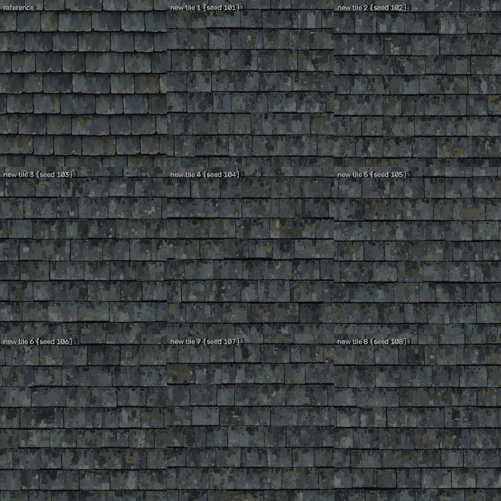

What the checker saw: the new roofs "read as small blocky camouflage patches"; bold pale chipped lips, strong green moss and long upright drips are mostly missing
(`slate/verifier_answer.json`). The score says "same kind"; the eye says "the same family, less bold".

### Step 6. Transfer: a surface nobody gave us

Weathered cedar shingles and clay fish-scale tiles were made by changing numbers in one script of about 90 lines (palette, rows x pieces, widths, gaps, corners,
raggedness, tones, moss shares, height stretch). Cedar needed no change to the Blender generator; fish-scale needed one new setting (rounded bottoms, about 12 lines).
The one number that did not carry over: the height stretch (the slate stretch made the cedar height all white); rule found: stretch the picture's own 1st to 99th
percentile of brightness (the brightness that 1 % of the dots are darker than, and the one that 99 % are darker than) to nearly black and nearly white. Section 6 has all six builds' transfers.

---

## 3. The six ladders side by side

### 3.1 The six ladders on one chart

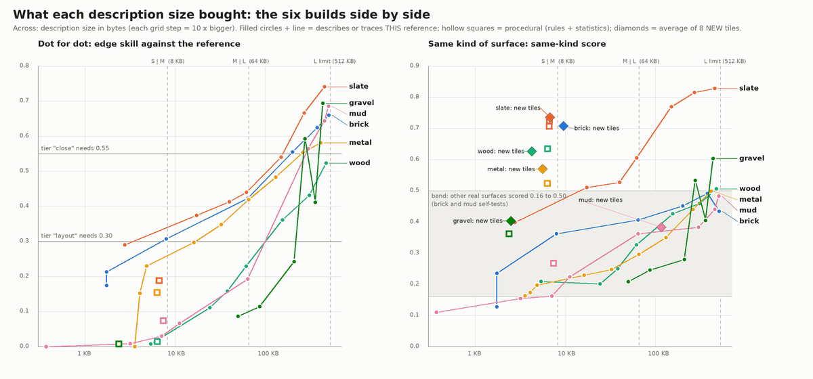

How to read it (drawn by `cookbook/checks/descriptions/ladder_chart.py` from the six `final_report.json` files; every point is in `ladder_chart_numbers.json`):
across is the description size in bytes, each grid step ten times bigger, with the S / M / L limits as dashed lines. **Filled circles joined by a line** are
descriptions of THIS reference (its layout, fitted elements, traced patches), in order of size; **hollow squares** are procedural descriptions (rules plus measured
statistics); **diamonds** (right panel) are the average of the eight new tiles. Left: edge skill (the tier lines are drawn; edge skill is one of several limits of each
tier). Right: the same-kind score, with the band where other real reference surfaces scored in my self-tests (0.16 to 0.50; baking guide, section 7.4).
Brick's line leaves out its three in-between traced steps (88 KB, 196 KB, 399 KB; they are in the table below); gravel's line zigzags because outline-only and
outline-plus-stamp descriptions alternate in size.

What it shows:
* **Left panel:** every line climbs steadily with size and none bends over before 512 KB. The procedural squares sit at the bottom (edge skill 0.007 to 0.188).
  Slate and metal start high (strong layouts); mud, wood and gravel start near 0 and only climb with tracing.
* **Right panel:** the procedural squares and new-tile diamonds of brick, slate, wood and metal sit ABOVE the traced lines of the same size and above the
  other-surface band; mud's and gravel's sit inside it. Traced descriptions score highest on slate (0.828, because it IS the reference rebuilt); elsewhere their
  best is 0.434 to 0.603.

### 3.2 Each ladder in numbers

Columns: bytes; tier; colour SSIM; colour difference (Delta E); edge skill; height error after best fit (steps of 255); normal error (degrees); same-kind score.
"Flat" = what a completely flat map scores on that reference (baking guide, section 7.5): a normal error above it is worse than no relief at all.

**Brick** (`brick/final_report.json`, rate_distortion; flat normal 16.72, flat height 39.95)

| step | bytes | tier | SSIM | Delta E | edge | height | normal | same-kind |
|---|---|---|---|---|---|---|---|---|
| R0 layout only: rectangles, one colour | 1,731 | none | 0.518 | 14.31 | 0.174 | 38.08 | 17.63 | 0.127 |
| R1 + one base colour per brick | 1,735 | none | 0.518 | 12.68 | 0.213 | 36.06 | 17.82 | 0.235 |
| S: + 146 fitted ragged ellipses + dark outline ring | 7,986 | layout | 0.531 | 10.02 | 0.307 | 31.32 | 17.69 | 0.362 |
| M: 1,818 ellipses | 63,973 | layout | 0.551 | 7.95 | 0.423 | 25.08 | 17.37 | 0.406 |
| 5,990 ellipses | 199,978 | layout | 0.592 | 7.1 | 0.555 | 21.29 | 16.31 | 0.451 |
| 11,406 ellipses | 375,773 | layout | 0.626 | 6.7 | 0.624 | 19.28 | 15.39 | 0.491 |
| traced patches over 300 dots (640) | 89,783 | none | 0.521 | 9.9 | 0.146 | 30.34 | 17.19 | 0.242 |
| traced over 80 dots (2,449) | 200,320 | layout | 0.566 | 7.06 | 0.38 | 22.8 | 16.6 | 0.274 |
| traced over 20 dots (8,509) | 408,137 | layout | 0.641 | 5.98 | 0.609 | 16.95 | 14.79 | 0.389 |
| L: traced over 12 dots (12,553) | 508,878 | layout | 0.672 | 5.73 | 0.66 | 15.37 | 13.95 | 0.434 |
| L + per-dot grain 0.14 | 508,911 | layout | 0.537 | 6.37 | 0.667 | 16.24 | 15.32 | 0.598 |

L misses "close" only on the normal error (13.95 against 12). (The same file holds a second bake of L in its "classes" block, the one the brick guides
and the checker quote: SSIM 0.673, Delta E 5.71, edge 0.656, height 15.35, normal 13.93; the two differ only in the second or third decimal.) The outline ring alone, at M size: edge skill 0.357 -> 0.421, same-kind 0.308 -> 0.406
(`brick/builder_answer.json`). Ellipses beat traced outlines up to about 300 to 400 KB.

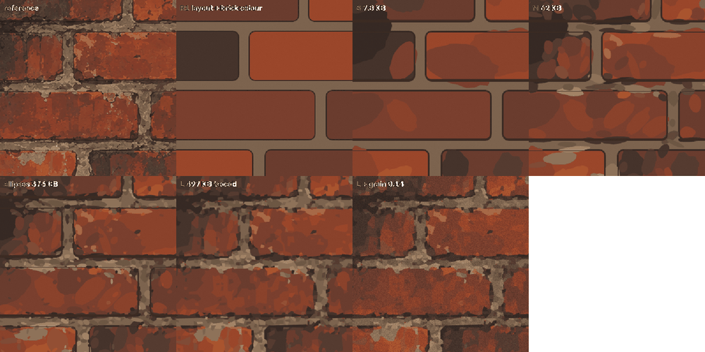

**Slate** (`slate/final_report.json`, classes; flat normal 11.27, flat height 41.08)

| step | bytes | tier | SSIM | Delta E | edge | height | normal | same-kind |
|---|---|---|---|---|---|---|---|---|
| S0 layout only | 2,762 | none | 0.711 | 8.07 | 0.29 | 35.1 | 11.89 | 0.398 |
| S1 + paint statistics (procedural) | 6,597 | none | 0.569 | 9.06 | 0.188 | 35.02 | 16.79 | 0.707 |
| S2 + faint height grain (procedural) | 6,667 | none | 0.569 | 9.06 | 0.188 | 35.06 | 17.87 | 0.725 |
| M tiny: traced outlines + biggest patches, 8 colours | 17,294 | layout | 0.721 | 7.31 | 0.374 | 31.43 | 11.66 | 0.51 |
| M small: 12 colours | 39,916 | layout | 0.720 | 6.35 | 0.413 | 26.86 | 11.95 | 0.527 |
| M coarse: 16 colours, patches over 520 dots | 61,707 | layout | 0.731 | 5.67 | 0.44 | 23.24 | 11.79 | 0.605 |
| L small: patches over 100 dots, 24 colours | 150,279 | layout | 0.751 | 4.02 | 0.54 | 16.07 | 11.91 | 0.769 |
| L medium: patches over 30 dots | 269,986 | **close** | 0.792 | 3.28 | 0.666 | 12.44 | 11.03 | 0.815 |
| L fine: patches over 12 dots | 453,054 | **close** | 0.836 | 2.85 | 0.741 | 10.34 | 9.68 | 0.828 |

Honest reading: S0 and the M classes have a normal error worse than flat (11.27); L medium passes "close" on normals by 0.24 of a degree below flat; only L fine is clearly
better than flat (`slate/04 Recipe ...`, section 0).

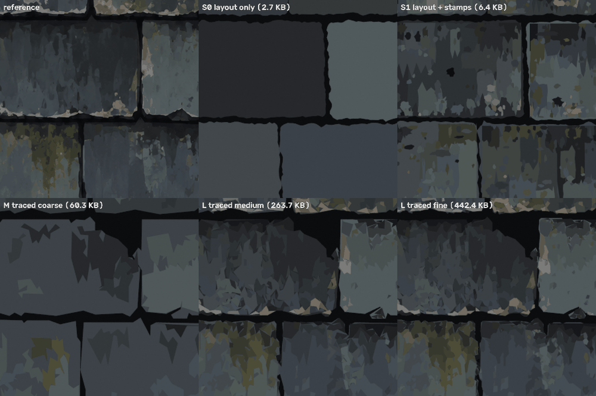

**Wood** (`wood/final_report.json`, classes and extras; flat normal 24.11, flat height 41.59)

| step | bytes | tier | SSIM | Delta E | edge | height | normal | same-kind |
|---|---|---|---|---|---|---|---|---|
| S0 layout: plank rows, 25 cracks, 4 knots, splatter, pebbles | 5,376 | none | 0.377 | 10.84 | 0.007 | 40.16 | 24.65 | 0.209 |
| S0 + grain only (extra) | - | - | 0.262 | - | 0.01 | - | 30.31 | 0.303 |
| S1 without grain: + invented paint (extra) | - | - | 0.293 | - | 0.0 | - | 28.68 | 0.425 |
| S1: + invented paint + dry-brush grain (procedural) | 6,330 | none | 0.22 | 13.44 | 0.014 | 41.42 | 33.05 | 0.635 |
| M1 traced | 24,345 | none | 0.423 | 9.56 | 0.111 | 34.2 | 23.7 | 0.201 |
| M2 traced | 38,119 | none | 0.455 | 8.32 | 0.158 | 29.78 | 23.1 | 0.25 |
| M3 traced | 61,526 | none | 0.488 | 7.48 | 0.229 | 27.04 | 22.41 | 0.326 |
| L1 traced | 154,799 | layout | 0.591 | 6.06 | 0.361 | 21.16 | 19.38 | 0.426 |
| L2 traced | 308,261 | layout | 0.674 | 5.21 | 0.431 | 17.59 | 16.84 | 0.459 |
| L2 + grain (extra) | - | - | 0.509 | - | 0.377 | - | 23.8 | 0.763 |
| L3 traced (3,723 patches) | 473,489 | layout | 0.725 | 4.61 | 0.523 | 15.2 | 15.46 | 0.506 |

A 1.5 MB trace (outside the classes) reached normal 12.6 (`wood/builder_answer.json`). Wood's M classes stay at tier none: its picture is busy (92,000 same-colour areas).

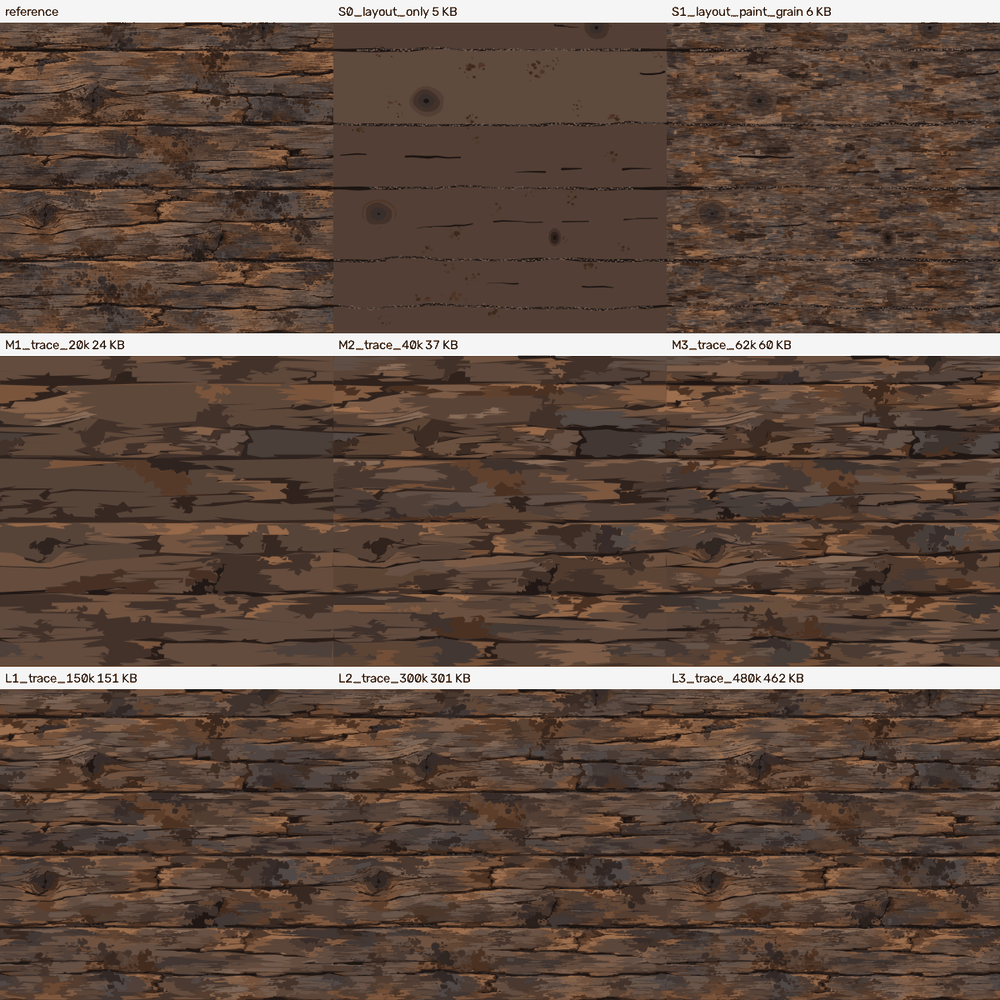

**Metal** (`metal/final_report.json`, rate_distortion; flat normal 13.26, flat height 32.49)

| step | bytes | tier | SSIM | Delta E | edge | height | normal | same-kind |
|---|---|---|---|---|---|---|---|---|
| layer A: plate + bar faces | 3,567 | none | 0.613 | 9.75 | 0.0 | 32.31 | 13.28 | 0.163 |
| layer B: + bar edge shading from measured edge profiles | 4,080 | none | 0.649 | 8.88 | 0.152 | 28.06 | 12.75 | 0.173 |
| S0: + 33 rivets + 3 seam lines | 4,840 | none | 0.656 | 8.6 | 0.23 | 26.76 | 12.71 | 0.197 |
| S: S0 + procedural wear (seamless "donut" noise, Map Range, Color Ramp: pattern makers guide, section 3.1) | 6,303 | none | 0.479 | 12.18 | 0.154 | 31.51 | 16.05 | 0.523 |
| + 88 traced patches | 16,091 | none | 0.667 | 7.75 | 0.297 | 25.06 | 12.55 | 0.229 |
| + 275 traced patches | 32,447 | layout | 0.675 | 7.12 | 0.348 | 23.95 | 12.39 | 0.247 |
| M: 841 traced patches | 65,198 | layout | 0.692 | 6.44 | 0.419 | 22.27 | 12.07 | 0.296 |
| + traced patches | 130,500 | layout | 0.713 | 5.77 | 0.483 | 20.33 | 11.62 | 0.35 |
| + 5,392 traced patches | 261,188 | **close** | 0.740 | 5.14 | 0.553 | 17.93 | 11.01 | 0.44 |
| L: 9,155 traced patches | 413,452 | **close** | 0.756 | 4.9 | 0.581 | 16.62 | 10.62 | 0.498 |

"Each doubling of traced bytes buys about +0.01 to +0.03 SSIM and +0.05 to +0.07 edge skill; it never saturates below the size limit" (`metal/builder_answer.json`).
The checker showed tier "exact" is reachable with metal's map rule (the reference colour through it reaches exact); L misses it on the colour.


**Mud** (`mud/final_report.json`; flat normal 23.5, flat height 46.48)

| step | bytes | tier | SSIM | Delta E | edge | height | normal | same-kind |
|---|---|---|---|---|---|---|---|---|
| R0 flat ground | 371 | none | 0.443 | 14.17 | 0.0 | 46.48 | 23.59 | 0.11 |
| R1 + 8 puddle outlines | 3,168 | none | 0.448 | 11.87 | 0.008 | 43.39 | 23.65 | 0.154 |
| R2 + 40 big stones | 7,088 | none | 0.447 | 11.0 | 0.03 | 43.24 | 23.83 | 0.162 |
| R3 + 34 wheel ruts | 11,161 | none | 0.423 | 11.11 | 0.066 | 42.81 | 25.38 | 0.224 |
| S: layout + ruts + 14,000 invented clods | 7,367 | none | 0.367 | 12.52 | 0.074 | 45.16 | 28.27 | 0.267 |
| M: + puddle tones, 590 stones with faces | 63,885 | none | 0.403 | 9.75 | 0.193 | 40.05 | 28.0 | 0.362 |
| L2: traced ground, 2,000 patches | 299,544 | layout | 0.633 | 5.8 | 0.564 | 21.71 | 20.44 | 0.383 |
| L: traced ground, 5,000 patches | 453,360 | layout | 0.688 | 5.26 | 0.644 | 19.05 | 18.63 | 0.44 |
| L final: + correction layer | 503,014 | layout | 0.698 | 5.0 | 0.685 | 17.57 | 18.59 | 0.483 |
| golden mud S / M / L final (colour only) | 7,144 / 59,853 / 513,735 | none / none / "close"* | 0.272 / 0.312 / 0.604 | 16.57 / 13.07 / 6.84 | 0.041 / 0.147 / 0.6 | - | - | 0.366 / 0.425 / 0.503 |

\* golden mud has no height or normal reference, so those limits are skipped; the checker's stand-in maps say it would be "layout" (`mud/verifier_answer.json`).
The correction layer: in the bakes above, going from "L" to "L final" (looser ground outlines plus 113 KB of corrections, +49,654 bytes in all) bought
SSIM +0.009 and edge skill +0.041, while 2,000 -> 5,000 ground patches (+153,816 bytes) bought SSIM +0.056 and edge skill +0.080; so per byte the
corrections were the better buy in edge skill and the same-kind score (+0.043), not in SSIM. In mud's quick numpy tests, corrections added +0.021 SSIM for
+38.9 KB (mud recipe guide, section 6). The builder's summary "+0.03 SSIM for +50 KB" (`mud/builder_answer.json`) matches neither.
Even the best 16-colour copy of the reference itself reaches only normal 9.83 (`mud/final_report.json`, quantised_ceiling).

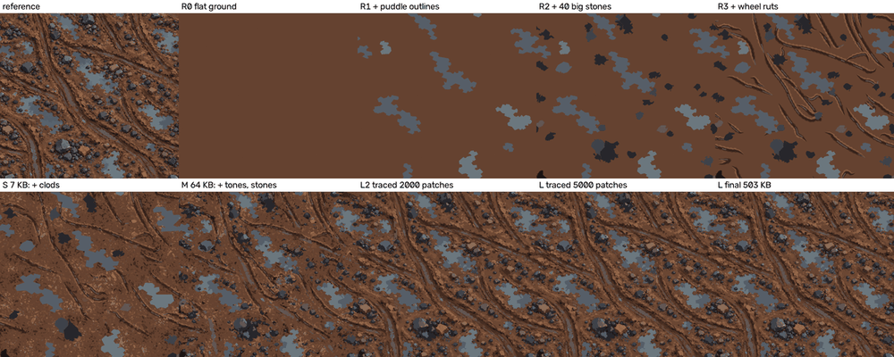

**Gravel** (`gravel/final_report.json`; sizes in KB as written in the file, 1024 bytes; flat normal 24.46, flat height 48.11)

The procedural ladder, scored on quick OpenCV drawings outside Blender (procedural_ladder): ground colour only 178 bytes, SSIM 0.444, same-kind not defined (the tool
fails on a flat picture); + soil lumps 910 bytes, same-kind 0.197; + tiny specks 1,105, 0.170; + tiny and small stones 1,857, 0.247; + medium stones 2,022, 0.345;
+ large stones 2,186, 0.408; all stone classes with shadow, rim, facets and flaky patches 2,364, **0.437** (without those details 0.352). SSIM falls at every step
(0.444 -> 0.206): invented stones are never in the reference's places.

| step | KB | tier | SSIM | Delta E | edge | height | normal | same-kind |
|---|---|---|---|---|---|---|---|---|
| S_v4: all procedural, baked in Blender | 2.31 | none | 0.213 | 20.93 | 0.007 | 48.11 | 37.77 | 0.362 (0.435 smoothed-height view) |
| M: traced big patches + stamps | 48.6 | none | 0.431 | 11.93 | 0.086 | 40.63 | 27.59 | 0.208 |
| traced patches over 250 dots | 84.71 | none | 0.453 | 11.37 | 0.114 | 40.57 | 26.45 | 0.245 |
| traced patches over 100 dots | 204.27 | none | 0.513 | 8.51 | 0.242 | 30.97 | 25.67 | 0.279 |
| traced patches over 250 + about 18,000 stamps | 270.02 | layout | 0.588 | 6.49 | 0.593 | 23.62 | 25.1 | 0.533 |
| traced patches over 50 dots | 350.37 | layout | 0.584 | 6.83 | 0.411 | 23.51 | 23.94 | 0.404 |
| L: traced patches over 100 + about 23,000 stamps | 426.16 | layout | 0.666 | 5.29 | 0.694 | 18.46 | 22.33 | 0.603 |

"Stamps" are the specks too small to outline, written as three numbers each (x, y, radius under their colour): about +0.15 SSIM and +0.35 edge skill for +50 % bytes,
against +0.07 SSIM for doubling the outlines (`gravel/builder_answer.json`). Beyond the L limit the stamp experiment reached SSIM 0.741 at 807.3 KB, still tier layout
(normal 18.68).

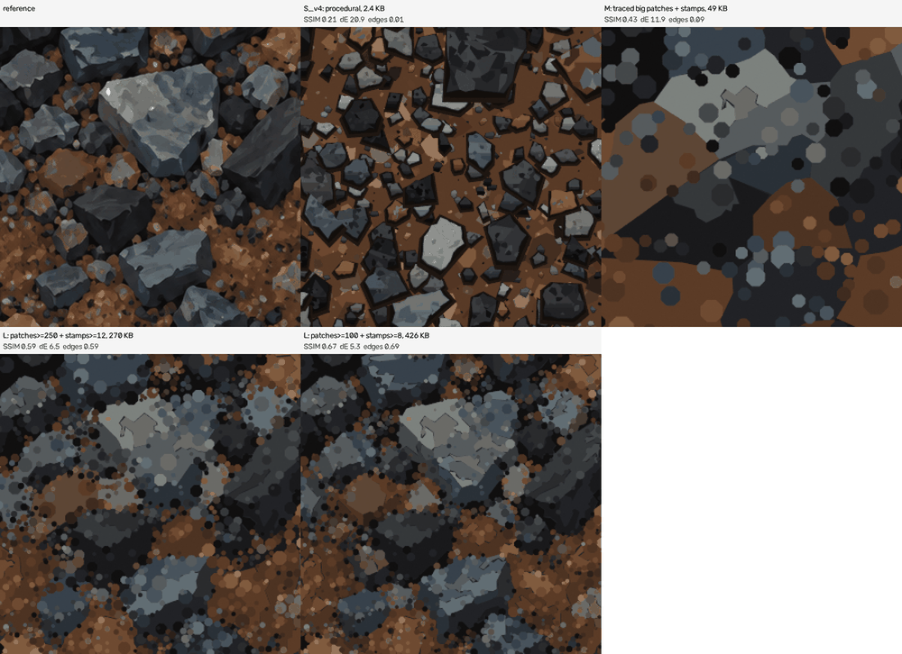

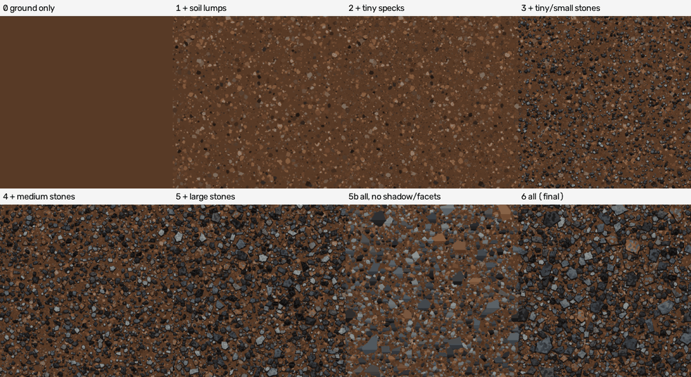

### 3.3 Summary across the six

| | brick | slate | wood | metal | mud | gravel |
|---|---|---|---|---|---|---|
| layout only: bytes, SSIM, same-kind | 1,731 B, 0.518, 0.127 | 2,762 B, 0.711, 0.398 | 5,376 B, 0.377, 0.209 | 3,567 B, 0.613, 0.163 | 371 B, 0.443, 0.11 | 178 B, 0.444, - |
| procedural S: bytes, SSIM, same-kind | (none; S is fitted) | 6,597 B, 0.569, 0.707 | 6,330 B, 0.22, 0.635 | 6,303 B, 0.479, 0.523 | 7,367 B, 0.367, 0.267 | 2.31 KB, 0.213, 0.362 |
| first tier "layout" at | 7,986 B (S) | 17,294 B | 154,799 B | 32,447 B | 299,544 B | 270.02 KB |
| first tier "close" at | never | 269,986 B | never | 261,188 B | never | never |
| best within 512 KB: SSIM / edge / normal (flat) | 0.672 / 0.66 / 13.95 (16.72) | 0.836 / 0.741 / 9.68 (11.27) | 0.725 / 0.523 / 15.46 (24.11) | 0.756 / 0.581 / 10.62 (13.26) | 0.698 / 0.685 / 18.59 (23.5) | 0.666 / 0.694 / 22.33 (24.46) |
| what kept it from "close" | normal 13.95 > 12 | - | edge 0.523, normal 15.46 | - | normal 18.59 | normal 22.33 |

### 3.4 What each kind of layer bought (the lessons)

1. **Layout** (rows, joints, bars, planks): the strong edges and the structure, for 0.2 to 5.4 KB. Worth a lot where the reference has a strong layout (slate SSIM 0.711,
   metal 0.656 with rivets) and little where it has none (mud, gravel: nothing to lay out).
2. **One colour per element**: colour difference down (brick 14.31 -> 12.68, same-kind 0.127 -> 0.235) for almost no bytes.
3. **Outlines** (brick's dark ring): +0.064 edge skill at M size.
4. **Procedural paint or wear from statistics**: the same-kind score up (slate +0.309, wood +0.426, metal +0.326, mud +0.043 over R3), the dot-for-dot scores down (slate
   SSIM 0.711 -> 0.569, metal 0.656 -> 0.479, wood 0.377 -> 0.22) and the normal error worse than flat (slate 16.79, wood 33.05, metal 16.05, mud 28.27, gravel 37.77).
5. **Grain** (per-dot noise): same-kind up, SSIM down, on every surface that tried it (brick L 0.434 -> 0.598 and 0.672 -> 0.537; wood L2 0.459 -> 0.763 and 0.674 -> 0.509).
6. **Traced patches**: dot-for-dot accuracy, slowly: each doubling about +0.01 to +0.03 SSIM (metal, brick).
7. **Stamps for specks** (gravel) and **a correction layer painted last** (mud): the best buys per byte at the top end.
8. **Derived maps**: height and normal for about 0.3 KB, ceiling height 3 to 5 steps, normal 2.7 to 4.6 degrees (relief guide, section 3).
9. **The normal error is the last measure to move**: it lives in the 1 to 3 dot detail and fell only as more of the reference's real detail was written down
   (brick: about 1.5 degrees per halving of patch size; wood 1.5 MB for 12.6).

---

## 4. Where "procedural" ends and "tracing" begins

**What the words mean here, in one sentence each:**
* **procedural** = rules plus measured statistics plus a seed: change a number or the seed and you get a new, different, valid picture.
* **fitted elements** = each element of THIS picture written down as a few meaningful numbers (a brick's corners, a joint's position and lean, a rivet, an ellipse
  placed by fitting); you can edit it meaningfully, but it describes one picture.
* **tracing** = the outline of every flat patch of THIS picture written down as corner steps: a compressed vector copy.

**Example first:** slate's L fine description holds 9,383 patches and 154,230 numbers, 9.6 % of the size of a raw colour picture of the reference
(`cookbook/checks/baking_and_checking/audit_examples.json`). It passes the audit. Its same-kind score of 0.828 is high "because it IS the reference, rebuilt from flat
polygons" (`slate/04 Recipe ...`, section 0). Changing its seed changes nothing: it has no rules.

| build | procedural (makes new tiles) | fitted elements (this picture) | tracing (this picture) |
|---|---|---|---|
| brick | the sampler's mosaic descriptions (9,523 to 9,582 bytes = 9.3 to 9.4 KB each) | S and M: layout + 146 / 1,818 ellipses "greedily fitted" to the reference snapped to 16 colours (checker) | L: 12,553 traced patches |
| slate | S1, S2 paint block | S0 layout (rows, joints, leans) | M and L: traced outlines and patches |
| wood | S1 paint and grain | S0 layout (planks, cracks, knots, splatter, pebbles) | M1 to L3: 3,723 patches and 85,093 corners at L3 (checker) |
| metal | S wear layers | S0 layout (bars, edge profiles, 33 rivets, seams) | R16k to L: up to 9,155 traced outlines (408 of the 413 KB) |
| mud | S clods | R1 to R3 and M (puddles, 590 stones with faces, ruts) | L: 76,058 polygon corners in all, of which 60,686 traced ground corners (checker) |
| gravel | S_v4 (no elements could be found one by one) | - | M to L: outlines plus about 22,900 stamps at the reference's own speck positions; L_a100_s8 holds 138,857 numbers, 9.3 % of a raw picture (checker) |

**Where the line falls:**
* **By size:** every procedural S description is 2,364 to 7,367 bytes (class S). The sampled new-tile descriptions are 2,470 to 9,582 bytes (brick's are
  just over the 8 KB S limit), except mud's, whose sampler writes every clod (112,383 to 118,421 bytes; section 5). Every description that reached tier "layout" or better is fitted or traced: brick's S (7,986
  bytes) is the smallest, and it is a fit. Within class M, brick (fitted ellipses), slate and metal (traced patches) reached "layout"; wood, mud and gravel did not. **So the M and L classes are vector copies**
  (brick's and mud's M are fits of the same picture, which is the same kind of thing for this purpose: they cannot make a new tile).
* **By behaviour:** a traced class copies the reference's own mild seam (seam number: brick L 2.11, metal M and L 1.33 and 1.38, `metal/scores/M_texture.json` and `L_texture.json`; the six references 1.69 to 2.49), while every
  procedural and sampled description is seamless by construction (half-tile test passed on all six builds; seamless guide, section 8.1).
* **The audit cannot see the line** (baking guide, section 8): it checks bytes and list lengths only. Say in words which kind each description is.
* **Brick's builder put the line at about 400 KB** for its own fits: ragged ellipses beat traced outlines per byte up to about 300 to 400 KB, "this is where
  'procedural' ends and 'tracing the picture' begins" (`brick/builder_answer.json`). The checker's stricter view: the ellipse classes are fits of the same label picture
  too (the reference snapped to 16 colours, each dot labelled with its colour; `brick/verifier_answer.json`). Both are recorded here; this guide uses the stricter one.

**Why tracing was still worth doing:** it proved that the generator and the description format can say everything the reference says (the project's first step),
and its ladder shows where the accuracy lives: in thousands of tiny details, 1 to 3 dots across, that no rule placed.

---

## 5. New tiles: how good were they?

**Example first:** brick's sampler (`brick/generator/sampler_model_brick.json`, 6,477 bytes of measured statistics: brick pitch 313.5 +- 59 dots, joint 20.4 +- 2.0,
colour tables, patch size bins, soot and spall clouds) wrote eight new descriptions of 9.3 to 9.4 KB (9,523 to 9,582 bytes: class M by size, just over the 8 KB limit). Baked, they score 0.684 to 0.730 on the same-kind tool, against 0.432
for the traced L copy of the reference, and tier none dot for dot (SSIM 0.237 to 0.258). Against each other they differ as much as against the reference (average
difference 25.9 steps against 26.9) (`brick/final_report.json`).

| surface | sampler numbers | description per new tile (bytes) | same-kind, mean (range) | the fitted procedural S | SSIM against the reference | between two new tiles: SSIM / average difference (steps) | bake per tile |
|---|---|---|---|---|---|---|---|
| slate | `fitted_distributions.json`, 4,840 B | 6,726 to 6,746 | **0.735** (0.722 to 0.753) | 0.707 (S1), 0.725 (S2) | 0.494 to 0.525 | 0.49 / 20.1 | about 31 s |
| brick | `sampler_model_brick.json`, 6,477 B | 9,523 to 9,582 | **0.708** (0.684 to 0.730) | (no procedural S) | 0.237 to 0.258 | 0.251 / 25.9 | 33 to 36 s |
| wood | `fitted_distributions.json`, 3,753 B | 4,132 to 4,584 | **0.626** (0.607 to 0.665) | 0.635 (S1) | 0.197 to 0.205 | 0.214 / 23.1 | 248 s for 8 |
| metal | ranges in the sampler code | 5,027 to 5,850 | **0.569** (0.525 to 0.603) | 0.523 (S) | 0.387 to 0.417 | 0.399 / 18.71 | 26 to 67 s |
| gravel | S_v4 + spreads measured between nine 418-dot windows | 2,470 to 2,486 (file sizes) | **0.403** (0.365 to 0.456); 0.457 (0.425 to 0.488) with a smoothed height | 0.362 (0.435) | 0.206 to 0.224 | 0.19 / 34.62 | not recorded per tile |
| mud | `fitted_distributions_mud.json`, 13,961 B | 112,383 to 118,421 | **0.383** (0.353 to 0.416) | 0.267 (S) | 0.277 to 0.288 | 0.343 / 28.05 | 33 to 54 s |

All tiles are tier none against the reference, as they should be. The numbers come from each build's `final_report.json` (variation), the sampler file sizes from `ls`.

**How to read the scores against "another surface"** (baking guide, section 7.4, TESTED for this guide): against brick, the other five references score 0.164 to 0.324,
so brick's new tiles (0.684 to 0.730) are clearly brick-like. Against mud, the other references score 0.179 to **0.498** (gravel), so mud's new tiles (0.353 to 0.416) are
NOT shown to be mud-like by the tool; the mud checker found the same overlap with the new tiles themselves (tile 103: 0.353 against mud, 0.306 against brick). The other
four surfaces were not cross-scored: NOT TESTED.


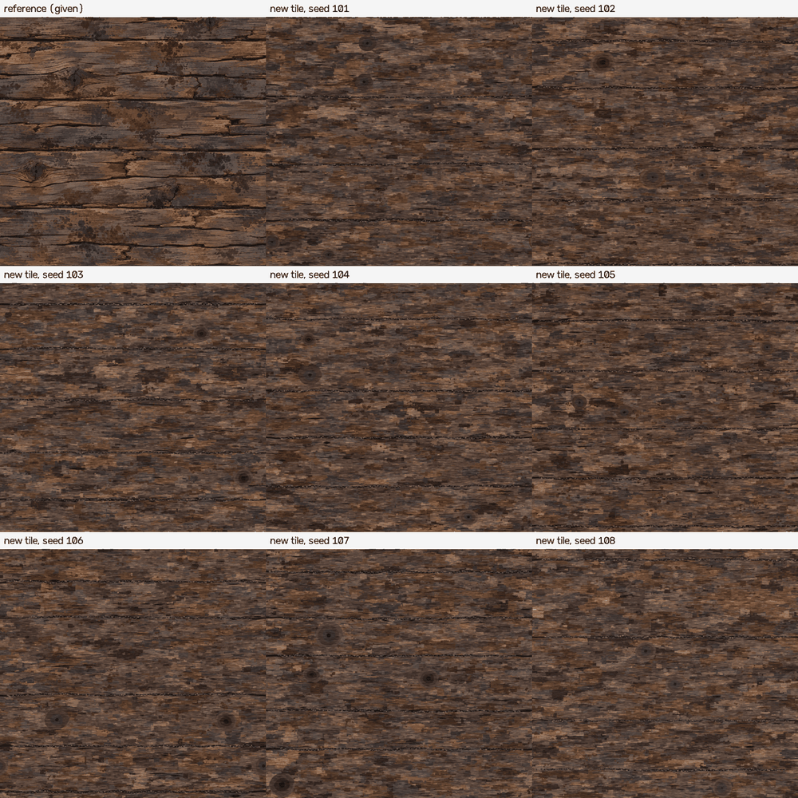

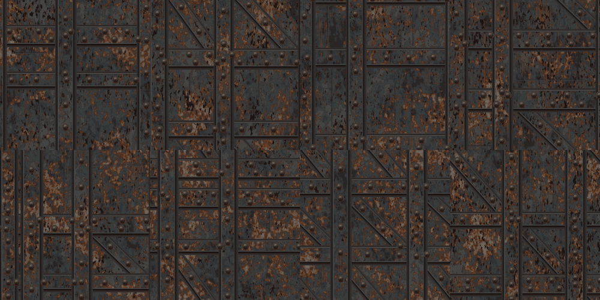

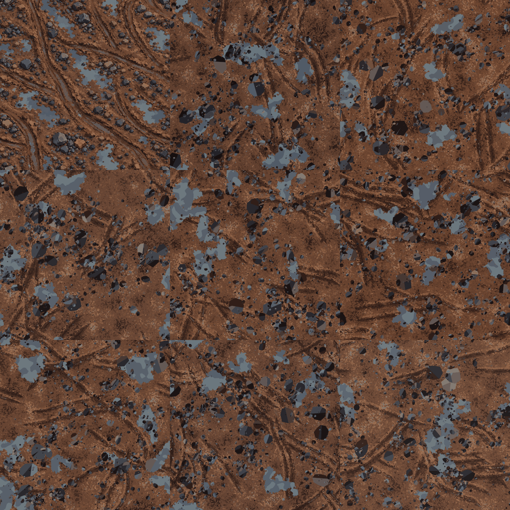

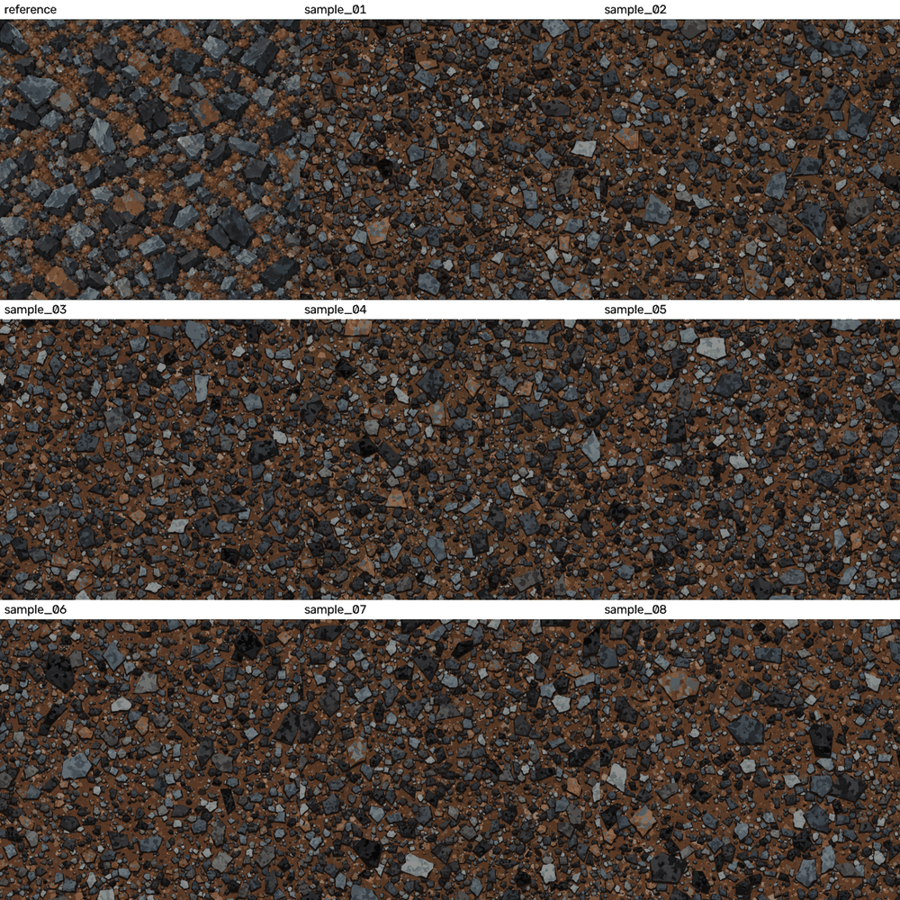

(Slate's contact sheet is in section 2, step 5. The sheets show crops, not whole tiles, at least for slate, by the slate checker's reading.)

**What the eye says** (the checkers' words; every build admits a "family look"):
* **brick:** "they read as the same painted brick wall but are visibly not the reference's style: speckled soot, a confetti of small cells on the brick faces, thin dark
  mortar and a tidier outline, with no big flat hand-painted patches"; all eight have 12 courses of 4 bricks (`brick/verifier_answer.json`).
* **slate:** "small blocky camouflage patches", missing the bold pale lips, green moss and long drips.
* **wood:** "the planks are barely readable, the cracks are thin dashed lines, the knots are small faint smudges ... the paint is blocky 'pixelated camouflage'"; all eight
  share nearly the same tone (mean grey 69.0 to 72.7). Also: the sampler was tuned on the same-kind score, so 0.626 "is optimistic".
* **metal:** same edge profiles, rivet picture and wear colours in all; rust "evenly peppered with few long drips".
* **mud:** "pale mottled puddles, many uniform hexagon-like stones and black round blobs, scratchy rather than flowing ruts, and flat confetti ground".
* **gravel:** stones are "small flat kite-shaped polygons on flat darker soil"; the share of the picture that is still stone after removing every stone narrower than about 24 dots (an "opening of radius 12") is 0.28 to 0.38
  against the reference's 0.516: far fewer big stones. "As good as the fitted tile" only because the fitted tile has the same gap.

**The pattern:** the new tiles are as good as the procedural description they were drawn around (no mean is more than 0.01 below its fitted procedural S: wood 0.626
against 0.635; the others are above), and that
procedural description is where the quality is decided. Where the reference is made of clear elements in rows (slate, brick), the elements and their statistics carry
the look. Where it is a busy scatter (mud, gravel), the measured statistics did not capture the big shapes the eye reads first (flowing ruts, big chunky stones).

---

## 6. Transfer: surfaces nobody gave us

**Example first (gravel to pebbles on sand):** `transfer/` in the gravel build changed 21 description keys (8 pebble tones, 8 sand tones, 7 to 12 corners per stone, almost
no chipping, softer shadow, fewer bigger pebbles, light from the top left, fewer sand lumps) plus one number found again (the height stretch: the tile's own 1st and 99th
percentile stretched to 10 and 245). No generator code changed. About 12 minutes of work, a 1,992-byte description, a 48.2 s bake; seamless (`gravel/final_report.json`,
transfer). The checker counted 60 changed values, one stone class and one speck layer dropped, "but 'numbers only' is true" (`gravel/verifier_answer.json`).

| from -> to | what changed | code changed? | work, bake | judged by | flaws found |
|---|---|---|---|---|---|
| brick -> grey granite cobblestones | a new sampler model (6,275 B, chosen by eye): palette, 13 courses of stones about 150 dots wide, corner radius 26, accent colour lists | three optional model keys added to the sampler; first bake gave black stones (accent colours guessed from saturation) | about 20 min; 35 s per tile, 13.4 KB | eye, half-tile test (0.023 % of dots over 40) | checker: "the brick layout re-coloured", sandy joints HIGHER than stones in the height; the model script no longer reproduces the stored model |
| slate -> cedar shingles | numbers in one 90-line script: palette, 14 x 12 pieces, widths, gaps, corners, raggedness, tones, moss, height stretch | none in the Blender generator (uses the sampler's fitted= option) | numpy preview 10 s, bake 25 s | eye, half-tile test (0.929, 0 %) | - |
| slate -> clay fish-scale tiles | the same, 17 x 12 pieces | one new setting (rounded bottoms, about 12 lines), two sampler options | as above | eye, half-tile test (0.99, 0.02 %) | rows do not overlap: black gaps between scales |
| wood -> silver deck boards | palette, paint numbers, sampler options, straight equal gaps, two hand-written lists (6 butt joints, 176 nail blobs), pebbles removed | "none" (builder); cannot be proven from file times (checker) | about 10 min (not checkable), 6,144 B, bake 50.3 s | eye, half-tile test (0.71, 0 %) | joints and nails had to be written by hand |
| metal -> ship hull plates | one 43-line script: 6 wide plate bars, joints, two rivet rows per plate, colours, wear stretch, rust share | none | 6 tool calls, 20 s calibration + 79.6 s bake, 17,869 B | eye; checker's half-tile test 2.52, 0 % | paint tone too wavy, rust too sparse; stored bake predates the final generator |
| mud -> snowy track | palette, which colours play band / groove / bank / water, 4 numbers (stone scale 0.35, puddle scale 0.7, 9,000 clods, zone weight 0.85), height stretch 60..245 | one new sampler option (maps) | about 10 min, 49,971 B, bake 31.1 s | eye | rut ends fade like claws, clods too small |
| mud -> golden mud (a re-fit) | one analysis threshold (3 instead of 7) | none | about 6 min of computer time | both tools (colour only) | L "close" is an artefact of missing maps (section 3.2) |
| gravel -> pebbles on sand | 21 keys (checker: 60 values) + height stretch | none | about 12 min, 1,992 B, bake 48.2 s | eye, half-tile test at 512 dots (1.54, 0 %) | - |

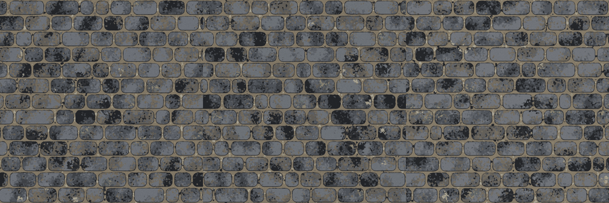

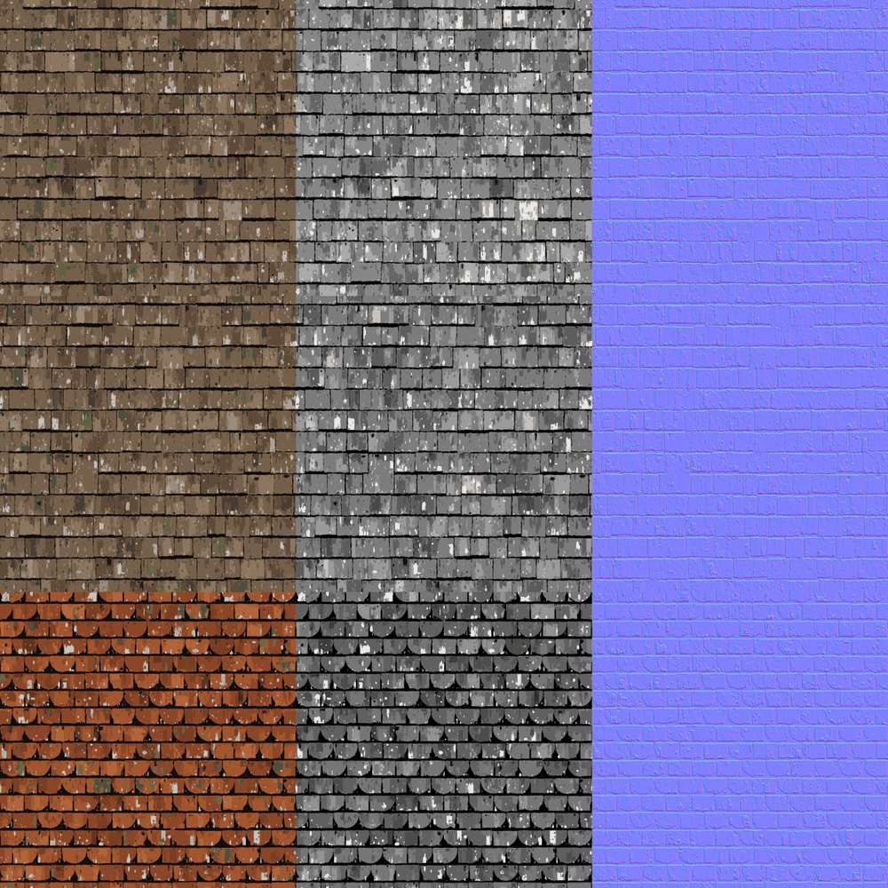

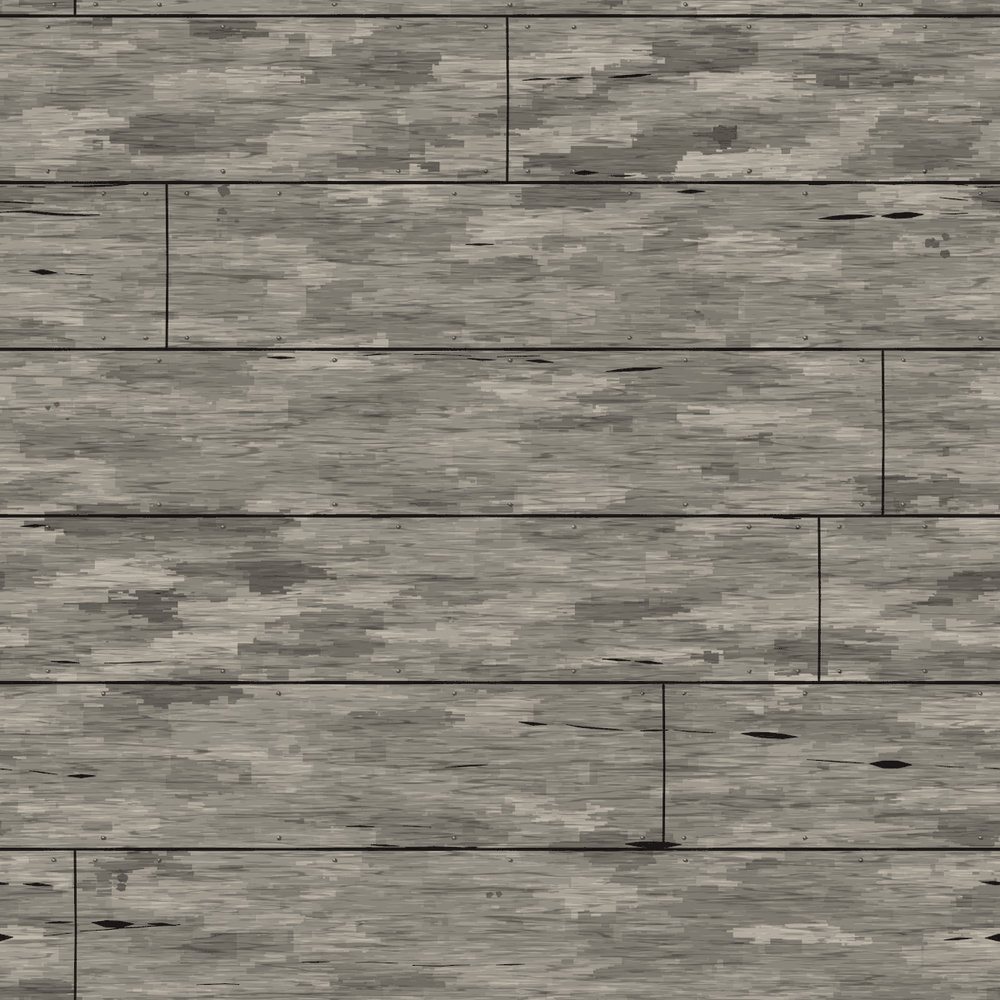


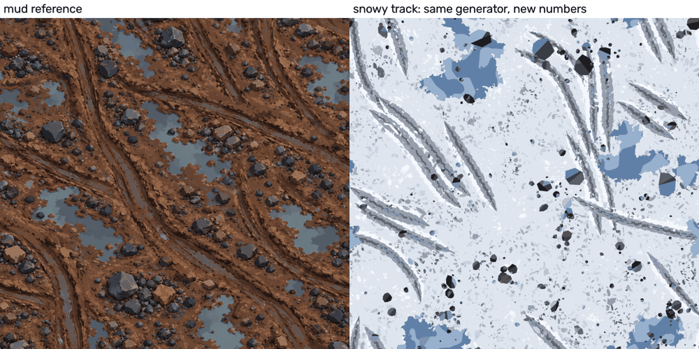

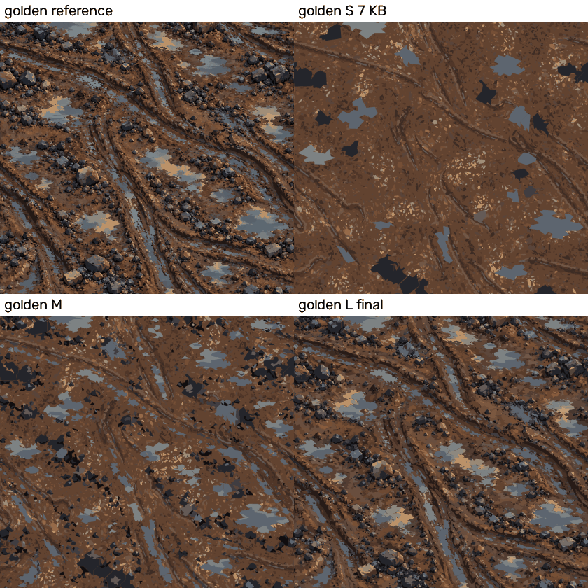

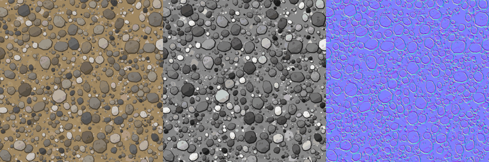

**What transferred, and what did not** (from the six builds' lessons):
* **A new surface of the same family is new numbers; a new piece shape is one new setting; a new arrangement (overlap, a non-row layout) is new code** (slate).
  Cobblestones from the brick generator stayed "too brick-like: straight courses, rectangular stones" (brick).
* **The height stretch must be found again for every surface** (slate, gravel, mud): stretch the picture's own 1st to 99th percentile of brightness to about 10..245.
* **Accent colours must be named in the description, not guessed** (brick's black stones).
* **Things outside the generator's vocabulary become hand-written lists** (wood's joints and nails); a generator option would make them numbers.
* **No transfer has a reference**, so none has a score; all were judged by eye and by the half-tile test.

---

## 7. Bigger areas and other picture sizes

**Areas: one 2508 x 2508 picture of new content (2 x 2 tiles) from one description** (each build's `final_report.json`, area; times on a shared machine, 2 threads):

| surface | description bytes | bake | seam: wrap edge / middle lines (1.0 = none) | repeats (1.0 = a copy) |
|---|---|---|---|---|
| brick | 21,674 | 143.92 s, 65,998 shapes | 1.037 / 0.989 | best match when moved 0.145 |
| slate | 14,548 | 131.5 s, 25,858 shapes | 0.75, 0.58 / 0.86, 0.59 | quarters at most 0.371 |
| wood | 9,223 | 232.6 s | 0.84, 0.89 / 1.06, 0.91 | quarters SSIM 0.214 to 0.222 |
| metal | 9,228 | 298.0 s | 1.016 / 0.985, 0.863 | strongest repeat 0.236 (the straps) |
| mud | **471,580** | 227.7 s, 114,875 shapes | 0.876, 1.044 / - | strongest repeat 0.176 |
| gravel | 2,493 | 252.6 s (checker; the builder's 173 s belonged to another test) | 0.953, 1.045 / 1.063, 1.097 | quarters 0.039 |

All six areas are seamless and free of repeats by these measures, and the checkers confirmed it by eye. Seams were measured as neighbour jumps across the wrap edge and the
middle lines (seamless guide, section 9).

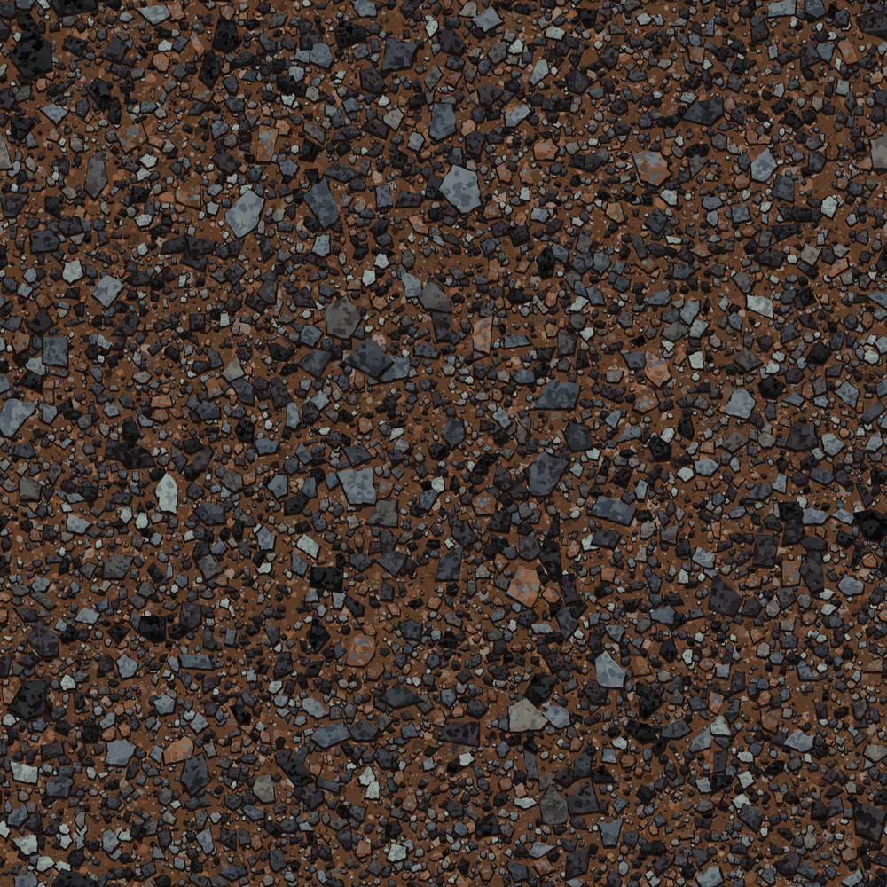

**Picture size:** the same description at 512, 1254 and 2508 dots gives the same shapes; only edge sharpness and time change. Brick: 25.3 / 33.7 / 76.3 s, and the 1254
bake matches the 2508 bake shrunk with SSIM 0.994 (`brick/final_report.json`); mud: 0.987 / 0.993 / 1.0 against the 2508 bake shrunk (`mud/final_report.json`); slate:
"resolution scales edges, not detail". Descriptions measured in tile dots, with blur and normal strength scaled by dots per tile dot, draw at any size (gravel's mean slope
0.374 / 0.367 / 0.352). Time grows slower than the dot count where shape-cutting dominates (brick: about 20 s of every bake does not depend on size) and faster where the
shader grain is evaluated per dot (metal S: 13.7 / 54.8 / 293.9 s).

---

## 8. What this means for scaling to larger sets

**What is ready (TESTED in the builds):**
1. **One generator per surface reads only its description** (all six checkers found the main generator reads no picture of the reference: by searching the code,
   by tracing the files a bake opens, or by baking in a copy with no reference folder). The same generator draws a tile, a new
   tile, a 2 x 2 area and any picture size.
2. **Seamless by construction:** wrap copies of every shape crossing the edge, seeds that repeat every tile, sizes in tile dots. Every area passed.
3. **Cheap per tile:** about 30 s per new 1254-dot tile and 130 to 300 s per 2508-dot area on 2 threads. As arithmetic only (NOT TESTED): 100 new tiles at slate's
   30.7 s each would take about 51 minutes.
4. **Cheap per new surface of a known family:** one script each (TESTED: the seven transfers of section 6 were baked); the 10 to 20 minutes of work are
   the builders' own counts and NOT TESTED (the wood and gravel checkers: "not checkable"; slate and metal recorded no working time).

**What is not ready:**
1. **The new tiles are one family each.** Eight samples per surface all look alike (same palette, same layout family, same patch statistics); none of the builds varied
   the statistics themselves from tile to tile. A larger set that needs variety (clean and dirty brick, young and old slate) needs the statistics sampled too: NOT TESTED.
2. **The quality gap:** same-kind 0.38 to 0.74, and the checkers' eyes found every family poorer than its reference in the big shapes (flat hand-painted patches, long drips,
   flowing ruts, big chunky stones). The ladders say those big shapes are cheap to describe (they are few); the samplers did not model them. That is the first thing to fix.
3. **The checking tool cannot certify mud or gravel** (section 5). A larger set needs an acceptance check per tile: same-kind score above the other-surface level FOR
   THAT reference, the half-tile test, and a person looking at a contact sheet.
4. **Tuning a sampler on the same-kind score makes that score optimistic** (wood). Keep some checks the sampler was not tuned on (the eye, the other-surface level).
5. **Description size must not grow with area.** Brick's first sampler wrote every cell (1.8 MB per tile) and was replaced by parameters plus seeds (9 KB per tile,
   `brick/builder_answer.json`). Mud's sampler still writes every clod: 112,383 to 118,421 bytes per tile and 471,580 bytes for a 2 x 2 area, so a 4 x 4 area would pass the 512 KB
   L limit (arithmetic, NOT TESTED). Gravel's 2 x 2 area is 2,493 bytes; slate's 4 x 4 description is 44.7 KB (made by the slate checker, not baked).
6. **Traced descriptions do not scale at all:** each copies one tile, including its seam.

---

## 9. Checklist: how to start a new surface (from all six builds)

1. **Prove how the maps were made** (about 10 minutes of plain Python): fit grey weights, a stretch or tone curve, a blur and a normal strength that turn the reference
   colour into the reference height and normal. Write down the ceiling. (all six)
2. **Snap the colour to 8, 16, 24 colours** and measure what a palette copy reaches; **count the patches by size** before choosing a description style: slate's
   9,383 patches over 12 dots were traced into 442 KB; gravel's 18,881 patches over 12 dots need 1,182 KB of outlines (gravel recipe guide) and cannot be;
   wood has 92,000 same-colour areas in all, 43,000 of them 1 to 3 dots (wood recipe guide). (slate, wood, gravel)
3. **Find the layout with the outlines, not the colours** (dark-line filters, fitted straight lines), and LOOK at the overlay. Check whether the reference is truly periodic
   (brick's is stitched; slate's tile edge cuts through a row). (brick, slate, metal)
4. **Measure elements as statistics:** sizes, spacing, colour by area (not by count), how patches gather into clouds, light direction and shadow bands. When elements touch
   and cannot be found one by one, measure shares and size curves instead (gravel). Name accent colours explicitly. (all)
5. **Build the generator as a painter of flat shapes**, back to front, photographed from above, with wrap copies; make height and normal from the colour with the proven rule.
   Read the tile size from the description. (all)
6. **Bake layout only, then one colour per element; score with both tools; look at both sheets.** Fix the biggest visible error first. (all)
7. **Add layers big to small, record the ladder after each**, and keep procedural layers and traced layers in separate descriptions. (all)
8. **Add per-dot grain last, as a separate switch**, and say which tool it is tuned for. (brick, slate, wood)
9. **Test seams with the half-tile test and a first-against-last column check**, not with the seam number. (brick, slate, wood)
10. **Write the sampler from the measured statistics, with seeds for every random part** (wood's tiles first all shared one grain), bake eight, look at the contact sheet,
    score them against the reference AND the other references, and expect two rounds of look-and-fix (metal, mud, gravel).

---

## 10. Lessons that carry to other surfaces

1. **Accuracy per kilobyte is the honest result.** A description's size says how much it knows; the ladder says what that knowledge bought. Report bytes next to every score.
2. **Rules make new tiles, tracing makes copies.** Both are useful; never mix them in one tile, and never call a trace a recipe.
3. **The fine detail is statistics, not positions.** Describe it as noise for new tiles; leave it out when matching dot for dot. (brick)
4. **The big shapes are what people see first** and what the samplers missed. Spend the next effort there, not on the 1-dot detail.
5. **A score is only as good as its yardsticks:** compare every same-kind score with the other-surface level and every normal error with the flat number.

---

## 11. Tested for this guide, and not tested

TESTED for this guide: the chart `pictures/descriptions-six-ladders-chart.png` (220 KB), drawn by `cookbook/checks/descriptions/ladder_chart.py` from the six
`final_report.json` files (points in `ladder_chart_numbers.json`; its six colours passed the chart-palette check, with a contrast warning on three light colours answered by
direct labels and the tables here); the audit of the slate S1 and L fine descriptions and the other-surface scores against brick and mud
(`cookbook/checks/baking_and_checking/`); the sizes of the sampler files and of gravel's sampled descriptions (`ls`).

Quoted, not re-run by me: every other number, from the files named next to it, including the checkers' corrections (metal's ceiling, gravel's area time and half-tile
size, wood's unprovable "no code changed", golden mud's tier).

NOT TESTED: the same-kind score of slate, wood, metal and gravel new tiles against the OTHER references; sampling the statistics themselves for more variety; a 4 x 4
area of any surface (slate's 4 x 4 description was made but not baked); how long 100 new tiles would take (arithmetic only); the slate build in separate layers that is
in progress in `recipes/slate_layers/` (not covered here).
