# 06 Guide - pattern makers

What this is: a guide to the Blender 5.2 nodes that MAKE a pattern from nothing but a position: Noise, Voronoi, Brick, Wave, Gabor,
White Noise, Magic, Gradient, Checker and Radial Tiling. For each one it says what it is, what it did (or did not do) on our six surfaces,
what each setting does to the picture, which traps cost time, and a short recipe card of chains that were really run.
The companion guide "06 Guide - shapers.md" covers the nodes that change a value after it is made (Color Ramp, Map Range, Math, Mix and others).

## How to read this guide

Words used (one word for each thing, always):
* **tile** = the square picture we make (1254 x 1254 for the finals, 256 x 256 for the small test pictures); **dot** = one pixel of it.
* **position** = where a dot sits on the tile: **u** across (0 at the left, 1 at the right), **v** up (0 at the bottom, 1 at the top).
* **pattern maker** = a node that turns a position into a value or a colour.
* **value** = the grey number a node gives for one dot (0 = black, 1 = white; numbers below 0 or above 1 show as black or white).
* **setting** = a number or a choice on a node (Scale, Detail, Feature...).
* **chain** = nodes linked one after another; an arrow `->` in this guide means "feeds into".
* **strip** = a row of small pictures of the same chain with ONE setting changed; it shows what that setting does.
* **build** = one of the six surface jobs in `recipes/` (brick, slate, wood, metal, mud, gravel).
* **seamless** = the right edge of the tile continues into the left edge and the top into the bottom, so copies laid side by side show no join.
  **seam number** = the jump across that join divided by an ordinary jump between neighbouring dots (about 1.0 = no seam; seamless guide, section 8.2).
* **the donut trick** = the project's way of making Noise and Voronoi seamless (`lib/recipe_tools.py`, `tileable_noise_group` and `tileable_voronoi_group`):
  u and v are turned into two circles and a 4-dimensional pattern is read on them, so walking off the right edge brings you back at the left.
* **mask** = a value that says where something goes (1 = here, 0 = not here).
* **cut** = the value where a hard step happens (below it one thing, above it another); **share** = the part of the tile something covers.
* **same-kind score** = `lib/texture_compare.py` overall: 1 = the same kind of surface as the reference; other real reference surfaces score 0.16 to 0.50
  (not "about 0.1"; baking and checking guide, section 7.4).

Labels: **TESTED** = run in Blender 5.2.2 on this machine and the result looked at or measured; the file that shows it is named.
**NOT TESTED** = only read (manual, web page) or only reasoned. Every number in this guide is copied from the file named next to it.

Where the facts come from: `research/02 Research - the shader node toolbox.md` (most settings and strips, folder
`research/experiments_shader_node_toolbox/`), `research/02 Research - getting a hand-painted stylised look.md` (folder
`research/experiments_hand_painted_look/`), `research/02 Research - seamless tiles and baking.md` (folder `research/experiments_seamless_tiles_and_baking/`),
the six builds' guides, reports and checkers' findings (`recipes/<surface>/04 Recipe - ...md`, `builder_answer.json`, `verifier_answer.json`),
and NEW tests made for this guide: `cookbook/checks/tool_guide_strips/make_tool_guide_strips.py` (run with `run_strips.sh` in the same folder),
numbers in `cookbook/checks/tool_guide_strips/numbers.json`, strips in `cookbook/pictures/pattern-strip-*.jpg`.

---

## 1. The short version

Example first. The cloudy rust on the metal tile is made like this (TESTED, `recipes/metal/generator/metal_generator.py`):
Noise Texture read with the donut trick, 44 features across the tile and 30 up -> Map Range (stretch 0.27..0.71 to 0..1) -> Math Multiply Add
(more or less rust) -> Color Ramp with Constant steps (one flat colour per step) -> Mix over the bare steel.
That one chain contains the whole idea of a pattern maker: **the pattern maker gives a soft grey value; everything that makes it look painted happens after it**
(stretching, cutting into flat steps, colouring, mixing). Those later steps are in "06 Guide - shapers.md".

The rules that would have saved the most time:
1. **Blender's random pattern makers are not seamless.** Noise, Voronoi, Gabor, Magic and Wave (with Distortion) change when you move one whole tile.
   Use the donut trick for Noise and Voronoi; Wave, Magic and Checker tile only with special Scale numbers; Gabor and Gradient never do (section 13).
2. **Noise sits in the middle.** A default Noise value only spans about 0.25..0.73 (the middle 90 per cent of dots: 0.38..0.61). Stretch it with Map Range before you cut or colour it.
3. **Normalize only changes fBM noise.** Ridged and Multifractal give the same numbers with it on or off, and they are not limited to 0..1.
4. **Ridged, Hybrid and Hetero ignore Detail until Offset is above 0.**
5. **A cut on raw noise covers far less than you think:** a cut at 0.6 covers only 6.7 per cent of the tile, at 0.65 only 1.1 per cent.
6. **In the six final builds, pattern makers did small jobs** (grain, streaks, wear). The big shapes (bricks, slates, planks, plates, stones, puddles) were drawn
   from lists of numbers. That is the main lesson that carries to other surfaces: use pattern makers for texture INSIDE shapes, and describe the shapes themselves.

---

## 2. What the six builds actually used (honest table)

In all six builds the main picture is made by a "painter": Python turns the description file into a list of flat coloured shapes, Blender builds them as
one flat mesh and photographs it from straight above. So most pattern makers were never needed. Where one was used, it is listed here (TESTED in each build's bakes).

| Pattern maker | brick | slate | wood | metal | mud | gravel |
|---|---|---|---|---|---|---|
| **Noise Texture** | only in a comparison test: pushes the corners of each paint blob in and out (`generator/gn_blobs_route.py`) | optional fine height grain (`generator/slate_generator.py`); the real-geometry test uses it for chips, edge wobble and moss (`generator/geometry_route_slabs.py`) | dry-brush streaks and hair-thin dark lines (`generator/wood_shaders.py`) | every wear layer: steel tone, rust, drips, stains, speckle (`generator/metal_generator.py`) | only in the real-geometry test: lumpy stones (`generator/geometry_route.py`) | offered for height grain but not used in any gravel description (gravel recipe guide, item 11) |
| **White Noise Texture** | per-dot grain (`generator/brick_generator.py`) | - | - | per-dot grain (`generator/metal_generator.py`) | - | - |
| **Voronoi Texture** | not the node: the paint "mosaic" is cut into Voronoi cells in plain Python (`generator/mosaic_tools.py`) | - | tried for hair lines and dropped (it drew diagonal lines; wood recipe guide, section 11) | - | - | - |
| Brick, Wave, Gabor, Magic, Gradient, Checker, Radial Tiling | not used by any build. They were tested in the research (toolbox first attempts, hand-painted demos, seamless tests) and that is where every fact below comes from. |

(All paths in the table are inside `recipes/<surface>/`.)

Why so little: the references are hand-painted pictures made of flat patches with dark outlines. A cloudy noise cut into steps looks "painted", but its patches
land in random places; the references' patches sit in particular places that follow the bricks, slates and planks. The toolbox research measured this: its
first attempts built only from pattern makers and shapers scored 0.05 to 0.29 on the same-kind score (brick 0.16, slate 0.29, wood 0.13, metal 0.21,
mud 0.05, gravel 0.11; `research/02 Research - the shader node toolbox.md`, section 12), while 8 NEW tiles from each build's painter scored
(lowest to highest, `recipes/<surface>/final_report.json`, block `variation` or `variations`): brick 0.684 to 0.730, slate 0.722 to 0.753, wood 0.607 to 0.665,
metal 0.525 to 0.603, mud 0.353 to 0.416, gravel 0.365 to 0.456. Every build beat the pattern-maker-only attempt on its own surface. Fair warning: the
toolbox attempts were quick, untuned and not seamless, so this compares hours of work as well as the method. And the toolbox scores were made with the
EARLIER copy of the same-kind tool (score files dated 14:28 to 14:35 on 19 October; the tool's height measures and yardsticks changed at 15:45, baking
and checking guide, section 5), so the two sets of numbers come from different versions of the tool: NOT TESTED as like for like.

---

## 3. Noise Texture

**What it is:** a node that gives every dot a smooth random grey value, like clouds, built from layers that get finer and finer.

**Example first.** Noise Texture (Scale 5, Detail 6, Roughness 0.55) -> Map Range From 0.3..0.7 To 0..1 gives a cloudy mask with real contrast.
Narrow the Map Range to 0.45..0.55 and the clouds become hard-edged blotches (TESTED, picture below).

### 3.1 What it did on our surfaces
* **Metal: all the wear** (TESTED; `recipes/metal/generator/metal_generator.py`, functions `streaky_noise_group`, `add_noise_field`, `add_wear_field`;
  numbers in `recipes/metal/description/S.json`, block `procedural`). Each of the five layers is a fine noise, and four of them also blend in a coarse
  "clumping" noise; all are read with the donut trick so they are seamless and can be stretched: for example "rust and chips" = fine 44 across x 30 up, Detail 6, Roughness 0.6, Distortion 0.2, plus coarse
  5 x 4 at weight 0.45; "rust drips" = 260 across x 6 up (long thin streaks running down). The strips below are the metal builder's (made with 4 samples;
  the checker found that the "wear size" strip changes the across AND the up size together, up = 0.68 x across, `recipes/metal/verifier_answer.json`).

  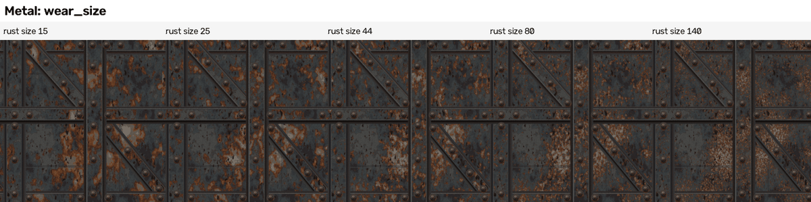
  

  Read the second strip: 8 features up the tile = long vertical drips; 30 = the fitted look; 110 = round speckle with no direction.
* **Wood: dry-brush streaks and hair lines** (TESTED; `recipes/wood/generator/wood_shaders.py`; numbers in `recipes/wood/description/S1_layout_paint_grain.json`,
  block `maps.grain`). Streaks: donut noise with 45 features across and 420 up (streaks about 28 dots long and 3 tall), Detail 1.5, cut hard at 0.58 (lighter by
  1.8 times above it) and at 0.38 (darker, 0.55 times, below it). Hair lines: donut noise with 5 across and 150 up; a dot is on a line when the noise is within
  0.012 of 0.5 (the noise's contour line).

  

  Read it: the lower the cut, the more of the noise counts as a light streak (0.50 smothers the board, 0.70 leaves almost none).
* **Slate (and offered in gravel): a very fine height grain** (TESTED; `recipes/slate/generator/slate_generator.py`, using `lib/recipe_tools.tileable_noise_group`):
  800 grain bumps across the tile, Detail 0, added to the brightness the height is made from (2 brightness steps). Result (`recipes/slate/final_report.json`,
  S1 against S2): the same-kind score rose from 0.707 to 0.725, but the dot-for-dot normal error got worse, 16.79 to 17.87 degrees. Random grain is not
  the reference's grain, so it is switched on for new tiles and off for traced ones.
* **Real-geometry tests** (TESTED, comparison only): brick (`gn_blobs_route.py`, a 4D noise with the blob's seed as W pushes each blob corner in or out),
  mud (`geometry_route.py`, noise Scale 2.2 Detail 0, its Color output minus 0.5 pushes the corners of each low-poly stone to make lumps),
  slate (`geometry_route_slabs.py`, donut noise for chips Scale 45, edge wobble Scale 26, moss Scale 8 cut at 0.50..0.58).

### 3.2 The settings and what they do (all TESTED in the toolbox research unless marked)

**Scale = how many blobs fit across the tile.** Doubling Scale halves the blob size.
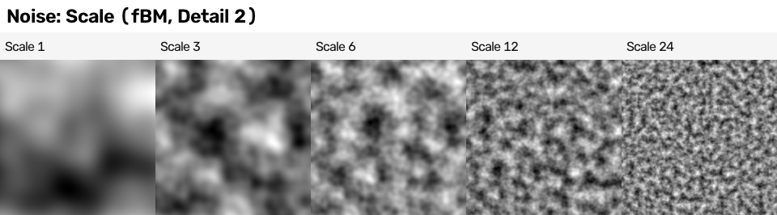

**Detail = how many finer layers are added.** 0 = one smooth layer; every step adds a finer grain. Fractions blend exactly (2.5 is half way between 2 and 3).
More Detail also makes the value FLATTER (spread 0.120 at Detail 0, 0.090 at Detail 1), so re-stretch after changing it. In 160-dot pictures layers above
about 6 were too small to see.
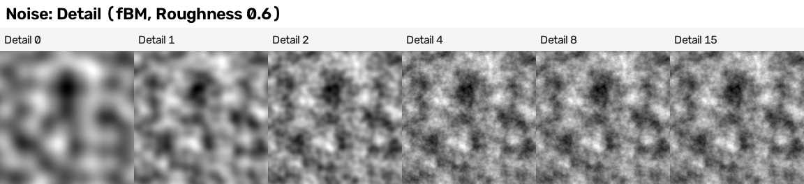

**Roughness = how strong the fine layers are.** 0 = only the big smooth blobs; 1 = every layer equally strong, grainy, almost like white noise.
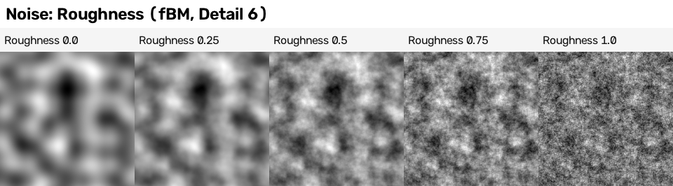

**Lacunarity = how much finer each layer is than the one before** (2 = each half the size). 1.2 = layers of nearly one size: smeared, wobbly shapes;
5 = very different sizes: a speckled look.
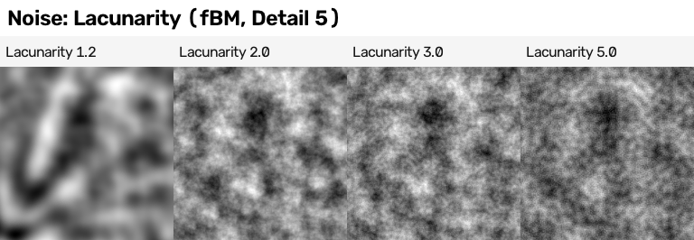

**Distortion = bends the position with another noise before reading.** 0.5 = swirls; 2 to 4 = marbled, folded streaks.
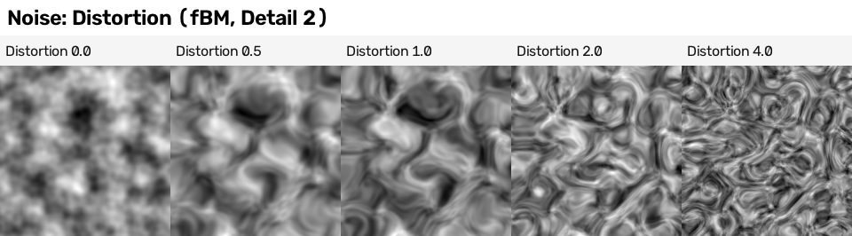

**Type (the fractal kinds):** fBM = even clouds (the default; used by every build). Multifractal = smooth valleys, rough peaks, values centred on 1.
Ridged = sharp ridges like cracks or veins. Hybrid and Hetero Terrain = peaks and plains. (This is the old Musgrave node, merged into Noise in 4.1.)
The picture stretches each to full black-to-white so their shapes can be compared.
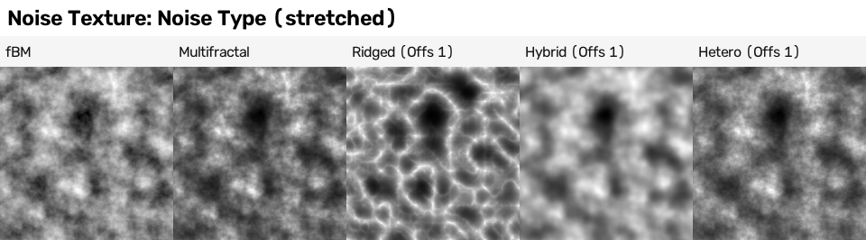

**Offset (Ridged, Hybrid, Hetero only) decides whether Detail does anything.** Ridged at Offset 0: the numbers at Detail 2 and Detail 8 were identical.
At Offset 1 the range became 0.09..1.8 and the detail appeared. Gain (Ridged, Hybrid) shifts the range again (Gain 2: 0.17..1.87).
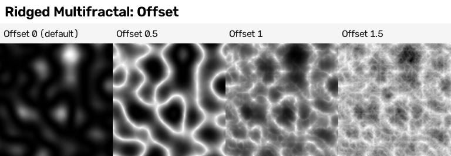

**Normalize: only fBM listens to it** (NEW, TESTED for this guide; numbers in `cookbook/checks/tool_guide_strips/numbers.json`, Scale 5, Detail 2).
fBM on: 0.244..0.717. fBM off: -0.897..0.759, and 52 per cent of the dots are below 0 (black in the strip). Ridged: 0..0.583 with it on AND off (mean 0.054:
nearly black). Multifractal: 0.224..1.893 on and off, 46 per cent of dots above 1 (white).
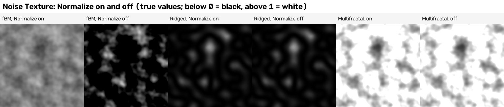

**Dimensions and W.** 2D ignores the third number of the position; 3D ignores W; 4D uses W as a fourth direction, so **W is a free "seed"**: change it and
you get a new, related pattern (value 0.51 became 0.45). The donut trick uses all four directions, so a donut noise takes its seed as an extra number added to one of them.
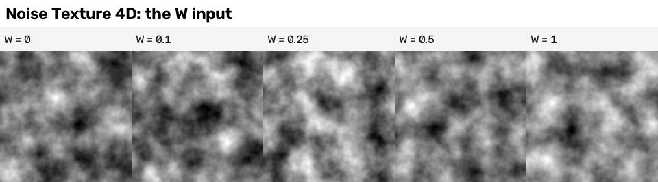

**Outputs: Factor and Color.** The red channel of Color is exactly the Factor; green and blue are two other, unrelated noises (NEW, TESTED: correlation with
the Factor 1.0, -0.092 and 0.028; `numbers.json`). So one Noise node gives three random values for the price of one. See "06 Guide - shapers.md", Separate and Combine.

### 3.3 Traps found by testing
* **Noise sits in 0.25..0.73** (toolbox research). NEW measurement (Scale 5, Detail 4, `numbers.json`): 0.26..0.708, and 90 per cent of dots lie between 0.381 and 0.611.
  The metal build stretches 0.27..0.71 to 0..1 before anything else (`metal_generator.py`, `add_noise_field`).
* **A cut on raw noise covers very little** (NEW, TESTED, `numbers.json`): share of the tile above a cut at 0.45 / 0.5 / 0.55 / 0.6 / 0.65 =
  74 / 48 / 22 / 6.7 / 1.1 per cent. The metal build stopped guessing and measured: it draws each noise once, reads where the values lie and sets each cut so
  each colour covers exactly the wanted share (`recipes/metal/analysis/calibrate_wear.py`; after that steel 0.67 against the reference's 0.63, rust 0.156 against 0.184).
  Strip: "06 Guide - shapers.md", Color Ramp.
* **Not seamless.** Moving the position by one whole tile changed Noise by 0.07 to 0.10 on average (`research/experiments_shader_node_toolbox/which_patterns_wrap.json`), even at whole-number
  Scale. The donut trick fixes it (seam number 0.87, where 1.0 = no seam; it costs about 30 per cent more time: 3.2 s against 2.5 s at 1254 dots, 4 samples;
  `research/02 Research - seamless tiles and baking.md`, section 1.3). Stretching with the Mapping node is NOT seamless (91 per cent of dots differ after one tile;
  hand-painted research 4.5); the donut's own across/up numbers are.
  
* **On the donut, a small Scale stretches the pattern** (seamless research: Voronoi at donut Scale 2 shows long soft cells). Keep donut scales at about 4 and up (NOT TESTED as an exact limit).
* **At whole-number positions Noise reads exactly 0.5** (0.500 at (0,0,0), (1,2,3), (2,5,1)...). On a grid of blocks every block gets the same grey. Use White Noise for "one random number per block".
* **A vector typed into an unconnected Vector socket is ignored**; the node then uses the object's own coordinates. Feed a real position in.
* **Grain that does not move with the picture.** In the slate build's half-tile test the grain stayed fixed while the shapes slid, so the height row of the test
  differed by 3.28 steps (the checker, `recipes/slate/verifier_answer.json`). Not a seam, but any noise must be read from the same (shifted) position as the shapes.
* **The red channel is the Factor** (above): taking "Color" for a second random number gives the same one again.

### 3.4 Recipe card (every line was run)
1. **Contrast a noise:** Noise (Scale 5, Detail 4 to 6) -> Map Range 0.3..0.7 to 0..1. (toolbox s02b; `cookbook/pictures/shaper-strip-clamp.jpg`, first square)
2. **Hard painted blotches:** Noise -> Map Range 0.45..0.55 -> Color Ramp Constant, 3 to 5 colours. (toolbox recipe card 2; hand-painted research 4.1)
3. **Seamless streaky wear with an exact share:** donut noise (44 across, 30 up, Detail 6, Roughness 0.6, Distortion 0.2) mixed 0.55 / 0.45 with a coarse donut
   noise (5 x 4) -> Map Range 0.27..0.71 -> Math Multiply Add (gain, offset) -> Color Ramp Constant with stops set by measuring -> Mix over the base. (metal build, `description/S.json`)
4. **Dry-brush streaks:** donut noise (45 across, 420 up, Detail 1.5) -> Map Range from 0.58 to 0.584 = a hard cut -> brightness x 1.8 where above. (wood build, `wood_shaders.py`)
5. **Hair-thin wavy lines:** donut noise (5 across, 150 up) -> Math Subtract 0.5 -> Math Absolute -> Map Range from 0.012 to 0.006 -> dark line. (wood build, `wood_shaders.py`)

---

## 4. Voronoi Texture

**What it is:** a node that scatters one random point in each cell of a grid and tells every dot how far it is from the nearest point(s), so it draws cells:
stones, tiles, cracks, dots.

**Example first.** Feature "Distance to Edge", then Math Less Than 0.05 = thin white lines round random cells (cracks or stone gaps) (TESTED, toolbox research).
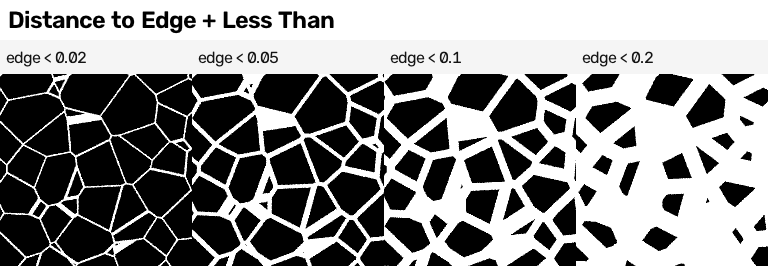

### 4.1 What it did on our surfaces
* **No final build uses the Voronoi node.** The brick build uses the same IDEA in plain Python: every brick face is cut into "mosaic" cells, each the part of the face
  nearest to its seed point, with wobbly shared edges (`recipes/brick/generator/mosaic_tools.py`). Its strip shows what the cell size does:
  
  (5000 dots: a few big flat facets per brick; 1100: mixed; 500 and 220: speckle.)
* **Wood tried it and dropped it** (TESTED, `recipes/wood/04 Recipe - wood - how it is made.md` section 11): Distance to Edge on stretched donut cells drew long
  DIAGONAL criss-cross lines, not the wanted horizontal hair lines. Contour lines of a stretched noise did the job (section 3.1).
* **Research first attempts** (TESTED, not used in the builds): gravel stones from cells (toolbox demo, same-kind 0.11); rivets on a regular grid (toolbox metal demo);
  the hand-painted research's painted gravel (stone cells, flat facets of Chebychev cells inside each stone, dark rims from Distance to Edge) reached 0.394, and
  0.417 with a brightness jitter per stone (`research/02 Research - getting a hand-painted stylised look.md`, section 5.2).

### 4.2 The settings and what they do (TESTED in the research)

**Scale = how many cells across the tile** (3 = a few huge patches, 24 = fine specks).
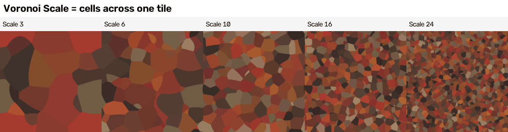

**Feature = which distance is measured.** F1: distance to the nearest point (soft bubbles). F2: to the second nearest (star-like ridges). Smooth F1: F1 blended with
its neighbours. **Distance to Edge**: distance to the border between cells (cracks, gaps). **N-Sphere Radius**: one flat grey per cell, half the distance to the nearest
neighbour (a per-stone size).
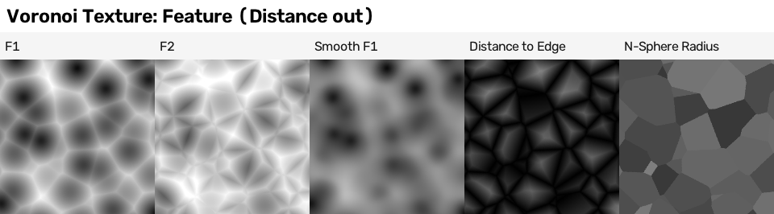
The **Color** output gives one random colour per cell (each channel averages about 0.45, range 0.01..0.97):
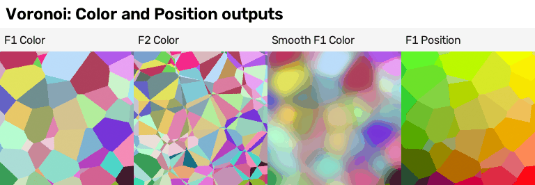

**Distance Metric = the shape of a cell.** Euclidean = round cells; **Manhattan** = diamonds; **Chebychev** = square-ish chunks (paving, slate, angular stones);
Minkowski + Exponent = in between (1 = Manhattan, 2 = Euclidean, large = Chebychev; **0.5 breaks the cells into noisy fragments**).
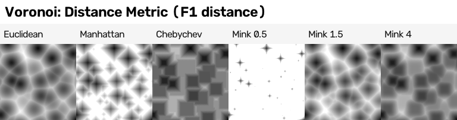
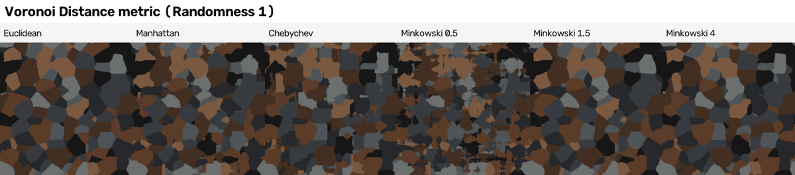

**Randomness = how far each point may wander from its grid square.** 0 = a perfect grid (with F1 and a cut: a neat row of round dots, i.e. rivets);
0.25 to 0.5 = an irregular brick-like grid; 0.75 to 1 = natural patches.
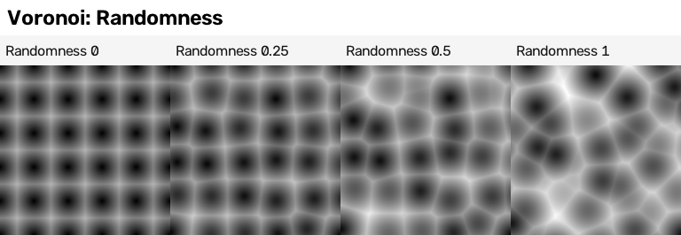

**Smoothness** (Smooth F1 only): 0 = hard cells, 1 = blobby merge. ([p13](../research/experiments_shader_node_toolbox/pictures/p13_voronoi_smoothness.png))
**Detail / Roughness / Lacunarity** (not for N-Sphere Radius): add layers of smaller cells. In practice Detail above 0 turns the cell field into scattered soft blobs on a
mostly white ground, good for speckle, not for "finer cells". ([p14](../research/experiments_shader_node_toolbox/pictures/p14_voronoi_detail.png))
**Normalize** (F1, F2, Smooth F1 only) makes values SMALLER, not bigger: F1 fell from 0.05..1.0 to 0.03..0.58.

### 4.3 Traps found by testing
* **Not seamless** (one tile's move changed it by 0.19 to 0.22 on average, `which_patterns_wrap.json`). Use `tileable_voronoi_group` (seam number 1.07 at Scale 6;
  seamless research section 1.2).
* **Do not make a per-cell random number from the Position output** of the seamless version: it gave straight cuts through the cells. Use the Color output
  (hand-painted research, picture `research/experiments_hand_painted_look/pictures/c02b_position_check/sheet.png`).
* **Shrinking cells to make stones gave daggers and slivers** (mud research first try, same-kind 0.204):
  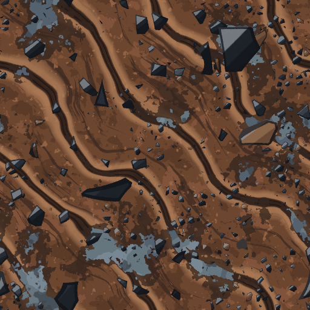
  The researcher's explanation (NOT TESTED): a flat slice through 4D cells has very uneven cell sizes. Polygons with a few straight sides per stone worked better.
* **Distance to Edge cuts are in tile units.** For a line w dots wide on a 1254-dot tile, use Less Than (w / 2) x Scale / 1254; measured widths came out about
  w + 1 dots for w of 4 and up (hand-painted research, section 4.7).
* **Cost:** the toolbox gravel attempt with six Voronoi nodes took 54 s at 1254 dots against 18 s for the brick attempt (toolbox section 12).
* **Blender 5.0 changed Voronoi's random pattern** (new hash): a file made in 4.5 will not look the same. WEB ONLY (release notes and a forum thread; no old Blender here).

### 4.4 Recipe card (every line was run in the research)
1. **Cracks:** Voronoi Distance to Edge, Scale 5 to 14 -> Math Less Than 0.012 to 0.1. (p15)
2. **Rivets on a grid:** Voronoi F1, Randomness 0, Scale 5 -> Math Less Than 0.09 (a Map Range of the distance 0..0.09 to 0.9..0.2 gives a dome shading). (toolbox metal demo)
3. **Flat palette patches, seamless:** seamless Voronoi (Scale = 1254 / patch size in dots, Randomness 0.75 to 1) -> Color output -> White Noise -> Color Ramp Constant
   (the palette) -> Hue/Saturation for a small jitter. (hand-painted research, recipe R1)
4. **Painted stones:** stone cells (Scale 12 to 64) + Chebychev facet cells seeded by the stone number + a dark rim from Distance to Edge. (hand-painted research, recipe R7; 0.394 to 0.417)

---

## 5. Brick Texture

**What it is:** a node that draws rows of rectangles with mortar between them and gives each brick a random mix of two colours.

**Example first.** Scale 1.7, Brick Width 0.5, Row Height 0.14, Offset 0.5 gives 3.4 bricks across and about 12 rows, the layout of the brick reference
(TESTED, toolbox research). The rule: **bricks across = Scale / Brick Width; rows = Scale / Row Height.**

### 5.1 What it did on our surfaces
* **No final build uses it.** The brick reference is not a perfect grid: its brick pitch along a course is 313.5 dots with a spread of 59.2, and 12 courses of 101.9 dots
  leave a sliver course of about 30 dots (`recipes/brick/04 Recipe - brick - how it is made.md`, section 2B). The node draws only a regular grid, so it cannot draw that; the build writes each course
  and joint into the description instead.
* **Research attempts** (TESTED): the toolbox brick and slate first attempts used it (same-kind 0.16 and 0.29); "stock" web chains rebuilt node by node scored brick 0.065,
  slate 0.183 and wood planks 0.048: "clean even rows, flat colour, no soot, no chips, no outline" (`research/02 Research - how people make each surface.md`; picture
  `research/experiments_how_people_make_each_surface/pictures/stock_chains_vs_reference.png`).

### 5.2 The settings (TESTED, toolbox research)
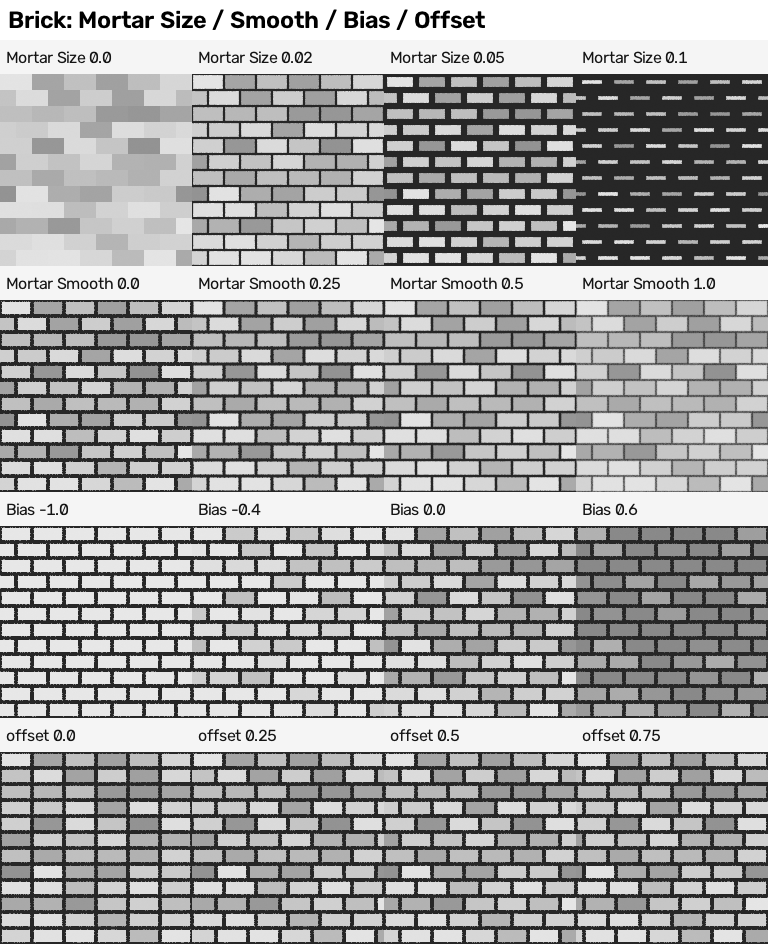
* **Color1 / Color2 and Bias:** each brick gets its own mix of the two colours (black and white gave 32 different greys on a small picture); Bias -1 or +1 uses only one colour.
* **Mortar Size:** measured in the same units as the brick height, so 0.1 on a 0.25-tall brick eats most of it. **Mortar Smooth:** 0 = hard edge; 0.02 to 0.1 = a soft edge
  that works with Bump. The **Factor** output is 1 in the mortar and 0 on a brick (with Mortar Size 0.03 at Scale 2, 33 per cent of the tile was mortar).
* **Offset and Offset Frequency:** 0.5 = the usual half-brick shift; 0 = bricks stacked in columns; Frequency 3 = only every third row shifted.
* **Squash and Squash Frequency:** every Nth row narrower or wider.
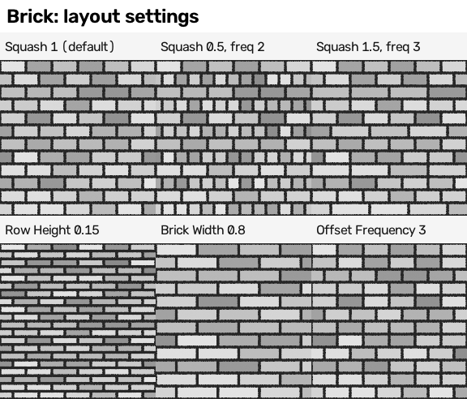

### 5.3 Traps
* **Only the mortar tiles, and only with whole numbers.** Scale 2, Width 0.5, Height 0.25 (4 x 8) repeats exactly; Scale 4.3 breaks everything; the random brick COLOUR
  never repeats (difference 0.15 after one tile, `which_patterns_wrap.json`). With Squash, Scale / (Brick Width x Squash) must also be whole (Squash 0.75 at Scale 3 worked,
  0.62 broke; seamless research 1.4).
  
* **No brick number and no position inside the brick**, so you cannot shade each brick's top edge or pick a colour per brick that repeats. The research's home-made brick
  (Math Floor / Fraction / Floored Modulo + White Noise) does both and tiles exactly (section 7.3 and the shapers guide).
* **Bump shows nothing on hard mortar at its default Filter Width 0.1**; use 1 to 4 (toolbox research, picture `e04_bump_filter_width.png`).

### 5.4 Recipe card (every line was run in the research)
1. **Brick layout like the reference:** Scale 1.7, Width 0.5, Height 0.14, Offset 0.5. (toolbox z01)
2. **Slate shingles:** Scale 1.0, Width 0.17, Height 0.125, Offset 0.5, black mortar for the outlines. (toolbox z01)
3. **Seamless mortar mask:** whole counts (Scale 2, Width 0.5, Height 0.25), use only the Factor; take colour variation from a seamless noise. (seamless research 1.4)
4. **Planks:** Scale 1, Brick Width 1, Row Height 0.2 (the stock wood chain: it ran, but scored only 0.048). (how-people research)

---

## 6. Wave Texture

**What it is:** a node that draws stripes (bands) or rings from a repeating wave, and can bend them with a built-in noise.

**Example first.** Bands along Y, Saw profile, Scale 24, Distortion 5, Detail 3 = wavy horizontal wood grain (TESTED, toolbox wood attempt).

### 6.1 What it did on our surfaces
No final build uses it. The toolbox attempts used it for wood grain and for mud tyre ruts (bent diagonal bands); those attempts scored 0.13 (wood) and 0.05 (mud).
The wood build made its grain from stretched donut noise instead (section 3.1), because Wave with Distortion is not seamless.

### 6.2 The settings
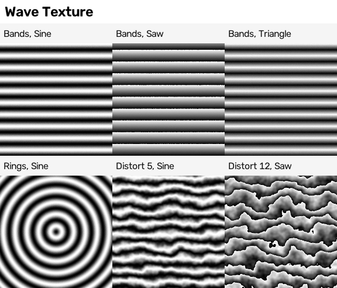
* **Type:** Bands (stripes) or Rings (circles round one centre; Spherical rings make knots once centred with Mapping).
* **Direction:** X, Y, Z or Diagonal for bands.
* **Profile:** Sine (smooth), Saw (a sharp edge every period), **Triangle** (exists in 5.2.2 though the manual lists only two). ([profiles](../research/experiments_hand_painted_look/pictures/c04_wave_profile/strip.png))
* **Scale:** how many bands. **Distortion:** how much the built-in noise bends them (5 = wavy, 12 with Saw = torn, jagged edges); **Detail, Detail Scale,
  Detail Roughness** = the bending noise. ([distortion](../research/experiments_hand_painted_look/pictures/c04_wave_distortion/strip.png))
* **Phase Offset = slides the bands** (NEW, TESTED for this guide, `numbers.json`; Bands X, Sine, 5 bands, 256 dots):
  a full turn (6.283) gives exactly the same picture (difference 0.0); a half turn (3.142) gives exactly the negative of the first picture (difference 0.0 from
  1 minus the original); a quarter turn (1.571) moves the bands a quarter of a band to the LEFT (12.8 of 51.2 dots; the measure's best match was 64 dots to the left = 1 1/4 bands,
  which on repeating bands is the same picture). With Distortion 3, a quarter turn changed the picture by 0.45 on average, so bent bands move too. Phase Offset is therefore the dial for "the same grain, moved", and an animation dial.
  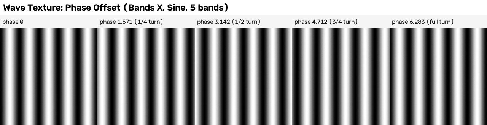

### 6.3 Traps
* **Bands tile only with Scale = k x pi/10 (k whole) and Distortion 0** (seamless research 1.2: Scale 3 x pi/10 = 0.942 passes; Scale 3 fails). Five bands = Scale 1.5708.
* **Distortion breaks the tiling** (83 per cent of dots differ, hand-painted research 4.5). To bend tiling bands, bend the POSITION with a seamless noise first
  (seamless research: seam number 0.37, passes).
* **Rings never tile** (one centre).
  

### 6.4 Recipe card (every line was run)
1. **Wood grain look:** Bands Y, Saw, Scale 24, Distortion 5, Detail 3. (toolbox wood attempt; not seamless)
2. **Seamless bands:** Scale = k x pi/10, Distortion 0, bent by a seamless noise added to the position. (seamless research, `fig10_tileable_bricks_and_wave_groups.png`)
3. **Slide the same bands:** Phase Offset; 6.283 = one whole band. (this guide, `pattern-strip-wave-phase-offset.jpg`)

---

## 7. White Noise Texture

**What it is:** a node that gives a completely different random number (0..1) for every different position, with no smoothness at all.

**Example first.** Snap the position to a 32 x 32 grid (Vector Math Snap 1/32), then White Noise: 1019 different random values over the 1024 blocks, from 0.001 to 0.999
(TESTED, toolbox research).
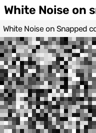

### 7.1 What it did on our surfaces
**Per-dot grain on brick and metal** (TESTED; `recipes/brick/generator/brick_generator.py`, `recipes/metal/generator/metal_generator.py`). The chain:
Position x 1254 (the tile in dots) -> Vector Math Floor (whole dots) -> add a seed to the third number -> White Noise 3D -> Map Range 0..1 onto 1 - a..1 + a,
with a = amount x 0.5 / 0.2887 -> Combine Color -> Mix Multiply (Factor 1) with the colour. Why 0.2887: an even random number between 0 and 1 has a spread of 0.2887,
so this makes **amount = the spread of the brightness change** (amount 0.10 = a typical dot 10 per cent lighter or darker than its patch).

0 = flat painted patches; 0.05 = a faint tooth; 0.10 = clearly grainy; 0.25 = sandpaper. What it did to the scores (brick class L, `recipes/brick/scores/rate_distortion.json`):
grain 0 / 0.10 / 0.14 gave colour structure (SSIM) 0.672 / 0.593 / 0.537 and same-kind score 0.434 / 0.555 / 0.598 (the other bake of L, in
`final_report.json` "classes", gives 0.673 and 0.432 for grain 0). Random grain cannot match the reference's grain
dot for dot, so the dot-for-dot measures fall while the same-kind score rises. Metal uses 0.12 (`description/S.json`); its zoomed strip:
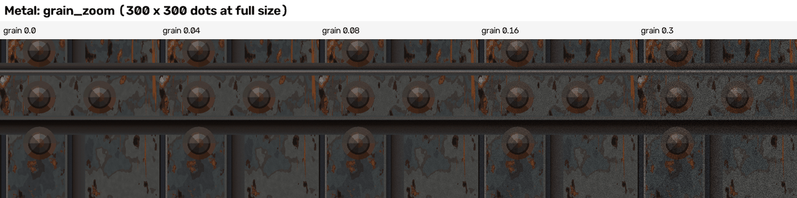

### 7.2 Traps
* **Part of the "better score" is a measuring effect.** Grain makes the ordinary jump between neighbouring dots bigger, so the seam number inside the same-kind score
  improves although no seam was fixed: about 0.04 of the 0.165 gain on brick L (the checker's correction, brick recipe guide section 4, item 7).
* **Two bakes of the same tile differ by about 3 colour levels when grain is on.** With 8 samples per dot, Cycles reads the White Noise at slightly different spots
  inside each dot, so the metal half-tile test (a shifted bake against the first one rolled back) showed a mean difference of 3.2 levels; with grain 0 it fell to 0.71 (the checker, `recipes/metal/verifier_answer.json`). Harmless, but do not
  read a 3-level difference as a seam.
* **Read the position of the DOT, not of the 3D shape.** The first metal grain used the 3D position of each painted shape, so a shape's height in the paint stack
  changed its grain; fixed by using only the dot number (metal recipe guide, section 10, item 13).
* **Tiny number errors can give different results** for positions that should be equal (manual: add an arbitrary offset if bands appear). NOT TESTED.

### 7.3 Recipe card (every line was run)
1. **Per-dot grain:** the brick / metal chain above, amount 0.10 to 0.14. (brick and metal builds)
2. **One random number per block:** Vector Math Snap (1/32) -> White Noise. (toolbox p32)
3. **One random number per brick that tiles:** row = Floor(v x rows), column = Floor(u x columns + 0.5 x (row mod 2)), both wrapped with Floored Modulo ->
   Combine XYZ (column, row, 0) -> White Noise 2D. 48 bricks gave 48 different values and the picture was identical after one tile's move (difference 0.0).
   (toolbox section 8.1; picture `r01_home_made_brick_tiled_2x2.png`)
4. **One random number per Voronoi cell:** Voronoi Color -> White Noise (a different W for each independent number). (hand-painted research 4.2)

---

## 8. Gabor Texture

**What it is:** a noise made of short ripples that all run in a chosen direction, like brushed metal, wood fibres or sand ripples (new in Blender 4.3).

### 8.1 What it did on our surfaces
No build uses it. It was tested only in the research.

### 8.2 The settings (TESTED in the research)
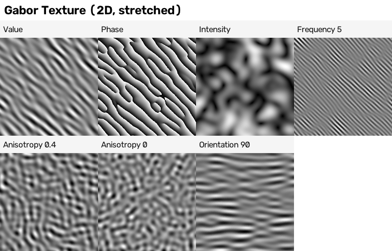
* **Scale** = overall size. **Frequency** = how many ripples across their direction (5 = fine hairlines).
  ([frequency strip](../research/experiments_hand_painted_look/pictures/c04_gabor_frequency/strip.png))
* **Anisotropy** = how strictly they share one direction: 1 = all parallel, 0.4 = partly scrambled, 0 = no direction.
  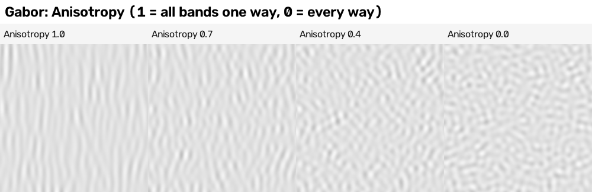
* **Orientation** (2D) = the angle: 0.785 (45 degrees) by default, 1.57 = horizontal ripples. ([orientation strip](../research/experiments_hand_painted_look/pictures/c04_gabor_orientation/strip.png))
* **Outputs:** Value (the ripples, with weak patches), **Phase** (clean stripes with no weak patches, 0..1), **Intensity** (smooth blobs: near zero where the ripples break up;
  multiply by it to hide the broken spots). 2D ignores the third number of the position; 3D uses it.

### 8.3 Traps
* **Low contrast:** the Value stays near 0.5 grey; stretch it hard with Map Range.
* **Bands, not brush strokes** (hand-painted research, claim check).
* **Never seamless** (45 per cent of dots differ after one tile; seam number 13.9). It has no 4D version, so the donut trick cannot be used. A cross-fade of four copies,
  each shifted by one tile and handed over with cos/sin weights, brought the seam number to 1.09; it still fails the strict shift test, and two patterns blended in the
  middle can show as a ghost on structured patterns (seamless research 1.5 and 1.7).
* It costs more than Noise (manual). NOT TESTED here.

### 8.4 Recipe card
1. **Directional streaks for look-development:** Gabor 2D, Anisotropy 1, Orientation 1.57 for horizontal ripples -> Map Range to stretch. (hand-painted research strips; not seamless)
2. **Seamless-looking Gabor:** the four-copy cross-fade with cos/sin weights (seamless research 1.7, seam number 1.09). Only these two combinations were run.

---

## 9. Magic Texture

**What it is:** a node that makes a colourful pattern of crossing sine waves.

What it does (TESTED, toolbox research): Depth 0 to 2 = smooth woven bands; Depth 10 with Distortion 4 = a fine grain like white noise.
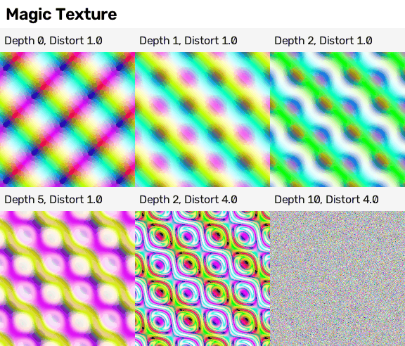

On our surfaces: not used by any build, and the research found little use for it (a cheap smooth colour field to bend positions: NOT TESTED).
Seamless only with **Scale = k x 2 pi / 5** (Scale 2 x 2 pi / 5 = 2.513 passed; Scale 2 failed; seamless research 1.2).
Recipe card: only the seamless rule above was run.

---

## 10. Gradient Texture

**What it is:** a node that turns the position into a smooth ramp: from left to right, or round a centre.

Types (TESTED, toolbox research): Linear (left to right), Quadratic, Easing (smooth start and end), Diagonal, Spherical and Quadratic Sphere (bright in the middle),
Radial (the angle round the centre).
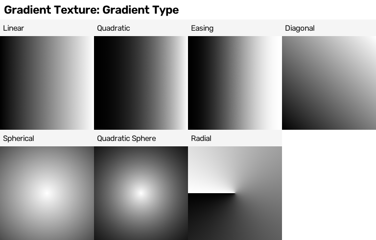

On our surfaces: not used by any build (fades along a slate or a plate were drawn as shapes).
Traps (TESTED): the round types are centred on the tile CORNER (the point 0, 0) unless you first move the position by (-0.5, -0.5) with Mapping (done in the picture);
a Linear gradient never tiles (it jumps from white to black at the join); Linear followed by Math Ping-Pong looks seamless because it becomes a mirror (seam number 0.16;
seamless research 1.2).
Recipe card: (1) centred glow: Mapping location (-0.5, -0.5) -> Gradient Spherical (toolbox p01); (2) a seamless back-and-forth ramp: Gradient Linear -> Math Ping-Pong (seamless research).
"A vertical fade for moss or drips: Linear along v times a noise" is suggested in the toolbox research but NOT TESTED.

---

## 11. Checker Texture

**What it is:** a node that draws a chessboard of two colours; Scale = how many squares across.

On our surfaces: not used by any build. It is a good test pattern for layouts and for checking that something tiles.
Traps (TESTED): it tiles only with an EVEN Scale (Scale 8: difference 0.0 after one tile; Scale 7 doubles a square at the join). The project's quick seam number
gives false alarms here: a perfect Scale 8 checker scored 73 because a real square edge falls exactly on the tile border (seamless research 1.1). Trust the
"move by one tile and compare" test, not the seam number, for hard-edged patterns.
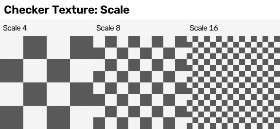
Recipe card: Checker Scale 8 as a seamless layout test (`which_patterns_wrap.json`).

---

## 12. Radial Tiling (new in Blender 5.0)

**What it is:** a node that cuts the picture into pie slices round a centre and gives each slice its own coordinates, so any pattern repeats round the centre.

**Example first** (NEW, TESTED for this guide): move the position so the centre of the tile is (0, 0) (Vector Math Subtract 0.5, 0.5) -> Radial Tiling (Sides 8) ->
its **Segment Rotation** output (one fixed angle per slice) -> Math Subtract 0.785 (the light direction) -> Math Cosine -> Map Range -1..1 to 0.25..0.9, kept inside a disc
of radius 0.38. Each slice gets one flat shade: a faceted rivet head, like the metal reference's rivets.
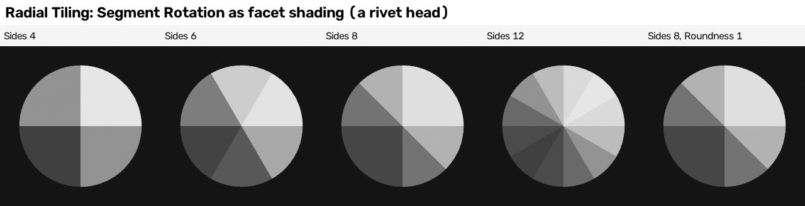

What was measured (`numbers.json`): Segment Rotation took exactly 4, 6, 8 and 12 different values for Sides 4, 6, 8 and 12 (for 8 sides: 0.393 to 5.89, one value per slice).
With the light at 0.785 the 8 facets came out as only 4 shades, because the light then sits exactly between two facets and mirror pairs face it equally; with the light
at 0.6 all 8 facets got their own shade. **Roundness 1 changed nothing in this chain** (same 8 rotation values, same picture). My reading (NOT TESTED separately): Roundness acts on the slice's own
coordinates, which this chain does not use.

Other settings (TESTED once, toolbox research, a Checker drawn inside each slice): **Sides** (a value such as 5.5 gives one smaller odd slice), **Roundness**
(0 = straight slice edges, 1 = round), **Normalize**. Outputs: Segment Coordinates, Segment ID, Segment Width, Segment Rotation.
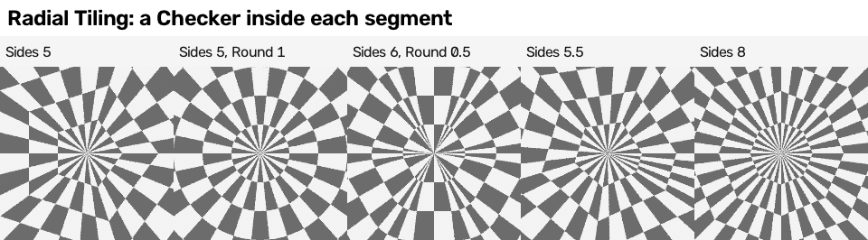

On our surfaces: not used by any build. The metal build drew its rivet as a picture of 4 rings x 8 slices of flat colour, made in Python (`recipes/metal/generator/metal_shapes.py`);
Radial Tiling could make the slices inside the shader instead. NOT TESTED as a replacement in the metal build, and the rings were not tried.
Recipe card: (1) faceted rivet head (above); (2) a Checker inside each slice (toolbox p35).

---

## 13. Which pattern makers tile by themselves (summary, TESTED in the seamless research)

| Pattern maker | Seamless? | How to make it seamless |
|---|---|---|
| Noise, Voronoi | no | the donut trick (`tileable_noise_group`, `tileable_voronoi_group`) |
| Brick | mortar only, with whole counts | whole numbers of bricks and rows; colour per brick from a home-made brick |
| Wave (bands) | only Scale = k x pi/10 and Distortion 0 | bend the position with a seamless noise instead of Distortion |
| Wave (rings), Gradient, Gabor | no | Gradient: Ping-Pong mirror; Gabor: cross-fade |
| Magic | only Scale = k x 2 pi/5 | |
| Checker | only an even Scale | |
| White Noise | no smoothness, so no visible seam at whole-dot positions (brick recipe guide) | |
| Radial Tiling | one centre per tile; seamless as long as the pattern stays inside the tile (my reasoning, NOT TESTED) | |

---

## 14. Lessons that carry to other surfaces

1. **Describe the shapes, use pattern makers inside them.** All six builds draw the big elements from numbers and use pattern makers for grain, streaks and wear. A pattern
   maker alone gave 0.05 to 0.29 (toolbox first attempts); the painters' new tiles 0.35 to 0.75 (section 2).
2. **Measure the size first.** The metal build's first wear was far too fine (90 x 64 features: patches 4 to 5 dots wide instead of 9 to 13); matching the measured patch size
   fixed it (metal recipe guide, section 10, item 10). Turn "patch size in dots" into "features across the tile" = 1254 / size.
3. **Measure the share, then set the cut.** A noise is not spread evenly; set each cut from the share of the tile you want (metal `calibrate_wear.py`; table in 3.3).
4. **Stretch, then cut.** Every useful chain here is "pattern maker -> Map Range stretch -> hard cut or Constant ramp".
5. **Make it seamless at the source** (donut trick, whole-number rules) and check it with the half-tile test, not only with the seam number.
6. **Grain is a style choice, not accuracy:** it raises the same-kind score and lowers the dot-for-dot scores.

## 15. Tested for this guide, and not tested

TESTED for this guide (Blender 5.2.2, `-b --disable-autoexec -t 2`, 256-dot squares, 4 samples for the pictures, 1 sample for the numbers; the whole run took
about 14 seconds): Wave Phase Offset (full, half and quarter turns; with Distortion 3); Noise Normalize on and off for fBM, Ridged and Multifractal; Radial Tiling
Segment Rotation as facet shading for Sides 4, 6, 8, 12, Roundness 0 and 1, light at 0.785 and 0.6; the share of the tile above a cut on raw noise; Noise Color channel
correlations. Script: `cookbook/checks/tool_guide_strips/make_tool_guide_strips.py`; numbers: `cookbook/checks/tool_guide_strips/numbers.json`.
No test failed; one surprise is reported above (8 facets gave 4 shades with the light at 45 degrees).

NOT TESTED: Radial Tiling without centring the position, its Segment Coordinates and rings; Magic as a field to bend positions; a Gradient-times-noise fade;
Gabor's cost; the Voronoi look before Blender 5.0; Hybrid and Hetero Terrain beyond the type picture; noise at 4D donut scales below 4; the manual's White Noise rounding pitfall;
any pattern maker in EEVEE (no graphics card here).
