# 06 Guide - relief - height, bump, displacement and normal maps

What this is: a guide to the maps and tools that make a flat picture look raised and sunken: the height map, the normal map, Blender's Bump node,
Normal Map node and Displacement, plus how the six builds made their height and normal maps from the colour picture and how close that can ever get.
Every rule is shown on an example from the builds or from a test, with the file that holds the numbers.
Companion guides: "06 Guide - seamless tiles and coordinates.md", "06 Guide - pattern makers.md", "06 Guide - shapers.md".

## How to read this guide

Words used (one word for each thing, always; the same words as the other 06 guides):
* **tile** = the square picture we make. **dot** = one pixel of it. **picture size** = dots across (1254 for the references and the finals).
* **relief** = how raised or sunken each place of the surface is.
* **height map** = a grey picture of the relief: white = high, black = low. **height** = one value of it (0 to 1, or 0 to 255 "steps" in an 8-bit file).
* **normal map** = a blue-violet picture in which each dot's colour says which way the surface there is tilted. **normal** = that tilt direction.
* **slope** = how fast the height changes from one dot to the next. **strength** = the number the slope is multiplied by before it becomes a normal.
* **OpenGL** and **DirectX** = the two ways of storing a normal map (they differ only in the green channel; Blender uses OpenGL).
* **the derivation** = the rule that turns a colour picture into a height map and a normal map. **ceiling** = the best a derived map can ever match the
  reference, even with a perfect colour picture.
* **build** = one of the six surface jobs in `recipes/` (brick, slate, wood, metal, mud, gravel). **description** = a build's list of numbers.
* **height error** = mean difference from the reference's uploaded 8-bit height, in steps of 255, after the best brightness-and-contrast fit
  (`lib/pixel_compare.py`). **normal error** = mean angle between our normal and the reference's, in degrees.
  **flat normal** = a normal map with no tilt at all; its normal error is the "do nothing" baseline.
* **same-kind score** = `lib/texture_compare.py` overall: 1 = the same kind of surface as the reference; other real reference surfaces score 0.16 to 0.50
  (not "about 0.1"; baking and checking guide, section 7.4).
* **tier** = `lib/pixel_compare.py`'s dot-for-dot verdict: none, layout, close (normal error 12 or less, height error 20 or less, and colour measures),
  exact (normal error 4 or less, height error 6 or less, and colour measures).

Labels: **TESTED** = run in Blender 5.2.2 or plain Python on this machine and measured; the file is named. **NOT TESTED** = only read, or only reasoned.

Where the facts come from: `research/02 Research - seamless tiles and baking.md` sections 2.3, 3 (folder `research/experiments_seamless_tiles_and_baking/`),
`research/02 Research - the shader node toolbox.md` section 7 (folder `research/experiments_shader_node_toolbox/`), the six builds' reports and their
checkers' findings (`recipes/<surface>/builder_answer.json`, `final_report.json`, `verifier_answer.json`, `04 Recipe - <surface> - how it is made.md`), and one
new picture and measurement for this guide (`cookbook/checks/seamless_and_relief_strips/finish_strips.py`, numbers in `numbers_coordinates.json`, "relief_opengl_directx").

In tables, a short path such as `brick/builder_answer.json` means `recipes/brick/builder_answer.json`; "research" means the research guide named above.

---

## 1. The short version

Example first. The mud reference (`recipes/mud/final_report.json`, derivation_ceiling): take each dot's grey brightness (0.299 red + 0.587 green +
0.114 blue, on the ordinary 0..255 colour numbers), stretch grey 20..128 to height 0..255, blur by half a dot. That reproduces the uploaded height to
3.32 steps of 255 (correlation 0.997). Take the slope of that height between the left and right neighbours, times 9: that reproduces the uploaded
normal map. So the mud's height and normal maps are not separate artwork; they are two sums on the colour picture.

The rules that would have saved the most time:
1. **Find out how the reference's maps were made before making your own.** All six reference heights are colour brightness (3 to 5 steps of 255 off), and
   all six normal maps are the slope of the 8-bit height with whole-number strengths: brick 6, slate 7, wood 8, metal 5, mud 9, gravel 10.
2. **That gives a ceiling.** With a perfect colour picture the derived maps are still 3 to 5 steps (height) and 2.7 to 4.6 degrees (normal) off. Any
   remaining error is the colour picture's fault.
3. **The normal map is the hardest measure.** It is the slope of the finest detail. The best any build reached was 9.68 degrees (slate); invented detail
   in the wrong place makes it WORSE than a flat normal map (gravel 37.8 against 24.5 for flat).
4. **Strength = how many dots tall white stands above black.** By the tested Bump rule (section 5), strength 6 on a 1254-dot tile is about a Bump node
   Distance of 6 / 1254 = 0.0048 tile widths. Scale strength with the picture size; a Bump Distance does not need it.
5. **The Bump node's default Distance (0.001) is nearly flat,** and its default Filter Width (0.1) hides hard steps. Use Distance 0.02 to 0.1 for a
   one-unit tile and Filter Width 1 to 4 for steps.
6. **Bump changes only the shading; Displacement moves the surface** and needs Material > Settings > Displacement set away from the default "Bump Only",
   plus a fine mesh (adaptive subdivision, Dicing Rate 1 to 2).
7. **Blender wants OpenGL normal maps (green up).** A DirectX map lights the surface from the wrong side. A one-line test on the map alone tells them apart.
8. **Save heights as 16-bit, Non-Color, view transform Raw.** 8-bit heights make terraces in the slope.
9. **Real geometry gives a true relief, but it did not match these references** (their height is brightness; brick's mortar is HIGH). Geometry height
   correlated -0.15 (brick), 0.07 (metal) and about 0 (gravel) with the reference height; 50/50 mixes did not help.

---

## 2. The three maps in one picture

**Height map, in one sentence:** a grey picture where white is high and black is low.
**Normal map, in one sentence:** a picture whose red says how much each dot tilts left or right, whose green says how much it tilts up or down the picture,
and whose blue says how much it faces straight out (flat = (0.5, 0.5, 1.0), the familiar blue-violet).

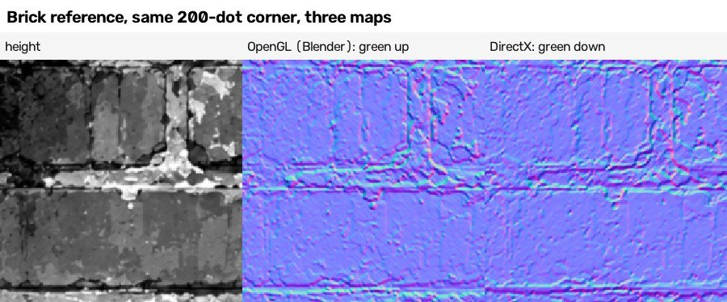

Look at the middle picture: where the height goes from dark to bright going DOWN the picture (the top edge of a bright mortar band), the normal map is light
green; in the right-hand (DirectX) picture the same places are dark in green. That is the whole difference between the two (section 7).

---

## 3. Height from colour brightness: the derivation and its ceiling

**What it is, in one sentence:** a small rule that turns each dot's colour into a height: a grey brightness, a stretch (or a tone curve), and a slight blur.

**Example first (brick, `recipes/brick/04 Recipe - brick - how it is made.md`, section 2A):** one dot of the reference is red 138, green 66, blue 43. Its grey
brightness is 0.299 x 138 + 0.587 x 66 + 0.114 x 43 = 84.9. After a 0.7-dot blur, 84.9 is looked up on the brick's 12-point tone curve: it lies just
above the point 84.6 -> 117.3, so the height is about 118 of 255. Done for every dot, that is the reference height to within 3 steps.

### 3.1 What each build measured

| build | grey | stretch or curve | blur (dots) | height error from the reference colour | normal strength (whole number) | normal error from the uploaded height | normal error from the colour-made height (the ceiling) | flat normal | file |
|---|---|---|---|---|---|---|---|---|---|
| brick | 0.299 R + 0.587 G + 0.114 B | 12-point tone curve, steep (one grey step = 2 to 3 height steps) | 0.7, before the curve | 3.02 after the best fit (3.05 before it; the checker's 3.05 is the number before the fit) | 6 | not recorded | **3.6** (checker 3.63) | not comparable* | `brick/builder_answer.json`, `verifier_answer.json` |
| slate | same | straight: 2.5 x (grey - 9.5), cut at 0 and 255 | 0.5 | 2.95 with a tone curve; checker with the straight line actually used: 3.77, 3.03 after the best fit | 7 | 0.34 | **2.76** (checker 2.71) | 11.3 | `slate/final_report.json`, `verifier_answer.json` |
| wood | same | straight: (grey - 12) / 116 | 0.5 | 4.15 | 8 | 0.34 | **4.6** with the plain slope used (4.3 with Sobel; checker) | 24.1 | `wood/builder_answer.json`, `verifier_answer.json` |
| metal | same | 12-point tone curve (grey 50..72 -> height 100..170) | 0.7 | 5.0 (4.93 after the best fit) | 5 | 2.06 (Sobel slope) | **3.71** (corrected, see 3.3) | not comparable* | `metal/04 Recipe ...`, section 3.1 |
| mud | same | straight: (grey - 20) / 108 | 0.5 | 3.32 (checker 3.19) | 9 | 0.35 | **3.7** with Sobel at 10; 4.8 plain slope at 8; checker 4.42 | 23.5 | `mud/final_report.json`, `verifier_answer.json` |
| gravel | its own mix: (267.15 R + 91.48 G + 210.5 B) / 255 - 17.7 (green hardly counts) | straight, cut at 0 and 255 | 0.5 | 5.02 | 10 | 0.34 | **4.6** with Sobel at 12; 5.9 plain slope at 12 | 24.5 | `gravel/builder_answer.json` |

\* brick's and metal's builders measured the flat normal with the angle mistake described in 3.3, so their flat numbers are left out. Measured the
dot-for-dot tool's way for the baking and checking guide (section 7.5, `cookbook/checks/baking_and_checking/flat_baselines.json`): brick 16.72, metal 13.26.

What the table says, in plain words:
* **Height:** brightness follows each reference height almost perfectly (correlation 0.989 to 0.997). What is left (3 to 5 steps) is a little blur and
  tone-curve detail.
* **Normal from the uploaded height:** the slope of the reference's own 8-bit height reproduces its normal map to a third of a degree. The seamless
  research found the same for all six with the plain slope ("central difference") at whole-number strengths 6.00, 7.02, 7.99, 5.00, 9.00, 9.99, average
  error 0.5 of an 8-bit step, which is rounding (`research/experiments_seamless_tiles_and_baking/reference_normal_recipe_fit.py`).
* **Normal from a colour-made height (the ceiling):** 2.7 to 4.6 degrees. The tier "exact" asks for 4 degrees or less (and height 6 or less). By the numbers
  that is within reach for slate, brick, metal and mud (mud only with the Sobel slope) and just out of reach for wood and gravel. Brick and metal were
  actually run through `lib/pixel_compare.py` with the reference colour by their checkers and reached tier "exact" (`brick/verifier_answer.json`,
  `metal/verifier_answer.json`); the other four were not.
* **A slightly smoothing slope (Sobel) matches better than the plain slope when the height is made from the colour** (mud 3.7 against 4.8, gravel 4.6
  against 5.9, wood 4.3 against 4.6), and its best strength is then a little above the reference's (mud 10 against 9, gravel 12 against 10). It does not
  when the height is the reference's own.

### 3.2 How to fit the rule for a new surface (what the builds did)

1. Grey brightness on the ordinary screen numbers (not Blender's linear numbers). Try the plain 0.299 / 0.587 / 0.114 first; gravel needed its own mix.
2. **Stretch:** the gravel builder's rule of thumb: take the tile's own 1st and 99th percentile of grey and stretch them to about 10 and 245
   (`gravel/builder_answer.json`). Slate's first cedar bake reused the slate stretch and the whole height map came out white (`slate/builder_answer.json`).
3. **A few curve points are not enough when there is clipping:** slate's 4-point curve was off by 17.9 steps because it cannot bend flat at the ends
   (checker's note), 8 points 7.9; the straight line with cut-offs that the generator uses: 3.77 (3.03 after the best fit; checker).
4. **Blur first, then the curve** (brick: 3.0 against 5.0 steps the other way round).
5. **Blur half a dot to 0.7 of a dot** (all six). In the brick strip below, 1.5 dots softens the normal map a little, 3 and 6 clearly:

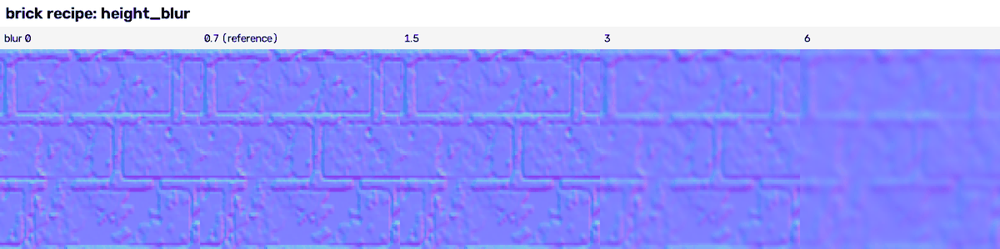

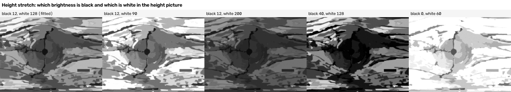

The blur can also be done by the renderer: Cycles' Gaussian pixel filter used on the height picture. Slate measured it at 1254 dots
(`recipes/slate/final_report.json`, filter_width_test): width 1 and 1.5 = a 0.3-dot blur, width 2 = 0.5, 3 = 0.7, 4 = 0.9, 6 = 1.4, 8 = 1.8 (about
4 x the blur). This width is counted in dots of the render, so the same width blurs more of the tile in a smaller picture (the slate strip below was made at
384 dots; the checker noted it blurs about 3.3 times more of the tile than at 1254).

**Where the builds did it:** in numpy, after Blender photographed the colour (all six: `generator/derive_maps.py` or the generator's last step). In
Blender nodes the toolbox research used Gamma 0.4545 (Blender's linear numbers back to screen numbers) -> RGB to BW -> Height, and that raised its demo
recipes' scores (brick normal group 0.33 -> 0.43, slate height group 0.03 -> 0.14; toolbox research 8.8). How close that node chain is to the
0.299 / 0.587 / 0.114 rule was NOT measured.

### 3.3 Traps in measuring the ceiling

* **Normal maps saved in 8 bits are not exactly length 1.** Metal's first ceiling (5.7 and 6.7 degrees, "exact cannot be reached") was a measuring
  mistake: the arrows read from the 8-bit reference were on average 0.9957 long and were used without making them length 1, which alone adds about 5 degrees.
  Made length 1 (as `lib/pixel_compare.py` does): 2.06 and 3.71 degrees, and the reference colour through the generator's rule reached tier "exact"
  (`recipes/metal/verifier_answer.json`; the metal guide is corrected). The brick build recorded a similar unexplained gap (5.9 degrees by the builder's own
  measure, 3.6 by the project's tool); it was not re-measured, so the same cause is likely but NOT TESTED.
* **Say which slope you used.** Wood's guide quoted the Sobel number (4.3) while describing the plain slope its generator uses (4.6) (`wood/verifier_answer.json`).
* **Both tools now read the same reference height, the 8-bit upload.** The slate builder wrote that `texture_compare.py` reads the 16-bit copy smoothed by
  0.8 dots (`slate/builder_answer.json`); that was true of the tool before it was changed at 15:45 on 19 October. Today it reads `height_as_uploaded.png`
  whenever the folder has one (read in `lib/texture_compare.py`, `summarise`; baking and checking guide, section 5). Smoothing your own height can still move
  the same-kind score either way (gravel's tile went up, 0.362 -> 0.435; a correct copy of the brick reference went down, 0.992 -> 0.830), so say which
  height you scored.

### 3.4 What the ceiling means for the work

**The colour picture is the whole problem.** Every build made its height and normal from its own baked colour with its fitted rule (a few hundred bytes of
numbers in the description). The results (each build's best class, dot for dot):

| build | best height error | best normal error | tier | flat normal | the build's made-up tile (new content) | file |
|---|---|---|---|---|---|---|
| brick | 15.35 | 13.93 | layout | - | - | `brick/builder_answer.json` |
| slate | 10.34 | 9.68 | close | 11.27 | S1 16.79 (worse than flat) | `slate/builder_answer.json` |
| wood | 15.2 | 15.5 | layout | 24.1 | - | `wood/builder_answer.json` |
| metal | 16.62 | 10.62 | close | - | S 16.05 | `metal/builder_answer.json` |
| mud | 17.57 | 18.6 | layout | 23.5 | S 28 (worse than flat) | `mud/builder_answer.json` |
| gravel | 18.5 | 22.3 | layout | 24.5 | S_v4 37.8 (worse than flat) | `gravel/builder_answer.json` |

Lessons the builds wrote down:
* **The normal error falls only as more real detail is described.** Brick: smoothing the normal or changing blur and strength gained nothing (13.9 against
  13.95). Gravel: smoothing gave 24.8 -> 21.8 at most. Wood: a 1.5 MB trace reached 12.6. Mud: the best 16-colour copy of the reference itself reaches only
  9.8 (`mud/final_report.json`, quantised_ceiling).
* **New content cannot match dot for dot, and its normal map is then worse than flat.** Mud's normal-strength test (`mud/final_report.json`,
  normal_strength_test): for the made-up S tile the error grows with strength (strength 2: 25.25, strength 9: 29.07); for the traced L tile it falls a
  little and flattens (central slope strength 2: 22.02, 7: 19.67, 9: 19.89; Sobel 7: 19.30). Lowering the strength only moves a wrong map toward flat.
  Judge made-up tiles with the same-kind score and your eyes, not with the normal error.

---

## 4. Normal from height: the slope filter and the strength

**What it is, in one sentence:** for every dot, take the height of the right neighbour minus the left neighbour (and the dot below minus the dot above),
multiply by the strength, and turn that into a tilt direction.

Two versions (both TESTED in the builds):
* **Plain slope ("central difference")**: (right - left) / 2 and (below - above) / 2. This is exactly how the reference normal maps were made.
  It is `sobel_normal()` in `lib/bake_harness.py` (despite its name) and `central_differences()` in `research/experiments_seamless_tiles_and_baking/normal_map_tools.py`.
* **Sobel**: the same, with the rows above and below (or columns left and right) counted in at half weight; slightly smoother. Better from a colour-made
  height (section 3.1); worse against the reference's own height (the 3 x 3 Sobel fitted the references at 1.6 to 3.3 steps against 0.5 for the plain slope).

In the project's convention (OpenGL): red = -strength x (right - left) / 2, green = +strength x (below - above) / 2, blue = 1; made length 1; stored as
value x 0.5 + 0.5. Picture rows run top to bottom, so "up the picture" is minus the row direction, which is why green gets a plus sign
(seamless research 3.2). All builds wrap at the edges (`np.roll`), so the normal map is as seamless as the height.

**What the strength means (arithmetic from the tested Bump rule in section 5):** strength s on a height of 0..1 means "a white dot stands s dots above
a black dot". Brick 6 on 1254 dots: a full black-to-white step rises as much as 6 dots are wide, which is 6 / 1254 = 0.0048 of the tile width.

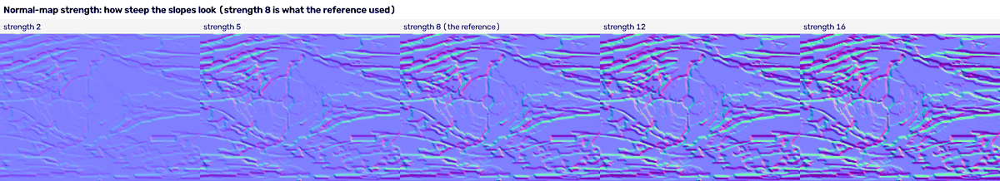

The wood strip is cut from the wood build's traced L3 colour, not from a sampled tile (wood checker). Strength 2 looks nearly flat; the reference's 8 shows
every plank edge; 16 exaggerates the tiny grain into noise.

**Rules (from the builds):**
* **The strength is counted in dots, so scale it with the picture size.** Gravel and brick multiply the strength (and the blur) by the dots per tile dot:
  gravel's mean slope stayed 0.374 / 0.367 / 0.352 at 512 / 1254 / 2508 dots (`gravel/final_report.json`, resolution).
* **The references rounded the height to 8 bits first.** Slate's, mud's and gravel's generators do the same on purpose to copy the reference
  (`np.round(height16 * 255.0)` in `slate_generator.py` line 153, `mud_generator.py` line 121, `gravel_generator.py` line 173). For your own surfaces keep the
  16-bit height: an 8-bit height puts terraces in the slope (section 8).
* **A normal map from the 16-bit smoothed height needs a higher strength** for the same look: fitted 7.3, 8.2, 9.7, 5.9, 10.6, 11.6 instead of 6, 7, 8, 5,
  9, 10 (seamless research 3.3).

---

## 5. The Bump node

**What it is, in one sentence:** the Bump node turns a height into a tilted surface direction at render time, by comparing the height at a point with
the height a tiny step away; nothing is moved, only the shading changes.

**Example first (TESTED, seamless research 3.1, `research/experiments_seamless_tiles_and_baking/out/normal/analysis.json`):** a Bump node with Distance 0.02 on a 256-dot picture gives the same normal map
as the slope filter with strength 0.02 x 256 = 5.12 (the best fit was 5.46). On N dots, Distance d equals strength d x N within 4 to 8 % (fitted
strength / (d x N) = 1.043 at 512 dots, 1.066 at 256, 1.082 at 128). The harness uses this: `bump_distance = strength / size` for `normal_bumpnode.png`.

| setting | what it does (TESTED unless marked) | picture |
|---|---|---|
| **Distance** | how tall a height of 1.0 stands, in object units (on our 1 x 1 tile: tile widths). **Default 0.001 since Blender 4.5 = almost flat.** 0.01 shows a surface, 0.03 clearly, 0.1 strongly | e02 below |
| **Strength** | fades the effect: 0 = none, 1 = full; above 1 it keeps multiplying (tested to 5). For gentle slopes Distance 0.04 / Strength 1 equals Distance 0.02 / Strength 2 (difference 0.0001) | e01 below |
| **Filter Width** (dots) | how far apart the two heights are compared. On a hard step the default 0.1 shows almost nothing (mean tilt 4.1 degrees); 1.0 makes a 24-dot-wide bevel up to 78 degrees; 2.0 a 40-dot bevel (mean tilt 17.8 and 29.5) | e04, fig9 below |
| **Invert** | swaps bumps and dents (an exact mirror of red and green about 0.5) | `e03_bump_invert.png` |
| **Height** | the grey height (if nothing is connected the node does nothing: manual, NOT TESTED) | |
| **Normal** | chain a second Bump after a first for two layers of detail (not measured) | |

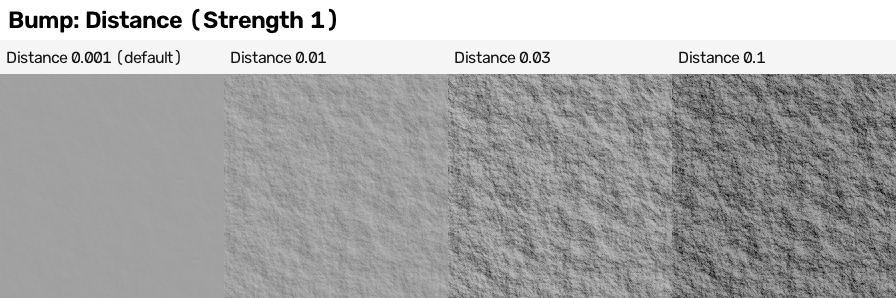

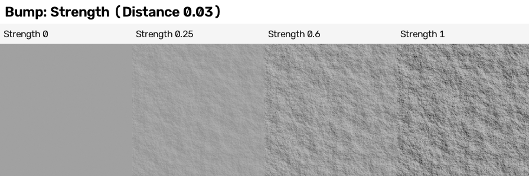

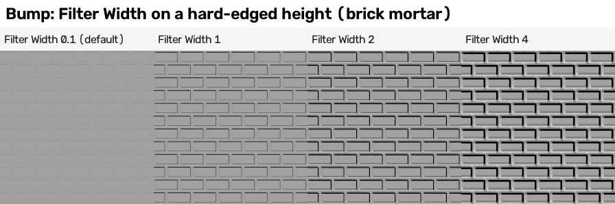

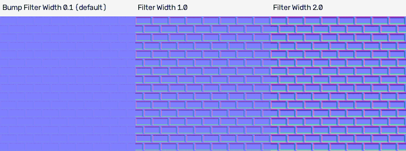

**The reference strengths as Bump Distances** (arithmetic from the rule above, for a 1 x 1 tile; the rule was tested at 128 to 512 dots, NOT at 1254):
brick 6 / 1254 = 0.0048, slate 0.0056, wood 0.0064, metal 0.0040, mud 0.0072, gravel 0.0080. So the references are about 4 to 8 times the default
Distance, and the default 0.001 on a 1254-dot tile is like strength 1.25: nearly flat.

**Traps (each one TESTED in the research):**
1. **Old tutorials** ("Bump Strength 0.3 gives a nice rough look") assumed the old larger default Distance; today the same chain looks flat (toolbox 2).
2. **Hard steps need Filter Width 1 to 4** (pictures above); keep 0.1 for smooth noise.
3. **Ambient occlusion cannot see a Bump node:** a Cycles Bake of AO on a flat square with a Bump node gave a plain white picture (min 1.0, max 1.0). AO
   needs real geometry (seamless research 2.2).
4. **The silhouette stays straight** (section 6): Bump is shading only.
5. **A baked height reused in a Bump node** must have Image Texture Extension **Repeat**: normal-map seam number 0.46 with Repeat, 1.43 with Extend
   and Mirror, 105.9 with Clip (seamless research 2.5).
6. **An 8-bit height in a Bump node makes terraces:** 53 % of dots with exactly zero sideways tilt (float: 1.4 %, 16-bit: 0.9 %); Cubic interpolation only
   brings it to 32 % (section 8).
7. **It does not depend on the picture size:** a Bump-node normal made at 512 dots and shrunk to 128 differs from one made at 128 by only 0.0007. That
   is why a Bump Distance can be written in the recipe once and used at any size.
8. **It equals Cycles' own Bake > Normal** within 0.00008 (seamless research 2.2).

**Did the builds use it?** Not in their generators: all six made their normal maps in numpy from the derived height, because the references were made
that way (mud recipe guide, section 5: "the maps are derived in numpy exactly like the reference"). The project's harness writes `normal_bumpnode.png`
beside every shader recipe's `normal.png` for comparison. Use the Bump node when the material is used live in Blender (a scene, not a baked set).

---

## 6. Displacement, Bump, or both

**What it is, in one sentence:** Displacement really moves the surface up and down by the height, so outlines and shadows change; Bump only changes
how light falls on a surface that stays flat.

**Example (TESTED, seamless research 3.5, a noisy surface seen from a low angle, 512 x 512 grid):**

| Material > Settings > Surface > Displacement | how bumpy the far outline is (dots) | shading spread | render time |
|---|---|---|---|
| Bump Only (the default) | 0.16 (straight) | 0.098 | 3.6 s |
| Displacement Only | 3.1 | 0.098 | 2.1 s |
| Displacement and Bump | 3.1 | 0.100 | 3.6 s |

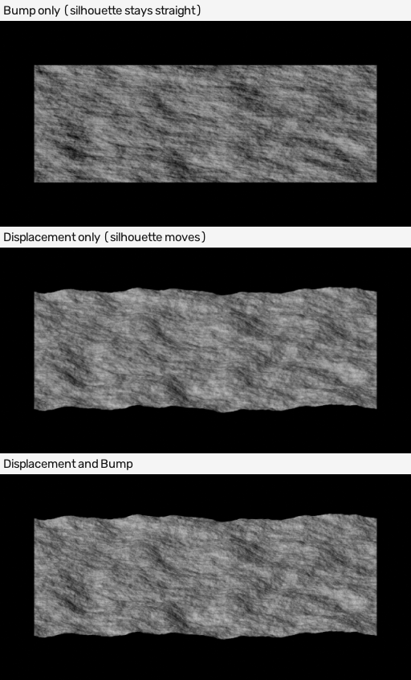

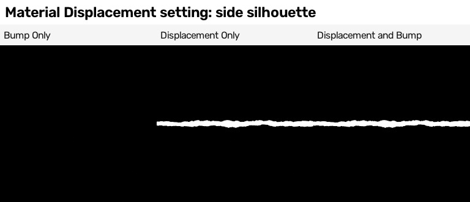

How to set it up (TESTED in the research):
1. Material Output > Displacement <- **Displacement** node <- Height. Distance moved along the surface = **(Height - Midlevel) x Scale**. Measured edge-on:
   Height 0 and 1 with Midlevel 0.5, Scale 0.1 moved -0.0498 and +0.0502; Midlevel 0 moved 0.0002 and 0.1003; Midlevel 1 moved -0.0998 and 0.0002.
   Defaults: Midlevel 0.5, Scale 0.01 (1 cm since Blender 4.5). Midlevel = "the grey that means no movement": 0.5 raises and sinks equally; 1.0 only sinks.
2. **Change Material > Settings > Surface > Displacement** from "Bump Only" (`material.displacement_method = 'DISPLACEMENT'` or `'BOTH'`). Without this the
   Displacement node does nothing visible.
3. **Space Object** scales the movement with the object (stretched x 2 in height: +-0.1 instead of +-0.05); **World** ignores the object's scale.
4. **A fine enough mesh.** Either a dense grid, or a Subdivision Surface modifier with **Adaptive Subdivision** ticked (Cycles; no longer "Experimental"
   since Blender 5.0) and Render > Subdivision > **Dicing Rate** (render default 1 dot):

| mesh | detail kept (shading spread) | time |
|---|---|---|
| grid 16 x 16 | 0.038 | 1.8 s |
| grid 256 x 256 | 0.160 | 2.1 s |
| grid 1024 x 1024 (1 million faces) | 0.164 | 3.9 s |
| a 2 x 2 plane, adaptive, Dicing Rate 8 | 0.131 | 1.8 s |
| adaptive, Dicing Rate 2 | 0.1615 | 2.2 s |
| adaptive, Dicing Rate 1 (default) | 0.1635 | 2.9 s |
| adaptive, Dicing Rate 0.5 | 0.1627 | 5.2 s (twice the time, no gain) |

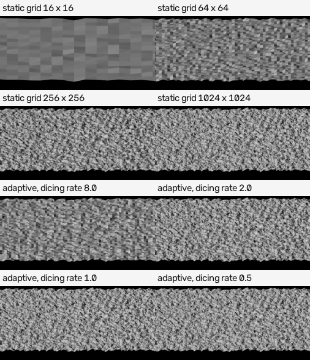

**Which to use:**
* **Bump** (or a normal map): flat-looking surfaces seen from the front, anything baked into a texture set, anything cheap. It is all our baked tiles need.
* **Displacement**: when outlines and real shadows matter (a stone floor seen at a low angle, a wall corner). It is cheaper than it sounds: Displacement
  Only rendered faster than Bump in the test above.
* **Both**: coarse displacement plus bump for the finest grain; the manual says use Displacement Only once the mesh is very fine.

NOT TESTED: `Material.max_vertex_displacement` (the largest allowed movement; the API warns larger movements may show gaps); the Normal Map node's Base
setting (Original / Displaced, added in 5.1; Displaced is the 5.2 default, read only); displacement of our six baked heights on a real object; Vector
Displacement.

**The baked heights as displacement (TESTED in the research, 3.5):** an 8-bit ramp displaced with Scale 2 shows steps (0.82 dots from a smooth curve
against 0.43 for 16-bit). Poly Haven's rule for a displacement map: 16-bit, normalised to 0..1, true depth written down separately.

---

## 7. OpenGL or DirectX, and how to tell

**What it is, in one sentence:** the two ways of storing a normal map differ only in the green channel: in OpenGL (Blender, Unity, Maya) green is bright
where the surface faces the TOP of the picture; in DirectX (Unreal, 3ds Max, many game exports) where it faces the BOTTOM.

**Example (TESTED for this guide, `numbers_coordinates.json`, "relief_opengl_directx"):** the brick reference's two normal maps against the slope of its own
height going down the picture: `normal.png` green correlates **+0.972** (OpenGL), the uploaded `normal_as_uploaded_directx.png` **-0.972** (DirectX).
The picture in section 2 shows the same corner of both.

Three ways to tell (seamless research 3.4, TESTED on all six references):
1. **With the height map** (best): correlate green with the height's slope down the picture: about +0.94 = OpenGL, -0.94 = DirectX (all six references:
   `normal.png` +0.93 to +0.95, the uploads -0.93 to -0.95).
2. **From the normal map alone:** a real surface's sideways slope changes down the rows exactly as its up-down slope changes along the columns, with a sign set
   by the green convention. The correlation of those two changes was **-1.00 for all six OpenGL maps and +1.00 for all six DirectX uploads**; Bump-node maps
   -0.78 (128 dots) to -0.96 (512 dots). `convention_from_the_map_alone()` in `research/experiments_seamless_tiles_and_baking/normal_map_tools.py`. **Blind spot:** it compares red with
   green only, so a map with BOTH red and green flipped (dents instead of bumps) reads as OpenGL. Keep the height map to check that.
3. **By eye:** a raised feature has a light-green upper edge in OpenGL. NOT TESTED by a person here.

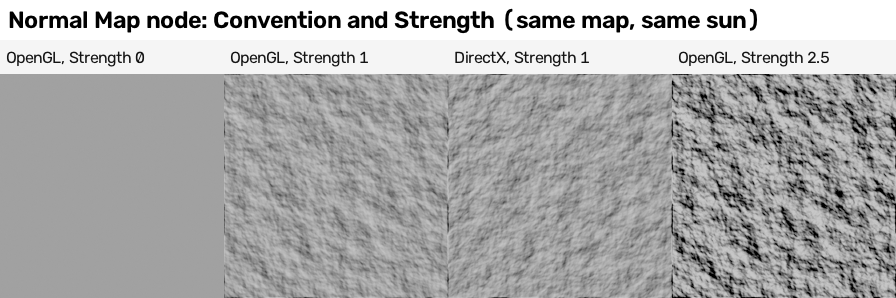

A map read with the right convention lights like the Bump node (render correlation 0.85); read with the wrong one it does not (-0.02) (toolbox 7.4).

**What to do about it** (TESTED unless marked):
* Normal Map node > **Convention** = OpenGL (default) or DirectX (added in Blender 5.1).
* Flip a file: green = 1 - green (`pack_pbr_channels.py flipgreen`: exact round trip).
* Bake DirectX directly: Bake > Normal, swizzle **G = -Y** (green = 1 - default green, difference 0.00002).
* Name files `name_nor_gl.png` / `name_nor_dx.png`: Node Wrangler's Principled setup skips names containing `dx` or `directx` (read in its source).
* Load normal maps as **Non-Color**; Normal Map node Space Tangent (on our flat tile Tangent and Object space gave identical maps, difference 0.0000).
* **Mirror tiling breaks normal maps:** a mirrored copy needs red (left-right mirror) or green (up-down) flipped; forgetting it gave errors of 0.12 and 0.11.

---

## 8. 16-bit height, colour space and saving

**What it is, in one sentence:** an 8-bit picture can hold only 256 grey levels, which turns a gentle slope into stairs; a 16-bit picture holds 65,536.

**Example (TESTED, seamless research 3.5):** a gentle ramp using 40 % to 60 % of the grey range has **54 levels in 8 bits** and thousands in 16 bits.
Its normal map from the 8-bit file has **53 %** of dots with exactly zero sideways tilt (terraces); from 16-bit, 0.9 %. A numpy normal from an 8-bit height
(strength 30): 18.1 % flat dots and error 0.0068, against 0.1 % and 0.0000.

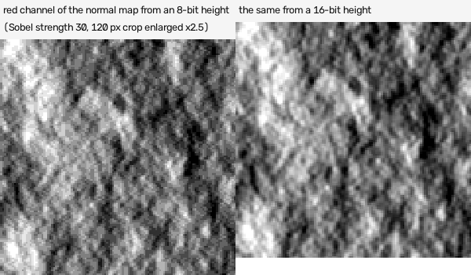

Rules (all TESTED in the research, section 2.3):
* **Height, roughness, metallic, normal = data:** a Non-Color image, saved with 16 bits, photographed with view transform **Raw**. A fresh Blender scene
  uses AgX, which turned a photographed 0.5 into 0.667 (Standard 0.737, Raw 0.500).
* **Colour:** sRGB, view transform **Standard**, 8 or 16 bits.
* Roughness baked into an sRGB image came out 0.74 instead of 0.51.
* `lib/bake_harness.py` already does this (height.png is 16-bit, Raw). **An old trap, now fixed:** an earlier `save_array_png` wrote only the red channel
  for a flat (2-D) array (found when the research's first 8-bit tests came out wrong). The current one copies a grey array into red, green and blue: TESTED
  by the baking and checking guide (section 3, `cookbook/checks/baking_and_checking/save_grey_check.log`).
* The manual's "use Cubic interpolation to avoid stepping with 8-bit bump images" is only partly true (53 % -> 32 % flat dots). The fix is 16 bits.
* The references themselves: `height.png` 16-bit (lightly smoothed), `height_as_uploaded.png` the 8-bit original from which the normal maps were made.

---

## 9. Real geometry height against colour-brightness height

**What it is, in one sentence:** instead of deriving the height from the colour, build the raised parts as real 3D shapes (slabs, bars, rivets, stones)
and photograph their true height and true normal from above.

**Example first (brick, `recipes/brick/04 Recipe - brick - how it is made.md`, section 7):** each brick of the M class made a real slab with Solidify and
Bevel modifiers, the mortar at ground level. Its height correlated **-0.15** with the reference height; a half-and-half mix 0.16; the height made from
the colour 0.69. Reason: the reference height IS brightness, and the mortar is painted bright, so in the reference the mortar is HIGH and the bricks LOW,
the opposite of a real wall.

| build | real-geometry route | match to the reference height | height error (best fit) and normal error | same-kind score | time | file |
|---|---|---|---|---|---|---|
| brick | slabs: Solidify + Bevel (M colour) | correlation -0.15; 50/50 mix 0.16; colour-made 0.69 | 39.12 / 39.44 / 25.04 steps; normal 18.77 / 17.86 / 17.34 | 0.262 / 0.296 / 0.407 | not recorded | `brick/04 Recipe ...` 7 |
| slate | Geometry Nodes slabs (Instance on Points, Mesh Bevel, Subdivide, Set Position with seamless noise) | true height correlation 0.52; half-and-half 0.47 | 33.76; half-and-half 34.94 (layout-only painter S0: 35.1) | 0.32 to 0.37 against 0.71 for the painter's stamps | 88 s against 28 s | `slate/final_report.json`, geometry_route |
| metal | Geometry Nodes bars (Curve Line + Curve to Mesh) and rivets (Mesh Cone on points) | correlation 0.07 (colour-made S0: 0.576) | with the L colour: colour-made 16.62 / 10.62 degrees (close); geometry 32.39 / 13.25 (layout); mixes 20, 40, 60 %: 16.69, 16.87, 17.46 / 10.68, 10.97, 11.50 | - | 1.3 s against 14 to 45 s | `metal/final_report.json`, height_routes_L |
| gravel | Geometry Nodes: one short 4-, 5- or 6-sided column per stone | correlation about 0 for all (the stones are new content) | normal 28.5 geometry, 33.0 half-and-half, 37.8 painter (flat 24.5) | geometry 0.173, painter colour + geometry height 0.203, half-and-half 0.257, painter alone 0.362 | 9 s against 65 to 100 s | `gravel/builder_answer.json` |
| mud | Geometry Nodes stones, curves for ruts (colour only) | height not tried ("the reference height is derived from colour") | - | - | stones 8.4 s against 3.4 s | `mud/builder_answer.json` |
| wood | curves for cracks, Geometry Nodes for splatter (colour only) | height not tried | - | - | 11.6 s against 15.3 s | `wood/builder_answer.json` |

What it means:
* **The research hint "50/50 mixes help brick, slate and gravel" did NOT hold in any build that tried it** (brick, slate, metal, gravel).
* **The geometry looks right as geometry:** gravel's true-height normal map shows clean bevelled stones (picture above); slate's real slabs overlap and
  cast true shadows. It just is not what these references drew.
* **Geometry is fast to build** (metal 1.3 s, gravel 9 s) but its colour came out soft and blobby (slate: ambient occlusion colour alone took 76 s).
* gravel's lower normal error for geometry is not a better match: smooth normals simply sit nearer the flat-normal level (24.5) (`gravel/builder_answer.json`).

**When to use real geometry:** when the texture will sit on a real 3D object and the relief must be physically right (outlines, shadows, ambient
occlusion, displacement), or when the reference's height really is a relief (check its sign first: brick's would have to be turned round, NOT TESTED).
How to photograph it (seamless research 2.7, TESTED): an emission shader showing Geometry > Position Z gives the height, Geometry > Normal x 0.5 + 0.5 the
normal; use at least one mesh vertex per dot and let the mesh reach a little past the tile edge (normal error 0.00077 against 0.0013 when it stops at the
edge). **Trap:** a mesh made from nothing in Geometry Nodes ignores the object's material and renders black (error 0.659) until a Set Material node is added.

---

## 10. Recipe cards (every line was run, in the file named)

**Card 1 - height from colour (numpy, after the colour bake).** grey = 0.299 R + 0.587 G + 0.114 B on screen numbers -> blur 0.5 to 0.7 dots ->
stretch the 1st..99th percentile to 10..245 (or fit a straight line with cut-offs, or a 12-point curve) -> save 16-bit. (six builds; section 3)

**Card 2 - normal from height.** plain slope (right - left) / 2 and (below - above) / 2, wrapping at the edges -> x strength (5 to 10 at 1254 dots;
x 2 at 2508) -> red = -x, green = +y, blue = 1 -> length 1 -> x 0.5 + 0.5. When the height comes from a colour, Sobel and a strength a little above the
reference's. (section 4)

**Card 3 - Bump node live in Blender.** Height -> Bump (Distance = strength / dots across, for example 0.004 to 0.008 for the references' look on a 1 x 1 tile;
Strength 1; Filter Width 0.1 for smooth heights, 1 to 4 for steps) -> Principled BSDF Normal. (section 5)

**Card 4 - real displacement.** Height -> Displacement node (Midlevel 0.5, Scale = true depth) -> Material Output Displacement; Material > Settings >
Displacement = Displacement Only; Subdivision Surface with Adaptive Subdivision, Dicing Rate 1 to 2. (section 6)

**Card 5 - normal map file.** OpenGL (green up) for Blender; Non-Color; Normal Map node Convention set to the file's; name `_nor_gl` / `_nor_dx`; test with
`convention_from_the_map_alone()`. (section 7)

**Card 6 - saving data.** 16-bit PNG, Non-Color, view transform Raw; colour sRGB and Standard. (section 8)

---

## 11. Lessons that carry to other surfaces

1. **Prove the derivation first** (about 10 minutes of plain Python per surface, every build): it removes height and normal from the work and tells you
   the best you can ever reach. Then spend your effort on the colour picture.
2. **Check the meaning of a height map before you build relief for it.** Brightness-height and physical height can point opposite ways (brick).
3. **Normal errors live in the finest detail.** If the fine detail is invented, do not chase the normal error; judge by eye and by the same-kind score.
4. **Strength and blur are in dots; Bump Distance is in tile widths.** Convert once (s = d x dots across) and scale with the picture size.
5. **Measure angles between arrows of length 1.** An 8-bit normal is a little shorter; skipping the step added 5 degrees to metal's ceiling.
6. **Use real geometry for real relief, not to copy a painted one.**

---

## 12. Tested for this guide, and not tested

TESTED for this guide (plain Python, `cookbook/checks/seamless_and_relief_strips/finish_strips.py`): the brick reference's two normal maps against its height
slope (+0.972 OpenGL, -0.972 DirectX) and the comparison picture `pictures/relief-opengl-or-directx-brick.jpg` (105 KB). Everything else is quoted from
the research guides and the builds' files named in each section, including the checkers' corrections (metal's ceiling, wood's slope number, slate's
straight-line height).

NOT TESTED: the Bump Distance equivalent of the reference strengths at 1254 dots (the rule was measured at 128 to 512); the node-only height-from-colour
chain against the references' rule; brick's angle puzzle; Vector Displacement; `max_vertex_displacement`; the Normal Map node's Base setting; displacement of
the builds' own baked heights on a 3D object; any of this in EEVEE (no graphics card here); whether a person reads the "light-green upper edge" the same way.
