# 06 Guide - seamless tiles and coordinates

What this is: a guide to the tools that decide WHERE a pattern is drawn (Texture Coordinate, Mapping, Vector Math), to making a tile that repeats with no
visible join, to checking that it really does, and to making bigger areas and bigger pictures from the same recipe. Every rule here is shown on an
example from the six builds or from a test, with the file that holds the numbers.
Companion guides: "06 Guide - pattern makers.md" (Noise, Voronoi, Brick, Wave ...), "06 Guide - shapers.md" (Map Range, Color Ramp, Math, Mix ...) and
"06 Guide - relief - height, bump, displacement and normal maps.md".

## How to read this guide

Words used (one word for each thing, always; the same words as the other 06 guides):
* **tile** = the square picture we make; it is meant to be laid side by side and on top of itself, like floor tiles.
* **dot** = one pixel of a picture. **picture size** = how many dots across (512, 1254, 2508).
* **position** = where a dot sits on the tile: **u** across (0 at the left, 1 at the right), **v** up (0 at the bottom, 1 at the top).
* **seam** = a visible line where the right edge of one tile meets the left edge of the next (or the top meets the bottom).
  **seamless** = no seam. **wrap edge** = the place where the last column meets the first column again (and the last row the first row).
* **rolled by half** = the picture moved half its width to the right and half its height down, with what falls off one side coming back on the other.
  A seam then shows as a cross in the middle. Most pictures in this guide are shown rolled by half.
* **the donut trick** = the project's way of making Noise and Voronoi seamless (`lib/recipe_tools.py`): u and v are turned into two circles and a
  4-dimensional pattern is read on them, so walking off the right edge brings you back at the left.
* **feature count** = how many blobs or cells of a pattern fit across one tile (the donut trick's Scale setting).
* **tile count** = how many tiles' worth of content one picture holds (1 = one tile; 2 = an area of 2 x 2 tiles).
* **area** = one picture bigger than a tile, filled with NEW content (no copies).
* **half-tile test** = bake the recipe once normally and once with everything slid by half a tile, then compare the second picture with the first one
  rolled by half (section 8.1). **seam number** = the jump across the wrap edge divided by an ordinary jump between neighbouring dots (section 8.2).
* **build** = one of the six surface jobs in `recipes/` (brick, slate, wood, metal, mud, gravel). **description** = a build's list of numbers that its
  generator draws from. **strip** = a row of small pictures of one recipe with ONE setting changed.
* **same-kind score** = `lib/texture_compare.py` overall score: 1 = the same kind of surface as the reference; other real reference surfaces score 0.16
  to 0.50 (not "about 0.1"; baking and checking guide, section 7.4).

Labels: **TESTED** = run in Blender 5.2.2 on this machine and the result looked at or measured; the file that shows it is named.
**NOT TESTED** = only read, or only reasoned. Every number is copied from the file named next to it.

Where the facts come from: `research/02 Research - seamless tiles and baking.md` (its folder `research/experiments_seamless_tiles_and_baking/`),
`research/02 Research - the shader node toolbox.md` (folder `research/experiments_shader_node_toolbox/`), the six builds' reports and their checkers'
findings (`recipes/<surface>/builder_answer.json`, `final_report.json`, `verifier_answer.json`, `04 Recipe - <surface> - how it is made.md`), and NEW tests
made for this guide: `cookbook/checks/seamless_and_relief_strips/make_coordinate_strips.py` (Blender) and `finish_strips.py` (plain Python), numbers in
`cookbook/checks/seamless_and_relief_strips/numbers_coordinates.json`, pictures `cookbook/pictures/seamless-*.jpg` and `coordinates-*.jpg`.

In tables, a short path such as `brick/builder_answer.json` means `recipes/brick/builder_answer.json`; "research" means the research guide named above.

---

## 1. The short version

Example first. The slate build's roof area (`recipes/slate/final_report.json`, "area"): ONE description with the tile size set to 2508 dots instead of
1254 (16 rows of 12 slates instead of 8 rows of 6), baked as one 2508-dot picture in 131 s. The jump across its wrap edge is 0.75 (sideways) and 0.58
(up-down) of an ordinary jump, so no seam; the strongest match between two of its four quarters is 0.371, where a repeated tile gives 1.0, so no copies.
That one result uses every idea in this guide: positions that repeat every 1.0, a layout of whole numbers, a check that the edge joins, and sizes
measured in the tile's own units so that the same recipe can draw a bigger area.

The rules that would have saved the most time:
1. **Blender's random patterns are not seamless,** not even at whole-number Scale. Plain Noise has a seam number of 20.5, Voronoi 34.6, Wave 24.4
   (`research/experiments_seamless_tiles_and_baking/out/pattern_table.txt`). A shop page that says they "wrap on integer UV boundaries" is wrong.
2. **Use the donut trick for Noise and Voronoi** (`tileable_noise_group`, `tileable_voronoi_group` in `lib/recipe_tools.py`): seam numbers 0.87 and 1.07,
   identical after moving one whole tile (difference 0.00000). It costs about 30 % more render time. Use 4 or more cells across for Voronoi.
3. **Everything else tiles only by whole numbers:** whole counts of bricks, rows, planks, bands (Wave Scale = k x pi/10), Checker Scale even.
4. **Never scale the position BEFORE the donut trick to stretch a pattern.** A whole-number scale repeats the tile inside itself; any other number puts
   a seam in it (new strip, section 3.1). Give the donut trick two feature counts instead (4 across, 16 up).
5. **To bend a pattern and keep it seamless, add a seamless noise to its position** (a "warp"). Wave's own Distortion setting breaks the tile.
6. **Use UV coordinates for anything you bake.** On the bake square UV and Object are identical; Generated is (u, v, 0.5); an unconnected input is Generated.
7. **Check with two different tests and your eyes.** The half-tile test and the seam number each have blind spots that the builds' checkers found (section 8).
8. **A bigger area = a bigger tile count, not copies.** Multiply every feature count and every layout count; never multiply the position (that copies).
9. **Measure sizes in tile units, not in dots of the finished picture.** Then 512, 1254 and 2508-dot bakes of one recipe show the same shapes
   (brick: 1254 against 2508 shrunk, SSIM 0.994). Settings counted in dots (blur, normal strength, the render's pixel filter) must be scaled by hand.

---

## 2. Texture Coordinate: where a dot is

**What it is, in one sentence:** the Texture Coordinate node gives each point of a surface its position, in several systems at once (Generated, UV,
Object, Camera, Window, Reflection, Normal), and every pattern maker reads one of them through its Vector input.

**Example (TESTED for this guide, `numbers_coordinates.json`, "texture_coordinate"):** the same plain 3D Noise (Scale 5, Detail 2) on the 1 x 1 bake square,
fed five ways. Mean difference between the pictures, in brightness steps of 255:

| fed by | against UV | what that means |
|---|---|---|
| UV | 0 | the reference |
| Object | **0.00** | on the bake square (corners at 0,0 and 1,1) Object positions are the UV numbers |
| Generated | 40.27 | a different picture |
| nothing connected | 40.27, and **0.00 against Generated** | an unconnected Vector input uses Generated |
| UV with its third number set to 0.5 | 40.27, and **0.00 against Generated** | on this flat square, Generated = (u, v, 0.5) |

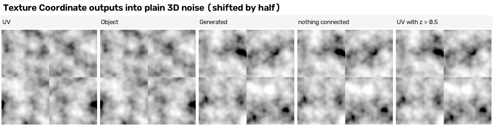

All five show the cross of a seam, because plain 3D noise never repeats: the wrap jump of the UV picture is 32.5 steps where the biggest jump between
two ordinary neighbouring columns is 6.0 (`numbers_coordinates.json`, "wrap_line_against_ordinary_lines").

What else was found:
* The seamless research found the same: UV and Object identical (difference 0.0000), and still the same pattern when the square was stretched 2 x 1 by
  its Object scale (0.0016), because Object means the object's own local positions. Generated gave a different picture (0.075 on a 0..1 scale); the third
  number 0.5 explains that difference (this guide's test). World positions move with the object (NOT TESTED).
* **Typing numbers into an unconnected Vector input does nothing:** (0.31, 0.77, 7.3) and (0.31, 0.77, 0.1) gave identical pictures (toolbox research, section 2).

**Rule:** use **UV** for everything that will be baked: it is exactly 0..1 across the bake square and it travels with the surface when the tile is put on
an object. The project's harness (`lib/bake_harness.py`) already links Texture Coordinate UV to every recipe's Vector input.

---

## 3. Mapping: move, turn and stretch positions

**What it is, in one sentence:** the Mapping node moves, turns and scales the positions before a pattern maker sees them.

**Example (TESTED, toolbox research 6.9):** a point (0.2, 0.4, 0.6) with Location (1, 2, 3) and Scale 2 becomes (1.4, 2.8, 4.2) in type **Point**
(scale, then move: use this for textures), (-0.4, -0.8, -1.2) in type **Texture** (the opposite way: the pattern moves the other way), (0.4, 0.8, 1.2) in
type **Vector** (Location ignored), (0.27, 0.54, 0.80) in type **Normal** (made length 1: a fan-shaped picture, useless for textures).

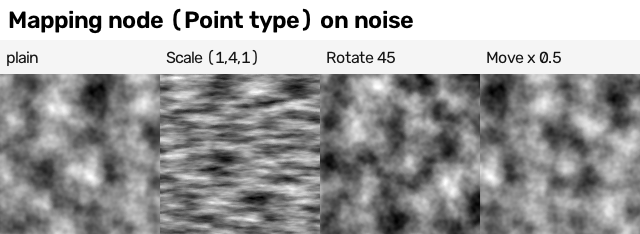

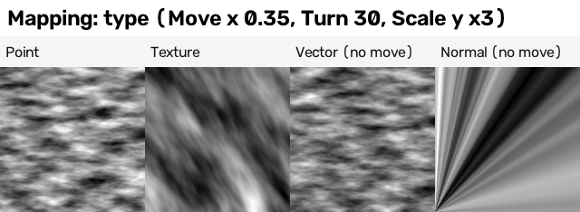

**The stretching rule (TESTED):** a LARGER scale in one direction makes MORE and SMALLER features in that direction. Scale (1, 4, 1) makes noise blobs four
times thinner up the picture (flat streaks running left to right); Scale (14, 1.2, 1) makes upright streaks (the toolbox demo's slate and metal drips).

### 3.1 The trap: Mapping before the donut trick (NEW, TESTED for this guide)

The donut trick turns u into an angle. If you scale u or v first, the circle is walked round several times, so the pattern does not stretch: it repeats
(whole numbers) or gets a seam (anything else).

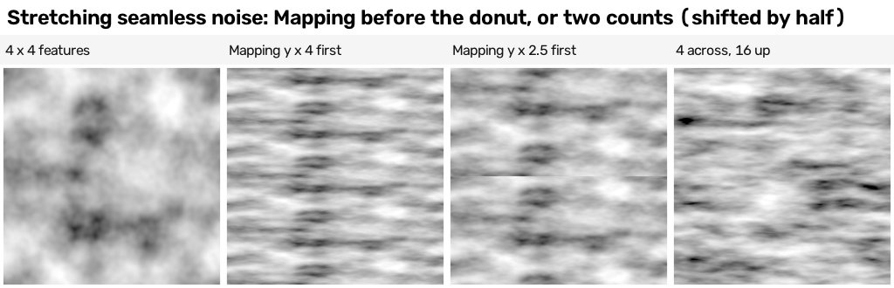

| square (all rolled by half) | what you see | measured (`numbers_coordinates.json`, "stretch_trap") |
|---|---|---|
| donut trick, 4 x 4 features | cloudy blobs, no cross | seamless |
| Mapping Scale (1, 4, 1), then the donut trick | **the same strip of blobs four times up the tile** | the bottom quarter and the next quarter differ by 0.85 steps (the plain 4 x 4 tile: 45.63) |
| Mapping Scale (1, 2.5, 1), then the donut trick | **a horizontal seam** through the middle | jump across the top-bottom wrap edge 39.77 steps; biggest ordinary row jump 7.34 |
| the donut trick with 4 features across and 16 up | thin horizontal streaks, no cross | wrap jumps inside the ordinary range |

**Rule:** to stretch a seamless pattern, give it two feature counts. `lib/contrib/builder.py` does this: `tnoise(scale_u, scale_v)` and
`tvoronoi(scale_u, scale_v)` use one circle size across and another up. The metal build's rust layer has 44 features across and 30 up, its
streak layer 260 across and 6 up (thin upright streaks) (`recipes/metal/description/S.json`); the wood build's grain streaks are made the same way. `lib/recipe_tools.py`'s groups have only one Scale (the wood builder asked for Scale U and Scale V inputs there).

---

## 4. Vector Math: arithmetic on positions

**What it is, in one sentence:** the Vector Math node does the same sums as the Math node, but on all three numbers of a position at once.

**Example (TESTED, toolbox research 6.10):** the same noise fed through one Vector Math operation each.

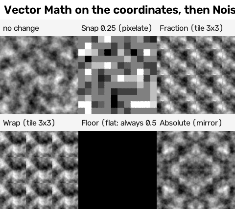

* **Snap** (to 0.25 in the picture) = blocks: every dot in a block reads the same position (one random number per block: Snap 1/32 into White Noise gave
  1019 different values for 32 x 32 = 1024 blocks).
* **Fraction** and **Wrap** = the piece from 0 to 1 repeated: position x 3 then Fraction repeats the tile exactly 3 x 3 times (this is the honest way to
  repeat a tile on purpose, and the same thing the Mapping trap above does by accident).
* **Floor** = the whole-number part: noise read at whole numbers is always 0.5, so the picture is one flat tone (the Snap and Floor results are used to
  give "one number per brick" in section 6).
* **Absolute** = a mirror about 0.
* **Add / Scale / Subtract** = the warp chain of section 7.

---

## 5. Why Blender's patterns do not tile, and the donut trick

### 5.1 The fact

Example first (TESTED, `research/experiments_seamless_tiles_and_baking/out/pattern_table.txt`, 512-dot pictures): Noise at Scale 5 has a seam number of 20.5; Voronoi at Scale 6, 34.6;
Wave bands at Scale 3, 24.4; Magic, 72; Gabor, 13.9; a straight Gradient, 470. Moved by one whole tile, Noise, Voronoi, Gabor and Magic pictures differ by
0.07 to 0.22 on average (toolbox research, `which_patterns_wrap.json`). Whole-number Scale does not help: a pattern maker is a smooth random landscape
that goes on for ever; nothing makes the value at u = 1 equal the value at u = 0.

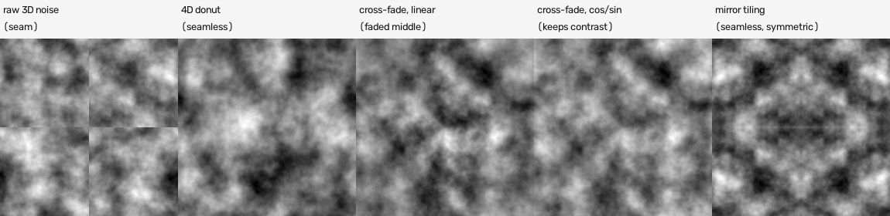

### 5.2 The donut trick

**What it is, in one sentence:** it turns the flat tile into a closed loop in both directions (a donut shape in four dimensions) and reads Blender's 4D
Noise or Voronoi there, so walking off the right edge brings you back at the left.

**Example first.** Take u = 0 and u = 1. On a flat noise they are two different places. On the donut, u is an angle: cos(2 pi u) and sin(2 pi u) have the
same values at u = 0 and u = 1, so it is the same place. The same is done for v with a second pair of numbers.

The chain (built for you by `rt.tileable_noise_group()` and `rt.tileable_voronoi_group()`):
1. Texture Coordinate UV -> Separate XYZ -> u and v.
2. Math Multiply u and v by 2 pi; Math Cosine and Sine of each.
3. Combine XYZ (cos u, sin u, cos v) -> the Vector input; sin v -> the W input (the fourth number).
4. Multiply both by Scale / (2 pi), so one trip round is exactly Scale features long; add Seed to W.
5. Noise Texture **4D** (Scale 1, Detail, Roughness, Lacunarity, Distortion passed through) or Voronoi Texture **4D** (Randomness passed through).

| group | inputs | outputs |
|---|---|---|
| `tileable_noise_group` | Vector, Scale (features across the tile), Detail, Roughness, Lacunarity, Distortion, Seed | Fac (mostly 0.25..0.75: stretch it with Map Range), Color |
| `tileable_voronoi_group` | Vector, Scale (cells across the tile), Randomness, Seed | Distance (to the nearest cell centre), Color (one random colour per cell), Position |

What was tested (seamless research, section 1.3):
* **Seamless at any setting:** seam number 0.87 (Noise, Scale 5, Detail 4) and 1.07 (Voronoi, Scale 6); moved by whole tiles the picture changes by
  0.00000; Distortion 1 still tiles exactly. Every octave of detail is still read on the same circles.
* **Cost:** at 1254 dots, Detail 8, 2 threads: plain 3D noise 2.5 s (4 samples), 8.7 s (16), 34.9 s (64); the donut 3.2 s, 12.1 s, 46.5 s: about 30 % more.
* **It is a different random pattern** from plain Noise: thresholds and ramps tuned on plain noise need re-tuning.
* **One circle size for both directions means square tiles.** A non-square tile needs two circle sizes (NOT TESTED; the two-count version in
  `builder.py` is the same idea and was used by the metal and wood builds).

**Few cells is a trap (NEW strip, TESTED for this guide):** the straight line through the donut is shorter than the way round it, and the shortfall
grows when a cell is a big part of the circle (by the seamless research's arithmetic: 1 % at 12 cells across, 4.5 % at 6, 36 % at 2).

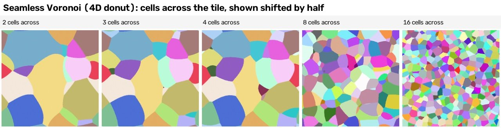

What the strip shows: at "2" and "3 cells across" the cell edges are curved, the cells are of very different sizes and there are not 2 or 3 of them
across; "2", "3" and "4" even share much of their layout. From 8 cells across the cells look like ordinary Voronoi cells. No square shows a cross (every
wrap jump lies inside the range of ordinary column and row jumps, `numbers_coordinates.json`). **Rule: 4 or more cells across, better 6 or more.**

**What the builds did with it** (from their reports): metal's rust and wear = donut noise -> Map Range -> Constant Color Ramp; wood's grain streaks =
donut noise with two feature counts, cut at two levels; slate's optional height grain = donut noise with 800 features across (about 1.5 dots each).
One failure: wood's hair lines as Voronoi "Distance to Edge" on a stretched donut drew diagonal criss-cross lines; contour lines of stretched noise worked
(`recipes/wood/builder_answer.json`, dead_ends). The lib Voronoi group has no Distance to Edge output; `builder.tvoronoi(feature=...)` returns the node.

### 5.3 The other ways (when the donut trick cannot be used)

From the seamless research, section 1.7 to 1.9 (TESTED): a **cross-fade** of four shifted copies with cos/sin weights makes any pattern seamless (Gabor:
13.9 -> 1.09) but shows ghost doubles on structured patterns and fails the exact test because it is only defined between 0 and 1; **mirror tiling** is
always seamless but always symmetric, and a mirrored normal map needs red or green turned round in the mirrored copies (error 0.12 if you forget);
**repairing a finished picture** works on cloudy pictures and fails on bricks (ghost bricks). Prefer the donut trick or whole numbers at the source.

---

## 6. Whole-number layouts

**What it is, in one sentence:** a layout (bricks, rows, planks, bands, slates) repeats every tile when it fits a whole number of times into the tile.

**Example first (TESTED, seamless research 1.4):** Brick Texture Scale 4, Brick Width 0.5, Row Height 0.25 gives 4 / 0.5 = **8 bricks across** and
4 / 0.25 = **16 rows**: the mortar joins at the edges (seam number 0.03). Scale 4.3 gives 8.6 bricks across: everything breaks (13 to 17).

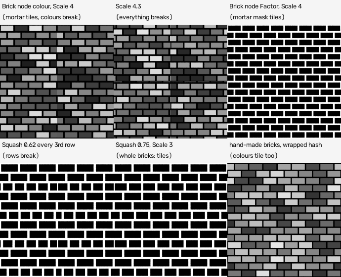

The rules (TESTED):
* Brick: Scale / Brick Width and Scale / Row Height whole; rows a multiple of the Offset Frequency and of the Squash Frequency (default 2); with Squash,
  Scale / (Brick Width x Squash) whole too.
* **Brick's Colour output still breaks** with whole numbers (seam number 2.43, peak 5.2): the half brick on the right edge gets a different random shade
  from its other half on the left, because the node numbers the bricks without wrapping. Fix: build the bricks yourself and **wrap the brick number**
  (Floored Modulo by the number of bricks across, and the row by the number of rows) before White Noise; then the colours tile too (seam number 0.03).
  Ready-made: `tileable_bricks_group()` in `research/experiments_seamless_tiles_and_baking/tileable_pattern_groups.py` (all four outputs passed the exact
  test), and `rows_and_columns()` in `lib/contrib/builder.py`.
* Wave bands: Scale = k x pi/10 puts k whole bands across (Scale 3 x pi/10: seam number 0.08). Magic: Scale = k x 2 pi/5. Checker: even Scale only.
  Wave rings, straight Gradient and Gabor never tile.

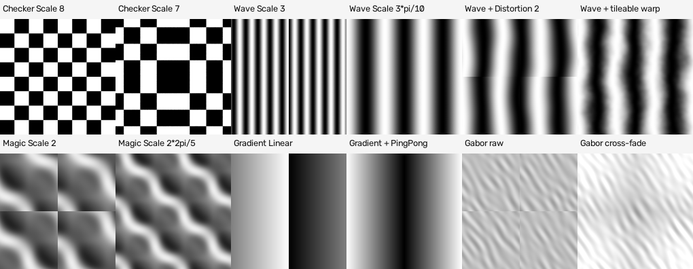

**How the six builds kept their layouts whole** (they drew flat shapes from a description, not Brick nodes). From their reports:
* **Counts that add up to the tile:** courses and bricks (brick), rows and slates (slate), planks (wood) are chosen so they fill the tile exactly.
* **Wrap copies:** every shape that crosses the tile edge is drawn again one tile over (left, right, up, down and the corners: up to 9 copies). Gravel's
  generator draws "nine copies of every shape that touches the tile edge" (`recipes/gravel/builder_answer.json`, blender_tools_used).
* **Failure (slate):** shapes that ran past the tile made the half-tile test show 18 % of dots different until "each shape's middle was folded into the
  tile first" (`recipes/slate/builder_answer.json`, dead_ends). Fold first, then copy.
* **Failure (wood):** tracing the reference's patches without letting patches join across the tile edge left a colour seam: edge jump 12 times a normal
  jump in the coarse classes, until a merge that wraps round was used (`recipes/wood/builder_answer.json`, dead_ends).
* **Not whole (brick):** the brick builder's slow "tone dial" and edge wobble are sine waves 110, 170, 260 dots long (and 5 to 17 dots), which do not divide
  1254. The checker pointed out that this could put a jump at the edge (`recipes/brick/verifier_answer.json`). A check made later without grain found no
  sign of one (section 8.3), but the fix is easy: give such waves lengths that divide the tile (1254 / 11, 1254 / 7) or read them from the donut trick.

---

## 7. Bending a pattern without losing the tiling: the warp

**What it is, in one sentence:** a warp adds a small random amount to each position before a pattern maker reads it, so straight lines wobble and
cells look hand-drawn; if what you add is itself seamless, the bent pattern stays seamless.

**Example (NEW strip, TESTED for this guide):** six whole wave bands across the tile (Wave Texture, Bands, Scale = 6 x pi/10), with the position
u replaced by u + warp x (noise - 0.5). The first four squares use the donut-trick noise; the last uses plain 3D noise.

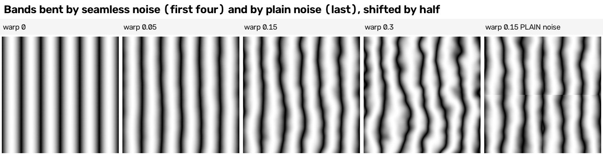

| square | rolled by half | wrap jump against ordinary jumps (`numbers_coordinates.json`, "warp_keeps_tiling") |
|---|---|---|
| warp 0 | straight bands, no cross | inside the ordinary range |
| warp 0.05 / 0.15 / 0.3 | the bands wobble more and more, no cross | inside the ordinary range (for warp 0.15: wrap 19.50, biggest ordinary column jump 21.77) |
| warp 0.15 with PLAIN noise | **a horizontal break across the middle**, kinks down the middle | top-bottom wrap jump **19.66**; biggest ordinary row jump **2.52** |

The same was found in the seamless research (section 1.6): Wave bands bent this way, seam number 0.37 and the exact test passed; the Brick mortar mask bent
the same way, 0.36 and passed; **Wave's own Distortion setting uses plain noise inside and breaks the tile** (seam number 6.7, peak 52).

The chain (toolbox research 6.10, plus the donut trick):
seamless noise (Color output, or Fac for one direction) -> Vector Math **Subtract** (0.5, 0.5, 0.5) -> Vector Math **Scale** by the warp amount -> Vector Math
**Add** the position -> the pattern maker's Vector input. Amounts: 0.05 wobbles lines; 0.3 tears cells apart (toolbox picture below, which was made with
plain noise to show the look, not the tiling).

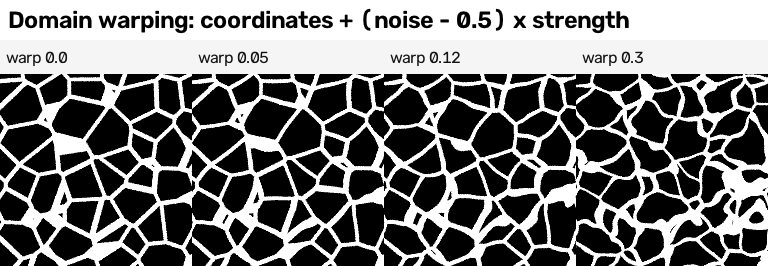

**The warp amount is measured in tiles.** 0.15 means "move by up to 0.075 of a tile either way". If the same 0..1 square later holds a 2 x 2 area
(section 9), the same 0.15 is twice as big compared with the features (my reasoning, NOT TESTED): divide warp amounts by the tile count.

---

## 8. Checking that a tile is seamless

There are two tests in the project, and the builds' independent checkers found blind spots in both. Use both, and look.

### 8.1 The half-tile test

**What it is, in one sentence:** bake the recipe twice, the second time with everything slid by half a tile, and compare the second picture with the
first one rolled by half; if the recipe really repeats every tile, they are the same picture.

**Example (TESTED, `recipes/metal/final_report.json`, "seam_tests"):** the metal L class differs from its rolled first picture by 0.56 steps on average,
0.0 % of dots by more than 40 steps; the control (rolled by a wrong amount) differs by 16.2 steps. Only the anti-aliased edges of shapes differ.

How to run it:
* for a shader recipe, `lib/contrib/periodicity_test.sh RECIPE.py NAME 256` (bakes with `--params '{"shift": [0.5, 0.5]}'` and prints both numbers);
* the strictest version for a shader recipe, `research/experiments_seamless_tiles_and_baking/recipe_tiling_test.py` (moves the recipe by +1, +1 and -3/+2
  whole tiles: `PASS: repeats exactly`; on plain 3D noise it printed FAIL, average difference 0.060 colour and 0.084 height);
* each build has its own version for its painter (`recipes/brick/generator/seam_test.py`, gravel's `analysis/half_tile_test.py`, metal's
  `final_tests.py seam`).

Results in the builds (all pass; the numbers are from the files named):

| build | what was tested | mean difference | dots over 40 steps | wrong-roll control |
|---|---|---|---|---|
| brick | class S (`final_report.json`) | 0.36 | 0.0 % | 35.9 % |
| slate | S1 layout + stamps (`final_report.json`, half_tile_test) | 0.67 | 0.0 % | 13.2 % |
| wood | S1 layout + paint + grain (`04 Recipe`, section 7) | 0.74 | 0.00 % | 14.7 % |
| metal | L (`final_report.json`, seam_tests) | 0.56 | 0.0 % | 5.4 % (mean 16.2) |
| mud | a sampled tile (`final_report.json`) | 0.76 | 0.98 % over **8** steps (a different cut) | not recorded |
| gravel | S_v4 at **512** dots (`final_report.json`); the checker at 1254: 0.78 and 0 % | 1.29 | 0 % | 27.9 % |

**Blind spots found by the checkers and builders** (each one happened):
1. **It cannot see content that does not repeat when the shapes are made first and slid afterwards.** Both bakes then hold exactly the same shapes, so the
   test only proves the wrap copies work. The brick checker: "The slide is added after all shapes are made ... the slow tone could jump at the tile edge,
   and this test would never see it" (`recipes/brick/verifier_answer.json`).
2. **It passes a seam that was copied.** Wood's traced class L2w passed (0.47 steps, 0.00 %) while its edge jump was 3.72 and 2.05 times a normal jump,
   because it traces the reference, which has its own mild seam (`recipes/wood/04 Recipe ...`, section 7 table).
3. **Grain that stays put in space is not slid.** Wood's first test showed a false 10 steps of difference because the shader grain did not move with
   the shapes (`wood/builder_answer.json`, dead_ends). Slate's height row read 3.28 steps with grain on against 1.7 to 2.0 without
   (`slate/verifier_answer.json`). Metal's S read 3.2: the builder blamed rounding at colour cuts, the checker showed it was the grain (0.71 with grain 0)
   (`metal/verifier_answer.json`). Not seams, but the number means nothing until the grain slides too.
4. **A bug shared by both bakes is invisible.** The brick area generator divided by a fixed 1254 and so photographed only a quarter of the 2508-dot
   description; the half-tile test passed because both runs had the bug. A different check found it: the first and last picture columns correlated
   0.23, against 0.9 for neighbouring columns (`brick/builder_answer.json`, area_result).
5. **The test itself can be wrong:** slate's 18 % (section 6) was a slide that pushed shapes out of the tile, not a seam.
6. **Compare like with like:** gravel's quoted numbers were measured at 512 dots although the text said 1254 (`gravel/verifier_answer.json`); mud
   counted dots over 8 steps where the others counted over 40.

### 8.2 The seam number

**What it is, in one sentence:** the average brightness jump across the wrap edge divided by the average jump between neighbouring dots anywhere in the
picture (`seam_ratio()` in `lib/texture_compare.py`): about 1.0 = no seam, above about 3 a seam shows.

**Example:** plain 3D Noise 20.5; the donut trick 0.87 (seamless research table).

**Blind spots** (each one measured):
1. **False alarms on hard edges:** a perfect Checker with Scale 8 scores 72.98 and a perfect saw-tooth Wave 92, because a real edge sits exactly on the
   tile border (seamless research 1.1). On the brick wall, an edge that runs along a mortar band read 1.20 (`recipes/brick/04 Recipe ...`, section 6.4).
2. **False passes:** a Checker with Scale 7 has a doubled square at the join and scores 0.17.
3. **The references themselves score 1.69 to 2.49** (brick 2.22, slate 1.69, wood 2.24, metal 2.02, mud 2.30, gravel 2.49): hard painted edges, plus a
   mild real seam. Anything traced from them inherits it: brick L 2.11, metal M and L 1.33 and 1.38 (`recipes/metal/scores/M_texture.json`, `L_texture.json`; the
   builder's report says 1.34 and 1.37) (and wood's coarse traced classes, measured as an
   edge jump in the same direction: 2.4 to 4.3).
4. **Grain hides seams.** Dot-level grain raises the ordinary jump, so the ratio falls: brick's traced L went from 2.11 to 1.0 when grain 0.14 was added,
   and the "tiling" part of the same-kind score from 0.444 to 1.0, with no change at the seam (`recipes/brick/verifier_answer.json`).
5. **Directions mixed.** The project's number divides by the average of sideways AND up-down jumps. Wood's first area numbers read 3.71 and 3.65; measured
   against jumps in the same direction they were 0.91 and 0.89 (`recipes/wood/verifier_answer.json`). On a picture of upright bands, sideways jumps are
   much bigger than up-down ones, so mixing them gives nonsense.
6. **One line against the whole picture.** The wrap edge is one column; the ordinary jump is an average over all of them. My seamless warped bands
   (section 7) read 1.38 to 1.65 sideways although they are seamless, because their bands are steeper in some columns than others.
7. **A crop is not a tile:** a 1254-dot quarter of a 2508 area gets a "tiling" score of 0 (`recipes/mud/final_report.json`, scale_tests) although nothing
   is wrong.

**A fairer version (TESTED for this guide, `finish_strips.py`, "wrap_line_against_ordinary_lines"):** put the wrap jump next to the jumps of EVERY ordinary
pair of neighbouring columns (and rows) in the same direction. A seamless tile has its wrap jump somewhere inside that range; a seam is far above the
biggest ordinary one. Plain noise: wrap 32.5, biggest ordinary 6.0. Plain-noise warp: 19.66 against 2.52. Mapping 2.5 first: 39.77 against 7.34. All
seamless squares in this guide: inside the range. The brick check did the same with 40-dot bands of slow tone: the wrap edge was 17th of 21 lines
sideways and 3rd of 21 up-down, below the largest ordinary line (`recipes/brick/04 Recipe ...`, 6.4).

### 8.3 Other checks that caught things

* **Look at the tile rolled by half and at a 2 x 2 copy**, zoomed in on the crossing. `research/experiments_seamless_tiles_and_baking/check_texture_set.py
  YOUR_FOLDER` writes `tile_check_shifted.png` and `tile_check_2x2.png` and prints PASS / WARN / FAIL lines (on a set spoiled on purpose it found every
  planted fault except a roughness map saved in the wrong colour space; seamless research, section 5).
* **First against last column** (and row), compared with neighbouring pairs: found the brick area bug (0.23 against 0.9).
* **An area's quarters against each other** at every shift: a copy gives 1.0 (the reference tile laid 2 x 2), new content 0.04 to 0.37 (section 9).
* **Turn the grain off and check again:** `cookbook/checks/brick_seam_without_grain/` (brick tile 14 without grain: edge jump 1.01 sideways, 1.20 up-down
  along a mortar band).

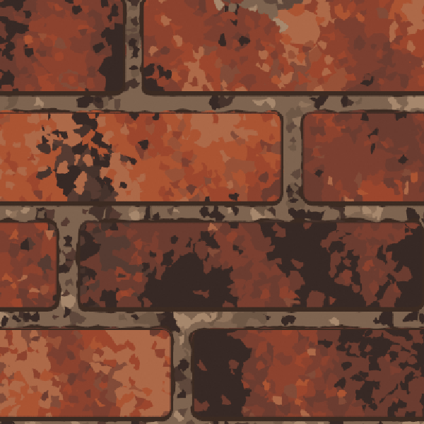

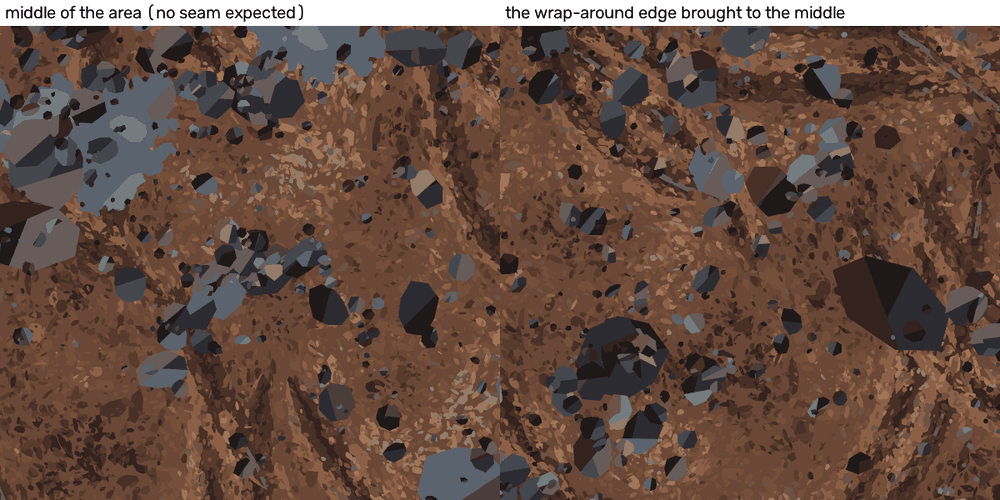

---

## 9. Bigger areas without repeats: the tile count

**What it is, in one sentence:** instead of laying copies of one tile, make one picture that holds k x k tiles' worth of NEW content, by multiplying
every count in the recipe by k; the result is still seamless as a whole, so it can itself be repeated if needed.

**Example (NEW strip, TESTED for this guide):** a donut noise with 4 features across. Left: the position multiplied by 2 before the donut trick, which
draws the same tile 2 x 2 times. Right: the feature count raised to 8 (tile count 2), which draws one area of new content with the same blob size.

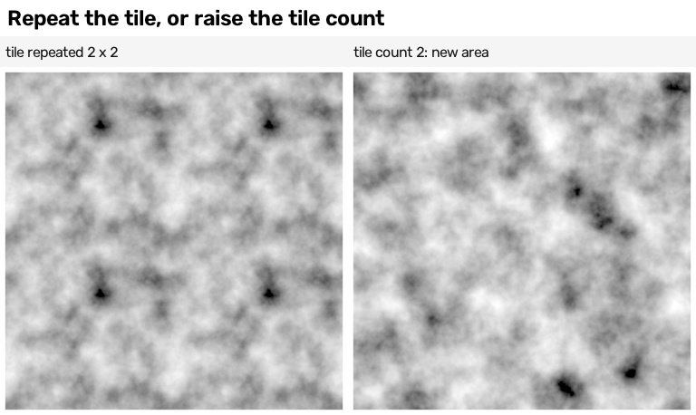

| picture | top-left quarter against the other three quarters, mean difference in steps (`numbers_coordinates.json`, "area_or_repeat") |
|---|---|
| tile repeated 2 x 2 | 0.48, 0.49, 0.49 (copies; the eye finds the same dark spot four times) |
| tile count 2 | 32.51, 41.39, 36.30 (four different quarters) |

**What to multiply** (how the builds did it, from their reports):
* **Feature counts** of every donut noise and Voronoi: x k.
* **Layout counts:** brick 12 courses of 4 bricks per tile -> 24 courses of 8 for the 2508 area; slate 8 x 6 -> 16 rows x 12 slates; wood 5 -> 10 planks;
  stones, clods, knots, rivets: about k x k times as many.
* **The tile size the generator reads.** The builds measure their descriptions in "tile dots" and pass `tile=2508` (or `tile_multiple=2`); spreads and
  shapes keep their size in dots, so there are simply more of them. Gravel's checker: the stones "are the same size in dots as in the 1254 tile, so they look
  half as big at the 1254 preview" (`recipes/gravel/verifier_answer.json`).
* **Do NOT multiply:** the position (that copies, as shown above); colour tables and size spreads (they are the same surface).
* **Divide** anything measured in fractions of the tile, such as a warp amount, by the tile count (reasoning, NOT TESTED).

Results of the six builds' 2 x 2 areas (each one picture of 2508 x 2508 dots):

| build | description | bake time | jump across the wrap edge / middle lines (1.0 = no seam) | quarters alike? (a copy gives 1.0) | file |
|---|---|---|---|---|---|
| brick | 24 courses of 8, 21.7 KB | 144 s | 1.04 / 0.99 | best match moved 400+ dots 0.145; checker 0.185 | `brick/builder_answer.json`, `verifier_answer.json` |
| slate | 16 rows x 12, 14.5 KB | 131 s | 0.75, 0.58 / 0.86, 0.59 | strongest quarter match 0.371 | `slate/final_report.json` |
| wood | 10 planks | 232.6 s | 0.84, 0.89 / 1.06, 0.91 | quarter SSIM 0.214 to 0.222 | `wood/builder_answer.json` |
| metal | seed 21, 9.2 KB | 298 s | 1.016 / 0.985, 0.863 | quarter SSIM 0.45 to 0.51; strongest repeat 0.236 (the long straps) | `metal/builder_answer.json` |
| mud | 114,875 shapes | 228 s | 0.876, 1.044 / checker 0.946 | strongest repeat 0.176; quarter SSIM 0.34 to 0.35 | `mud/final_report.json` |
| gravel | 2.5 KB | 252.6 s (the checker; the report's 173 s belongs to another test) | 0.95, 1.05 / 1.06, 1.10 | best shifted correlation 0.039 | `gravel/final_report.json`, `verifier_answer.json` |

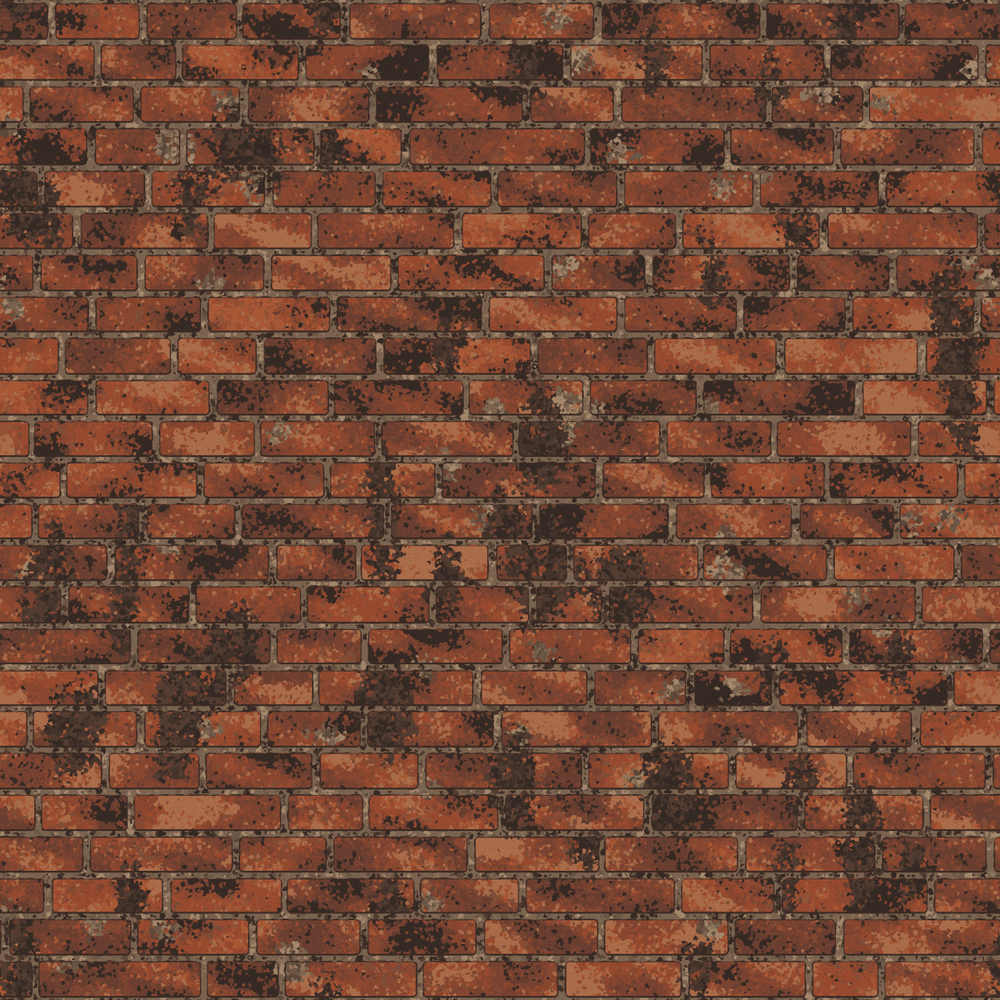

What was not tested: a 4 x 4 area (`tile=5016`) in any build; the shader-only version of a whole surface at tile count 2 (only the noise strip above).

---

## 10. The same recipe at any picture size: sizes in tile units

**What it is, in one sentence:** if every size in a recipe is measured in tiles (or in the design's own "tile dots"), the recipe draws the same shapes at
any picture size, and a bigger bake only makes the edges crisper.

**Example (TESTED, `recipes/brick/builder_answer.json`, resolution_result):** one brick description baked at 512, 1254 and 2508 dots. The 1254 picture and
the 2508 picture shrunk to 1254 have SSIM 0.994 (mean difference 0.7 steps): the same picture. The 512 picture enlarged against the 2508 one: 0.754 (fine
detail lost). Bake time 25.3 s, 33.7 s, 76.3 s (about 20 s of every bake is cutting cells in numpy and does not depend on the size).

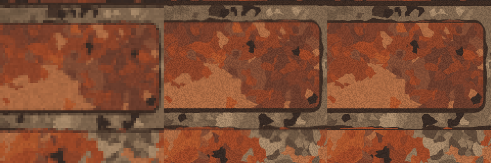

The other builds (from their reports; times are from a shared machine and vary by about 30 %):

| build | 512 / 1254 / 2508 dots, bake time | what changed | file |
|---|---|---|---|
| slate | 13.6 / 31.6 / 100.7 s | same shapes; mean step between neighbouring dots 4.55 / 2.49 / 1.49 (crisper edges) | `slate/builder_answer.json` |
| wood | 13.5 / 32.6 / 105.8 s | at 512 the 1 to 3 dot strokes blur away (same-kind 0.38 against 0.60) | `wood/builder_answer.json` |
| metal | L: 12.6 / 26.8 / 90.0 s | scores at 2508 equal those at 1254; no new detail (the description holds detail to about 1254 dots) | `metal/builder_answer.json` |
| mud | 15.4 / 33.3 / 77.8 s | SSIM to the 2508 bake shrunk: 0.987 / 0.993 / 1.0 | `mud/final_report.json` |
| gravel | 19 / 100 / 173 s (checker: 20.8 and 61 s) | SSIM 0.99 after shrinking; slope of the normal map kept, 0.374 / 0.367 / 0.352 | `gravel/final_report.json` |

**Settings that are already in tile units** (safe at any size):
* the donut trick's feature counts, Wave and Brick Scale, layout counts, positions from Texture Coordinate UV;
* the Bump node's Distance: it is a height in tile widths, so a normal map made at 512 dots and shrunk to 128 differs from one made at 128 by only 0.0007
  (seamless research 3.1);
* the builds' descriptions, which are in "tile dots" of the design tile.

**Settings counted in dots of the finished picture** (must be scaled by hand, or the look changes with size):
* **the normal strength** of a slope filter and **the blur** of a derived height: gravel and brick scale both by dots per tile dot (gravel's slope stays
  0.374 / 0.367 / 0.352 above);
* **the render's pixel filter width** used as a blur: slate found width = about 4 x the blur in dots (`recipes/slate/final_report.json`, filter_width_test:
  width 2 = 0.5-dot blur). Its strip was rendered at 384 dots, where the same width blurs about 3.3 times more of the tile than at 1254
  (`slate/verifier_answer.json`); gravel's strip label "width 2 (used)" is really about width 1 at the strip's 640 dots (`gravel/verifier_answer.json`);
* **grain drawn per dot:** brick's grain is one random number per TILE dot of the 1254 design, so at 2508 each grain speck is 2 x 2 dots: it does not get finer.

**What a bigger picture does NOT add:** detail. Metal, mud and brick all report the same shapes drawn sharper, not more of them. Detail comes from the
description (or from more octaves of noise), not from the picture size.

---

## 11. Recipe cards (every line was run, in the file named)

**Card 1 - seamless cloudy pattern.** Texture Coordinate UV -> `rt.tileable_noise_group()` (Scale = features across the tile, Detail 2 to 6) -> Map Range
0.3..0.7 to 0..1. Two directions: `builder.tnoise(across, up)`. (seamless research 1.3; this guide's stretch strip)

**Card 2 - seamless cells.** UV -> `rt.tileable_voronoi_group()` with Scale 6 or more (never below 4) -> Distance or Color. (voronoi strip)

**Card 3 - seamless bricks, planks, tiles.** Whole counts across and up, rows even when staggered; one random number per piece from the WRAPPED piece
number (Floored Modulo) into White Noise. Ready-made: `tileable_bricks_group()`, `builder.rows_and_columns()`. (seamless research 1.4)

**Card 4 - bent but seamless.** seamless noise -> Subtract 0.5 -> Scale 0.05..0.3 -> Add to the position -> pattern maker. Never Wave's Distortion. (warp strip)

**Card 5 - shapes from a list.** Fold every shape's middle into the tile, then draw a copy one tile over wherever it crosses an edge (up to 9 copies);
let traced patches join across the edge. (slate, gravel, wood reports)

**Card 6 - check.** Half-tile test (control: a wrong roll) AND the wrap jump against every ordinary line AND first-against-last column AND a 2 x 2 look at
the crossing; turn grain off or make it slide. (section 8)

**Card 7 - bigger area.** Multiply feature counts and layout counts by k (or pass `tile = k x 1254`), never the position; divide warp amounts by k.
(area strip; six builds' areas)

**Card 8 - any picture size.** Keep sizes in tile units; scale slope strength, blur and pixel-filter width by the picture size. (section 10)

---

## 12. Lessons that carry to other surfaces

1. **Make it seamless at the source, then prove it.** Every build that drew shapes with wrap copies and whole counts passed; every repair after the fact
   (picture cross-fades, mirrors) had a side effect.
2. **A test only sees what it moves.** Ask of any check: "what would this NOT catch?" The half-tile test cannot see content generated before the slide; the
   seam number cannot tell a seam from a hard edge or from grain.
3. **Copying a reference copies its seam.** Heal the reference first if you trace it: metal faded a 14-dot strip at each edge and traced on a wrap-padded
   copy; the tiling score went 0.30 -> 0.79 to 0.87 at no cost to the dot-for-dot score (`recipes/metal/04 Lessons ...`).
4. **Units decide whether a recipe scales.** Tile units scale to areas and picture sizes for free; dot units need a rule; a hidden constant (1254) breaks it.
5. **Write the tile size into the description,** and read it from there everywhere.

---

## 13. Tested for this guide, and not tested

TESTED for this guide (Blender 5.2.2, `-b --disable-autoexec -t 2`, 4 samples, 256-dot squares and 512 for the area pair; the whole Blender run took 7 s):
the seamless Voronoi at 2, 3, 4, 8, 16 cells across; a wave bent by seamless and by plain noise; Mapping before the donut trick (x 4 and x 2.5) against two
feature counts; the tile repeated against tile count 2; the five Texture Coordinate inputs; and a fairer seam check (wrap jump against every ordinary line).
Scripts: `cookbook/checks/seamless_and_relief_strips/make_coordinate_strips.py` and `finish_strips.py`; numbers: `numbers_coordinates.json` in the same folder.
No test failed. Two surprises: Generated on the bake square is exactly (u, v, 0.5); and the project's seam number read 1.38 to 1.65 on seamless warped bands
(section 8.2, blind spot 6).

NOT TESTED: World and Camera coordinates; the donut trick on a non-square tile; Voronoi features other than F1 on the donut (except wood's failed Distance to
Edge); dividing warp amounts by the tile count; a 4 x 4 area; any of this in EEVEE (no graphics card here); Vector Rotate.

Pictures made for this guide (all under 150 KB): `pictures/seamless-strip-voronoi-cells-across.jpg`, `pictures/seamless-strip-warp-keeps-tiling.jpg`,
`pictures/seamless-strip-stretch-trap.jpg`, `pictures/seamless-area-or-repeat.jpg`, `pictures/coordinates-strip-texture-coordinate.jpg`.
Every other picture is linked from where it was made.
