# 06 Guide - shapers

What this is: a guide to the Blender 5.2 nodes that CHANGE a value or a colour after a pattern maker has made it: Color Ramp, Map Range (with its Stepped mode),
Math, Float Curve, Mix (with its blend modes), Clamp, Hue/Saturation/Value, and Separate / Combine. For each one it says what it is, what it did on our six surfaces,
what each setting does to the picture, the traps found by testing, and a short recipe card of chains that were really run.
The companion guide "06 Guide - pattern makers.md" covers the nodes that make the pattern in the first place (Noise, Voronoi, Brick, Wave and others).

## How to read this guide

Words used (one word for each thing, always):
* **tile** = the square picture we make; **dot** = one pixel of it; **position** = where a dot sits (**u** across from 0 to 1, **v** up from 0 to 1).
* **value** = the grey number a node gives for one dot (0 = black, 1 = white; below 0 shows black, above 1 shows white).
* **shaper** = a node that takes a value (or a colour) and gives back a changed one.
* **setting** = a number or a choice on a node. **chain** = nodes linked one after another (`->` means "feeds into").
* **strip** = a row of small pictures of the same chain with ONE setting changed.
* **mask** = a value that says where something goes (1 = here, 0 = not here). **share** = the part of the tile something covers (0.22 = 22 per cent).
* **stop** = one colour marker on a Color Ramp. **cut** = the value where a hard step happens (below it one thing, above it another).
* **screen numbers** = colour numbers 0..255 as a colour picker or a picture file shows them (for example the hex code #4b5052 = 75, 80, 82).
  **linear numbers** = the numbers Blender wants typed into a colour box or a stop. They are different (section 3.3).
* **build** = one of the six surface jobs in `recipes/` (brick, slate, wood, metal, mud, gravel).
* **same-kind score** = `lib/texture_compare.py` overall (1 = the same kind of surface as the reference).

Labels: **TESTED** = run in Blender 5.2.2 here, with the file that shows it; **NOT TESTED** = only read or reasoned. Every number is copied from the file named next to it.

Where the facts come from: `research/02 Research - the shader node toolbox.md` (folder `research/experiments_shader_node_toolbox/`), `research/02 Research - getting a hand-painted stylised look.md`
(folder `research/experiments_hand_painted_look/`), `research/02 Research - how people make each surface.md`, the six builds' guides,
reports and checkers' findings (`recipes/<surface>/`), and NEW tests made for this guide: `cookbook/checks/tool_guide_strips/make_tool_guide_strips.py`
(run with `run_strips.sh`), numbers in `cookbook/checks/tool_guide_strips/numbers.json`, strips in `cookbook/pictures/shaper-strip-*.jpg`.

---

## 1. The short version

Example first. On the metal tile, a soft cloudy noise becomes hard-edged rust like this (TESTED, `recipes/metal/generator/metal_generator.py`):
noise -> **Map Range** 0.27..0.71 to 0..1 (stretch: the noise only uses the middle) -> **Math Multiply Add** (a gain and an offset: the "more or less rust" knob)
-> **Color Ramp, Constant** (a ladder of cuts, one flat colour per step) -> **Mix** (lay that colour over the bare steel only).
Four shapers, four jobs: **stretch, adjust, cut and colour, combine.** Almost every painted-looking chain in this project is that order.

The rules that would have saved the most time:
1. **Stretch before you cut.** A noise only spans about 0.26..0.71; a cut at 0.65 covers 1.1 per cent of the tile, at 0.55 already 22 per cent (section 3).
2. **Hex colours must be converted to linear numbers.** Typed straight in, #4b5052 came out 147, 152, 154 instead of 75, 80, 82 (section 3.3).
3. **Constant is the "painted" interpolation.** Map Range with a very narrow From window does the same for a single cut.
4. **Map Range Stepped with Steps N gives N + 1 levels, not N.** Math Snap rounds DOWN and never reaches 1.
5. **Clamp does not stretch.** It flattens the ends; Map Range flattens the ends AND stretches the middle (section 8).
6. **Multiply by a dark colour darkens twice.** A soot stain at full strength went nearly black (29, 5, 2) instead of soot (58, 45, 39) (section 7).
7. **Float Curve continues the slope of its ends unless you tell it not to** (section 6).

---

## 2. How the six builds used shapers (honest table)

The builds draw their shapes as flat coloured pieces from lists of numbers (the "painter"); the colour of each piece is written in the description, so the
shapers mostly prepare grain, wear and the data pictures. TESTED in each build's bakes; paths are inside `recipes/<surface>/generator/`.

| Shaper | brick | slate | wood | metal | mud | gravel |
|---|---|---|---|---|---|---|
| **Color Ramp** | - | 5-stop palette in the real-geometry test (`geometry_route_slabs.py`) | - | every wear layer, Constant, cuts set by measuring (`metal_generator.py`, `make_ramp`) | - | - |
| **Map Range** | grain range (`brick_generator.py`) | height stretch (`slate_generator.py`); edge weights, wobble, moss in the geometry test | hard cuts for streaks and hair lines (`wood_shaders.py`); height stretch (`wood_generator.py`) | noise stretch; grain range (`metal_generator.py`) | - | - |
| **Math** | divide in the geometry height test | grain sums; tilt in the geometry test | combine streak gains; line distance | gain and offset; donut sums | push sizes in the geometry test | grain sums (unused); "top face" test in the geometry test |
| **Float Curve** | - | - | - | - | - | - |
| **Mix** | grain (Multiply) | moss and pale edge in the geometry test | - (its grain factor multiplies the colour with a Vector Math Scale node, `wood_generator.py`) | wear over steel; speckle (Multiply); blend two noises; roughness and metallic; grain | - | - |
| **Clamp node** | - (Map Range's Clamp checkbox is used instead, in every build that uses Map Range) | | | | | |
| **Hue/Saturation/Value** | - (colours are picked per shape in Python; gravel's lesson about colour changes is in section 9) | | | | | |
| **Separate / Combine** | Combine Color makes a grey for photographing data pictures in ALL six (`*_generator.py`); Separate / Combine XYZ build the seamless donut position (metal, wood) and size vectors in the geometry tests (gravel, mud, slate) | | | | | |

The tone curve that turns colour brightness into height (for example brick: 12 points from 41.6 -> 7.5 to 137.4 -> 243.8, `recipes/brick/04 Recipe - brick - how it is made.md`
section 2A) was applied in plain Python (`derive_maps.py` in brick and metal), not with a Float Curve.

---

## 3. Color Ramp

**What it is:** a node that turns a grey value into a colour by looking it up on a row of colour stops.

**Example first** (NEW, TESTED for this guide, `numbers.json`). Raw noise (Scale 5, Detail 4) -> Color Ramp, Constant, steel from 0 and rust from a stop at 0.55:
rust covers 22 per cent of the tile. Move the rust stop to 0.6 and rust covers 6.7 per cent; to 0.65 and only 1.1 per cent. At 0.45 it covers 74 per cent.
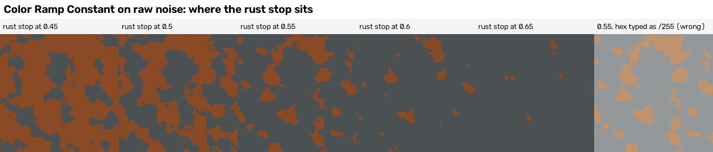
The last square shows the hex trap (section 3.3).

### 3.1 What it did on our surfaces
* **Metal: the wear ladders** (TESTED; `recipes/metal/generator/metal_generator.py`, `make_ramp`; stops in `recipes/metal/description/S.json`). Each wear layer
  ends in a Constant ramp: for example the steel tone layer has five steel greys with stops at 0, 0.3633, 0.4909, 0.5991 and 0.6536. A stop's alpha (see-through amount)
  is used as "cover or not": the first stop of the rust layers has alpha 0, so below the first cut the steel underneath shows. The stop positions were not guessed:
  `recipes/metal/analysis/calibrate_wear.py` drew each noise, read where its values lie over the bare steel and placed every stop so that each colour covers the share
  measured on the reference (steel 0.67 against 0.63 in the reference, rust 0.156 against 0.184, dark 0.08 against 0.096; metal recipe guide 5.3).
* **Slate, real-geometry test only** (TESTED, comparison; `recipes/slate/generator/geometry_route_slabs.py`): a 5-stop palette from (20, 21, 23) to (110, 112, 108).

### 3.2 The settings and what they do (TESTED in the research)
**Interpolation:** **Constant** = hard steps of flat colour (this IS the "painted patches" tool); Linear = straight blend; Ease = smooth blend; **Cardinal** = smooth
but it OVERSHOOTS (a saturated orange appeared that is in no stop); **B-Spline** = smoothest, but it never reaches the end stops (the first dark stop never appeared).
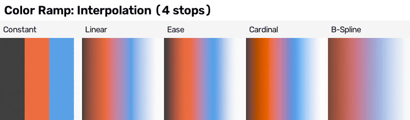

**Colour mode:** RGB blends straight (red to blue passes a muddy grey-purple); HSV and HSL blend by hue, and **Hue Interpolation** picks the way round the colour wheel:
Near (the short way), Far (the long way), Clockwise, Counter-clockwise.
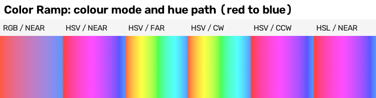
On our palettes: a blend from slate blue-grey to brick orange passed through purple (Near) or green and olive (Far): fine for inventing a stain, wrong for keeping to a measured palette.
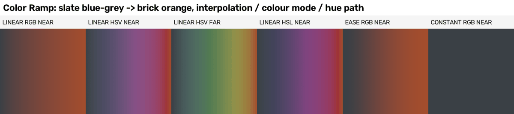

**Number of stops with Constant = number of flat levels** (N stops at i / N gave exactly N levels; hand-painted research 4.1):
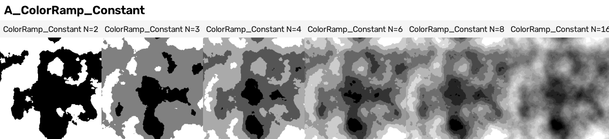

### 3.3 Traps found by testing
* **Hex colours must be converted to linear numbers** (NEW, TESTED, `numbers.json`). Steel #4b5052 is 75, 80, 82 in screen numbers. Converted first
  (`lib/recipe_tools.srgb_hex_to_linear`, or `lib/contrib/builder.srgb_hex_to_linear`), the baked picture came back 75.0, 80.0, 82.0. Typed as 75/255, 80/255, 82/255
  it came back 147.5, 152.0, 153.7: about 72 steps too bright (the hand-painted research found 73 steps on a brick colour, section 4.9). Last square of the strip above.
* **The stops only see the values that arrive.** Raw noise spans 0.26..0.71 (90 per cent of dots 0.38..0.61), so a stop at 0.8 never shows. Stretch first, or measure.
* **"Stop length = share" works only for evenly spread inputs.** The research's palette helper sets each stop's length to its colour's share (hand-painted research 4.9);
  that is right for a value spread evenly over 0..1 (White Noise, a cell's random number) and wrong for noise, which bunches in the middle (strip above). The metal build
  measured instead.
* **Sort the palette dark to light**, so a smooth value reads dark to light (hand-painted research 4.9).
* **Cardinal overshoots, B-Spline undershoots** (above): neither keeps to the palette.

### 3.4 Recipe card (every line was run)
1. **Flat painted patches:** Noise -> Map Range 0.45..0.55 -> Color Ramp Constant with 3 to 5 palette colours (converted to linear). (toolbox recipe card 2)
2. **A wear ladder with exact shares:** stretched noise -> Constant ramp with stops placed by measuring the noise (alpha 0 on the first stop = "leave what is underneath").
   (metal build, `calibrate_wear.py`)
3. **A random flat colour per cell:** Voronoi Color -> White Noise -> Constant ramp (palette, stop length = share, sorted dark to light). (hand-painted research, recipe R1)
4. **Rust from one cut, with the share you want:** raw noise -> Constant ramp, rust stop at 0.55 for about a fifth of the tile. (this guide, `shaper-strip-ramp-stop-and-share.jpg`)

---

## 4. Map Range (and its Stepped mode)

**What it is:** a node that takes the values between two numbers (From Min and From Max) and spreads them over two other numbers (To Min and To Max).

**Example first.** From 0.4..0.6 To 0..1 turns cloudy noise into near black and white. The narrower the From window, the harder the edge: 0.3..0.7 = soft clouds,
0.45..0.55 = hard blotches, 0.49..0.51 = almost no soft edge (TESTED, toolbox research).
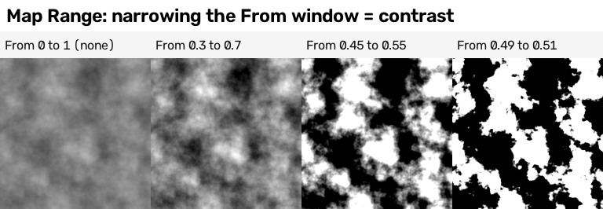

### 4.1 What it did on our surfaces
* **Stretching noise** (metal, TESTED): every wear noise goes through From 0.27..0.71 To 0..1 first (`metal_generator.py`, `add_noise_field`).
* **Hard cuts** (wood, TESTED, `recipes/wood/generator/wood_shaders.py`): the light streaks are From 0.58 to 0.584 (a window only 0.004 wide = a one-dot staircase edge,
  the painted look); the dark streaks From 0.38 down to 0.376; the hair lines From 0.012 down to 0.006 on the distance from the noise's middle.
  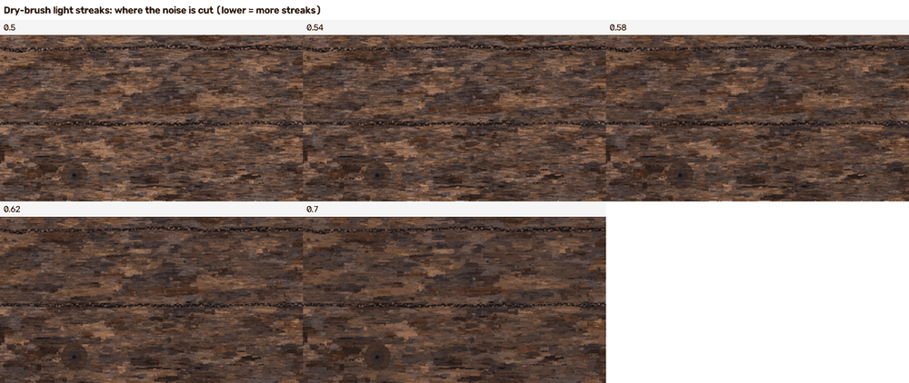
  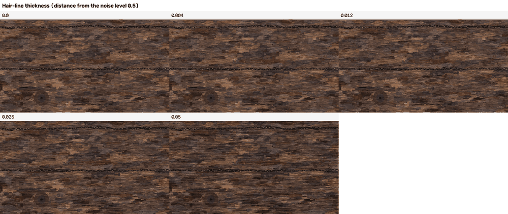
  Read the second strip: 0 = no hair lines; 0.012 = the fitted value; 0.05 = bold wavy lines.
* **Height stretch** (slate and wood, TESTED): the brightness of each piece goes From 9.5/255..111.5/255 To 0..1 on the slate (`slate_generator.py`, numbers in
  `recipes/slate/description/S0_layout_only.json`, block `maps.height`); everything brighter than 111.5 is white in the height. (Gravel does the same stretch in Python; same result.)
* **Grain range** (brick and metal, TESTED): White Noise's 0..1 goes To 1 - a .. 1 + a, a brightness factor round 1 (see "06 Guide - pattern makers.md", White Noise).
* **Real-geometry test on slate** (`geometry_route_slabs.py`): REVERSED ranges for edge weights (From -0.5..-0.30 To 1..0: 1 at the lower edge of each slate fading
  to 0), noise From 0.3..0.7 To -1..1 for a push in both directions, and moss From 0.50..0.58.

### 4.2 The settings and what they do (TESTED, toolbox research; numbers in `research/experiments_shader_node_toolbox/map_range_numbers.json`)
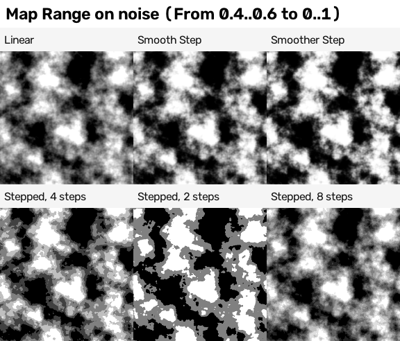
* **Interpolation:** Linear; **Stepped Linear** + **Steps** (flat levels: a posterised look); **Smooth Step**; **Smoother Step** (S-shaped, softer at both ends).
* **Steps:** with Steps 4 the values at 0.45, 0.5 and 0.55 came out 0.25, 0.5, 0.75. **Steps N gives N + 1 levels** (Steps 4: 0, 0.25, 0.5, 0.75, 1).
  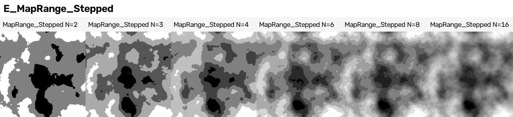
* **Clamp:** with Linear and Stepped, Clamp on keeps the result between To Min and To Max; off, values run past (From 0.4..0.6: 0.2 gave -0.97, 0.8 gave 2.02).
  **Smooth Step and Smoother Step stay inside whatever Clamp says.**
* **Reverse a range** by putting From Min above From Max: "everything BELOW the level becomes 1". The research's puddle mask is From 0.40 down to 0.34 with Smooth Step
  (TESTED, toolbox research 8.10, picture `m02_puddle_stages.png`).

### 4.3 Traps
* **N + 1 levels** from Stepped (above): ask for one fewer step than the levels you want.
* **The From window width is the edge softness.** Too narrow on a 16-bit height gives one-dot steps that make a harsh normal map (the hand-painted research blurred the
  height 0.8 dots before making the normal; its normal agreement went from 0.00 to 0.73, section 4.11).
* **Clamp off lets numbers escape** into the next node (a Mix factor, a colour). Keep it on unless you want the overshoot.
* **In Python** the float sockets are positions 0 to 5 (Value, From Min, From Max, To Min, To Max, Steps); Steps only appears in Stepped mode.

### 4.4 Recipe card (every line was run)
1. **Stretch noise to full contrast:** From 0.27..0.71 (metal) or 0.3..0.7 (toolbox) To 0..1, Clamp on.
2. **One hard cut with a one-dot edge:** From 0.58 To 0.584 -> a mask. (wood build)
3. **Below-the-level mask (puddles):** From 0.40 To 0.34 (reversed), Smooth Step. (toolbox research 8.10)
4. **N flat grey levels:** Map Range 0.30..0.70 to 0..1, then Map Range Stepped with Steps 3 = 4 levels -> Constant Color Ramp with 4 palette colours. (hand-painted research 4.1)
5. **A brightness factor round 1:** From 0..1 To 1 - a .. 1 + a. (brick and metal grain)

---

## 5. Math

**What it is:** a node that does one sum on one, two or three values: add, multiply, greater than, absolute, and about forty more.

**Example first** (TESTED, toolbox research): noise -> Math Greater Than 0.5 = a black-and-white mask. The picture shows twelve operations on the same noise.
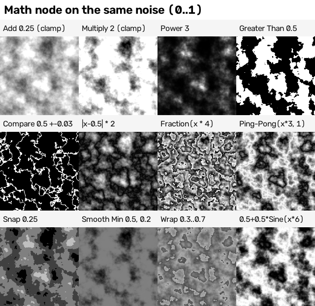

### 5.1 What it did on our surfaces (TESTED)
* **Metal, the "more or less rust" knob:** Math Multiply Add (value x gain + offset) before the Constant ramp. Moving the offset from -0.10 to +0.10 goes from much less
  rust to rust and pale chips over a large part of the plate (metal recipe guide 5.6). The checker measured it: a rough rust-colour share of 3.3 per cent at -0.10 against
  11.5 per cent at the fitted setting, so "much less rust", not "almost none" (`recipes/metal/verifier_answer.json`).
  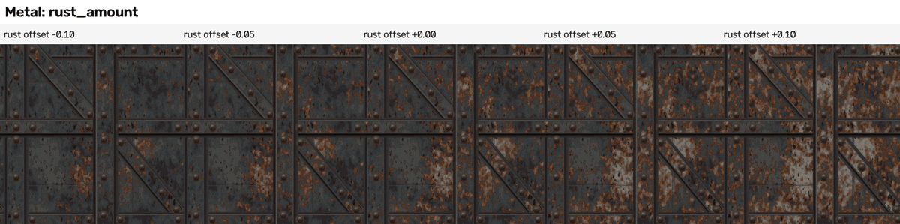
  A second Multiply Add adds "edge attraction" (a stored number high beside bar edges and rivets) x its gain, so rust gathers there.
* **Wood, hair lines and gains:** Subtract 0.5, then Absolute = how far the noise is from its middle (small on its contour line); Subtract, Add and Multiply combine the light
  and dark streak factors into one brightness factor (`wood_shaders.py`).
* **Slate (and the unused gravel option), height grain:** noise - 0.5, x a gain, + the brightness (`slate_generator.py`).
* **The donut position** (metal, wood, lib): Multiply by 2 pi, Sine, Cosine, Multiply by a radius.
* **Geometry tests:** Divide (brick height = Z / thickness), Arctan2 (slate tilt), Greater Than 0.5 on a dot product (gravel: "is this face looking up?").

### 5.2 The operations that matter, and what they do (TESTED)
* **Add / Subtract / Multiply:** brightness and contrast (the Clamp checkbox keeps 0..1). **Multiply Add:** gain and offset in one node.
* **Power:** 3 darkens the middle (a gamma curve).
* **Greater Than / Less Than:** a hard cut: a mask.
* **Compare:** "is the value within Epsilon of B?" = a line along one level of the noise. NEW, TESTED (`numbers.json`, stretched noise, B = 0.5): Epsilon 0.005 / 0.01 / 0.03 /
  0.06 / 0.12 made 2.4 / 4.8 / 14 / 27 / 51 per cent of the tile white. Doubling Epsilon roughly doubles the line width until the lines run into each other.
  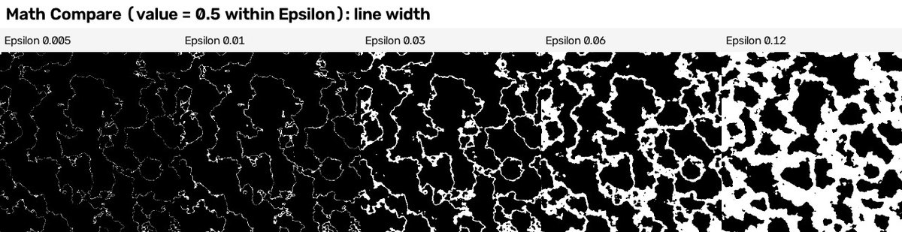
* **Absolute** (after Subtract 0.5): ridges along the middle level. **Fraction:** repeats 0..1 (contour bands). **Ping-Pong:** a zig-zag. **Wrap:** loops into a window.
* **Floor / Round / Snap** = flat levels (hand-painted research 4.1, counted with 1 sample and no dither):
  Floor (x x N, Floor, / (N - 1), clamp) gives N levels; Round (x x (N - 1), Round, / (N - 1)) gives N levels with half-width end bins; **Snap (Increment 1 / N) gives N levels but
  rounds DOWN: the top level is 1 - 1/N, never 1.**
  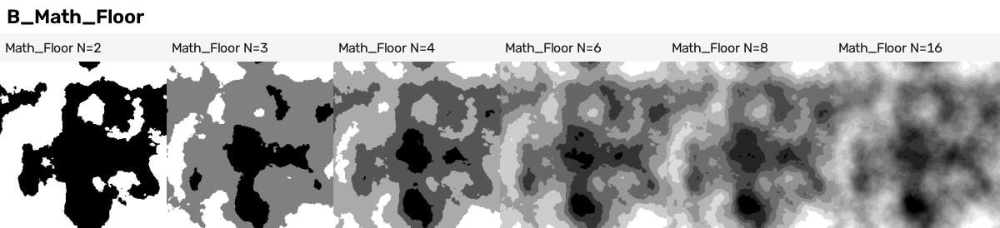
  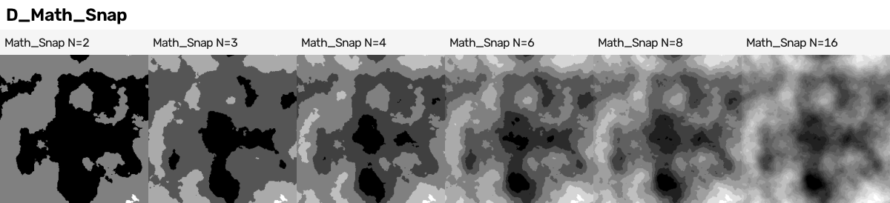
* **Smooth Min / Smooth Max:** a soft union of two shapes. **Floored Modulo:** wraps whole numbers (used to make a brick count repeat).

### 5.3 Traps
* Snap never reaches 1 (above). Stepped Map Range gives N + 1 levels (section 4). Choose deliberately.
* **The third input appears only for some operations** (Multiply Add, Compare, Smooth Min/Max, Wrap...). In Python it is `inputs[2]`.
* **Counting flat levels needs 1 sample and dither 0**, or anti-aliased edges and the PNG's +-1/255 dither add fake levels (hand-painted research, pitfall 11).

### 5.4 Recipe card (every line was run)
1. **Mask:** value -> Greater Than 0.5. (toolbox s03)
2. **A thin line along one level:** value -> Subtract 0.5 -> Absolute -> Map Range (from w to w / 2) (wood build, w = 0.012); or Math Compare (B 0.5, Epsilon w) (this guide).
3. **"More or less of it" knob:** Multiply Add (gain, offset) before the cut. (metal build)
4. **Brick numbers that tile:** row = Floor(v x rows); column = Floor(u x columns + 0.5 x Floored Modulo(row, 2)); Fraction gives the position inside each brick;
   48 bricks, picture identical after one tile's move. (toolbox research 8.1)
5. **N flat levels:** Floor (x x N) / (N - 1), Clamp. (hand-painted research 4.1)

---

## 6. Float Curve

**What it is:** a node that reshapes a value with a curve you draw: the value goes in along the bottom and the new value comes out up the side.

**Example first** (TESTED, toolbox research, noise stretched to 0..1 first): an S-curve through (0.35, 0.1) and (0.65, 0.9) deepens the darks and lifts the lights;
a hump through (0, 0), (0.5, 1), (1, 0) turns the middle values white and leaves only the darkest and lightest spots dark; a staircase curve makes three flat steps.
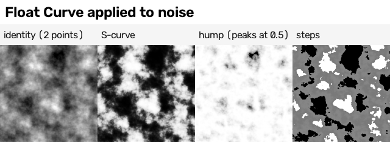

### 6.1 What it did on our surfaces
No build uses it. The builds' height tone curves (12 points each) were applied in plain Python; a Float Curve could hold such a curve inside Blender: NOT TESTED.
The toolbox research suggests it where a Color Ramp is clumsy: a smooth S-shaped contrast, a hump that peaks at one level, a shaped height profile (section 6.4 there).

### 6.2 The setting that matters: what happens outside 0..1 ("extend")
* **Default = Extrapolated: the curve keeps going with the slope of its last piece.** The research's curve (0, 0) -> (0.5, 1) -> (1, 1) gave -2.994 at -0.5 and 0.846 at 1.5;
  between its points it also overshot to 1.059 at 0.75 (`research/experiments_shader_node_toolbox/misc_checks.json`).
* NEW, TESTED for this guide (`numbers.json`): an S-curve through (0, 0), (0.35, 0.1), (0.65, 0.9), (1, 1) has nearly flat ends, so Extrapolated gave only -0.007 at -0.5
  and 1.007 at 1.5. **How far it shoots off depends on how steep the ends are.**
* **Horizontal** holds the end values: 0 below 0 and 1 above 1 in both tests. In Python: `node.mapping.extend = 'HORIZONTAL'` then `node.mapping.update()`.

### 6.3 Traps
* Extrapolated ends (above). Set Horizontal whenever the input can leave 0..1 (raw Multifractal noise, unclamped Map Range).
* The curve can overshoot between points (1.059 at 0.75 above): check the top and bottom values if the result feeds a Mix factor.
* **RGB Curves** (the colour version, with a curve per channel) was NOT TESTED.

### 6.4 Recipe card
1. **S-curve contrast on noise** (toolbox s04). 2. **Middle values white, extremes dark** (the hump; toolbox s04). 3. **Flat steps** (staircase curve; toolbox s04).
Only these three were run; Float Curve in a build was not tried.

---

## 7. Mix (and its blend modes)

**What it is:** a node that blends two inputs, A and B, by a Factor (0 = all A, 1 = all B), in one of many blend modes.

**Example first** (NEW, TESTED for this guide, `numbers.json`). A = three brick reds I picked (#7a3426, #9c4a35, #b8664a, flat patches from a Constant ramp), B = soot #3a2d27, blend Multiply, Factor = a stain mask x an amount. Inside the stain the
mean colour went (screen numbers) 146, 68, 49 at amount 0 -> 129, 59, 42 at 0.25 -> 108, 48, 34 at 0.5 -> 80, 34, 22 at 0.75 -> 29, 5, 2 at 1. Outside the stain nothing changed (148, 70, 50).
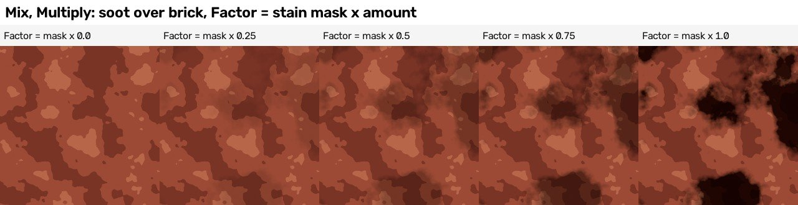
Read it: the Factor is the strength knob, and the mask decides where. The steps are not even on screen (17, 21, 28, then 51 levels darker in red): the blend is even in
linear numbers, and screen numbers bunch the darks.

### 7.1 What it did on our surfaces
* **Grain** (brick and metal, TESTED): Mix, Multiply, Factor 1: the colour times a grey brightness factor round 1 (`brick_generator.py`, `metal_generator.py`).
* **Metal wear** (TESTED, `metal_generator.py`, `build_material`): each wear colour is laid with Mix (blend MIX) where Factor = the ramp's alpha x the "bare steel" mask, so
  rust lands on steel only. The speckle layer uses Multiply with greys 118, 128 and 140 out of 128 (128 = no change): a brightness change, not a colour. Float Mixes blend
  each fine noise with its coarse "clumping" noise (weight 0.3 to 0.5) and carry each layer's roughness and metallic (rust 0.8 / 0.2).
* **Slate, real-geometry test** (`geometry_route_slabs.py`): moss colour mixed in by (moss mask x "upper part of the slate"), then a pale chipped edge by (lower-edge weight x chip noise).

### 7.2 The blend modes (TESTED)
The toolbox research, A = bricks, B = a blue-yellow noise, Factor 1:
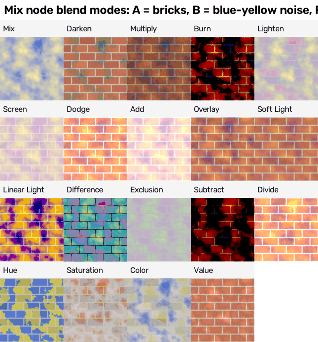
NEW, the same soot stain at Factor = mask x 1, mean colour inside the stain (`numbers.json`):

| Mode | Inside the stain (screen numbers) | What it means for a stain |
|---|---|---|
| Mix | 58, 45, 39 | paints the soot colour flat on top (exactly #3a2d27) |
| Darken | 58, 45, 39 | the same here, because the soot is darker than every brick red in every channel |
| Multiply | 29, 5, 2 | nearly black: two dark colours multiplied darken twice |
| Overlay | 43, 10, 4 | dark and more contrasty, keeps some red |
| Soft Light | 90, 19, 8 | a gentle darkening that keeps the brick's red |
| Value | 58, 23, 14 | takes the soot's brightness, keeps the brick's colour: dark red-brown |
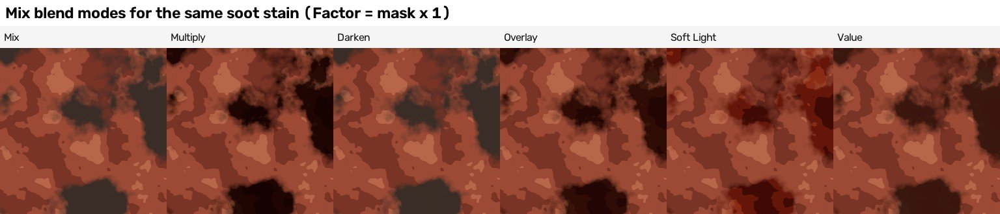

Other modes in 5.2.2: Burn, Lighten, Screen, Dodge, Add, Linear Light, Difference, Exclusion, Subtract, Divide, Hue, Saturation, Colour. Options: Clamp Factor (on by default),
Clamp Result (colour only). Data types: Float, Vector, Colour (only Colour has blend modes), Rotation.

### 7.3 Traps found by testing
* **Multiply by a dark colour goes nearly black** (table above). For soot that should look like soot, use Mix with a lower Factor, or Multiply by a light grey-brown.
* **A brightness layer written as a colour layer hides what is under it.** The metal build's fine speckle, first written as a colour layer, cut the rust share from
  15.6 to 1.0 per cent; written as Multiply (128 = no change) it left the rust alone (metal recipe guide, section 10, item 8).
* **In Python:** set `data_type` first; then the sockets are found by the names `A`, `B`, `Factor` and the output `Result` (`A_Color` is NOT accepted as a name; toolbox research section 4).
  **Mix (Legacy)** is the old Mix RGB, kept for old files.

### 7.4 Recipe card (every line was run)
1. **Per-dot grain:** colour -> Mix Multiply (Factor 1) with a grey of 1 +- amount. (brick and metal builds)
2. **A stain where a mask says:** Mix (Multiply or Mix) of base and stain colour, Factor = mask x amount (amount = strength). (this guide, `shaper-strip-mix-factor.jpg`)
3. **Wear on one material only:** Factor = Color Ramp alpha x "bare steel" mask. (metal build)
4. **Brightness flecks that do not hide the colour:** Multiply with greys 118 / 128 / 140 out of 128. (metal build, speckle layer)
5. **Wet ground:** base colour mixed toward base x grey 0.45 (Multiply) by a wetness mask. (toolbox research 8.10)

---

## 8. Clamp

**What it is:** a node that keeps a value between a Min and a Max: anything lower becomes Min, anything higher becomes Max.

**Example first** (NEW, TESTED for this guide, `numbers.json`). A noise stretched to 0..1, then Clamp Min 0.45, Max 0.55: 41 per cent of the tile becomes flat 0.45,
36 per cent flat 0.55, and the rest keeps its soft middle: a washed-out grey picture. Map Range 0.45..0.55 flattens exactly the same dots (41 and 36 per cent) but
stretches the result to 0..1: black and white blotches.
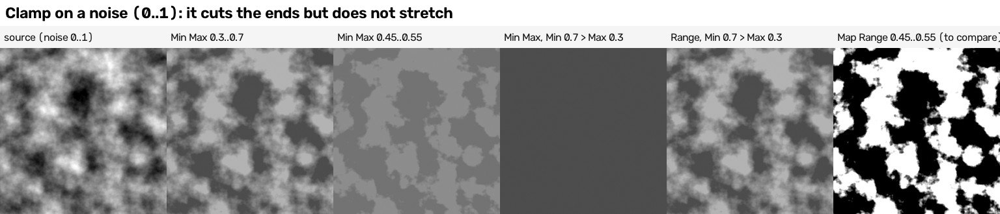

### 8.1 What it did on our surfaces
No build uses the Clamp node. Map Range's Clamp checkbox (on by default) and the Math node's Clamp checkbox did the job everywhere they were needed.

### 8.2 The settings (NEW, TESTED for this guide)
* **Min and Max:** Clamp 0.3..0.7 flattened 14 per cent of dots at 0.3 and 11 per cent at 0.7.
* **Type Min Max** with Min ABOVE Max (Min 0.7, Max 0.3): every dot became 0.3 (the Max), a flat grey square.
* **Type Range** with the same numbers swaps them: exactly the same picture as 0.3..0.7.

### 8.3 Traps
* **Clamp does not add contrast.** If you want "flatten the ends and use the full range", use Map Range (or Clamp followed by a stretch).
* **Min Max with swapped numbers gives a flat picture**; use Range when Min and Max come from other nodes and might cross.

### 8.4 Recipe card
1. **Flatten only the extremes, keep the middle:** Clamp Min Max 0.3..0.7. 2. **Safe when Min and Max may swap:** Clamp, type Range. (both in `shaper-strip-clamp.jpg`; only these were run)

---

## 9. Hue/Saturation/Value

**What it is:** a node that turns a colour round the colour wheel (Hue), makes it more or less colourful (Saturation) and lighter or darker (Value).

**Example first** (TESTED, toolbox research): on an orange-brown picture, Hue 0.3 turned the oranges violet and 0.7 turned them green; Saturation 0 = grey, 1.6 = vivid;
Value 0.5 = darker. **The "no change" numbers are Hue 0.5, Saturation 1, Value 1.** Factor mixes the result with the original. (The same picture shows Bright/Contrast, Gamma and Invert.)
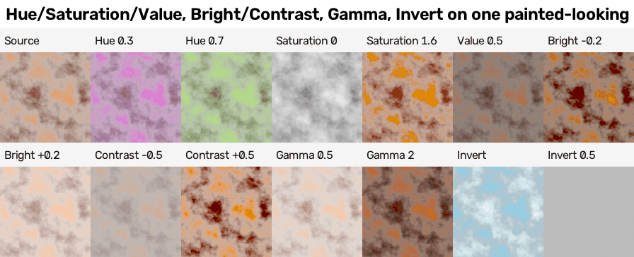

### 9.1 What it did on our surfaces
No build uses the node: each shape's colour was picked in Python. But the gravel build learned the lesson this node is for: **change brightness, not red, green and blue
separately.** Separate random changes turned dark grey stones purple and green; one change applied to all three channels kept the hue (`"jitter_mode": "brightness"`;
`recipes/gravel/04 Lessons - gravel - what carries over to other surfaces.md`). With this node that means: jitter **Value**, keep **Hue** jitter tiny.

### 9.2 Per-patch jitter (TESTED, hand-painted research 4.2)
With r and r2 = two random numbers per patch (0..1): Hue = 0.5 + (r - 0.5) x h, Value = 1 + (r2 - 0.5) x v. Measured in the baked picture: h = 0.02 moves the hue by about
plus or minus 3.6 degrees; v = 0.5 moved the baked values from 0.48 to 0.60 around 0.545 (about plus or minus 11 per cent). The references' patches wobble 3 to 6 lightness
units inside, so keep it small.
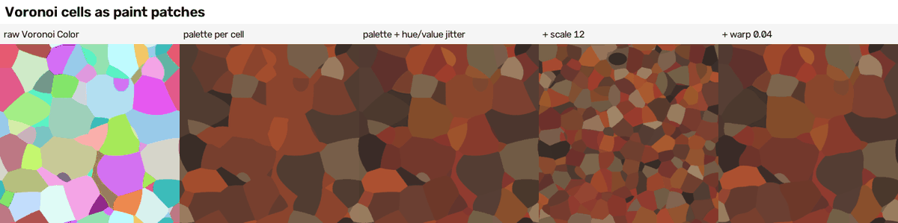

### 9.3 Traps
* "No change" is Hue **0.5**, not 0.
* Not available in the Geometry Nodes editor (toolbox research section 10).
* Hue jitter round red (where the wheel wraps from 1 back to 0): NOT TESTED.

### 9.4 Recipe card
1. **Per-patch jitter:** Hue 0.5 + (r - 0.5) x 0.04, Value 1 + (r2 - 0.5) x 0.35. (hand-painted research, recipe R1) 2. **Tune a finished colour picture** (s06 settings above).
Only these two were run.

---

## 10. Separate and Combine (Color and XYZ)

**What they are:** Separate nodes split a colour into its three channels (or a position into X, Y and Z); Combine nodes build a colour or a position from three numbers.
Separate / Combine Color work in RGB, HSV or HSL; Separate / Combine XYZ work on positions.

**Example first** (NEW, TESTED for this guide, `numbers.json`). One Noise node's Color output, split with Separate Color: the red channel is exactly the noise's Factor
(correlation 1.0); green and blue are two other noises (correlation with the Factor -0.092 and 0.028; with each other 0.047). So one noise gives three random values.
Separate XYZ of the position gives u (a left-to-right ramp). Combine XYZ (u x 6, v) fed into a noise makes its blobs 6 times narrower across: upright streaks.
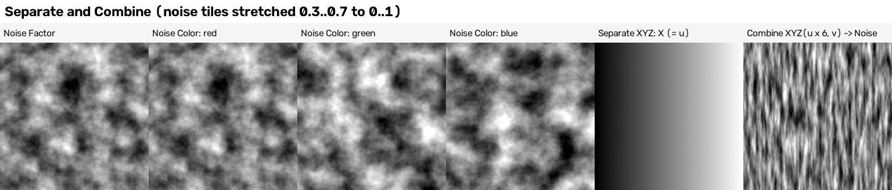

### 10.1 What they did on our surfaces (TESTED in every build)
* **Photographing data pictures:** a height, roughness or metallic number is one value, but the Emission shader wants a colour, so every generator puts the same value
  into Combine Color's red, green and blue (`brick_generator.py`, `slate_generator.py`, `wood_generator.py`, `metal_generator.py`, `mud_generator.py`, `gravel_generator.py`).
* **Grain:** Combine Color turns the brightness factor into a grey to multiply with (brick, metal).
* **The seamless donut position:** Separate XYZ gives u and v; Math turns them into circles; Combine XYZ builds the position the 4D noise reads
  (`metal_generator.py`, `streaky_noise_group`; `wood_shaders.py`, `_donut`; `lib/recipe_tools.py`).
* **Geometry tests:** Combine XYZ builds each stone's or slate's size from stored numbers (gravel, mud and slate `geometry_route*.py`).
* **Research:** the toolbox gravel attempt took a per-stone random number from Voronoi Color -> Separate Color, red, and a "stone or soil" dice roll from green > 0.35
  (toolbox research 8.7).

### 10.2 Traps
* **The red channel of Noise Color is the Factor** (above): take green or blue for a second random value.
* **Brightness is not "red + green + blue".** For height from colour the research used Gamma 0.4545 -> RGB to BW (toolbox research 8.8); the brick build used
  0.299 red + 0.587 green + 0.114 blue on screen numbers (brick recipe guide 2A).
* **In Geometry Nodes** the colour versions are separate Function nodes (toolbox research section 10).

### 10.3 Recipe card (every line was run)
1. **Photograph a number as a picture:** value -> Combine Color (same value in R, G, B) -> Emission. (all six builds)
2. **Three random values from one noise:** Noise Color -> Separate Color -> red (= Factor), green, blue. (this guide, `shaper-strip-separate-combine.jpg`)
3. **A random number per cell:** Voronoi Color -> Separate Color -> red. (toolbox gravel attempt)
4. **Streaks without a Mapping node:** Separate XYZ -> u x 6 -> Combine XYZ (u x 6, v) -> Noise. (this guide; not seamless)
5. **The seamless donut position:** Separate XYZ -> Math (x 2 pi, Sine, Cosine, x radius) -> Combine XYZ + W -> 4D noise. (metal and wood builds)

---

## 11. Lessons that carry to other surfaces

1. **Stretch, adjust, cut and colour, combine** (the metal chain) is the order that worked; on a new surface start from it.
2. **Set cuts from the share you want, by measuring** (metal `calibrate_wear.py`; the raw-noise strip in section 3): moving a cut by only 0.05 changed the share 2 to 6 times (48, 22, 6.7, 1.1 per cent for cuts at 0.5, 0.55, 0.6, 0.65).
3. **Painted = hard edges:** Constant ramps and narrow Map Range windows (0.004 wide on the wood). Soft blends read as clouds.
4. **Brightness changes multiply; colour changes mix.** A brightness layer written as a colour hid the metal's rust; a Multiply by a dark colour turned soot black.
5. **Convert every hex or picker colour to linear numbers** before typing it in.
6. **Change brightness, not each channel** when you add variety (gravel).

## 12. Tested for this guide, and not tested

TESTED for this guide (Blender 5.2.2, `-b --disable-autoexec -t 2`, 256-dot squares, 4 samples for pictures, 1 sample for numbers; about 14 seconds in all):
Color Ramp stop position against share on raw noise and the hex trap; Clamp Min Max and Range (including Min above Max) against Map Range; Mix Factor from 0 to 1 and six blend
modes for one stain; Separate Color of a Noise Color output and Separate / Combine XYZ; Math Compare Epsilon from 0.005 to 0.12; Float Curve Extrapolated against Horizontal
with an S-curve. Script `cookbook/checks/tool_guide_strips/make_tool_guide_strips.py`; numbers `cookbook/checks/tool_guide_strips/numbers.json`. No test failed.
One result differed from what I expected: Extrapolated barely moved an S-curve with flat ends (the research's steep curve went to -2.99); both are reported in section 6.

NOT TESTED: Float Curve holding a build's height tone curve; RGB Curves; Hue jitter round red; Map Range's Vector mode; Mix's non-uniform Vector factor; Clamp inside a build;
the Mix modes not in the stain table on our palettes; anything in EEVEE.
