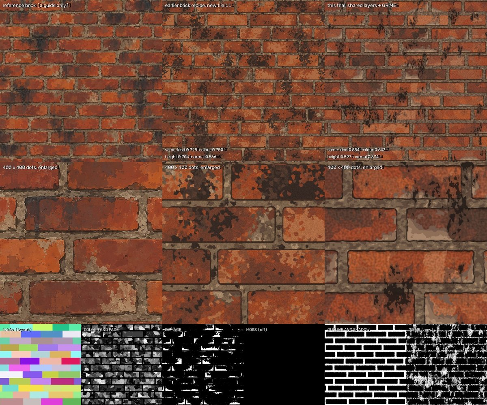
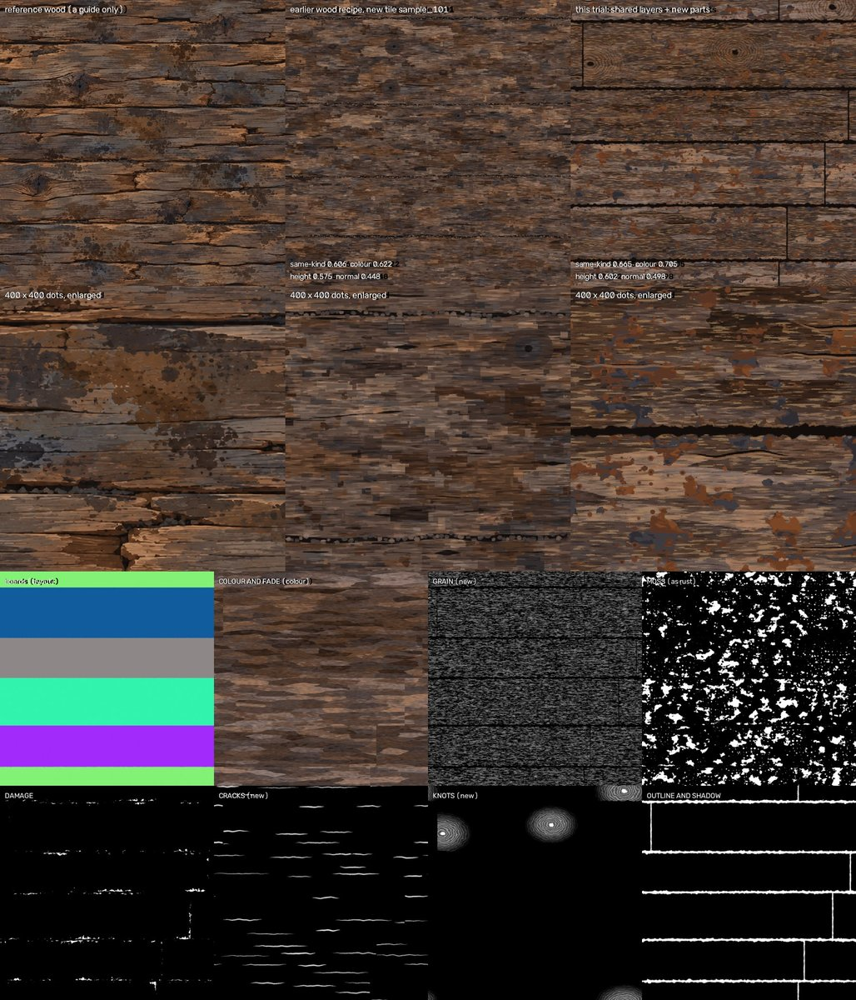
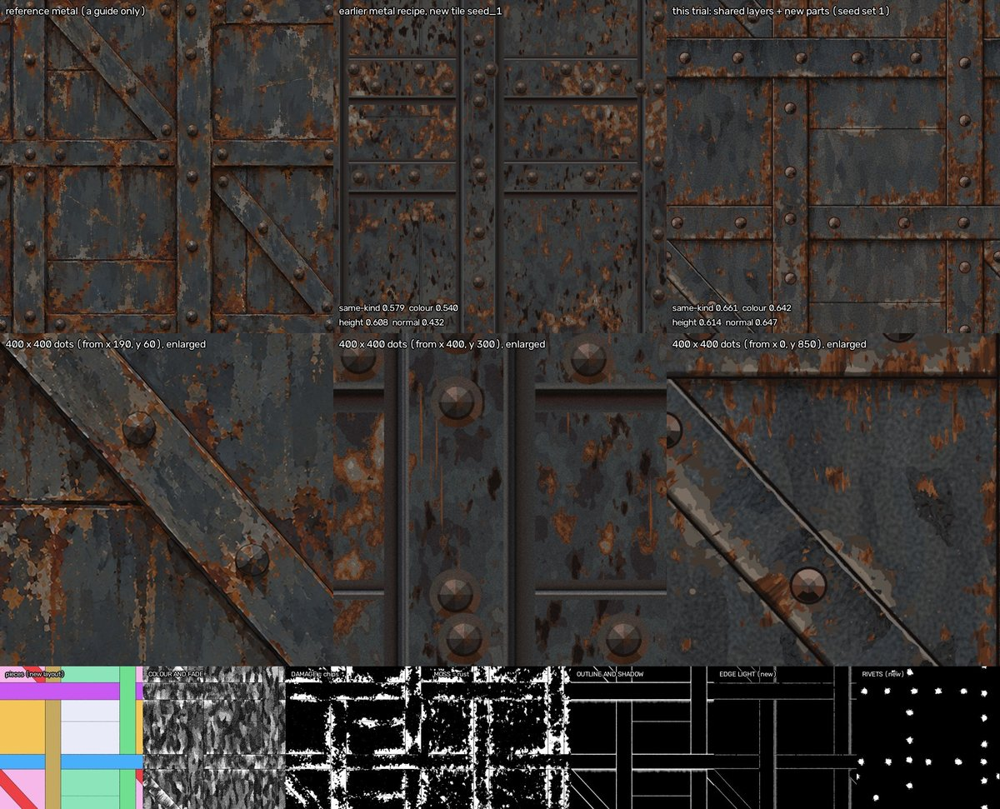
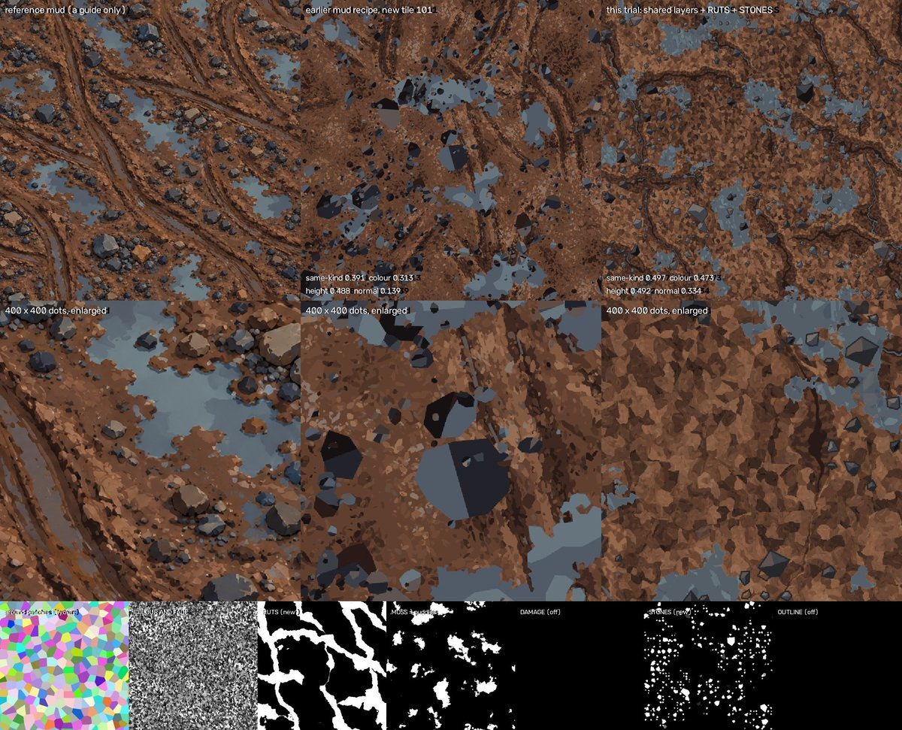
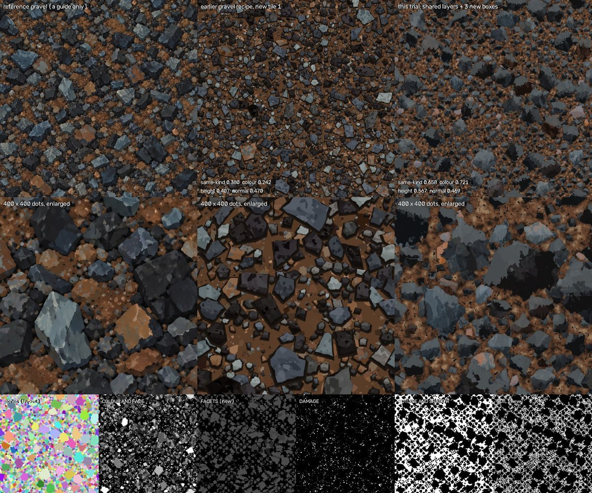

# 07 Reuse - which tools work on which surfaces

What this is: the answer to the question "How much of the tools can be used on the other textures now?". The slate was rebuilt as separate layers (colour and
fade, damage, moss, outline and shadow, combine). Five trials then tried to make the other five surfaces (brick, wood, metal, mud, gravel) with those same
layers, changing only their settings and adding only the smallest new parts that were truly needed. An independent check then re-ran the scores and counts (section 6 says which things it did not re-run). This page
puts the result in one place: the answer and one table, a table of every tool against every surface, what is still missing to make the toolkit general (ranked
by how many surfaces need it), and one short section per surface with its picture sheet. Written on 20 October by the reuse guide writer from the five trial
reports and the independent check; **no new baking was done for this page** (section 6 says what I did check).
Link to the front page: [06 Cookbook - start here](06%20Cookbook%20-%20start%20here.md).

---

## 1. The answer

**The paint machinery carries over; the shape-making does not.** Between **55 percent (mud) and 87 percent (wood)** of the nodes in a finished recipe are
shared layers that were used unchanged (the layer interface, the paint layers and the stacking; the baking and scoring tools were shared too). What is not shared is the LAYOUT (the box that says which
piece a dot is on) and one to three new layers per surface for things no shared layer paints (soot, rivets, ruts, soil, cracks, rings, stones). On the
same-kind score the layered tile is **ahead of the surface's own earlier recipe on four surfaces (wood, metal, mud, gravel) and behind on brick**, and up
close every layered tile is cleaner, flatter and more regular than its reference.

In detail:

* **Ran with no change to their code on all five surfaces:** the layer interface, COLOUR AND FADE, COMBINE's stacking, the baking tool and the scoring tool.
  The recipe wiring and the tests were copies of the slate ones with a line or two changed. The seven frozen shared files still match their fingerprints (I ran
  that check again while writing this).
* **Did a job by settings on three or four of the five:** DAMAGE, OUTLINE AND SHADOW and MOSS, often with a new meaning (MOSS as rust or as puddle water,
  DAMAGE as chipped paint). They were switched off where they had no job: MOSS on brick and gravel, DAMAGE and OUTLINE AND SHADOW on mud.
* **Did not carry over:** the LAYOUT (four of five needed a new one; wood needed only a 5-node turn) and COMBINE's height-from-colour rule (it is slate's and no
  setting changes it; three surfaces replaced it with a new box).

One table, one row per surface. "Node" = one small step Blender works out for every dot of the picture; "share" = shared and unchanged nodes divided by all
nodes of the finished recipe.

| surface | share of the recipe from shared parts (nodes) | what had to be new (nodes) | reads as the surface? | same-kind score, layered vs the surface's own earlier recipe (same tool, 1254 dots, like for like) |
|---|---|---|---|---|
| **brick** | **83.5 %** (1,530 of 1,832); 78.6 % if MOSS, built but switched off, is not counted | GRIME layer for soot over bricks and mortar (161); a height box after COMBINE (13); a brick layout (118, optional: the shared slate LAYOUT by settings scores 0.646 against 0.654) | **Yes**, an old red brick wall; flat cut-paper patches, small soot flecks, pale spall bands along lower edges, no right-hand shadow | layered **0.615** (mean of 3 seed sets: 0.654 / 0.615 / 0.577) against earlier **0.725** (its 8 new tiles: 0.708). **Behind by 0.11.** With COMBINE's own height rule: 0.538 on set 1 |
| **wood** | **86.9 %** (1,718 of 1,978) | WOOD TURN (5); CRACKS (95); KNOTS (78, optional); GRAIN (31, plus 39 borrowed unchanged from the earlier wood build) | **Yes**, old weathered boards; tidy and drawn up close (straight even boards, uniform black gaps, rings drawn on the knots) | layered **0.667** (0.665 / 0.657 / 0.678) against earlier **0.606** (its 8 stored tiles: 0.626). **Ahead by 0.06** (0.04 against the 8-tile mean) |
| **metal** | **77.5 %** (1,533 of 1,977) | METAL LAYOUT (191); EDGE LIGHT (98); RIVETS (125); height rule (19) | **Yes**, riveted rusty steel; cleaner and more regular than the reference (ruler-straight edges, identical rivets, short rust stripes) | layered **0.648** (0.661 / 0.629 / 0.654; a never-looked-at 4th set: 0.632) against earlier **0.579** (8 tiles: 0.569). **Ahead by 0.07.** With COMBINE's rule: 0.578 on set 1 |
| **mud** | **54.8 %** (1,401 of 2,555); 43.2 % counting only the boxes that work in the final tile | MUD LAYOUT (295); RUTS (212); STONES (637, of which about 498 are the borrowed stone maker) | **Partly**: earthy ground with blue-grey puddles, stones and dark trenches, but a flat mosaic of clods, no broad braided wheel ruts, sparse cartoon-like stones | layered **0.507** (0.497 / 0.470 / 0.555) against earlier **0.391** (8 tiles: 0.383). **Ahead by 0.12**, but both are far from the reference and the score separates mud from other surfaces least sharply |
| **gravel** | **56.2 %** (1,111 of 1,976) | GRAVEL LAYOUT (564, mostly a declared copy of `stone_tools.polygon_stones`); SOIL (170); FACETS (109); height rule (12, optional) | **Yes at a glance**; up close ragged, soft, stair-stepped stone faces and mottled soil | layered **0.622** (0.658 / 0.618 / 0.589) against earlier **0.380** (8 tiles: 0.412). **Ahead by 0.24.** The shared layers alone on a gravel layout reach only about 0.21 |

The picture, one row per surface: reference, the surface's own earlier recipe, the layered tile (set 1). The numbers under each picture are read from the
independent check's score files by `checks/reuse_overview/make_reuse_overview.py`.

**How much of the shared code is it?** Counting lines of code (comments and blank lines not counted, the independent check's counts): the picture-making
code that was reused unchanged against the new box code is 987 against 211 for brick (82 percent reused), 1,158 against 224 for wood (84), 987 against 390
for metal (72), 987 against 297 for mud (77) and 792 against 306 for gravel (72). The helpers' own counts differ a little for metal (938 against 382) and
gravel (749 against 295); the shares come out the same to within one point.

**The shared layers, how many of the five surfaces used each** (from sections 3 and 5):

| shared piece | surfaces where it did a job | by |
|---|---|---|
| layer interface, the eleven-number bundle | 5 of 5 | as is |
| COLOUR AND FADE | 5 of 5 | settings |
| COMBINE (stacking the layers) | 5 of 5 | settings (its height rule: 3 surfaces replaced it with a new box, wood worked round it with a setting) |
| OUTLINE AND SHADOW | 4 of 5 (not mud) | settings |
| DAMAGE | 4 of 5 (not mud) | settings (wood's cracks needed a new layer) |
| MOSS | 3 of 5 (wood as rust, metal as rust, mud as puddle water; not brick, not gravel) | settings, with a new meaning |
| the slate LAYOUT | 1 of 5 (wood, with a 5-node turn); brick would work too (0.646) | settings |

### Read the scores with these cautions

* **The score is rough.** It says "is this the same kind of surface?" from 0 to 1. It cannot see "cleaner and more regular than the reference", which is the
  main fault of every layered tile. Every tile was also looked at by eye (sections 5.1 to 5.5).
* **Seed set 1 is the one the settings were tuned on**, so it flatters. Seed sets 2 and 3 score lower for brick (0.615, 0.577), gravel (0.618, 0.589) and metal
  (0.629, 0.654); for wood and mud the spread goes both ways. The seed alone moves the score by 0.02 to 0.09. Use the mean of three sets, and for metal the
  never-looked-at 4th set (0.632).
* **Both sides were tuned on this score.** The earlier recipes (especially wood's sampler) were tuned against the same score tool, so "ahead by 0.06" is a
  small win of one tuned thing over another. Only the gaps for mud (0.12) and gravel (0.24) are large.
* **Two headline scores are partly calibration.** Brick's height box (a straight line, 2 numbers) and metal's height box (a 12-point curve, 24 numbers) were
  fitted once to the reference's height maps. They are global curves measured once, which the project's rules allow, but they are fitted to the very quantity the
  score reads: they add **+0.116 for brick** (0.538 to 0.654) and **+0.083 for metal** (0.578 to 0.661), and gravel's 4-number colour mix adds +0.015
  (0.643 to 0.658). Quote them together with the "COMBINE's own rule" score, as in the table.
* **The score is weakest on mud.** Scored against all six references, each layered tile scores highest on its own reference every time. The margin to the
  next-best reference is 0.34 for brick (0.654 against 0.317), 0.31 for wood (0.665 against 0.352), 0.24 for metal (0.661 against 0.425, slate), 0.17 for gravel
  (0.658 against 0.485, mud) and only 0.14 for mud (0.497 against 0.354, gravel).
* **No fitting or tracing.** The independent check searched every trial for per-element lists and optimiser code and found none; hand tuning with the score in
  view only. The height boxes above are the one place where reference map data enters a final tile.

---

## 2. Words used (one word for each thing)

* **tile**: the square picture that repeats; **dot**: one picture dot (the tile is 1254 x 1254 dots in all the scores).
* **piece**: one brick, board, bar, panel, ground patch or stone; **gap**: the mortar, joint, crease or soil between pieces.
* **layer**: one box of the recipe that paints one kind of thing (COLOUR AND FADE, DAMAGE, MOSS, OUTLINE AND SHADOW, or a new one). **box**: one self-contained
  group of Blender nodes (a layer, the LAYOUT, a height rule). **node**: one small step Blender works out for every dot.
* **LAYOUT**: the box that says "which piece is this dot on, and where on it". **bundle**: the eleven numbers LAYOUT hands to every layer for every dot.
  **turn**: handing the bundle over rotated a quarter, so "down the piece" means "along the board".
* **setting**: one named number or colour of a layer. **seed**: the number that picks one random pattern; **seed set**: a new seed for every layer at once.
* **same-kind score**: `lib/texture_compare.py`, "is it the same kind of surface?" from 0 to 1, with four groups: colour, height, normal, tiling.
  **Colour group**: the part that does not depend on how the height map was made.
* **height rule**: the formula that turns the finished colour into the height map (the reference maps were made that way).
* **earlier recipe**: the surface's own first build (a painter generator that draws thousands of flat shapes from a description file). Its new tiles are what
  the layered tile is compared with.
* **half-tile test**: bake the recipe, slide it half a tile, compare: a tile that repeats properly shows no difference.

---

## 3. Every tool, against every surface

How to read the verdicts (one label per cell; a note in brackets says more):

* **as is**: used unchanged, nothing to set.
* **settings**: the code is unchanged; only its named numbers and colours are set (often with a new meaning).
* **new layout**: a new LAYOUT box was needed.
* **new layer**: a new layer or a small new box was needed for what the shared one cannot do.
* **copy + edit**: a copy of the slate file with a line or two changed (the original is never edited).
* **not useful**: no use for the layered route, or tried and switched off.

"Evidence" says whether a trial or the independent check **ran** the tool, or whether the verdict is from **reading** only (the inventory's reading; nobody ran
it). Verdicts for tools nobody ran are the weakest part of this table.

<!-- TOOL TABLE START -->
| tool | what it does (plain) | brick | wood | metal | mud | gravel | evidence |
|---|---|---|---|---|---|---|---|
| **A. Baking, measuring, checking** | | | | | | | |
| `lib/bake_harness.py` | Turns a recipe into colour, height, roughness, metallic and normal pictures by photographing a flat square from straight above. | as is | as is | as is | as is | as is | Ran: all five trials call its scene-and-photograph functions from their own small bake scripts. The plain command line was never run on a layered recipe. |
| seamless noise and cell helpers (`lib/recipe_tools.py`, `lib/contrib/builder.py`) | Node helpers, seamless noise and seamless cells (the 15-node seamless-noise group every layer uses). | as is | as is | as is | as is | as is | Ran: every shared layer and every new box is built on them. |
| `lib/texture_compare.py` (+ anchors file) | The same-kind score and its four groups, with a side-by-side sheet. | as is | as is | as is | as is (weak) | as is | Ran: the independent check re-scored every final seed set and every earlier tile, same to three decimals. Weakest on mud: control scores needed. |
| `lib/pixel_compare.py` | The "same picture, dot for dot?" measures. | as is | as is | as is | as is | as is | Reading only; not run in these trials. |
| `lib/description_audit.py` | Checks a settings or description file is a short list of numbers, not a picture in disguise. | as is | as is | as is | as is | as is | Ran (independent check): all five settings files pass at 8 KB (78 to 98 numbers). Blind spot: numbers written inside new box code (the height rules) are not seen. |
| `lib/sweep_tools.py`, `lib/make_strip.py` | Bake small squares with one setting at several values and join them into a labelled strip. | as is | as is | as is | as is | as is | Reading only; no trial used them (they tuned by looking at small views and changing one or two settings). |
| `lib/contrib/periodicity_test.sh` | The half-tile test as a script. | as is | as is | as is | as is | as is | Reading only; the trials used copies of the slate half-tile test instead (next block). |
| `integration/make_normal.py` (slate_layers) | Normal map from a 16-bit height map at a whole-number strength. | as is (strength 6) | as is (8) | as is (5) | as is (9) | as is (10) | Ran in all five. |
| `integration/colour_character.py` | Measures shares of olive, tan and very dark dots (to set coverage by hand). | copy + edit | copy + edit | copy + edit | copy + edit | copy + edit | Not used: each trial wrote its own small measure-once script instead. |
| `tests/bake_tools.py` | Bakes many single views of any recipe in one Blender run. | as is | as is | as is | as is | as is | Reading only; each trial wrote its own driver (`run_views.py`, `final_bake.py`). |
| `tests/layout_statistics.py` | Measures the slate layout (counts, widths, gap share) next to the reference's numbers. | copy + edit | copy + edit | copy + edit | copy + edit | copy + edit | Not used. |
| `ladder/make_ladder_table.py` | Scores the "what each layer adds" bakes and draws one sheet. | copy + edit | copy + edit | copy + edit | copy + edit | copy + edit | Only gravel ran a ladder (its own `score_ladder.py`, not this tool). |
| **B. Helpers in `lib/contrib/`** | | | | | | | |
| `stone_tools.py` | Seamless random faceted stones, one per grid cell (`polygon_stones`), with mask, facet brightness, random numbers. | not useful | not useful | not useful | as is (borrowed unchanged, three calls inside STONES) | new layout (GRAVEL LAYOUT is mostly a declared copy that also hands out each stone's coordinates and size) | Ran in mud and gravel. |
| `hp_tools.py` | Painted-look helpers: streaky seamless noise, warped coordinates, palette ramps. | as is | as is | as is | as is | as is | Reading only; no trial used it. |
| `layout_tools.py` | Geometry Nodes group that places one point per brick, plank or plate. | not useful | not useful | not useful | not useful | not useful | Reading: the layers need eleven numbers for every dot, not a cloud of points. |
| `relax_tools.py` | Pushes overlapping points apart on a wrapping tile. | not useful | not useful | not useful | not useful | not useful | Reading; the earlier gravel real-geometry route lowered the score from 0.362 to 0.173. |
| `gn_tools.py` | Builds Geometry Nodes groups and photographs real geometry from above. | not useful | not useful | not useful | not useful | not useful | Reading: the layered route is shader nodes only. |
| **C. The layout bundle and the shared layers** | | | | | | | |
| `interface/interface.md` (the contract: eleven bundle numbers, four outputs per layer, sizes in tile units, declared links) | The fixed rules every layer and every new box follows. | as is | as is (bundle turned) | as is (one recorded change of meaning: top_edge_distance starts at the bar top) | as is (pieces = ground patches) | as is (pieces = stones, gap = soil) | Ran: all five. |
| `layers/layer_interface.py` | Makes the empty layer box with the fixed sockets, the Amount-0 off switch, per-piece random numbers. | as is | as is | as is | as is | as is | Ran: all five; every new layer is built with it. |
| `layers/layout.py` (the slate LAYOUT) | Rows of pieces with random widths, leaning joints, rounded and chipped edges; hands out the bundle. | settings (12 courses of 4: scores 0.646 vs 0.654 with the trial's own layout) | settings (5 rows, ONE board per row) + the 5-node turn | new layout (by reading; not baked) | new layout (looked at once at 512 dots: no puddle basins, so MOSS has nothing to turn into puddles) | new layout (by reading; not baked) | Ran for brick and wood; mud once, by eye. |
| `layers/colour_and_fade.py` | The bottom paint: a tone per piece, flat patches, specks, big bleached and damp areas, palette rounding. | settings (three no-tongue settings) | settings (on the turned bundle) | settings | settings (the same no-tongue settings) | settings | Ran: all five; checksums unchanged. |
| `layers/damage.py` | Flakes, pits, scratches, cracks from an edge, broken corners. | settings (spalls land as pale bands along lower edges: slate's lower-edge habit) | settings for chips (1.4 percent of dots); its cracks start only at an edge: new layer (CRACKS) | settings (chipped paint) | not useful (tried twice as pebbles: polka dots; off) | settings (6 percent of dots, +0.009) | Ran: all five. |
| `layers/moss.py` | Growth: clumps by rules (drips, joints, low spots, a big patch gate), lichen discs in colonies; can seek damage. | not useful (tried twice as soot; off) | settings (as rust splatter) | settings (as rust; reads DAMAGE's mask through the one declared link) | settings (as puddle water; works only because the new layout hands over basins) | not useful (tried four times as rust; dropped) | Ran: all five. |
| `layers/outline_and_shadow.py` | The drawing: dark gaps, thin outline, shadow band under the upper edge, pale lip, edge darkening. | settings (no right-hand shadow available) | settings | settings (creases and shadow under upper edges); the lit edge needed a new layer (EDGE LIGHT) | not useful (drew a net of dark lines round every ground patch; off) | settings (used to paint the soil flat) | Ran: all five. |
| `layers/combine.py`, stacking | Stacks any layers named in `recipe.stack_order`; adds heights and roughness; one metallic number. | as is | as is | as is | as is | as is | Ran: all five; new layers needed no change in COMBINE. |
| `layers/combine.py`, its height rule | Makes height from the finished colour (`tone_blend`); the rule is slate's and no setting changes it. | new layer (a 13-node height box after COMBINE) | settings (tone blend 0.8; a wood height box scored lower) | new layer (19-node box) | as is (own rule close enough; a box adds only +0.015, left out) | new layer (12-node box, optional, +0.015; used) | Ran: scores with and without in section 1. |
| **D. Recipe wiring and tests** | | | | | | | |
| `recipe/slate_recipe.py` | Wires LAYOUT, layers, declared links and COMBINE; settings order; debug views; half-tile shift; `tiles_across`. | copy + edit (134 lines) | copy + edit (140) | copy + edit (133) | copy + edit (135) | copy + edit (132) | Ran: every trial's recipe is a copy; each refuses to run if a shared module did not come from the snapshot. |
| `recipe/make_controls_table.py` | Writes the one-page controls table from the layer files. | copy + edit | copy + edit | copy + edit | copy + edit | copy + edit | Not run. |
| `tests/half_tile_test.py`, `half_tile_layers.py` | Proves the recipe and every layer repeat at the tile edge (slide, wrong-roll control, 2 x 2 area). | copy + edit | copy + edit | copy + edit | copy + edit | copy + edit | Ran by every trial; the independent check re-ran it: passes on all five. |
| `tests/independence_full.py` | Proves the layers are independent (Amount 0 and Seed + 1; nothing changes outside a layer's own mask except declared links). | copy + edit | copy + edit | copy + edit | copy + edit (DAMAGE and OUTLINE off: trivial rows) | copy + edit | Ran by every trial (Amount 0 rows). Not re-run by the independent check; the Seed + 1 rows prove little. |
| `controls_sweeps/` strips | Pictures of what each setting of each layer does (on slate). | as is | as is | as is | as is | as is | Reading only; no new strips were made for the five surfaces. |
| `reuse/brick_layers_recipe.py` + `settings_round_2/` | The earlier brick test on a quick layout (scored 0.194). | copy + edit (start point, then superseded: 0.194 to 0.654) | not useful | not useful | not useful | not useful | Ran for brick. |
| `05 Recipe`, `05 Lessons - slate in layers` | How the layered slate was made, the order to build, the traps. | as is | as is | as is | as is | as is | Reading. Its remark that brick needs a new paint layer for pointed shapes was corrected by the inventory: three settings remove the tongues. |
| **E. From the per-surface builds** | | | | | | | |
| painter generators (`recipes/*/generator/`) | Draw a surface as thousands of flat shapes from a description file. | not useful | not useful | not useful | not useful | not useful | A different route; they are the earlier recipes the trials are compared with. |
| proof of how the reference maps were made (`derivation_ceiling.py`, 04 guides) | Shows each height map is the brightness of its colour (a curve or straight stretch) and each normal a whole-number slope. | settings (normal strength 6; its 2 height numbers sit in the height box above) | settings (tone blend 0.8; normal 8) | settings (normal 5; its 12-point curve sits in the height box above) | settings (normal 9) | settings (normal 10; its 4-number colour mix sits in the height box above) | Ran. The fitted height numbers sit in code, outside the settings file (section 4, rank 8). |
| measured summary numbers (palettes, shares, sizes) | Numbers measured once on each reference as a whole. | as is | as is | as is | as is | as is | Ran: each trial stored a measure-once file; general character, not positions. |
| per-element lists and traces (`layout_clean.json`, `rivets_found.json`, `cracks_fitted.json`, `ruts_*.json`, `stones_found.json`, M and L descriptions) | Positions and outlines of single bricks, rivets, cracks, ruts, stones, patches. | not useful | not useful | not useful | not useful | not useful | Forbidden (it would be tracing); the independent check found none used. |
| tracing tools and the samplers | Cut a reference into outlines; write painter descriptions from measured ranges. | not useful | not useful | not useful | not useful | not useful | Forbidden or a different route. |
| wood `generator/wood_shaders.py` ("Wood Grain Gain") | Thin dry-brush streaks and hair-thin lines. | not useful | new layer (borrowed unchanged inside GRAIN; colour group 0.330 to 0.636) | not useful | not useful | not useful | Ran in wood only. |
| `04 Recipe` and `04 Lessons` guides | Each build's story, numbers, traps. | as is | as is | as is | as is | as is | Reading. |
| **F. The cookbook guides** (reading: nothing here shows which a helper read) | | | | | | | |
| `06 Cookbook - start here` | Front page: words, which guide for what, results. | as is | as is | as is | as is | as is | Reading. It still says the 05 slate guides are not written. |
| `06 Guide - baking and checking maps` | Getting maps out of Blender, what each score means, 17 blind spots. | as is | as is | as is | as is | as is | Reading. |
| `06 Guide - descriptions - analyse, describe, generate, compare` | The fit-and-trace method, the ladders. | as is (only "measure first" and "ladder") | as is (same) | as is (same) | as is (same) | as is (same) | Reading. |
| `06 Guide - geometry nodes, curves, modifiers and physics` | Real geometry photographed from above. | not useful | not useful | not useful | not useful | not useful | Reading. |
| `06 Guide - pattern makers` | Noise, Voronoi, Wave and others: what each makes. | as is | as is | as is | as is | as is | Reading. |
| `06 Guide - relief - height, bump, displacement and normal maps` | How height and normal maps were made from colour. | as is | as is | as is | as is | as is | Reading; decides the height rule and normal strength. |
| `06 Guide - seamless tiles and coordinates` | The donut trick, whole-number layouts, the half-tile test. | as is | as is | as is | as is | as is | Reading; every new layer and layout must follow it. |
| `06 Guide - shapers` | Map Range, Color Ramp, Math, Mix: soft greys into flat steps. | as is | as is | as is | as is | as is | Reading. |
| `06 Guide - the painted look` | Flat patches, palettes, outline widths, ragged edges, grain. | as is | as is | as is | as is | as is | Reading. |
| `06 How to start a new surface - checklist` | The six Lessons merged into one ordered checklist. | as is (sections 0 and A; B to G are the painter route) | as is (same) | as is (same) | as is (same) | as is (same) | Reading. |
| `06 Check - what was checked and fixed` | The independent check of the cookbook. | as is | as is | as is | as is | as is | Reading. |
<!-- TOOL TABLE END -->

<!-- TOOL COUNTS START -->
How the 51 tools in the table fit each surface (counted by `cookbook/checks/reuse_overview/count_tool_verdicts.py`; a cell is counted under
its first label; guides, layers, tests and scripts are counted alike, so read it as "how much of the shelf is usable", not "how close the tile looks"):

| | brick | wood | metal | mud | gravel |
|---|---|---|---|---|---|
| as is | 27 | 27 | 27 | 29 | 27 |
| settings | 5 | 7 | 5 | 3 | 4 |
| new layout | 0 | 0 | 1 | 1 | 2 |
| new layer | 1 | 1 | 1 | 0 | 1 |
| copy + edit | 8 | 7 | 7 | 7 | 7 |
| not useful | 10 | 9 | 10 | 11 | 10 |
| **fits now (as is or settings)** | **32 of 51** | **34 of 51** | **32 of 51** | **32 of 51** | **31 of 51** |
<!-- TOOL COUNTS END -->

So **31 to 34 of the 51 shelf items work as they are or by settings on every surface** (the same on all five to within three). Two cautions. First, of the 27
"as is" items on brick, 18 were never run in these trials (marked "Reading only"): 6 code tools or sets of strips (`pixel_compare`, the sweep and strip tools, the
half-tile script, `tests/bake_tools`, `hp_tools`, the setting strips) and 12 reading guides; the other surfaces are within two of that. Second, the new layers the trials wrote (GRIME, CRACKS, KNOTS, GRAIN,
EDGE LIGHT, RIVETS, RUTS, STONES, SOIL, FACETS) and the new layouts are not rows of this table, because they were not tools before; they are the missing pieces,
and section 4 ranks them. The row "new layer" therefore counts only the shared height rule.

---

## 4. What is missing to make the toolkit general, ranked

Ranked by how many of the five surfaces ran into it (ties: the one that cost more new code or score first). The last column is an idea, **not built and not
tested**. The inventory's guesses for the size of the new boxes were low: GRIME 161 nodes against 40 to 60, RUTS 212 against 60 to 100, RIVETS 125 against 50 to
80, CRACKS 95 against about 40, MUD LAYOUT 295 against 150 to 250, METAL LAYOUT 191 against 100 to 150 (about 1.2 to 4 times).

| rank | what is missing | surfaces that hit it | what happened without it | idea for a general version (not built, not tested) |
|---|---|---|---|---|
| 1 | **Recipe wiring, bake drivers, tests and score scripts that are not tied to slate** | 5 of 5 | Every trial copied the slate recipe's wiring (132 to 140 lines) and wrote its own drivers, test runs and sheet makers (tools and tests: brick 388 lines, wood 511, metal 489, mud 547, gravel 638). Copy slips cost runs: brick run 7 and two mud runs stopped at once (an empty list, a missing seed in STONES, a folder one level too high); the first metal helper could not find Blender. | One recipe wiring that takes a layout box, a list of layers and a settings file; one test runner that takes a recipe path; one "bake three seed sets, score, draw the sheet" script. |
| 2 | **A LAYOUT for each kind of piece** | 5 of 5 did something: new layout on metal (191 nodes), mud (295) and gravel (564); brick wrote one (118) but it was optional; wood needed a 5-node turn | The shared slate LAYOUT makes staggered rows of slates. It served brick (0.646 against 0.654) and wood (with the turn). Mud got no puddles from it (no basins); metal and gravel were judged unable by reading. | A small library of layouts that all hand over the same eleven numbers: rows (with the turn as a setting), bars and panels, ground patches with basins, stones in several sizes. |
| 3 | **A height rule that is a setting, not slate's formula** | 5 of 5 touched it; 3 final tiles use a replacement (brick +0.116, metal +0.083, gravel +0.015); wood worked round it (tone blend 0.8 and a soft height filter); mud left an optional box out (+0.015) | COMBINE's rule cut off 6.9 percent of brick's dots at the top of the height range; brick's height group was 0.299 with it and 0.597 with the new box. | Put the curve's few numbers (a straight line, or control points) in COMBINE's settings. Caveat: the numbers are fitted to the reference's height maps, so quote the score with COMBINE's own rule beside it. |
| 4 | **A light direction in OUTLINE AND SHADOW** | 4 of 5 (brick, metal, mud, gravel) | Brick has no right-hand shadow; metal needed EDGE LIGHT (98 nodes); gravel needed FACETS (109 nodes, about +0.12 on the helper's ladder; the checker did not re-run the ladder); mud has no lit and shadowed clods. Wood did not hit it. | A light-direction setting: a lit line on edges that face the light and a cast shadow on the others. |
| 5 | **A paint layer that works over the whole surface, across the gaps** | 4 of 5 (brick, wood, mud, gravel) | MOSS and DAMAGE stop at the piece edge and COLOUR AND FADE lies under the gap paint, so each surface wrote its own: GRIME (brick, 161 nodes), GRAIN (wood, 31 plus 39 borrowed; colour group 0.330 to 0.636), RUTS (mud, 212), SOIL (gravel, 170; about +0.33 on the helper's ladder). The inventory expected ONE shared GRIME for four surfaces; four different layers were written instead. | One layer for streaks, clouds, flat mottle and shadow from the bare relief. Whether one layer could really replace the four is not tested. |
| 6 | **Round or faceted things at chosen places ("stamps")** | 4 of 5 (metal, wood, mud, gravel) | RIVETS (metal, 125 nodes), KNOTS (wood, 78, optional), STONES (mud, 637 of which about 498 are the borrowed stone maker) and the stones inside GRAVEL LAYOUT; each paints domes, rings or faces its own way. | A stamp layer with spacing or density, size, rings or facets and the light direction. |
| 7 | **A soft-height option when baking** | 3 of 5 looked at it; it helped one | Wood's soft pixel filter lifts overall 0.634 to 0.665 but lowers the normal group 0.569 to 0.498; brick's report says height follows colour too exactly because a shader cannot blur; metal's blur check lowered or barely moved the overall. | A bake option and a written rule for when to use it. |
| 8 | **An audit that also sees numbers written in code** | 3 of 5 (brick, metal, gravel), plus wood's borrowed grain numbers | The fitted height numbers live in the new boxes' code, outside the settings file, so `description_audit` (which passes all five) cannot see them. | Move them into the settings file, or let the audit read the new boxes' defaults. |
| 9 | **Pieces that run right across the tile** | 2 of 5 (wood, metal) | A piece spanning the tile restarts its own coordinates at the tile edge, which shows as a seam in every pattern read on the piece. Wood therefore has one butt joint per board per tile that the reference does not have; metal's upright bars are cut where they pass under lying bars. | Needs an interface change (wrapped piece coordinates); not tried. |
| 10 | **Cracks that start anywhere along a piece** | 1 of 5 (wood) | DAMAGE's cracks start only at a piece edge, which on turned boards is the board end; wood needed CRACKS (95 nodes). Metal's scratches are set on, but none were seen clearly. | A "start anywhere" setting in DAMAGE, or a shared CRACKS layer. |
| 11 | **A metallic value per dot** | 1 of 5 (metal) | COMBINE gives one metallic number (metal's is 0.5). The reference has no metallic map, so this was never scored. | Not needed unless a surface has a metallic reference. |

Not listed as missing, but worth knowing: MOSS carried over on three surfaces only because its rules happened to fit (drips, edges and low spots read as rust
or water). On brick (as soot) and gravel (as rust) it did not fit and was switched off after two and four tries. A growth layer reused for something else works
only where its rules match.

---

## 5. One short section per surface

Every sheet has the same three rows: **top**, the reference, the surface's own earlier recipe, the layered tile (seed set 1) with their scores; **middle**,
400 x 400 dot close-ups, enlarged; **bottom**, the pieces and the mask or grey map of each layer (white is where a layer paints). Folders are in
`reuse_trials/<surface>/` with a plain-words `notes - <surface> reuse trial.md` and `trial_result.json`. Scores are the independent check's.

### 5.1 Brick

* **Shared, by settings:** COLOUR AND FADE (nine brick reds and oranges; the three no-tongue settings give round flat patches), DAMAGE (pale tan spalls and broken
  corners), OUTLINE AND SHADOW (flat mortar colour, thin dark outline, the lip used as a dark lower rim), COMBINE (tone blend 1). MOSS was tried twice as soot (a
  comb of drips under every brick top; then almost no difference) and switched off.
* **New:** GRIME (161 nodes: soot clouds over bricks and mortar that break into flat specks at the rim, plus mottled mortar), a 13-node height box, an optional
  118-node brick layout.
* **Score:** layered 0.654 / 0.615 / 0.577, mean 0.615 (colour 0.584); the earlier recipe's tile 11 scores 0.725 (colour 0.750). **Brick is the one surface where
  the layered tile is behind.** Without the height box, 0.538. The earlier layered brick on a quick layout scored 0.194.
* **By eye:** reads clearly as an old red brick wall (running bond, mottled mortar, dark outlines, spalls, soot); the 2 x 2 repeat shows no seam. Weak points:
  soot is small flecks, not smudges running down several courses; spalls come out as pale bands along lower edges; patches inside bricks have cut-paper edges;
  no right-hand shadow.
* **Went wrong:** first GRIME made hard black blobs (rewritten); round 3 overshot (37 percent dark dots against 24); round 6 went backwards (colour group 0.642 to
  0.598, reverted); more grain lowered a colour measure from about 0.48 to 0.14; one run failed at once; seed alone moved the colour group from 0.516 to 0.642.
* **Not tested:** the 2 x 2 area of new content (`recipe.tiles_across` 2) was not looked at or scored; no ladder; the plain `bake_harness.py` command; colour was
  not re-baked after the height box was switched on (by its code it changes only Height); the Seed + 1 independence rows prove nothing.

### 5.2 Wood

* **Shared, by settings:** the slate LAYOUT (5 rows, ONE board per row, thin butt joint), COLOUR AND FADE (nine browns from the reference's palette, run on the
  turned bundle so the streaks run along the grain), MOSS as rust and grey-blue splatter, DAMAGE chips on long edges (1.4 percent of dots), OUTLINE AND SHADOW as
  the near-black gaps, COMBINE (seven names in the stack, tone blend 0.8).
* **New:** WOOD TURN (5 nodes, one setting "Grain Stretch"), CRACKS (95; long cracks with a pale lip), KNOTS (78; rings, optional), GRAIN (31 of its own plus the
  earlier wood build's "Wood Grain Gain" box, borrowed unchanged; it alone lifts the colour group from 0.330 to 0.636). The height is baked with a soft pixel
  filter (width 2), a bake option, not a layer.
* **Score:** 0.665 / 0.657 / 0.678, mean 0.667 (colour 0.698); the earlier recipe's sample 101 scores 0.606 (its 8 stored tiles 0.607 to 0.665, mean 0.626).
  Ahead, but both were tuned on this score.
* **By eye:** reads as old weathered boards, more clearly as planks than the earlier tile. Next to the reference it is tidy and drawn: straight even boards,
  a uniform black gap, a butt joint in every board, flat patches instead of big soft stains, hatched grain that does not bend round knots, rings drawn on top of
  knots, no splintered edges; rust covers 16 to 19 percent of dots against 12.4.
* **Went wrong:** the first helper was stopped part-way and the second finished (11 of 12 Blender runs used); Grain Stretch was multiplied instead of divided in
  round 1; a crack lying on the picture's top edge gave a tiling score of 0.767 in one bake (chance, not a seam); stronger grain, and more tone spread, scored
  worse; the wood height-rule box scored below tone blend 0.8; the soft filter lowers the normal group.
* **Not tested:** whether the GRAIN mask's half-tile difference (12.5 percent mean) is only sampling noise (no higher-quality bake; the finished colour and
  height do repeat); 2 x 2 new content not looked at or scored; a second wood reference (so over-fitting to this one is unmeasured); the plain bake command.
  GRAIN borrows streak numbers the earlier build's own note calls invented.

### 5.3 Metal

* **Shared, by settings:** COLOUR AND FADE (nine steel tones), DAMAGE as chipped paint showing pale bare steel, MOSS as rust (along bar edges and in chips through
  the one declared link from DAMAGE's mask, short drips, lichen discs as small rust spots), OUTLINE AND SHADOW (creases and shadow under upper edges), COMBINE
  (six layers, tone blend 1).
* **New:** METAL LAYOUT (191 nodes: crossing upright and lying bars, panels, creases, seams, diagonal braces), EDGE LIGHT (98; lit line, dark wall, shadow right of
  upright bars), RIVETS (125; faceted domes with a rust halo), METAL HEIGHT RULE (19; a 12-point curve). One recorded change of meaning: top_edge_distance starts
  at the bar top on lying bars and braces.
* **Score:** 0.661 / 0.629 / 0.654, mean 0.648 (colour 0.639); the never-looked-at 4th set 0.632 (mean of four 0.644). The earlier recipe's seed_1 scores 0.579.
  With COMBINE's own height rule: 0.578.
* **By eye:** reads as riveted, rusty painted steel on all four seed sets. Up close it is cleaner and more regular: ruler-straight edges, identical rivets, rust
  as short vertical stripes instead of blooms with drips, blotchy camouflage plate paint, short braces; scratches and dark stains are missing.
* **Went wrong:** the first helper did not start Blender (not on the search path); the first layered probe scored 0.549 (braces and rounder rust fixed the colour
  orientation); the first final bake had 31 and 34 percent rust on sets 2 and 3 (reference 22; fixed in round 7); blurring the saved height did not win points
  back; 13 Blender starts against a limit of 12 (self-reported).
* **Not tested:** the shared slate LAYOUT on metal (reasoning only); other bar counts and widths (an unlucky setting stops with a "two bars overlap" error);
  2 x 2 new content scored; a render under lights; metallic against anything. Earlier-recipe tiles other than seed_1 were not re-run by the checker.

### 5.4 Mud

* **Shared, by settings:** COLOUR AND FADE (nine earth browns, flat clods from its mottling cells, dry and wet areas), MOSS as puddle water (its low-spot rule
  turned up, water blue-greys), COMBINE (stack of six). DAMAGE and OUTLINE AND SHADOW were tried and switched off: no real piece edges, and OUTLINE drew a net
  of dark lines round every ground patch.
* **New:** MUD LAYOUT (295 nodes: ground patches as pieces, plus a base height with puddle basins, which MOSS needs), RUTS (212; S-curved bands with a dark band,
  groove, bank and wet streaks), STONES (637, about 498 of them the borrowed `stone_tools.polygon_stones`; six stone greys, lit face, dark ring). An optional height
  box adds only +0.015 and is not in the final tiles.
* **Score:** 0.497 / 0.470 / 0.555, mean 0.507 (colour 0.487); the earlier recipe's tile 101 scores 0.391 (its 8 tiles 0.383). The seed alone moves it 0.085.
* **By eye:** partly. Earthy ground with puddles, stones and trenches, but a flat mosaic with no lit and shadowed clods, narrow winding ruts instead of broad
  parallel braided bands, stones 8 percent of the dots against 18 and a little cartoon-like, flat puddles, a sparser tile. The least finished of the five.
* **Went wrong:** ruts first came out as hairlines; MOSS first painted hundreds of tiny bits; the local numbers froze beyond one patch width and drew straight
  blocks, found only at true dot size (fixed by making the box two patch widths); lichen discs and DAMAGE pits as stones looked like polka dots; tan stones looked
  cartoon-like and grey ones plastic; two runs stopped at once (a missing seed, a wrong folder level); all 12 Blender starts were used, so a few late ideas were
  not tried.
* **Not tested:** the shared slate LAYOUT baked and scored (looked at once at 512 dots only); seed sets 2 and 3 as close-ups; 2 x 2 new content (the stone grid's
  bend does not scale with the number of tiles); the independence rows for the switched-off layers. Unsure whether "settings only" is a fair verdict for MOSS,
  since it works only because of the new layout's basins.

### 5.5 Gravel

* **Shared, by settings:** COLOUR AND FADE (eight measured stone colours dark to light plus a rust-orange ninth, a tone per stone), DAMAGE (small chips and pits,
  6 percent of dots, +0.009), OUTLINE AND SHADOW used as "paint the soil flat", COMBINE. MOSS as rust was tried four times (a few orange flecks) and taken out.
* **New:** GRAVEL LAYOUT (564 nodes; three grids of stones, each turned by its own whole-number step, ragged edges, a soil dip beside every stone; mostly a copy of
  `stone_tools.polygon_stones`), SOIL (170; adds about 0.33 on the helper's ladder), FACETS (109; about +0.12), a 12-node height rule (optional, +0.015).
* **Score:** 0.658 / 0.618 / 0.589, mean 0.622 (colour 0.669); the earlier recipe's sample 1 scores 0.380 (0.372 with its own stored normal map; its 8 tiles
  0.412). Without SOIL and FACETS the shared layers alone reach about 0.21. Control: against the mud reference the layered gravel scores 0.485, only 0.17 below.
* **By eye:** reads as gravel at a glance on all three sets. Up close clearly weaker: flat cut-paper stones with a few big faces, one-dot stair-step edges, soil like
  mottled granite instead of round orange lumps, stones spread evenly and not touching, dusty-pink rust stones.
* **Went wrong:** three upright grids made a plaid (fixed by turning each grid); straight-edged stones scored 0.472 (ragged edges lifted it to 0.641); round 7
  went backwards to 0.566 (reverted); removing the paint tongues scored 0.009 lower; one early mean counted the COMBINE-rule bake among the seed sets (found and
  fixed before reporting); the SOIL mask differs on 9.7 percent of dots in the half-tile test, spread over fine crumb edges, not a seam.
* **Not tested:** sets 2 and 3 were never tuned on (0.04 to 0.07 lower); the shared slate LAYOUT baked; the soil shadow separately; 2 x 2 new content scored; the
  ladder was run in one order only and the checker did not re-run it; a 3D render.

---

## 6. What was tested for this page, what was not, what I am unsure of

**What I did for this page** (no Blender was started; the machine's other helper was baking):

* Read the inventory (`reuse_trials/00 Inventory - which tools fit which surface.md`), the five trial reports (`trial_result.json`) and the independent check
  (`reuse_trials/verify/verify_result.json`). **Where the independent check differs from a trial report, this page uses the check's number** (node shares 83.5 and
  not 84 for brick, metal and gravel line counts, gravel's earlier score quoted both ways).
* Ran `sha256sum -c checksums.txt` in `reuse_trials/shared_layers_snapshot`: all seven shared layer files OK, no cache folder.
* Made the overview picture from the check's own score files (`cookbook/checks/reuse_overview/make_reuse_overview.py`) and **looked at it** (and at all five
  sheets) after making it: the numbers under the pictures match the table in section 1.
* Counted the verdicts of the tool table with `count_tool_verdicts.py` (same folder), so the counts under the table always match the table.
* Checked every link on this page with `cookbook/checks/overview/check_links.py`.

**What I did not do:** re-run any bake or score; judge any picture beyond looking; check which cookbook guides a helper actually read.

**Not re-run even by the independent check:** the earlier layered brick's 0.194; the earlier-recipe scores for metal tiles other than seed_1; the Amount 0
independence tests; the wood GRAIN-mask half-tile number; gravel's ladder; scoring with `recipe.tiles_across` 2; anything about roughness, metallic or a 3D render.
These items are therefore the trials' own word.

**Open across all five trials:** the plain `bake_harness.py` command line was never run on a layered recipe (the trials call its functions from their own
scripts); roughness and metallic maps were baked but compared with nothing (the references have none); the 2 x 2 area of new content was never looked at or
scored; no tile was rendered under lights; and no person has yet judged whether the layered tile looks closer to its reference than the earlier recipe's tile.

**What I am unsure of:**

* Whether "ahead by 0.06" (wood) and "ahead by 0.07" (metal) is real or only comes from tuning on the same score.
* How fair the counts of "shared" nodes are: switched-off layers (brick MOSS; mud DAMAGE and OUTLINE) are counted as shared in the headline share. The working-only
  shares are 78.6 (brick), 86.9 (wood), 77.5 (metal), 43.2 (mud) and 56.2 (gravel).
* Whether one general "whole-surface" layer or a general layout library (section 4, ranks 2 and 5) would really replace the surface-specific boxes. The trials
  show the need, not the cure.
* The tool table's verdicts for tools nobody ran (marked "Reading only" or "Not used") come from the inventory's reading and could be wrong.
* The cookbook front page still says the 05 slate guides are not written, and two of its links are broken (to the slate_layers README, now called
  "README - folder map.md", and to the NEXT PHASE file, now called "... - STARTED.md"). They were already broken before I added my one line there; I did not change them.

---

## 7. Files

* Overview picture: `cookbook/pictures/07 Reuse - five surfaces.jpg` (made by `cookbook/checks/reuse_overview/make_reuse_overview.py`; files used listed in
  `reuse_overview_files_used.json` in the same folder).
* Verdict counter: `cookbook/checks/reuse_overview/count_tool_verdicts.py`.
* Inventory: [00 Inventory - which tools fit which surface](../reuse_trials/00%20Inventory%20-%20which%20tools%20fit%20which%20surface.md).
* Trials: [brick](../reuse_trials/brick/notes%20-%20brick%20reuse%20trial.md), [wood](../reuse_trials/wood/notes%20-%20wood%20reuse%20trial.md),
  [metal](../reuse_trials/metal/notes%20-%20metal%20reuse%20trial.md), [mud](../reuse_trials/mud/notes%20-%20mud%20reuse%20trial.md),
  [gravel](../reuse_trials/gravel/notes%20-%20gravel%20reuse%20trial.md).
* Independent check: `reuse_trials/verify/verify_result.json` (scripts, re-score files and half-tile pictures are in the same folder).
* Frozen shared layers: `reuse_trials/shared_layers_snapshot/`.
