# 04 Recipe - brick - how it is made

What this is: the full recipe for the painted brick wall, from "look at the reference" to "bake new tiles and a bigger wall", written for a person
who is not a programmer. The brick builder made and measured everything but never wrote this guide; it was written afterwards from the builder's
files (`builder_answer.json`, `final_report.json`, `scores/`, the scripts) and corrected with everything the independent checker found
(`verifier_answer.json`). Where a sentence corrects the builder, it says so. A companion file, "04 Lessons - brick - what carries over to other
surfaces.md", is the short checklist for starting a different surface.

Words used (one word for each thing):
* the **tile** is the 1254 x 1254 picture; a **dot** is one dot of a picture (a pixel);
* the **description** is the small file of numbers that the generator reads; **KB** means 1024 bytes, the way the project's size check counts;
* a **patch** is an area of one flat colour in a picture;
* a **blob** is a patch written in the description as a ragged ellipse (8 numbers: middle, two radii, turn, colour, raggedness, seed);
* a **traced patch** is the outline of one real patch of the reference, written as corner steps;
* a **cell** is a patch the generator cuts out by itself (no outline is written down), as in a mosaic;
* a **course** is one row of bricks; the **mortar** is the pale stuff between bricks; a **joint** is the mortar gap between two bricks of a course;
  a **mortar band** is the mortar between two courses;
* the **ring** is the dark outline round each brick; a **soot cloud** is a dark smudge running down over several bricks; a **spall** is a pale chipped spot;
* **grain** is a tiny random lighter-or-darker change given to every single dot.

Measures (from `lib/pixel_compare.py` and `lib/texture_compare.py`): **colour SSIM** (does the picture have the same structure, 1 = the same);
**colour difference** (Delta E, average; about 2 is "just visible"); **edge skill** (are the edges in the same places, 1 = all of them);
**height error** (average difference in steps of 255, after the best stretch); **normal error** (average angle in degrees); the **same-kind score**
(texture_compare overall: 1 = the same kind of surface, a re-shuffled copy of the reference scores about 0.99; the five other references score 0.164 to
0.324 against brick, not "about 0.1" as the project notes said: `cookbook/06 Guide - baking and checking maps.md`, section 7.4).
The **pixel tier** sums the dot-for-dot measures up: "layout" needs edge skill 0.30, colour difference 20 or less, height error 40 or less;
"close" needs edge skill 0.55, colour SSIM 0.60, colour difference 10, height error 20 and normal error 12 or less; "exact" needs 0.85, 0.92, 3, 6 and 4.

Everything below was run, unless it says "not tested".

## 0. The result in one table

The generator is one Blender script that reads a description and writes the six pictures of one tile (colour, height 16-bit, normal, roughness,
metallic, ambient occlusion). Numbers from `final_report.json` (classes S, M, L: the final bakes, 16 samples) and `scores/rate_distortion.json`
(every other row). Size classes: S = up to 8 KB, M = up to 64 KB, L = up to 512 KB.

| description | size | what is in it | pixel tier | colour SSIM | colour difference | edge skill | height error | normal error | same-kind score | bake time |
|---|---|---|---|---|---|---|---|---|---|---|
| layout only | 1.7 KB | the bricks as rounded rectangles in one colour with a thin dark border, on the mortar colour | none | 0.518 | 14.31 | 0.174 | 38.08 | 17.63 | 0.127 | not recorded |
| + one colour per brick | 1.7 KB | the same, each brick in its own palette colour | none | 0.518 | 12.68 | 0.213 | 36.06 | 17.82 | 0.235 | not recorded |
| **class S** | 7.8 KB (7,986 bytes) | layout + 146 blobs + ring | layout | 0.532 | 10.0 | 0.306 | 31.3 | 17.66 | 0.365 | 16 s |
| **class M** | 62.5 KB (63,973 bytes) | layout + 1,818 blobs + ring | layout | 0.552 | 7.93 | 0.421 | 25.03 | 17.33 | 0.406 | 19 s |
| blobs, 195 KB | 195.3 KB | layout + 5,990 blobs + ring | layout | 0.592 | 7.1 | 0.555 | 21.29 | 16.31 | 0.451 | not recorded |
| blobs, 367 KB | 367.0 KB | layout + 11,406 blobs + ring | layout | 0.626 | 6.7 | 0.624 | 19.28 | 15.39 | 0.491 | 16 s (8 samples) |
| traced, patches of 300 dots and more | 87.7 KB | 640 traced patches | none | 0.521 | 9.9 | 0.146 | 30.34 | 17.19 | 0.242 | not recorded |
| traced, 80 dots and more | 195.6 KB | 2,449 traced patches | layout | 0.566 | 7.06 | 0.380 | 22.8 | 16.6 | 0.274 | not recorded |
| traced, 20 dots and more | 398.6 KB | 8,509 traced patches | layout | 0.641 | 5.98 | 0.609 | 16.95 | 14.79 | 0.389 | not recorded |
| **class L** (tracing) | 497.0 KB (508,878 bytes) | 12,553 traced patches, 12 dots and more | layout | **0.673** | **5.71** | **0.656** | **15.35** | **13.93** | 0.432 | 20 s |
| L + grain 0.10 | 497.0 KB | the same + one number | layout | 0.593 | 6.07 | 0.658 | 15.82 | 14.71 | 0.555 | not recorded |
| L + grain 0.14 | 497.0 KB | the same + one number | layout | 0.537 | 6.37 | 0.667 | 16.24 | 15.32 | 0.598 | not recorded |
| 8 new tiles from the sampler (mean) | 9.3 to 9.4 KB each | numbers only: layout, palette, mosaic settings, seeds | none (as it should be) | 0.253 | 21.4 | 0.0 | not listed | not listed | **0.708** (0.684 to 0.730) | 33 to 36 s |

How to read it:
* **"close" was not reached by any description.** The L class passes four of the five "close" rules (SSIM 0.673, colour difference 5.71, edge skill 0.656,
  height error 15.35) and misses only the normal error: 13.93 degrees where "close" asks for 12 or less (`final_report.json`). "exact" is far away.
* **The best possible, even with a perfect colour picture:** the height and normal maps are made from the colour picture (section 2A). Fed with the
  reference's OWN colour picture, the rule gives height error 3.02 and normal error 3.63 degrees, tier "exact" (`scores/ref_roundtrip/pixel.json`;
  the checker reproduced 3.05 and 3.63). So every error in the table above comes from the colour picture.
* **The L class is tracing, not a procedure:** its 12,553 patches are the reference's own patches cut into polygons. It proves the generator can carry
  the reference; it cannot make a new wall. The class that matters for new walls is the sampler row (section 6).
* **The S, M and L rows are not one ladder of the same method.** S and M are greedy fits of ragged ellipses to the reference's patches (each blob is the
  ellipse that fixed the most dots, with a fixed seed per blob and no search over seeds); L is traced outlines. Both kinds are listed so that you can see
  where each wins (section 5).
* **Bake times depend on the shared machine.** The checker baked S in 28 s against the 16 s above, with a load of 7 on 4 processors; a grain-free copy of
  sampled tile 14, re-baked for this guide, took 43 s against 33 s in `final_report.json`. Treat every time as "about".
* **The sampled tiles are class M by size**, not S: 9.3 to 9.4 KB is over the 8 KB limit (the builder wrote "about 9.5 KB" without a class).

## 1. The idea in one picture


The same corner of the wall, from top left: the reference; layout + one colour per brick; class S; class M; (bottom row) blobs at 367 KB; class L
(traced); L + grain 0.14. *Correction:* the picture's label "ellipses 375 KB" is in thousands of bytes; in the KB used everywhere else in this guide it is
367 KB (375,773 bytes). The other labels (S 7.8, M 62, L 497) are already in this guide's KB.

The recipe paints flat shapes back to front, like a sign painter:

1. **The ground:** one tile-sized square in the mortar colour.
2. **The bricks:** one rounded rectangle per brick in its base colour, each with a thin dark border drawn just under it.
3. **The paint on the bricks and in the mortar:** blobs, traced patches or cells, depending on the description.
4. **The ring:** a dark outline round every brick, drawn on top of everything (a shape with a hole in it).

The height, normal and ambient occlusion pictures are then made from the finished colour picture with the same rule that made the reference's maps
(sections 2A and 4).

## 2. How the reference was analysed

All analysis scripts are plain Python in `analysis/`. They read the reference; the Blender generator never does (the checker searched the generator for
any way of opening a picture and found none, `verifier_answer.json`).

### 2A. The derivation ceiling: how the reference's maps were made from its colour

Script `analysis/derivation_ceiling.py`, numbers in `analysis/derivation_ceiling.json` (also in `final_report.json`).

Example first: take one dot of the reference colour, red 138, green 66, blue 43. Its grey brightness is 0.299 x 138 + 0.587 x 66 + 0.114 x 43 = 84.9.
Blur the grey picture very slightly, then look 84.9 up on a tone curve: it lies just above the curve point 84.6 -> 117.3, so the height of that dot is
about 118 steps of 255. Do this for every dot and you have the reference height to within 3 steps.

The rule, in full:
* **Grey** = 0.299 red + 0.587 green + 0.114 blue, on the ordinary (sRGB) colour numbers. Plain grey already correlates 0.974 with the height.
* **Blur** the grey picture with a Gaussian of 0.7 dots (blurring first and applying the curve second fits better: 3.0 against 5.0 steps).
* **Tone curve** with 12 points (grey -> height): 41.6 -> 7.5, 59.2 -> 48.1, 66.8 -> 69.4, 72.6 -> 85.1, 77.2 -> 97.3, 81.4 -> 108.7, 84.6 -> 117.3,
  88.8 -> 128.4, 94.1 -> 142.3, 100.7 -> 160.4, 108.0 -> 180.5, 137.4 -> 243.8. It is very steep: one step of grey is two to three steps of height.
  A plain straight-line fit from red, green and blue is off by 7.5 steps; the curve brings it to 3.04 steps, correlation 0.9969.
* **Normal** = the slope of the height (a Sobel slope: right neighbours minus left neighbours, lower minus upper), times a strength, made into a unit
  arrow, green pointing up the picture. Whole-number strength 6 fits best: angle 5.9 degrees from the uploaded height at strength 6, 6.1 at 7, 6.8 at 5,
  12.9 at 2, 11.8 at 12 (`analysis/derivation_ceiling.json`). A flat normal map would be 18.4 degrees off.
* *A puzzle left open:* the builder's own angle measure gives 5.9 degrees even from the uploaded height, while the project's tool gives 3.6 degrees from
  the colour picture. The two measures are computed differently; this guide quotes the tool's numbers in every table. Not explained further.

What it means: **the height and the normal are not separate work.** Make the colour picture right and they follow. The rule's numbers (blur, 12 curve
points, strength) live in the description (about 0.3 KB).

What the height says about the wall: **mortar is HIGH and bricks are LOW** (bright = high). That is the reverse of a real wall, where bricks stand out of
the mortar. It is simply how the upload was made (height = brightness). It matters in section 7.

### 2B. What the colour picture is made of

**Layout** (`analysis/find_layout.py`, `analysis/clean_layout.py`, result `analysis/layout_clean.json`; sizes in `generator/sampler_model_brick.json`).
Example first: in every mortar joint there are two thin dark lines about 20 dots apart (the rings of the two bricks on either side). A "black top-hat"
filter (it keeps dark lines thinner than 9 dots and drops broad dark areas) followed by a search for PAIRS of strong lines 12 to 32 dots apart finds
the courses; inside each course the same search on upright lines finds the joints. Colour was NOT used to find the layout: the ring lines are cleaner.

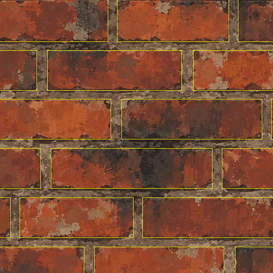

(Thin yellow rectangles: the bricks the line finder found, drawn over the reference. Small copy of `analysis/layout_overlay.png`.)

* 12 full courses, about 4 bricks per course. Course pitch (one course plus one mortar band) 101.9 dots; brick face height 83.3 dots (spread 1.1);
  mortar band between courses 18.6 dots; brick pitch along a course 313.5 dots (spread 59.2); joints 20.4 dots wide (spread 2.0).
* **The reference is not a perfect repeating wall:** 12 x 101.9 = 1223 dots, so a sliver course of about 30 dots is left where the picture was stitched,
  and the reference itself has a mild seam (the jump across its wrap-round edge is 2.22 times a normal jump between neighbouring dots,
  `final_report.json`). The description simply lists the 13 courses that are there (12 + the sliver); the generator draws any list.
* Corner radius 9 dots: chosen by eye and written into `analysis/fit_stage1.py`, not measured.

**Palette** (`analysis/fit_stage1.py`, `analysis/region_tools.py`; shares in `analysis/element_stats.json`). The colour picture was lightly smoothed with
a bilateral filter (it smooths inside a patch but keeps edges) and squeezed to 16 colours with k-means in the Lab colour space, ordered dark to light.
* Brick faces cover 77.9 % of the tile, mortar 22.1 %.
* Eight of the 16 colours (the saturated reds and oranges) **never** occur in the mortar. The mortar is made of four pale greys and browns (19.2, 26.6,
  11.9 and 6.4 % of the mortar) plus four darker browns (35.9 % together: soot, dirt and the ring).
* 21.6 % of all dots are dark (grey under 70): soot, ring and the dark bricks.
* 32 colours instead of 16 at the same number of patches gave a LOWER colour SSIM (0.609 against 0.658) and only a slightly better colour difference, so
  16 were kept (`builder_answer.json`, dead ends).

**Patches** (`analysis/element_stats.json`). Cutting the 16-colour picture into same-colour areas gives 12,571 patches of 12 dots or more. Half of them are
36 dots or smaller; 90 % are 208 dots or smaller; 99 % are 1,886 dots or smaller. But counted by AREA it is the other way round: half of the picture lies in patches bigger than
511 dots. "Lots of tiny patches, but the big ones cover most of the wall" is the reason why counting patches one by one gave a camouflage look (section 9).

**The ring.** `analysis/outline_profile.py` measured the median grey at each distance from the found brick edges, side by side (its numbers were not saved).
What was used: a ring 1 dot into the brick on three sides and 1.5 dots at the bottom, reaching 1 dot out at the left, 0 at the top, 1.5 at the right and
3 at the bottom: a thin line at the top and left and a shadow band below and to the right. These numbers were chosen by eye from that measure
(written into `analysis/fit_blobs.py`).

**The flat-patch ceiling** (`analysis/posterise_ceiling.py`, `analysis/posterise_ceiling.json`). Question: if the colour picture were ONLY flat patches of K
colours, how close could it ever get? Answer: 16 colours, every dot kept: colour SSIM 0.945, tier "close", but that is 197,504 patches. Tidy the patches a
little (a 3 x 3 majority filter) and it falls to 0.720 with 93,230 patches (still "close"). Throw away all patches under 20 dots and it falls to 0.658
with 8,997 patches (`analysis/explore_regions.json`). So the dot-for-dot score is decided by tens of thousands of tiny details; no description under
512 KB can hold them.

**Statistics for new walls** (`analysis/fit_sampler_model.py` -> `generator/sampler_model_brick.json`, 6.3 KB). For the sampler, the bricks were
sorted into five classes from dark to pale, and the patches measured per class and per size band (nine size bands from 20 to 12,000 dots): how many per
10,000 dots, how stretched, how tilted, how ragged, and which colours, counted both by number and by area. No positions of anything in the reference.

## 3. The description format

A description is one JSON file (format name `painted-tile-1`). The project's size check (`lib/description_audit.py`) accepts all of them: no picture
data, no list longer than 4000 numbers. A shortened class-S description:

```
{ "format": "painted-tile-1", "surface": "brick", "tile": 1254, "seed": 11, "backdrop": 11,
  "palette": [[54, 41, 36, 0.88], [69, 51, 43, 0.86], ...],          # red, green, blue (ordinary 0-255 numbers), roughness; 17 entries
  "maps": {"blur_sigma": 0.7, "curve_x": [41.6, ... 137.4], "curve_y": [7.5, ... 243.8], "normal_strength": 6.0},
  "layers": [
    {"type": "bricks", "corner_radius": 9.0, "outline_width": 2.0, "outline_colour": 0, "ragged": 0.0,
     "rows": [{"y0": 0, "y1": 85, "bricks": [[240, 469, 12], [488, 657, 3], ...]}, ...]},       # each brick: left, right, palette colour
    {"type": "blobs", "items": [[837, 450, 67.9, 39.5, 167, 12, 0.3, 484], ...]},             # 146 ragged ellipses
    {"type": "outlines", "colour": 16, "corner_radius": 9.0, "inside": [1.0, 1.0, 1.0, 1.5], "outside": [1.0, 0.0, 1.5, 3.0], "rows": [...]} ],
  "grain": {"amount": 0.14, "seed": 12} }                                                         # optional
```

The layers a description can hold (`generator/shape_stack.py`), painted in the order they are listed:
* `bricks`: courses of rounded rectangles, each with a dark border; optional `ragged` edge.
* `blobs`: ragged ellipses, 8 numbers each.
* `regions`: traced patches: `[colour, start x, start y, step x, step y, ...]` in half dots (short numbers make a short file).
* `outlines`: the ring (left, top, right, bottom reach into and out of each brick).
* `mosaic`: the sampler's layer: no shapes are written, only settings and seeds; the generator cuts the cells itself (section 4, tool 11).
* `specks`: tiny dots from a count, a size range and a seed (in the code; not used by any final description).

**Where the description stops being a procedure and starts being tracing:** the layout, palette, maps, mosaic settings and grain are procedural (numbers
that mean something; change one or the seed and you get a new picture). The `blobs` of classes S and M sit in between: they are fitted to the
reference's patches one by one, so they copy the reference, but each is only 8 numbers. The `regions` list of class L is tracing: the reference's own
patches.

**The size check's false alarm, and the workaround in the data.** `lib/description_audit.py` calls a list a "picture grid" when its first five items each
hold more than 64 numbers, even if the items have different lengths. The traced list did that. The builder did not edit lib; instead the L description's
first region is the plain tile-sized square (the ground, 9 numbers), which makes the check pass. (Suggested change in lib: only call it a grid when the
rows have EQUAL length.)

Sizes: layout only 1.7 KB; S 7.8 KB; M 62.5 KB; L 497.0 KB; sampled tile 9.3 to 9.4 KB; the 2508-dot area 21.2 KB (21,674 bytes); cobblestones 13.1 to
13.2 KB (13,429 to 13,563 bytes; they fail a 12 KB limit and pass the 64 KB one, as the checker found).

## 4. The Blender recipe, tool by tool

The generator is `generator/brick_generator.py` (the Blender half) with `generator/shape_stack.py` (description -> back-to-front list of shapes, plain
numpy), `generator/mosaic_tools.py` (the cell cutter) and `generator/derive_maps.py` (height, normal, ambient occlusion from the colour, plain numpy).
Run it like this (one line):

`blender -b --disable-autoexec -t 2 --python generator/brick_generator.py -- DESCRIPTION.json OUT_FOLDER --size 1254 --samples 16`

Optional: `--shift N` slides the whole painting N dots right and down (for the half-tile test), `--height-mode hybrid|geometry` (section 7).

1. **The shape list (plain numpy, not a Blender tool).** *What it is:* a list of flat polygons in painting order, built from the description.
   *How used:* the ground square first, then each layer. A shape that sticks out over the tile edge is drawn again one tile over (left/right, up/down,
   at most four pictures of it in all), so what leaves on one side comes back on the other. Before copying, each shape's middle is folded into the tile (layouts can run
   past the edge). *What matters:* the tile size must be read from the description. The first area bake used a fixed 1254 and drew only the top-left
   quarter of a 2508-dot wall (section 9).

2. **One mesh built from number lists** (`mesh.vertices.add` + `foreach_set`, `mesh.polygons`). *What it is:* a Blender surface made straight from lists
   of corner points and triangles, without clicking anything. *How used:* every shape of the list becomes triangles in ONE mesh; shape number i sits at
   height i x 0.00002, so a later shape lies a hair above an earlier one and covers it (12,555 shapes for class L, 16,807 for a sampled tile).
   *What matters:* the height step. Much smaller and two shapes tie and flicker into each other; much larger and the pile grows out of the camera's range
   (the camera is raised to the top of the pile + 1 and its range set to fit). 0.00002 worked for up to 65,998 shapes (the area bake). Other values were
   not tested.

3. **`mathutils.geometry.tessellate_polygon`** (Blender's own triangle-maker). *What it is:* a function that fills any outline, also a hollow one, with
   triangles. *How used:* for ragged blobs, traced patches, and the ring (an outer outline with a hole). Simple convex shapes are filled with a plain fan
   of triangles instead (faster). *What can go wrong:* only an outline that crosses itself; it did not happen in the final runs.

4. **Colour attribute + Attribute node + Emission shader.** *What they are:* a colour stored on every corner point of the mesh (`Col`, type FLOAT_COLOR,
   converted once from ordinary sRGB numbers to linear); the Attribute node reads it in a material; Emission makes the surface glow with exactly that
   colour, with no lights and no shading. *How used:* one little material shows ONE thing at a time: first the colour, then the roughness number (a
   second stored number, `rough`). *What matters:* Emission Strength 1 and no lights, so the photograph is the stored number, nothing else.

5. **Cycles settings** (from `lib/bake_harness.py`). *What Cycles is:* Blender's ray tracer; here it is only used as a camera. *Settings that matter:*
   * samples = how many rays are averaged per dot; at a shape's edge this decides how smooth the edge is. 16 for the final classes, 8 for the tests,
     variations, area and transfer, 4 for the sweep strips. Not measured on the brick; the same tool on the slate's flat polygons:

     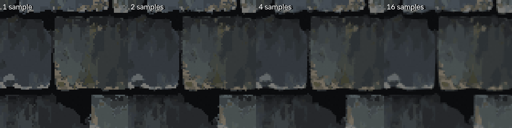

     (Made for the slate guide: 1 sample gives a hard stair-step at every edge, 16 a clean one-dot soft edge.)
   * pixel filter Box, width 1.0 (each dot averages only its own area: no extra blur); max bounces 0; no denoising.
   * view transform **Standard** for the colour picture (the ordinary sRGB numbers come back unchanged) and **Raw** for data pictures (roughness):
     a wrong choice shifts every number.
   * *Cost to know:* the roughness picture takes as long as the colour picture (7.4 against 6.7 s for class S, `outputs/final_S/bake.json`), and
     roughness is an invented number (section 10).

6. **Orthographic camera over a 1 x 1 square.** *What it is:* a camera that looks straight down with no perspective; one picture dot is one tile dot.
   From `lib/bake_harness.py new_bake_scene`; the harness's own square is deleted (the ground shape covers the tile).

7. **Grain: a White Noise per dot, in the colour material.** *What White Noise is:* a node that gives a random number for every input position; give it
   whole-number positions and every block gets its own number (see the research picture:
   [White Noise on a 32 x 32 grid](../../research/experiments_shader_node_toolbox/pictures/p32_white_noise.png)).
   *Chain used:* Geometry (Position) -> Vector Math Scale (x 1254, the tile in dots) -> Vector Math Floor (whole dots) -> Vector Math Add (seed x 17
   in the third number) -> White Noise Texture (3D) -> Map Range (0..1 onto a range round 1 whose spread is the amount) -> Combine Color -> Mix (Multiply) with the Attribute colour
   -> Emission. *The setting:* `amount` = the spread of brightness. Example: amount 0.10 makes a typical dot 10 % lighter or darker than its patch.

   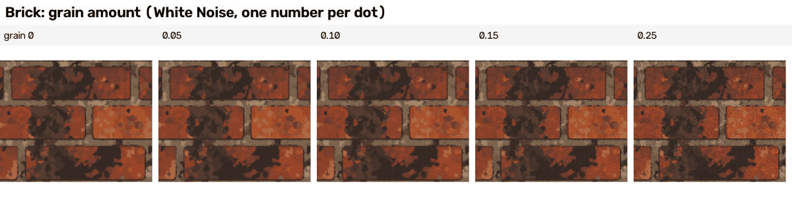

   0 is flat painted patches; 0.05 a faint tooth; 0.10 clearly grainy; 0.15 close to the default 0.14 of new tiles; 0.25 sandpaper.
   *What it does to the scores* (`scores/rate_distortion.json`): on class L, grain 0 / 0.10 / 0.14 gives colour SSIM 0.673 / 0.593 / 0.537 and same-kind
   score 0.432 / 0.555 / 0.598. Random grain cannot be the reference's grain dot for dot, so the dot-for-dot measures fall while the same-kind score
   rises. On a sampled tile the effect is bigger: tile 14 scores 0.730 with grain 0.14 (`final_report.json`) and 0.576 without
   (`../../cookbook/checks/brick_seam_without_grain/texture_compare_tile_14_no_grain.json`; that bake used 16 samples instead of 8).
   *Correction (checker):* part of the L + grain gain is a measuring effect. Grain makes the ordinary jump between neighbouring dots bigger, so the
   tool's seam measure (wrap-edge jump divided by an ordinary jump) falls from 2.11 to 1.0 and its "tiling" part rises from 0.444 to 1.0
   (`verify/bake_Lg14_texture.json`), although the traced L picture still has the reference's mild seam. The seam measure carries 1.5 of the 20 weight
   points of the overall score (`lib/texture_compare.py`), so this alone accounts for about 0.04 of the 0.165 gain. The grain fixes no seam.
   *Seams:* White Noise has no link between neighbouring dots, so it cannot make a visible seam. It was left out of the half-tile test (section 6.4).

8. **Height, normal and ambient occlusion from the colour (plain numpy, `generator/derive_maps.py`).** *What it is:* the rule of section 2A, written in
   numpy, with blurs that wrap round the tile edge so a seamless colour stays seamless. Ambient occlusion here is cheap: how much lower a dot is than its
   surroundings blurred by 6 dots (not a ray-traced one). Metallic is 0 everywhere. *Settings that matter:*
   * the blur before the curve (0.7 dots fitted):

     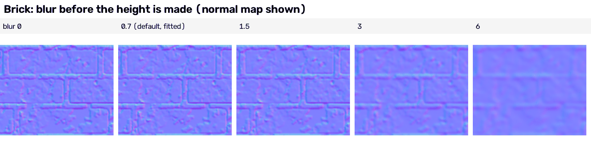

     (Normal map shown. The strip was baked at 384 dots, and the generator scales the blur with the picture size: at 384 dots "0.7" is only a 0.2-dot
     blur, so the first three squares look alike. At 3 and 6 the small patches melt and their little ridges vanish from the normal map.)
   * the normal strength (6 fitted). This strip is new (the builder made none); it is made from the height of sampled tile 11 at full size, with the
     same slope formula, by `../../cookbook/checks/brick_strips/rejoin_brick_strips.py`:

     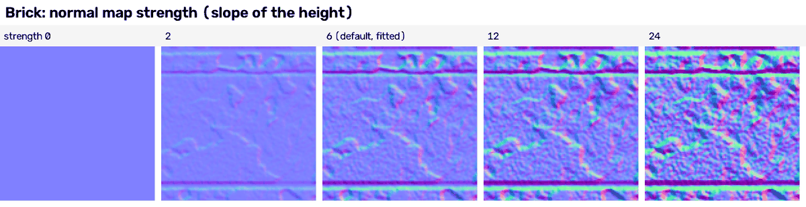

     0 is a flat normal map (no relief at all); 2 shows mostly the mortar bands and faint patch edges; 6 (fitted) shows the joints and the bigger patch edges; 12 and 24
     exaggerate every patch and the grain into a rough, hammered look. Both the blur and the strength are scaled with the picture size, so a 2508-dot bake
     keeps the same look (section 6.3).
   * the 12-point tone curve: not swept. It is the reason the height has so much contrast; a straight line would be off by 7.5 steps (section 2A).

9. **Layout settings (shape_stack).** *Corner radius* = how round the brick corners are, in dots:

   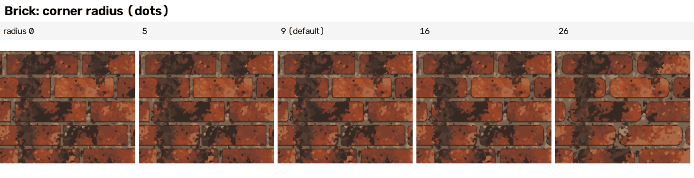

   0 gives sharp rectangles; 5 and 9 (default) the slightly worn corners of the reference; 16 soft; 26 bars of soap.

   *Ring width* = how far the dark outline reaches into the brick and out into the mortar (the strip multiplies the default reaches; "x2" is the default):

   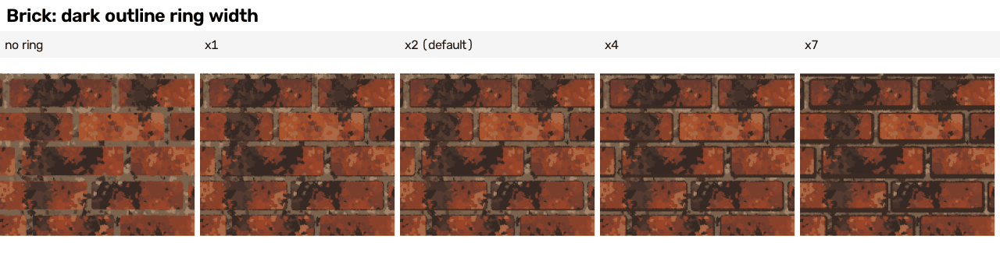

   No ring: the bricks look stuck on; x1 a hairline; x2 (default) the reference's ink line with a shadow band below; x4 and x7 a heavy cartoon outline.
   *Measured* (`scores/M_noring_pixel.json`, `scores/final_M_pixel.json`): on class M the ring raises edge skill from 0.357 to 0.421, colour SSIM from 0.535
   to 0.552 and the same-kind score from 0.308 to 0.406. On top of TRACED patches it made things slightly worse (section 9).

10. **Blobs (shape_stack `ragged_ellipse`).** *What a blob is:* an ellipse whose edge wobbles at three scales (a few big lumps, some middle bumps, fine
    chips); raggedness 0 = smooth ellipse, 0.4 = hand-cut, 0.8 = very irregular. The fitted classes S and M use raggedness 0.1 to 0.9, measured per patch
    from how far the real patch strays from its ellipse (`analysis/fit_blobs.py`). Not swept; the S difference sheet (section 5) shows how blobs look.

11. **The mosaic: cells cut by the generator (plain numpy, `generator/mosaic_tools.py`), used by every NEW tile.** *What it is:* the brick face is filled
    with cells like a crazy-paving floor. Seed points are scattered on a jittered grid; each cell is the part of the face nearer to its seed than to any
    other (a Voronoi cell: a big square cut by the straight line half way to each neighbouring seed); the cell edges are then bent by a smooth wobble that
    is the SAME for two cells sharing an edge, so no gaps open. Several cell sizes are laid on top of each other (default areas 1100, 320, 90 and 45 dots;
    the smaller ones are kept with a chance of 0.5, 0.35 and 0.22, so they only sprinkle). Each cell's colour comes from the measured AREA-weighted colour
    table of its brick class, picked by a "tone dial" (a slow wave of light and dark over the wall, wavelengths 110, 170 and 260 dots) plus a little
    chance per cell (the jitter), plus a shift per brick. Soot clouds and spalls are "accents": places where cells take dark (or pale) colours, solid in the
    middle and clear at the edge. The mortar gets its own mosaic (cells of 150 and 40 dots). *Settings that matter:*

    *Area of the biggest cells:*

    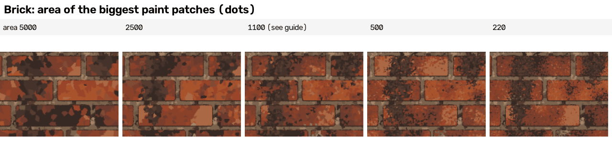

    5000: a few big flat facets per brick; 1100: mixed facets; 500 and 220: speckle. The reference's look (big flat patches) is nearer the left end.
    *Correction (checker):* the middle square is not the default tile. The sweep's setting changes all four cell sizes together and makes the fourth 89.6
    dots instead of 45; and every OTHER strip uses cells twice the default area (see the note under the strips).

    *How many cell sizes are layered:*

    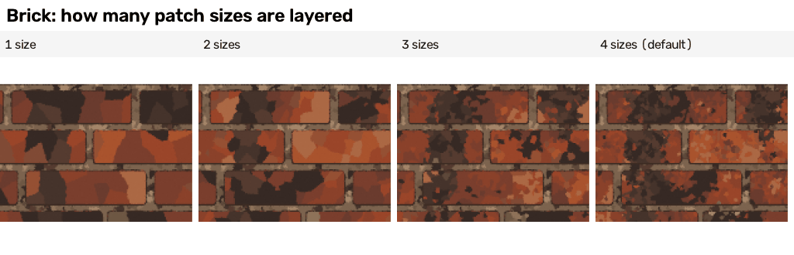

    1 size: stained glass; 2: patches; 3 and 4 (default): the small sprinkle that makes it look painted rather than cut.

    *Wobble of the cell edges* (dots):

    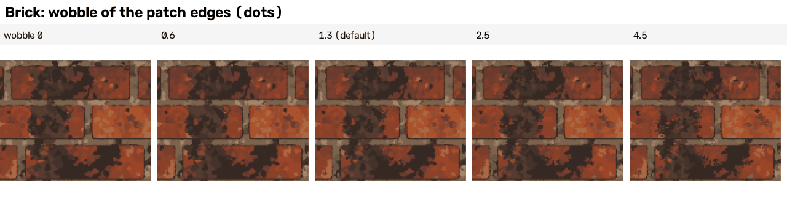

    0 gives straight polygon cuts; 1.3 (default) hand-cut edges; 4.5 frayed. The difference is small at this size; look at the edges of the dark cells.

    *Tone jitter of the two biggest cell sizes* (how much chance each cell gets on top of the tone dial; the middle of the tile, 2 x):

    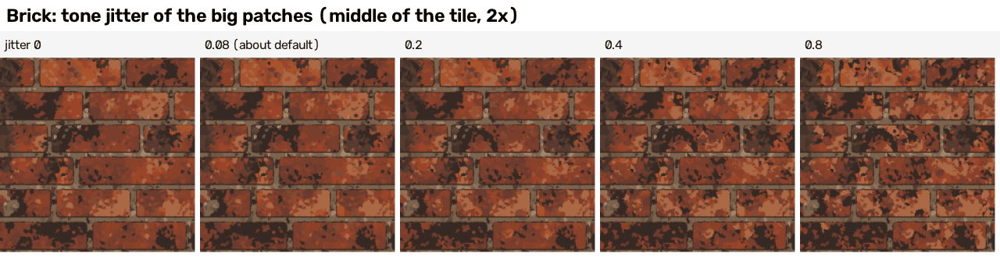

    The change is hard to see: at 0 neighbouring big cells follow the slow tone wave closely; at 0.8 they are picked more at random and the bricks look a
    little more mottled. The default is 0.08 for the biggest cells and 0.12 for the next (the strip sets both to the same value).

    *Number of soot clouds per tile:*

    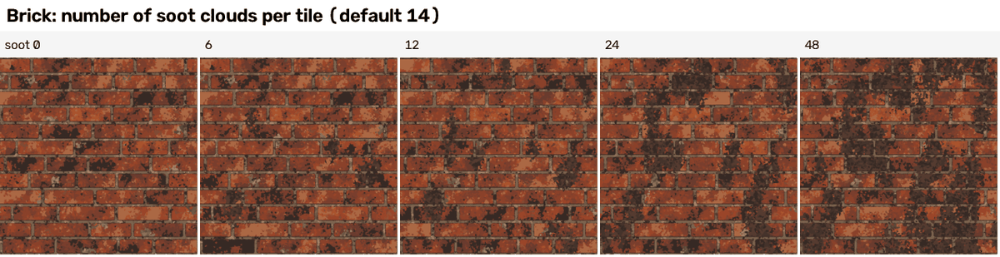

    0: no dark clouds (the few dark flecks left come from the ordinary colour tables, which still hold dark-ish colours); 6 and 12: a few streaks running
    down over several bricks, like the reference; 24 and 48: a filthy wall. The default is 14 (`generator/sampler_model_brick.json`).

    **Note on all strips (from the checker, `verifier_answer.json`).** They come from `generator/make_sweeps.py`: ONE sampled description (seed 7) baked
    at 384 dots with 4 samples, no grain, and **cells twice the default area** (`cell_scale` 2.0). So the square marked "(default)" is the sampler's
    default for THAT setting, on a coarser and grain-free base; it is not one of the eight new tiles of section 6. The builder's strips said "(reference)"
    where they meant "default", and only some defaults were measured on the reference (the height blur and the normal strength were; the corner radius,
    ring, wobble, cell sizes and soot count were chosen by eye). The builder's strips also joined the squares with no gap, so the joins looked like cracks; the
    strips shown here were re-joined from the same squares with white gaps, honest labels and no stretching
    (`../../cookbook/checks/brick_strips/rejoin_brick_strips.py`; the old ones are still in `guide_pictures/strip_*.png`).

12. **Solidify and Bevel modifiers** (only in the real-geometry test, section 7). *What Solidify is:* a modifier that gives a flat face a thickness.
    *What Bevel is:* a modifier that rounds the edges of a shape. *How used:* every brick face became a slab 0.02 thick, its top edges rounded by
    4 dots (3 segments), and the height photographed. *What went wrong first:* the faces point DOWN here (the picture's y runs down, Blender's up), so the
    slabs grew downwards and the height picture came out black; thickness +0.02 with offset -1 fixed it. Not swept on the brick; for what a bevel width does
    to a normal map, see the research strip
    [Mesh Bevel offset](../../research/experiments_geometry_nodes_curves_modifiers_physics/out/strips/bevel_offset_normals.png) (Geometry Nodes' Mesh Bevel
    node, the same idea).

13. **Geometry Nodes** (only in a comparison test, `generator/gn_blobs_route.py`). *What it is:* Blender's node editor for making and changing geometry.
    *Chain used:* a cloud of points (one per blob; its radii, turn, colour, raggedness and seed stored on the point) -> Mesh Circle (28 corners, filled)
    -> Instance on Points (scale = the two radii, rotation = the turn, read with Named Attribute nodes) -> Realize Instances -> Set Position (each corner
    pushed in or out by a 4D Noise Texture, the patch's seed as the 4th number, a lump about every 6 dots) -> Store Named Attribute (the colour) -> Set
    Material. *What matters:* without Set Material the result renders black in Blender 5.2. *Result:* section 7.

Not used: Blender's compositor, curves, physics, a blurring pixel filter (the height blur is done in numpy). Nothing here needed them.

## 5. How accurate, layer by layer

The table of section 0 is the whole ladder. Difference sheets (reference | generated | where they differ | edges: red = only in the reference, green =
only in the generated picture, yellow = both): `guide_pictures/difference_sheet_class_S.png`, `..._class_M.png`, `..._class_L.png`. "Same kind" sheets
(2 x 2 repeat, feature-size and brightness curves): `guide_pictures/texture_sheet_class_S.png` (and M, L). Each is 2 to 7 MB.

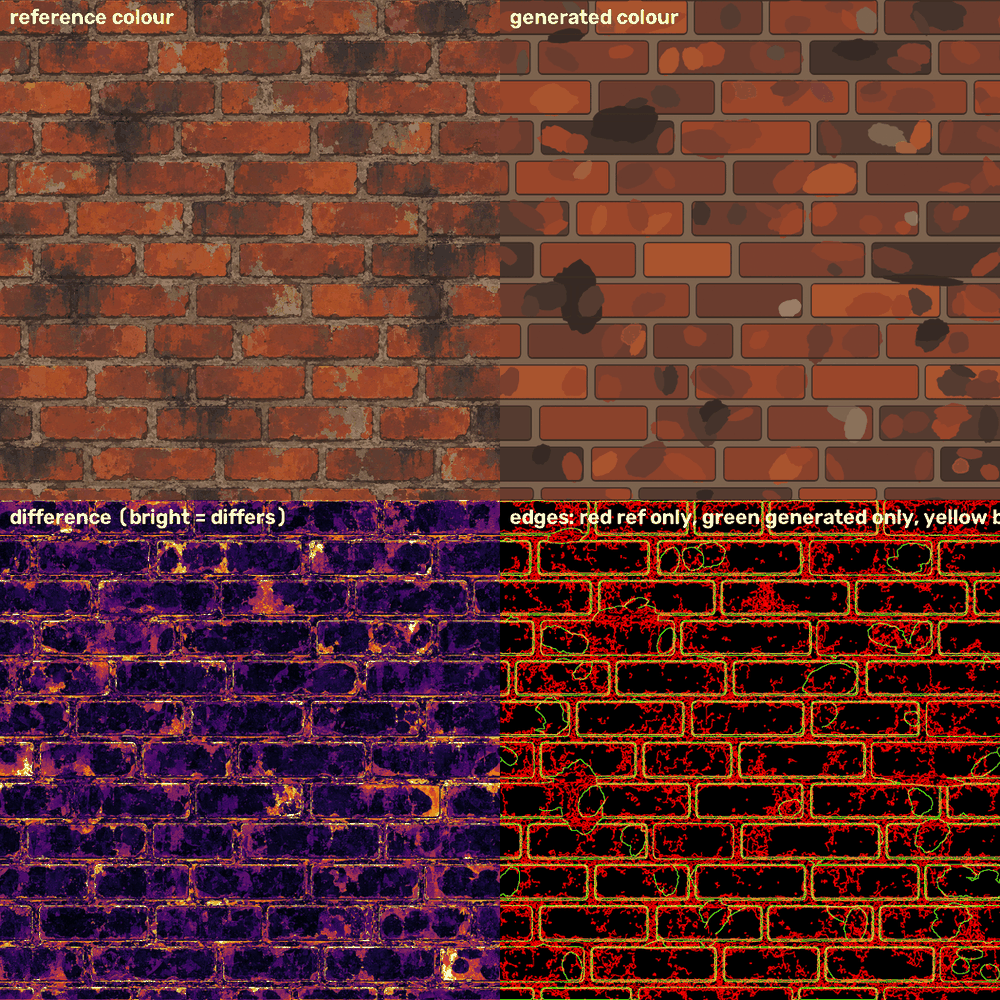

What the sheets show:
* **Layout (1.7 KB) already puts every brick edge in place**: in the S sheet the brick rectangles are yellow (edges in both pictures). The colour SSIM is
  0.518 for layout only and 0.673 for the full trace: SSIM hardly notices paint, because most of both pictures is flat.
* **Class S:** the blobs (green outlines) sit in about the right places, but they are soft ellipses; all the ragged mortar edges, the chips and the
  small patches are red (only in the reference). The mortar is one flat colour.
* **Class L:** only thin lines at patch borders remain (one dot off), plus scattered small red bits: the patches under 12 dots that the trace dropped.

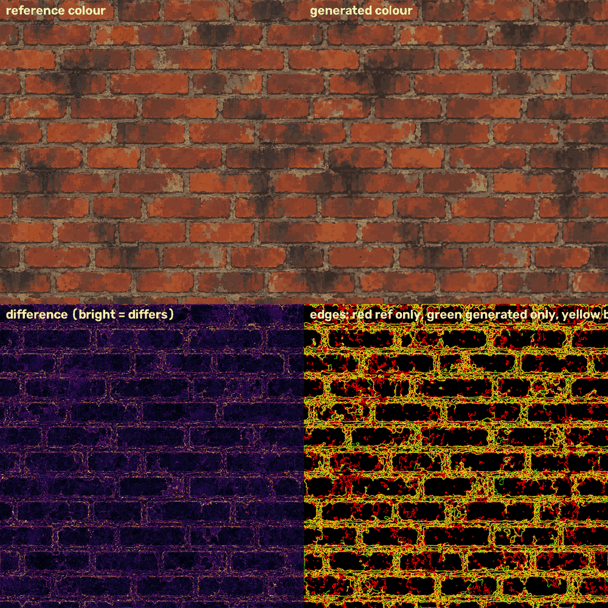

**Blobs or tracing?** Per KB, blobs win up to about 300 to 400 KB: at 195 KB, blobs give colour SSIM 0.592 and edge skill 0.555, traced patches 0.566 and
0.380. Tracing overtakes only near 400 KB (traced 398.6 KB: 0.641 / 0.609; blobs 367 KB: 0.626 / 0.624). Tracing outlines of only the biggest patches is
the worst buy of all (87.7 KB: edge skill 0.146, worse than class S).

**Why the normal error is stuck:** it falls only slowly as patches are added (17.66 degrees for S, 17.33 for M, 15.39 for blobs at 367 KB, 13.93 for L).
The reference's normal map is made of dot-level detail; going from 20-dot to 12-dot patches lowered it by about 1 degree (14.79 -> 13.93). Reaching 12
would need several times more patches than 512 KB allows (patches under 12 dots were not tested). Smoothing or re-scaling the derived normal does not help
(best 13.9 against 13.95 degrees; `analysis/normal_tuning.py`, numbers from `builder_answer.json`).

## 6. Making new walls

### 6.1 Variation: eight new tiles from one generator

`generator/sample_description.py`: `sample_description(seed, model)` draws a whole new description from `generator/sampler_model_brick.json`
(6.3 KB of statistics). It never reads a picture. What it draws:
* 12 courses of 4 bricks: course pitches around 1254 / 12 (spread 1.2 %), stretched so they fill the tile exactly; brick widths with the measured spread
  (19 %), stretched so each course fills the tile width; joints 20.4 dots (spread 2.0); each course's joints kept at least 70 dots away from the joints of
  the course above when possible (60 tries);
* a base colour per brick from the measured frequencies; the whole palette shifted a little per tile (brightness, saturation, hue);
* the mosaic settings of section 4 (tool 11), new seeds, soot (14 per tile) and spall (14 per tile) clouds; grain 0.14.

Run: `python3 -I generator/run_variations.py 11 8 0.14` (seeds 11 to 18; 8 samples, 1254 dots).

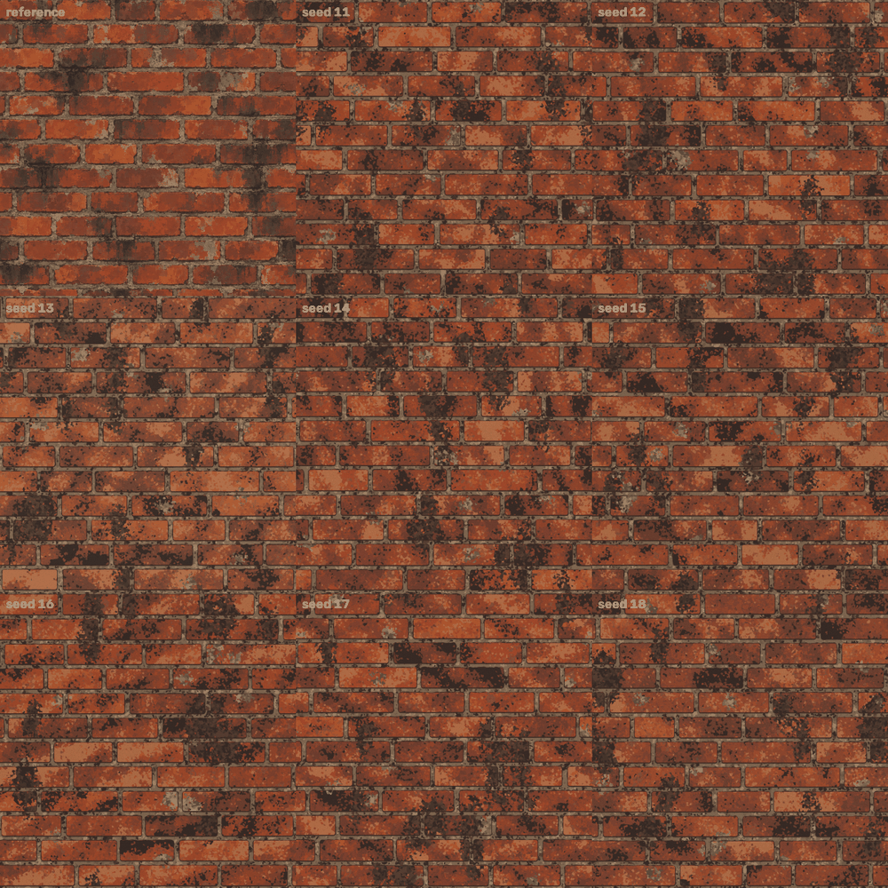

| measure | result (`final_report.json`, `variations/variation_summary.json`) |
|---|---|
| same-kind score, 8 tiles | mean 0.708, range 0.684 to 0.730 (against 0.432 for the traced L copy and 0.365 for S) |
| parts of it | colour 0.68 to 0.75, height 0.59 to 0.75, normal 0.52 to 0.68, tiling 0.94 to 0.99 |
| dot for dot against the reference | tier "none" for all 8; colour SSIM 0.237 to 0.258, colour difference 20.9 to 21.7, edge skill 0.0 |
| how different the new tiles are from each other | mean dot difference 25.9 steps and SSIM 0.251 between pairs, against 26.9 and 0.253 against the reference: as different from each other as from the reference |
| description size | 9,523 to 9,582 bytes (9.3 to 9.4 KB: class M by size) |
| bake time | 33 to 36 s each, about 16,700 shapes (`final_report.json`) |

Checked by the checker: seeds 11, 14 and 18 regenerate byte for byte; re-baked seeds 12, 13, 14 and 16 gave identical colour pictures (largest difference 0)
and identical scores (0.698, 0.684, 0.730, 0.686); a seed nobody had used (777) scored 0.685, inside the range.

**Missing maps.** Only `variations/tile_11/` holds all six pictures. In `tile_12` to `tile_18` the builder deleted the height, normal, roughness, metallic
and ambient occlusion pictures to save disk; only `colour.png` and `bake.json` are left. The per-tile scores in the table cannot be re-checked from those
folders; re-bake first (one line per tile:
`blender -b --disable-autoexec -t 2 --python generator/brick_generator.py -- variations/description_15.json SOME_FOLDER --size 1254 --samples 8`).

**Honest look (builder and checker together).** The new tiles read as the same kind of painted brick wall: ragged-edged flat patches, a tone per brick,
soot running down, pale spalls, a dark ring. But they are a **narrow family**: all eight have 12 courses of 4 bricks, the same palette shifted by a few
per cent and the same patch statistics; only the joint positions, brick colours, soot and spall places and the cells differ. And they are visibly not the
reference's style: the mortar lines are thinner and darker with a heavier ring; the brick faces carry a fine confetti of small cells the reference does not
have; the soot is speckled rather than smeared; the reference's big flat hand-painted patches are missing. The soot, spall, tone, cell-size and wobble
numbers were tuned by eye against the pictures and the same-kind score, not fitted. Only 8 tiles were checked, and the score moves by 0.01 to 0.03 with the
seed alone.

### 6.2 Area: one wall of 2 x 2 tiles of new bricks, 2508 x 2508 dots

`generator/run_area.py` (seed 101, grain 0.14): the sampler with `tile=2508` draws 24 courses of 8 bricks (the counts double; the spreads stay the same),
a 21.2 KB description, 65,998 shapes, baked in one go in 144 s (8 samples).


| measure (`area/area_result.json`) | the new wall | the reference tile copied 2 x 2 |
|---|---|---|
| best match of the picture with a copy of itself moved by 400 dots or more (1.0 = a repeat) | 0.145 | 1.0 (at one tile) |
| jump across the wrap-round edge (1.0 = no seam) | 1.04 | 2.20 |
| jump across the middle lines, where four 1254-dot tiles would meet | 0.99 | 2.20 |
| same-kind score of a 1254-dot piece from the middle | 0.652 | - |

The checker re-rendered the same description at half size (1254 dots) and it matched the stored 2508-dot picture shrunk to that size (mean difference
1.4 steps), so the stored picture really comes from the description; the four quarters match each other
at most 0.185 at any shift; a 1254 piece centred on the wrap corner scored 0.650. So: no seam and no repeat at the scale of a tile. A 4 x 4 area was not
baked (the same sampler takes `tile=5016`). The bug found on the way is in section 9.

### 6.3 Resolution: the same description at 512, 1254 and 2508 dots

`generator/resolution_test.py` on `variations/description_11.json` (16,807 shapes, 233,880 triangles at every size; 8 samples). Numbers from
`resolution/resolution_result.json`.

| dots | bake time | colour render | maps from colour | colour picture file | share of dots on a strong edge |
|---|---|---|---|---|---|
| 512 | 25.3 s | 1.9 s | 0.2 s | 484 KB | 10.3 % |
| 1254 | 33.7 s | 5.6 s | 2.7 s | 2,779 KB | 6.8 % |
| 2508 | 76.3 s | 21.4 s | 15.4 s | 8,746 KB | 3.9 % |


* **What stays the same:** every shape. The description is measured in tile dots, not picture dots, so it draws at any size; the blur and the normal
  strength are scaled with the size. The 1254 picture and the 2508 picture shrunk to 1254 have SSIM 0.994 (mean difference 0.7 steps).
* **What changes:** edges are redrawn from the outlines, so a bigger picture has crisper edges (left: 512, blocky; right: 2508). The 512 picture
  enlarged against the 2508 one: SSIM 0.754 (fine detail lost). The grain is one random number per TILE dot, so at 2508 each grain speck is 2 x 2 dots.
* **What does not change with size:** about 17 to 20 s of every bake is cutting the cells in numpy (17.2 s of a 43.3 s bake in
  `../../cookbook/checks/brick_seam_without_grain/bake_tile_14_no_grain.json`); it is the same at any size, so a small picture is not much faster.
* **What does not improve:** detail. The cells and wobbles are made at the 1254 scale, so at 2508 you see the same shapes drawn sharper, not finer.

### 6.4 Seamless: what the half-tile test proves, and what it does not

`generator/seam_test.py` bakes a description twice: once normally, once with every shape slid by half a tile right and down (wrapping round), and compares
the second picture with the first one rolled by half a tile. A wrongly rolled copy is the control.

| description (`final_report.json`, `transfer/transfer_result.json`, checker) | share of dots differing by more than 40 steps | mean difference | the same for the wrong roll |
|---|---|---|---|
| class S | 0.0 % | 0.36 | 35.9 % / 22.2 |
| class M | 0.001 % | 0.44 | 42.0 % / 23.8 |
| an earlier blob-style sampled tile (`scores/seam_sample11`) | 0.002 % | 0.69 | 44.4 % / 24.3 |
| an earlier mosaic sampled tile (`scores/seam_mosaic21d`) | 0.005 % | 0.73 | 47.4 % / 25.2 |
| a FINAL sampled tile, seed 14 (run by the checker) | 0.007 % | 0.73 | 49 % |
| cobblestones, seed 1 | 0.023 % | 0.83 | 36.0 % / 30.9 |

**What this proves:** the wrap-round drawing works: a shape that leaves one side of the tile comes back on the other, exactly.

**What it cannot prove (correction from the checker):** that the CONTENT joins up at the edge. The slide is added after all shapes are made, so both
pictures contain exactly the same shapes, whatever they are. The tone dial and the edge wobble are sine waves whose lengths (110, 170, 260 dots; 5 to
17 dots) do not divide 1254, so in principle the slow tone could jump at the tile edge, and this test would never see it. It also leaves out the grain, and
it cannot be run on class L at all (the traced patches are cut at the tile edge and not copied: L keeps the reference's own mild seam, seam measure 2.11
against the reference's 2.22).

**What does speak for seamless content:**
* the seam measure on the eight grainy tiles, 1.01 to 1.12 (`final_report.json`), and the area's 1.04 (but grain softens this measure, see section 4,
  tool 7);
* a check made for this guide WITHOUT grain (`../../cookbook/checks/brick_seam_without_grain/`): tile 14 with only the grain removed, baked at 1254 dots.
  The dot jump across the wrap edge is 1.01 times an ordinary jump sideways and 1.20 up and down (the up-and-down edge runs exactly along a mortar band,
  where the jump measure gives false alarms on course layouts). The slow tone jump (40-dot bands either side of a line) is 8.4 at the wrap edge sideways
  against 9.9 on average for 20 ordinary lines (17th of 21), and 11.9 up and down against 9.0 on average (3rd of 21, below the largest ordinary line, 13.7).
  So the wrap edge is within the range of ordinary lines; the up-and-down one is at the high end of it, which may again be the mortar band. Not proof, but
  no sign of a seam;
* the eye: the checker's zoom of a seam crossing on tile 14 (`verify/seam_crop_var14.png`) and the grain-free corner where four tiles meet, below,
  show nothing.


**How to make it a proof (not done):** give the tone dial and the wobble wavelengths that divide the tile (1254 / 11, 1254 / 7, ...) or read them through
the project's seamless 4D noise; then the half-tile test plus periodic content would be a proof.

## 7. Real geometry, compared honestly

Three other routes were run on the same tools and scored with the same scorers (`final_report.json`, `route_comparison`).

| route | colour SSIM | colour difference | edge skill | height error | normal error | same-kind score | time |
|---|---|---|---|---|---|---|---|
| main route, class M (flat painted shapes, height from colour) | 0.552 | 7.94 | 0.421 | 25.04 | 17.34 | 0.407 | 19 s |
| class M colour + height from real slabs (Solidify + Bevel), the derived height thrown away | 0.552 | 7.94 | 0.421 | 39.12 | 18.77 | 0.262 | not recorded |
| class M colour + half slab height, half derived height | 0.552 | 7.94 | 0.421 | 39.44 | 17.86 | 0.296 | not recorded |
| shader-only brick recipe from the research folder (`research/.../recipe_brick.py`) | 0.311 | 25.73 | 0.004 | 39.95 | 25.53 | 0.408 | not recorded |
| class M blobs made by Geometry Nodes (colour only) | 0.554 | 7.84 | 0.434 | not made | not made | not made | 4.2 s in all, 0.11 s for the nodes |

Verdict:
* **Real slabs for height: worse here, for a reason that is a fact about the upload.** The reference height is brightness: mortar high, bricks low.
  A physically raised brick is the opposite: the slab height correlates -0.15 with the reference height, the half-and-half mix 0.16, the colour-derived
  height 0.69 (`scores/M_height_*_pixel.json`). The research guide's "50/50 hybrids help brick" did NOT hold for this upload. Use slabs when you want a
  physically right relief (a 3D wall, displacement), and then compare with the sign of the reference height turned round (not tested).
* **Shader-only: right layout and palette, no hope dot for dot.** Its same-kind score (0.408) equals class M's, but the colour difference is 25.7 and the
  edge skill 0.004. A shader cannot read a list of thousands of patches; that is why the main route paints real flat shapes.
* **Geometry Nodes for the blobs: a valid alternative, not used.** The same 1,818 blobs built by a node tree in 0.11 s give the same picture (SSIM 0.554
  against 0.552). It is not part of the main generator because the rings with holes, the mosaic and the tracing layer are built in numpy. It was not
  tested for seams (its blobs are not copied over the tile edge).
* **The main route** is itself real geometry: thousands of flat mesh pieces photographed from above. Its strength: exact placement from a list, hard
  edges, free smoothing of edges by Cycles, any outline with a hole; 12,555 shapes in about 20 s.

## 8. Transfer to a surface nobody gave us: cobblestones

Chosen: grey granite cobblestones (paving setts) with sandy joints, a little dirt and moss. Same generator, same sampler function, a new model file.
There is no cobble reference, so nothing could be fitted or scored: the numbers were chosen by eye, and only the eye and the half-tile test judge it.


**What the cobble model changed** (`generator/sampler_model_cobble.json` against `generator/sampler_model_brick.json`):

| setting | brick | cobblestones |
|---|---|---|
| palette (16 colours + ring colour) | reds, oranges, mortar greys and browns | cool greys, sandy joint colours, moss greens, dark dirt, pale chips |
| courses per tile, stone pitch (spread), face height | 12, 313.5 (59.2), 83.3 | 13, 150 (38), 84 |
| joint width / band between courses | 20.4 / 18.6 | 13 / 12 |
| corner radius | 9 | 26 |
| ring | brick default (out into the mortar 1 / 0 / 1.5 / 3 dots: left, top, right, bottom) | thinner: border width 1.5, raggedness 1.5, out into the joint 1 / 0.5 / 1 / 2 dots |
| accents (where cells take special colours) | soot (14 per tile), spall (14) | dirt (5, also in the joints), moss (9), pale chips (7) |
| tone curve (grey -> height) | the fitted 12 points | a straight ramp: grey 30 -> 0 ... 180 -> 255 |
| normal strength | 6 | 5 |
| patch SIZE statistics (counts per size band, stretch, tilt) | measured | **copied unchanged from the brick**: the painted-patch look is what carries over |

**Code that had to change:** three optional model keys in the sampler (`row_pitch_target`, the `outline` settings, explicit `accents`), because the brick
sampler held brick-only guesses. The first cobble bake came out with BLACK stones: the brick sampler guessed its "spall" colours as "every low-colour,
fairly bright palette entry", and in a grey palette that is every stone colour. Fix: write the accent colours into the model; the brick model now uses the
same mechanism. Effort: one model, one failed bake, one fix, one re-bake, about 20 minutes of work; then about 35 s per tile (three tiles,
13.1 to 13.2 KB descriptions, `transfer/transfer_result.json`). Half-tile test: 0.023 % of dots over 40 steps (control 36 %).

**Correction (checker): the script does not make the model that was used.** `transfer/make_cobble_model.py` writes an OLDER model: it has no `accents`
list, no `smudges_per_tile` (3) or `smudge_luma_limit` (50), and no area-weighted (`area`) colour tables, all of which were added to
`generator/sampler_model_cobble.json` by hand afterwards (compare the checker's re-run, `verify/cobble_model_remade.json`). The three cobble descriptions
come from the STORED model (the checker reproduced them byte for byte). To repeat the transfer, use the stored model file, not the script. (The two
smudge settings only affect the older blob-style sampler, not the mosaic tiles.) The script was not changed for this guide.

**Honest verdict (builder and checker):** it looks like grey-blue setts with sandy joints, moss flecks and dirt blotches, but it is the brick wall
re-coloured: straight courses in running bond, rounded rectangles of one shape, brick tilt and size statistics. There are no round or irregular cobbles,
and the dirt blotches are too black. The height is backwards for stones: the straight ramp makes the sandy joints HIGHER than the stones (mean 162
against 111 of 255, measured by the checker), the same inversion as the brick reference (mortar 180, brick 131) but physically wrong for setts. A cobble
tile scored against the BRICK reference gets 0.398, which says nothing about quality. Lesson: "new numbers" was enough for a re-coloured wall of the same
family; real cobbles need a new layout (irregular or fan-shaped courses, stones that are not rectangles) and a height rule with the right sign.

## 9. Dead ends and failures (kept on purpose)

1. **Smoothing the normal map, or changing the blur or strength of the derived height**, to make an imperfect colour picture give a better normal: no
   gain (best 13.9 against 13.95 degrees; more smoothing is worse).
2. **The ring on top of traced patches:** slightly worse (traced 20-dot description: SSIM 0.641 -> 0.636, colour difference 5.98 -> 6.31, height 16.95 ->
   19.45, normal 14.79 -> 15.30, `scores/L_a20o_pixel.json`): the traced patches already contain the dark lines.
3. **32 colours instead of 16:** lower SSIM (0.609 against 0.658) at the same patch count. A bilateral smoothing before the colour squeeze helped a little
   (0.683 against 0.658 in the first exploration).
4. **First sampler (blobs with colour tables counted per patch):** confetti and camouflage. Fixed with AREA-weighted colour tables, a slow tone dial so
   neighbours look alike, soot and spall as clouds, and a tone shift per brick.
5. **First mosaic wrote every cell as a polygon:** 1.8 MB per tile. Replaced by settings + seeds, with the cutting done inside Blender: 9.3 KB per tile
   (and about 17 s of cutting per bake).
6. **Soot by chance everywhere** gave speckle; a solid core with a clear edge gave clouds; still more speckled than the reference.
7. **The area bug:** the first 2508-dot wall looked like a reference-style tile enlarged, with a visible seam, because the generator divided positions by a
   fixed 1254 and photographed only the top-left quarter. **The half-tile test could not see it** (both of its bakes had the same bug). What caught it: the
   first and the last column of the picture correlated only 0.23, against 0.9 for neighbouring columns. Fixed: the tile size is read from the description.
8. **Real slabs grew downwards** at first (black height picture); once fixed, they gave an upside-down relief compared with the reference (section 7).
9. **Cobble transfer, first try:** black stones (section 8).
10. **The size check's false alarm** on long polygon lists (section 3), worked round in the data.
11. **Tool handling:** `pkill -f` / `pgrep -f` with a pattern that also appears in your own command line killed the builder's own shell twice.
12. **An earlier grain** (files `scores/L12_grain0.05_*`, `L12_grain0.10_*`) was replaced by the White Noise grain of section 4; its numbers are not used here.

## 10. Known gaps (honest)

* No description reaches the "close" tier (normal error 13.93 against 12 for L). S and M reach "layout" mainly because their edge skill just clears 0.30.
* Class L is a trace (12,553 polygons, about 12 numbers each): honest proof that the generator can carry the reference, but not procedural, and not
  periodic.
* The sampler's soot, spall, tone, cell-size (1100 / 320 / 90 / 45 dots) and wobble numbers were tuned by eye, not fitted; the new tiles are a narrow,
  simpler family (section 6.1).
* Seamless CONTENT is supported by measures and by eye, not proved (section 6.4).
* Height, normal and ambient occlusion of the sampled tiles 12 to 18 were deleted (section 6.1); `tile_11` has all six pictures.
* Roughness is an invented guess (a number per palette colour from its colour saturation); metallic is 0; ambient occlusion is a cheap blur difference.
  The reference has none of the three, so none is scored. The normal map is always made from the colour (OpenGL style, green up).
* Geometry Nodes, the Solidify / Bevel slabs and the shader-only route were each tested on class M only. Curves, physics and the compositor were not used.
* The cobblestone transfer has no reference and no scorer, is a re-coloured brick layout with a backwards height, and its model script is stale (section 8).
* Bake times depend on the load of the shared machine.
* To stay under the disk limit the builder deleted roughness, metallic and ambient occlusion and most pictures of exploration bakes. Full sets are kept for
  `outputs/final_S`, `final_M`, `final_L`, `variations/tile_11`, `transfer/cobble_1` and `area/picture`; the descriptions, scores and scripts of everything
  are kept, so every bake can be repeated.

## 11. Files

* `generator/`: `brick_generator.py` (the Blender recipe), `shape_stack.py` (layers -> shapes), `mosaic_tools.py` (cells), `derive_maps.py` (maps from
  colour), `sample_description.py` (new descriptions), `sampler_model_brick.json` and `sampler_model_cobble.json` (the statistics the sampler reads),
  `gn_blobs_route.py` (Geometry Nodes test), `make_sweeps.py` (the strips), `run_variations.py`, `run_area.py`, `resolution_test.py`, `seam_test.py`,
  `bake_and_score.sh`, `descriptions/` (every description, including `description_S.json`, `description_M.json`, `description_L.json`).
* `analysis/`: the measuring scripts of section 2 and their results (`derivation_ceiling.json`, `layout_clean.json`, `element_stats.json`,
  `posterise_ceiling.json`, `explore_regions.json`, `layout_overlay.png`).
* `scores/`: every score (`*_pixel.json`, `*_texture.json`), difference sheet (`*_diff.png`), `rate_distortion.json`, half-tile tests (`seam_*`).
* `outputs/`, `variations/`, `area/`, `resolution/`, `transfer/`, `guide_pictures/`: baked pictures and their numbers.
* `final_report.json` (every number in one file), `builder_answer.json` (the builder's report), `verifier_answer.json` and `verify/` (the checker's report
  and re-runs).
* Made for this guide, outside this folder: `../../cookbook/pictures/brick-*.png` (the re-joined strips, the new normal-strength strip, the layout crop,
  the seam corner), `../../cookbook/checks/brick_strips/rejoin_brick_strips.py`, `../../cookbook/checks/brick_seam_without_grain/`.

## 12. What the builder would change in `lib/` (suggestions only; nothing in lib was changed)

* `description_audit.py`: call a list a picture grid only when its rows have equal length.
* `pixel_compare.py`: also print, per measure, which tier it would reach ("close on four of five"); it resizes everything to 1254 dots, so an area bake
  must be cropped by the caller.
* `texture_compare.py`: its seam measure is dominated by dot-level grain (the reference itself reads 2.2, grain alone turns 2.1 into 1.0); the half-tile
  test plus a look, or a band measure like `../../cookbook/checks/brick_seam_without_grain/seam_check.py`, is a better seam test. Its gradient and
  normal-tilt measures reward dot-level noise and so pull against `pixel_compare.py`; worth saying in its notes.
* `bake_harness.py`: a scene helper that takes the tile size in dots (needed for area bakes and for meshes built from descriptions).
* `sweep_tools.py`: only sweeps shader node groups; a "bake this description with one change per value" helper (like `generator/make_sweeps.py`) could
  sit beside it.
