# 04 Recipe - gravel - how it is made

**About this guide.** The gravel builder could not write its guides (its writing tool refused .md files), so this guide was written afterwards from
the builder's files: `final_report.json`, `builder_answer.json` (the builder's full report), `scores/`, `generator/`, `analysis/`, `variations/`,
`area/`, `resolution/`, `transfer/`. An independent checker re-ran the work; its findings are in `verifier_answer.json`. Where the checker found a
mistake in the builder's report, this guide uses the corrected number and says so (marked **Correction**). Every number names the file it comes from.

Words used in this guide (one word for each thing): the **tile** is the 1254 x 1254 picture; a **dot** is one dot of a picture (a pixel); the
**description** is the small file the generator reads; the **soil** is the orange-brown earth; a **lump** is one small piece of soil the generator
makes up; a **speck** is a tiny lump, 2 to 5 dots across; a **stone** is one piece of gravel the generator makes up (it is drawn as several flat shapes:
shadow, rim, body, faces, flakes); a **size class** is a group of stones of one size range (tiny, small, medium, large, biggest); a **patch** is an area
of one flat colour copied (traced) from the reference; a **stamp** is a tiny round patch copied from the reference and written as just three numbers
(x, y, radius). (Careful: in the slate guide "stamp" meant a made-up patch. Here a stamp is always copied from the reference.)
The **"same kind" score** is the project's tool `lib/texture_compare.py` (is it the same kind of surface? 0 = as different as another surface, 1 = the
same); the **dot-for-dot tool** is `lib/pixel_compare.py` (is it the same picture?), which also gives the **tier** (none, layout, close, exact).
Its measures: **colour SSIM** is a picture-structure score (1.0 = the same picture); **colour difference (Delta E)** is how different the colours look
(about 2.3 is "just visible"); **edge skill** says how many edges sit where the reference has them (0 = no better than luck, 1 = all of them); **height
error** is the average height difference in steps of 255 after the best brightness and contrast fix; **normal error** is the average angle between the
two normal maps. **Ambient occlusion** is a grey picture of how hemmed-in each dot is.

## 0. The result in one table

The generator is one Blender script that reads a description and writes the six pictures of a seamless tile (colour, height 16-bit, normal,
roughness, metallic, ambient occlusion). One generator, different descriptions (size classes: S = up to 8 KB, M = up to 64 KB, L = up to 512 KB).
Numbers from `final_report.json` (class rows); the checker re-baked all eight in fresh Blender runs and got the same scores to the third decimal
(`verifier_answer.json`, "discrepancies", first item).

| description | size | what is in it | tier | colour SSIM | colour difference (Delta E) | edge skill | height error (steps of 255, after best fit) | normal error (degrees) | "same kind" score (as baked / smoothed-height view) | bake time, builder / checker |
|---|---|---|---|---|---|---|---|---|---|---|
| flat ground colour only (for comparison; a quick drawing, not baked) | 178 bytes | one brown square | none | 0.444 | 21.04 | 0.0 | - | - | not defined | - |
| **S_v4: made-up gravel (class S, the final generator description)** | 2.3 KB | a soil recipe and a stone recipe with 5 size classes, 2 seeds | none | 0.213 | 20.93 | 0.007 | 48.1 | 37.8 | 0.362 / 0.435 | 99.5 s / 61.3 s |
| M_a600_s120 (class M) | 48.6 KB | traced patches over 600 dots + stamps over 120 dots, 24 colours | none | 0.431 | 11.93 | 0.086 | 40.6 | 27.6 | 0.208 / 0.212 | 53.3 s / 39.7 s |
| TS_k24_a300 (a dead end) | 53.5 KB | only the stone-coloured patches over 300 dots traced; soil and small stones made up | none | 0.379 | 13.78 | 0.135 | 44.6 | 30.3 | 0.215 / 0.213 | 47.0 s / 27.8 s |
| T_k24_a250 | 84.7 KB | traced patches over 250 dots, 24 colours | none | 0.453 | 11.37 | 0.114 | 40.6 | 26.4 | 0.245 / 0.248 | 45.3 s / 31.0 s |
| T_k24_a100 | 204.3 KB | traced patches over 100 dots | none | 0.513 | 8.51 | 0.242 | 31.0 | 25.7 | 0.279 / 0.268 | 62.0 s / 56.6 s |
| L_a250_s12 (class L) | 270.0 KB | traced patches over 250 dots + stamps over 12 dots | layout | 0.588 | 6.49 | 0.593 | 23.6 | 25.1 | 0.533 / 0.484 | 88.1 s / 77.5 s |
| T_k24_a50 (class L) | 350.4 KB | traced patches over 50 dots | layout | 0.584 | 6.83 | 0.411 | 23.5 | 23.9 | 0.404 / 0.364 | 57.0 s / 40.7 s |
| **L_a100_s8 (class L, best dot for dot)** | 426.2 KB | traced patches over 100 dots + stamps over 8 dots | layout | 0.666 | 5.29 | 0.694 | 18.5 | 22.3 | 0.603 / 0.543 | 97.2 s / 61.8 s |

(The flat-colour row is stage 0 of the builder's ladder, `final_report.json` "procedural_ladder". Bake times: the builder's from `final_report.json`,
the checker's from `verify/bake_*.log`; the machine was shared by other jobs, so both are upper bounds. KB = 1024 bytes. The S_v4 file on disk is 4,637
bytes because it is indented; written compactly it is 2,364 bytes, `scores/description_audit_all.txt` and `final_report.json`.)

The tier rules (from `lib/pixel_compare.py`): "layout" needs edge skill at least 0.30, colour difference at most 20 and height error at most 40;
"close" needs edge skill 0.55, colour SSIM 0.60, colour difference 10, height error 20 and normal error 12 degrees; "exact" needs 0.85, 0.92, 3, 6 and 4.

**Honest reading, in three points.**
1. The made-up gravel S_v4 is the only description that makes NEW gravel. Dot for dot it is tier "none" and it is no better than a plain brown square
   (SSIM 0.213 against 0.444, colour difference 20.93 against 21.04): its stones are in different places from the reference's, so the dot-for-dot
   tool cannot reward it. Its "same kind" score is 0.362 as baked and 0.435 in the smoothed-height view (section 5 explains the two numbers).
2. Every description that reaches tier "layout" is **tracing**: the reference picture cut into flat polygons and tiny discs. The checker counted
   138,857 numbers in L_a100_s8, 9.3 % of the reference picture's raw size (`verifier_answer.json`). They show how much a description of flat
   shapes CAN say; they are not a recipe for new gravel.
3. No description reaches "close". L_a100_s8 passes four of the five "close" limits (SSIM 0.666, colour difference 5.29, edge skill 0.694, height
   error 18.5) and fails only the normal error (22.3 degrees against the limit 12). "Exact" cannot be reached by any recipe of this kind: even the
   reference's own colour, turned into a normal map by the best rule, is 4.6 degrees off and "exact" asks for 4 (section 2A).


The same 300 x 300 dot patch of the reference and of four descriptions, zoomed 2 times (`analysis/make_ladder_picture.py`). Top row: the reference;
S_v4 (made-up; the picture says 2.4 KB, the file is 2,364 bytes); M (traced big patches + stamps, 49 KB). Bottom row: L (patches over 250 + stamps over 12, 270 KB); L (patches over 100 + stamps
over 8, 426 KB). The made-up tile has the right ingredients in the wrong places; the traced ones have the right places but look like stained glass
sprinkled with round dots.

## 1. The idea: a painter that draws flat shapes back to front

The recipe is a list of flat coloured shapes, drawn from the back to the front like a painter works, then photographed from straight above by Blender.
For S_v4 the list is 32,386 shapes (`outputs/S_v4/bake.json`). The order:

1. **The ground:** one square in the middle soil brown (88, 58, 38).
2. **The soil:** lumps in three sizes (radius 2.2 to 6 dots, 3,300 of them; 5 to 11 dots, 1,540; 10 to 20 dots, 500), each with a lighter top for
   80 % of the lumps of radius 4.5 or more, then two kinds of specks (2,800 dark grey ones of radius 1 to 2.6, 1,800 pale ones of radius 0.9 to 2.2).
   All numbers from `description/S_v4.json`.
3. **The stones:** five size classes. Radius in dots and number asked for (`description/S_v4.json`): biggest 42 to 78 (28), large 24 to 42 (105),
   medium 13 to 24 (400), small 6.5 to 13 (800), tiny 3 to 6.5 (1,500). The stones are PLACED biggest class first (so the small ones fill the gaps)
   and DRAWN smallest first (so the big ones lie on top). Of the 2,833 asked for, 2,832 found a place (`final_report.json`, geometry route "stones").
   Each stone is drawn as seven kinds of flat shape, back to front: a wide soft shadow on the soil and a narrower darker one, a dark rim, the body,
   a lit face toward the light, a shaded face away from it, two extra facets on stones of radius 14 or more, and light and dark flakes on stones of
   radius 8 or more.
4. **Optional, for the traced descriptions only:** traced patches (outlines copied from the reference) and stamps (tiny discs copied from the reference).

Then the height and the normal are made from the colour picture with the rule the reference maps were made with (section 2A), so a right colour
picture brings the right height and normal with it.

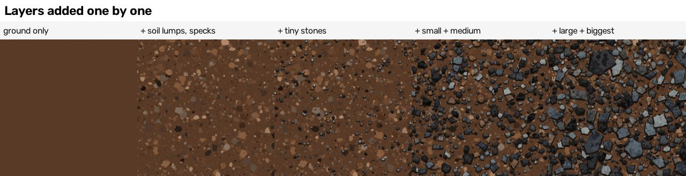

The same corner of the tile with more and more layers. **Correction:** the builder's strip `guide_pictures/strip_layers_stage.png` labels the third
square "+ tiny + small stones" and the fourth "+ medium stones", but the sweep script (`generator/sweeps_for_guide.py`, function `stage`) put only the
tiny class in the third square and the small and medium classes together in the fourth (the checker found this). The copy above has the right labels;
the pictures are the same.

## 2. How the reference was analysed

All analysis scripts are plain Python in `analysis/`. They read the reference picture; the Blender generator never does (the checker confirmed this:
`verifier_answer.json`). The full numbers are in Appendix A at the end of this guide; the short version follows.

**A. The maps come from the colour (the "derivation ceiling")** (`analysis/derivation_ceiling.py`, numbers in `scores/derivation_ceiling_log.txt` and
`scores/derivation_ceiling.json`)
* Height = a straight mix of the colour's red, green and blue numbers (0 to 255) plus a shift, cut off at 0 and 255, after blurring the colour by
  0.5 dots. The best fitted mix matches the uploaded height to 5.01 steps (of 255) on average, correlation 0.994. The usual grey (0.299 red + 0.587
  green + 0.114 blue) is a little worse (5.08); no blur is worse (6.20); a 0.8-dot blur is worse (5.87). The fit gives red and blue a lot of weight and
  green almost none.
* The generator uses the mix **267.15 x red + 91.48 x green + 210.5 x blue, divided by 255, minus 17.7** (`generator/gravel_generator.py`,
  `description/S_v4.json` "maps"/"height"). This line came from `analysis/derivation_parametric.py`, which printed it but did not save it; the
  builder's report quotes a mean error of 5.02 steps for it (`builder_answer.json`, "derivation_ceiling").
* Normal = the slope of the 8-bit height times a strength, made into a unit arrow. From the UPLOADED height, plain neighbour differences with strength 10
  rebuild the uploaded normal map to 0.34 degrees. From a height made from the reference COLOUR, the best is 5.88 degrees (neighbour differences,
  strength 12) or 4.58 degrees (Sobel, strength 12). A completely flat normal map is 24.46 degrees off.
* So even a perfect colour picture could not get a normal map better than about 4.6 degrees, and the tier "exact" asks for 4. That is why "exact" is
  out of reach for gravel.

**B. What the colour picture is made of** (`analysis/measure_gravel.py`, numbers in `scores/measurements.json` and `scores/measure_gravel_log.txt`)
* Stone or soil: soil is any dot that is orange-brown (in the Lab colour space: yellow-blue above 5, red-green above 2, colourfulness above 6.5, then a
  5-dot median filter). 32.2 % of the dots are soil, 67.8 % stone.
* Sizes ("what survives opening with a disc"): erase every part of the stone area that a disc of radius r cannot fit inside, and see how much is left.
  Stone left at radius 16: 51.6 %; at 32: 32.2 %; at 48: 10.9 %. Soil left at radius 6: 23.0 %; at 16: 9.6 %; at 24: 1.5 %. So the stones are big
  (half the picture is stone at least 32 dots wide) and the soil is crumbly.
* Colours: 8 stone colours from near black (19, 19, 19) to pale blue-grey (111, 117, 116), and 8 soil colours from (40, 30, 24) to (149, 115, 87).
  Small stones use more of the brownish grey (87, 84, 80): 24 % in the smallest size class, under 1 % in the biggest. Big stones use more of the blue-grey
  (60, 69, 76): 0.5 % in the smallest, 19.6 % in the biggest.
* No dark outline, but a shadow: right next to a stone the soil is darker (lightness 24.6 at 1 dot from the stone, rising to 31.4 at 8 dots), while the
  stone's own edge is not darker than its inside (20.0 at the edge, 21.2 at 8 dots in). So the dark band belongs to the soil: it is a shadow.
* Light from the top: inside big stones the lightness falls by 0.061 per dot going down the picture and only 0.005 per dot going sideways.
* The edges of big stones point in no particular direction (coherence 0.033 out of 1).
* Palette (`scores/palette_ceiling.json`): snapping every dot to 8 colours gives colour difference 4.43 and SSIM 0.855; 16 colours 3.32 / 0.902;
  24 colours 2.81 / 0.923; 48 colours 2.15 / 0.954. At 24 colours the picture falls apart into 226,197 separate same-colour areas.
* How much the reference differs from place to place (`analysis/window_spread.py`, `scores/window_spread.json`): cut into 3 x 3 windows of 418 dots,
  the stone share is 67.8 % give or take 3.0 (4.5 % of itself), the big-stone share 51.6 % give or take 3.8 (7.4 %), the soil-lump share 23.0 % give
  or take 3.2 (13.8 %). The sampler uses these as the size of its random changes (section 6.1).

**C. Why the stones could not be found one by one.** The first plan was to find every stone, measure it and write it down. `analysis/segment_stones.py`
(soil-or-stone by colour, then cutting touching stones apart at their narrowest neck) found 237 pieces (`analysis/stones_found.json`); the builder's
own estimate is about 1,500 stones (`builder_answer.json`). Dark stones touch dark stones, the shadows are stone-coloured and the rusty stones are
soil-coloured, so neighbouring stones merge. A second try (one stone per biggest-fitting-disc peak) gave the same merged pieces and was deleted
(`analysis/placed_stones.json` is empty). The builder switched to **statistics** (share, size curve, colour mix, shadow, light) and **calibration**
(section 4, step 13).

## 3. The description format

A description is one JSON file. `lib/description_audit.py` accepts every one of them (`scores/description_audit_all.txt`). The made-up part (S_v4):

```
{ "format": "gravel_painter_1", "tile": 1254,
  "ground": [88, 58, 38],                                  # the colour under everything
  "light": [0.0, -1.0],                                    # where the light comes FROM (x, y; y points down the picture): from the top
  "maps": {"height": {"mix": [267.15, 91.48, 210.5], "offset": -17.7, "blur": 0.5}, "normal": {"strength": 10}},
  "soil": { "seed": 1, "tones": [8 colours], "jitter_mode": "brightness",
            "layers": [ {"count": 3300, "radius": [2.2, 6.0], "sides": [5, 8], "jitter": 0.3, "top_share": 0.8, "top_shift": [14, 36],
                         "weights": [share of each of the 8 tones], "jitter_tone": 7.0}, ... 3 layers ],
            "specks": [ {"count": 2800, "radius": [1.0, 2.6], "tones": [3 colours], "weights": [3, 2, 1]}, ... 2 kinds ] },
  "stones": { "seed": 1, "tones": [8 colours], "tint": [1.0, 1.03, 1.08], "jitter_mode": "brightness", "tone_jitter": 4.0,
              "rim": 0.8, "shadow": 6.0, "shadow_rgb": [30, 22, 17], "chip": 0.1, "chip_step": 0.28,
              "facets": 2, "facet_min_radius": 14.0,
              "mottle_per_radius": 0.7, "mottle_size": [0.07, 0.24], "mottle_min_radius": 8.0, "mottle_shift": [8, 22],
              "classes": [ {"count": 28, "radius": [42, 78], "aspect": [0.5, 0.85], "sides": [4, 5], "jitter": 0.09,
                            "spacing": 0.585, "rust": 0.096, "weights": [share of each of the 8 tones]}, ... 5 classes ] } }
```
(The "mottle" settings are the flakes; "tones" and "weights" are the colours and how often each is picked.)

The traced descriptions add (`generator/gravel_layers.py`, `make_shape_list`):
* `"palette"`: 24 colours; `"patches"`: `[colour number, [x0, y0, dx1, dy1, ...]]` per traced patch, the first corner then the small steps to each
  next corner (short numbers make a short file); `"grow"`: every patch pushed out by this many dots so neighbours leave no hairline.
* `"stamps"`: a list of bands, biggest discs first; a band is `{colour number: [x, y, radius in half dots, x, y, radius, ...]}`.
* `"order"` (which blocks are drawn in which order) and `"stamp_mask"` (only for the dead-end hybrid TS: put made-up lumps only where the traced patches
  say "soil").

**Where the description stops being a procedure and starts being tracing:** the `soil` and `stones` blocks are procedure: numbers that mean something
(how many, how big, which colours, how close) and give a new picture for every seed. The `palette`, `patches` and `stamps` are tracing: the reference's
own areas and specks, cut into polygons and discs. S_v4 is all procedure; M, T, L and TS are tracing.

**A warning about the audit.** The audit refuses any list of more than 4,000 numbers ("it looks like a picture"). The stamps pass only because they are
grouped by colour: the biggest list in L_a100_s8 has 3,450 numbers (`scores/description_audit_all.txt`) and in L_a150_s7 3,963 (checker,
`verifier_answer.json`). This is a loophole, not a proof that the traced descriptions are "descriptions" in the project's sense.

## 4. The Blender recipe, tool by tool

The generator is `generator/gravel_generator.py` (Blender) plus `generator/gravel_layers.py` (plain numpy: turns the description into the
back-to-front list of shapes). Run:
`blender -b --disable-autoexec -t 2 --python generator/gravel_generator.py -- DESCRIPTION.json OUT_FOLDER --size 1254`
(or `-- --batch JOBS.json` for several; `--shift 0.5 0.5` slides the whole picture by half a tile, for the seamless test).
The Blender part is the same as the slate generator's (both are "painters"); the shape-making part is new.
**Honest note (from the checker):** here Blender's job is to draw and photograph the flat shapes. The shapes themselves (where every stone goes, its
outline, its colours) are made in plain Python. No shader-node noise or Voronoi, no physics and no curves are used in the final recipe; the one
Geometry Nodes route that was tried is in section 7.

**The Blender part**

1. **Mesh from points** (`mesh.from_pydata`). *What it is:* a list of corner points and faces turned into a real Blender surface. *How used:* every
   shape becomes one flat face, and each later shape lies a hair higher (step = 0.0001 of the tile, or less when there are more than 15,000 shapes:
   `min(0.0001, 3 / (2 x number of shapes))`). *Wrap copies:* every shape that crosses the tile edge is drawn again one tile to the left, right, up or
   down (nine places at most, corners included); each shape's middle is first folded into the tile. S_v4: 32,386 shapes became 33,004 faces (`outputs/S_v4/bake.json`).
2. **Face attributes** (`mesh.attributes.new(..., 'FACE')`). *What it is:* a number or colour stored on each face. *How used:* `piece_colour` (the
   colour, converted once from ordinary sRGB numbers to Blender's linear numbers), `piece_height`, `piece_rough`, `piece_metal`.
3. **Attribute node + Emission shader.** *What it is:* the Attribute node reads what is stored on the face; Emission makes the surface glow with exactly
   that colour, with no lights and no shading. *How used:* one little material per picture shows ONE channel (colour, height, roughness or metallic).
4. **View transform Standard for the colour picture, Raw for the data pictures; height saved 16-bit.** Standard gives back the same sRGB numbers that
   went in; Raw writes the stored numbers unchanged.
5. **Orthographic camera over a 1 x 1 square** (`lib/bake_harness.new_bake_scene`). A camera looking straight down without perspective, exactly
   covering the tile: one picture dot is one tile dot at 1254.
6. **The height of each shape is worked out in Python, not with a node.** Each flat shape gets ONE height number from its colour with the rule of
   section 2A (`height_of_colour` in `gravel_generator.py`). (The slate generator did the same stretch with a Map Range node; the result is the same.)
7. **Cycles samples: 16 for the colour and height pictures, 4 for roughness and metallic.** *What it is:* how many rays are averaged per dot; at a shape
   edge this decides how smooth the edge is. No gravel strip was made for this; the slate strip shows the same painter method:

   

   (Slate, 4 times zoomed: 1 sample gives hard stair-steps, 16 a clean one-dot soft edge.)
8. **Pixel filter: Box width 1 for the colour picture, Gaussian for the height picture.** *What it is:* how each picture dot averages its
   surroundings. *How used:* the Gaussian filter IS the 0.5-dot blur of the height. The width asked for is 4 x the blur in picture dots
   (`gravel_generator.py`, from the slate measurement `../slate/scores/filter_width_test.json`: width 2 blurs like 0.5 dots, 4 like 0.9, 6 like 1.4).
   So the generator asks for width 2 at 1254 dots, about 1 at 640 dots and 4 at 2508 dots.
9. **Normal map, in numpy after the photo:** the slope of the height rounded to 8 bits, times strength 10 (neighbour differences), divided by "tile
   dots per picture dot" so the slope looks the same at other sizes. **Ambient occlusion:** a cheap one (how much lower a dot is than its surroundings
   blurred over 6 dots).
10. **Roughness and metallic:** there are none in the reference, so this is a written-down choice: soil (red more than 12 above blue) 0.95; stones 0.55
    (darkest) to 0.8 (lightest); metallic 0 everywhere.
11. **Seamless 4D noise for an optional grain** (`lib/recipe_tools.tileable_noise_group`): offered by the generator, **not used** in any gravel
    description.

**The shape-making part** (plain numpy, `generator/gravel_layers.py`)

12. **A stone outline:** `blob_polygon` puts 4 to 7 corners (per size class) at uneven angles round a middle, each at the radius x (1 plus or minus
    "jitter"), squashed by "aspect", turned at random, and keeps the outside of those points (a convex shape). `rough_outline` then chips it: every edge is
    cut into pieces about 0.28 x radius long and each new corner is pushed in or out by up to 0.1 x radius ("chip").
13. **Placing with spacing that wraps:** a new stone is refused if it is closer than "spacing" x (its radius + the other's radius) to any stone already
    placed, measuring across the tile edge too (14 tries each). Sizes in a class are drawn with equal chance for every doubling of size.
    **Calibration** (`analysis/calibrate_sampler.py`): the counts and spacings were tuned by drawing the tile with OpenCV (no Blender), measuring it like
    the reference (stone share and size curve) and changing one number at a time, keeping a change only if the match got better (logs:
    `scores/calibrate2_log.txt` to `calibrate4_log.txt`; the last run went from cost 0.210 to 0.114 and ended at spacings 0.585 / 0.65 / 0.65 / 0.585 / 0.65).
14. **Brightness-only colour changes:** each stone's colour is moved lighter or darker by a random amount (spread 4 steps), the SAME amount on red, green
    and blue, so the hue stays. (Moving the three separately made purple and green stones; see section 9.)
15. **Lit face, shaded face, facets, flakes:** the body is cut by a straight line across it, toward the light, and the cut-off piece is drawn lighter
    (10 to 26 steps, with a slight blue lean from "tint"); a piece on the other side is drawn 5 to 12 steps darker; stones of radius 14 or more get 2
    more cuts at random angles (from 9 steps darker to 14 lighter); stones of radius 8 or more get about 0.7 x radius flakes (a stone of radius 20 gets
    about 14), small angular spots 0.07 to 0.24 x radius across, 8 to 22 steps lighter or darker. 8 to 9.6 % of the stones are rusty: they get a
    rust-brown body and mostly grey flakes.
16. **Shadow on the soil:** two copies of the stone outline, grown outward and pushed away from the light, in a dark brown (30, 22, 17) and a darker
    one. "shadow" 6 means 6 dots wide for a stone of radius 20; small stones get down to half of that, big ones up to 1.3 times;
    stones of radius under 5 get none.

**What changing each setting does** (strips; each square is the top-left 320 x 320 dots of the whole tile photographed at 640 dots, so the stones are
drawn at about half their size in the 1254 tile; colour with 8 samples. Made by `generator/sweeps_for_guide.py`. Where the builder's label was wrong,
the copy in `../../cookbook/pictures/` has the corrected label, made by `../../cookbook/pictures/gravel-strips-maker.py` from the same tile pictures.)

**Corners per stone** (every size class set to one number)

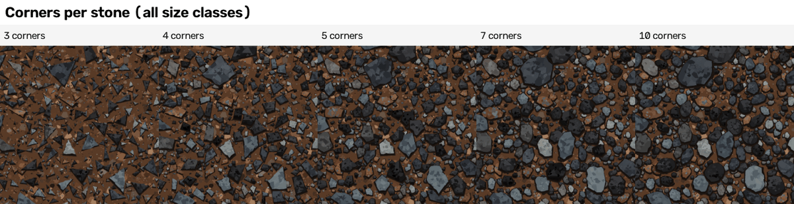

3 corners gives sharp shards; 4 and 5 give the chunky blocks of the reference (S_v4 uses 4 to 5 for the big classes and up to 6 or 7 for the small);
7 and 10 give round pebbles.

**Edge chipping** (share of the stone radius)

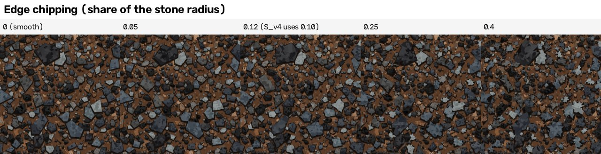

0 gives clean straight-edged polygons; 0.05 to 0.12 gives slightly broken edges; 0.25 and 0.4 give star-shaped, crumbling stones. **Correction:** the
builder's strip labels 0.12 as "used", but S_v4 uses 0.10 and no square shows 0.10 exactly.

**Packing** (a stone may come no closer than this x the sum of the two radii)

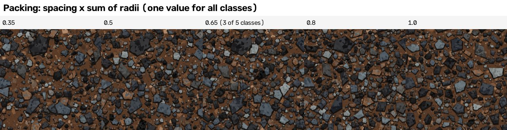

0.35 lets stones overlap a lot (a heap); at 1.0 stones no longer overlap and more soil shows between them (scattered gravel). **Correction:** the builder's strip
says 0.65 is "used"; S_v4 uses 0.65 for three classes and 0.585 for the biggest and the small class, and the sweep set all five classes to one value.

**Shadow on the soil** (dots, for a stone of radius 20)

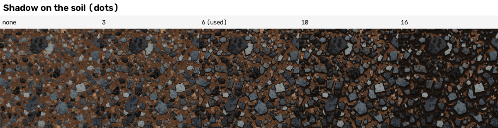

None: the stones float on the soil like stickers. 6 (used) gives the dark band the reference has. 10 and 16 bury the soil in black.

**Light direction**

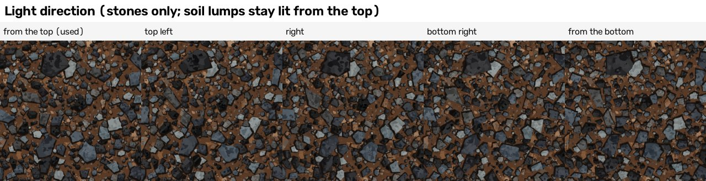

The lit face of every stone turns toward the light. **Correction (title only):** only the stones follow this setting; the lighter tops of the soil lumps
are always toward the top of the picture (it is fixed in `gravel_layers.soil_shapes`).

**Flakes on stones** (number per dot of stone radius)

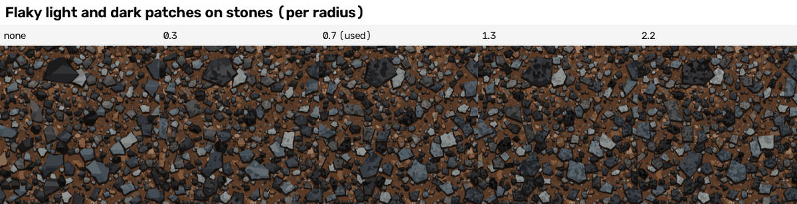

None: the stones are flat plastic. 0.7 (used) gives the broken, painted look; 2.2 makes every stone speckled like granite.

**Soil lumps** (all lump and speck counts times this number)

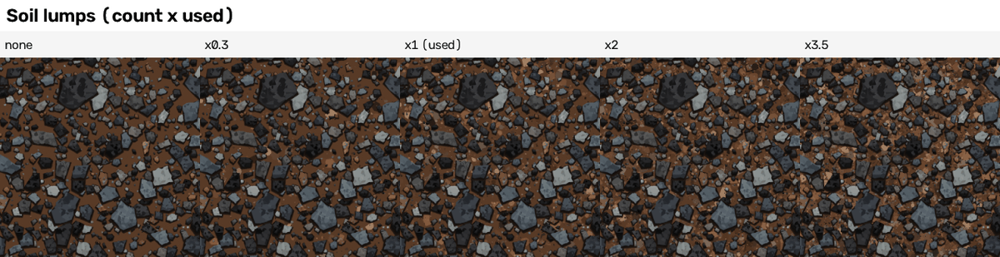

None: the soil is one flat brown. x1 (used) gives the crumbly look; x3.5 covers the brown with pale crumbs.

**Height blur** (the Cycles Gaussian filter width on the height picture)

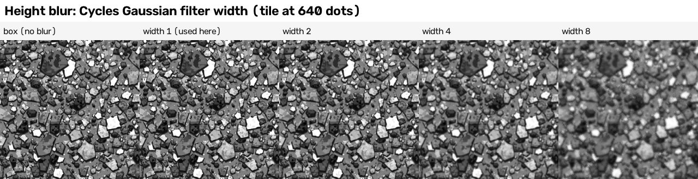

Box (no filter) leaves hard one-dot steps; width 4 and 8 smear the small stones into mush. **Correction:** the builder's strip labels width 2 as "used".
Width 2 is what the generator asks for at 1254 dots; these squares were photographed at 640 dots, where the generator would ask for about width 1.

**Normal strength** (new strip, made for this guide)

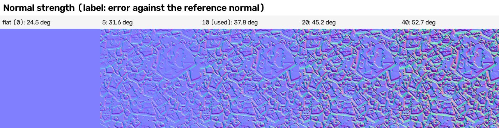

The S_v4 height picture turned into a normal map at strengths 0, 5, 10, 20, 40 with the generator's own rule, top-left 320 x 320 dots of the 1254 tile
(so this strip is drawn twice as big as the others). The label is the normal error against the reference (`lib/pixel_compare.py`; numbers in
`../../cookbook/pictures/gravel-strips-numbers.json`): flat 24.5 degrees, 5: 31.6, 10 (used): 37.8, 20: 45.2, 40: 52.7. **What it says:** for made-up
stones, a stronger normal map is always further from the reference dot for dot, because the bumps are in different places. A flat map wins this measure,
which is why the dot-for-dot normal error must not be used to choose the strength of a made-up tile. Strength 10 was chosen because it rebuilds the
reference normal from the reference height (section 2A). Not tested: the "same kind" score at other strengths.

## 5. How accurate, layer by layer

**Made-up gravel, one layer at a time** (`analysis/ladder_procedural.py`, `final_report.json` "procedural_ladder"; drawn with OpenCV, not Blender,
so it is quick; the "same kind" score here is close to the baked tile's smoothed-height view: 0.437 drawn against 0.435 baked)


| stage | description size | colour SSIM | colour difference | edge skill | "same kind" score | shapes |
|---|---|---|---|---|---|---|
| 0 ground colour only | 178 bytes | 0.444 | 21.04 | 0.0 | not defined | 1 |
| 1 + soil lumps | 910 bytes | 0.367 | 22.06 | 0.0 | 0.197 | 5,353 |
| 2 + tiny soil specks | 1,105 bytes | 0.335 | 22.05 | 0.0 | 0.170 | 9,953 |
| 3 + tiny and small stones | 1,857 bytes | 0.246 | 21.60 | 0.001 | 0.247 | 22,482 |
| 4 + medium stones | 2,022 bytes | 0.212 | 21.32 | 0.0 | 0.345 | 28,618 |
| 5 + large stones | 2,186 bytes | 0.202 | 21.25 | 0.009 | 0.408 | 31,321 |
| 5b all stones, but no shadow, rim, facets or flakes | 2,364 bytes | 0.291 | 21.46 | 0.006 | 0.352 | 17,738 |
| 6 all (final, S_v4) | 2,364 bytes | 0.206 | 20.94 | 0.008 | 0.437 | 32,386 |

What it says: every layer of made-up stones LOWERS the dot-for-dot SSIM (0.444 to 0.206) and RAISES the "same kind" score (0.17 to 0.44). The shadow,
rim, facets and flakes together are worth +0.085 on the "same kind" score (0.352 to 0.437) for no extra bytes (only their values change).

**Traced gravel, one size at a time** (`final_report.json` class rows; difference sheets: `scores/M_a600_s120_diff.jpg`, `scores/T_k24_a250_diff.jpg`,
`scores/T_k24_a100_diff.jpg`, `scores/T_k24_a50_diff.jpg`, `scores/L_a250_s12_diff.jpg`, `scores/L_a100_s8_diff.jpg`)

| traced description | size | colour SSIM | colour difference | edge skill | height error | normal error |
|---|---|---|---|---|---|---|
| patches over 250 dots | 84.7 KB | 0.453 | 11.37 | 0.114 | 40.6 | 26.4 |
| patches over 100 dots | 204.3 KB | 0.513 | 8.51 | 0.242 | 31.0 | 25.7 |
| patches over 50 dots | 350.4 KB | 0.584 | 6.83 | 0.411 | 23.5 | 23.9 |
| patches over 250 + stamps over 12 dots | 270.0 KB | 0.588 | 6.49 | 0.593 | 23.6 | 25.1 |
| patches over 100 + stamps over 8 dots | 426.2 KB | 0.666 | 5.29 | 0.694 | 18.5 | 22.3 |

What it says: **stamps are the big win for a busy picture.** Adding about 18,000 stamps (`builder_answer.json`) to the patches over 250 dots lifts the edge
skill from 0.114 to 0.593 (+0.48) for 185 KB more, while making the patch outlines 2.5 times finer (250 to 100 dots, +120 KB) lifts it only to 0.242.
The stamps were found as the dots where the drawn patches still disagree with the 24-colour picture.

A quick numpy experiment went further (`final_report.json` "stamp_experiment"; scored without Blender, sizes counted differently from the real files,
which are smaller: 356 KB in the experiment against 270 KB for the same settings): patches over 100 + stamps over 6 dots, 635.5 KB: SSIM 0.709, edge
0.694, normal 20.1 degrees; patches over 50 + stamps over 6 dots, 807.3 KB: SSIM 0.741, normal 18.7 degrees. Both are over the 512 KB limit and still
miss the 12-degree normal limit. The normal map is the slope of the finest detail, so every tiny edge must sit within a dot: "close" needs almost every dot.

**Two more honest notes.**
* The traced tiles do not repeat smoothly: their seam numbers are 2.8 to 11.4 (`final_report.json`, "seam_ratio"; 1.0 = seamless, the reference
  itself 2.49), because the patches were cut out of a picture that stops at its edge. The half-tile test (section 6.4) was not run on them.
* The "same kind" score of the coarser traced tiles is LOW (0.208 to 0.279 for M, TS, patches over 250 and over 100 dots): they look like stained
  glass and lose the soil grain. Patches over 50 dots reach 0.404, and the two with fine stamps 0.533 and 0.603.

**Two "same kind" numbers.** `analysis/score_folder.py` also scores a "smoothed-height view": a copy of the tile whose height got a 0.8-dot smoothing. Its
note says this matches the reference height the "same kind" tool reads; that was true before the tool was changed at 15:45 on 19 October. Today the tool
reads the reference's 8-bit upload and stretches both heights to full range (`lib/texture_compare.py`; `cookbook/06 Guide - baking and checking maps.md`,
section 5), so the as-baked number is the main one. For S_v4 this lifts the
height part from 0.402 to 0.645 and the overall score from 0.362 to 0.435; colour (0.236) and normal (0.399) do not change (`scores/S_v4_summary.json`).

**What the S_v4 sheet shows** (`scores/S_v4_texture_sheet.jpg`, `scores/S_v4_texture_compare.json`, and the checker):
* The stones are smaller and flatter than the reference's chunky faceted blocks; the reference's biggest stones are rarer and bigger.
* Measured: the stone share is 61.1 % against 67.8 %, and stone left after opening with a disc of radius 16 is 31.2 % against 51.6 %; at radius 32,
  7.0 % against 32.2 % (measured for this guide with `generator/preview_tools.measure` on `outputs/S_v4/colour.png`; the numbers are in
  Appendix A8; the reference numbers are in `scores/measurements.json`). The checker found the same gap.
* Part of the gap comes from the calibration itself: it was done on the quick OpenCV drawing, which measures a stone share of 67.4 %, the same as the
  reference; the Blender photograph of the same description measures 61.1 % (the two pictures differ by 6.2 steps per dot on average, mostly at
  shape edges; measured for this guide, Appendix A8). Not tested: calibrating on the Blender picture.
* The soil is one flat brown with a sharp spike in the brightness curve; the reference's brightness is spread smoothly.
* The colour is a little too orange-red: average Lab 23.8, 4.1, 6.4 against the reference's 24.5, 2.5, 3.8. Three colour parts of the "same kind" score
  are 0.0 (spectrum, scale, gradient), and the features are finer (correlation length 5 dots against 8).

## 6. Making new tiles

### 6.1 Variation: eight new tiles from one generator

`generator/sampler.py`: `sample_description(seed)` starts from S_v4 and changes it the way the reference changes from place to place
(`scores/sampler_spread.json`): the stone count of each class by about 7 %, the radii by 5 %, the spacing by 0.03, the colour weights by 18 %, every colour by
about 2 steps, the soil counts by 12 %, the rust share by 0.03, the light by a few degrees, and new seeds. It never reads a picture. The eight
descriptions (seeds 1 to 8) are 2,470 to 2,486 bytes each. The checker re-ran the sampler and got byte-identical files, and re-baked sample_03 to a
byte-identical picture.


(First picture: the reference. Then the eight new tiles.)

| measure | result (`variations/report.json`, `final_report.json` "variation") |
|---|---|
| "same kind" score, 8 tiles | as baked 0.365 to 0.456 (mean 0.403); smoothed-height view 0.425 to 0.488 (mean 0.457). The fitted S_v4 scores 0.362 / 0.435 |
| seam number | 0.97 to 1.08 (1.0 = seamless) |
| dot for dot against the reference | tier "none" for all eight; SSIM 0.206 to 0.224, colour difference 20.53 to 21.37, edge skill 0.0 to 0.015 |
| how different the tiles are from each other | average difference 33.29 to 35.55 steps (mean 34.62), SSIM 0.176 to 0.206 (mean 0.19): none is a copy |
| bake time | 38.3 to 60.5 s each (`variations/out/sample_*/bake.json`) |

Honest reading (with the checker): they read as gravel on rusty soil and none is a copy. But they are "the same gravel in a different arrangement", not
different looks, and they share S_v4's gap: too few big stones, flat kite-shaped stones, flat dark soil. "As good as the fitted tile" is true only because
the fitted tile has the same gap. The "same kind" score did not see the shape problem; the eye did.

### 6.2 Area: one picture of 2 x 2 tiles of new content, 2508 x 2508 dots

`sample_description(101, area=2)` (`area/descriptions/sample_101.json`, 2,493 bytes): four times the stones and lumps on a 2508-dot tile, so the stones
keep their size in dots (the checker notes they look half as big in the 1254 preview).


* **Bake time: 252.6 s** for all six pictures (`area/out/area_2508/bake.json`: 126,443 shapes, colour 78.1 s, height 81.3 s). The checker's re-bake took
  204.9 s (`verify/bake_area.log`). **Correction:** the builder's report says 173 s; that number is the RESOLUTION bake of S_v4 at 2508 dots
  (section 6.3), which has about a quarter of the shapes.
* **No seam** (`area/area_report.json`): the jump across the middle lines is 1.06 (up and down) and 1.10 (sideways) times a normal jump, across the
  wrap-around edge 0.95 and 1.05 (the reference tile itself: 2.49).
* **No repeat:** the four 1254-dot quarters compared with each other: SSIM 0.174 to 0.183, best shifted match 0.039 (a copy would give 1.0). The checker
  found the same (0.034 to 0.039) and that the whole picture matches itself shifted by half at 0.00.

### 6.3 Resolution: the same description at 512, 1254 and 2508 dots

(`resolution/resolution_report.json`, `resolution/out/*/bake.json`, `outputs/S_v4/bake.json`; description S_v4)

| dots | bake time, all six pictures (builder; checker) | colour render | height render | shapes + mesh | files | change between neighbouring dots (per tile dot) | mean normal slope |
|---|---|---|---|---|---|---|---|
| 512 | 19.2 s; 20.8 s | 3.3 s | 3.2 s | 9.1 s | 2.3 MB | 4.33 | 0.374 |
| 1254 | 99.5 s; 61.3 s | 28.9 s | 31.1 s | 22.6 s | 11.5 MB | 5.66 | 0.367 |
| 2508 | 173.2 s; not re-run | 63.8 s | 52.0 s | 9.3 s | 38.7 MB | 6.54 | 0.352 |

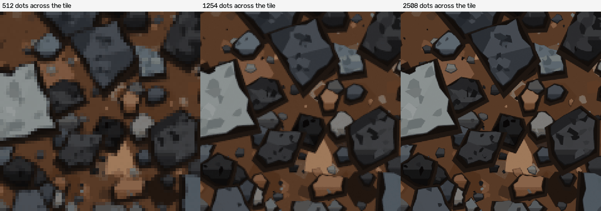

* **The picture is the same:** shrunk to 512, the 1254 and 2508 bakes match the 512 one with SSIM 0.99 and an average difference of 1.65 and 1.68 steps.
* **What changes:** edges get sharper (4.33, 5.66, 6.54); the normal map keeps its slope (0.374, 0.367, 0.352) because the strength and the height blur
  are scaled by "tile dots per picture dot".
* **What does NOT change:** the detail. Shapes are made at the 1254 scale, so at 2508 the same shapes are drawn sharper, not finer.
* **Times are rough:** making the shapes costs the same at every size, yet it reads 9.1, 22.6 and 9.3 s: that is the load from other jobs. The checker's
  1254 bake took 61.3 s against the builder's 99.5 s.

### 6.4 Seamless: the half-tile test

`analysis/half_tile_test.py` bakes a description, bakes it again with the whole picture slid by half a tile in both directions, and compares the second
picture with the first one rolled by half its size. A tile that really repeats gives the same picture.

| what | size | mean colour difference (steps of 255) | share of dots differing by more than 40 | the same two numbers for a WRONG roll (control) | height difference |
|---|---|---|---|---|---|
| S_v4, builder (`final_report.json` "half_tile_test") | **512 dots** | 1.29 | 0.0 % | 31.1; 27.9 % | 2.04 |
| S_v4, checker (`verifier_answer.json`) | 1254 dots | 0.78 | 0.0 % | 27.9; 25.0 % | 2.05 (normal 3.9) |
| pebbles transfer, builder (`scores/half_tile_test.json`) | **512 dots** | 1.54 | 0.0 % | 28.6; 26.6 % | 1.99 |

**Correction:** the builder's report says its half-tile numbers were for the 1254 tile; `analysis/half_tile_test.py` bakes at 512 dots (`size = 512`).
The checker ran the test at 1254 (`verify/half_tile_1254.py`) and got 0.78 and 0 %. All pass: the tile repeats exactly.

## 7. Real geometry, compared honestly

`generator/geometry_route.py` builds the SAME stone list (positions, sizes, turns, colours from `gravel_layers.make_stone_list`) as real 3D blocks with
Geometry Nodes and photographs them from above (`lib/contrib/gn_tools.photograph_geometry`):
* **Mesh Cylinder** (4, 5 or 6 sides) -> **Scale Elements** on the top face (picked with Input Normal + Dot Product + Greater Than) to shrink it ->
  **Transform** (sit on the ground) -> **Geometry to Instance** -> **Join Geometry** = three block shapes;
* one point per stone (2,921 points with wrap copies for 2,832 stones) with Named Attributes for radius, aspect, angle, shape -> **Combine XYZ** ->
  **Instance on Points** (Pick Instance) -> **Realize Instances** -> **Set Material**.

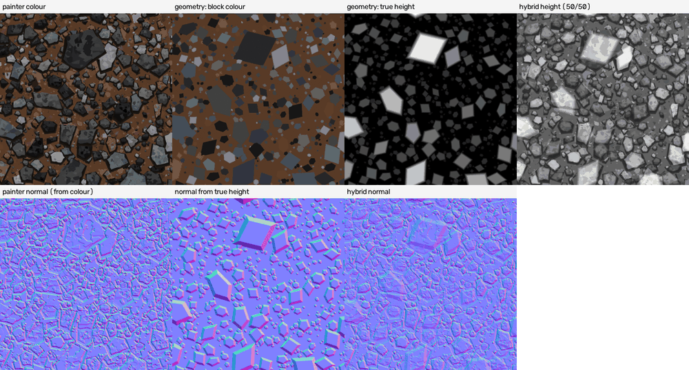

(Top: painter colour, geometry block colour, geometry true height, 50/50 hybrid height. Bottom: the painter's normal (made from its colour), the normal from
the true height, the hybrid normal.)

| route (same stone list, 1254 dots; `final_report.json` "geometry_route") | colour SSIM | colour difference | height error | normal error | "same kind" (as baked / view) |
|---|---|---|---|---|---|
| geometry alone (flat block colours, true height) | 0.360 | 20.23 | 48.1 | 28.46 deg | 0.173 / 0.173 |
| painter colour + geometry height | 0.213 | 20.93 | 48.1 | 28.96 deg | 0.203 / 0.193 |
| painter colour + 50/50 hybrid height | 0.213 | 20.93 | 48.1 | 33.05 deg | 0.257 / 0.247 |
| painter alone (S_v4) | 0.213 | 20.93 | 48.1 | 37.77 deg | 0.362 / 0.435 |

* **Cost:** the geometry is quick: 0.66 s to build, 3.05 s height and 5.05 s colour render (`final_report.json`, "photo").
* **Verdict:** for a reference whose maps were made from its colour, real geometry LOWERS the "same kind" score (0.173 alone, 0.257 for the hybrid,
  against 0.362 for the painter). The research hint that 50/50 hybrids help gravel did NOT hold here. Its normal error is lower (28.46 against 37.77) only
  because smoother normals sit closer to a flat map (24.5), not because the stones are in the right places. Use real geometry for a gravel floor that must
  really stick out in 3D (displacement), not to copy this kind of painted map.
* The checker notes: `geometry_route.py` reads the reference normal picture to fit one strength number (through `photograph_geometry(normal_reference=...)`);
  the main generator never does. The route is a dead end anyway.

## 8. Transfer: rounded pebbles on sand (a surface nobody gave us)

`analysis/make_transfer_description.py` (about 70 lines) takes S_v4 and changes only numbers (its first lines say "S_v1"; the code reads S_v4). No generator
code was touched (the checker confirmed the generator files are older than the pebble description).


**What was changed** (`analysis/make_transfer_description.py`, `transfer/pebbles_changes.json`)

| setting | gravel (S_v4) | pebbles |
|---|---|---|
| stone colours (8) | near black to pale blue-grey | greys, beiges and ochres, (70, 68, 66) to (200, 194, 180) |
| soil colours (8) and ground | orange-brown; ground (88, 58, 38) | sand, (120, 100, 72) to (214, 196, 160); ground (160, 136, 98) |
| size classes | 5: radius 3 to 78 dots, 2,833 asked for | 4: radius 2.5 to 28 dots, 3,850 asked for |
| corners per stone | 4 to 7 | 6 to 12 (round) |
| chipping | 0.1 | 0.015 (smooth) |
| spacing | 0.585 to 0.65 | 0.9 (loose) |
| rust share | 8 to 9.6 % | 0 |
| shadow | 6 dots, dark brown | 3 dots, sand brown (104, 88, 62) |
| rim | 0.8 dots, 0.45 x body colour | 0.6 dots, (70, 60, 48) |
| facets / flakes | 2 / 0.7 per radius | 0 / 0.25 per radius, softer |
| lit / shaded face | default (10-26 lighter / 5-12 darker) | 6-14 lighter / 4-9 darker |
| light | from the top | from the top left (stones only) |
| soil lumps / lighter tops / specks | 3,300 + 1,540 + 500; 80 %; 2 kinds | 2,500 + 900 + 200; 20 %; 1 kind (1,500, dark and pale) |
| **height stretch** | mix 267.15 / 91.48 / 210.5, shift -17.7 | mix 187.9 / 64.34 / 148.05, shift -73.1 |

The change list in `transfer/pebbles_changes.json` names 21 settings; it leaves out some that the script also changed (the soil lumps' lighter-top share, their
colour weights and the two seeds). The checker counted 60 single values that differ.

**The one number that must be found again: the height stretch.** The gravel rule turns the bright sand white. With no reference height for pebbles, the
builder drew the tile, took the 1st and 99th percentile of the gravel mix over the picture (118.1 and 452.3) and stretched those to 10 and 245.

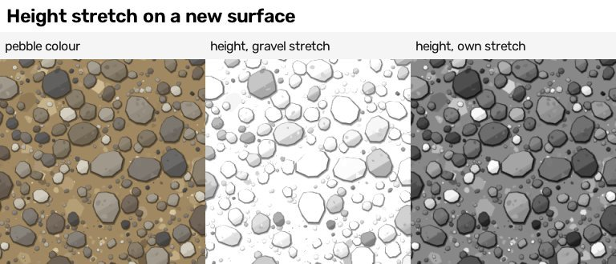

(New strip for this guide. Left: the pebble colour. Middle: the height the GRAVEL rule would give, worked out in plain Python from the baked colour.
Right: the height the generator really baked with the pebbles' own stretch.) Measured (`../../cookbook/pictures/gravel-strips-numbers.json`): with the gravel
rule 62 % of the dots are full white and the average height is 230.7 of 255; with the pebbles' own rule 0.1 % are full white and the average is 118.3.

**Time and checks:** description 1,992 bytes; bake 48.2 s (`transfer/out/pebbles_1254/bake.json`; checker 47.9 s); half-tile test passed at 512 dots
(section 6.4); the checker looked at the 2 x 2 repeat (`transfer/pebbles_2x2_tiling.png`), found it seamless, and re-baked the tile to a byte-identical picture. The builder says
the work took "about 12 minutes" (`transfer/transfer_report.json`); that cannot be checked. There is no pebble reference, so no score: it was judged by eye.
It looks like a pebble beach.

**What this says about the method:** another "stones in soil" surface is new numbers plus one re-found number (the height stretch). Not tried: a surface
of a different kind (for example stones set in mortar, or stones that overlap in layers).

## 9. Dead ends, failures and mistakes (kept on purpose)

1. **Finding single stones** (`analysis/segment_stones.py`): 237 merged pieces for about 1,500 stones; a second try with biggest-fitting discs gave the same
   and was deleted. Replaced by statistics and calibration. Because of this, the planned class-M made-up description "place the big stones one by one,
   make up the rest" was **not built**, and no class-M description is good (traced M: tier none, SSIM 0.431).
2. **Tracing only the stone-coloured patches and making up the soil** (TS_k24_a300, 53.5 KB): the clean-up of small patches pushed dark soil into the stones
   (stone share 0.83 against 0.68, `builder_answer.json`); SSIM 0.379, "same kind" 0.215.
3. **Tracing coarse patches only** (over 600 or 250 dots): stained glass with no soil grain (SSIM 0.43 to 0.45, edge skill 0.09 to 0.11).
4. **Stones 1.5 times too small** (first round, S_v2): the counts were calibrated against the size curve of a colour mask and matched it, but by eye the stones
   were too small. Redone as S_v4 with sizes taken from the biggest stones. Note: S_v2 scores a hair HIGHER on "same kind" (0.378 / 0.443, `final_report.json`)
   than S_v4 (0.362 / 0.435); the difference is inside the seed noise of 0.03 to 0.05 (`builder_answer.json`). The eye chose S_v4. And S_v4 still has too
   few big stones (section 5).
5. **Separate random changes on red, green and blue** turned dark grey stones purple and green (a made-up example: (38, 38, 40) changed by +6, -5, +7
   becomes (44, 33, 47), a purple). Fixed with brightness-only changes (`"jitter_mode": "brightness"`). No picture of the failure was kept.
6. **Small colour tweaks chosen by the score:** more tone jitter, fewer fine lumps, a lighter palette moved the "same kind" score by only 0.01 to 0.02
   (`scores/tune_texture_round1.json`: 0.423 base, 0.415, 0.431, 0.435), which is noise. Only the picture could choose.
7. **The soil drawing order.** The builder's notes say "draw big lumps first and small on top; my first soil drew big lumps last and hid the grain". The try
   that did this (`description/S_v3.json`) was not kept: the final S_v4 draws small lumps first and big lumps last, with only the specks on top. No score
   compares the two orders, so this "lesson" is not proven.
8. **Real-geometry height for gravel:** lowers the "same kind" score (section 7).
9. **The normal error cannot be fixed by smoothing:** a majority filter on a traced colour and a weaker normal gain about 3 degrees (24.8 to 21.8,
   `builder_answer.json`); the 12-degree limit stays out of reach.
10. **The sweep strips:** the first sweep run crashed (TypeError at the soil-lumps sweep, `scores/flags/sweeps.txt`); the strips came from later partial runs
    (`scores/sweeps_big.log`, `scores/sweeps_part2.log`) and the script was edited after the failed run (checker). Five strips had labels that did not match what
    was run (section 4; corrected copies in `../../cookbook/pictures/`).
11. **Two numbers in the builder's report were mis-stated** (found by the checker): the area bake time (173 s; really 252.6 s) and the size of the half-tile
    test (512 dots, not 1254). Both are corrected here.
12. **A mistake that may have hurt other jobs:** the builder once stopped processes by name (`pkill -f run_everything.sh`), which may have stopped another
    builder's script of the same name (metal and slate both have one). Nobody checked whether those runs were cut short.
13. **Disk:** to get from 1.1 GB to 334 MB the builder deleted scratch pictures, 7 of 8 early texture sheets and extra map files of non-final bakes; their
    numbers stay in `scores/*.json`.
14. **The guides were not written by the builder** (its tool refused .md files); this guide was written afterwards from its files. The separate file
    `analysis/analysis_findings.md` could not be written either: the writing tool refuses files of that name. Its content is Appendix A below.
15. **Not tried:** shader-node noise and Voronoi recipes (the research route), rigid-body physics (dropping stones), curves, the compositor; a finer second
    wobble for big pictures; describing the soil grain.

## 10. Files

* `generator/`: `gravel_generator.py` (the Blender recipe), `gravel_layers.py` (description to shapes), `sampler.py` (new descriptions),
  `geometry_route.py` (real-geometry route), `preview_tools.py` (quick OpenCV drawing and measuring), `sweeps_for_guide.py` (the strips).
  Leftovers: `_gg_body.txt` (an old copy that still imports the slate code) and `gravel_layers_v1_backup.py` (a stale copy).
* `analysis/`: the measuring and tracing scripts (Appendix A11). `run_everything.sh` (the chain of bakes) and `run_bake_and_score.sh` are in the gravel folder itself.
* `description/`: every description (S_v4 is the final made-up one; L_a100_s8 the best traced one; `transfer_pebbles.json`).
* `outputs/` baked pictures, `scores/` every score and sheet, `variations/`, `area/`, `resolution/`, `transfer/`, `guide_pictures/`, `verify/` (the checker's runs).
* Corrected and new strips: `../../cookbook/pictures/gravel-strip-*.jpg`, made by `../../cookbook/pictures/gravel-strips-maker.py`.


## Appendix A. The analysis in full

(This would have been `analysis/analysis_findings.md`; the writing tool refuses files of that name, so it lives here. The analysis scripts read the reference
picture; the Blender generator never does. Section A8 holds three measurements made while writing this guide; the command is given so they can be repeated.
Every other number names the file it comes from. Paths are from the gravel folder.)

Words used here: **stone** dots are the blue-grey and black ones, **soil** dots the orange-brown ones; **steps** are brightness steps from 0 to 255.
Measures: **colour SSIM** is a picture-structure score (1.0 = the same picture); **colour difference (Delta E)** is how different two colours look (about 2.3
is "just visible"); **edge skill** says how many edges sit where the reference has them (0 = no better than luck, 1 = all of them); **height error** is the
average height difference in steps after the best brightness and contrast fix; **normal error** is the average angle between the two normal maps.

### A1. The height and the normal map come from the colour

*What was done* (`analysis/derivation_ceiling.py`, `analysis/derivation_parametric.py`; numbers in `scores/derivation_ceiling_log.txt`): try several ways of
turning the reference colour into its height, and see how close each gets to the uploaded 8-bit height.

Example first: with the rule the generator uses, a soil dot of colour (88, 58, 38) gets height 267.15 x 88/255 + 91.48 x 58/255 + 210.5 x 38/255 - 17.7 =
about 127 of 255; a black stone (22, 22, 22) about 31; a pale stone (124, 130, 129) about 271, cut off at 255.

| brightness recipe | blur 0 | blur 0.5 dots | blur 0.8 | blur 1.0 | blur 1.3 |
|---|---|---|---|---|---|
| fitted mix of red, green, blue | 6.20 | **5.01** | 5.87 | 7.30 | 9.59 |
| ordinary grey (0.299 R + 0.587 G + 0.114 B) | 6.33 | 5.08 | 5.93 | 7.37 | 9.68 |
| HD grey (Rec. 709) | 6.53 | 5.26 | 6.02 | 7.44 | 9.73 |
| plain average of R, G, B | 6.84 | 5.65 | 6.34 | 7.68 | 9.88 |

(Mean height error in steps. Best: fitted mix, blur 0.5: 5.01 steps, correlation 0.994. The ordinary grey is nearly as good.)

* The fitted mix weighs red 293.9, green 0.5, blue 252.8 (`scores/derivation_ceiling.json`, "linear_weights"): green hardly counts. The generator uses
  267.15 / 91.48 / 210.5 with shift -17.7, from `analysis/derivation_parametric.py` (printed, not saved; the builder reports 5.02 steps for it).
* **Normal map:** from the UPLOADED height, neighbour differences x strength 10 rebuild the uploaded normal map to 0.34 degrees (Sobel differences: 4.83
  degrees at their best strength, 8). From the height made from the reference COLOUR: 5.88 degrees (neighbour differences, strength 12) or 4.58 degrees
  (Sobel, strength 12). A flat normal map is 24.46 degrees off.
* **The ceiling:** a recipe that makes its height and normal from its own colour can at best be 5 steps off in height and 4.6 degrees off in the normal,
  even with a perfect colour picture. "Exact" asks for 4 degrees, so it is out of reach for gravel.

### A2. How few colours the picture needs

*What was done* (`analysis/palette_ceiling.py`, `scores/palette_ceiling.json`): k-means (a method that finds the k colours that best stand for all the dots)
in a colour space that follows the eye; every dot snapped to its nearest colour.

| colours | colour difference | colour SSIM | separate same-colour areas |
|---|---|---|---|
| 8 | 4.43 | 0.855 | 82,431 |
| 12 | 3.74 | 0.883 | 125,605 |
| 16 | 3.32 | 0.902 | 162,168 |
| 24 | 2.81 | 0.923 | 226,197 |
| 32 | 2.50 | 0.937 | 265,006 |
| 48 | 2.15 | 0.954 | 351,258 |

Scored with the full dot-for-dot tool, the 24-colour picture gives edge skill 0.857, height error 8.1 and normal error 10.6 degrees, tier "close"; after a
3 x 3 majority filter, SSIM 0.857 and normal error 13.4, tier "layout" (`builder_answer.json`; printed by `analysis/numpy_bake.py`, not saved to a file).
So even a perfect 24-colour copy only just makes "close", and only by keeping all its 226,197 areas.

### A3. Stone or soil, and how big they are

*What was done* (`analysis/measure_gravel.py`, `scores/measurements.json`, `scores/measure_gravel_log.txt`).
* **Soil or stone, by colour:** soil = orange-brown (Lab colour space: yellow-blue above 5, red-green above 2, colourfulness above 6.5; then a 5-dot median
  filter). Result: **32.2 % soil, 67.8 % stone.**
* **Sizes, by "opening with a disc":** erase every part of the stone (or soil) area that a disc of radius r cannot fit inside, and see how much is left.
  A big stone survives a big disc; a crumb does not.

| disc radius (dots) | 0 | 1 | 2 | 3 | 4 | 6 | 8 | 12 | 16 | 24 | 32 | 48 |
|---|---|---|---|---|---|---|---|---|---|---|---|---|
| stone left (share of all dots) | 0.678 | 0.677 | 0.669 | 0.660 | 0.644 | 0.621 | 0.598 | 0.557 | 0.516 | 0.407 | 0.322 | 0.109 |
| soil left | 0.322 | 0.322 | 0.314 | 0.300 | 0.272 | 0.230 | 0.198 | 0.146 | 0.096 | 0.015 | 0.002 | 0.0 |

Reading: half of the picture is stone at least 16 dots in radius, a third is stone at least 32 dots in radius; the soil is crumbly (almost none of it is 24
dots across). Of all stone dots, 31.6 % sit in stones of radius 32 to 48 and 16.0 % in stones of radius 48 or more.

### A4. The colours, and how they change with stone size

*Stone colours* (8, dark to light, share of stone dots; `scores/measure_gravel_log.txt`): (19, 19, 19) 16.6 %; (33, 33, 35) 20.7 %; (42, 46, 51) 17.0 %;
(57, 57, 56) 10.5 %; (60, 69, 76) 12.1 %; (87, 84, 80) 5.0 %; (83, 93, 98) 10.6 %; (111, 117, 116) 7.6 %.
*Soil colours* (share of soil dots): (40, 30, 24) 5.5 %; (63, 44, 33) 14.9 %; (79, 52, 34) 25.6 %; (96, 63, 42) 20.1 %; (87, 69, 56) 8.4 %;
(118, 81, 54) 15.5 %; (114, 96, 80) 6.4 %; (149, 115, 87) 3.5 %.

*Colour mix by stone size* (share of each colour among the stone dots of that size; "size" = the largest disc radius that still fits):

| size (disc radius) | share of stone dots | near black (19,19,19) | blue-grey (60,69,76) | brownish grey (87,84,80) | pale blue-grey (83,93,98) |
|---|---|---|---|---|---|
| 0 to 3 | 4.9 % | 0.21 to 0.26 | 0.00 to 0.04 | 0.22 to 0.24 | 0.01 to 0.03 |
| 4 to 8 | 12.9 % | 0.18 to 0.20 | 0.05 to 0.08 | 0.09 to 0.21 | 0.04 to 0.06 |
| 12 to 24 | 34.7 % | 0.18 to 0.20 | 0.06 to 0.13 | 0.04 to 0.08 | 0.09 to 0.12 |
| 32 | 31.6 % | 0.13 | 0.14 | 0.02 | 0.14 |
| 48 and more | 16.0 % | 0.15 | 0.20 | 0.00 | 0.08 |

Small stones are more often brownish grey, big stones more often blue-grey. The generator carries this as one colour-weight list per size class
(`description/S_v4.json`, "weights").

### A5. Shadow, rim and light

*Shadow, not outline* (`scores/measurements.json`, "border_lightness_profile"): lightness (0 to 100) at 1 to 8 dots from a stone/soil border.

| dots from the border | 1 | 2 | 3 | 4 | 5 | 6 | 7 | 8 |
|---|---|---|---|---|---|---|---|---|
| inside the stone | 20.0 | 19.7 | 20.2 | 20.4 | 20.5 | 20.7 | 20.9 | 21.2 |
| inside the soil | 24.6 | 27.0 | 27.7 | 28.5 | 29.5 | 30.2 | 30.8 | 31.4 |

The soil gets darker toward the stone (31.4 down to 24.6 over 8 dots); the stone does not get darker at its edge. So the dark band round each stone belongs
to the soil: a shadow. *Light:* inside the big stones the lightness falls by 0.061 per dot going DOWN the picture and by 0.005 per dot going sideways:
the light comes from the top. *Edges:* the big stones' edges point in no particular direction (coherence 0.033 of 1).

### A6. How much the reference changes from place to place

*What was done* (`analysis/window_spread.py`, `scores/window_spread.json`): cut the tile into 3 x 3 windows of 418 dots and measure each.

| measure | average | spread between windows | spread as a share of the average |
|---|---|---|---|
| stone share | 67.8 % | 3.0 | 4.5 % |
| big-stone share (survives a radius-16 disc) | 51.6 % | 3.8 | 7.4 % |
| soil-lump share (soil surviving a radius-6 disc) | 23.0 % | 3.2 | 13.8 % |
| edge density | 16.3 % | 0.4 | 2.3 % |
| average lightness | 24.5 | 0.5 | 2.0 % |

These spreads set how far the sampler moves the counts of new tiles (`scores/sampler_spread.json`: counts 7 %, radius 5 %, soil counts 12 %).

### A7. Finding single stones did not work

*What was done* (`analysis/segment_stones.py`): stone or soil by colour, fill holes, remove crumbs, cut touching stones apart at their narrowest neck
("watershed" on the distance to the soil), measure each piece. *Result:* 237 pieces (`analysis/stones_found.json`) where the builder estimates about 1,500
stones (`builder_answer.json`). Dark stones touch dark stones, shadows are stone-coloured and rusty stones are soil-coloured, so neighbours merge. A second
try (one stone per peak of the biggest fitting disc) gave the same merged pieces and was deleted (`analysis/placed_stones.json` is empty). *Consequence:* no
"place the big stones one by one" description was made; the generator works from the statistics in A3 to A6.

### A8. Measured while writing this guide: the made-up tile against the reference

Command (plain Python, from the `generator/` folder):
`python3 -I -c "import sys; sys.path.insert(0,'.'); import cv2, preview_tools as pt; print(pt.measure(cv2.imread('../outputs/S_v4/colour.png')))"`
(`preview_tools.measure` is the same stone/soil test and disc opening as `analysis/measure_gravel.py`; the OpenCV drawing is
`preview_tools.make_preview(description, scale=1)`, the same drawing the calibration uses.)

**Stone left after opening with a disc** (share of all dots):

| disc radius (dots) | 0 | 4 | 8 | 12 | 16 | 24 | 32 | 48 |
|---|---|---|---|---|---|---|---|---|
| reference (`scores/measurements.json`) | 0.678 | 0.644 | 0.598 | 0.557 | 0.516 | 0.407 | 0.322 | 0.109 |
| S_v4 as baked by Blender (`outputs/S_v4/colour.png`) | 0.611 | 0.585 | 0.528 | 0.428 | 0.312 | 0.134 | 0.070 | 0.013 |
| new tile sample_03, baked (`variations/out/sample_03/colour.png`) | 0.607 | 0.580 | 0.518 | 0.434 | 0.327 | 0.139 | 0.043 | 0.005 |
| S_v4 drawn with OpenCV (the calibration's quick drawing) | 0.674 | 0.647 | 0.597 | 0.507 | 0.390 | 0.187 | 0.085 | 0.014 |

* **The made-up gravel has far too few big stones.** At radius 32 the reference keeps 32 % stone, the baked S_v4 7 %. The checker found the same gap
  (`verifier_answer.json`; its numbers match the radius-16 and radius-32 rows here, though it names them radius 12 and 24).
* **The calibration matched the curve on average, not at the big end.** Its score is the average gap over all radii (`analysis/calibrate_sampler.py`), so
  the many small radii, where it matches well, hide the miss at 24 to 48.
* **The quick drawing is not the Blender picture.** The same description drawn with OpenCV measures 67.4 % stone, the Blender photograph 61.1 %. The two
  colour pictures differ by 6.2 steps per dot on average; their soil shares are 32.6 % (drawing) and 38.9 % (Blender) and they agree on soil-or-stone for
  93.3 % of the dots. Average colour (blue, green, red): drawing 48.2, 54.7, 64.8; Blender 48.0, 55.2, 66.4. The files do not say which detail causes the
  shift; Blender's soft (anti-aliased) shape edges are one candidate, not tested.

### A9. Tracing: how big a copy of the picture has to be

*What was done* (`analysis/trace_experiment.py`, `scores/trace_experiment.json`; drawn and scored in numpy): snap to k colours, drop areas smaller than a
minimum size, write each remaining area as an outline that may stray from the true edge by "tolerance" dots.

| colours | smallest area kept (dots) | tolerance | patches | size of the outline list | colour SSIM | colour difference |
|---|---|---|---|---|---|---|
| 24 | 12 | 1.0 | 18,881 | 1,182 KB | 0.675 | 5.49 |
| 24 | 12 | 1.6 | 18,254 | 898 KB | 0.643 | 5.86 |
| 24 | 30 | 1.0 | 9,236 | 810 KB | 0.614 | 6.06 |
| 24 | 30 | 1.6 | 9,233 | 600 KB | 0.598 | 6.25 |
| 24 | 80 | 1.0 | 3,177 | 440 KB | 0.517 | 7.99 |
| 24 | 80 | 1.6 | 3,177 | 317 KB | 0.512 | 8.04 |
| 24 | 250 | 1.0 | 764 | 160 KB | 0.445 | 11.72 |
| 24 | 250 | 1.6 | 764 | 115 KB | 0.444 | 11.73 |
| 16 | 12 | 1.0 | 15,828 | 1,073 KB | 0.561 | 6.50 |

The patches over 12 dots do not fit in 512 KB (1,182 KB). For comparison the slate reference had 9,383 patches over 12 dots and its finest traced
description was 442 KB (`../slate/04 Recipe - slate - how it is made.md`). A busy picture cannot be traced into a class-L description.

**Stamps** (`analysis/stamp_experiment.py`, `final_report.json` "stamp_experiment"; numpy scoring; the sizes here are larger than the real description
files made later, for example 356 KB here against 270 KB for `description/L_a250_s12.json`): the specks too small to outline are added back as discs,
found as the dots where the drawn patches still disagree with the 24-colour picture.

| patches over (dots) | stamps over (dots) | number of stamps | size | colour SSIM | colour difference | edge skill | height error | normal error | tier |
|---|---|---|---|---|---|---|---|---|---|
| 250 | none | 0 | 125.6 KB | 0.452 | 11.41 | 0.096 | 40.5 | 26.4 | none |
| 250 | 12 | 18,153 | 356.0 KB | 0.616 | 6.08 | 0.604 | 21.6 | 23.6 | layout |
| 250 | 6 | 27,662 | 476.7 KB | 0.652 | 5.63 | 0.662 | 19.7 | 22.4 | layout |
| 100 | none | 0 | 282.8 KB | 0.509 | 8.50 | 0.229 | 30.9 | 25.8 | none |
| 100 | 12 | 16,847 | 496.7 KB | 0.670 | 5.33 | 0.627 | 17.8 | 21.4 | layout |
| 100 | 6 | 27,783 | 635.5 KB | 0.709 | 4.89 | 0.694 | 16.1 | 20.1 | layout |
| 50 | none | 0 | 461.8 KB | 0.576 | 6.93 | 0.384 | 23.5 | 24.1 | layout |
| 50 | 12 | 14,237 | 642.6 KB | 0.699 | 5.10 | 0.631 | 16.1 | 20.2 | layout |
| 50 | 6 | 27,217 | 807.3 KB | 0.741 | 4.64 | 0.693 | 14.5 | 18.7 | layout |

Stamps lift the edge skill far more per kilobyte than finer outlines do (0.096 to 0.604 with stamps; 0.096 to 0.229 with outlines 2.5 times finer). No row
gets the normal error under the 12-degree limit of "close", even at 807 KB.

### A10. Calibration of the made-up stones

*What was done* (`analysis/calibrate_sampler.py`): draw the tile with OpenCV, measure it like the reference (A3 and A8), and change one number at a time (the
count of one size class times 1.5 or 0.7, or its spacing times 0.9 or 1.08), keeping a change only if the match gets better. The match ("cost") is the average
gap of the stone and soil curves plus half the gap in edge density (reference 0.229).

| run (in `scores/`) | from | to | cost before, after | stone share after |
|---|---|---|---|---|
| `calibrate2_log.txt` | the first guess | `S_calibrated2` | 0.217, 0.121 | 0.673 |
| `calibrate3_log.txt` | an `S_calibrated2`-like start | `S_v2` (stones too small by eye) | 0.187, 0.117 | 0.676 |
| `calibrate4_log.txt` | `S_v4_start` (sizes from the biggest stones) | `S_v4` | 0.210, 0.114 | 0.674 |

For S_v4 the counts of the two biggest classes were multiplied by 0.7 (40 to 28 and 150 to 105) and the spacings ended at 0.585, 0.65, 0.65, 0.585, 0.65
(`scores/calibration_S_v4.json`). The builder reports about 4 s per try. A8 shows what the calibration missed.

### A11. The scripts in `analysis/`

Analysis (read the reference): `derivation_ceiling.py`, `derivation_parametric.py`, `palette_ceiling.py`, `measure_gravel.py`, `window_spread.py`,
`segment_stones.py`, `trace_tools.py`, `trace_experiment.py`, `stamp_experiment.py`, `make_trace_descriptions.py`, `make_trace_stamp_descriptions.py`.
Making descriptions: `make_first_description.py`, `calibrate_sampler.py`, `make_transfer_description.py` (its first lines say it starts from S_v1; the code
reads S_v4). Scoring and reports (read the bakes): `score_folder.py`, `numpy_bake.py`, `tune_texture.py`, `ladder_procedural.py`, `half_tile_test.py`
(bakes at 512 dots), `variation_report.py`, `area_report.py`, `resolution_report.py`, `score_geometry_route.py`, `make_ladder_picture.py`,
`make_final_report.py`. Each starts with a plain note saying what it does. Large files: `seg2.npy` and `seg3.npy` (segmentation pictures, 18 MB together),
`stones_found.json`.
