# 04 Recipe - mud - how it is made

What this file is: the recipe for the MUD tile (wheel ruts, blue-grey puddles, dark stones, crumbly brown ground), step by step, in plain words: how I looked at the picture, what I wrote down about it, which Blender tool draws each part, what every setting does, and how close it got. Everything here was run in this folder (`recipes/mud/`); where I did not run something, it says so.

Words used (one word for each thing):
* **tile** = the 1254 x 1254 picture; **dot** = one picture dot (a pixel); **reference** = the picture you gave me.
* **description** = the small file (a few kilobytes up to half a megabyte) that tells the generator what to draw. It holds lists of corners and colours, never pictures. **generator** = the Blender program that reads a description and bakes the pictures.
* **layer** = one kind of thing in a description: **ruts**, **clods**, **puddles**, **stones**, **patches**.
* **rut** = a wheel groove: a broad dark **band**, a darker thin **groove** inside it, a lighter **bank** beside it and grey **wet streaks** along it. **clod** = one small flat piece of the crumbly ground. **patch** = one flat-coloured area cut out of the reference picture ("traced").
* **palette** = the list of flat colours (16 for the first layers). **ladder** = a table that adds one layer at a time and shows what each layer bought.
* **pixel scores** = `pixel_compare.py` (is it the same picture, dot for dot). **kind score** = `texture_compare.py` overall (is it the same KIND of surface). Tiers: none, layout, close, exact.

## 1. The result on one page

* The reference maps were made from the colour picture, and I proved how (section 2). So the real problem is the colour picture.
* **A description of 503.0 KB (the L class, limit 512 KB) reproduces the reference colour with SSIM 0.698, colour difference 5, edge skill 0.685; height error 17.6 levels, normal angle 18.6 degrees: tier "layout".** It does not reach "close" because the normal map error is above 12 degrees (section 6 says why and what the best possible is).
* The same generator, driven by the smaller descriptions, gives the S class (7.4 KB: SSIM 0.367, kind 0.267) and the M class (63.9 KB: SSIM 0.403, kind 0.362).
* A sampler invents NEW mud tiles from numbers measured on the reference: 8 tiles, kind score 0.383 on average (range 0.353 to 0.416), SSIM against the reference only 0.283 (they are not copies), SSIM between the tiles 0.343 (they differ from each other). One 2508-dot picture of new unique mud was baked as the area test.
* The SAME generator and sampler, with only numbers changed, made a snowy track (not given) and re-fitted the golden-puddle mud (colour only).

(Top left: the reference. Then, in reading order: flat ground; + puddle outlines; + 40 big stones; + wheel ruts; the S class; the M class; traced ground with 2000 and 5000 patches; the final L class.)

## 2. Step 1: how the reference maps were made (the "derivation ceiling")

Before drawing anything I fitted the smallest rule that turns the reference COLOUR into the reference HEIGHT and NORMAL map (`analysis/derivation_ceiling.py`, plain Python):
* **Height = a straight stretch of the brightness of the colour, then a light blur.** Brightness = 0.299 R + 0.587 G + 0.114 B (of the sRGB numbers). height = (brightness - 20) / (128 - 20), cut to 0..1, blurred with a Gaussian of 0.5 dot. Mean error 3.32 height levels (out of 255); correlation 0.9971.
* **Normal = the slope of the 8-bit height times 9** (OpenGL: green up). Made from the uploaded height this matches the uploaded normal map to 0.345 degrees. Made from the height that the colour gives, it is 3.701 degrees off with a smoother slope filter (strength 10) and 4.759 degrees with the plain two-neighbour slope (strength 8). A flat normal map would be 23.495 degrees off.
* So height and normal are NOT drawn: the generator draws the colour and makes the maps from it, the way the reference was made. The ceiling for derived maps is about 3.3 height levels and 3.7 to 4.8 degrees.

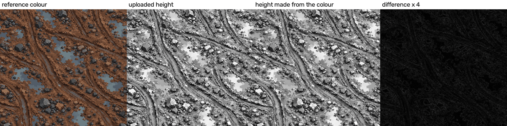

A second ceiling, for any description that only says "which palette colour is where": snapping every dot of the reference to its nearest of 16 colours keeps SSIM 0.916, colour difference 3.29, edge skill 0.854, height error 8.9, normal angle 9.8 (tier close). Cleaning single-dot specks with a 3 x 3 median filter already drops it to SSIM 0.82 and normal angle 13.4; a 5 x 5 filter to 0.705 and 18.2 degrees. **The normal map lives in the 1 to 3 dot detail**: that is why none of my descriptions of 512 KB or less reaches the "close" tier.

## 3. Step 2: looking at the colour picture (analysis)

All analysis scripts are plain Python (OpenCV and numpy) in `analysis/`; they read the reference, the generator never does.

**3.1 It is a painted picture.** 16 palette colours reproduce it to a mean colour difference of 3.25 (8 colours: 4.5; 12: 3.68; 24: 2.74; 32: 2.47; `palette_and_labels.py`). It has about 197,000 tiny same-colour areas (157,000 of them 4 dots or less), and the areas of 64 to 4096 dots hold 45 per cent of the picture. The mud palette: earth browns from (46,29,24) to (156,112,82), blue-grey water (86,94,104) and (107,119,126), stone greys and blacks (39,38,43), (64,66,73), (26,19,18), a grey-brown shine (98,87,83).

**3.2 Find what is NOT earth (the key trick).** Earth is orange-brown; stones and water are grey, blue-grey or black. In the Lab colour space the "b" number (blue-yellow balance) separates them: earth is mostly above 10 (its darkest brown grooves come down to about 7), stones and water below 7. A plain test `b < 7` (`element_tools.non_earth_mask`) marks stones and water cleanly (about 31 per cent of the picture); holes inside it are filled (a stone's tan highlight). I first tried to sort stones and water by their palette colours and failed (section 10): a stone's lit face is blue-grey like water and a pale stone is tan like earth. For another picture the one number to calibrate is that threshold (the golden mud needed 3 instead of 7); a quick rule: pick it so that the non-earth part is about a third of the picture.

**3.3 Puddles and stones are told apart by shape and colour.** Among the non-earth areas, a **puddle** is one that survives a big opening (13 dots), is big (1500 dots or more), is ragged (solidity under 0.82: area divided by the area of its convex hull) or very big, and is at least 40 per cent clearly blue (b under -3.5, not dark). Found: 8 big puddles (areas 3000 to 31,600 dots), their outlines (about 100 corners each at 1.5 dots accuracy) and their flat water tones (two: lighter and darker blue-grey). Everything else non-earth is cut into **stones** by a "watershed" on the distance-to-edge picture: 830 stones, median area 83 dots, 90th percentile 709, the biggest 10,500. A stone is stored as its outline and the flat faces inside it.

**3.4 Wheel ruts are found as long dark valleys.** The ground (puddles and stones painted over with the nearest ground colour) is smoothed, and the second-derivative "ridge" test (Hessian) finds thin dark valleys; each valley is followed as a curve (`rut_tools.py`). Seen at a scale of 3 dots, only fragments are found; at a scale of 10 dots the broad rut paths come out (93 curves, 34 of them long and straight enough: total length 10,493 dots). Measured across the curves (`fit_ground_model.py`): the dark band is about 20 dots wide (brightness 21 against 30 to 33 for the ground), with slightly lighter banks on both sides.

**3.5 The ground model.** From the ground (not the stones and puddles) I measured: which earth colour is found how far from the nearest rut and on which side (a table of chances, 2 sides x 10 distances x 9 earth colours); the size of the flat patches (median 39 dots area, log-normal spread 1.05), their shape (long side about 1.9 times the short side) and their direction (they lie along the nearest rut: average cosine 0.75, a random direction would give 0.64).

**3.6 What matters for the score: the fine detail.** `ground_scale_test.py` keeps the real puddles and stones and replaces the ground by the real ground blurred by 24, 12, 6, 3 and 0 dots and snapped to 16 colours:

| ground blurred by | SSIM | colour difference | edge skill | normal angle |
|---|---|---|---|---|
| 24 dots | 0.491 | 8.28 | 0.202 | 23.7 |
| 12 dots | 0.494 | 7.69 | 0.204 | 23.9 |
| 6 dots | 0.511 | 6.88 | 0.226 | 23.8 |
| 3 dots | 0.574 | 6.01 | 0.276 | 22.2 |
| not blurred | 0.797 | 4.42 | 0.772 | 14.3 |

A smooth tone field for the ground buys colour difference but nothing in SSIM, edge skill or normal angle; those only move when the 1 to 3 dot structure is right. That is the main reason the pixel-accurate classes are "tracing" and not "procedural".

## 4. Step 3: the description

One json file. Corners are whole numbers in picture dots, stored as steps (first corner, then the step to each next one). The file has: `tile`, `seed`, `palette` (list of [r,g,b]), `ground` (the base colour number), `layers` (drawn back to front) and `maps` (height stretch and blur, normal strength). Layer kinds (`generator/mud_layers.py` explains each):

* `ruts`: a list of curves (corners), each with band width, bank width, groove width and four palette numbers (band, groove, bank, wet streak). The generator rounds the curve (corner cutting), draws the lit bank, the band, the groove and a few wet streaks as flat ribbons that wobble a little and fade to nothing at both ends.
* `clods`: the numbers of the crumbly ground: how many, the chance table (colour by distance to the nearest rut and side), size and shape numbers, how strongly clods clump into zones of one tone. The generator draws the clods itself (random but fixed by the seed).
* `puddles`: an outline, a base water colour, and flat water tones inside.
* `stones`: per stone a base colour, an outline and a few flat faces.
* `patches`: traced flat colour areas (outline + colour). This is the biggest layer; it is **tracing the picture, not describing mud**, and I say so plainly.
`python3 -I lib/description_audit.py FILE --limit-kilobytes N` passes for every description of the ladder (no picture data, no list over 4000 numbers).

Size classes: **S** 8 KB, **M** 64 KB, **L** 512 KB. The S description (7.4 KB) has 6 puddles, 16 stones, 22 ruts and the clod numbers; the M description (63.9 KB) has 8 puddles with water tones, 590 stones with faces, 34 ruts and the clod numbers; the L description (503.0 KB) has 8 fine puddles and 830 stones, 5157 traced ground patches and a last layer of 3988 traced correction patches.

**How the traced ground is made** (`trace_ground.py`, `merge_trace.py`, copied from the wood work): paint the puddles and stones over with the nearest ground colour; cut the picture into about 330,000 tiny same-colour areas (32 colours); join the two neighbouring areas whose joining changes the picture least (their sizes times how different their colours are: "Ward's rule") until 5000 patches are left; give each patch the average colour, squeeze the colours into 32; write each outline with a looseness of 2.6 dots. **The correction layer** is painted last: wherever the finished picture is still more than 8 colour steps away from the reference, the reference's flat colour there is traced (areas of 14 dots or more). It is the cheapest accuracy per byte (next table).

## 5. Step 4: the generator, tool by tool

The generator is `generator/mud_generator.py` (Blender, plus `mud_layers.py` for the shape list). It does NOT use shader noise for the picture: the picture is flat shapes. This is the same idea as the wood work: **draw flat coloured shapes back to front and photograph them from above**. Every tool below was used in a run; "what it does if you change it" comes from the sweep pictures or a test I name.

1. **Mesh made from corner lists** (`bpy.data.meshes.new` + `from_pydata`). A mesh is a set of corner points and flat faces. One mesh holds every shape; each shape is a flat face a tiny step higher than the one before (`Z_STEP` = 0.00002 of the tile), so the last shape drawn is on top. With 50,000 shapes the stack is 1 tile unit high; the camera must sit above it (the wood work found that a step that is too small makes shapes flicker through each other; I did not test the failure cases again here).
2. **Face attributes** (`mesh.attributes.new(name, 'FLOAT_COLOR', 'FACE')`). A face attribute is a number or colour stored on each face. Each face carries its palette colour, its brightness and its roughness. Changing the palette changes the whole picture without touching the shapes.
3. **Emission material with an Attribute node** (Shader editor). An emission shader makes a surface glow with exactly the colour it is given, so no light or shading changes it; the Attribute node reads the face colour. This is how every dot of the baked picture is the exact palette colour. (The shader needs sRGB-to-linear conversion for the colour; the generator does it with one function.)
4. **Orthographic camera over a 1 x 1 square, Cycles renderer, 8 samples, box filter width 1.0** (`lib/bake_harness.py`). An orthographic camera has no perspective, so one dot of the picture is one dot of the tile. The box filter of width 1.0 averages exactly the area of one dot (an anti-aliased edge dot is the right mix of the two colours). I used 8 samples and did not sweep this setting; the half-tile test (section 7.4) shows that edge dots differ by less than a level on average. View transform "Standard" keeps colours as numbers.
5. **Wrap copies for seamless tiles.** A shape that touches the tile edge is drawn again moved by one tile to the left, right, up or down (the picture repeats exactly). The half-tile test (section 7.4) proves it.
6. **Curve objects with bevel** (`geometry_route.py`, section 8). A curve is a smooth line through points; "bevel depth" gives it a round cross-section; seen from above it is a ribbon whose width is twice the bevel depth. Used as the real-geometry route for the ruts.
7. **Geometry Nodes** (`geometry_route.py`, section 8): Mesh to Points (one point per stone), Instance on Points (put a low-poly ball on every point, scaled by a stone-size attribute and turned a random way), Random Value, Noise Texture and Set Position (push every corner in or out so each ball becomes a lump), Set Shade Smooth (switched off: flat facets), Realize Instances, Set Material. Used as the real-geometry route for the stones.
8. **Sun lamp, Diffuse shader and a grey World** (route B stones only). The sun comes from the upper left, so every flat facet of a low-poly stone gets its own brightness: lit face and shaded face for free.
9. **numpy after the render** (the derivation of section 2): height from the baked colour (straight stretch 20..128, blur 0.5), normal from the 8-bit height (slope across two dots, strength 9), a cheap ambient-occlusion look from the height. The generator writes `colour.png`, `height.png` (16-bit), `normal.png` (OpenGL), `roughness.png`, `metallic.png`, `ao.png`.

Not used, and why: Blender's Noise, Voronoi, Gabor and Wave textures do not repeat across a tile edge (the project's 4-D "donut" versions do, but the flat-shape painter needed none); the Bump node (the maps are derived in numpy exactly like the reference); the compositor (no filter was needed); physics (Dynamic Paint, particles: not tried here; the research guide found Dynamic Paint gave almost no depth).

### What the settings do (sweep pictures; same sampled description, one setting changed, 384 dots)

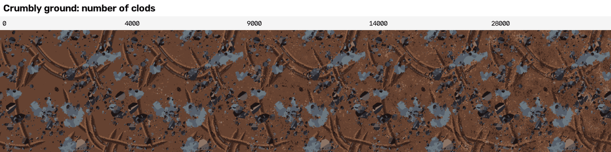
**Number of clods** (0, 4000, 9000, 14,000, 28,000): at 0 the ground is one flat brown; more clods make the crumbly texture and raise the density of fine edges (the measure the kind score is most sensitive to). On the quick painter the mean edge strength of the picture went from 3.6 (14,000 clods) to 4.5 (30,000) to 5.1 (60,000), against 6.8 for the reference, so more (and smaller) clods move toward the reference; each 10,000 clods add about 10,000 shapes and a few seconds of bake time. The sampler's default is 36,000 clods, 0.35 smaller in log-area.

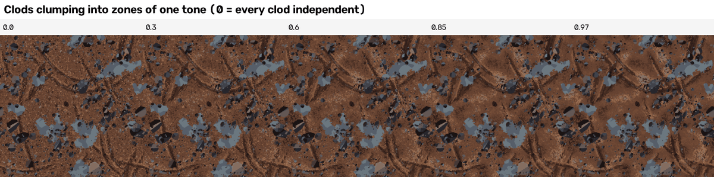
**Zone weight** (0 to 0.97): at 0 every clod picks its colour alone and the ground looks like confetti; near 1 whole neighbourhoods take the same tone, giving bigger light and dark areas. I used 0.6 (chosen by eye on the first tile; I did not tune it against a score).

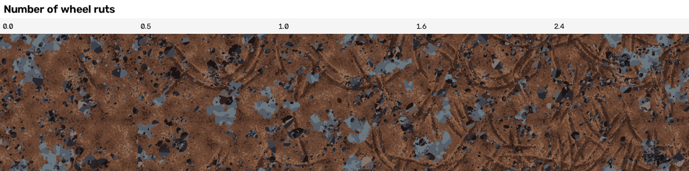
**Number of ruts** (0 to 2.4 times): with none, the picture has no direction; with many, the ruts criss-cross like the reference but start to crowd.

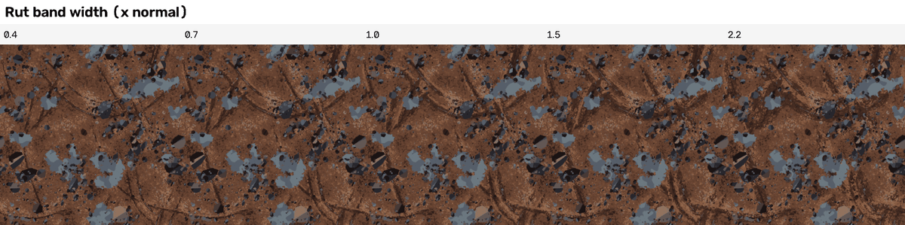
**Rut band width** (0.4 to 2.2 times): the effect is mild at this size. Narrow ruts almost vanish into the ground; wide ones make broad dark bands and a darker picture overall.

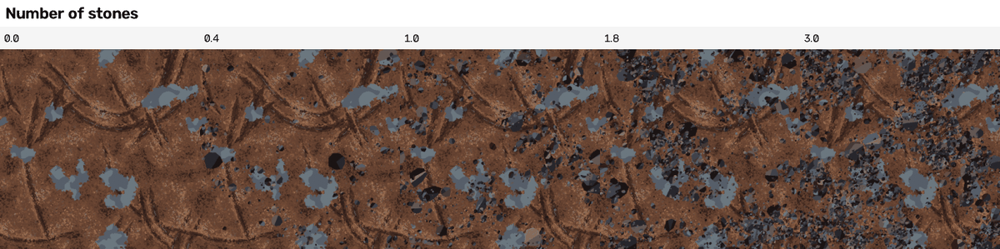
**Number of stones** (0 to 3 times): stones are the strongest dark marks, so this moves the colour spread most.

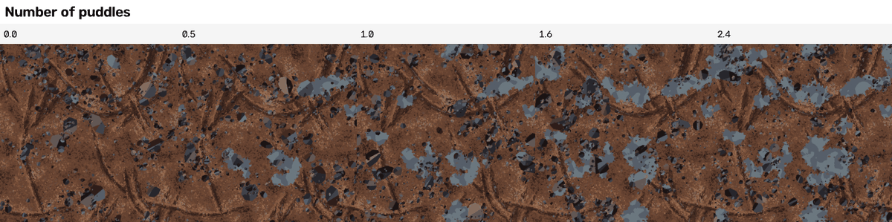
**Number of puddles** (0 to 2.4 times): puddles are the only blue in the picture; with none, the picture loses its second colour family.

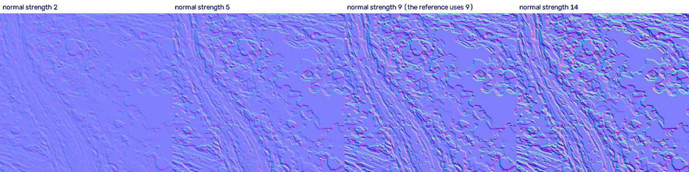
**Normal-map strength** (2, 5, 9, 14, from one baked height): the reference uses 9; weaker looks flat, stronger makes the slopes harsh. (Not a generator setting you tune for accuracy: lower values did not reduce the angle error; section 6.)

## 6. Step 5: comparing and the rate-distortion ladder

Every row was baked in Blender at 1254 dots, 8 samples, and scored with both tools (`analysis/score_folder.py`). "Tier" is the pixel tier. Heights and normals are made from each row's own colour.

| layer or class | description size | tier | SSIM | colour difference | edge skill | height error | normal angle | same-kind score | bake seconds |
|---|---|---|---|---|---|---|---|---|---|
| flat ground only | 0.4 KB | none | 0.443 | 14.17 | 0 | 46.5 | 23.6 | 0.11 | 10 |
| + 8 puddle outlines (coarse) | 3.2 KB | none | 0.448 | 11.87 | 0.008 | 43.4 | 23.6 | 0.154 | 11 |
| + 40 biggest stones (outline only) | 7.1 KB | none | 0.447 | 11 | 0.03 | 43.2 | 23.8 | 0.162 | 10.4 |
| + wheel ruts (34 curves) | 11.2 KB | none | 0.423 | 11.11 | 0.066 | 42.8 | 25.4 | 0.224 | 18.1 |
| S class: smaller layout + ruts + 14,000 clods | 7.4 KB | none | 0.367 | 12.52 | 0.074 | 45.2 | 28.3 | 0.267 | 29.1 |
| M class: puddle water tones, 590 stones with faces, ruts, clods | 63.9 KB | none | 0.403 | 9.75 | 0.193 | 40 | 28 | 0.362 | 31.2 |
| traced ground, 2000 patches + fine puddles and stones | 299.5 KB | layout | 0.633 | 5.8 | 0.564 | 21.7 | 20.4 | 0.383 | 15.4 |
| traced ground, 5000 patches + fine puddles and stones | 453.4 KB | layout | 0.688 | 5.26 | 0.644 | 19.1 | 18.6 | 0.44 | 17.2 |
| L class (final): traced ground 5000 + corrections last | 503.0 KB | layout | 0.698 | 5 | 0.685 | 17.6 | 18.6 | 0.483 | 27.2 |

Note: the reference-fitted S and M rows were baked with 14,000 clods of the size measured on the reference; the sampler's later default (36,000 smaller clods, section 7.2) came from matching the density of fine edges and was not applied to these two rows.

Reading it:
* **Layout alone buys almost no pixel accuracy.** From flat ground (SSIM 0.443) to the S class (0.367) the SSIM does not rise: the puddles and stones are right but small in area, and the invented clods sit in the wrong places. The colour difference falls from 14.2 to 12.5 and the kind score rises from 0.11 to 0.267.
* **Invented ground (clods and ruts) lowers dot-for-dot scores and raises the kind score**: the same trade as the wood and the metal. Never mix it with traced patches in one tile.
* **The traced ground is where the accuracy is**: 2000 patches take SSIM from 0.403 (M) to 0.633; 5000 to 0.688; the correction layer to 0.698.
* **Tier "close" needs a normal angle under 12 degrees; the best row gets 18.6.** I tried other normal strengths (2 to 9, two slope filters): the best was 19.3 against 19.9 for strength 9 on the 5000-patch row, so the error is the colour's fine detail, not the settings.

Trace ladder with fine puddles and stones under it (preview painter, same numbers as Blender within 0.8 colour levels; `try_trace_levels.py`):

| traced patches | outline looseness | total size | SSIM | colour difference | edge skill | height error | normal angle |
|---|---|---|---|---|---|---|---|
| 2000 | 1.0 | 445.2 KB | 0.68 | 5.48 | 0.565 | 20.2 | 18.6 |
| 5000 | 1.0 | 592.9 KB | 0.722 | 5.01 | 0.648 | 18 | 17.3 |
| 10000 | 1.0 | 778.9 KB | 0.745 | 4.76 | 0.697 | 16.8 | 16.5 |
| 20000 | 1.0 | 1075.4 KB | 0.759 | 4.56 | 0.726 | 15.9 | 15.9 |
| 40000 | 1.0 | 1617.2 KB | 0.767 | 4.42 | 0.746 | 15.2 | 15.6 |
| 70000 | 1.0 | 2405.6 KB | 0.769 | 4.36 | 0.747 | 15 | 15.5 |

Doubling the patches buys about +0.02 to +0.04 SSIM and costs 150 to 450 KB; it does not stop below 512 KB. The outline looseness is a second knob: for the 5000-patch row, looseness 1.0 / 1.8 / 2.6 gives 592 / 453 / 390 KB for SSIM 0.721 / 0.699 / 0.675 (`budget_search.py`). The correction layer (`try_residual.py`):

| ground patches | patch looseness | correction threshold | correction patches | total size | SSIM | colour difference | edge skill | height error | normal angle |
|---|---|---|---|---|---|---|---|---|---|
| 5000 | 2.6 | 8 | 1390 | 428.9 KB | 0.696 | 5.05 | 0.667 | 18 | 18.6 |
| 5000 | 2.6 | 6 | 4358 | 512.1 KB | 0.714 | 4.84 | 0.689 | 17 | 18 |
| 5000 | 3.2 | 8 | 1468 | 404.1 KB | 0.683 | 5.15 | 0.657 | 18.5 | 19.1 |
| 5000 | 3.2 | 6 | 4588 | 491.5 KB | 0.703 | 4.92 | 0.683 | 17.4 | 18.4 |
| 10000 | 3.6 | 8 | 1246 | 527.8 KB | 0.703 | 4.95 | 0.705 | 17.5 | 18.5 |
| 10000 | 3.6 | 6 | 3673 | 595.2 KB | 0.719 | 4.76 | 0.726 | 16.6 | 17.9 |

At a fixed size the best mix is the 5000-patch ground with loose outlines plus corrections: that is the final L row.

**The golden mud (colour only; the same analysis and generator):**

| layer or class | description size | tier | SSIM | colour difference | edge skill | height error | normal angle | same-kind score | bake seconds |
|---|---|---|---|---|---|---|---|---|---|
| S class (6 puddles, 16 stones, 22 ruts, clods) | 7.1 KB | none | 0.272 | 16.57 | 0.041 | no map | no map | 0.366 | 28.6 |
| M class (trimmed harder: the golden has 1,085 stones) | 59.9 KB | none | 0.312 | 13.07 | 0.147 | no map | no map | 0.425 | 31.2 |
| traced ground, 5000 patches + fine puddles and stones | 506.6 KB | close | 0.601 | 7.02 | 0.569 | no map | no map | 0.444 | 30.8 |
| L class (final): traced ground + corrections last | 513.7 KB | close | 0.604 | 6.84 | 0.6 | no map | no map | 0.503 | 33.5 |

For the golden picture there are no height or normal maps ("no map"), so the tier uses colour measures only (it reaches "close" for the 5000-patch rows). Sizes here are in KB of 1000 bytes: the golden L description is 513.7 KB, inside the audit tool's limit of 512 x 1024 bytes but not under 512,000 bytes (the golden has more stones and ragged outlines; the mud's L description is 503.0 KB).

**The pixel picture of the final class (reference, generated, difference, edges):**

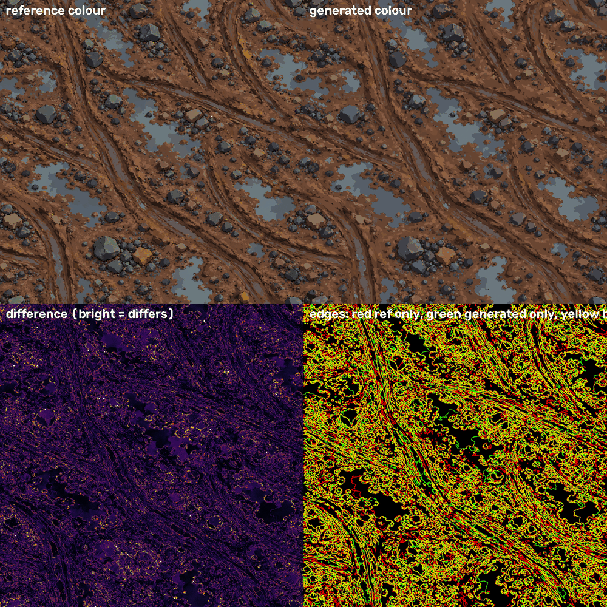

What it shows: the structure of the ruts, puddles and the stone clusters is right. The brightest differences are on the biggest stones (the stone finder cuts a big stone into several pieces and gives each its own base colour, so a stone looks chopped) and on thin dark lines in the ruts. Tan and orange stones are not "non-earth", so they are only traced.

## 7. Step 6: making new tiles and bigger pictures

### 7.1 The sampler (`generator/sampler.py`)
`sample_description(seed)` writes a NEW description from numbers measured on the reference (`fitted_distributions_mud.json`): wheel ruts as smooth wandering curves along two or three main directions of travel (heading bends slowly; some ruts get a twin 45 to 95 dots away, like two wheels); puddles as chains of overlapping round lobes with a scalloped edge, cut into lighter and darker water tones by a smooth noise; stones with sizes drawn from the reference's measured size list (positions: half of the small stones are put within 1 to 2.6 stone radii of one of the big stones, the others are scattered, more often where a slow density field is high), 6 to 9 sided lumps with up to three flat faces made by chords turned toward the light (upper left) and colours from the reference's measured base-to-face transitions; clods from the fitted chance table. Same seed = same tile. Options change the KIND of surface by changing numbers (used in the snow test).

### 7.2 Variation: 8 new tiles
Seeds 101 to 108, baked with the same generator (`variations/`, `run_variations.py`):

| tile (seed) | same-kind score | SSIM against the reference | colour difference to reference | seam ratio | bake seconds | shapes |
|---|---|---|---|---|---|---|
| 101 | 0.407 | 0.279 | 18.6 | 0.86 | 33.3 | 28757 |
| 102 | 0.373 | 0.281 | 18.8 | 0.94 | 32.6 | 28832 |
| 103 | 0.353 | 0.288 | 18.4 | 0.88 | 37.4 | 28558 |
| 104 | 0.389 | 0.287 | 18.4 | 0.97 | 41.5 | 28719 |
| 105 | 0.377 | 0.279 | 18.9 | 1.14 | 50.5 | 28632 |
| 106 | 0.371 | 0.287 | 18.8 | 0.89 | 52.4 | 28876 |
| 107 | 0.416 | 0.277 | 18.8 | 1.18 | 54.3 | 28937 |
| 108 | 0.374 | 0.284 | 18.4 | 0.99 | 45.3 | 28559 |

Summary: kind score mean 0.383 (min 0.353, max 0.416); SSIM against the reference mean 0.283, max 0.288 (the reference-reproducing L class gets 0.698); SSIM between the eight tiles over all 28 pairs: mean 0.343, max 0.352; mean colour difference between tiles 28.1 levels. So the tiles are not copies of the reference, they differ from each other, and the kind score is on a level with the S/M classes and below the traced L class (0.483). An honest limit: SSIM between two unrelated mud tiles is not near 0 (about 0.4) because both are mostly flat brown with fine detail; use it for "same" versus "different", not as a distance.

(The reference is top left, then seeds 101 to 108.) By eye they are clearly the same family: ruts with banks, ragged blue-grey puddles, dark angular stones, crumbly ground. They are flatter and sparser than the reference: the reference ruts flow as broad S-shaped bands with lit crests and the ground has more light and dark planes; the sampled ruts are more scratch-like and the ground is more uniform. (I added pebble clusters around big stones late: the kind score did not change, 0.38 against 0.38, 0.46 against 0.41 and 0.40 against 0.38 on three seeds, but by eye the tiles are closer to the reference, so I kept it: the kind tool cannot see this.) The one weak kind measure is the density of fine edges, which I calibrated (clod count and size) from 0.34 to 0.41 on one tile; it is still the weakest.

### 7.3 Area: one bigger picture of new content
`sample_description(201, tile=2508)` makes one description for a 2508 x 2508 dot picture (four tiles' worth: four times the ruts, puddles, stones and clods, wrapped at 2508), baked at 2508 (`area/`):
* bake 227.7 s, 114875 shapes;
* seam ratio across the wrap edges (left/right, top/bottom): [0.876, 1.044] (1.0 = an ordinary jump between neighbouring dots = invisible seam);
* strongest repeat: the picture's own correlation at any shift of 40 dots or more peaks at 0.176 (at shift [24, 32], which is just outside the excluded 40 dots, so it is the ordinary correlation length and not a repeat); 1 would be an exact repeat, near 0 never repeats;
* the four 1254-dot quarters scored as separate tiles: kind score overall top left 0.292, top right 0.307, bottom left 0.301, bottom right 0.303. Those overall scores are lower than the 1254 tiles' (0.35 to 0.42) only because a quarter cut out of a bigger picture is not a wrapping tile, so the tool's tiling group is 0 for it (seam ratio about 7); the colour, height and normal groups are on a level with the 1254 tiles: top left colour 0.26 / height 0.49 / normal 0.14, top right colour 0.27 / height 0.5 / normal 0.19, bottom left colour 0.28 / height 0.49 / normal 0.15, bottom right colour 0.28 / height 0.44 / normal 0.24. Their pairwise SSIM 0.344, 0.351, 0.348, 0.351, 0.346, 0.352 (unique, not the same quarter four times).

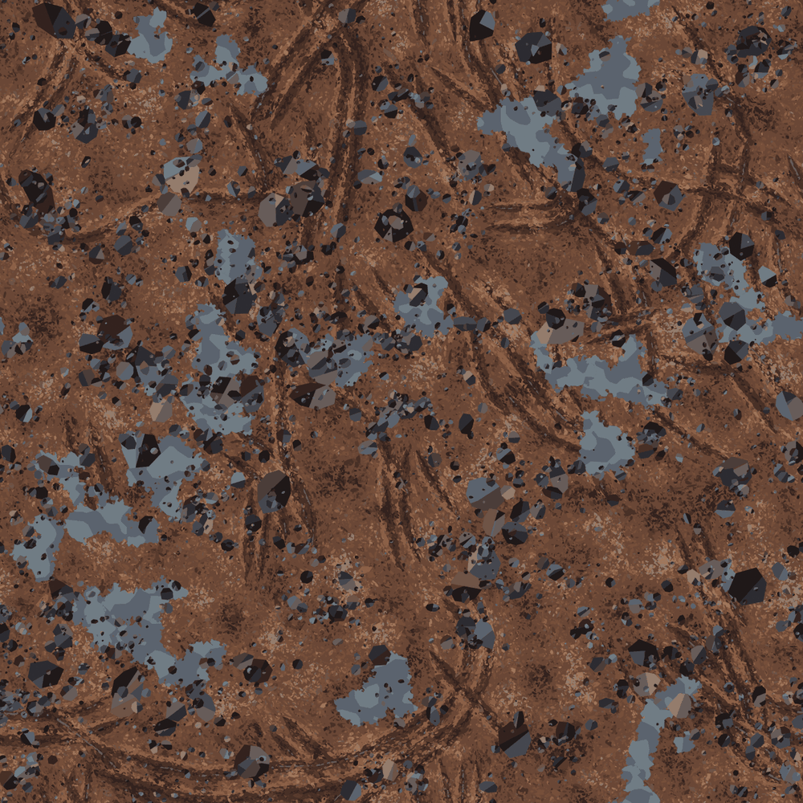

### 7.4 Seamless proof (half-tile test)
The description of the first variation tile baked slid by half a tile in both directions, compared with the first bake rolled by half a tile: mean absolute colour difference 0.757 levels; 0.977 per cent of dots differ by more than 8 levels. Same test on the reference-fitted descriptions: M: 0.652 levels (0.74 per cent over 8), L: 0.793 levels (1.09 per cent over 8). Where the differences sit: spread evenly over the picture (no line at the old or the new edge; I checked bands of 157 dots on M). (A perfectly periodic recipe differs only at the anti-aliased edges of shapes, since a slid shape is rendered with a different sub-dot position.) The `seam_ratio` from the kind tool is 0.7 to 1.1 for the sampled tiles and 2.0 to 2.5 for the traced L classes, because the reference itself has a mild seam (the tool says the reference tiles are 1.7 to 2.5) and the traced patches copy it.

### 7.5 Resolution
The same description (seed 101) baked at three sizes (times are from a computer shared with other jobs and move by 30 per cent); the shapes are described in tile dots, so a bigger bake only adds sharpness of the edges, not new content:

| size | bake seconds | colour render seconds | shapes | SSIM to the 2508 bake shrunk to this size | mean colour difference to it |
|---|---|---|---|---|---|
| 512 | 15.4 | 3.8 | 28757 | 0.9868 | 1.22 |
| 1254 | 33.3 | 10.7 | 28757 | 0.9929 | 0.62 |
| 2508 | 77.8 | 27.2 | 28757 | 1 | 0 |

The content is the same at every size (the SSIM column), so the drawing really is resolution-free: the shapes are described in tile dots. What a bigger bake changes: the edges of the shapes fall on finer dots (less stair-stepping, finer anti-aliasing), the bake takes longer (it grows about with the number of dots: 15 s, 33 s, 78 s for 0.26, 1.6 and 6.3 million dots), and nothing new appears: there is no extra detail below the dot size of the description.

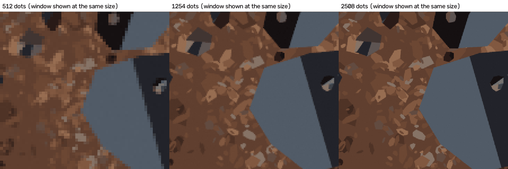

## 8. The real-geometry route (tried; honest comparison)

`generator/geometry_route.py` draws the SAME description's stones and ruts with Blender geometry instead of flat polygons (the M description: 590 stones, 34 ruts), 1254 dots:

* **Stones by Geometry Nodes**: 7080 corners, 8.4 s against 3.4 s for the 1090 flat polygons. Each stone needs only THREE numbers (position, size, colour); the lit face and the shaded face come from the sun. But with my settings the stones came out as smooth, low-contrast, round lumps (the painted stones are sharp-faced, with strong light and dark faces and a dark rim) and the pebbles lose their dark outline. Two bugs cost time: an attribute named `radius` is overwritten by Mesh to Points (its own radius input), and the Vector Math "Scale" operation takes its number on the fourth socket. Verdict: a good route for a stone SCATTER you want to look three-dimensional; the flat polygon route is better for copying a painted look and for exact outlines; I did not try stronger light or sharper shapes.
* **Ruts as curve objects**: 3.2 s against 4.6 s for polygon ribbons; the ribbons are equally good, but one curve gives one width and one colour, so band, groove and bank would be three curves each; the wobble and the fading ends are one line of numpy in the polygon route. Verdict: equal picture, curves are fine when ruts should be real 3-D grooves (not needed here: the height is derived from the colour).
* **Height from geometry** (hybrid with the colour height) was **not tested**: the reference height is derived from the colour, so a real-geometry height would move away from it.

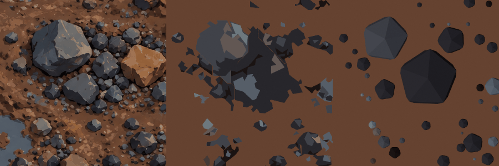
(reference | flat polygons | Geometry Nodes rocks)
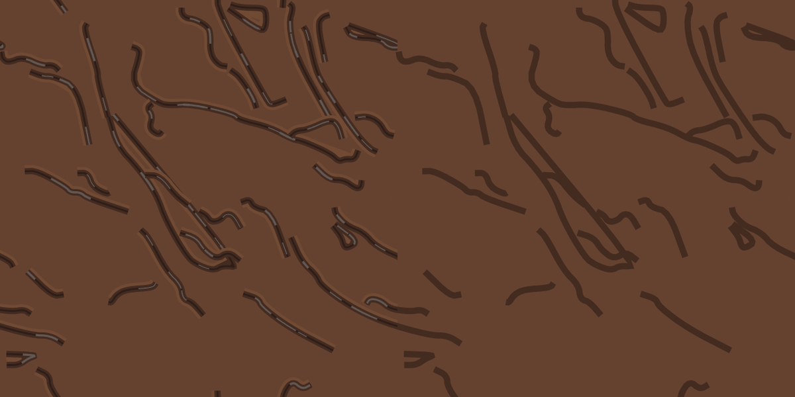
(flat polygon ribbons | Blender curve objects)

## 9. Transfer tests

### 9.1 A surface nobody gave me: a snowy track
`transfer/make_snow.py` (30 lines) calls the SAME sampler with a new 16-colour palette (snow whites and blues, grey slush, blue meltwater, dark rocks), a naming of which palette entries play band / groove / bank / wet streak / water, three scale numbers (stones 0.35, puddles 0.7, clods 9000 that clump harder: 0.85) and a moved height stretch (60 to 245 because snow is bright). The generator was not changed; the sampler got one small new option for this test (`maps`, to move the height stretch). Time: writing the palette and the call about ten minutes; one call to make the description (0.6 s), one bake (about 40 s). Judged by eye only (no reference exists): it reads as compacted snow with grey slush tracks, white banks, blue meltwater and dark rocks. What looks wrong: the rut ends fade like claws (the generic fade-out is mud-shaped), the clods are too small for snow, and there is no sparkle or soft drift edge.

### 9.2 The golden-puddle mud (colour only)
The same analysis chain, run with the name changed and one number (the non-earth threshold 3 instead of 7): palette, puddles (16 found, with the warm sky reflections kept as holes filled by the puddle outline), stones (1,085), traced ground, ruts, ground model, S, M and L descriptions. Time: the whole analysis chain about 6 minutes of computer time; a handful of calls of mine to start it, look at the stone overlay, and trim the M class (the golden has more stones). Results in the golden table of section 6.

## 10. Dead ends and failures (kept on purpose)

1. **Sorting stones and water by palette colour failed**: a stone's lit face is blue-grey like water; pale stones are tan like earth. The stone outlines hugged the inside of the stones. Fixed by the pixel test `b < 7`, hole filling and a watershed (section 3.2).
2. **A watershed that did nothing**: I added 1 to every dot of the marker picture, so no dot was left "undecided" and every stone came out one dot big (the first run said "0 stones found" at area 12). Marker 0 must stay 0.
3. **Thin groove lines (scale 3) found only fragments** (25 curves, 3400 dots long). The broad rut paths appear at scale 10.
4. **Clusters of dark stones were first called puddles** (big, ragged, not solid); the fix was the "at least 40 per cent clearly blue" test.
5. **The first sampled puddles were smooth amoebas, the ruts were spaghetti and ended in square cuts.** Fixes: two scales of edge noise; two or three main directions of travel, slower bending, longer curves; a fade-out at both ends of every rut.
6. **The sampler needs OpenCV, Blender's Python has none**: sampling and baking are two steps.
7. **Geometry Nodes stones: two bugs** (section 8) and a result that does not match the painted look.
8. **Smooth ground tone fields buy nothing in SSIM** (section 3.6) and invented clods lower SSIM (section 6).
9. **Lower normal strengths did not help** (19.3 against 19.9 degrees).
10. **Naming mistakes in my own scripts**: a score file of the golden mud overwrote the mud's (same name, different folder); a `pkill -f` with a word that appeared in my own command killed my own shell. Lessons in the other file.
11. **The kind score is noisy**: the same sampler gives 0.35 to 0.42 for different seeds; I did not tune to differences under 0.05. It also cannot see some things I can: pebble clusters around big stones changed it by nothing.
12. **A false alarm in my own seam test**: the first extra half-tile test compared a ladder bake made BEFORE I made the rut ends fade with a shifted bake made AFTER, and reported 4.5 per cent of dots different. The ladder rows with ruts were re-baked with the final code and the test repeated (0.7 per cent: ordinary anti-aliasing). Lesson: after any generator change, re-bake every row that the change touches.
13. **A misleading first reading of the area test**: the four quarters of the 2508 picture scored 0.29 to 0.31 overall against 0.35 to 0.42 for the 1254 tiles. I first blamed a distance grid that did not grow with the tile (it did not: I fixed it anyway, the grid now has about 8 dots per cell at every tile size, and the score did not move); the real reason is the tool's tiling group, which is 0 for a crop that is not meant to wrap. Compare the colour, height and normal groups instead.
14. **The first rut ends were square cuts** (visible as rectangles in the first snow tile): the width now shrinks to nothing over the last 70 dots; in the snow they look like claws.

## 11. What I tested and what I did not
Tested (ran): the derivation fit; the palette and element analyses on mud and mud_golden; ruts; ground model; traced ground; all ladder rows baked in Blender at 1254 and scored with both tools; the half-tile test; 8 sampled tiles; a 2508 area; 512 / 1254 / 2508 bakes; the two geometry routes; the snow transfer; the golden refit; six sweep strips.
Not tested: EEVEE or the GPU; Dynamic Paint, particles or other physics for the ruts; the compositor stylising filters; a hybrid height from real geometry; a 4 x 4 area; the roughness and metallic maps against anything (there is no reference for them: roughness is 0.97 - 0.55 x brightness, metallic is 0; the water is not made glossier); the ambient-occlusion picture; the "close" tier (not reachable at 512 KB, see section 2).

## 12. How to run it again
* Analysis: `python3 -I analysis/palette_and_labels.py`, `extract_elements.py mud`, `trace_ground.py mud 2000 5000`, `find_ruts.py mud 10`, `fit_ground_model.py mud ruts_s10_mud.pkl 150 0.6`, `fit_sampler_stats.py mud`, `make_descriptions.py mud` (golden: the same with `mud_golden`, threshold 3).
* Bake: `generator/bake_one.sh description/L_final_traced_ground_plus_corrections.json outputs/L 1254 8` (about 40 s).
* New tiles: `python3 -I generator/run_variations.py`; area, resolution and seam: `generator/run_scale_tests.sh`; compare: `python3 -I analysis/score_folder.py FOLDER`.
