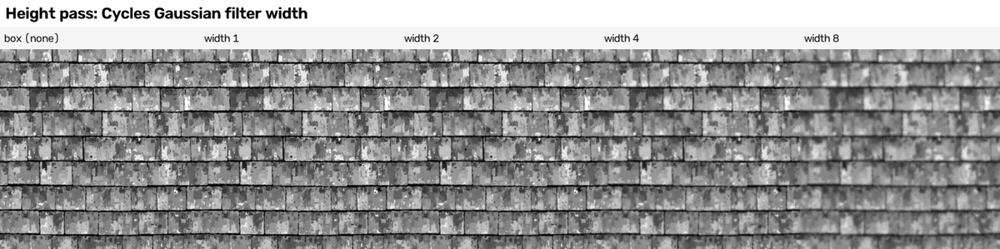
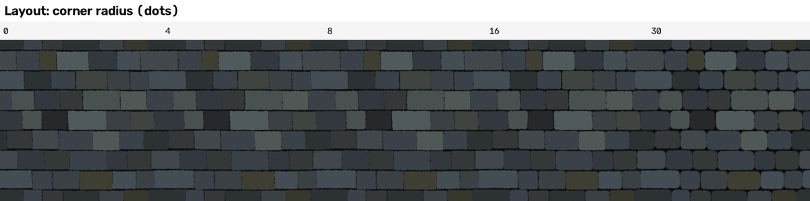
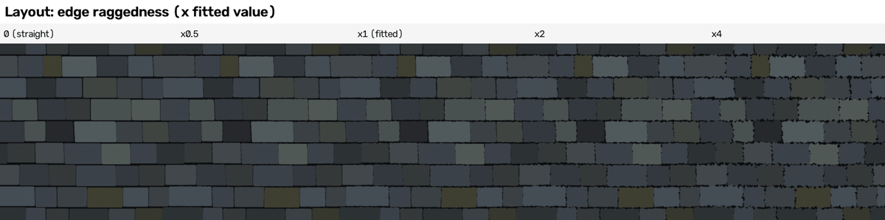
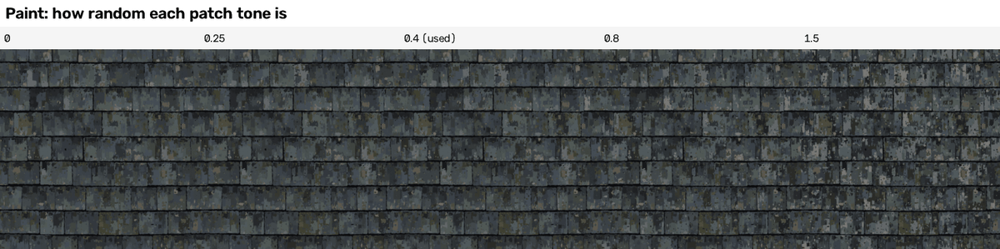
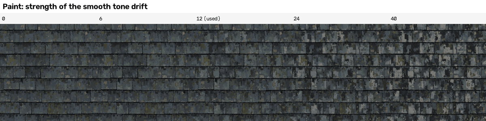
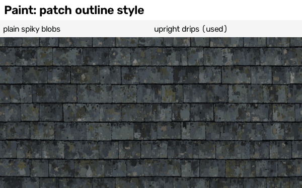
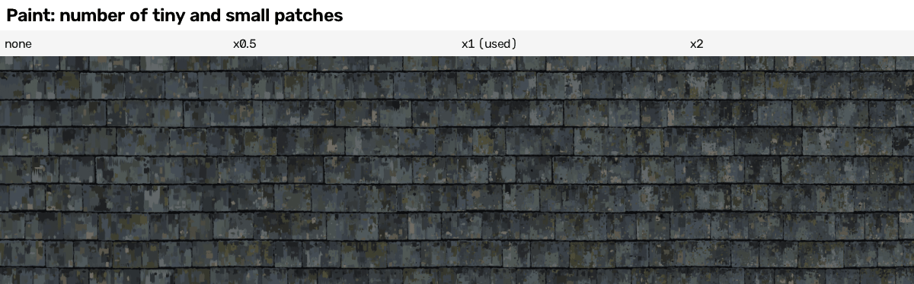
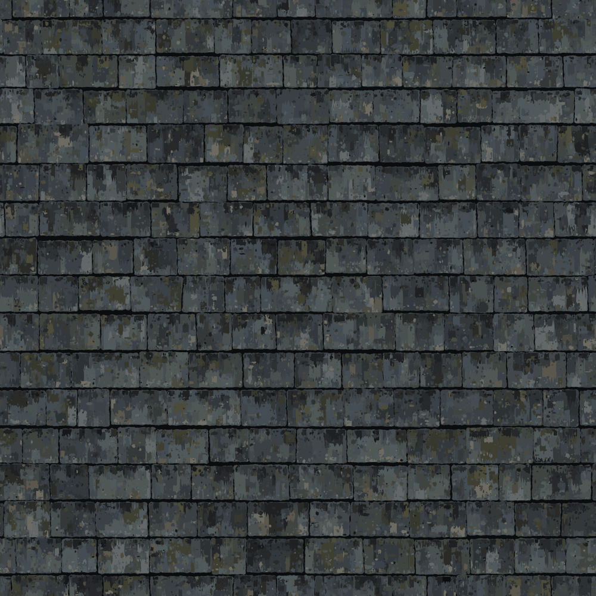
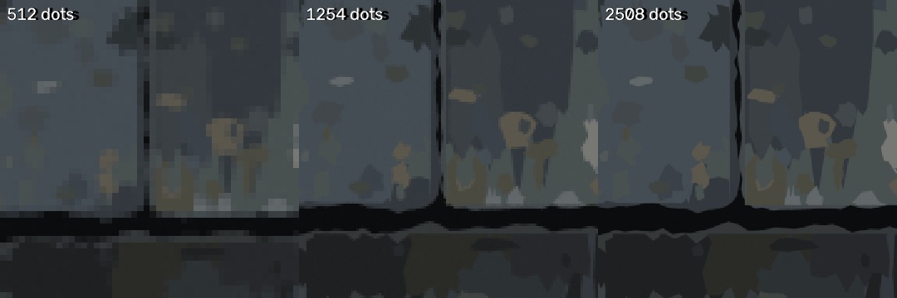
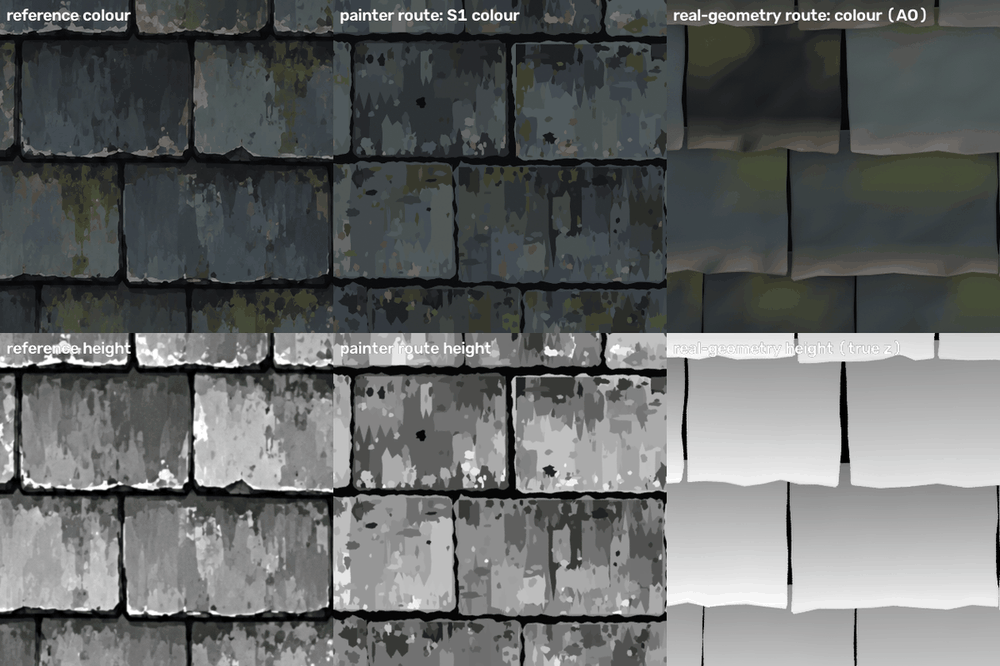

# 04 Recipe - slate - how it is made

Words used in this guide (one word for each thing): the **tile** is the 1254 x 1254 picture; a **dot** is one dot of a picture (a pixel); the
**description** is the small file (a few KB to a few hundred KB) that the generator reads; a **patch** is an area of one flat colour; a **stamp** is
a patch the generator makes up instead of copying; the **joint** is the black line between two slates; a **row** is a line of slates side by side.
Everything below was run; where something was not run, it says so.

## 0. The result in one table

The generator is one Blender script that reads a description and writes the six pictures of a seamless tile (colour, height 16-bit, normal, roughness,
metallic, ambient occlusion). One generator, different descriptions (size classes: S = up to 8 KB, M = up to 64 KB, L = up to 512 KB):

| description | size | what is in it | pixel tier | colour SSIM | colour difference (Delta E) | edge skill | height error (steps of 255, after best fit) | normal error (degrees) | "same kind" score | bake time |
|---|---|---|---|---|---|---|---|---|---|---|
| S0 layout only | 2.7 KB | rows, joints, ragged outlines, one flat colour per slate | none | 0.711 | 8.07 | 0.29 | 35.1 | 11.9 | 0.40 | 20 s |
| S1 layout + stamps (class S) | 6.4 KB | S0 + paint statistics + a seed | none | 0.569 | 9.06 | 0.19 | 35.0 | 16.8 | 0.71 | 28 s |
| S2 layout + stamps + grain (class S, best "same kind") | 6.6 KB | S1 + a faint seamless grain in the height (so in the normal map) | none | 0.569 | 9.06 | 0.19 | 35.1 | 17.9 | 0.73 | 31 s |
| M tiny | 16.9 KB | traced outlines + the biggest patches, 8 colours | layout | 0.721 | 7.31 | 0.37 | 31.4 | 11.7 | 0.51 | 17 s |
| M small | 39 KB | the same, 12 colours | layout | 0.720 | 6.35 | 0.41 | 26.9 | 12.0 | 0.53 | 18 s |
| M coarse (class M) | 60 KB | the same, 16 colours, patches over 520 dots | layout | 0.731 | 5.67 | 0.44 | 23.2 | 11.8 | 0.61 | 20 s |
| L small | 147 KB | traced outlines + patches over 100 dots, 24 colours | layout (edge skill 0.54, "close" asks 0.55) | 0.751 | 4.02 | 0.54 | 16.1 | 11.9 | 0.77 | 22 s |
| L medium | 264 KB | traced outlines + patches over 30 dots, 24 colours | **close** | 0.792 | 3.28 | 0.67 | 12.4 | 11.0 | 0.82 | 25 s |
| L fine (class L) | 442 KB | the same, patches over 12 dots | **close** | 0.836 | 2.85 | 0.74 | 10.3 | 9.7 | 0.83 | 31 s |

The ceiling for maps made from the colour picture is a height error of about 3 and a normal error of about 2.8 degrees. The tier "exact" asks for colour
SSIM 0.92, edge skill 0.85, height error 6, normal error 4: not reached (best: 0.84, 0.74, 10.3, 9.7). Honest note: the "same kind" score of the traced
descriptions is a copy of the reference (the score is high because it IS the reference, rebuilt from flat polygons); the one that matters for new tiles is S1
(and the sampler tiles of section 6).

(All bakes: 2 processor threads, shared with other jobs, 1254 x 1254 dots. Bake time = all six pictures.)

## 1. The idea in one picture


The same 300 x 300 dot patch of the reference and of each description (zoomed 2x). Top row: the reference; layout only; layout + stamps. Bottom row: traced coarse;
traced medium; traced fine. The more of the real patches the description holds, the closer the picture. The size of each description is in the picture.

The recipe has three kinds of layer, drawn back to front like a painter:

1. **The ground:** one big square in the joint colour (near black).
2. **The slates:** one polygon per slate in its base colour. Either written out (traced outline) or made by the generator from the layout block (rows, joints,
   corner radius, edge raggedness).
3. **The paint on the slates:** either patches written out one by one (traced), or stamps scattered by the generator from measured statistics, or both.

Then the maps are made from the colour picture the way the reference maps were made (sections 2A and 4).

## 2. How the reference was analysed (A and B)

Scripts, all plain Python in `analysis/`: `derivation_ceiling.py`, `vector_trace.py`, `trace_reference.py`, `fit_layout.py`, `fit_paint_model.py`,
`calibrate_rates.py`. They read the reference; the Blender generator never does.

**A. The derivation ceiling** (`derivation_ceiling.py`, numbers in `scores/derivation_ceiling.json`)
* Height = the brightness of the colour picture. Brightness = 0.299 red + 0.587 green + 0.114 blue on the ordinary (sRGB) colour numbers. The best straight
  stretch is height = 2.5 x (brightness - 9.5), cut off at 0 and 255, then blurred by a Gaussian of 0.5 dots. It matches the uploaded height to 2.95 steps
  (of 255) on average, correlation 0.9967. A 0.8 dot blur is worse (3.5), no blur is worse (4.1). A tone curve with 4 control points is off by 18 steps, so
  the straight line with two numbers is used.
* Normal = the slope of the 8-bit height: (right neighbour - left neighbour) / 2 sideways and (lower - upper) / 2 downwards, times strength 7, then made into a
  unit arrow. Fed with the UPLOADED height it reproduces the uploaded normal to 0.34 degrees (correlation 0.9999). Fed with the height made from the reference
  colour it is off by 2.76 degrees. A flat normal map would be off by 11.3 degrees.
* So even a perfect colour picture could not get a better height than about 3 steps or a better normal than 2.8 degrees.

**B. What the colour picture is made of** (numbers measured on the reference)
* *Layout:* 8 rows of 6 slates (48). Row body height 146 dots on average (spread 6.4; 135 to 161), black band between rows 10.6 dots (spread 0.5), 8 x 156.75 = 1254.
  Slate widths: median 200 dots, 134 to 402, log-normal (log-mean 5.30, spread 0.217). Joints between slates: 3.9 dots wide (spread 1.6), lean 0.016 (about 2 dots over
  a slate's height). Edge raggedness (standard deviation): top 2.5, bottom 2.0, sides 1.6 dots. 7 % of all dots are joint-black. The tile edge cuts through the middle
  of a row (not along a joint). The reference itself has a mild seam (jump across the wrap-around edge 1.7 times a normal jump).
* *Colours:* snapped to a palette found by k-means in the Lab colour space the mean colour difference is 3.1 (8 colours), 2.6 (12), 2.3 (16), 2.0 (24), 1.5 (48).
  The 24 colours are four families: 13 blue-greys (brightness 23 to 102), 5 olive mosses (42 to 74), 3 tan lichens (87 to 107) and the joint black (11, 12, 14), plus a
  grey-green and a neutral grey.
* *Patches:* cutting the picture into same-colour areas gives 9383 patches over 12 dots. By size class (12-30, 30-100, 100-300, 300-1000, 1000-3000, over 3000 dots) they cover
  5, 13, 16, 21, 21, 21 % of the slates: the paint is "the same at every scale". Biggest patches are about 100 x 100 dots, smallest 5 x 6. Patches are taller than wide
  (median height / width 1.2 to 1.3) and their edges are spiky: thin pointed teeth ("drips") up and down.
* *Tone inside a slate:* the average slate brightness is 63 (spread 4.3 between slates). Compared with that, blue patches are 20.5 steps darker in the top sixth of the slate,
  then 7 darker, 0, 2 lighter, 6 lighter, and 13 lighter in the bottom sixth.
* *Moss and lichen:* moss (olive) covers 7.7 % of an average slate with a very uneven spread (spread 9.7 %: most slates almost none, a few 30 to 40 %); tan lichen 5.6 % (spread 3.7 %).
* *Anisotropy:* neighbouring dots differ by more than 3 steps in 22.6 % of the sideways pairs and 15.1 % of the up-and-down pairs (streaks standing upright). Along a row the
  picture stays alike for 64 dots, up and down only for 11 (the "same kind" tool's correlation length: the long joints dominate).
* *Not described:* a faint grain (75 % of neighbouring dots differ by more than half a step) and soft shading in the joints. They are one reason for the missing tier "exact".
* No roughness or metallic map exists in the reference. The roughness numbers (0.9 to 0.95 for black joint, moss and lichen; 0.45 to 0.85 for slate, darker = smoother) are a documented
  choice, metallic is 0 everywhere.

**Why the joints were hard to find, and the fix.** First attempt: "dark dots that touch each other are the joint network; every other connected area is a slate". That found 4 slates, then 7,
16, 46: a 1 to 3 dot break in a faint joint lets two slates join. Fix (`trace_reference.py`): find long thin dark lines with a 1 x 35 dot kernel, fit a straight line through the dark dots
near each one, accept it only if it is dark along 80 % of its length with no light stretch of 20 dots, draw those lines into the network, close the network a little, open the rest to get
"cores", name the cores, grow them back out. Result: 48 slates, 6 per row, as counted by eye.

## 3. The description format (C)

A description is one JSON file. The audit (`lib/description_audit.py`) accepts it: no picture data, no list longer than 4000 numbers.

```
{ "format": "slate_painter_1", "tile": 1254, "grow": 0.5,
  "palette":   [[r,g,b], ...],                 # 24 colours, ordinary 0-255 numbers; colour 0 = the joint colour
  "roughness": [0.92, ...],                    # one number per palette colour
  "maps": {"height": {"grey_low": 9.5, "grey_high": 111.5, "blur": 0.5, "grain": {"amplitude": 2.0, "features": 800, "seed": 3}}, "normal": {"strength": 7}},   # grain optional
  "layout": {"rows": [ {"top": 89.0, "bottom": 235.0,
                         "joints": [[x, lean, gap], ... 6 per row],          # the joint between slate k and slate k+1
                         "top_shift": [...], "bottom_shift": [...], "colour": [...]}, ... 8 rows],
             "corner": 8.0, "rough": {"top": 2.5, "bottom": 2.0, "side": 1.6, "scale": 14.0}, "seed": 1, "bottom_round": 0.0},
  "paint":  {"model": { size classes, colour families, tone by height, drift field... }, "slates": [[tone, moss, lichen], ...],
             "seed": 1, "shape": "streak", "noise_scale": 0.4, "contrast": 1.4, "rate_scale": [0.6, 0.7, 0.7, 0.8, 1.1, 4.1]},
  "slates":  [ {"o": [x0,y0,dx1,dy1,...], "c": colour}, ...],                 # traced outlines (optional)
  "patches": [ [colour, [x0,y0,dx1,dy1,...]], ... ] }                           # traced patches, back to front (optional)
```
* Outlines and patches are polygons written as the first corner followed by the small steps to each next corner (short numbers = short file).
  A patch is written `[colour, [numbers]]` on purpose: a row of two entries passes the audit (a plain long row looked "like an image" to the audit).
* A description may hold the layout block, the paint block, the traced lists, or any mix: the generator draws what is there, back to front: ground, layout slates, traced slates,
  traced patches, stamps.
* **Where the description stops being a procedure and starts being tracing:** the layout block and the paint block are procedural (numbers that mean something and give new pictures
  when changed or re-seeded). The `slates` and `patches` lists are tracing: they are the reference's own areas, cut into polygons. Classes S0, S1 and S2 are procedural; M and L are tracing
  (with the palette and layout as a frame).
* Sizes: S0 2.7 KB, S1 6.4 KB, S2 6.5 KB (class S); M tiny 16.9, small 39, coarse 60 KB (class M); L small 147, medium 264, fine 442 KB (class L); the 2508-dot area description 14.5 KB and the transfer descriptions 13 to 15 KB (class M by size). All pass the audit
  (`python3 -I lib/description_audit.py file.json --limit-kilobytes 512`).

## 4. The Blender recipe, tool by tool (D)

The generator is `generator/slate_generator.py` (Blender) plus `generator/slate_layers.py` (plain numpy: turns the description's layers into a back-to-front list of shapes).
Run: `blender -b --disable-autoexec -t 2 --python generator/slate_generator.py -- DESCRIPTION.json OUT_FOLDER --size 1254`.

1. **Mesh from points** (`bpy` `mesh.from_pydata`). *What it is:* a list of corner points and faces turned into a real Blender surface. *How used:* every shape of the shape list becomes one
   flat polygon face at height z = (its number in the painting order) x 0.0001, so a later shape lies a hair above an earlier one; Blender's own triangle-maker handles the
   spiky outlines. *What matters:* the z step. 0.0001 of a tile with a camera 5 above worked for 26 000 shapes (not tested with smaller steps; if two shapes ever flicker into each other, this is the number to raise).
   Shapes touching the tile edge are drawn again shifted by minus and plus one tile (nine copies at most) so the tile wraps. Each shape's middle is first folded into the tile
   (layouts run past it): forgetting this broke the half-tile test.
2. **Face attributes** (`mesh.attributes.new(..., 'FACE')`). *What it is:* a number or colour stored on each face. *How used:* the face's colour (linear, converted once from the ordinary
   colour numbers), its brightness as the height-maker needs it, and its roughness and metallic number.
3. **Attribute node + Emission shader.** *What it is:* the Attribute node reads what is stored on the face; Emission makes a surface glow with exactly that colour, with no lights and no shading.
   *How used:* one little material per picture shows ONE channel (colour, height, roughness or metallic) so every dot of the picture is exact data. *What matters:* Emission Strength 1.
4. **Colour management: view transform Standard for the colour picture, Raw for the data pictures.** *Why:* Standard writes the ordinary sRGB numbers back, so a palette colour comes out as the
   same three numbers; Raw writes the stored numbers unchanged. Height is saved 16-bit.
5. **Orthographic camera over a 1 x 1 square** (from `lib/bake_harness.py`). *What it is:* a camera that looks straight down with no perspective, 5 above, covering exactly the tile. One picture
   dot is one tile dot.
6. **Map Range node (the height stretch).** *What it is:* turns one range of numbers into another. *How used:* from brightness 9.5/255 ... 111.5/255 onto 0 ... 1, clamped. *Effect of
   changing it:* the two numbers are the height's contrast and level; the fit found 9.5 and 111.5 for the slate (brighter than 111.5 is all white in the height).
7. **Cycles samples** (colour pass: 16). *What it is:* how many rays are averaged per dot; at a polygon edge this decides how smooth the edge is. 1 sample gives a hard staircase, 16 a clean 1-dot soft edge.
   See the strip below.
8. **Pixel filter: Box 1.0 for the colour picture, Gaussian for the height picture.** *What it is:* how each dot averages its surroundings. *How used here:* the Gaussian filter IS the
   0.5-dot blur of the height. *Measured* (`generator/test_filter_width.py`, `scores/filter_width_test.json`): filter width 1 blurs like a 0.3-dot Gaussian, width 2 like 0.5, 3 like 0.7, 4 like 0.9,
   6 like 1.4, 8 like 1.8. So the width to ask for is about 4 x the blur wanted (the first guess, width / 12, gave a blur about 3 times too strong and cost about 0.06 "same kind" score: 0.67 against 0.74).
9. **Tileable 4D noise for the optional grain** (`lib/recipe_tools.tileable_noise_group`, node "Noise Texture" 4D on a donut). *What it is:* Blender's own Noise node does NOT repeat at the tile edge; this group samples a 4-dimensional noise on a donut so the left
   edge continues into the right edge. *How used:* a very fine noise (800 specks across the tile, Detail 0) is added to the brightness the height is made from, so it shows up in the height and in the normal map but not in the colour. *What matters:*
   the amplitude (2 brightness steps gave a measured grain of 3.4 height steps) and the number of specks (800 is about 1.5 dots per speck). *Effect:* the "same kind" normal score goes from 0.51 to 0.57 and the overall from 0.707 to 0.725, but the dot-for-dot normal error
   gets 1 degree WORSE (random grain is not the reference's grain). So grain is on for invented tiles and off for the traced, dot-for-dot descriptions.
10. **Plain numpy after the photo:** the normal (slope of the height rounded to 8 bits, strength 7), and a cheap ambient occlusion (how much lower a dot is than its blurred surroundings). Blender's
   Python has numpy but no OpenCV; the blur used there is written in numpy with wrap-around edges.

**What changing each setting does (strips, 384 dots; made by `generator/sweeps_for_guide.py`):**

Each strip is the same small picture baked again and again with ONE setting changed (`generator/sweeps_for_guide.py`; the files are in `guide_pictures/`).

**Height blur: the Cycles Gaussian pixel filter width** (height pass of S1)



Box (no filter) leaves hard one-dot stair-steps; width 2 is the 0.5-dot blur that matches the reference's softness (and made the normal map agree with the reference); width 4 and 8 smear
the small patches into mush, which also kills their little ridges in the normal map.

**Colour anti-aliasing: Cycles samples** (a 4x zoom of a patch of the colour picture)


With 1 sample every polygon edge is a hard stair-step (a dot is either in or out); 2 and 4 samples soften the edge; 16 gives a clean one-dot soft edge. The difference is small at this
size; 16 samples cost almost nothing here (the shapes are flat), so 16 is used for colour and height.

**Layout: corner radius** (dots) and **edge raggedness** (x the fitted value), flat slates only




Radius 0 gives hard rectangles, 8 (fitted) gives the slightly worn corners of the reference, 16 to 30 give pebbles. Raggedness 0 gives ruler-straight edges (a clean diagram), x1 the reference's
chipped look, x4 a crumbling roof.

**Paint: how random each patch tone is, strength of the smooth tone drift, patch outline style, number of small patches**






Tone noise 0 gives clean layered blue-greys, 1.5 gives speckled camouflage; 0.4 matches the reference. The drift (a slow wave of lighter and darker over each slate) makes the neighbouring
patches belong together: 0 looks flat, 12 like the reference, 40 like a patchwork. Upright drips look like paint run down a wall; plain spiky blobs look like spots. Without tiny and small
patches the roof looks too clean; double the number and it looks sandy.

**Numbers for three settings that are hard to see** (plain Python preview painter, same shapes as the Blender picture; the preview and the Blender bake agree to about 0.01 in SSIM):
* Polygon "grow" (every outline is pushed out by this many dots so neighbouring patches leave no hairline): grow 0 gives colour SSIM 0.773 and edge skill 0.60; 0.3 gives 0.793 and 0.66; 0.5 gives 0.800 and 0.68
  (used); 0.8 gives 0.803 and 0.70; 1.1 gives 0.794 and 0.71 (tested on the 264 KB description).
* Paint contrast factor (how strongly the tone offsets are applied) against the spread of brightness of the picture (reference 22.2): 1.0 gives 18.5, 1.3 gives 20.1, 1.6 gives 21.5, 2.0 gives 23.6. 1.4 is used.
* Tone noise 0.25 / 0.4 / 0.55 and drift 9 / 14 / 20 (nine runs, "same kind" 0.70 to 0.73 for the fitted layout): flat plateau; the picture, not the score, picked the values.

## 5. How accurate, layer by layer (E)

Tables as in section 0. Difference sheets (reference | generated | where they differ | edges: red = only reference, green = only generated, yellow = both):
`scores/S0_layout_only_diff.png`, `scores/S1_layout_stamps_diff.png`, `scores/M_trace_coarse_diff.png`, `scores/L_trace_medium_diff.png`, `scores/L_trace_fine_diff.png`.
"Same kind" sheets (with the 2 x 2 repeat look, normal, height, feature-size and brightness curves): `scores/*_texture_sheet.png`.

What I read off the sheets:
* Layout only: the joints are in the right places (colour SSIM 0.71) but the edge measure is only 0.29: the generator's ragged edges are random, the reference's are specific. The slates are flat so
  the height error is 35 steps (reference height tracks the paint).
* Layout + stamps: the picture now has the reference's character (upright drips, moss, lichen, shadow band, pale lip) but is invented paint: dot for dot it is no better than flat slates
  (SSIM 0.57, the stamps put edges where the reference has none).
* Traced coarse: the big streaks and slate tones are right; the small stuff is missing. Height error 23.
* Traced fine: the difference sheet shows only thin lines at patch borders (1 dot off) and a few small rectangles where a slate outline was cut a little wrongly.

Where the ladder stops: colour SSIM only goes from 0.79 to 0.84 when the description grows from 264 to 442 KB, and "exact" would need 0.92. The remaining error is in the 1-dot placement of every
border and in the faint grain, neither of which a compact description of polygons captures.

## 6. Making new tiles (F)

### 6.1 Variation: eight new tiles from one generator

`generator/sampler.py`: `sample_description(seed)` draws a new description from the spreads measured on the reference (`generator/fitted_distributions.json`, 4.8 KB; it never reads the picture):
row heights (146 +- 6.4) and row gaps (10.6 +- 0.5) stretched so the rows exactly fill the tile; slate widths log-normal (median 200, spread 0.217) stretched so each row exactly fills the tile width; random row
phase; joint lean and width; top and bottom shifts; per slate a tone (63 +- 4.3), a moss share and a lichen share (drawn from the 48 measured slates, with a little random change); the tile edge always
cuts through the middle of a row. The sampled description is 6.6 KB and has the same form as the fitted one. `analysis/run_variations.py` bakes eight of them (seeds 101 to 108) in one Blender run.


(First picture: the reference. Then the eight new tiles.)

| measure | result |
|---|---|
| "same kind of surface" score (texture_compare overall), 8 tiles | mean 0.735, range 0.722 to 0.753 (with the optional grain; the same eight seeds without grain: mean 0.716, range 0.705 to 0.733). For comparison the fitted S2 description scores 0.725 and the reference rebuilt from traced polygons 0.83. Parts: colour 0.72 to 0.75, height 0.70 to 0.78, normal 0.58 to 0.59 |
| tiling part of that score | 1.0 for seven tiles, 0.90 for one (seam ratio 1.21: the tool's false alarm on a layout with long joints) |
| dot for dot against the reference (pixel_compare) | tier "none" for all eight; colour SSIM 0.49 to 0.52 (mean 0.517), colour difference 10.2 to 11.3 (mean 10.7), edge skill 0.01 to 0.13, normal error about 19 degrees |
| how different the new tiles are from each other | colour SSIM between two new tiles 0.47 to 0.51 (mean 0.49), average difference 18.2 to 21.8 brightness steps (mean 20.1): as different from each other as from the reference |
| description size | 6.7 KB each |
| bake time | 246 s for all eight (30.7 s each, all six pictures) |

Honest reading: the new tiles have the right layout, patch sizes, drips, moss and lichen spread and brightness spread, and none is a copy of anything. Side by side with the reference they are a little darker and more even:
the reference has bolder pale and dark streaks and each slate looks more individually painted; the sampler does not know about the long-range tone differences between neighbouring slates.

### 6.2 Area: one roof of 2 x 2 tiles of new content, 2508 x 2508 dots

`sample_description(201, tile=2508)`: 16 rows of 12 slates (the number of rows and slates doubles, the spreads stay the same). The description is 14.5 KB (the size grows with the number of slates, not with the area covered by paint).
Baked in one go: 26 327 flat faces, 131 s (colour 40 s, height 43 s).



| measure | big new roof | the reference tile repeated 2 x 2 |
|---|---|---|
| jump across the wrap-around edge, sideways / up and down (1.0 = as smooth as the rest of the picture) | 0.75 / 0.58 | 1.70 / 1.87 |
| jump across the middle lines where four 1254-dot quarters would meet | 0.86 / 0.59 | 1.70 / 1.87 (a seam at every tile edge) |
| strongest match between two of the four quarters (normalised cross-correlation; 1.0 = a copy) | 0.37 | 1.0 |

So there is no seam and no repeat at the scale of one tile. (A 4 x 4 area was not baked; the same sampler takes `tile=5016`.)

### 6.3 Resolution: the same description at 512, 1254 and 2508 dots

(`analysis/run_area_resolution.py`; description `resolution/sample_1.json`)

| dots | bake time, all six pictures | colour render | height render | colour png size | mean brightness step between neighbouring dots | what changes |
|---|---|---|---|---|---|---|
| 512 | 13.6 s | 3.5 s | 3.3 s | 0.35 MB | 4.55 | features look blocky: a 5-dot patch is 2 dots |
| 1254 | 31.6 s | 10.7 s | 10.4 s | 1.5 MB | 2.49 | the standard tile |
| 2508 | 100.7 s | 33.7 s | 33.8 s | 4.5 MB | 1.49 | edges twice as sharp; the straight polygon facets (4 to 8 dots long at 1254) become visible as straight lines |



Time grows a little slower than the number of dots (6 times the dots and 2.3 times the time from 512 to 1254, because building the shapes and starting Blender cost the same at any size; 4 times the dots and 3.2 times the time from 1254 to 2508). The description is the same file: shapes are stored in tile dots and scaled
by the picture size, so nothing is stored per output dot. What does NOT improve with resolution is the detail: the stamps and ragged outlines are made at the 1254 scale, so at 2508 you see the same shapes drawn sharper,
not finer. (A fix not built: subdivide the outlines and add a second, finer wobble when the picture size is larger than the description's tile.)

### 6.4 Seamless: the half-tile test and the 2 x 2 look

`analysis/half_tile_test.py` bakes a description at 512 dots, bakes it again with the whole picture slid by half a tile in both directions, and compares the second picture with the first one rolled by half its size.

| description | mean difference (steps of 255) | share of dots differing by more than 40 | the same two numbers for a WRONG roll (control) |
|---|---|---|---|
| S1 layout + stamps | 0.67 | 0.0 % | 19.4 and 13.2 % |
| a sampled tile (seed 1) | 0.61 | 0.0 % | 16.1 and 11.2 % |
| L medium (traced) | 0.67 | 0.0 % | 19.2 and 15.1 % |
| cedar shingles (transfer) | 0.93 | 0.0 % | 28.2 and 26.1 % |
| fish-scale tiles (transfer) | 0.99 | 0.02 % | 38.4 and 40.4 % |

All pass: a tile slid by half a tile is the same picture, so the tile repeats exactly. The "same kind" tool's tiling score is 1.0 for these (it reads 0.98 for L fine and 0.90 for one sampled tile: its seam number gives false alarms on joint layouts; the half-tile test is the one to trust).
The 2 x 2 sheets in `scores/*_texture_sheet.png` show no seam either.

## 7. Real geometry, compared honestly

The research guide's version of this (a roof of real slate plates made with Geometry Nodes, `research/.../recipe_slate_layout.py`, 94 s, "same kind" 0.50) used its own random layout. I copied and
adapted it (`generator/geometry_route_slabs.py`, the original is untouched) so that it reads the SAME layout block as the painter route: a cloud of points (one per slate and per wrap-around copy, 63 in all) with the
slate's width, height and tone as point attributes; Geometry Nodes then run Instance on Points (a thin box per slate, scaled to it and tilted so its lower edge lifts and lies over the slate below), Realize Instances,
Mesh Bevel, Subdivide Mesh, Set Position with seamless noise (ragged lower edge, wobbly outline), a colour from tone + moss near the top + a pale chipped lower edge, and a dark sheet underneath. The overhead
"photo booth" (`lib/contrib/gn_tools.photograph_geometry`) takes the colour (with ambient occlusion: the crevices go dark by themselves), the true height and the geometry's own normal.



(A crop. Left: the reference colour and height. Middle: the painter route, S1. Right: real geometry. The real slates overlap, tilt and cast soft shadows; the reference and the painter route have flat painted patches and a height that follows the paint.)

| route (same layout, same 1254 dots) | colour SSIM | colour difference | edge skill | height error | normal error | "same kind" score | time for all pictures |
|---|---|---|---|---|---|---|---|
| painter route, layout only (S0, 2.7 KB) | 0.711 | 8.07 | 0.29 | 35.1 | 11.9 deg | 0.40 | 20 s |
| painter route, layout + stamps (S1) | 0.569 | 9.06 | 0.19 | 35.0 | 16.8 deg | 0.71 | 28 s |
| real geometry, as photographed (height = true z, normal = slope of that height) | 0.679 | 10.2 | 0.24 | 33.8 | 12.2 deg | 0.32 | 88 s (colour with ambient occlusion 76 s) |
| real geometry with its own true normal | 0.679 | 10.2 | 0.24 | 33.8 | 15.8 deg | 0.37 | the same |
| real geometry, hybrid height (half true z, half brightness of the colour) | 0.679 | 10.2 | 0.24 | 34.9 | 12.2 deg | 0.32 | the same |
| real geometry colour, height made by the reference's recipe from that colour | 0.679 | 10.2 | 0.24 | 38.5 | 12.5 deg | 0.36 | the same |

Verdict, honestly:
* **Structure:** equal. Real geometry gives the overlap, the shadow under each lower edge and a believable tilt for free (SSIM 0.68 against 0.71 for flat slates), but its joints and edges are not where the reference's are (edge skill 0.24).
* **Height and normal:** neither route gets the height error below about 34 without paint. Real geometry's true height is smooth ramps; the reference's height follows the paint, so more true geometry does not help: the hybrid and the true height
  scored the same (33.8 and 34.9). The painter route beats it on the maps as soon as paint exists (traced coarse: 23).
* **Look:** the geometry route's colour is soft blobs; it scores 0.32 to 0.37 on "same kind" against 0.71 for painted stamps. Adding the painted colour on top of real geometry (not built) would give both.
* **Cost:** about 3 times the time of the painter route (colour with ambient occlusion alone is 10 times slower), and it needs Geometry Nodes, bevel and noise nodes to make ragged outlines that the painter route makes with a few numbers.
* **Use for it:** when the texture will sit on a 3D roof and the overlap and shadow must be real (true normal, ambient occlusion, displacement), or as the layout for baking.

## 8. Transfer to a roof covering nobody gave us (G)

Chosen surfaces: **weathered wooden roof shingles** (the suggested "roof shingles") and **clay fish-scale tiles** (the suggested "fish-scale tiles"). There is no reference picture for either, so they are checked by eye, by the
half-tile test and by the seam measure, not by the "same kind" tool. Script: `transfer/make_transfer_descriptions.py` (about 90 lines, all numbers).


**What I changed for the cedar shingles (and nothing else): the generator code was not touched.**
| setting | slate | cedar shingles |
|---|---|---|
| palette (24 colours) | blue-greys, olive, tan, black | 14 weathered browns, greys, 2 mossy greens, 2 bleached tans, dark knot, black joint |
| the family lists (which palette numbers are "main", "moss", "pale", "dark") | blues 13 / olive 5 / tan 3 | 7 browns / 2 greens / 2 bleached / 1 dark |
| rows x pieces per tile | 8 x 6 | 14 x 12 |
| piece width (median, log spread) and row height (+- spread) | 200 (0.217), 146 (6.4) | 104 (0.28), 83 (3.0) |
| gap between rows / between pieces | 10.6 / 3.9 | 6.0 / 3.0 |
| corner radius, edge raggedness top / bottom / side | 8; 2.5 / 2.0 / 1.6 | 3; 1.5 / 2.2 / 1.2 |
| average tone of a piece | 64 | 100 |
| top-to-bottom tone gradient (6 steps) | -20 ... +13 | -9 ... +8 |
| patch tone spread | measured | x0.55 |
| patch width / height | measured | width x 0.64, height x 1.16 (long thin grain streaks) |
| moss and lichen shares | 7.7 % / 5.6 % | 4 % / 5 % |
| height stretch (grey_low, grey_high) | 9.5, 111.5 (fitted on the reference) | 12, 177 (first and 99th percentile of the picture's own brightness) |

**The one thing that does NOT carry over unchanged is the height stretch.** The first cedar bake used the slate's 9.5 and 111.5 and the whole height map came out white (brown is brighter than slate). With no reference height to fit, the rule "stretch the
1st to the 99th percentile of the picture's brightness" reproduces the slate fit from the slate picture alone (the reference gives 9 and 114 against the fitted 9.5 and 111.5), so it was used for the new surfaces.

**Time:** writing the cedar numbers: one short script, one try; a quick numpy preview 10 s; Blender bake 25 s (all six pictures); the first look was already a convincing shingle roof (see the sheet). Total from "decide the surface" to "pictures on the screen":
a few minutes of work and under a minute of computing. Half-tile test: passed (mean difference 0.93 steps, 0.0 % of dots over 40).

**Fish-scale tiles needed one new generator setting.** `layout.bottom_round` (0 to 1) makes the two lower corners of every piece rounder (1 = a half circle); the change is about 12 lines in `slate_outline`. Plus two small sampler options: alternate rows shifted
by half a piece (`phase_mode`) and a `fitted=` argument so the sampler can read another set of numbers. The numbers: 17 rows of 12 tiles, width 104.5 (spread 0.02), row height 66, terracotta palette of 14 colours, `bottom_round` 1. Half-tile test: passed
(0.99 steps, 0.02 %). Bake 25 s. Known flaw: real fish-scale tiles overlap, so the gap between two scales shows the next row's tile; mine shows black (the painter draws every row with a gap). That would need an "overlap" option (draw rows
bottom-up, extend each tile's top under the row above); not built. The "wrap seam" number of the fish-scale tile reads 1.83 sideways: that is the seam measure's false alarm on a scalloped edge; the half-tile test says it repeats exactly.

**What this says about the method:** a new surface of the same family (pieces in rows with joints, painted) is "new numbers"; a new piece SHAPE is "one new setting"; a new kind of arrangement (overlapping, non-row) would be new code.

## 9. Dead ends and failures (kept on purpose)

1. **One threshold to find the joints** (dark dots that touch): 4, 7, 16, 46 slates found instead of 48 (see section 2). Fixed with fitted line segments.
2. **First paint model** (independent random patches, tones from the measured spread, counts straight from the measured density): camouflage confetti, "same kind" 0.62. Fixed by
   (a) calibrating the counts to the visible share of each size class (8 rounds), (b) upright "drip" patches instead of plain blobs, (c) using the tone spread that is left after
   removing the top-to-bottom gradient, (d) a slow smooth tone drift, (e) a contrast factor so the brightness spread equals the reference's (22 steps). 0.62 to 0.71.
3. **A hybrid** (traced outlines and big patches + stamps for the small patches): "same kind" 0.71 but dot-for-dot WORSE than the traced coarse alone (SSIM 0.62 against 0.72, edge skill 0.27 against 0.42):
   random small stamps cover traced areas. Not used.
4. **A wrong filter formula** (Cycles Gaussian width / 12 = blur): the height was about 3 times too blurred; found by comparing with a numpy blur, replaced by the measured table (width = 4 x blur).
5. **Slide test broken by the harness, not the recipe:** layouts that run past the tile needed their middle folded into the tile before sliding (18 % of dots differed, then 0.0).
6. **A sampler that forgot one setting** (the smooth tone drift): "same kind" 0.63 instead of 0.70 for sampled tiles; found by swapping parts between the fitted and the sampled description one at a time.
7. **The audit false alarm** (a list of long patches "looks like an image"): worked around with `[colour, [numbers]]`.
8. **A joint-sharing layout** and a straight fitted slant per slate gave a black wedge at one joint (a chipped corner fooled the line fit); fixed by one joint line shared by both neighbours with a lean clipped to plus or minus 0.06.
9. **The harness refused to write a file called `analysis_findings.md`** (it rejects "report/findings" files from helpers), so the findings of section 2 live in this guide.
10. **A shape library of REAL outlines** (`analysis/make_shape_library.py`: 32 patch outlines from the trace, at most 10 corners each, 2.7 KB, stamped instead of the made-up upright drips; `paint.shape = "library"`): "same kind" 0.692 (three seeds: 0.698, 0.685, 0.693)
    against 0.707 for the made-up drips (0.695, 0.712, 0.715). No gain, costs 2.7 KB: made-up drips with the right size, aspect and spikiness are as good as real outlines for this score. Not used (the option stays in the code).
11. **Not tried:** a Geometry Nodes outline maker (Fillet Curve, Resample Curve, Set Position, Fill Curve); an overlap option for fish-scale rows; texture_compare on the transfer surfaces (there is no reference for them).

## 10. Files

* `generator/`: `slate_generator.py` (the Blender recipe), `slate_layers.py` (layers to shapes), `sampler.py` (invents new descriptions), `fitted_distributions.json` (the spreads the sampler reads),
  `geometry_route_slabs.py` (real-geometry route), `test_filter_width.py`, `sweeps_for_guide.py`.
* `analysis/`: the measuring scripts, `layout_fit.json`, `paint_model.json`, `trace_full.json` (the trace: analysis only, large), `describe_tools.py`, `make_descriptions.py`, `score_folder.py`, `half_tile_test.py`, ...
* `description/`: the description files. `outputs/`: baked pictures. `scores/`: every score and difference sheet. `variations/`, `area/`, `resolution/`, `transfer/`, `guide_pictures/`.
