# 05 Recipe - slate in layers - how it is made

This guide explains, for a person who is not a programmer, how the slate roof texture is made in Blender as ONE recipe built from separate
layers, what every part does, which settings matter and what changing them does, how well it matches the reference, and what does not work yet.
The companion guide, `05 Lessons - slate in layers - what carries over to other surfaces.md`, says what to take from this to other surfaces.

Who did what: five helpers built the layout and the four layers (each tested its own layer); a first integrator joined them, tuned the whole
stack by hand in 13 rounds and baked most of the results; the machine restarted at about 03:15 before it wrote these guides. I (the second
integrator) checked every result on disk, re-ran what the restart had cut off or never started (marked **re-run after the restart** below),
kept the first integrator's tuning (section 6 says why) and wrote the guides and `final_report.json`.

**Round 15 (20 October, after the first version of this guide).** A "look checker" found eleven things that looked wrong next to the reference, a "tuner"
fixed them by hand in two rounds (73 settings instead of 49, and six new controls in two layer files), and a "re-baker" (me, again) made everything that depends on the default
settings again and brought this guide up to date. Section 6b tells the story in plain words; **every result table in section 7 now shows the new numbers
with the old ones ("before the look fixes") beside them**. A separate honesty check of the first version (`verify/HONESTY_VERDICT.md`) found that the numbers held but some
sentences in this guide were wrong or too strong; those sentences are corrected in this version and marked "(corrected)".
A second honesty check, of round 15 itself (`verify/after_look_fixes/HONESTY_VERDICT_AFTER_LOOK_FIXES.md`), found again that every number it re-measured reproduced and that the default tile re-bakes identically, and listed a few more small wording faults
(the half-tile "nothing got worse", the normal group, the share of the colour gain that is the feature-size measure, one slate-spread number, and a few labels); they are corrected in this version and marked "(corrected after the second honesty check)",
and listed at the end of `look_fixes/notes - look fixes round 15.md` under "Corrections after the honesty check".

**How long this guide is, and how to read it.** It has grown to about 17,000 words (the first version had about 9,500; the extra is round 15: section 6b, the "before" columns and the corrections). A short route: to bake the tile, read section 1; to learn what each layer does, section 4;
for how good the result is and what is still wrong, sections 6b, 7.1 and 9. Sections 6 and 7.2 to 7.9 are the history and the tests: look things up there when you need them, do not read them in one go.

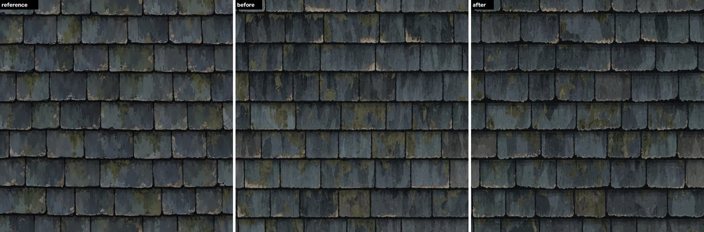

*Left: the reference (a guide only). Middle: the default tile of this recipe before the look fixes (1254 x 1254 dots). Right: the default tile now.
The slates, streaks, moss and chips are all made by Blender nodes from a list of 182 settings (73 of them are written in `recipe/settings.json`, the other
109 keep the starting values written in the layer files; many of all 182 were also set by hand after looking at the reference); nothing is copied from the
reference slate by slate. The older picture of the first default next to the reference is `integration/takeover/whole_ref_vs_default.png`.*

## 0. Words used in this guide (one word for each thing)

| word | meaning |
|---|---|
| **tile** | the square picture that repeats (1254 x 1254 dots for the default). A **base tile** is one repeat of the pattern. |
| **dot** | one dot (pixel) of a picture. |
| **tile units** | sizes written as a share of the base tile: 1.0 = the whole tile; at 1254 dots per tile, 0.0064 = 8 dots. Every size in the recipe is in tile units, so the look is the same at any picture size. |
| **slate** | one roof slate. A **row** is a horizontal line of slates. |
| **joint** | the dark gap between two slates of a row, and the dark band between two rows. |
| **layer** | one of the boxes that paint: COLOUR AND FADE, DAMAGE, MOSS, OUTLINE AND SHADOW. LAYOUT (the slates) and COMBINE (stacking) are boxes too, but they do not paint. |
| **box** | what Blender calls a *node group*: a set of nodes packed into one node with named sockets, which you can open, look inside and switch off. |
| **bundle** | the eleven numbers LAYOUT gives every layer for every dot ("which slate am I on, and where on it"). |
| **mask** | where a layer paints: 1 = the layer's colour fully covers what is below, 0 = the layer does nothing there. |
| **setting** | one number or colour you can change, named `layer.name`, for example `moss.coverage`. It is also a knob (socket) on the layer's box in the Shader editor. All settings are listed in `recipe/controls.md`. |
| **seed** | a number that picks a different random pattern; every layer has its own. |
| **declared link** | the ONLY way one layer may look at another layer (written in the layer's file and in this guide). There is one: MOSS reads DAMAGE's mask. |
| **same-kind score** | `lib/texture_compare.py`: 0 = as different as another surface, 1 = cannot be told apart by that measure (a re-shuffled copy of the reference scores about 0.99). It has groups: colour, height, normal, tiling. |
| **dot-for-dot score** | `lib/pixel_compare.py`: compares two pictures dot by dot. It is reported for transparency only; it is NOT a target here (the slates are new slates, not the reference's slates). |
| **look checker, tuner, re-baker** | three helpers of round 15 (section 6b): the look checker only looks and measures; the tuner changes settings and bakes the default tile; the re-baker makes everything else again |
| **normal map** | a picture that tells a game engine or a renderer which way every dot of the surface faces (so it can light the bumps); here it is worked out from the height picture. The "normal group" of the same-kind score judges it |
| **Sobel** | a standard recipe for working out how steep a picture is at each dot from the brightness of the dots around it. The 3 x 3 Sobel of `integration/make_normal.py` looks at the eight dots around each dot; the harness's own normal (`normal_harness_sobel.png`, named after the recipe) is a simpler version that only compares the dot to its left with the dot to its right and the dot above with the dot below |
| **the harness** | `lib/bake_harness.py`, the small program that starts Blender, bakes the maps of a recipe one by one and writes the PNG pictures |
| **relief, raking light** | relief = the bumps of the surface (height map, and the normal map made from it); a raking light is a low sun, 20 degrees above the surface, which makes bumps show |
| **facet** | a flat patch of paint with straight edges (a fault of the current default, section 6b) |
| **Lab** | a way to write a colour as three numbers: lightness (0 = black, 100 = white), green-red leaning and blue-yellow leaning |
| **Delta E** | how different two colours look to a person, in one number (below 2 is hard to see, about 10 is plainly different) |
| **SSIM** | "structural similarity": 1 = two pictures have the same shapes in the same places, 0 = unrelated |
| **log-normal** | a kind of random width: most slates are near the middle width and a few are much wider (the logarithm of the width is bell-shaped) |
| **4D noise, "donut"** | noise that has four coordinates; feeding it a circle for x and another circle for y makes the pattern repeat at the tile edge |
| **Smooth F1** | the Voronoi texture's "distance to the nearest random point, softened": it makes cells with soft borders; **1 - abs(2n - 1)** is a sum that turns smooth noise n into pointed peaks (the paint "tongues") |

## 1. How to bake it (copy and paste)

Blender 5.2.2, command line, CPU, 2 threads. `cd` into the project folder `proc-work` first.

```
# the finished maps: colour, height (16 bit), roughness, metallic, normal (the new default took 9.8 minutes at 1254 dots on a busy machine, the old
# one 6.6 minutes; about half of it is the extra "normal_bumpnode" picture the harness also makes)
blender -b --disable-autoexec -t 2 --python lib/bake_harness.py -- recipes/slate_layers/recipe/slate_recipe.py OUT --size 1254 --normal-reference slate

# change any setting for one bake (here: more moss and a new moss pattern)
... --params '{"moss.coverage": 0.34, "moss.seed": 61}'

# one layer alone (a "debug view"): its mask, colour, height or roughness
... --params '{"debug_view": "moss.mask"}'          (also damage.colour, outline_and_shadow.height, bundle.edge_distance, bundle.piece_colour ...)

# a bigger area of NEW slates: 2 x 2 base tiles = 2508 dots
... --size 2508 --params '{"recipe.tiles_across": 2}'

# the reference-style normal map from the baked height (3 x 3 slope, strength 7, the rule the reference maps were made with)
python3 -I recipes/slate_layers/integration/make_normal.py OUT/height.png OUT/normal.png 7
```

The default tile is in `outputs/default/` (colour.png, height.png 16 bit, normal.png = strength 7 like the reference, roughness.png,
metallic.png; plus normal_harness_sobel.png = the harness's own normal with a fitted strength of 8.0 (7.37 for the old default), and normal_bumpnode.png).
The old default's maps are kept in `outputs/default_before_look_fixes/`.
(Sobel, in `normal_harness_sobel.png`: a standard recipe that works out how steep the picture is at each dot from the dots around it; section 0. The `normal.png` of `outputs/default/` is the 3 x 3 version with strength 7, the `normal_harness_sobel.png` the harness's simpler two-neighbour version.)

## 2. The plan: one recipe, six boxes, eleven shared numbers

```
          Vector (where on the tile: x 0..1 left to right, y 0..1 bottom to top)
             |
          LAYOUT  ---- the bundle: eleven numbers for every dot ----+---------------+-------------+--------------------+
                                                                     |               |             |                    |
                                                             COLOUR AND FADE       MOSS  <---- DAMAGE         OUTLINE AND SHADOW
                                                                     |               | (declared link: Damage Mask)    |
                                                                     +---------------+------+------+--------------------+
                                                                                            |
                    LAYOUT's base_height -----------------------------------------------> COMBINE --> Colour, Roughness, Metallic, Height
```

Open `recipe/slate_recipe.py` in Blender (or bake it) and you see one box called SLATE; inside it the six boxes above, each of which you can open
and switch off (Amount 0). That is what "layers inside the recipe" means: the layers are not separate pictures, they are separate boxes of nodes
inside one node tree, and the pictures in `debug_views/` are made by baking one box's output alone.

**The bundle** (the fixed interface; full table in `interface/interface.md`). For every dot LAYOUT answers "which slate am I on and where on it?":

| number | what it is, with an example |
|---|---|
| `piece_id` | a random number 0..1, the same on every dot of one slate. Example: every dot of one slate carries, say, 0.4172 and every dot of its neighbour 0.8806. Layers use it to give each slate its own tone, damage and moss. |
| `row` | the row number divided by the number of rows (8 rows: 0, 0.125, ... 0.875) |
| `local_x`, `local_y` | where on the slate: 0..1 across, and 0..1 DOWN (0 = the slate's top edge). Example: the middle of a slate's lower edge is (0.5, 1). |
| `piece_width`, `piece_height` | the slate's size in tile units (median width 0.164 = 206 dots, height 0.120 = 150 dots) |
| `edge_distance` | how far in from the nearest slate edge, along the real chipped outline (tile units, 0 at the edge) |
| `top_edge_distance` | how far below the slate's upper edge |
| `gap_mask`, `piece_mask` | 1 in the joint / 1 on the slate |
| `base_height` | the bare relief: joints low (0.08), slates high (about 0.50), a rounded slope 4 dots wide along every edge |

**The rules every layer keeps** (they are what make the layers independent and the tile seamless):

1. A layer reads only the bundle, its own settings, its own seed and its declared links. It never reads another layer's picture.
2. Every layer has the same four outputs: Mask, Colour, Height (0 = no change), Roughness (0 = no change). Amount 0 makes Mask, Height and
   Roughness exactly 0 (the shared helper `finish_layer` in `layers/layer_interface.py` guarantees it).
3. Sizes are tile units. Counts (rows, slates per row) are whole numbers.
4. Anything that belongs to the whole roof (big sun-bleached areas, where moss gathers) uses the SEAMLESS noise on the tile coordinate; anything
   that belongs to one slate (streaks, drips, chips) uses the slate's own coordinates (`local_x x piece_width`, `local_y x piece_height`) with
   random offsets from `piece_id`. Both repeat exactly at the tile edge: the first because the noise is read on a donut (section 3), the second
   because a slate cut by the picture edge carries the same `piece_id` and coordinates on both sides.
5. Settings: the starting value written in the layer's own file < `recipe/settings.json` < the parameters of a bake. `settings.json` holds only
   what was tuned (73 entries, 2.4 KB: 71 values and 2 build settings, `recipe.stack_order` and `recipe.tiles_across`; the size check
   `lib/description_audit.py --limit-kilobytes 8` passes with no problems, 67 numbers). (Corrected wording: this is NOT everything the look depends on. The other 109 of the
   182 controls keep the starting values written in the layer files, many of them also set by hand after looking at the reference. For the first version all 176
   values together were 6.0 KB with 148 numbers, `verify/full_effective_description.json`, and also passed the 8 KB check; that was not repeated for the 182.)

**COMBINE** stacks the layers: colour starts as COLOUR AND FADE's colour on every dot; then, in the stack order (`recipe.stack_order`, default
`colour_and_fade, moss, damage, outline_and_shadow`), each layer's colour is laid over it by its mask. Height = base_height + the sum of every
layer's height (then partly replaced by the paint brightness, see `combine.tone_blend` in section 5). Roughness = 0.8 + the sum of every
layer's roughness. Metallic = 0.

## 3. The Blender tools used, in one plain sentence each

Everything is shader nodes, written by Python, inside one node group (**1,872 nodes in all since the look fixes** (1,842 before): LAYOUT 307, COLOUR AND FADE 419, DAMAGE 439,
MOSS 431 (419 before), OUTLINE AND SHADOW 234 (216 before), COMBINE 19, plus small helper groups; counted by `recipe/count_nodes.py` after the look fixes, list in `recipe/node_counts_after_look_fixes.json`; the first count is `integration/count_tools.py`, `integration/tools_used.json`).
There is no picture, no geometry and no modifier: this shader recipe bakes in about one minute per map at 1254 dots (the research measured
geometry recipes at 1.5 to 4.5 minutes for all maps; shader recipes at 18 to 54 seconds, so this one, with about 1,870 nodes, is a slow shader recipe).

| tool (Blender's name) | what it is, in one sentence | how this recipe uses it | settings that matter |
|---|---|---|---|
| **Node group** | a box of nodes with its own named sockets, used like one node | every layer is one box; the sockets are the bundle, Seed, Amount and the layer's settings | the socket names (fixed by `interface/interface.md`) |
| **Math** node | does one sum on numbers (add, multiply, minimum, greater than, floor, modulo, power, sine ...) | 1,504 of the 1,872 nodes (80 %; 1,479 of 1,842 before the look fixes): distances to edges, thresholds, ramps, per-slate sizes | the operation; "Clamp" to cut the result to 0..1 |
| **Map Range** | stretches a number from one range to another (Linear), or makes a soft step between two values (Smooth Step) | turning noise (which sits between about 0.25 and 0.73) into 0..1; soft edges of masks | From Min/Max, To Min/Max, Clamp, interpolation |
| **White Noise Texture** | gives a random number that is always the same for the same input | one set of random numbers per slate (fed `piece_id` and the layer's seed) and per row (fed the row number): slate tone, slate width, how damaged, how mossy | the input you feed it (1D/2D/3D/4D); nothing else |
| **Noise Texture** | a smooth random "cloud" of values | 1D noise for the pointed paint tongues; 2D/3D noise on the slate's own coordinates for drips, wobbles, chips, moss clumps; 4D noise for seamless patterns | Scale (how many features across), Detail (how many finer layers are added), Roughness (how strong the finer layers are), and the 4th coordinate W (a different pattern for the same place) |
| **seamless noise** (the project's group `tileable_noise_group` in `lib/recipe_tools.py`) | turns x into a circle and y into another circle and reads 4D noise there, so the right edge continues into the left | big sun-bleached and damp patches, where moss gathers, the shadow's ragged border, chips of the slate edge | Scale must be "features per base tile x Tile Count" so a 2 x 2 area has the same look per dot |
| **Voronoi Texture** | cuts space into cells around random points; F1 = distance to the nearest point, Smooth F1 = the same with soft borders | COLOUR AND FADE: tall flat patches of one tone (cells stretched up-down); MOSS: flat patches of one olive tone inside a clump | Scale, Randomness, the stretch of the coordinate you feed it |
| **Mix** (colour) | lays one colour over another by a factor 0..1 (the factor is the mask) | painting the layers over each other in COMBINE; the palette lookup in COLOUR AND FADE (a chain of "if the step is above this line take the next colour") | Factor; blend mode Mix |
| **Mix** (float) | the same for plain numbers | blending two noises (upright flakes and round flakes in DAMAGE) | Factor |
| **Separate / Combine XYZ**, **Separate Color** | split a vector or colour into its numbers, or join numbers into one | reading x and y of the tile coordinate; reading the 4 random numbers White Noise gives at once | none |
| **RGB to BW** | the brightness of a colour | the tints in COLOUR AND FADE (change hue, keep brightness); `combine.tone_blend` (height from the paint brightness) | none |
| **Cycles bake** (through `lib/bake_harness.py`) | photographs one output of the recipe from straight above, one map at a time | colour (view "Standard"), height (16 bit, view "Raw"), roughness, metallic; the normal is the slope of the height | 4 samples per dot (16 gives cleaner one-dot edges, see `tests/bake_tools.py`) |

Three facts about these tools that cost time (the research guides have more):
* Blender's own Noise, Voronoi, Wave and Magic textures do NOT repeat at the tile edge. Use the seamless group, or read them on the slate's own coordinates.
* Noise Texture values sit between about 0.25 and 0.73, not 0 and 1: always stretch with Map Range before you threshold.
* Colours typed as hex (#3d444a) are sRGB; Blender's nodes work in linear colour. The layer helper converts them (`srgb_hex_to_linear`).

## 4. The layers one by one

Each part: what it does (with a concrete example first), how it is built, the settings that matter most and what changing them does, and where
the "what does this setting do" strips are. Strips in `controls_sweeps/<layer>/` were made by the layer builders at their layer's own starting
values (before integration tuning); the strips in `controls_sweeps/whole_recipe/` (**made after the restart**) show five settings on the
finished, tuned recipe. **Round 15 note:** none of the strips were made again. The builders' strips are of their own starting values, and the
five whole-recipe strips and the table below them were made on the OLD default (768 dots), so the "default in bold" values in that table are the old defaults
(today: moss coverage 0.30, chip amount 0.68, streak contrast 1.3, mottle tallness 1.5, shadow darkness 0.55 unchanged). The tables for each layer further
down show the NEW defaults with the old value in brackets. (Corrected: there are no strips at all for the LAYOUT layer, although the brief asked for two or three
per layer; this is a known gap.)

The five whole-recipe strips (`controls_sweeps/whole_recipe/*.jpg`, 768 dots, one setting changed at a time, the same crop of about two rows; the
colour group of each picture is written over it and kept in `colour_group_of_each_picture.json`). The scores of 768-dot bakes are lower than those of
1254-dot bakes (the OLD default scored 0.632 at 768 and 0.701 at 1254, because the scorer enlarges a smaller picture to 1254 dots and that blurs it), so
compare the numbers within one strip only:

| strip | values (default in bold) | colour group at 768 dots | what you see |
|---|---|---|---|
| `moss_coverage.jpg` | 0, 0.12, **0.22**, 0.34 | 0.52, 0.57, **0.63**, 0.67 | no moss; a few drips; drips on about one slate in three; olive slates |
| `damage_chip_amount.jpg` | 0, 0.35, **0.65**, 1.0 | 0.56, 0.57, **0.63**, 0.62 | almost clean edges (the few tan dots left are lichen); then pale-tan flakes along more and more lower edges |
| `colour_and_fade_streak_contrast.jpg` | 0, 0.7, **1.4**, 2.1 | 0.60, 0.60, **0.63**, 0.75 | smooth fade only; flat streaks in more and more contrast |
| `colour_and_fade_mottle_tallness.jpg` | 0.6, **1.1**, 2.2, 4.0 | 0.61, **0.63**, 0.64, 0.61 | a small change at this crop: the flat patches inside a slate get longer up and down as the value grows |
| `outline_and_shadow_shadow_darkness.jpg` | 0, 0.3, **0.55**, 0.8 | 0.76, 0.74, **0.63**, 0.56 | no shadow band under the rows; a light one; the default; a heavy one |

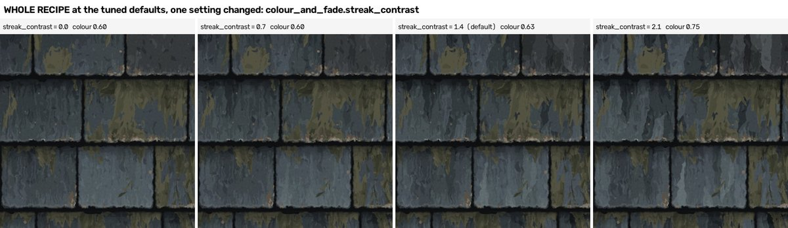

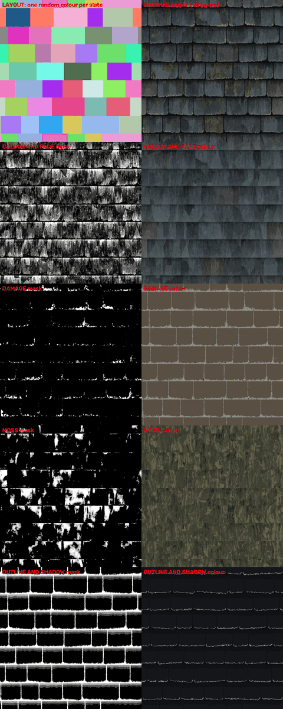

*Every layer baked alone (`debug_views/`): left its mask, right its colour; top left the layout (one random colour per slate), top right the finished tile.*

### 4.1 LAYOUT (`layers/layout.py`) - the slates, no paint

*Example (made-up but typical numbers).* Take a dot at x = 0.31, y = 0.47 of the tile: LAYOUT finds it is in row 4 (counting rows from the top, rows are 1/8 of the tile high, each
with a slightly jittered edge), the row is slid sideways by its own random amount, the dot falls in the third of six slates, which is 0.171 wide;
the dot is 0.02 below the slate's top edge and 0.013 from its nearest edge, so `local_y` is about 0.17 and `edge_distance` 0.013.

*How it is built.* (1) Rows: row edges are jittered steps of an even grid, so the next row starts exactly where this one ends and the last row ends
where the first starts again (the tile repeats). (2) Each row slides by its own random amount. (3) Six random widths per row (log-normal: a bell
number put through exp), scaled so they add up exactly to the row length; every dot of the row works out the same widths without a loop.
(4) Joints lean a little. (5) Corners are rounded (bottom corners rounder than top ones, so the joints flare into the band between rows) and the
four edges are pushed IN by seamless noise (chips only remove slate), a different noise for every slate. (6) From the four edge distances come
the bundle numbers.

| setting | default | what changing it does |
|---|---|---|
| `layout.rows_per_tile`, `layout.slates_per_row` | 8, 6 | how many rows and slates per tile (whole numbers; 6 and 4 give the "big slates" variation) |
| `layout.width_spread` | 0.26 | 0 = all slates equally wide; higher = more different widths (0.35 in the "big slates" variation; range up to 0.8) |
| `layout.row_slide` | 1 | 0 = every row starts at the same joint (a stack bond); 1 = rows slid anywhere |
| `layout.row_gap`, `layout.joint_width` | 0.005, 0.0014 | narrowest band between rows (6 dots) and between slates (1.8 dots); chips widen them |
| `layout.ragged_bottom`, `ragged_side`, `ragged_top` | **0.01** (was 0.0055), 0.0024, 0.0022 | how deep the chips bite into each edge (12.5, 3, 2.8 dots) |
| `layout.corner_radius`, `corner_bottom_factor` | 0.0064, **3.0** (was 1.5) | corner rounding (8 dots) and how much rounder the bottom corners are (round 15: 3.0 is the top of its range) |
| `layout.bottom_tilt` | **0.08** (was 0.02) | how much the lower edge of each slate slopes (a random direction per slate), so that neighbouring lower edges step against each other and the rows wave a little |
| `layout.seed` | 1 | a new roof: widths, slides, leans and chips change, nothing else |

Debug views: `debug_views/layout_slates_colour.png` (one random colour per slate) and `debug_views/skeleton_layers_sheet.png`, `debug_views/bundle_sheet.png`
(every bundle number as grey). Layout statistics (slate widths, row heights, joint share 7.5 % against the reference's 7 %): `tests/layout_stats/layout_statistics.md`.

### 4.2 COLOUR AND FADE (`layers/colour_and_fade.py`) - the bare slate paint, the bottom layer

*Example (made-up but typical numbers).* One slate rolls a base tone step of 3.4 (on a palette of nine blue-greys numbered 0 = darkest to 8 = lightest). Near its top edge a
dark tongue hangs down and takes away 1.2 steps; a tall flat patch adds 0.6; no speck; the slate sits in a sun-bleached area that adds 0.5. The
sum is 3.3, ROUNDED to 3, so the dot gets palette colour number 4 (#33393e). Rounding is what makes the paint flat: a dot is never "between" two
paints, so the picture is made of flat patches with hard edges, like a painting.

*How it is built.* The tone step is a sum: the slate's own base tone (from `piece_id`; a few slates are pushed clearly darker or lighter: the
"outliers") + pointed tongues (rows of 1D noise turned pointy with `1 - |2n - 1|`; dark tongues hang from the top edge, pale bleached tongues
reach up from the bottom edge) + mottling (tall flat patches from stretched Smooth F1 Voronoi cells) + specks + big sun-bleached and damp patches
that cross slates (seamless noise cut by thresholds) + a slow drift. The palette lookup is a chain of Mix nodes, so every palette colour stays a
live colour knob. Some slates and patches lean towards a green-grey or a warm grey (hue only, lightness kept), and a faint grain keeps flat patches
from being perfectly flat. Height follows the tone (lighter paint higher, like the reference maps); roughness: lighter rougher, darker smoother.

| setting | default (tuned) | what changing it does | strip |
|---|---|---|---|
| `colour_and_fade.tone_1` ... `tone_9` | #141719 ... #616b70 | the nine paint colours; changing them recolours the whole roof (the brick reuse test uses nine brick reds) | `tint.png` |
| `tone_centre` | 3.7 | the tone step of the average slate: lower = a darker roof | `tone_centre.png` |
| `tone_spread`, `outlier_share`, `outlier_size` | **0.45** (was 1.0), **0.08** (was 0.15), **0.7** (was 1.2) | how different slates are; how many slates stand out and by how much (round 15: far fewer pale and dark odd slates) | `tone_spread.png` |
| `fade_amount`, `fade_direction`, `fade_length` | **0.9** (was 0.85), 1, 0.07 | how strong the tongues are; 1 = dark above and bleached below (as on the reference), -1 = the reverse; how long the longest tongue is (88 dots) | `fade_amount.png`, `fade_direction.png`, `fade_length.png` |
| `streak_width` | **0.03** (was 0.014; the layer file's start is 0.034) | width of one tongue (38 dots): wider = broader flat bands (round 15) | `streak_width.png` |
| `streak_contrast` | **1.3** (was 1.4) | how much neighbouring patches differ (0 = smooth fade only) | `streak_contrast.png` and the whole-recipe strip |
| `streak_bend` | 0.006 | slow sideways wander of the streaks (0 = ruler-straight; the look checker found that 0.045 curves the straight facet edges, section 6b) | `streak_bend.png` |
| `edge_ragged`, `grain_amount` | **0.0015** (was 0.0035), **0.04** (was 0.05) | how much a fine ripple pushes the patch edges sideways (less = crisper edges); a very faint fine grain inside flat paint (round 1 had lowered it to 0.02 and the fine grain vanished) | |
| `mottle_tallness` | **1.5** (was 1.1; was a fixed 2.2 before integration) | how much taller than wide the flat patches are: 2.2 = patches the whole slate high (slates look like corrugated stripes), 1.1 = shorter strokes | whole-recipe strip |
| `patch_hardness` | 1 | 1 = flat patches with hard edges; 0 = the tones blend smoothly (the "airbrushed" look the brief does NOT want) | `patch_hardness.png` |
| `bleach_amount`, `stain_amount`, `patch_size` | 0.25, 0.4, 0.2 | big pale (sun) and dark (damp) areas crossing slates, and their size | `sun_bleach.png`, `damp_stain.png` |
| `tint_amount`, `tint_green_share`, `patch_tint` | **0.9** (was 0.7), 0.8, **0.55** (was 0.4) | how far some slates (and some single patches) lean green or warm, and which | `tint.png` |
| `amount` | 1 | 0 = every slate one flat middle tone, nothing else | `amount.png` |

The colour builder's own tests: `tests/colour_and_fade/layer_tests_table.md`; its controls page: `tests/colour_and_fade/controls_colour_and_fade.md`.

### 4.3 DAMAGE (`layers/damage.py`) - chips, cracks, the pale tan breaks

*Example (made-up but typical numbers).* Take a dot 0.012 above the lower edge of a slate. The "reach" of flaking there is 0.02 (the lower edge flakes most; sides reach only 12 % of
that, the top edge less still) times this slate's own damage level (some slates barely touched) times a seamless noise that is high here. The reach
works out to 0.018, which is more than the dot's distance to the edge (0.012), so the dot is flaked: it gets the tan break colour, it is sunk by
about 0.05 and made rougher. Two noises are blended: one stretched up-down (flakes are teeth pointing up from the edge, like the reference) and one
round (loose islands above the edge).

*Kinds of damage, in painting order*: flakes (pale cream at the edge, tan above, darker brown at the tips), pits, scratches, cracks (thin dark lines
from an edge, thinner towards the tip), notches (small dark bites), corner breaks (a lower corner gone). Every kind sinks the surface and makes it rougher.

| setting | default (tuned) | what changing it does | strip in `controls_sweeps/damage/` |
|---|---|---|---|
| `damage.chip_amount` | **0.68** (was 0.65) | how much of the lower edges is flaked (0 = none, 1 = almost all) | `strip_1_edge_flakes.png`, whole-recipe strip |
| `chip_depth` | **0.024** (was 0.02) | how far a flake reaches in (30 dots) | strip 1 |
| `chip_frequency` | **115** (was 110) | flake teeth per tile: more = smaller teeth (115 = about 11 dots) | strip 1 |
| `chip_clustering`, `chip_breakup` | **0.55** (was 1.0), **0.8** (was 1.1) | flakes gathered in stretches with clean edge between; how ragged the flaked patches are (round 15: chunkier flakes, fewer holes and loose flecks) | strip 1 |
| `corner_gain` | **0.3** (was 1) | extra flaking at the two lower corners; 1 made the big tan L-shapes the look checker found | |
| `slate_variation` | 0.7 | 0 = every slate equally damaged; 1 = some clean, some badly hurt | `strip_4_where_and_how_big.png` |
| `crack_amount`, `scratch_amount`, `pit_amount` | **0** (was 0.02), 0.03, 0 | chance of a crack / scratch per slate, share of pits (turned off in tuning: the reference has hardly any; the "heavily damaged" variation switches cracks back on) | `strip_2_cracks_scratches_pits.png` |
| `notch_amount`, `corner_break_amount` | 0.1, 0 | bites and broken corners | `strip_3_corners_notches_colours_amount.png` |
| `break_colour`, `break_colour_light`, `break_colour_dark` | #7c6f5d, #8f8d85, #5a4f43 | the tan, the pale and the dark-tan of the breaks | strip 3 |
| `sink_depth`, `roughness_gain` | **1.6** (was 1), 1 | how deep damage is sunk, how much rougher it is | |

The damage builder's controls page with every setting: `damage_work/damage_controls.md`.

### 4.4 MOSS (`layers/moss.py`) - moss and lichen, in drips

*Example (made-up but typical numbers).* Take a dot 0.03 below a slate's upper edge, in a sideways place where this slate's drip strand is long (0.2 instead of the average 0.14):
the "drips" rule gives it 0.8 x drip preference 0.9 = 0.72; the clump noise adds 0.3; the slate is a mossy one and lies in a mossy area of the
roof, which lowers the threshold. The growth strength is above the threshold, so the dot is moss; it lies inside the clump, so it gets one of the
middle olive tones (the rim of a clump is lighter, the part right under the upper edge darker).

*How it is built.* A growth strength per dot = the RULES (where water and shade gather: drips running down from the upper edge, the upper part of
the slate, the side joints, the lower part, low damp spots read from `base_height`, and, through the declared link, damage) + a tall wobbly CLUMP
noise read on the slate's own coordinates + EDGE RAGGEDNESS noise. Moss is painted where the strength is above a threshold set by `coverage`; a very
slow seamless noise (`patchiness`) times each slate's own "how mossy am I" number (`slate_variation`) moves the threshold up in clean areas and
down on mossy slates. Clumps are tall (drip stretch 1.4), wander sideways as they run down (flow wobble), and grow a few downward teeth one brush-stroke
wide (fringe, now almost off). Paint: five flat olive tones in tall patches (stretched Voronoi), no smooth shading; since round 15 the paint is partly see-through at the
rim of a clump (the slate streaks show through) and the growth fades out before a side joint. Lichen: small pale-tan discs and rings on two
jittered grids, gathered in colonies.

*Why it reads as drips and not as camouflage* (the weakness of the first slate build): clumps start at each slate's own upper edge, are taller than
wide, and their lengths change from strand to strand; the earlier build placed round blobs anywhere. Compare `controls_sweeps/moss/04_drip_length.png`
and `07_clump_strength.png` (clump strength 3 = free blobs everywhere: the camouflage look).

| setting | default (tuned) | what changing it does | strip in `controls_sweeps/moss/` |
|---|---|---|---|
| `moss.coverage` | **0.30** (was 0.22) | how much moss: 0 = none, 0.62 = a very damp roof (round 15: the moss is see-through now, so more is needed to read as moss) | `01_coverage.png`, whole-recipe strip |
| `patchiness`, `slate_variation` | **0.9** (was 0.75), 0.95 | moss gathered in a few big areas; some slates thick with moss, others clean | `02_patchiness_and_slate_variation.png` |
| `drip_preference`, `joint_preference`, `lower_preference`, `damp_preference` | 0.9, 0.15, 0.25, 0.3 | WHERE moss gathers: drips under the upper edge (strongest), along joints, low on the slate, in damp low spots | `08_where_it_gathers.png` |
| `drip_length`, `drip_width` | 0.14, 0.07 | how far drips run (175 dots) and how wide a strand is (88 dots) | `04_drip_length.png`, `05_drip_width_and_stretch.png` |
| `cluster_size`, `clump_strength`, `drip_stretch` | **0.055** (was 0.06), 1.8, **1.4** (was 1.8) | clump width; how much the free clump noise decides (high = blobs); how much taller than wide | `06_cluster_size.png`, `07_clump_strength.png`, `05_...` |
| `edge_raggedness`, `fringe_amount` | **0.6** (was 0.7), **0.08** (was 0.3) | ragged clump edges with loose flecks; downward teeth (0.3 gave the rows of teeth the look checker found) | `10_edge_raggedness.png`, `09_flow_wobble_and_fringe.png` |
| `tone_1` ... `tone_5`, `tone_centre`, `tone_spread` | **#23241c** (was #2b2c23) ... **#63614a** (was #545342), **0.55** (was 0.7), 1.0 | the five olives (a wider range since round 15); which is typical; how many one clump uses | `11_tone_centre.png`, `12_tone_spread_rim_and_shade.png` |
| `lichen_amount`, `lichen_size` | **0.07** (was 0.15), 0.0042 | how many pale-tan lichen discs, their size (5 dots) | `13_lichen_amount.png`, `14_lichen_size_and_clustering.png` |
| **NEW** `rim_opacity`, `core_opacity` | 0.5, 1.0 (both 1 = solid, the old look) | how see-through the moss paint is at the rim of a clump and deep inside it (lower = the slate streaks show through) | none yet |
| **NEW** `side_clearance` | 0.012 (0 = off, the old look) | moss growth fades out over this distance before a side joint (no straight cut along the joint) | none yet |
| **NEW** `fleck_amount`, `rim_lightening` | 0.5 (1 = as before), **0.2** (was 0.5) | the small light and dark flecks inside the moss; how much lighter the rim of a clump is | none yet |
| `damage_avoid`, `damage_attract` | 0.8, 0 | the declared link: keep off damaged dots / grow on them (section 5) | `17_damage_avoid.png`, `17b_damage_attract.png` |
| `raise`, `roughness_gain` | **2.5** (was 1), 1 | moss raises the surface (1 = by 0.035; 2.5 = by 0.09) and adds 0.14 roughness | `18_height.png`, `19_roughness.png` |

The moss builder's controls page: `moss_work/moss_controls.md`.

### 4.5 OUTLINE AND SHADOW (`layers/outline_and_shadow.py`) - the drawing, painted last

*Example (made-up but typical numbers).* Take a dot 0.01 below a slate's upper edge: the shadow of the slate above reaches 0.026 down here (a
little more or less where the ragged noise says so); the dot is 40 % of the way into that reach, so its depth is 0.6, which is rounded UP to the
next of four flat steps (1, 0.75, 0.5, 0.25): 0.75. The shadow colour covers the slate paint by 0.55 x 0.75 = 0.41: the paint still shows through.

Five things, laid over each other like paint: edge darkening (6 dots next to every edge), the shadow band under the row above (two flat steps since round 15, four before, with
a slightly ragged lower border; the teeth of solid black are off now), the pale lip along the lower edge, the thin side outline, and the near-black
joints with a hand-drawn ragged edge. Relief: the shadow band is a slope out of the joint, the lip a small rim, the side outline a groove.

| setting | default (tuned) | what changing it does | strip in `controls_sweeps/outline_and_shadow/` |
|---|---|---|---|
| `outline_and_shadow.shadow_width`, `shadow_darkness` | 0.026, 0.55 | how far the shadow reaches (33 dots) and how dark it is right under the joint | `strip_2_shadow_band.png`, whole-recipe strip |
| `shadow_tiers`, `shadow_drip` | **2** (was 4), **0.2** (was 0.5) | number of flat steps (0 = smooth blur); how ragged its lower border is | strip 2 |
| `black_drips` | **0** (was 0.005) | how far black teeth hang from the band (0 = none) | strip 2 |
| `lip_brightness`, `lip_width`, `lip_breakup` | **0.3** (was 0.12), 0.003, 0.4 | the pale lower lip: strength, width (4 dots), how broken | `strip_3_lip_edges_and_amount.png` |
| **NEW** `joint_texture`, `joint_texture_size` | 0.35, 150 (0 = flat black, the old look; 600 was the old size) | a faint mottling of the black joints, and how many mottles fit across the tile (150 = about 8 dots each) | none yet |
| `joint_colour`, `side_outline_width`, `wobble` | #0e0f11, 0.002, 0.5 | joint black; thin outline (2.5 dots); how hand-drawn the lines are | `strip_1_joints_and_outlines.png` |
| `shadow_height`, `lip_height`, `outline_height` | 0.12, **0.1** (was 0.04), 0.05 | the relief this layer adds | `strip_4_relief_height.png` |

The outline builder's controls page: `outline_work/outline_controls.md`; its look comparisons: `controls_sweeps/outline_and_shadow/looks.png`.

### 4.6 COMBINE (`layers/combine.py`)

Stacks the colours by mask in the stack order, sums heights and roughness, and offers four settings: `combine.base_roughness` (0.8), `combine.metallic` (0),
`combine.height_gain` (1) and `combine.tone_blend` (0.7, added in integration, section 5).

## 5. The declared link, the stack order and the height choice

**The one declared link: MOSS reads DAMAGE's mask** (`moss.damage_avoid`, default 0.8; `moss.damage_attract`, default 0). Listed in
`layers/moss.py` (`DECLARED_LINKS`), in `interface/interface.md` section 5, and allowed for in the independence table.

What it really does, measured **after the restart** (`links_and_order/`, 768 dots):
* In the COLOUR picture it changes almost nothing with the default stack order: damage_avoid 0, 0.8 and 1 give colour pictures that are almost the same
  (corrected: the first version said "identical"; 0.12 to 0.14 % of the dots differ, by at most 8 steps of 255, and 0.00 % of dots differ by more than 10 steps),
  because DAMAGE is painted over MOSS anyway, so a break always shows its own colour. (Sheet: `links_and_order/links_sheet.jpg`, top row.)
* In the HEIGHT map it keeps moss from filling the chips: between damage_avoid 0 and 1, 0.67 % of the dots differ, every one of them on a damaged
  dot, by up to 0.044 of the height scale (moss would otherwise raise the floor of a chip). Roughness did not change by more than 0.004 anywhere
  (`links_and_order/link_height/link_measures.json`).
* Turned the other way round it is visible: with the stack order `colour_and_fade, damage, moss, outline_and_shadow` and `moss.damage_attract` 0.8,
  moss grows over the old breaks and hides them (bottom right of the sheet; 1.6 % of dots change).

So the link is honest but small. A person who wants "moss grows next to old damage" must also change the stack order; "moss right NEXT to damage
but not on it" is not possible, because the link is read dot by dot.

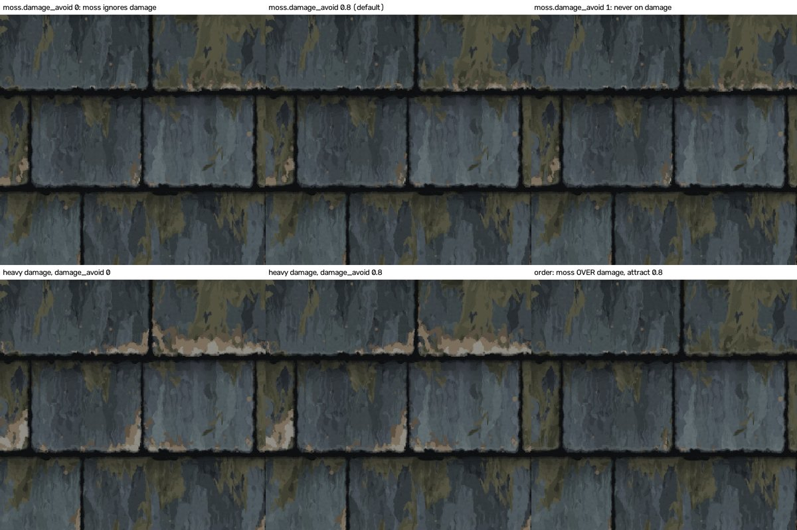

**The stack order** (`recipe.stack_order`) only decides who paints over whom; heights and roughness are plain sums, so they do not depend on it.
The default `colour_and_fade, moss, damage, outline_and_shadow` means: moss grows on the paint, damage breaks through moss, the drawing is last.

**The height choice** (`combine.tone_blend`, added during integration). The reference height map was made from the brightness of its colour picture
(height = 2.5 x (brightness - 9.5), research finding), so in it a pale chip is HIGH. Real relief, which every layer writes, makes a chip LOW. The
setting mixes the two: 0 = real relief only (chips sunk, moss raised, joints low); 1 = height = brightness of the finished colour (the reference's
rule); the default is 0.7. Height pictures: `links_and_order/tone_blend_sheet.jpg` (640 dots: reference, 0, 0.35, 0.7, 1). Same-kind height group
(1254 dots, measured by the first integrator's round 13 and re-scored by me before deleting the pictures): 0.4 gives 0.505, 0.7 gives 0.654, 1 gives 0.629.
**Honest note**: the brief asked for the height to be the sum of the layers' real relief. The default keeps 30 % of it; set `combine.tone_blend` 0
for pure real relief (the normal map then shows sunk chips and raised moss, and the same-kind height score drops).
Note that even at 0 the height still looks "painted": COLOUR AND FADE writes a small relief that follows its own tone (`colour_and_fade.tone_height`).
So every height and normal score in section 7 is partly a score of the paint brightness (corrected: the first summary quoted "height 0.654" without saying so).
In round 15 the tuner tried 0.45 and 0.55 (as the look checker suggested) and 0.8: 0.45 and 0.55 were worse by eye, by the slopes and by the score (overall 0.693 against 0.724 with 0.7), and 0.8 could not be told apart by eye, so 0.7 stays.

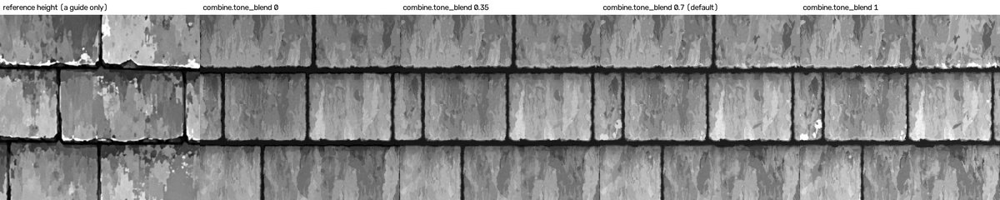

## 6. How it was tuned (no fitting) and why I kept the tuning

**The method.** The reference was looked at and measured ONCE for its general character (palette range, shares of olive, tan and very dark dots,
the top-to-bottom rise inside a slate, joint and shadow widths; scripts `integration/colour_character.py`, `tests/colour_and_fade/measure_reference_character.py`,
`damage_work/measure_reference_tan.py`, `moss_work/measure_reference_moss.py`, `outline_work/measure_reference_profile.py`). After that the only
method was hand-tuning: bake the colour at 1254 dots for two or three variants (`integration/look.sh`), put a crop next to the same crop of the
reference (`integration/side_by_side.py`), score the colour group (`integration/score_colour.sh`), change one or two settings, repeat. A few small
measuring scripts answered single questions (`variance_split.py`: how much of the brightness variation is "the same along a whole row";
`sideways_bands.py`: at which sizes the paint varies sideways; `row_profile.py`: average brightness of every picture row; `low_bins.py`: power at the
largest sizes; `share_olive.py`). No optimiser, no per-slate data.

**The rounds** (reconstructed from the first integrator's round files `integration/r*_views.json`, because its notes were lost in the restart;
scores where they were recorded or where I could re-score the pictures):

| round | what was tried (the variants) | what was kept |
|---|---|---|
| 1 | all four layers at their builders' starting values | baseline: overall 0.615, colour 0.619, height 0.516, normal 0.608 (scored with the harness's own normal map, see the correction below) |
| 2 | narrower, bent streaks (`streak_width` 0.024, `streak_bend` 0.008, `streak_contrast` 1.6); more slate-to-slate tone (`tone_spread` 0.9, outliers 15 %); fewer cracks, pits, corner breaks and bites; a lighter, narrower shadow (0.55, 0.026); moss coverage 0.3 against 0.4 | the shadow, the outliers |
| 3 | `tone_spread` 0.75; moss coverage 0.16 / 0.2 and where it gathers (drips against joints and lower part) | moss mostly in drips |
| 4 | `streak_width` 0.014 / 0.011 / 0.016, `streak_contrast` 1.4, `streak_bend` 0.006, `tone_centre` 4.0, `fade_amount` 0.85, `fade_length` | streaks 0.014 wide, contrast 1.4, bend 0.006, fade 0.85 |
| 5 | damage: no pits, no corner breaks, fewer bites (0.1), `chip_amount` 0.7, `slate_variation` 0.5; `bleach_amount` 0.35 | pits and corner breaks off, bites 0.1 |
| 6 | NEW setting `colour_and_fade.mottle_tallness` (1.0 / 0.6; was fixed at 2.2, slates looked like corrugated stripes); `streak_contrast` 1.9 | the new setting |
| 7 | `tone_centre` 3.7, `mottle_tallness` 1.1 | both |
| 8 | `tone_spread` 1.0 / 1.2 / 0.9 with drift, bleach and damp variants | `tone_spread` 1.0 |
| 9 | grain 0.12 against 0.05; `tone_spread` 0.7 against 1.0 | grain 0.05, spread 1.0 |
| 10 | shadow 0.5 dark / 0.032 wide against 0.55 / 0.026 | 0.55 / 0.026 |
| 11 | moss coverage 0.18 against 0.22 (and drip width 0.06 / 0.07); stronger green tints | coverage 0.22: colour group 0.701 against 0.664 at 0.18; the stronger tints scored 0.658 and were dropped |
| 12 | height only: `tone_height` 3.5, deeper damage, higher moss | the starting values |
| 13 | height only: NEW setting `combine.tone_blend` 0.4 / 0.7 / 1.0 | 0.7 (height group 0.505 / 0.654 / 0.629) |
| 14 (mine, after the restart) | prompted by the whole-recipe strips: `outline_and_shadow.shadow_darkness` 0.3; `colour_and_fade.streak_contrast` 2.1; both; milder both (0.4 and 1.8); then default against the milder pair on two more seed sets | nothing: see below (`integration/r14_results.json`) |
| 15 (the tuner, from the look checker's list; two rounds) | 49 settings became 73 and six new controls were added to two layer files: see section 6b | the new default tile: colour group 0.822, overall 0.778 |

**Correction to the round table (from the honesty check, `verify/HONESTY_VERDICT.md`).** Round 1's overall 0.615 (normal group 0.608) was scored with the harness's
own normal map; the end point 0.705 of round 13 uses the normal map made by `integration/make_normal.py` (3 x 3 slope, strength 7, the reference's own rule), which replaced
`outputs/default/normal.png` a few seconds before the score file was written. Like for like (the harness's normal both times) the end point is 0.695, and the normal group did not
improve with tuning (0.608 to 0.604); so the honest progress of rounds 1 to 13 is 0.615 to 0.695, and 0.705 includes a change of normal-map method.

Between rounds 2 and 11 the first integrator also set, by hand, the three lightest palette colours, the flake size and breakup, the moss clump size
and edges, the lichen amount, the lip and the black drips (all in `recipe/settings.json`; `integration/settings_before_integration.json` is the start).
Every edit to a layer file is listed in `integration/CHANGES_TO_LAYER_FILES.md` (two: the two new settings above; both keep the old look at their
starting value, so nothing else moved).

**When to stop.** The last change to the colour (round 11 to 12: `damage.crack_amount` 0.03 to 0.02) changed NO dot of the colour picture (mean
difference 0.00), and rounds 12 and 13 changed only the height. By the brief's rule (stop when two further rounds each change the look by less than a
person would notice) the colour look had converged.

**Round 14 (mine) and why it changed nothing.** The whole-recipe strips (section 4, 768 dots) showed two settings that raise the colour group a lot:
a lighter shadow band and stronger streaks. At 1254 dots with the default seeds: shadow darkness 0.3 gave 0.766, streak contrast 2.1 gave 0.793,
both together 0.750, a milder pair (shadow 0.4, streak contrast 1.8) 0.796, against 0.701 for the default. That looked like the brief's 0.8 within
reach. But almost all of the gain was the feature-size measure (`colour_scale`, a cliff, see the Lessons guide), and when I baked the default and
the milder pair on two other sets of seeds the default scored 0.769 and 0.753 and the milder pair 0.780 and 0.758: a gain of 0.005 to 0.011,
smaller than what the seed alone moves. **The default seeds are simply an unlucky draw** (0.701, the lowest of five seed sets; the five average 0.740). (Round 15 update: after the look fixes the default seeds
score 0.822 and the five seed sets 0.792 to 0.824, so this is no longer true; section 7.3.)

**Correction to this reasoning (from the honesty check).** On all three seed sets the milder pair won when each set was compared with itself (+0.095, +0.011, +0.005). The sentence
"smaller than what the seed alone moves" mixed up two things: 0.068 is how much the score differs between DIFFERENT seed sets, not how much it moves when a setting changes on the SAME seeds. A fairer
reading: the pair helped a little on every set and a lot on the default seeds, almost all of it through the one cliff measure; keeping the settings was a cost decision (everything would have had
to be baked again), not a statistical one. The same applies to round 11, which adopted moss coverage 0.22 on a single same-seed gain of 0.037 that came from the same cliff measure.
By eye the milder pair is at least as close to the reference (lighter shadow band, more contrasted streaks; `integration/looks/r14/crop_reference_default_r14d_r14b.png`),
so it is offered as a choice: `--params '{"outline_and_shadow.shadow_darkness": 0.4, "colour_and_fade.streak_contrast": 1.8}'`. I did not make it the
default, because that would have meant re-baking every result in this folder for a gain smaller than the seed noise.

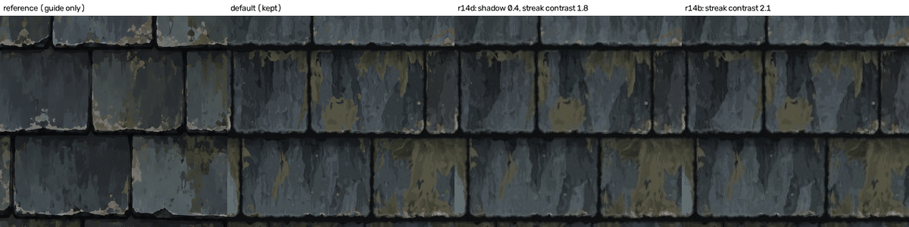

**What I checked before keeping it** (after the restart): the side-by-side above and crops at 1.4 x (`integration/takeover/crop_ref_vs_default.png`);
the brightness bands (share of dots 30-50 / 50-70 / 70-90 / 90+ of 255: reference 15.9 / 40.5 / 26.9 / 5.5 %, default 17.9 / 41.4 / 25.0 / 4.7 %);
the mean colour of the olive-or-tan dots (reference 72, 72, 58; default 72, 70, 57: the same); the mean Lab colour (25.2, -1.6, -1.0 against
25.1, -1.8, -1.0). What differs, and why I did not change it:
* **More moss and tan than the reference**: by the same simple colour rule 15.1 % olive-or-tan dots against 10.7 %, and 5.3 % pale-tan against 2.6 %.
  The score prefers it (moss coverage 0.18 scored 0.664, 0.22 scores 0.701). A person who prefers the reference's amount: `moss.coverage` 0.18.
* **The tan breaks gather on a few slates** in bigger patches; on the reference small tan flecks run along almost every lower edge. Settings to try:
  lower `damage.slate_variation` and `damage.chip_clustering`, raise `damage.chip_frequency`.
* **The moss clumps are solid**; on the reference the olive is partly a cast over the streaks.
None of these is a fault of the recipe: they are taste, each has a setting, and changing the defaults now would have meant re-baking every result
in this folder (about two hours of CPU). They are listed as known gaps (section 9). (Round 15 then changed the moss and the tan breaks anyway: less moss as a see-through wash,
chunkier chips, no corner L-shapes; section 6b. Everything above in this section describes the OLD default.)

## 6b. Round 15 - the look checker's fixes (20 October)

**What happened.** After this guide was first written, a "look checker" (a helper who only looks: it put the default tile next to the reference, at
full size and under a low light, and measured it with small scripts) listed eleven things that looked wrong (`verify_look/LOOK_VERDICT.md`). A "tuner"
fixed them in two rounds of hand-tuning (the notes are `look_fixes/notes - look fixes round 15.md`; `look_fixes/round_1_tuner_result.json` and
`round_2_tuner_result.json` list every setting changed, with its old value, its new value and why). The look checker looked again after each round
(`verify_look_after_fixes/round_1/` and `round_2/critic_result.json`). Last, I (the "re-baker") made again everything in this folder that depends on the
default settings (ladder, variations, seed spread, the 2 x 2 area, the tests, the debug views) and brought the guides up to date. The rules did not
change: hand-tuning only (look, change one thing, look again), the reference only as a guide, nothing traced and no optimiser.

Three words used below. **Relief** = the bumps of the surface (the height map and the normal map made from it). **Raking light** = a low sun,
20 degrees above the surface, which makes bumps show (the look checker's lit pictures). **Facet** = a flat patch of paint with straight edges.

### What each fix does, in plain words

| # | the fault the look checker found | what was changed (old to new) | how it came out (the look checker's second look) |
|---|---|---|---|
| 1 | The paint looked "liquified": narrow pointed flame tongues with a fine wavy ripple along their edges | broader paint bands (`colour_and_fade.streak_width` 0.014 to 0.03); less ripple (`edge_ragged` 0.0035 to 0.0015); the fine grain kept (`grain_amount` 0.05 to 0.04; round 1 had lowered it to 0.02 and the fine grain vanished, round 2 put it back); gentler contrast (`streak_contrast` 1.4 to 1.3); patches a little taller (`mottle_tallness` 1.1 to 1.5); a little more fade (`fade_amount` 0.85 to 0.9) | **better.** Ripple gone, broad flat crisp-edged bands, grain back. Not fixed: the tongues are still pointed and the paint is still more "upright-stripy" than the reference; and the broader bands brought a NEW fault (see "what is still wrong") |
| 2 | Moss: too much, a flat khaki stain, with a row of teeth hanging from the upper edge | `moss.fringe_amount` 0.3 to 0.08 (no teeth); softer, broader clumps (`cluster_size` 0.06 to 0.055, `edge_raggedness` 0.7 to 0.6); moss gathers in fewer areas (`patchiness` 0.75 to 0.9); a wider olive palette (`tone_1` darker, `tone_5` lighter, `tone_centre` 0.7 to 0.55); less light rim (`rim_lightening` 0.5 to 0.2); `coverage` 0.22 to 0.30 (round 1 had lowered it to 0.17; round 2 raised it again because the moss became see-through, so more of it is needed to read as moss); NEW controls `rim_opacity` 0.5, `core_opacity` 1.0 and `fleck_amount` 0.5 (see below) | **better.** The moss is now a soft see-through olive wash that lets the slate streaks show, hanging from the upper edges. Share of slate dots that are moss 13.6 % to 6.5 % (reference 9.0 %). A little too pale and thin |
| 3 | Big solid tan L-shaped chips at the lower corners | `damage.corner_gain` 1 to 0.3; chunkier, less clustered chips (`chip_frequency` 110 to 115, `chip_clustering` 1.0 to 0.55, `chip_breakup` 1.1 to 0.8, `chip_depth` 0.02 to 0.024, `chip_amount` 0.65 to 0.68); a paler lower lip (`outline_and_shadow.lip_brightness` 0.12 to 0.3) | **fixed.** Along most slates the chips are still a thin ragged fringe, not chunky cream flakes |
| 4 | Slate shape: square corners, ruler-straight rows | `layout.corner_bottom_factor` 1.5 to 3.0 (rounder lower corners), `ragged_bottom` 0.0055 to 0.01, `bottom_tilt` 0.02 to 0.08 | **better.** Corner rise 6.8 to 14.8 dots (reference 17.7); rows still straighter than the reference |
| 5 | Relief under a raking light looked like rippled plastic; rims, chips and moss carried little relief | `outline_and_shadow.lip_height` 0.04 to 0.1, `damage.sink_depth` 1 to 1.6, `moss.raise` 1 to 2.5; NEW controls `joint_texture` 0.35 and `joint_texture_size` 150 (a faint mottling of the black joints, see below) | **better, not fixed.** The plank-like ripple is gone, lower lips catch light, moss stands up a little. The relief is still weaker than the reference (mean tilt 20.2 against 23.7) and looks like thin scratch lines, not chunky pitted chips |
| 6 | The shadow under each row: black drips and four grey steps | `outline_and_shadow.black_drips` 0.005 to 0, `shadow_drip` 0.5 to 0.2, `shadow_tiers` 4 to 2 | **fixed.** A clean dark band with one soft step |
| 7 | Pale flat outlier slates | `colour_and_fade.outlier_size` 1.2 to 0.7, `outlier_share` 0.15 to 0.08, `tone_spread` 1.0 to 0.45, more teal and warm slates (`tint_amount` 0.7 to 0.9, `patch_tint` 0.4 to 0.55) | **better.** Spread of the slates' mean grey 8.5 to 5.6 (after round 1: 8.9; reference 5.5) by the copy of the look checker's script (`look_fixes/round2/independent_measures.py`; the tuner's own script, `measure_look.py`, measures slate lightness on another scale and gives 3.84 to 2.65, reference 2.51, in the first table below); the look checker's own cross-check says 9.2 to 6.9 (reference 5.1), so a few grey-brown flat slates are still visible (corrected after the second honesty check: the first version gave 8.9 as the starting value and named the wrong script) |
| 8 | One lone crack across a slate | `damage.crack_amount` 0.02 to 0 | **fixed** (a short pale hairline remains in one place) |
| 9 | Lichen discs like polka dots | `moss.lichen_amount` 0.15 to 0.07 | **fixed** (24 round dots against 28 in the reference) |
| 10 | Variations: v6 burnt patches, v5 flat, v4 only lighter, v2 like v1 | not part of the tuner's work; done in this re-bake (section 7.3) | see 7.3 |
| 11 | Moss cut off in a straight line at the side joints | NEW control `moss.side_clearance` 0.012 | **fixed.** Moss within 14 dots of a side joint 12.8 % to 7.2 % (reference 6.5 %) |

The same-kind colour group of the default tile went from 0.701 to 0.822 (section 7.1). **Be careful with that gain**: about three quarters of it (78 %, corrected after the second honesty check) comes from the
"feature size" measure, which is a cliff (the Lessons guide, section 7). Without that measure the colour group by the tool's own weights went from 0.767
to 0.801. What the eye sees is in the pictures below, and the look checker's verdict is "nearly the same hand" (not yet the same hand).

### The only code that changed: six new controls in two layer files

Only where no setting could do the job. Every new control starts at the value that gives exactly the old picture. Both files are listed in
`integration/CHANGES_TO_LAYER_FILES.md` (rows 3 to 6); the old files are in `look_fixes/round2/layer_files_before_round2/`.

| layer file | new control | in plain words |
|---|---|---|
| `layers/moss.py` | `rim_opacity`, `core_opacity` (both 1 = solid) | how see-through the moss paint is at the rim of a clump and deep inside it; lower = the slate paint and its streaks show through (only the colour mask is see-through; moss height and roughness are unchanged). The default tile uses 0.5 and 1.0 |
| `layers/moss.py` | `side_clearance` (0 = off) | moss growth fades out over this distance (tile units) before a side joint, so a clump no longer stops in a straight cut. The default tile uses 0.012 (15 dots) |
| `layers/moss.py` | `fleck_amount` (1 = as before) | scales the small light and dark flecks inside the moss. The default tile uses 0.5 |
| `layers/outline_and_shadow.py` | `joint_texture` (0 = flat black as before), `joint_texture_size` (600) | a faint, fine mottling of the black joints. The reference joints are faintly mottled (brightness spread 2.8) and ours were flat (0.5), so the relief, which follows the colour, was flat there too. The default tile uses 0.35 at size 150; 0.5 at 600 looked like grit at full size and was rejected |

Checks the tuner ran: with the controls at their starting values the picture is bit for bit the old one (384 dots: colour, height, roughness differ by 0);
and the independence test was run again for both layers (section 7.4, and again at 512 dots by me).

### Before and after, measured

Finished 1254-dot tiles. The first table is the tuner's own measuring script (`look_fixes/measure_look.py`, colour measures made after shrinking
to 900 dots, relief from the strength-7 normal); the second is a copy of the look checker's measuring script. "Before" = the old default
(`outputs/default_before_look_fixes`), "after round 1" = the tile at the end of the tuner's first round, "now" = `outputs/default`.

| measure (tuner's script) | before | after round 1 | now | reference |
|---|---|---|---|---|
| median colour gradient (how sharp the edges are; a 900-dot artefact) | 9.44 | 7.54 | 7.54 | 5.55 |
| side-to-side over up-down gradient energy (above 1 = upright stripes) | 1.15 | 0.98 | 0.98 | 0.83 |
| olive (moss) share by a colour rule (under-counts see-through moss) | 10.4 % | 5.7 % | 4.0 % | 6.4 % |
| tan (chip) share | 1.91 % | 0.88 % | 1.19 % | 1.00 % |
| lightness spread inside the moss | 4.4 | 5.8 | 5.6 | 6.0 |
| largest moss clump (dots) | 16,056 | 9,294 | 8,439 | 7,013 |
| brightest slate, mean lightness | 38.9 | 36.8 | 34.1 | 34.6 |
| slate-to-slate lightness spread | 3.84 | 3.84 | 2.65 | 2.51 |
| normal map: steepest 1 % tilt | 98.7 | 103.0 | 103.5 | 112.6 |
| normal map: average up-down slope (level edges) | 11.2 | 10.3 | 10.6 | 13.5 |
| normal map: average side-to-side slope (upright edges) | 16.4 | 13.7 | 14.2 | 15.6 |

| measure (copy of the look checker's script, 1254 dots) | before | after round 1 | now | reference |
|---|---|---|---|---|
| paint median slope (small = flat paint) | 3.06 | 1.25 | 1.91 | 1.86 |
| flat-paint share | 7.4 % | 18.9 % | 9.9 % | 10.9 % |
| hard-edge share | 28.4 % | 24.7 % | 23.8 % | 15.1 % |
| side-to-side over up-down paint slope | 2.44 | 1.89 | 2.08 | 1.61 |
| fine grain level | 1 | 0 | 1 | 1 |
| inner spread of a slate (mean / smallest) | 11.7 / 6.7 | 10.8 / 6.2 | 11.2 / 6.6 | 12.3 / 7.8 |
| spread of slate mean greys | 8.48 | 8.89 | 5.57 | 5.51 |
| slates more than 12 grey levels off the middle | 11 of 59 | 9 of 59 | 2 of 59 | 3 of 45 |
| moss within 14 dots of a side joint | 12.8 % | 14.5 % | 7.2 % | 6.5 % |
| tan share (checker's rule) / tan in pieces of 300+ dots | 2.23 % / 52.9 % | 1.18 % / 13.7 % | 1.47 % / 25.2 % | 1.56 % / 35.6 % |
| lower-edge wobble / corner rise (dots) | 1.33 / 6.8 | 1.78 / 12.3 | 2.21 / 14.8 | 2.98 / 17.7 |
| relief: steepest 1 % tilt / mean tilt | 98.7 / 22.5 | 103.0 / 19.7 | 103.5 / 20.2 | 112.6 / 23.7 |
| mean colour (Lab: lightness, green-red, blue-yellow) | 25.1, -1.8, -1.0 | 24.2, -1.7, -1.7 | 23.7, -1.8, -1.3 | 25.2, -1.6, -1.0 |
| share of dark dots (grey under 30) | 10.9 % | 12.5 % | 12.9 % | 11.3 % |

(Lab is a colour description in which the first number is lightness and the other two are the green-red and blue-yellow leanings; the "reference" column is
the reference picture measured the same way.) Most numbers moved towards the reference. Three moved away or stood still: the paint is still more
upright-stripy than the reference (2.08 against 1.61), the tile is a little darker (mean lightness 23.7 against 25.2), and the relief is still weaker.

### Pictures


*Left: the reference (a guide only). Middle: the default tile before the look fixes. Right: after. At this size the after tile reads as the same roof with
cleaner paint, softer and rarer moss, pale broken lower edges in place of tan corner flakes, and rounder lower corners. The straight-edged flat
patches of paint (facets) that the look checker found are visible in it, for example the dark triangles.*

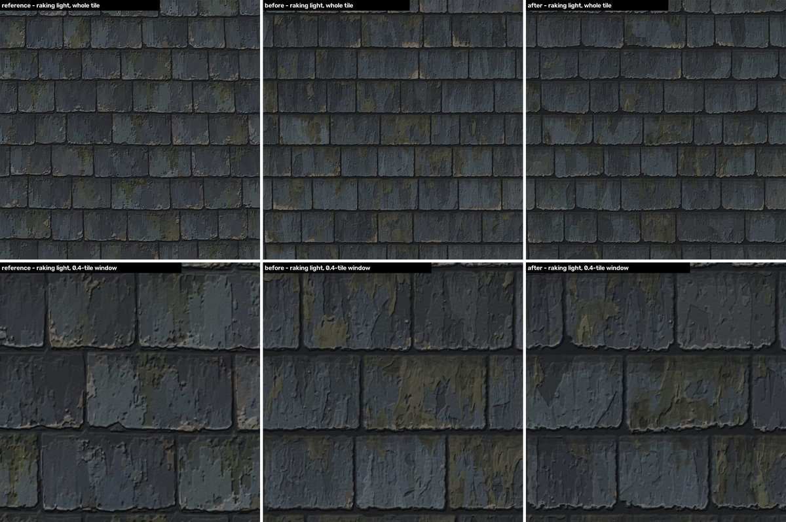

*The same three, lit from a low sun (top: whole tile; bottom: a 0.4-tile window). The after tile looks less like rippled planks than the before tile,
and still flatter than the reference, whose blotchy patches and chipped rims cast sharp little shadows.
One thing the picture does not say by itself: the light, the picture size and the window are the same for all three, but the reference is lit WITHOUT a roughness map (the reference set has none) while the before and after tiles are lit WITH theirs, so the shine of the left panel is not strictly comparable with the other two: compare the bumps and shadows, not the shine.*

More pictures: `look_fixes/before_after_zoom.jpg`, `look_fixes/maps_after.jpg` (the five maps of the new default), `look_fixes/tuning_pictures/`, the look checker's
crops in `verify_look_after_fixes/round_2/`.

### What was tried and did not help (kept out of the default)

| tried | what happened |
|---|---|
| `combine.tone_blend` 0.7 to 0.45 or 0.55 (the look checker's suggestion for more relief) | worse by eye, by the slope measures and by the score (overall 0.693 against 0.724 with 0.7). The slate faces went flatter and the lip showed as a thin line |
| `combine.tone_blend` 0.8 | slopes about 4 % higher, not different by eye under the raking light, and more paint-edge relief (faint contour lines) |
| `combine.height_gain` 1.7 with `tone_height` 0.4, and 2.4 with 0 | LOWERED the relief |
| `damage.sink_depth` 2.2 with `lip_height` 0.14 and `shadow_height` 0.2 | changed the relief by 0.01: nothing, because `tone_blend` 0.7 scales the real relief to 30 % |
| `colour_and_fade.tone_centre` 3.85 or 4.0 (to undo the darker tile) | raised the brightest slate and dropped the colour group from 0.755 to 0.692 (the feature-size cliff); set back to 3.7 |
| `moss.joint_preference` 0 | lowered the moss but left the straight cut at the joint; the new `side_clearance` fixed it |
| `outline_and_shadow.lip_breakup` 0.6, `damage.side_share` 0.05, `colour_and_fade.outlier_share` alone | moved a stripe measure away from the reference / invisible / no change in the brightest slate |
| `streak_width` 0.024, `edge_ragged` 0.002 to 0.003, `streak_bend` 0.012 to 0.02, `mottle_tallness` 1.2, fade 1.0 or 1.15 | none removed the straight-edged facets; the smaller streak width made the paint more upright-stripy; more fade gave a little more relief and inner contrast but more dark dots and more stripes |
| `outline_and_shadow.joint_texture` 0.5 at size 600 | looked like grit at full size; 0.35 at size 150 kept |

### What is still wrong (the look checker's second look, 20 October)

* **Straight-edged flat facets (a new fault, the first thing a person would point at).** About 14 slates carry a flat dark or pale polygon with
  straight slanting edges, like cut glass. The old tile and the reference have none. They come from the broader, taller paint cells (Voronoi cells in
  `colour_and_fade.py`) once the edge wobble was turned down. They also show as straight scratch lines under the raking light. The look checker tried
  `colour_and_fade.streak_bend` 0.045 on colour-only test tiles (the edges curve into soft lobes and the stripes fall from 2.20 to 1.98) and with
  `mottle_tallness` 1.1 the facets nearly vanish but the paint turns swirly. A proper fix needs a change in the code of that layer (idea: bend the cell
  coordinates with a medium-sized noise before the Voronoi, so no cell border runs straight for 60 dots). **Not done.**
* The lower rim reads as frayed or chewed (a thin pale-grey lip with a pink-orange fringe) instead of the reference's smooth pale line with a few chunky chips.
* The moss is slightly too pale and thinly spread at 3 x 3 scale (strong olive dots 2.3 % against 5.0 % in the reference).
* The relief is weaker than the reference and different in character.
* Landmarks that repeat when the tile is tiled: a grey-brown flat slate pair near the bottom, a dark mossy slate, the facet triangles. No seams.
* Small: the whole tile is a little darker; a short pale hairline; a black wedge where an upright joint meets a rounded corner.

### What this re-bake re-made, and what it did not

Re-made on the new default (sections 7.1 to 7.6): the default tile (by the tuner), the ladder, the eight variations (four with new settings), the seed
spread, the 2 x 2 area, the half-tile test, the independence re-test of the two changed layers, a 512-dot confirmation, the debug views, the controls table.
**Not re-made**: the 4 x 4 area (marked "before the look fixes"), `resolution/` (the 512 and 2508 pictures there are of the old default; its 1254 entries are
links which I pointed at the old default's pictures so the folder agrees with itself), `controls_sweeps/` (strips made at the layer builders' starting values or
on the old default), `reuse/` (the brick; the unchanged layer files with the new controls at their starting values should give the same brick,
but that was not baked again), `links_and_order/`, the independence of the three layer files that did not change.

## 7. Results

### 7.1 The default tile against the reference (a guide, not a target)

**Round 15 update.** The numbers below are for the NEW default tile (after the look fixes), baked by the tuner at 1254 dots through the harness (`outputs/default/`);
scores are read from `outputs/default/score_same_kind.json` and `score_pixel_for_transparency.json`. The "before" column is the old default
(`outputs/default_before_look_fixes/`, same measuring; the old file was re-scored by the tuner and gave the same numbers).

| same-kind measure | now | before the look fixes | in plain words |
|---|---|---|---|
| **overall** | **0.778** | 0.705 | |
| colour group | 0.822 | 0.701 | the brief's aim was 0.8 or more: **reached by this number** at the default seeds (0.822) and on average over five sets of seeds (0.810, section 7.3), but see the caution below |
| - colour distribution | 0.867 | 0.926 | the same colours in the same amounts (a little lower: the tile is a bit darker and bluer) |
| - colour spectrum | 0.707 | 0.609 | how much variation there is at each size |
| - colour orientation | 0.709 | 0.630 | which way the edges run |
| - colour scale (feature size) | 0.899 | 0.452 | how far the picture stays similar to itself sideways: 54 dots on ours now (258 before), 64 on the reference |
| - colour gradient | 0.858 | 0.753 | how sharp the edges are |
| height group | 0.735 | 0.654 | with `combine.tone_blend` 0.7: about 70 % of this height is paint brightness, not real relief (section 5) |
| normal group | 0.616 | 0.671 | **a weak signal, not a loss**: it depends on which normal map is scored. With the strength-7 normal of this table it fell (the tilt measure went 0.611 to 0.525 and the components 0.830 to 0.781; normal-to-height agreement 0.534 to 0.560, a tiny raw distance that jumps about); with the harness's own normal it ROSE from 0.604 to 0.690 (see "Which normal map?" below). It moves by about 0.07 either way |
| tiling | 1.0 | 1.0 | seamless |

**Which normal map?** (corrected: the first version of this guide had the two normal maps the wrong way round.) The normal group above is for
`outputs/default/normal.png`, made by `integration/make_normal.py` (3 x 3 slope of the 8-bit height, strength 7, the rule the reference's own normal map was made with).
The harness's own normal (`normal_harness_sobel.png`, a two-neighbour slope with a strength fitted to the reference's slope spread, 8.0 now) scores differently: for the old default the
strength-7 normal gave overall 0.705 (normal group 0.671) and the harness's normal 0.695 (normal group 0.604). For the new default the ladder table (7.2) shows both: overall 0.778 with the strength-7 normal,
0.789 with a harness-style normal made by `integration/score_set.py`.

**Both normal-group numbers, old and new tile, both ways** (added after the second honesty check, which scored both tiles both ways; the corrector scored them again, `look_fixes/corrections_after_honesty_check/`):

| normal map that is scored | normal group before | normal group now | overall before | overall now | normal-to-height agreement before / now |
|---|---|---|---|---|---|
| strength-7 normal (`integration/make_normal.py`, the table above) | 0.671 | 0.616 | 0.705 | 0.778 | 0.534 / 0.560 |
| the harness's own normal (`normal_harness_sobel.png`; fitted strength 7.37 before, 8.02 now) | 0.604 | 0.690 | 0.695 | 0.789 | 0.0 / 0.485 |

So the normal group moves by about 0.07 whichever way the normal is made: DOWN by 0.055 with the strength-7 normal, UP by 0.086 with the harness's own. That makes it a weak signal, neither a loss nor a gain. (Corrected: earlier versions of this guide, the known gaps below and the re-baker's summary said only that "the normal group fell (0.671 to 0.616)", which is true for one of the two methods.)
The same wrong-way-round error as the one corrected above sat in a note in `integration/takeover/measured_before_clean_up.json` ("the harness's own normal gives 0.534"): 0.534 is the strength-7 normal's agreement and the harness's own normal gives 0.0 for that tile. The note in that file is now corrected, and the same sentence in `final_report.json`.

**Caution about the colour group gain (0.701 to 0.822).** About three quarters of it (78 %: by the tool's weights 0.094 of the 0.121) is the "feature size" measure (0.452 to 0.899), which is a cliff: one small change of brightness
moved it by 0.3 in round 1 of the tuning. The other four colour measures together add the remaining 0.027 (22 %): without the feature-size measure the colour group, by the tool's own weights, went from 0.767 to 0.801, a real but small gain. (Corrected after the second honesty check: the first version said "almost all".) The gain also shows on all five seed sets
(section 7.3: feature size 0.90 to 0.96 on every set), so it is not a lucky draw; but the same-kind score is a guide, not a judgement of the look. The look checker, judging
by eye, said "nearly" the same hand (section 6b).

Mean colour (Lab): reference 25.2, -1.6, -1.0; default now 23.7, -1.8, -1.3 (before 25.1, -1.8, -1.0): a little darker and bluer. Height follows colour with correlation 0.989 (reference 0.993; before 0.987).

The dot-for-dot numbers, **for transparency only** (these are new slates, so they cannot match dot for dot), now / before: colour mean difference 9.9 / 10.5 (Delta E), structure (SSIM) 0.555 / 0.530,
edge skill 0.166 / 0.167, height error after best fit 37.3 / 37.7 steps of 255, normal error 16.3 / 16.9 degrees; tier "none" both times. The first slate build, which traced the reference, reached tier "close";
this build is not meant to.

### 7.2 What each layer buys (the ladder, **re-made after the look fixes**)

`ladder/ladder_table.md` (new table first, the old one under "before the look fixes"), sheet `ladder/ladder_sheet.jpg` (the same crop of every rung next to the reference; the old
sheet is `ladder/ladder_sheet_before_look_fixes.jpg`). 1254 dots, same seeds, **new default settings**. The rungs are baked by `tests/bake_tools.py` with the stack order and Amount changes in `ladder/ladder_views.json`.

| rung | what is in the picture | colour group (before) | of which: feature size (before) | height group (before) | overall, harness-style normal (before) | overall, strength-7 normal |
|---|---|---|---|---|---|---|
| 0 | layout and joints, every slate one flat colour | 0.410 (0.322) | 0.065 (0.065) | 0.441 (0.371) | 0.459 (0.402) | 0.442 |
| 1 | + colour and fade | 0.728 (0.480) | 0.798 (0.000) | 0.691 (0.598) | 0.735 (0.570) | 0.718 |
| 2 | + moss | 0.792 (0.636) | 0.902 (0.369) | 0.737 (0.632) | 0.774 (0.656) | 0.770 |
| 3 | + damage (the default tile) | 0.822 (0.701) | 0.899 (0.452) | 0.735 (0.654) | 0.789 (0.695) | 0.778 |
| - | the default WITHOUT outline and shadow | 0.676 (0.567) | 0.649 (0.489) | 0.403 (0.367) | 0.601 (0.539) | 0.588 |

"Overall, harness-style normal" is the older way of the ladder (`integration/score_set.py`: the normal made from the height by a two-neighbour slope with a fitted strength). "Overall, strength-7 normal" is the
way of the default tile's own score file; rung 3 gives the same 0.778 as `outputs/default/score_same_kind.json`. (Corrected: the first version said rung 3 showed "0.695 instead of the harness's 0.705"; it is the strength-7 normal
that gave 0.705, and the harness-style normal that gave 0.695.)

What each layer adds, step by step, and what taking the outline out costs (corrected: the first version said "the drawing layer is worth most" for both groups; for the colour group it is not):

| step | colour group | height group | overall (harness-style normal) |
|---|---|---|---|
| rung 0 to 1: + colour and fade | +0.318 | +0.250 | +0.276 |
| rung 1 to 2: + moss | +0.064 | +0.046 | +0.039 |
| rung 2 to 3: + damage | +0.030 | -0.002 | +0.015 |
| the finished tile minus the same tile without outline and shadow (a cost of REMOVING, a different question) | +0.146 | +0.332 | +0.188 |

So colour and fade adds the most to the colour group (+0.318, the part-built picture without it is flat slates), and the drawing layer (outline and shadow) is the one whose removal costs the most
of the HEIGHT group (0.332), and overall (0.188 against 0.276 for adding colour and fade: adding colour and fade is still the larger step). The rung 0 scores rose because the look fixes also changed the layout and the joints
(rounder corners, uneven lower edges, no black drips, a lighter two-step shadow).

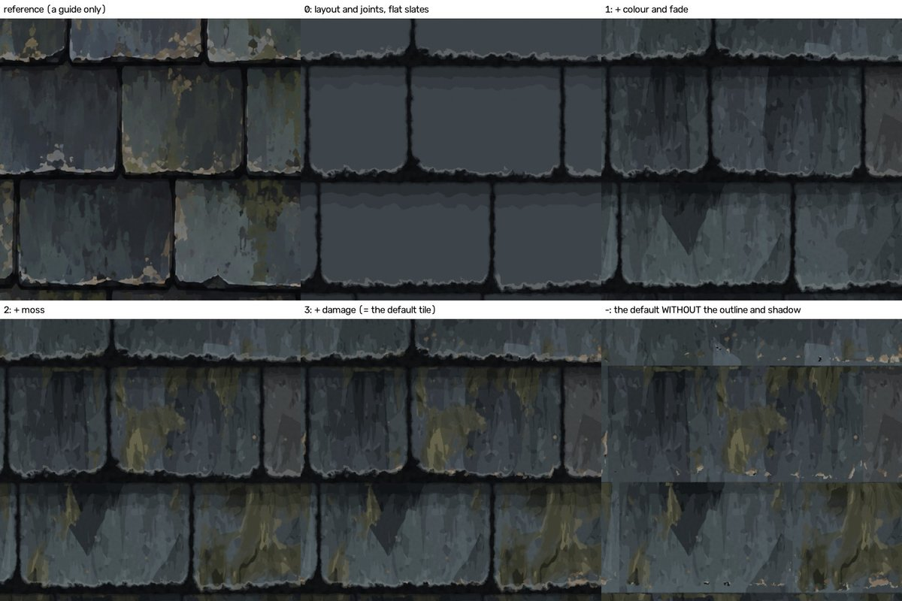

### 7.3 Seeds and settings variations (**re-made on the new default**)

Eight tiles from eight settings variations, 1254 dots each, on top of the NEW default, contact sheet with each tile's settings written under it and its old score in brackets:
`variations/contact_sheet.png` (the old sheet is `variations/contact_sheet_before_look_fixes.jpg`; settings in `variations/variations.json`, where the entry "before the look fixes" keeps the old settings and scores;
`variations/variations_before_look_fixes.json` and `same_kind_colour_scores_before_look_fixes.json` are plain copies of the old files). Colour group of each against the reference:

| variation | what changed | colour group now | before |
|---|---|---|---|
| v1 new seeds | five new seeds, same settings (unchanged) | 0.811 | 0.765 |
| v2 more moss | **new settings**: moss coverage 0.62 (default 0.30), patchiness 0.5, lichen 0.3, softer rim (`rim_opacity` 0.7): a damp roof with moss on nearly every slate | 0.700 | 0.760 |
| v3 heavily damaged | unchanged settings: deep flakes on every lower edge, cracks, scratches, pits, bites, broken corners | 0.761 | 0.733 |
| v4 faded and sun-bleached | **new settings**: long fade, bigger and stronger bleached areas (`bleach_amount` 1.0, `bleach_cover` 0.55, `patch_size` 0.6), no damp stain, lighter (`tone_centre` 4.6) and greyer (`tint_amount` 0.5) slates, little moss | 0.694 | 0.554 |
| v5 fresh and clean | **new settings**: even tone (`tone_spread` 0.3, no outlier slates, less tint), slight paint streaks kept (`fade_amount` 0.6, `streak_contrast` 0.9), almost no damage, no moss | 0.534 | 0.463 |
| v6 dark and wet | **new settings**: darker slates (`tone_centre` 3.0), damp patches that stay lighter than the joints (`stain_amount` 0.6, `stain_cover` 0.4, `patch_size` 0.3), rougher, some moss | 0.693 | 0.550 |
| v7 pale and old | unchanged settings: pale warm-grey slates, flaked edges, lots of lichen | 0.591 | 0.544 |
| v8 big slates | unchanged settings: 6 rows of 4 slates instead of 8 of 6 | 0.732 | 0.746 |

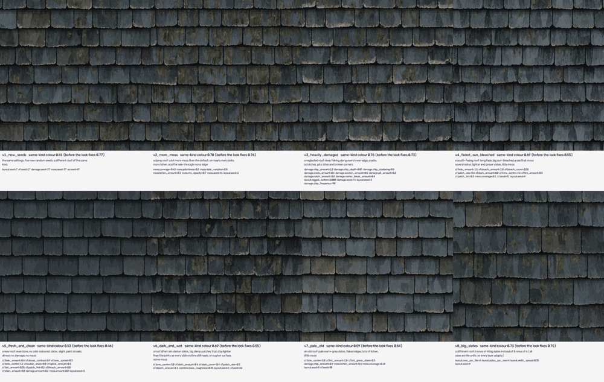

**How the four new variations were made (the look checker's advice, problem 10 of `verify_look/LOOK_VERDICT.md`, tried first and kept where it helped by eye).** I baked small colour-only tests at 512 dots (17 candidates, in
two rounds, `variations/tuning_512/`, sheets `sheet_*_round_*.jpg`; the advice and my other tries are in `views_round_1.json` and `views_round_2.json`), looked at them next to the new default, chose, and then baked the eight at 1254.
* **v6 dark and wet.** The checker's advice (stain 0.5, cover 0.3, tone centre 2.8) gave a dark roof in which the slate outlines read, but with brownish dark patches; a version with a slightly lighter tone centre 3.0 and bigger, gentler damp patches read best by eye: every slate outline still reads and the joints stay darker than the damp patches. (v6 is one of the darkest tiles; I did not measure the share of near-black dots for it.)
* **v5 fresh and clean.** The advice (fade 0.5, streak contrast 0.8) kept some paint streaks. The brown-grey odd slates of the first try came from the default's stronger tint, so tint and outliers were turned down; the result is even but not flat vector fills.
* **v4 sun-bleached.** The advice (bleach patch size 0.35, stronger bleach) still read only as a lighter tile. Much bigger pale areas (patch size 0.6) with greyer, warmer slates read better. It is the weakest of the four: at thumbnail size it still reads mostly as a lighter roof.
* **v2 more moss.** The advice ("distinct once the default moss is reduced") was true only in part: the new default has moss coverage 0.30 and the old v2 only 0.34, so v2 needed coverage 0.5 to 0.62 to be told apart. 0.62 with softer rims was chosen; 0.5 was a middle step; 0.62 everywhere with see-through cores looked like green carpet.

The low scores of v4, v5, v6 and v7 are expected: they are meant to be DIFFERENT roofs from the reference. The colour scores moved with the settings AND with the new default, so a before/after comparison of one variation mixes both.

**Seed spread (re-made).** The default settings with five different sets of seeds (the default tile, v1, and three more baked now: `variations/seed_spread/seed_spread.json`, small pictures `seeds_b/c/d_colour_small.jpg`,
the old ones kept as `..._before_look_fixes`):

| | default seeds | v1 | seeds b | seeds c | seeds d | mean | spread (highest minus lowest) |
|---|---|---|---|---|---|---|---|
| colour group now | 0.822 | 0.811 | 0.824 | 0.802 | 0.792 | **0.810** | 0.032 |
| colour group before the look fixes | 0.701 | 0.765 | 0.769 | 0.753 | 0.710 | 0.740 | 0.068 |
| feature size now / before | 0.899 / 0.452 | 0.961 / 0.878 | 0.940 / 0.845 | 0.913 / 0.850 | 0.927 / 0.854 | | |

So the default seeds are no longer the unlucky draw (they are the second highest of five), and four of the five sets are at or above the brief's 0.8. The gain shows on every set, mostly as a gain of the feature-size measure (the cliff of section 7.1).
Corrected statement about noise: the 0.032 / 0.068 spread is how much the score differs between DIFFERENT seed sets; it is not the noise of a same-seed comparison, which is smaller. A fair rule is: do not adopt a setting because of a gain
on one seed set, and bake it on at least three.

### 7.4 Independence (every layer, Amount 0 and Seed + 1)

**First version, before the look fixes (old default settings):** `tests/independence_full/independence_table.md` (384 dots; pictures `independence_sheet.png` and `<layer>_<variant>_where.png`, which show in
white where the finished picture changed). A dot counts as changed when the colour moves by more than 1 step of 255, the height by more than 0.0005 or
the roughness by more than 0.004.

| layer changed | variant | its own region (% of dots) | colour changed % | ... of which OUTSIDE its region | height changed % (outside) | roughness changed % (outside) |
|---|---|---|---|---|---|---|
| layout | Seed + 1 | 100 | 96.9 | 0.0 | 97.9 (0.0) | 92.2 (0.0) |
| colour and fade | Amount 0 | 95.0 | 74.8 | 0.0 | 93.2 (0.0) | 78.3 (0.0) |
| colour and fade | Seed + 1 | 95.0 | 76.0 | 0.0 | 93.7 (0.0) | 85.0 (0.0) |
| damage | Amount 0 | 5.3 | 4.9 | 0.0 | 5.1 (0.0) | 4.6 (0.0) |
| damage | Seed + 1 | 10.0 | 9.0 | 0.0 | 9.4 (0.0) | 8.1 (0.0) |
| moss | Amount 0 | 19.9 | 18.4 | 0.0 | 19.4 (0.0) | 19.2 (0.0) |
| moss | Seed + 1 | 39.3 | 35.9 | 0.0 | 38.2 (0.0) | 34.2 (0.0) |
| outline and shadow | Amount 0 | 37.4 | 35.9 | 0.0 | 36.9 (0.0) | 33.0 (0.0) |
| outline and shadow | Seed + 1 | 41.1 | 29.0 | 0.0 | 34.3 (0.0) | 19.4 (0.0) |

Other layers' own masks: when DAMAGE changes, the MOSS mask changes on 0.92 % (Amount 0) and 1.57 % (Seed + 1) of the dots, all inside the damage
region: that is the declared link. Every other cross entry is exactly 0. A layer's "own region" is where its mask is above 0 before or after the change
(for COLOUR AND FADE, the bottom layer, every slate dot; for LAYOUT everything).

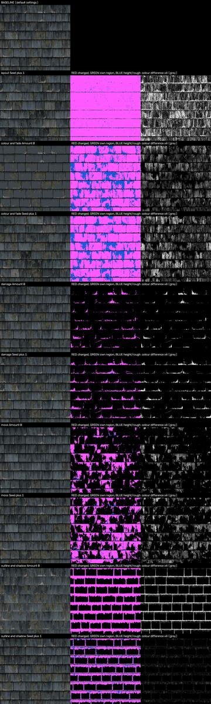

**Round 15: independence run again for the two layers whose files changed** (`tests/independence_changed_layers_after_look_fixes/`, 512 dots, NEW default settings; the tuner also ran it at 384 dots,
`look_fixes/round2/independence/`). Only MOSS and OUTLINE AND SHADOW got new code (six new controls, section 6b), so only those two were run again, each with Amount 0 and Seed + 1; the full test above
(all five layers, 384 dots, old default settings) was NOT run again: the files of layout, colour and fade, damage and combine did not change in round 15. The script is the tuner's
`look_fixes/independence_two_layers_bake.py` and `_analysis.py`, which reuse the counting rules of `tests/independence_full.py` (a dot counts as changed when the colour moves by more than 1 step of 255, the height by more than 0.0005, the roughness by more than 0.004).

| layer changed | variant | its own region (% of dots) | colour changed % | ... of which OUTSIDE its region | height changed % (outside) | roughness changed % (outside) |
|---|---|---|---|---|---|---|
| moss | Amount 0 | 17.7 | 16.5 | 0.0 | 17.3 (0.0) | 17.2 (0.0) |
| moss | Seed + 1 | 36.3 | 33.8 | 0.0 | 35.5 (0.0) | 31.8 (0.0) |
| outline and shadow | Amount 0 | 38.4 | 37.4 | 0.0 | 38.0 (0.0) | 34.8 (0.0) |
| outline and shadow | Seed + 1 | 40.8 | 30.7 | 0.0 | 39.3 (0.0) | 11.5 (0.0) |

Every other layer's own mask (colour and fade, damage, moss, outline and shadow, slate numbers) is exactly unchanged, inside and outside, whichever of the two layers is switched off or re-seeded. So the two changed layers are still independent.
Also checked by the tuner: with the six new controls at their starting values the picture is bit for bit the old one (384 dots: colour, height, roughness differ by 0).

### 7.5 Seamless (the half-tile test, **re-run after the look fixes**)

`tests/half_tile_layers/half_tile_table.md` (512 dots; the recipe's `shift` parameter slides everything by half a picture; the old table is `half_tile_table_before_look_fixes.md` and `.json`). Mean difference in
steps of 255; "control" = the same comparison with the picture rolled 7 dots too far, which must differ a lot. **Eight Blender runs, on the NEW default settings; the baked pictures were deleted afterwards to save disk (the table and numbers are kept).**

| tiles across | picture | raw mean difference (before) | after a 2-dot blur (before) | control (blurred) |
|---|---|---|---|---|
| 1 | finished colour | 1.65 (1.83) | 0.31 (0.34) | 15.0 |
| 1 | finished height | 2.19 (2.55) | 0.45 (0.49) | 29.6 |
| 1 | moss mask | 1.43 (2.42) | 0.40 (0.74) | 29.7 |
| 1 | damage mask | 1.05 (1.05) | 0.34 (0.34) | 9.9 |
| 1 | outline and shadow mask | 1.62 (1.54) | 0.41 (0.37) | 52.4 |
| 2 | finished colour | 2.53 (2.81) | 0.47 (0.52) | 17.6 |
| 2 | finished height | 3.82 (4.24) | 0.71 (0.76) | 34.0 |
| 2 | colour against itself rolled by ONE base tile (must differ: new content) | 20.3 (24.3) | 13.3 (16.8) | |

(All sixteen rows are in the table file: finished roughness, the colour-and-fade mask and the slate numbers too, for one tile and for the 2 x 2 area.) The blurred differences are 18 to 143 times smaller than the controls (over all sixteen rows of the table file: the smallest ratios are the 2 x 2 damage mask, 18, and the 2 x 2 colour-and-fade mask, 25; the largest are the two piece-number rows, 143 and 132, and the one-tile outline-and-shadow mask, 128). The one-tile picture and the 2 x 2 area both wrap exactly, and the 2 x 2 area is new content, not a copy.
Against the old table nearly everything got smaller, and the moss mask became closer to exact, probably because the moss clumps are smaller and softer. **(Corrected after the second honesty check: an earlier sentence here said "Nothing got worse", which was not quite true.)** A few numbers went UP slightly: the outline-and-shadow mask (one tile: raw 1.54 to 1.62, blurred 0.37 to 0.41; 2 x 2 area: raw 2.99 to 3.05, blurred 0.68 to 0.74), the 2 x 2 damage mask (blurred 0.673 to 0.688; for one tile raw 1.048 to 1.054), and the share of outline-and-shadow dots more than 10 steps apart (4.9 % to 6.4 % for one tile, 9.5 % to 11.6 % for 2 x 2). All of these are still tiny next to their controls (52 and 70 for the outline-and-shadow mask, 10 and 13 for the damage mask).

Where the raw difference comes from (corrected: the first version blamed only Cycles' 4-sample anti-aliasing). A stricter point-sampled run by the honesty check (`verify/`, 1 sample, 0.01 filter) showed that height, all four masks and the slate numbers are EXACT
(at most 0.03 % of dots differ, at isolated boundary dots) and that the colour still differs by 1 to 2 steps on about 57 % of dots: that is Blender's default 8-bit dither (noise added when the picture is saved), not the recipe. So the seamless conclusion is stronger than the raw
table shows. The point-sampled run was not repeated for the new default.

### 7.6 A bigger area of new slates (`recipe.tiles_across`)

**2 x 2 (2508 dots), re-baked after the look fixes** (`area/area_2x2/`; measures in `area_measures.json`, the old ones in `area_measures_before_look_fixes.json`; 1344 seconds for colour and height with the machine very busy, load average about 7 to 10, against 522 seconds before at a load of about 4;
pictures `area_overview.png` and `new_area_against_copied_tile.jpg`, old ones `..._before_look_fixes`):
* Seams: the jump across the line where a base tile would end is 0.80 (columns) and 0.51 (rows) times a normal jump between neighbouring dots (before 0.78 and 0.58); ordinary columns have a median of 0.98 and rows 0.65 (before 0.96 and 0.74). So the base-tile lines are no different from any other line: no seam.
  (The reference tile itself has 1.7 to 2.5 at its own wrap edge; the wrap-round edge of the area: 0.90 and 0.61.)
* Repeats: the correlation of the area with itself shifted by one base tile is 0.47 / 0.35 / 0.34 (x / y / diagonal) (before 0.44 / 0.29 / 0.27); a real copy gives 1.0; shifts that are NOT a base tile give 0.46 / 0.20 / -0.13 / 0.35 (the background level of a roof with rows).
  Only 23 to 27 % of dots are nearly equal one base tile away (before 18 to 21 %; a copy: 100 %). The four base tiles differ from the first by 7.0 to 8.0 brightness steps on average (before 8.2 to 9.5). The shift correlations are a little higher than before, and so is the background level (the new rows are more regular), so this is not a repeat.
* Same look per dot: each 1254-dot quarter scores 0.831 / 0.795 / 0.804 / 0.805 on the colour group (before 0.701 / 0.751 / 0.705 / 0.752; the default tile 0.822). The top-left quarter is NOT the same picture as the default tile (mean difference about 18 steps of 255); I could not explain why the old table gave the default's exact score (0.701) for it, and the old overview shows
  the same kind of difference (about 16 steps), so the old equality looks like a coincidence of the score, not a copy.
* By eye (`area_overview.png`): one continuous roof, no visible repeat, no line at the tile edges; the straight-edged flat paint facets (section 6b) are visible on many slates across the area.

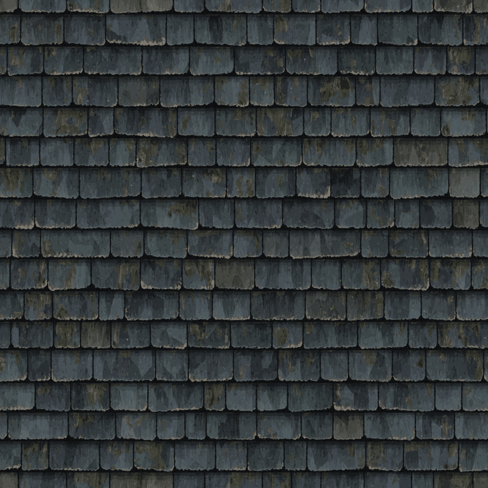

**4 x 4 (5016 dots, colour only): NOT re-baked, "before the look fixes".** `area/area_4x4/` was baked from the OLD default (it would have taken about 30 to 60 minutes on this busy machine). Its numbers are still true for the old default, and only for it:
* Seams: the jump across the three base-tile lines is 1.07, 1.14 and 0.90 (columns) and 0.66, 0.72, 0.67 (rows) times a normal jump; ordinary columns have a median of 0.98 (90 % of them below 1.15) and ordinary rows 0.74. The base-tile lines are ordinary lines: no seam.
* Repeats: correlation with itself one base tile away 0.42 / 0.34 / 0.33 (x / y / diagonal), a real copy 1.0, shifts that are not a base tile 0.43 / 0.13 / -0.07 / 0.29. The 0.34 straight down is the rows lining up (one base tile is exactly 8 rows), not a repeat: only 19 to 21 % of dots are
  nearly equal one base tile away (a copy: 100 %), and the 16 base tiles differ from the first by 8.3 to 9.7 brightness steps on average.
* Same look per dot: the four 1254-dot quarters of the top-left 2 x 2 score 0.768 / 0.762 / 0.717 / 0.748 on the colour group (the old default tile 0.701).
* By eye (`area_overview.png`, the whole area shrunk to 1254 dots): one continuous roof, no visible repeat, no lines at the tile edges. (1595 seconds, 27 minutes, on 2 threads; the colour picture is 31 MB.)

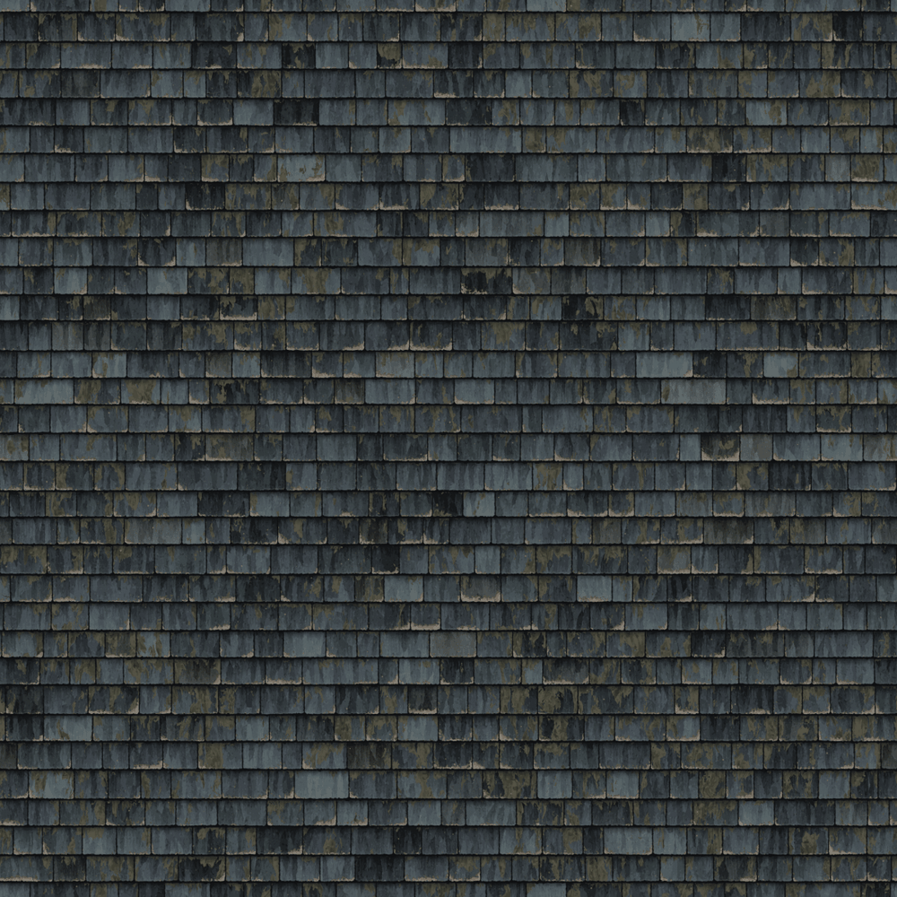

### 7.7 Resolution (the same settings at 512, 1254 and 2508 dots)

**`resolution/whole_recipe/` is "before the look fixes".** The 512 and 2508 bakes there were made from the OLD default and not made again (the 2508 bake of all three maps took 18 minutes on a quiet-ish machine and would take longer now). Its 1254 entries are symbolic links (corrected: the first version did not say so; the "1254" files are links to the default tile, not a separate bake); after the look fixes the links
would have pointed at the new default, so I pointed them at `outputs/default_before_look_fixes/` and the folder agrees with itself again. The table below is the old one, unchanged:

| bake | colour + height + roughness, seconds | load on the machine |
|---|---|---|
| 512 dots | 35 | about 4 (another bake running beside it) |
| 1254 dots | 179 | about 4 |
| 2508 dots | 1088 | about 4 (another bake running beside it for most of the time) |

| bigger -> smaller (old default) | colour mean difference (of 255) | height mean difference | dots more than 40 steps apart |
|---|---|---|---|
| 2508 -> 1254 | 1.0 | 1.1 | 0.000 % colour, 0.001 % height |
| 1254 -> 512 | 1.7 | 2.4 | 0.000 %, 0.010 % |
| 2508 -> 512 | 1.6 | 2.2 | 0.001 %, 0.007 % |

**Round 15 confirmation at one smaller size** (`tests/confirm_512_after_look_fixes/`, one Blender run; `tests/compare_512_with_1254.py`; `tests/confirm_512_after_look_fixes_differences.json`; picture `confirm_512_after_look_fixes_side_by_side.jpg`).
The new default baked at 512 dots with the same settings and the 1254-dot default shrunk to 512, compared dot by dot:

| picture | mean difference (of 255) | dots more than 40 steps apart | the old default, 1254 -> 512 |
|---|---|---|---|
| colour | 1.52 | 0.000 % | 1.7 |
| height | 2.08 | 0.022 % | 2.4 |
| roughness | 1.27 | 0.000 % | |

So the new default also looks the same at 512 dots (the same slates, streaks, moss and chips; only edges and specks have fewer dots). The colour group of the 512 picture is 0.812 (1254: 0.822; the scorer enlarges a smaller picture, which blurs it). 2508 was not baked again for the new default. The 512 bake of all maps took 112 seconds on a busy machine (35 seconds before, on a less busy one; not comparable).

Baking the same settings twice gives the same picture dot for dot: for the old default the 1254-dot resolution entry and `outputs/default` were checked identical (they are the same file, see above) and the honesty check baked the old default again separately and found the colour, height and roughness identical. The tuner baked its round-1 settings twice and got identical maps (the same fitted strength and the same scores); the new default was not baked twice.

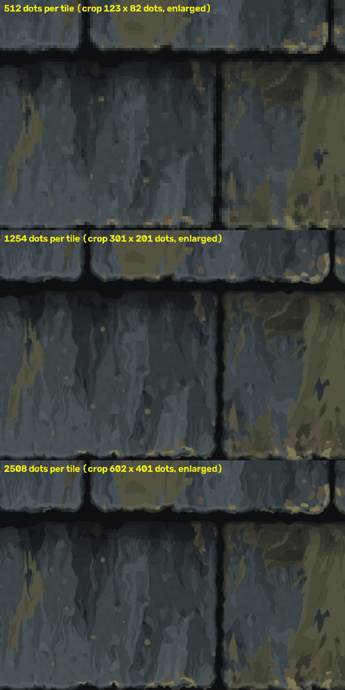

### 7.8 Reuse on another layout (brick) - NOT re-baked after the look fixes

The brick pictures below were made before the look fixes. The unchanged layer files `moss.py` and `outline_and_shadow.py` now have six new controls that start at the old behaviour, and the brick settings do not set them, so the brick should come out the same; that was not baked again, so it is untested.

See section 8 of the Lessons guide for what had to change (a 40-node brick layout and 53 settings; no line of any layer file) and
`reuse/reuse_sheet.png`. **After the restart** I also ran one settings-only round on the brick (`reuse/settings_round_2/`, 768 dots, colour only):
redder bricks and light mortar made it read much more like a brick wall (colour group against the brick reference 0.154 to 0.19); `fade_direction` 0
did NOT remove the slate-like pointed tongues, and soot made with the damp-stain setting hardly shows.

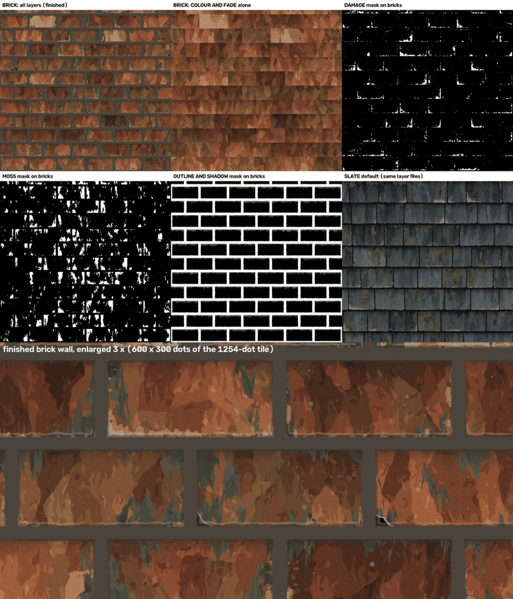

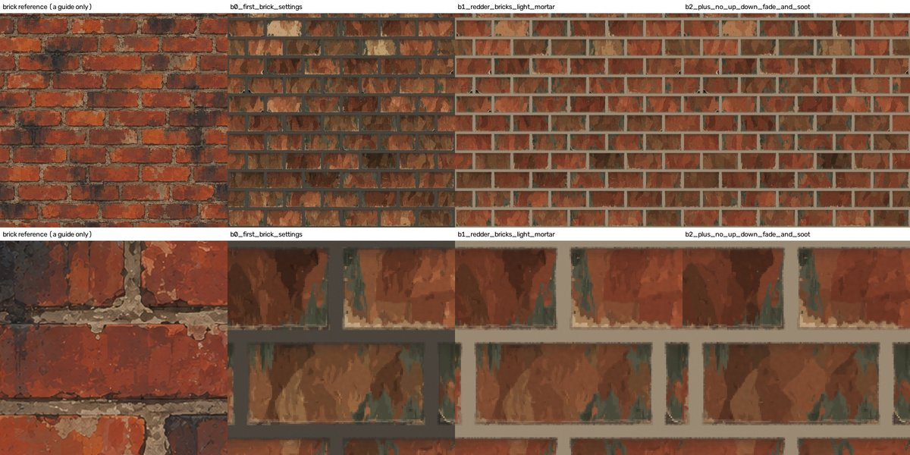

### 7.9 Time

Building the node tree takes about half a second. At 1254 dots one map of the full recipe took about 60 to 70 seconds on 2 threads when the machine was less busy (colour 69 s, height 65 s, roughness 56 s in the OLD default bake); the layout with empty layers took 13 to 16 seconds per map (`tests/timing.json`). The four layers
cost about 50 seconds per map together. **After the look fixes, with another job always running beside, load average 7 to 10:** the new default (all five maps and the extra bump-node normal) took 587 s; the four ladder rungs (colour and height each) about 8 minutes in one run; one 1254-dot colour tile 100 to 170 s;
the 2 x 2 area (2508 dots, colour and height) 1344 s (old default: 522 s at a load of about 4); a 512-dot bake of all maps 112 s (old: 35 s). The new layers did not make the recipe slower in any way I could tell apart from the load. The 4 x 4 area (5016 dots, colour only) took 1595 s for the old default and was not baked again.
Nothing here was timed on a quiet machine.

## 8. Tested, not tested

**Tested (ran it, numbers above):** every layer alone (debug views of mask, colour, height and roughness, `debug_views/`); the whole recipe at 512,
640, 768, 1254, 2508 and 5016 dots; Amount 0 and Seed + 1 for every layer; the half-tile test for one tile and a 2 x 2 area and for every layer's mask;
eight settings variations; the 2 x 2 area; the declared link (colour and height); the stack order changed; `combine.tone_blend` at 0, 0.35, 0.4, 0.7, 1;
the layers on a brick layout; the settings audit (1.7 KB for the first 49 entries, 2.4 KB and no problems for the 73 now); the controls table regenerated from the layer files (`recipe/make_controls_table.py`, identical to the
one on disk); baking the same settings twice (identical pictures).

**Tested in round 15 (ran it, looked at the result):** the new default tile at 1254 dots (by the tuner, with the look checker looking twice); the ladder, the eight variations (17 small test bakes at 512 dots for the four that changed), the seed spread and the 2 x 2 area, all on the new default;
the half-tile test (one tile and 2 x 2, finished maps and every layer's mask) on the new default; the independence of MOSS and OUTLINE AND SHADOW (Amount 0 and Seed + 1, 512 dots; also 384 dots by the tuner); a 512-dot bake of all maps against the 1254-dot default shrunk;
the debug views (every layer alone) again; the settings audit; the controls table made again. The tuner also checked that the six new controls change nothing at their starting values (384 dots: bit for bit).

**Not tested:** the recipe inside Blender's interactive Shader editor by a person (switching boxes off by hand; all tests were command-line bakes); EEVEE
(no graphics card here); GPU rendering; bakes on a quiet machine (every time above was measured with other bakes running); `recipe.tiles_across` 3 or
other odd numbers; any `layout.rows_per_tile` or `slates_per_row` other than 8 x 6 and 6 x 4; independence at 1254 dots (it was tested at 384 and 512);
the reuse layers on any layout other than brick, and the half-tile test or the independence table on the brick (only a simple wrap-edge check: no seam); a real 3D render of the maps on a roof (lighting, normal direction checked only by the scores).

**Not tested after the look fixes (round 15):** the 4 x 4 area, the resolution bakes at 512 / 2508 for the new default (only one 512 confirmation), the brick reuse, the independence of layout, colour and fade and damage (their files did not change), the full independence table at 1254 dots,
other seeds than the five sets of 7.3 for the tuned settings (all tuning was done on the default seeds), other light directions than the look checker's single raking light, any 3D render of a roof, the point-sampled half-tile test (only the ordinary one was run again), the new variations on other seeds, and the look of the variations at 1254 dots beyond the contact sheet and four crops.

## 9. Dead ends and known gaps (honest)

Dead ends recorded by the builders and the first integrator:
* Smooth blends of tones: they look airbrushed; flat steps (rounding to the palette) are what reads as paint (`patch_hardness` strip).
* Tall patches the whole slate high (`mottle_tallness` 2.2): slates looked like corrugated sheets of stripes.
* Free moss blobs (`clump_strength` high): camouflage, the first build's weakness.
* Stronger green tints on slates (round 11): lowered the colour group (0.658) and looked dyed.
* A smooth shadow under each row (`shadow_tiers` 0): airbrushed.
* Real relief only (`tone_blend` 0): honest, but the same-kind height score is lower because the reference height was made from the colour.
* Round 15: lowering `combine.tone_blend` for more relief (0.45, 0.55), raising `combine.height_gain`, deeper chips with a higher lip (the look checker's relief suggestions): worse or no change, because `tone_blend` 0.7 scales the real relief to 30 % (section 6b).
* Round 15: every settings-only attempt to remove the straight-edged paint facets (narrower streaks, more edge wobble, more streak bend up to 0.02, taller or shorter patches): none worked well enough; the proper fix is code in `colour_and_fade.py` (section 6b).
* Round 15: a joint mottle of 0.5 at 600 mottles looked like grit at full size.

Known gaps:
* (Old, before round 15: the colour group was 0.70 at the default seeds, and the moss and tan breaks were more and more gathered than the reference's.) **Now** the colour group is 0.822 at the default seeds and 0.810 on average over five sets of seeds, so the brief's 0.8 is reached by this number; but about three quarters of the gain (78 %; corrected after the second honesty check, the first version said "almost all")
  is the feature-size measure (a cliff), the normal group is a weak signal (it fell 0.671 to 0.616 with the strength-7 normal and rose 0.604 to 0.690 with the harness's own normal, section 7.1), and by eye the tile is "nearly" the same hand, not the same hand (section 6b).
* **Straight-edged flat paint facets** on about 14 slates (the first thing a person would point at); the proper fix is code in `colour_and_fade.py`. Not done.
* A frayed pale-grey and pink lower rim instead of smooth pale line with a few chunky chips; the relief weaker than the reference (mean tilt 20.2 against 23.7) and made of thin scratches; the whole tile a little darker (mean lightness 23.7 against 25.2);
  a few flat grey-brown slates that repeat as landmarks when tiled; moss slightly too pale and thin.
* The moss is now a see-through wash with soft edges, but the look checker found it a dull brownish olive with a combed vertical texture, not the reference's yellower dabs.
* No control strips exist for the LAYOUT layer (the brief asked for two or three per layer), and the strips of the other layers were not made again after the look fixes.
* The four variations that were retuned in round 15 are the weakest part of the re-bake: v4 (sun-bleached) still reads mostly as a lighter tile, and v6 is dark; v5 and v6 are untested on other seeds.
* The widest slate in 48 is about 1.2 times the median width; the reference has one about 2 times (layout's random widths are not heavy-tailed enough).
* No overlap of slates (a slate lying on the one below); the dark band and the shadow stand in for it.
* The declared link is read dot by dot: "moss next to damage" cannot be said, only "on" or "not on" damage.
* The height defaults to 70 % paint brightness, not the pure real relief the brief described (section 5).
* The paint layer's tongues always hang from the top of a piece (good for slate, wrong for brick).

## 10. Where everything is

See `README - folder map.md`. The numbers of this guide are collected in `final_report.json` (round 15's numbers are in its section "look fixes (round 15)"). What I re-ran after the restart and after the look fixes is listed in the
README, and for the restart in `integration/takeover/` (the chain scripts `run_chain_d.sh` to `run_chain_h.sh` and their logs; F and G were stopped part way and finished by H, as noted at their tops).
