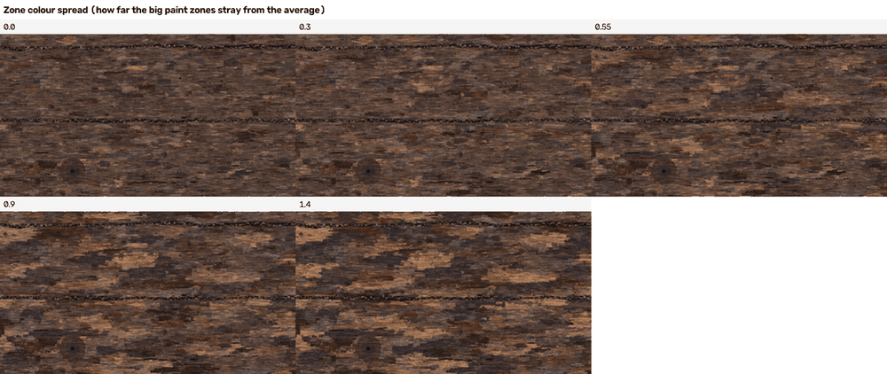
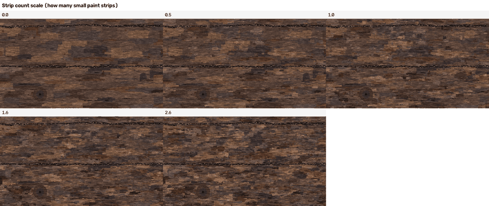
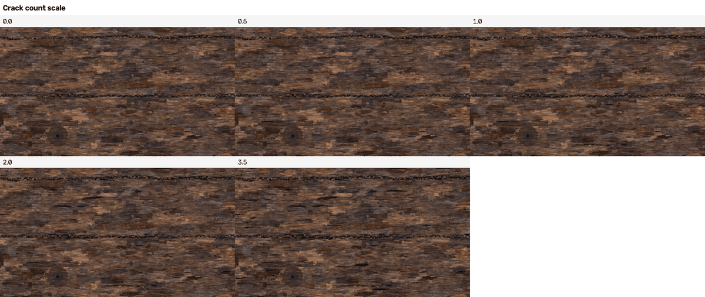
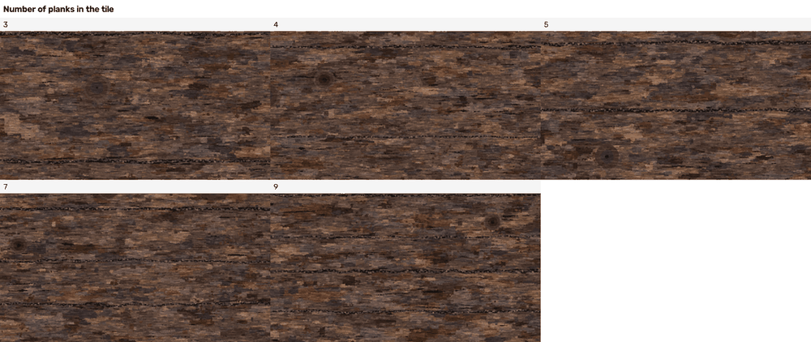
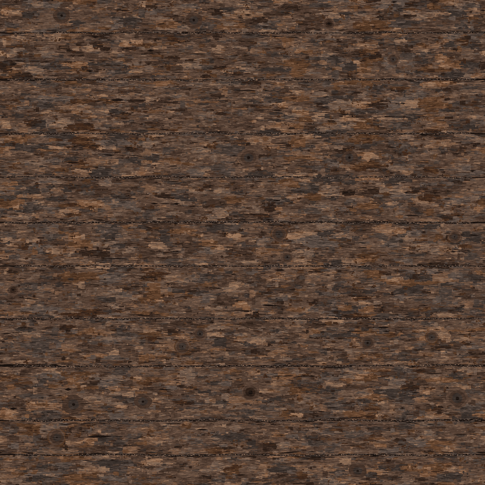

# 04 Recipe - wood - how it is made

What this is: the full recipe for the aged wood planks, from "look at the reference" to "bake new tiles and a bigger area", written for a person who is not a programmer. It says what every Blender tool in the recipe is, which settings matter, what changing them does (with small pictures), how the reference was analysed, what the description file looks like, every measured result (every layer, every size class), and what did not work. A companion file, "04 Lessons - wood - what carries over to other surfaces.md", is the short checklist for starting a different surface.

Words used the same way everywhere: the **tile** is the 1254 x 1254 picture. A **dot** is one dot (pixel) of it. The **description** is the small file the generator is driven by. A **patch** is an area of one flat colour. A **layer** is one kind of thing in the description (planks, paint, cracks, knots, splatter, pebbles). The **ladder** is the list of descriptions from tiny to big and what accuracy each reaches. **Tracing** means the description lists the outlines of the actual patches of the reference; **inventing** means it only holds numbers from which a sampler draws NEW patches of the same kind. **KB** means 1024 bytes (the unit the project's size check, `lib/description_audit.py`, uses for its 8 / 64 / 512 KB limits). An independent checker re-ran this work afterwards; what it confirmed and what was corrected is listed in the last section, "Checked independently".

**How to read the measures** (from the project's two comparison tools, `lib/pixel_compare.py` and `lib/texture_compare.py`):
* **colour SSIM** ("structural similarity"): a number from 0 to 1 that says how alike the light-and-dark structure of two pictures is, dot for dot. 1 = the same picture.
* **colour difference (Delta E)**: the average difference in colour between two dots in the same place, in the standard colour-difference unit. 0 = the same colour; about 2.3 is the smallest difference most people can see side by side; 10 is clearly a different shade.
* **edge skill**: how many of the reference's edges the generated picture puts within 2 dots of the same place, with the share a wrongly placed copy would get by luck taken off. 0 = no better than luck, 1 = every edge in place.
* **height error**: the average difference between the generated and the reference height picture, in steps of 255, after the best brightness-and-contrast fix.
* **normal angle**: the average angle, in degrees, between the generated and the reference normal map. Yardstick: a completely flat normal map is 24.1 degrees off on this wood.
* **tier**: a label made from those numbers; a tier is reached when ALL its limits pass. "layout": edge skill at least 0.30, colour difference at most 20, height error at most 40. "close": edge skill 0.55, SSIM 0.60, colour difference 10, height error 20, normal angle 12 degrees. "exact": edge skill 0.85, SSIM 0.92, colour difference 3, height error 6, normal angle 4 degrees.
* **"same kind" score**: texture_compare's overall score (0 to 1): does it look like the same KIND of surface, wherever things are? Other real reference surfaces score 0.16 to 0.50 on today's tool (not "about 0.1" as the project notes said: `cookbook/06 Guide - baking and checking maps.md`, section 7.4), a re-shuffled copy of the reference about 0.99.
* **seam number / edge jump**: the jump in brightness across the tile's wrap-around edge divided by a normal jump between two neighbouring dots. About 1.0 = no seam.

## 0. The result in one page

* **A generator exists** (`generator/wood_generator.py`, with `wood_layers.py`, `wood_shaders.py`, `sampler.py`): it reads a description and bakes `colour.png`, `height.png` (16-bit), `normal.png` (green up), `roughness.png`, `metallic.png`, `ao.png` for one seamless tile. It never reads the reference.
* **The maps follow the colour exactly like the reference's did**: height = a straight stretch of the colour's brightness, blurred 0.5 dot; normal = slope of the 8-bit height, strength 8. Proved on the reference: height mean error 4.15 steps (of 255), normal 4.6 degrees (with the slope rule the generator uses; an earlier version of this guide said 4.3, which is the figure for a different slope rule). So the whole job is the colour picture.
* **Two ends of one ladder** (the table in section 7): an INVENTED description of **6330 bytes** makes a picture that scores 0.635 on the "same kind of surface" tool (a re-shuffled copy of the reference itself scores about 0.99; other real reference surfaces 0.16 to 0.50 on today's tool, not "about 0.1": `cookbook/06 Guide - baking and checking maps.md`, section 7.4) but is not the same picture; a TRACED description of **462 KB** (the whole picture cut into 3723 flat patches with 85,093 corners: a compressed copy of the reference, not a procedure) reaches structure score (SSIM) 0.725, edge skill 0.523, tier **layout** on the dot-for-dot tool. The tier **close** was NOT reached: the normal map is the blocker (the reference normal map is made of very small features; even the best 512 KB description leaves it 15.5 degrees away while "close" needs 12; a flat normal map is 24 degrees away).
* **New tiles**: the sampler invents a new description from a seed. 8 new tiles: "same kind" score 0.626 on average (0.607 to 0.665), dot-for-dot SSIM against the reference only 0.201 (they are not copies), and they differ from each other (mean difference 23.1 brightness steps, SSIM between two new tiles 0.214). They are NOT as good as the reference to the eye (weak planks, short dashed cracks, faint knots, blocky "camouflage" paint), and the 0.626 is optimistic: the sampler's settings were tuned on the same score (section 8).
* **A bigger area** of 2508 x 2508 dots (4 tiles of new content, no repeats): baked in 232.6 s; the four 1254-dot quarters differ from each other (mean SSIM between quarters 0.217); half-tile shift test: mean difference 0.745 steps, 0.00 % of dots over 40 steps (a wrong roll: 14.9 %).
* **Resolution**: 512 dots: 13.5 s; 1254 dots: 32.6 s; 2508 dots: 105.8 s for the same description (seed 7).
* **A surface nobody gave us** (sun-bleached silver deck boards): made with a new description (palette, paint numbers, straight equal gaps, two short hand-written lists for butt joints and nails) and the sampler's options; bake 50.3 s at 1254 dots. The builder wrote that no generator code changed and that it took about 10 minutes; neither can be proven from the files (section 9).

## 1. What the reference is

Aged wood planks painted in a flat, hand-painted style: five horizontal boards of different heights (281, 239, 270, 178, 286 dots), each made of thousands of long thin horizontal splinter strips in brown, tan, grey-blue and near black, with long dark cracks, dark gaps between boards (with small grey pebbles in them), four round knots with rings, and clouds of round rust-brown splatter. The picture was made first; the uploaded height and normal maps were made FROM it. See `analysis/crop_*.png` for enlargements.

## 2. The method in one page (Analyse, Describe, Generate, Compare)

1. **Analyse** (plain Python, `analysis/`): prove how the maps were made; cut the picture into patches; measure layout and paint. The scripts READ the reference.
2. **Describe**: write `description/*.json`: a palette and a list of layers. The audit tool (`lib/description_audit.py`) checks it is numbers, not a picture (no list over 4000 numbers, no grid, no embedded text, size limit). All descriptions in `description/` pass (S0_layout_only 5.2 KB (limit 8): passes; S1_layout_paint_grain 6.2 KB (limit 8): passes; M1_trace_20k 23.8 KB (limit 64): passes; M2_trace_40k 37.2 KB (limit 64): passes; M3_trace_62k 60.1 KB (limit 64): passes; L1_trace_150k 151.2 KB (limit 512): passes; L2_trace_300k 301.0 KB (limit 512): passes; L3_trace_480k 462.4 KB (limit 512): passes).
3. **Generate** (Blender): the generator turns the layers into a back-to-front list of flat shapes, builds them as flat Blender geometry, photographs them from above with Cycles, makes the maps.
4. **Compare** with two tools and by eye: `lib/pixel_compare.py` ("same picture, dot for dot": tiers none / layout / close / exact) and `lib/texture_compare.py` ("same kind of surface", 0 to 1).

The two tools disagree on purpose. A flat-coloured description that gets the planks and cracks right scores low on "same kind" (0.2); invented paint scores high on "same kind" (0.6) and LOWER on dot for dot (SSIM 0.22 against 0.38) because invented paint is not where the real paint is.

## 3. How the maps were made (the derivation ceiling)

Script `analysis/derivation_ceiling.py`, numbers in `analysis/derivation_ceiling.json`.

* **Brightness**: 0.299 red + 0.587 green + 0.114 blue of the picture's own numbers. (Other recipes were 0.1 to 0.5 steps worse.)
* **Stretch**: height = clip((brightness - 12) / (128 - 12), 0, 1). Colours darker than 12 are black in the height; colours brighter than 128 are white. This 2-number stretch is as good as a free 64-point curve (4.15 against 4.06 steps).
* **Blur**: 0.5 dots (0.3 and 0.8 are worse). Mean error of the height: **4.15 steps**, correlation **0.9946**.
* **Normal**: slope of the 8-bit height from the dots on both sides (difference of left and right dot divided by 2), times **strength 8**: exact to 0.34 degrees from the uploaded height; **4.6 degrees** (4.644 in `analysis/derivation_ceiling.json`) from the colour picture through my height. (A different slope rule, "Sobel", which also averages the rows above and below, gives 4.3 degrees; the generator uses the plain left-and-right rule, so 4.6 is the ceiling that applies.) A flat normal map would be 24.1 degrees off.

What this gives: the ceiling. If my colour were perfect, the height would be wrong by 4 steps and the normal by 4.6 degrees at best. It also means I only have to describe the COLOUR picture; the generator makes the height from its own finished colour picture (`height_from_colour_s` in `bake.json`, 1 second), as the reference was made.

## 4. Analysis (what was measured, with numbers)

**The colour picture is a painted label map** (a map that says, for every dot, which of a few paint colours it is). 8 palette colours stand in for it with a colour difference (Delta E) of 4.35, 16 colours 3.13, 24 colours 2.65, 32 colours 2.36 (about 2.3 is "just visible"). But it is not a picture of a few big shapes: with 24 colours there are **91,884 separate same-colour areas**, 43,000 of them 1 to 3 dots, and from 4 to 2048 dots every doubling in size holds about the same share of the picture (4 to 13 %). Patches are long and flat: about 2.7 times wider than tall (3.5 for the biggest), 92 % within 25 degrees of horizontal; a run of one colour along a row has median 3 dots (dots-weighted median 9), down a column median 2 (4). A copy of the reference blurred by 2 dots has an SSIM of 0.62 against the reference; by 1 dot 0.85; removing the single-dot specks from the 24-colour picture drops its SSIM from 0.94 to 0.77. So SSIM 0.6 means "everything above about 4 dots is right", not "right to the dot".

**Layout** (scripts `fit_layout.py`, `fit_gap_waves.py`, `fit_cracks.py`):
* Five boards, gaps at y of about 187, 468, 707, 977, 1155 (the last board wraps over the tile edge). Each gap wobbles by only 3.6 dots (at most 10) and is 6.8 dots wide on average (2 to 14.5). A gap line is written well by its 10 strongest waves (whole waves per tile, so it repeats exactly; largest error 4.1 dots). All five boards have practically the same average colour (lightness 29 to 31): the variety is inside each board, not between boards.
* Cracks: the very dark dots (lightness under 13, 6.4 % of the picture) peeled layer by layer until only a one-dot-wide centre line is left ("Zhang-Suen thinning"), walked from end to end, straightened by dropping every corner that lies within a dot or two of the straight line ("Douglas-Peucker") and given a width from a distance map (how far each dot is from the nearest light dot): 814 lines, 19,940 dots long in total; median length 47, median width 2.9 dots, 37 % along the gaps, mean slope 0.17 radians (they follow the grain).
* Four knots: centres (350, 380), (171, 805), (990, 104), (833, 894); half-sizes 64 x 54, 64 x 54, 46 x 46, 30 x 40. From rim to middle lightness 28 to 4: a black hole of 3.5 dots, dark rings, a lighter rim.
* Rust splatter: 513 compact dark-rust blobs (median radius 3 dots), 434 of them in 70 clouds of at least 3 (44 clouds per megapixel, about 42 x 35 dots across).
* Pebbles lie in all five gaps: 16 to 28 per gap, radius 3.2 to 4.2 dots.

**Paint** (script `fit_paint_model.py`, numbers in `analysis/paint_model.json`):
* Two scales. ZONES: coarse patches about 120 dots long and 25 tall whose colours wander (average lightness 29, spread 9.7; yellow-ness spread 5.7); a slow field (warm brown versus grey-blue) changes over 149 dots along the planks and 49 across.
* STRIPS on top, in size classes by length (3-6, 6-12, 12-24, 24-48, 48-96, 96-192 dots): 130, 600, 1090, 1470, 910, 130 per megapixel; the longer, the thinner (length over thickness 2.1, 3.2, 4.9, 6.2, 7.5, 10.8). Most of the picture (68 %) is strips 24 to 96 dots long.
* A strip's colour is close to the colour beneath it (lightness spread 4.6 for 24-96 dot strips, 5.5 smaller): neighbouring strips look alike; it is not confetti.
* Fine speckle: 152,000 tiny areas (12 dots or fewer) per megapixel.

**The tracing method** (scripts `merge_trace.py`, `describe_tools.py`, `trace_tools.py`): start from the 318,000 tiny same-colour areas of a 32-colour picture and repeatedly join the two NEIGHBOURS that differ least (cost = the two sizes multiplied by how different the average colours are; this rule is called "Ward" clustering) until the wanted number of patches is left; the colour of a patch = the average of its dots; then write each patch's outline as a polygon with as few corners as keep it within a dot or two of the true edge (the OpenCV command `approxPolyDP`; fewer corners on fat patches than on thin ones: "outline looseness follows thickness"); painted big to small. The headline classes (the "w" files) let patches join across the tile's wrap-around edge; the cut-at-edge versions are in the second table of section 7. At about 600 KB this reaches SSIM 0.76; the plain way (keep every same-colour area above N dots) reached 0.53 at the same size.

## 5. The description format

A description is a small json file: `format`, `tile` (1254), `palette` (a list of [r, g, b] colours, dark to light), `ground` (palette number of the dark base), `grow` (0.5: polygons grow by half a dot so neighbours overlap), `maps` (how the height and normal are made, optional `grain`), `layers` (painted back to front). Layer types (all in `generator/wood_layers.py`):

| layer | what it holds | typical size |
|---|---|---|
| `plank_rows` | the gap lines as a height plus a few waves (whole numbers of waves per tile, amplitude, phase) and a width plus waves; boards between them | 1 KB for 5 gaps |
| `boards` | the same with explicit edge lists (a longer way) | 3 KB |
| `stamps` | invented paint from a fitted model (zones and strips) plus a seed | 2 KB |
| `patches` | TRACED flat patches `[palette colour, [x0, y0, dx1, dy1, ...]]` (first corner, then small steps) | 20 to 470 KB |
| `blobs` | rust splatter: single blobs, compact cloud rows `[x, y, count, spread x, spread y, smallest r, biggest r]`, or a model of clouds | 1 KB |
| `crack_field` | invented cracks from a model + seed | 0.3 KB |
| `cracks` | explicit centre lines `[[x, y, width], ...]` | 2 KB for 20 |
| `gap_ribbons` | draws the dark gaps (their widths come from `plank_rows`) | 0.1 KB |
| `knots` | round ring patterns: centre, half-sizes, ring colours from the outside in, black hole | 0.5 KB |
| `pebbles` | small round stones following a gap line | 0.3 KB |

`maps.grain` makes the fine dry-brush structure in the shader (section 6): `hatch` {u, v (features across and up the tile), detail, light_cut, dark_cut, light_gain, dark_gain, seed} and `hair` {u, v, thickness, gain, seed}.

**About the class names:** the names (20k, 40k, 62k, 150k, 300k, 480k) are the target sizes set before tracing, in thousands of bytes. The real sizes, in KB of 1024 bytes, are 23.8, 37.2, 60.1, 151.2, 301.0 and 462.4 (L3 is 473,489 bytes). Trust the sizes, not the names.

Size classes (audit limits): **S <= 8 KB**, **M <= 64 KB**, **L <= 512 KB** (each description is audited: S0_layout_only 5.2 KB (limit 8): passes; S1_layout_paint_grain 6.2 KB (limit 8): passes; M1_trace_20k 23.8 KB (limit 64): passes; M2_trace_40k 37.2 KB (limit 64): passes; M3_trace_62k 60.1 KB (limit 64): passes; L1_trace_150k 151.2 KB (limit 512): passes; L2_trace_300k 301.0 KB (limit 512): passes; L3_trace_480k 462.4 KB (limit 512): passes).

## 6. The generator, tool by tool

The generator is one Blender run per tile: `blender -b --disable-autoexec -t 2 --python generator/wood_generator.py -- DESCRIPTION.json OUT_FOLDER --size 1254`.

**The big idea: a painter in Blender.** Every wood element (plank, strip, patch, crack, knot ring, blob, pebble) is a flat coloured polygon. The generator lists them back to front, builds ALL of them as one flat Blender mesh (each polygon a hair above the one before), and photographs that mesh from straight above. Anything the picture needs is "a list of flat coloured polygons in painting order".

Tools used, in plain words (what it is; the settings that matter; what changing them does):

1. **Cycles with an orthographic camera.** Cycles is Blender's own renderer (the part that turns the scene into a picture); here it looks straight down at a 1 x 1 sheet with a camera that has no perspective. Settings: *Samples* (how many tries per dot: 16 for colour gives soft anti-aliased edges; 4 is fine for roughness; 1-2 gives jagged edges); *Pixel filter* (how much of its surroundings each dot averages in): Box width 1.0 (only its own square) or Gaussian (a soft round blur, used for blur: Gaussian width 2 blurs like 0.5 dots, width 4 like 0.9); *view transform* Standard for colour and Raw for data maps; 16-bit PNG for height. Changing the camera height or the shape count only matters for ordering: shapes are stacked 0.00002 apart, the camera sits above the highest.
2. **A mesh built from Python (`from_pydata`) with per-face attributes.** The mesh holds one face per polygon; each face carries four numbers: its colour (linear), its brightness, its roughness, its metallic value. Polygons that touch the tile edge are drawn again shifted by one tile ("wrap copies"), so the tile repeats exactly.
3. **Emission shader + Attribute node.** "Show this number as light with no lighting at all": the colour of every dot is exactly the attribute of the face above it. One render per map.
4. **Noise Texture (4D, "FBM" = several layers of noise, each finer and fainter than the one before) read from a donut** (Blender's own noise does not tile; reading it on the surface of a 4-D donut makes the left edge continue into the right edge, and different numbers of features across and up stretch it into long thin streaks). Used for the dry-brush streaks (`hatch`, about 45 features across the tile and 420 up: streaks about 28 dots long and 3 tall) and, as its level lines, for the hair-thin dark lines (`hair`). Settings: *Detail* (more = finer streak edges), *scale u / v* (stretch), the seed (moves the pattern).
5. **Map Range with a nearly zero-width window** = a hard cut of the noise ("above 0.58 = light streak"). Hard cuts make the painted look; softness 0.004 gives one-dot staircases. *light_cut* lower = more light streaks (sweep below). *light_gain* 1.8 = a streak is 1.8 times as light.
6. **Math / Vector Math nodes** combine the light and dark streak factors into one brightness factor that multiplies the colour (`Wood Grain Gain` node group, `generator/wood_shaders.py`).
7. **Numpy inside Blender** for the maps: height = a straight stretch of the baked colour's brightness, blurred 0.5; normal = slope of the 8-bit height, strength 8; a cheap cavity picture as `ao.png`.

The same recipe has a second, REAL-GEOMETRY route (section 10): cracks as Blender Curve objects (a "bevel" and a radius at every point make a tapering ribbon) and splatters by Geometry Nodes (Instance on Points with a circle, then Realize Instances).

**Sweep pictures** (made by `generator/sweeps_for_guide.py`, the same sampled wood each time, ONE setting changed, 384 dots each):

Dry-brush light streaks: the number is the level where the noise is cut. The lower it is, the more of the noise counts as a light streak. The effect is real but SUBTLE: at a glance the five pictures look alike; measured, the mean brightness falls from 76.4 (cut 0.50) to 65.1 (cut 0.70) and the pictures differ by up to about 11 brightness steps (the independent checker's measurement).

Hair-line thickness: the distance from the noise level 0.5 that still counts as a line. 0 = no hair lines; 0.012 is the fitted value; 0.05 makes bold wavy lines.

Zone colour spread: 0 = every zone the average colour (flat); 0.55 fitted; 1.4 = strong warm and dark zones.

Strip count scale: 0 = only the zones (broad, blocky); 2.6 = busy. The values in the strip are 0, 0.5, 1.0, 1.6 and 2.6; the fitted value 1.8 is NOT in the strip (it lies between the last two pictures).

Crack count scale (0, 0.5, 1.0, 2.0, 3.5): 0 = no cracks; 1.0 fitted; 3.5 only adds a few more short dark dashes (the sampler's cracks are short; see the honest gaps).

Number of planks in the tile (3 to 9): the planks always share the tile exactly, so the heights shrink as the count grows.

Normal-map strength (NOT from the sampled wood of the strips above: made in numpy from the baked colour of the biggest traced class, L3, cropped round a knot; `analysis/make_map_strips.py`): the slope of the 8-bit height times the strength. 2 is nearly flat; 8 is what the reference used (matches to 0.34 degrees); 16 looks carved. It changes only how steep the lighting looks, not where the slopes are.

Height stretch (also from the traced L3 colour, cropped round a knot, `analysis/make_map_strips.py`): which brightness is black and which white in the height picture. Black 12, white 128 is the fitted pair; a lower white (90) turns the lighter half of the wood plain white; a higher white (200) makes the height dark and low-contrast; a higher black (40, white 128) turns all the darker wood plain black, so the low parts lose their shape; the pair (0, 60) is nearly all white. A new surface needs this pair found again (1st and 99th percentile of its brightness is a good first guess).

(All six strips of the sampled wood were baked at 384 dots with 4 samples by `generator/sweeps_for_guide.py`. Note: the note at the top of that script names `make_normal_strength_strip.py`, which does not exist; the two map strips come from `analysis/make_map_strips.py`.)

**Settings that matter most, ranked by what they change in the "same kind" score** (tuning rounds in `analysis/tune_s1_results.json` and `tune_s1_round2_results.json`; score noise between runs is about +-0.03; the numbers in those two files were measured on baked tiles with 4 samples and an earlier version of the strips): the grain (adding it raised S1 from 0.425 to 0.635), the strip count and the strip colour spread (0.46 to 0.52), the zone spread (a smaller spread is better), the dry-brush cut levels (0.58 / 0.38); the exact hair thickness barely matters.

## 7. Results

**The ladder (rate and accuracy).** Every description baked in Blender at 1254 dots and scored with both tools. "Tier" is the dot-for-dot tier. "kind" is the same-kind score (0 to 1). Colour difference is the mean Delta E.

| class | size (KB) | tier | colour SSIM | colour diff (Delta E) | edge skill | height error (steps) | normal angle (deg) | "same kind" | bake seconds |
|---|---|---|---|---|---|---|---|---|---|
| S0_layout_only | 5.2 | none | 0.377 | 10.84 | 0.007 | 40.2 | 24.6 | 0.209 | 20.1 |
| S1_layout_paint_grain | 6.2 | none | 0.220 | 13.44 | 0.014 | 41.4 | 33.0 | 0.635 | 39.5 |
| M1_trace_20k | 23.8 | none | 0.423 | 9.56 | 0.111 | 34.2 | 23.7 | 0.201 | 27.6 |
| M2_trace_40k | 37.2 | none | 0.455 | 8.32 | 0.158 | 29.8 | 23.1 | 0.250 | 17.8 |
| M3_trace_62k | 60.1 | none | 0.488 | 7.48 | 0.229 | 27.0 | 22.4 | 0.326 | 19.2 |
| L1_trace_150k | 151.2 | layout | 0.591 | 6.06 | 0.361 | 21.2 | 19.4 | 0.426 | 16.3 |
| L2_trace_300k | 301.0 | layout | 0.674 | 5.21 | 0.431 | 17.6 | 16.8 | 0.459 | 14.5 |
| L3_trace_480k | 462.4 | layout | 0.725 | 4.61 | 0.523 | 15.2 | 15.5 | 0.506 | 16.9 |

The same traced classes made WITHOUT letting patches join across the tile edge (each patch cut at the edge; the colour of the two halves can differ: a visible colour seam in the coarse classes):

| class | size (KB) | tier | colour SSIM | edge skill | "same kind" | seam number (1.0 = none) |
|---|---|---|---|---|---|---|
| M1_trace_20k (cut at edge) | 18.5 | none | 0.413 | 0.105 | 0.190 | 12.21 |
| M2_trace_40k (cut at edge) | 31.6 | none | 0.440 | 0.176 | 0.276 | 11.64 |
| M3_trace_62k (cut at edge) | 60.6 | none | 0.471 | 0.291 | 0.390 | 5.61 |
| L1_trace_150k (cut at edge) | 147.4 | layout | 0.562 | 0.421 | 0.447 | 3.74 |
| L2_trace_300k (cut at edge) | 300.1 | layout | 0.652 | 0.485 | 0.480 | 3.80 |
| L3_trace_480k (cut at edge) | 458.0 | layout | 0.707 | 0.573 | 0.516 | 4.04 |

What each layer bought (S = invented/layout, M and L = traced):

| layer added | description size | what it fixed | what it did NOT fix |
|---|---|---|---|
| layout only (planks, gaps, 25 cracks, knots, splatter, pebbles; flat colour) | 5.2 KB | the plank structure; SSIM 0.377 | any paint; height error 40.2; kind 0.209 |
| + invented paint (zones, strips) + dry-brush grain | 6.2 KB | looks like the surface: kind 0.635 | the match dot for dot: SSIM 0.220 (the paint is not where the real paint is) |
| traced patches, coarse | 24 KB | big tones in the right places: SSIM 0.423 | edges (skill 0.111) |
| traced patches, 62 KB | 60 KB | SSIM 0.488, edge skill 0.229 | thin cracks and fine strips |
| traced patches, 150 KB | 151 KB | tier layout: SSIM 0.591, edge skill 0.361 | fine edges; normal 19.4 degrees |
| traced patches, 300 KB | 301 KB | SSIM 0.674, edge skill 0.431, height error 17.6 | normal 16.8 degrees |
| traced patches, 462 KB (the biggest class) | 462 KB | SSIM 0.725, edge skill 0.523, colour difference 4.61 | tier close (needs normal under 12 degrees: got 15.5) |

How to read it:
* **Layout only (S0, 5376 bytes)** gives the plank structure and cracks: SSIM 0.377 (an early test of ONE flat brown colour with only the 30 longest cracks drawn on it got 0.38 to 0.43, so the layout barely moves this score), kind 0.209. The layout is what makes it a wood.
* **Adding invented paint and grain (S1)** raises "same kind" to 0.635 and lowers dot-for-dot SSIM to 0.220: the new paint is real-looking but in the wrong places. Taking the grain away again: kind 0.425, dot-for-dot SSIM 0.293, edge skill 0.000, normal 28.7 degrees. Grain with no paint: kind 0.303, dot-for-dot SSIM 0.262, edge skill 0.010, normal 30.3 degrees.
* **Tracing** is what buys dot-for-dot accuracy: 20 KB reaches SSIM 0.423, 62 KB 0.488, 150 KB 0.591, 300 KB 0.674, 462 KB 0.725. The edge skill (share of edges within 2 dots of a reference edge, with luck taken off) reaches 0.523.
* **The grain on top of tracing** does not help the dot-for-dot score and only helps the "same kind" score a little: L2 with grain kind 0.763, dot-for-dot SSIM 0.509, edge skill 0.377, normal 23.8 degrees (without grain: kind 0.459, SSIM 0.674); M3 with grain kind 0.644, dot-for-dot SSIM 0.354, edge skill 0.260, normal 28.7 degrees (without grain: kind 0.326, SSIM 0.488). (The traced patches already carry the structure; the grain adds specks in the wrong places.)
* **Height and normal follow the colour**: the height error (best fit) falls from 40.2 steps to 15.2; the normal angle from 24.6 to 15.5 degrees. The "close" tier needs 12 degrees; the best I can make in 512 KB is 15.5. The normal map is mostly features of 1 to 4 dots; my first test at 1.5 MB traced got 12.6 degrees. So for this surface the normal angle is the measure that costs the most bytes.
* **Difference sheets** (reference | generated | difference | edges red = only in the reference, green = only in mine, yellow = both): `outputs/ladder_*/diff_sheet.png` and `kind_sheet.png` (same-kind sheet with the 2 x 2 tiling look and feature-size and brightness curves). In the edge pictures the big planks and cracks are yellow (right); the red is fine specks and the 1-2 dot fringes.

**Seamless proof** (half-tile shift test: bake with the whole pattern slid by half a tile and compare with the first picture rolled by half; a wrong roll is the control):

| description | mean difference after the half-tile roll (steps) | share of dots over 40 steps | wrong-roll control: mean / share over 40 | edge jump over normal jump (left-right, top-bottom) |
|---|---|---|---|---|
| S1_layout_paint_grain | 0.742 | 0.00 % | 22.54 / 14.7 % | [0.76, 1.22] |
| sample_101 | 0.742 | 0.00 % | 23.083 / 15.7 % | [0.93, 1.18] |
| deck_boards | 0.71 | 0.00 % | 22.412 / 14.9 % | [0.89, 0.77] |
| L2w | 0.472 | 0.00 % | 23.814 / 16.9 % | [3.72, 2.05] |

(L2 = the traced class cut at the tile edge, L2w = patches allowed to join across the edge. The edge-jump numbers are the jump across the wrap-around edge divided by a normal one-dot jump in the same direction; the traced classes copy the reference's own mild edge mismatch (the reference itself is 1.7 to 2.5), the invented ones have none.)

(The same-kind tool's own "seam" number is 1.0 for a seamless tile; the reference itself has 2.2, because it has a mild seam.)

## 8. Scale: new tiles, a bigger area, other sizes

**Variation** (8 new tiles, seeds 101 to 108, `variations/`): one Blender run baked all 8 at 1254 dots in 248 seconds. Same-kind score: mean 0.626, lowest 0.607, highest 0.665 (the reference scored against itself shuffled is about 0.99; the S1 description fitted to the reference scores 0.635). **This score is optimistic:** the sampler's tuned numbers (strip rate 1.8, zone spread 0.55, grain cut levels 0.58 and 0.38) were chosen by raising this same score against the reference (`analysis/tune_s1.py`), so a high score is partly what they were tuned for, not independent proof that the tiles are the same kind of surface. Against the reference dot for dot they are poor, as they must be (mean SSIM 0.201). Between two new tiles: mean absolute brightness difference 23.1 steps and mean SSIM 0.214 over all 28 pairs (the reference against a new tile is about as low): the tiles are different pictures, not copies. **But they are not equally good tiles.** Next to the reference they are visibly weaker: the planks are barely readable, the cracks are thin dashed lines, the knots are small faint smudges with no readable rings, the paint is blocky "pixelated camouflage", and all eight have nearly the same tone (mean grey 69.0 to 72.7 against the reference's 70.2), so they look like one family (the independent checker's reading of `variations/contact_sheet.png`, which agrees with section 12).

| seed | description (bytes) | same kind | dot-for-dot SSIM vs reference | edge skill vs reference | colour diff vs reference | tier vs reference |
|---|---|---|---|---|---|---|
| 101 | 4377 | 0.619 | 0.202 | 0.014 | 14.33 | none |
| 102 | 4132 | 0.622 | 0.202 | 0.029 | 14.14 | none |
| 103 | 4132 | 0.620 | 0.201 | 0.010 | 14.19 | none |
| 104 | 4359 | 0.614 | 0.200 | 0.007 | 14.29 | none |
| 105 | 4134 | 0.665 | 0.201 | 0.000 | 14.19 | none |
| 106 | 4139 | 0.629 | 0.205 | 0.012 | 14.01 | none |
| 107 | 4584 | 0.629 | 0.201 | 0.002 | 14.17 | none |
| 108 | 4150 | 0.607 | 0.197 | 0.002 | 14.24 | none |

**Area** (2508 x 2508 dots = 4 tiles of new content from one description with `tile = 2508`): `area/area_2508.json` is a sampled description with design tile 2508 (10 planks, about 4 times the knots, cracks, splatter and paint, grain feature counts doubled). One bake at 2508 dots took 232.6 seconds. (a) The four 1254 x 1254 quarters are different pictures: top_left vs top_right: SSIM 0.218, mean difference 22.96, top_left vs bottom_left: SSIM 0.215, mean difference 22.38, top_left vs bottom_right: SSIM 0.218, mean difference 22.72, top_right vs bottom_left: SSIM 0.214, mean difference 23.09, top_right vs bottom_right: SSIM 0.214, mean difference 22.74, bottom_left vs bottom_right: SSIM 0.222, mean difference 22.38. (b) Half-tile shift test on the big picture: mean difference 0.745 steps, share of dots over 40 steps 0.000 % (a deliberately wrong roll: mean 22.513, 14.9 % over 40). (c) Jump across the middle lines over a normal one-dot jump: vertical line 1.06, horizontal line 0.91 (about 1 = no seam); across the wrap-around edge: left-right 0.84, top-bottom 0.89. A 2 x 2 tiling of one 1254 tile would show the same picture four times (quarter SSIM 1.0); here it is about 0.22. Picture `area/area_tiled_2x2_preview.png` is the big picture itself tiled 2 x 2 to look for seams. (The first measurement of the jumps, in `area/run.log`, read 3.71 for the horizontal middle line and 3.65 for the top-bottom wrap edge: it divided by a normal jump measured differently; the final numbers divide by a normal one-dot jump in the SAME direction (the note inside `area/area_scores.json` says so), which is the fair yardstick on a picture of long horizontal planks. Compared with a normal jump in the same direction they read 0.91 and 0.89; the checker re-measured 0.92 and 0.90, and the half-tile test shows no seam.) Caveat by eye: the area has 10 planks, but the plank gaps are thin dotted lines and the whole area reads as camouflage-like brown paint, not as the reference's distinct planks with long cracks.

**Resolution** (one description, three sizes): the SAME description (coordinates in design dots; the camera simply sees the same sheet at another number of dots) baked at 512, 1254 and 2508 dots. The shapes are the same; the render time grows with the number of dots (the shader grain is evaluated per dot); at 512 dots the thin 1-3 dot strokes and hair lines fall below a dot and blur away (mean gradient falls); at 2508 dots the same shapes are drawn with four times as many dots (looked at full size every edge is crisper; after shrinking to 1254 dots it measures the same: gradient 5.7 against 5.9 at 1254), and the dry-brush streaks keep their shape because their feature counts are per tile. The "same kind" score is computed after the tool resizes every picture to 1254 dots.

(Total times include about 1 s of Blender start-up; `bake.json` in each folder says 12.5, 31.6 and 104.8 s. The PNG sizes were measured on the full set of six pictures; the folders now keep only `colour.png` and `normal.png` (the others were deleted to save disk), so the PNG column can no longer be re-checked.)

| size (dots) | total time (s) | colour render (s) | shapes | PNG files (MB) | mean gradient seen at 1254 | same kind |
|---|---|---|---|---|---|---|
| 512 | 13.5 | 3.65 | 14278 | 2.2 | 3.178 | 0.381 |
| 1254 | 32.6 | 16.32 | 14278 | 12.0 | 5.856 | 0.601 |
| 2508 | 105.8 | 64.22 | 14278 | 42.5 | 5.682 | 0.529 |

## 9. Transfer to a surface nobody gave us (sun-bleached silver deck boards)

Surface: sun-bleached silver deck boards (6 equal boards, narrow straight dark gaps, butt joints where two boards meet end to end at staggered places, rows of nail heads, a few long straight cracks, a little rust, no knots). Made by `transfer/make_deck_boards.py` (66 lines; the builder reports about 10 minutes of work including looking at the first picture, which cannot be checked) which calls the sampler and generator and changes the description: the palette (16 silver-grey and warm-brown colours instead of the wood's), the board tone, the paint model numbers (zone colour mean and spread, strip colour spreads, strips 1.4 times longer for their thickness), the sampler options (6 planks, no knots, 8 % of the rust splatter, 35 % of the cracks, strip count x1.1, zone spread 0.9, strip spread 0.8, finer and weaker grain: 30 x 520 features, light gain 1.35), the gap lines (6 EQUAL planks with STRAIGHT 4.2-dot gaps instead of wavy ones), two short hand-written lists (6 butt joints as thin dark ribbons: 3 points each, and 176 small round blobs as nail heads and their highlights), and the pebbles layer was removed. **"No generator code changed" cannot be proven from the files.** The file times show that `wood_layers.py` (20:38), `sampler.py` (20:50) and `wood_generator.py` (21:01:38) were changed AFTER `make_deck_boards.py` was written (20:29:56), and `wood_generator.py` even after the deck bake's log (21:01:20). What the independent checker did prove: the deck description is re-made byte for byte by the script, and a fresh bake with today's generator is identical dot for dot to the stored picture. So the deck boards work with the final code; whether that code was changed while making them is not known. The transfer also relies on option hooks in the sampler (boards, knots, cloud scale, crack scale, palette jitter, grain, distributions) and on edits to the fitted paint-model numbers, so it depends on the sampler's options, not on the description alone. The description is 6144 bytes. One bake at 1254 dots took 50.3 seconds (colour render 31.37 s; 8270 shapes). The first picture was used as it came out (no second iteration). There is no deck-boards reference, so the only checks are by eye and by the seamless test. (Scored against the WOOD reference it gets the same-kind score 0.205 and a colour difference of 29.42, which only confirms that it is a different surface.) The checker repeated the half-tile test on the deck boards: 0.71 mean difference, 0.00 % of dots over 40, as in the table of section 7. What I had to change was numbers, sampler options and two lists. What did not transfer by numbers alone: butt joints and nails (straight vertical ribbons and round blobs) had to be written by hand as lists; a generator option for "joints and nails along rows" would make them numbers too.

## 10. The real-geometry route (Curve objects and Geometry Nodes) compared honestly

`generator/geometry_route.py` draws the SAME sampled description (seed 5: planks, 200 cracks and gaps, 458 splatter blobs) twice: (1) the normal way (numpy polygons in one mesh) and (2) with Blender geometry tools: each crack is a CURVE object (poly curve, bevel on, the radius of every point = half the width, so the ribbon tapers by itself; flattened because only the view from above matters) and the blobs come from a GEOMETRY NODES tree (points with a "radius" and a colour -> Instance on Points with a 12-sided circle scaled by the radius -> Realize Instances -> Set Material). Result: the two pictures differ by a mean of 0.134 brightness steps and 0.10 % of the dots differ by more than 40 steps (the geometry-nodes blobs are perfect circles, the polygon blobs are ragged). Time 11.6 s against 15.3 s. So: the geometry route gives the same picture; its advantages are that a taper is one setting (the point radius) and that Geometry Nodes can scatter thousands of items with one node tree; its disadvantages are one Blender object per crack (200 objects here; it would not scale to 3000 traced patches) and no ragged paint edges without adding a noise displacement. For flat painted surfaces the polygon painter is simpler and exactly as good; the geometry route would start to pay for real relief (grooves, raised splinters), which I did not test.

## 11. Dead ends and failures (kept on purpose)

* **"Keep every same-colour area bigger than N dots"** (the obvious way to trace) was far worse than "join the least different neighbours" at the same size (SSIM 0.53 against 0.76 at 600 KB); it also repaints the small areas with the colour of the nearest big area, which invents wrong structure.
* **A hybrid of traced patches with the cheap layout layers on top** (cracks as ribbons, knots, splatter) did NOT pay: at 320 KB it scored SSIM 0.616 against 0.647 for plain tracing at 300 KB, because the traced patches already contain the dark cracks and the ribbons double them.
* **Few traced patches does not mean a small file**: 400 patches still cost 139 KB at the first setting, because the biggest patches (the dark network) have enormous ragged outlines. Only a looser outline for fat patches (`epsilon` follows thickness) fixed this.
* **A random colour table for the invented paint** (a probability of each colour for each patch size and warm/cool level) looked like camouflage and scored 0.39 to 0.45; making a strip's colour "the colour beneath it plus a small change" and covering the board first with big zones fixed it (0.51 to 0.63).
* **Hair lines from Voronoi "Distance to Edge"** (Voronoi = a pattern of cells; "Distance to Edge" = how far a dot is from the nearest cell border) made long diagonal criss-cross lines (stretched cells on the 4-D donut have diagonal edges); contour lines of a stretched noise (`|noise - 0.5| < thickness`) make the wanted horizontal wavy hair lines. (The note at the top of `generator/wood_shaders.py` still says the hair lines come from Voronoi "Distance to Edge"; that note is out of date, the code uses the noise contour lines.)
* **Pebbles and cracks fitted from the skeleton** break long cracks into short dashes where a pebble or a light speck interrupts them; the invented cracks are therefore shorter than the real long cracks.
* **Merging across the tile edge, first try** (wrap-around) made patches whose box reached across the whole tile and confused the statistics, so the first ladder merged without wrap-around (each patch cut at the edge). That gave a visible colour seam in the coarse classes (second table in section 7), so the final headline classes (the "w" files, made by `make_ladder.py` with `wrap=True`) DO join patches across the edge, and the generator redraws edge shapes shifted by a tile. (An earlier version of this bullet said the merge is done without wrap-around; that is true only of the cut-at-edge versions.)
* **The 5-minute mistake**: a command to stop a job by its name also matched (and stopped) my own command window, because the name was written in that window's own command; and a "wait until the other job ends" loop that looked for the job's name found itself and waited forever. Lesson: stop or wait for a job by its number, not its name.
* **Not reached**: the dot-for-dot tier "close" (needs normal angle under 12 degrees; I got 15.5 at 512 KB); "exact"; a faithful long crack network; sharp knots with fine rings; the warm tan chips along cracks.

## 12. Honest gaps and what I would do next

* The invented paint matches the statistics but looks like "pixelated camouflage" next to the reference's soft, big, irregular patches with dry-brush fringes; the shapes need smoother, less rectangular outlines.
* Long cracks (200 to 600 dots, branching, with a tan chip rim) are the most characteristic feature and the sampler's cracks are short; a branching crack model from the skeleton's graph would help.
* The tracing could share borders between neighbouring patches (store each border once instead of twice, once for each patch; map files do this, the "TopoJSON arcs" trick), which would cut the bytes by about a third (an estimate, not tested).
* The "same kind" score of invented tiles (0.626) is limited by the fine-scale measures (feature-size curve, height gradient); a better dry-brush model would raise it.
* Not tested: height from real geometry (cracks as grooves); a bigger sampler study (more than 8 tiles); the colour space of roughness (roughness is a guess from the colour's brightness, the references have none).

## 13. Files

* `generator/`: `wood_generator.py` (the Blender bake), `wood_layers.py` (layers to shapes; plain numpy), `wood_shaders.py` (grain node group), `sampler.py` + `fitted_distributions.json` (new descriptions from seeds), `geometry_route.py` (curves + geometry nodes), `sweeps_for_guide.py`.
* `analysis/`: the scripts that read the reference (derivation, trace, merge, fit_*), the experiment tables, `crop_*.png`.
* `description/`: every description (S0, S1, M1-3, L1-3, extras X1-X4, test traces).
* `outputs/`: baked pictures with `score.json`, `diff_sheet.png`, `kind_sheet.png`. `scores/`: tables. `variations/`, `area/`, `resolution/`, `transfer/`, `guide_pictures/`.
* `final_report.json`: the numbers for every class. `description/index.json`: which file is which class. (The two merge-order files `analysis/merge_ladder/*.pkl` were deleted to save disk; they are rebuilt automatically in about 80 seconds by `describe_tools.load_merge_state`.)
* Run everything: `run_bake_and_score.sh DESC OUT [SIZE]`, `run_ladder_bakes.sh`, `run_after_ladder.sh`.

## 14. What I would change in `lib/` (for whoever looks after the shared tools; not needed to use this recipe)

* `pixel_compare.py`: the "close" tier asks for a normal angle under 12 degrees, which a fine-grained surface such as this wood cannot reach at 512 KB (a flat normal map is 24 degrees off; my 470 KB trace gets about 17). Suggest expressing the limit as a share of the flat-normal error, or reporting the tier without the normal measure as well.
* `bake_harness.new_bake_scene`: the camera sits at height 5 with clip end 100; a generator with many stacked shapes must move it (mine puts it above the highest shape). Suggest a helper that sets the camera above the highest shape.
* `recipe_tools.tileable_noise_group`: only one feature count for both directions; `contrib/builder.py` has the stretched version. Suggest adding Scale U and Scale V inputs to the group.
* `description_audit.py`: fine for patches written as `[colour, [numbers]]`; a long flat list of corner steps is accepted below 4000 numbers per patch. Suggest also reporting the share of numbers that are corner steps so "tracing" is named in the report.
* `sweep_tools.py`: only for shader node groups. A helper that bakes a DESCRIPTION with one setting changed (mine: `generator/sweeps_for_guide.py`) would suit every description-driven surface.
* `texture_compare.py`: score noise of +-0.03 between seeds; a built-in repeat over a few seeds would help tuning.

## 15. Checked independently

A second helper (the "checker") re-ran this work from the files, without the builder. Its findings are in `verifier_answer.json`; its own bakes and scores are in `verify/`.

**Confirmed:**
* All eight ladder classes, baked again in a fresh Blender run and scored with both tools: every number in the section 7 table matched to the last digit, tiers included.
* The generator never reads the reference: a bake in a copy of the generator and `lib/` with no reference folder anywhere gave a colour picture identical to the normal bake.
* All eight ladder descriptions, the cut-at-edge versions, the eight sampled descriptions, the resolution sample and the deck description pass the size check at their limits.
* The eight variations are exactly what `sampler.sample_description(seed)` makes today; a fresh bake of seed 101 is identical dot for dot; seed 101 scores 0.619 "same kind".
* The variations differ from each other and from the reference (pair mean difference 23.1 steps, SSIM 0.214, best match after sliding 0.067 where a copy would be 1.0).
* The area quarters are different pictures, and there is no seam (middle lines 1.04 / 0.92, wrap edges 0.83 / 0.90; half-tile test passes).
* Half-tile test of seed 101 (0.742 mean difference, 0.00 % over 40) and of the deck boards (0.71, 0.00 %); the deck description is re-made byte for byte and bakes identically.
* Resolution: colour render times and the shape count (14278) match; the totals match apart from about 1 s of Blender start-up.

**Corrected in this guide:**
* The ceiling for the normal map is 4.6 degrees (the slope rule the generator uses), not 4.3 (that is the "Sobel" rule) (sections 0 and 3).
* "No generator code changed" for the deck boards cannot be proven: three generator files were changed after the deck script was written; the transfer also needs sampler options; "about 10 minutes" cannot be checked (sections 0 and 9).
* The dead-end bullet "the merge is done without wrap-around" contradicted the headline classes, which do join across the edge (section 11).
* The strip-count strip does not show the fitted value 1.8 (it shows 0, 0.5, 1.0, 1.6, 2.6) (section 6).
* The light-cut and crack-count captions overstated the effect (section 6).
* The height-stretch and normal-strength strips come from the traced L3 colour, not the sampled wood; the "black 40, white 128" picture is now described (section 6).
* The class names (20k ... 480k) do not match the real sizes in KB; now explained (section 5).
* The first area seam numbers (3.71 / 3.65) and why they changed (section 8).
* The PNG sizes of the resolution table can no longer be re-checked (four of the six pictures were deleted) (section 8).
* The variation score 0.626 is optimistic (the sampler was tuned on the same score), and the new tiles are visibly weaker than the reference, not "equally good" (sections 0 and 8).
* Jargon explained in plain words (measures at the top; Ward, thinning, Douglas-Peucker, approxPolyDP, FBM, Cycles, pixel filter, wrap copies, TopoJSON); step letters removed from headings.
* Two out-of-date notes in code are pointed out here (code was not changed): the top of `generator/wood_shaders.py` still says Voronoi hair lines; the top of `generator/sweeps_for_guide.py` names a script that does not exist (sections 6 and 11).

**Not checked independently:** the analysis chain (palette, cracks, knots, splatter and paint numbers of section 4); the geometry-route comparison of section 10; the time the deck boards took to write.
The guide is still long (about 40 KB) for a reader who is not a programmer; the short version is the companion "04 Lessons" file.
