# 08 Recipe - wood from your displacement and colour maps - how it is made

**What this file is:** the full guide to the wood-from-maps recipe, written for a person who is not a programmer. It says what the recipe does with the uploaded wood maps, what every setting does, what the pictures and the measurements showed (including what failed), and what I did not test. It describes the recipe as it is after **round 2** (the round in which two independent checkers judged round 1 and I fixed what they found; the round 2 section is section 11). The companion file `08 Lessons - wood from your displacement and colour maps - what carries over to other surfaces.md` says what carries over to other surfaces. The research that came first is in `research/08 Research - making big non-repeating surfaces from one map.md`.

**Words used the same way everywhere.** A **dot** is one pixel. The **source map** is an uploaded picture (the displacement map, which is a grey height picture where brighter means higher, or the colour map) used as raw material; it is 1254 x 1254 dots. A **tile** is the default square of 1254 x 1254 dots that repeats without a seam. An **area** is a bigger picture of new content (2 x 2 tiles, 4 x 4 tiles ...). A **row** is a long strip of boards between two dark gaps; a **board** is one piece of a row between two joints; a **joint** is the dark crack where two boards meet; a **gap** is the dark line between two rows. A **window** is the piece of the source map that one board shows (where it starts, whether it is flipped, how much it is stretched). A **step** is a joint that is not one straight line: it runs down, jumps sideways along a crack in the grain, and runs down again, like the stepped joints of the source. A **half joint** is a short crack from the edge of a row that tapers to a point and hides no cut (it is only for looks). A **landmark** is a place of the source map so recognisable that a person notices when it comes back (a knot, a zigzag crack, an orange splinter, a big rust cloud). To **paint out** a landmark means to show clean grain from another place of the map where the landmark would be. A **stamp** is a small round cut-out of the source map laid on top (a stain). A **patch** is a very large soft light or dark cloud made by the recipe itself. A **seed** is a whole number that gives a new arrangement. The **MAIN version** reads the colour from the colour map; the **COMPARISON version** makes the colour from the height with palettes. A **near copy** is a part of a picture that looks almost the same as another part. A **seam** is a visible line where a picture does not continue into its own copy.

---

## 0. The result in one page

* **One recipe** (`recipe/wood_from_maps_recipe.py`, settings in `recipe/settings.json`, about 1699 nodes) that takes the uploaded height map and colour map as source material and arranges new boards out of them with Blender nodes only. It gives Colour, Roughness, Metallic and Height; the normal map is made from the arranged height (strength 8). No hand-made collage, no editing outside Blender.
* **A default tile** that repeats without a seam, and **bigger areas** (2, 4, 8 tiles across) of new boards that never repeat on purpose, from the same nodes: one setting (`recipe.tiles_across`).
* **Round 2 changed the arrangement** (section 11): two boards per row that are 0.1 to 0.9 of a tile long, rows of different heights, **stepped joints**, windows that are stretched, bent and tilted, **twelve recognisable places painted out** unless a board draws a lucky number, wavy row edges that keep the real gap rubble, and a more varied COMPARISON colour (orange and grey-brown patches). Seen at full size the tile and the crops of the area read as a wall of stacked logs with stepped butt joints (round 1 read as a brick wall). Seen very small (the whole 4 x 4 area in one picture) the area still has more of a masonry look than the plain repeat of the uploaded map.
* **Colour and relief always match**, because both maps are read at exactly the same place for every dot. Colour brightness predicts height with correlation 0.978 / 0.98 / 0.979 for MAIN seeds 1 to 3 (the uploaded maps: 0.982).
* **Same-kind score** (the project's tool, 0 to 1) against the reference wood, three seeds: MAIN **0.839** (round 1: 0.801), COMPARISON **0.760** (round 1: 0.715), and the best new tile of the earlier pure-node wood recipe, scored the same way: **0.665**. Read this with care: the new tile is made from the reference's own dots, so a high score is partly expected, and the "tiling" part of the score is now only 0.75 to 0.93 for MAIN (round 1: 1.00) because the real gap rubble is kept at the tile edge (section 7.1).
* **The tile repeats exactly**: baked with the pattern slid by half a tile it equals the normal bake slid by half a tile (mean difference 1e-05 in height, 0.00154 in colour). The pipeline adds nothing of its own: with the arrangement switched off the height comes back to 3e-05 and the normal made from it to 0.0039 / 0.0039 / 0.0041 of the uploaded normal.
* **A 4 x 4 area does not repeat at the tile or map width**: the picture correlates with itself shifted by one tile at 0.066 (the plain repeat of the map, with an exact control: 1.0; the background of other sideways shifts: up to 0.117). **Recognisable places come back rarely**: the look checker's own twin test finds a twin over 0.7 for 2 % of the pieces (round 1, same test: 14 %; over 0.6: 2 % against 28 %); the twelve landmarks are shown 64 times in 16 tiles, of which 13 are knots (round 1: 24 knots). **But the material is still reused**: each used dot of the source map appears about 30.7 times in 16 tiles by the exact-picture count (this count is pushed up by sampling, see 7.3 (b); round 1 counted 22 with four times more samples; no arrangement can go below 19, because 16 tiles of dots come from the 1.34 million dots of the four usable rows); only the shape, the place and the neighbours change.
* **Touching boards**: 1 % of the 467 touching pairs of the 4 x 4 area take the same source row (round 1: 19 percent, although the round 1 guide said "never").
* **The first tile of an area is not the default tile**: correlation 0.049 (round 1: 0.76).
* **Joints:** found exactly from the board numbers (17 / 17 / 14 joint parts in the three tiles); what I saw on the sheets is in section 7.4. Weak points are in section 9.
* **No person has looked** at these pictures; I did, and measured.

---

## 1. What was asked

"Maybe the wood is going to need the displacement map. But then procedurally generate more non repeating surface with it. Because it's not good." Taken to mean: the earlier wood recipes (nodes only, the picture as a guide) are not good enough, so for the wood only the uploaded displacement map may be used as source material, and Blender must arrange it procedurally into a tile that repeats and areas that do not. Then: "And the material map." Taken to mean: the uploaded colour map is also source material and is read with exactly the same arrangement as the height. The uploaded normal map is not read (a flipped board would have its slopes pointing the wrong way); the normal is made from the arranged height and compared with the uploaded normal as a check.

---

## 2. What the recipe does with the maps (the idea)

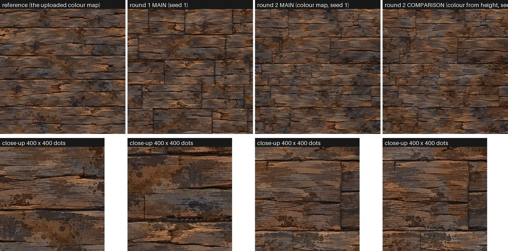

1. **The source map is cut along its own structure.** It has five rows separated by dark gaps with small pebbles. Row 1 is only 155 dots high and is not used. The other four are cut from the middle of one gap to the middle of the next (starts at y = 189, 470, 709, 980 dots; ends at 470, 709, 980, 1254): four "row strips", each with half a gap at the top and half a gap at the bottom. Every row strip is always shown from its top gap middle to its bottom gap middle, so every row edge of the new surface lies on a real gap of the source and keeps its small dark pebbles.
2. **The new surface is laid out as rows of boards.** Five rows per tile whose heights differ by up to 20 percent (they add up to exactly one tile), the edge between two rows waves by up to 4 dots. Each row is cut into two boards per tile (the cut positions jitter by up to 40 percent of a board, so boards are 0.1 to 0.9 of a tile long), every row shifted sideways by chance.
3. **The cut between two boards is a stepped joint.** About 7 joints in 10 have one step: above the step the cut lies up to 45 dots to the left, below it up to 45 dots to the right, and a crack along the grain joins the two parts. So a joint is two half-height cracks, as in the source, not one straight line from the top of the row to the bottom.
4. **Every board shows its own window.** It takes one of the four row strips (the next board takes a different strip, and so does the next row; the exceptions are counted in section 11.2, including a known hole at the edge of the default tile), a random start along it, a random flip left-right (chance 0.5) and upside down (0.4), is stretched along the board by up to 25 percent, bent by a slow wobble (up to 12 dots along, 5 dots across) and tilted by up to 3.5 degrees, so that no two windows have the same shape. The bending dies away at the row edges so they stay on the gaps.
5. **Landmarks are painted out unless a board draws a lucky number.** Twelve landmarks of the source (3 knots, 9 other recognisable places) have a ragged round disc; inside it the recipe reads the map a second time, at another place with clean grain (found once by `tools/find_landmark_replacements.py` and stored as numbers in `recipe/settings.json`). Each board draws one random number per landmark: with 30 percent (knots) or 20 percent (the others) the board shows the landmark, otherwise it is painted out.
6. **The height map and the colour map are read at exactly the same place** (one position, built once, fed to both Image Texture nodes), also for the clean grain behind a painted-out landmark.
7. **Dark stain stamps** from the source map are laid on top at random places (two layers of stamps, each with only the dark part of the stamp painted, with a hard edge, kept 15 dots away from joints and row edges). Two **very large soft patches** (light/dark drift and dark blotches) change the look from place to place; they change the colour only, not the relief.
8. **Every cut is hidden**: a dark ragged crack of random width (1.4 to 5.8 dots across, some joints faint, some strong) with dirt and a few pebbles of different sizes where two boards meet; a dark band along every row edge that is only added where the source is not already dark (so the real gap rubble of the source stays); half joints inside many boards.
9. **Tone** changes a little per board and more per row (so neighbours in one row look alike, rows differ, and the joints show less). **Height** is the height read from the source (plus a small change linked to the tone, and the cracks). **Roughness** is made from the height and a small change per board. **Metallic** is 0.
10. **COMPARISON version:** the colour is not read from the colour map but made from the height with three palettes measured from the colour map (dull grey-brown wood, plain brown wood, orange bare wood); two slow cloud patterns choose where the orange and blue-grey patches lie. Everything else is identical to MAIN.
11. **Default tile or area from the same nodes:** with `recipe.tiles_across = 1` every random number repeats after exactly one tile; with 2, 4, 8 the random numbers keep counting up and are salted differently from the tile, so nothing repeats on purpose and the first tile of an area is not the default tile (round 1 had this wrong, see section 11). A number of things are counted per tile-wide stretch so that the amount per dot stays the same.

---

## 3. The steps inside the recipe (what you see in the Shader editor)

Open the node group **WOOD FROM MAPS**: it is divided into labelled frames (about 1699 nodes in the default tile, 1669 in an area, 1182 with the arrangement switched off).

| Frame | What it does |
|---|---|
| **0 PLACE** | turns the coordinate of the picture (0 to 1) into dots on the area (one tile = 1254 dots); handles the slide test (`shift`) and crops (`window`); makes the seamless cloud helpers |
| **1 ROWS** | five rows of different heights with waving edges; finds the row of this dot, how far down in the row it is, and the row number the random numbers are made from |
| **2 BOARDS** | finds the board (random lengths, row shifted by chance), makes the stepped cut of every board end, and the random numbers of the board |
| **3 WINDOW** | chooses the source row strip, where the window starts, flips, stretch, bending and tilt, and works out the position in the source map for this dot |
| **4 LANDMARKS + READ THE MAPS** | decides for every landmark whether this board shows it; reads the height map and the colour map at that position (and at the clean place where a landmark is painted out); COMPARISON: makes the colour from the height instead |
| **5 STAINS** | two layers of stamps (one per cell of 250 dots, shifted against each other by half a cell); each paints the dark part of a stain from the source map |
| **6 JOINTS, HALF JOINTS AND ROW EDGES** | the cracks, the sideways cracks of the steps, the half joints, the row bands, with dirt, pebbles and a worn lip |
| **7 PATCHES** | the very large soft light/dark drift and dark blotches (seamless in the tile) |
| **8 COLOUR** | tone per board and per row, warmth, patches, edge shading, crack colour |
| **9 HEIGHT and ROUGHNESS** | height changes, roughness |
| **OUTPUTS** | the four outputs, or one of the debug views |

Tools: **Math** nodes (all the arithmetic), **White Noise Texture** in 4D (the hash: the same inputs give the same three random numbers; used for every random choice), **Image Texture** (reads the two maps, Linear reading, positions bounced back with Ping-Pong so a window never leaves the non-wrapping map), **Color Ramp** (used as small look-up tables of up to four numbers, and as the palettes of the COMPARISON version), **Noise Texture** and **Voronoi Texture** (bending, cracks, dirt, pebbles, patches; 4D "donut" versions in the repeating tile).

---

## 4. Every setting

Settings live in `recipe/settings.json` as `group.control`. Order of strength: the default written in the recipe file < `settings.json` < the parameters you pass (for example `--params '{"layout.boards_per_row": 3}'`). "Swept" means a picture of three values is in section 5. A setting marked (new) did not exist in round 1; (changed) means the meaning or the default changed.

| Setting | What it does | Range (default) | What changing it does |
|---|---|---|---|
| `recipe.tiles_across` | how many tiles across the picture | 1, 2, 4, 8 (1) | 1 = one tile that repeats exactly; more = an area of new boards. Bake with 1254 x that many dots, or fewer (smaller picture, same content) |
| `recipe.tile_repeats` | force the behaviour | -1 automatic, 0, 1 (-1) | 1 with `tiles_across` 2 = the default tile repeated 2 x 2 on purpose (the seam test picture); 0 with 1 = new boards everywhere |
| `recipe.seed` | a new arrangement | any whole number (1) | different boards, windows, joints, stains; seeds 1, 2, 3 are in `outputs/`. An area with seed 1 is not the tile of seed 1 (changed in round 2) |
| `layout.rows_per_tile` | rows in one tile | 4 to 6 (5) | built into the nodes. 5 gives rows of 251 dots like the source |
| `layout.row_height_variation` | how different the row heights are (changed: 0.05 before) | 0 to 0.35 (0.2) | **swept.** 0 = all rows the same height (looks like a brick wall); 0.2 = rows between 200 and 300 dots high; more = more zoom of the windows (blur or sharper) |
| `layout.boards_per_row` | boards in a row per tile (changed: 3 before) | 2, 3, 4 (2) | **swept.** 2 = long boards and few joints; 4 = many short boards (brick-like). Needs `joints.step_size` smaller than the shortest board (a board is at least (1 - `layout.board_length_variation`) of its average length). The source-row rule gives touching boards in a row different rows for 2, 3, 4 boards per tile, but not for 5, 9, ... (in the default tile the last and first board of a row would take the same row), and not across the tile edge (section 11.2) |
| `layout.board_length_variation` | how different the board lengths are (changed: 0.6 before) | 0 to 0.8 (0.8) | 0 = all boards equally long (brick wall); 0.8 = every cut moves by up to 40 percent of a board: boards from 0.1 to 0.9 of a tile |
| `windows.zoom` | random stretch of every window along the board (changed: 0.10 before; now along the board only, because the row strip always fills the row) | 0 to 0.3 (0.25) | more = fewer near copies, a little softer or sharper grain, knots a little oval (0.75 to 1.25 times as wide) |
| `windows.flip_left_right` | chance a board is flipped left-right | 0 to 1 (0.5) | 0 = no flips (more near copies) |
| `windows.flip_upside_down` | chance a board is turned upside down | 0 to 1 (0.4) | turns the whole window (a gap half is at both ends, so it still fits) |
| `windows.warp_along`, `windows.warp_across`, `windows.warp_size` (new) | slow bending of every window: size of the bending along the grain and across it (dots), and the length of one wave (dots) | 0 to 30, 0 to 14, 100 to 300 (12, 5, 200) | **swept.** 0 = grain stays as in the source (landmarks keep their exact shape); more = grain waves like a log's; the bending dies away at the row edges |
| `windows.tilt` (new) | the strip may be tilted by up to this many degrees | 0 to 5 (3.5) | tilts the grain lines of a board against the row |
| `windows.edge_margin` (new) | dots kept free at the ends of the source row so the bending never reads outside the map | 28 | must be larger than `windows.warp_along`; raise it with a strong bending |
| `landmarks.knot_chance` (new, replaces `windows.knot_share`) | chance that a board whose window contains a knot shows it | 0 to 1 (0.15) | **swept** (with the next setting). 0 = no knots at all; 1 = every knot that falls in a window is shown |
| `landmarks.mark_chance` (new) | the same for the 9 other landmarks (zigzag cracks, splinters, rust cloud ...) | 0 to 1 (0.12) | 0 = all painted out; 1 = all shown (the repeats the checker found) |
| `landmarks.edge_ragged` (new) | how ragged the edge of a painted-out disc is | 0 to 0.6 (0.3) | 0 = a round, visible disc; more = grain-like edge |
| `landmarks.list` (new) | the twelve landmarks: x, y, radius, shift to the clean grain, kind | list | measured once (`tools/find_landmark_replacements.py`); other maps need their own list |
| `boards.tone_variation`, `boards.row_tone_variation` | brightness change per board and per row (changed: 0.24 per board before; the row part is new) | 0 to 0.6 (0.12, 0.16) | 0.12 = plus or minus 6 percent per board, plus or minus 8 percent per row |
| `boards.warmth_variation` | warm/cool change per board | 0 to 0.3 (0.12) | red up and blue down, or the other way |
| `boards.height_shift` | height change linked to the tone | 0 to 0.3 (0.10) | brighter boards sit a little higher |
| `joints.width` | average width of a joint crack in dots (changed: 4.0 before) | 0 to 12 (3.6) | wider = more visible slits |
| `joints.width_variation` (new) | how much the width differs from joint to joint | 0 to 1 (0.6) | 0.6 = every joint between 0.4 and 1.6 times the average |
| `joints.step_share`, `joints.step_size` (new) | chance that a joint has a step, and the biggest sideways jump of a step (dots) | 0 to 1, 0 to 120 (0.7, 90) | **swept.** 0 = every joint one straight line from the top to the bottom of the row (the look of round 1: brick wall); 1 = every joint stepped. `step_size` must stay smaller than the shortest board minus a bit |
| `joints.darkness`, `joints.darkness_variation` (new) | how dark the cracks are, and how much stronger some joints are than others | 0 to 1, 0 to 1 (0.9, 0.5) | lower = faint joints that show the cut more |
| `joints.raggedness`, `joints.notches`, `joints.wobble`, `joints.wobble_length` | how much the crack edges wander and get notches, and the sideways wobble of the cut | 0 to 1 (0.8), 0 to 1 (0.6), 0 to 6 dots (2), 8 to 60 (22) | |
| `joints.edge_lip` | light worn edge next to a crack (a little higher) | 0 to 1 (0.4) | shows in the lit picture as a bevel |
| `joints.pebbles` | pebbles in the cracks (now of different sizes, in small groups) | 0 to 1 (0.45) | |
| `joints.edge_shade` | darker wood next to a joint | 0 to 1 (0.2) | |
| `joints.half_share`, `joints.half_depth`, `joints.half_run`, `joints.half_width` (new) | half joints: chance per board, depth as a part of the row height, length of the sideways run (dots), width at the edge (dots) | 0 to 1 (0.35), 0.1 to 0.6 (0.32), 20 to 120 (70), 2 to 8 (5) | 0 = no half joints |
| `gaps.band_width`, `gaps.band_variation` (changed: was `joints.gap_band_width` 4) | width of the dark band on every row edge (dots) and how much it changes along the edge | 0 to 10 (3.2), 0 to 1 (0.9) | the band is only added where the source is not already dark; hides the cut between two rows and the tile edge |
| `gaps.wobble`, `gaps.wobble_length` (new) | how far the row edges wave (dots) and the length of one wave | 0 to 8 (4), 60 to 300 (140) | 0 = dead straight row edges |
| `stains.amount` | chance per cell for a stain stamp (two layers) (changed: 0.18 before) | 0 to 1 (0.16) | more stains hide repeats but darken the picture and lower the score |
| `stains.size`, `stains.zoom` | radius of a stamp in dots, random zoom of a stamp | 40 to 120 (85), 0 to 0.4 (0.25) | |
| `stains.dark_limit`, `stains.dark_softness` (changed: 135 and 55 before) | which part of the stamp is painted (grey under 100 of 255, edge 30 wide) | 100 to 160, 20 to 80 | only the very dark blots are painted, with a crisper edge |
| `stains.keep_away`, `stains.edge_hardness` (new) | stamps stay this many dots away from joints and row edges; how hard the round edge of a stamp is | 0 to 40 (15), 0.5 to 0.95 (0.8) | 0 = stamps may cover joints (the soft smudges of round 1) |
| `masks.drift_amount`, `masks.drift_size` | very large light/dark drift: amount and clouds per tile | 0 to 0.3 (0.10), 1 to 4 (2) | colour only |
| `masks.blotch_amount`, `masks.blotch_size` | very large dark blotches | 0 to 0.5 (0.15), 3 to 8 (5) | colour only |
| `masks.darken_height` | how much of the patches also lowers the height | 0 to 1 (0) | 0 = patches are colour only (a stain film has no relief) |
| `colour.source` | where the colour comes from | `map` or `height_palette` (`map`) | `height_palette` = the COMPARISON version |
| `colour.warm_cool_amount` (new) | how much the orange and grey-brown patches of the COMPARISON colour are used | 0 to 1 (1) | 0 = the single brown palette of round 1 (flat and sepia) |
| `colour.palette`, `colour.palette_cool`, `colour.palette_mid`, `colour.palette_warm` | the palettes (height to colour) measured from the colour map | lists | used only for the COMPARISON version |
| `roughness.base`, `roughness.from_height`, `roughness.board_variation` | roughness | 0.78, 0.20, 0.04 | roughness = base + from_height x (height - 0.5) + a little per board |
| `bake.exact_dots` | ask the photograph for exact dots | 1 | when one picture dot = one source dot, uses 1 sample and a pixel filter of 0.01 so every dot is read at its own centre (the harness default would blur by about a dot) |
| `bake.shrink_samples`, `bake.shrink_filter` | samples and filter when the picture is smaller than the source | 8, 1.0 | e.g. a 4 x 4 area baked at 2508 dots; 1 and 0.01 pick one exact dot per picture dot (used for the debug pictures) |
| `debug.source_unchanged` | switch the arrangement off | 0 / 1 (0) | gives back the uploaded height (the check in section 7) |
| `source.*` | facts about the uploaded maps (file names, row strip starts and ends, stain stamp centres) | | measured, see `research/` |

Special parameters (not settings): `shift` [u, v] slides the pattern by that much of the picture (the slide test); `window` [x, y, size] bakes only a part of a big area, in tiles (for example [1.5, 2, 1] = the tile that starts one and a half tiles from the left and two from the top); `debug_view` = `boards` (a random colour per board; its Height output holds the exact board number), `rows`, `flips` (red = flipped left-right, green = upside down, blue = has a half joint), `landmarks` (which landmark is shown where: Height = number / 16, red = shown, green = painted out), `source_x` / `source_y` (exact: which dot of the source map every dot was taken from); `settings_file`.

---

## 5. Sweep pictures

All sweeps change one setting of the default tile (seed 1) and nothing else, at 512 dots, so the layout stays put and only that setting shows. Only the three that matter most are shown here; the other two are in `sheets/` (`sweep_warp.jpg`, `sweep_row_height.jpg`).

**Stepped joints (`joints.step_share` 0, 0.7, 1):** at this small size (512 dots) the step is a modest change: the joints of the left picture are straight lines, in the middle and right picture most of them jump sideways part way. The bigger changes against round 1 came from two boards per row, the different row heights and the faint and strong joints (`sheets/steps_round2.jpg` shows the steps in order); the step matters most at full size, where the sideways crack along the grain is clearly seen.

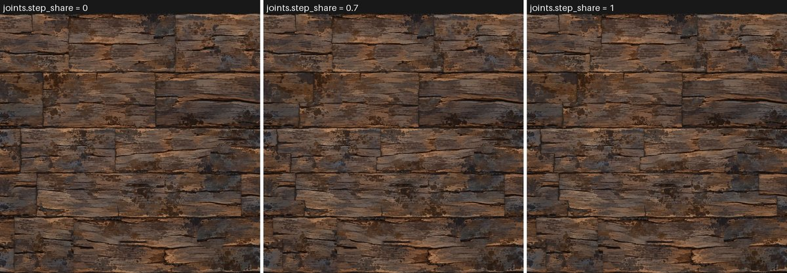

**Boards per row (2, 3, 4):**

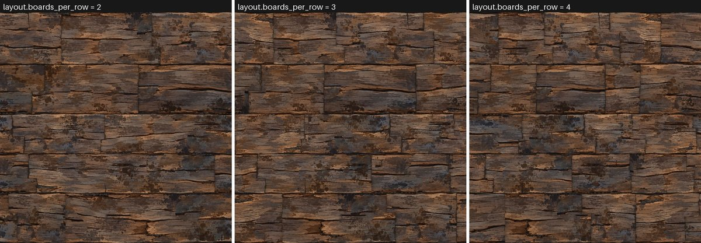

**Landmarks (all painted out, default, all shown):** with everything painted out the tile has no knots (other recognisable places that are not on the list of twelve remain); with everything shown it has knots, and the zigzags and splinters of the source, in three places at once (section 7.3 d counts them in the area).

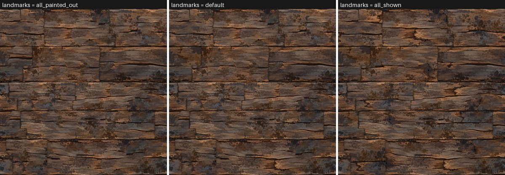

What the landmarks are and what a painted-out source map looks like (left: the twelve landmarks circled; right: the map with all of them painted out; the right picture is drawn by `tools/find_landmark_replacements.py` with numpy to show what the nodes do, it is not a Blender bake; the patches can be found by eye in it, for example near the middle of rows 2 and 3):

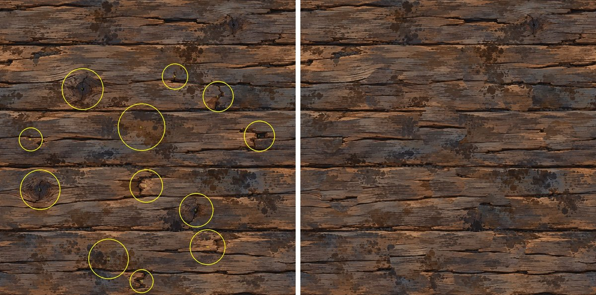

**Bending of the windows** (`windows.warp_*` and `windows.tilt` none, default, strong; `sheets/sweep_warp.jpg`): with none the grain keeps the straight lines of the source; with the default the grain lines wave a little (hard to see at 512 dots, it is what the near-copy tests reward, section 7.3 e); with strong (30 dots along, 14 across, 5 degrees) the grain waves like a log's, which looks natural in some boards and too wavy in others; I kept the gentle default.

**Row heights** (`layout.row_height_variation` 0, 0.2, 0.35; `sheets/sweep_row_height.jpg`): with 0 all five rows have the same height and the layout reads as a regular brick course; 0.2 (default) gives rows of 200 to 300 dots; 0.35 gives clearly thinner and thicker rows, but the windows are then magnified or squeezed more (the thin rows show the source reduced, the thick ones enlarged by up to a third).

---

## 6. How to bake

* **With the project's standard command** (this works: it was run on the final recipe for seed 1 at 1254 dots, about 3.5 minutes under load; seeds 2 and 3 were made by the job driver with the same standard bake, `"full": true`):
  `blender -b --disable-autoexec -t 2 --python lib/bake_harness.py -- recipes/wood_from_displacement/recipe/wood_from_maps_recipe.py OUT_FOLDER --size 1254 --params '{"recipe.seed": 1}'`
  It writes colour.png, height.png (16-bit), roughness.png, metallic.png and normal.png (made from the height, two-neighbour slope, strength 8) and normal_bumpnode.png (a cross-check, not needed).
* **Several pictures in one Blender run:** `tools/run_jobs.py` with a jobs file (examples: `tests/jobs_r2_tiles.json`, `tests/jobs_r2_areas.json`). A job with `"full": true` is the standard bake; otherwise it lists channels. Every job builds the nodes again (about 50 seconds under load), so many small jobs in one list cost mostly build time.
* **The COMPARISON version:** add `"colour.source": "height_palette"` to the parameters; the height and normal are the same as MAIN.
* **A bigger area:** `{"recipe.tiles_across": 4}` with `--size 2508` (about 6 minutes per channel under load) or smaller. **A full-size piece of an area:** add `"window": [1.5, 1.5, 1]` and bake 1254 dots.
* **Speed:** see the table below. The round 2 recipe has about twice the nodes of round 1 (1699 against 888) and bakes about three times as slowly (the full standard bake took 79 seconds in round 1 and about 236 now).

| What | Seconds (machine shared with two other helpers, load 4 to 9 on 4 cores, 2 threads) |
|---|---|
| default tile, 1254 dots, standard harness bake of ALL maps (colour, height, roughness, metallic, normal, normal cross-check) | 236.3 |
| default tile, 1254 dots, colour only / height only (1 sample) | 40.6 / 31.0 |
| building the nodes (once per job) | 75.7 |
| 2 x 2 area, 1254 dots across (2 dots per picture dot, 4 samples), colour / height | 77.8 / 73.4 |
| 4 x 4 area, 2508 dots across (2 dots per picture dot, 4 samples), colour / height | 354.3 / 371.3 |
| 4 x 4 area, exact "which source dot" picture, 1254 dots across (1 sample) | 8.3 |
| full-size piece of the 4 x 4 area (window), 1254 dots, colour | 26.7 |

---

## 7. Results

### 7.1 "Same kind of surface" score against the reference wood

(`lib/texture_compare.py`: 0 = as different as another real surface, 1 = indistinguishable by those measures; other real surfaces score 0.16 to 0.50; a re-shuffled copy of the reference itself about 0.99.) The earlier wood recipe's best new tile (its seed 105) was baked again from its own description at 1254 dots for round 1 and scored with the same tool.

**Read these numbers with two cautions.** First, the new tile is made from the reference's own dots, rearranged, and the earlier recipe used nodes only: the comparison is not like for like, and the new amounts were chosen partly by looking at this score (round 1: "a compromise between score and hiding repeats"). Second, the "tiling" part of the score measures the jump across the wrap-around edge; it fell from 1.00 in round 1 to 0.75 to 0.93 in round 2 (MAIN seeds) because the dark band at the tile edge is no longer a uniform strip: the real gap rubble of the source (pebbles, bright lips of wood) is kept there. This is my explanation, and I checked the part that can be checked: the jump across the tile edge is no bigger than the jumps across the ordinary row boundaries inside the same tile (table below; the edge is a row boundary like the others), and the slide test (7.2) and the look at the tile corner (`sheets/seam_2x2.jpg`) and at the wrap-around strips show no seam; the uploaded map itself would score far worse (its wrap jump is 2.8 to 4.0 times a typical jump, against 1.08 and 1.12 here for seed 1). What I did not test is a variant with a uniform dark band at the tile edge only (round 1's way) to confirm that the rubble is the whole reason.

| Colour of the default tile | jump across the tile edge (wrap-around) | jumps across the four strongest ordinary row boundaries inside the same tile |
|---|---|---|
| seed 1 | 1.08 | 1.96 / 2.52 / 2.09 / 1.92 |
| seed 2 | 1.4 | 1.78 / 2.07 / 2.49 / 1.65 |
| seed 3 | 1.61 | 1.65 / 1.92 / 2.6 / 1.85 |

| Picture (1254 dots) | Overall | Colour | Height | Normal | Tiling (seam) |
|---|---|---|---|---|---|
| MAIN (colour map), seed 1 | 0.828 | 0.778 | 0.876 | 0.835 | 0.934 |
| MAIN (colour map), seed 2 | 0.858 | 0.837 | 0.888 | 0.875 | 0.829 |
| MAIN (colour map), seed 3 | 0.830 | 0.794 | 0.899 | 0.842 | 0.751 |
| **MAIN (colour map), mean of three seeds, round 2** | **0.839** | 0.803 | 0.888 | 0.851 | 0.838 |
| MAIN (colour map), mean of three seeds, round 1 (for comparison) | 0.801 | 0.759 | 0.848 | 0.739 | 1.000 |
| COMPARISON (colour from height), seed 1 | 0.745 | 0.614 | 0.870 | 0.835 | 0.895 |
| COMPARISON (colour from height), seed 2 | 0.778 | 0.689 | 0.865 | 0.875 | 0.807 |
| COMPARISON (colour from height), seed 3 | 0.756 | 0.656 | 0.882 | 0.842 | 0.713 |
| **COMPARISON (colour from height), mean of three seeds, round 2** | **0.760** | 0.653 | 0.872 | 0.851 | 0.805 |
| COMPARISON (colour from height), mean of three seeds, round 1 (for comparison) | 0.715 | 0.587 | 0.835 | 0.739 | 1.000 |
| earlier wood recipe, best new tile (its seed 105), baked again | 0.665 | 0.655 | 0.634 | 0.588 | 1.000 |

The measures behind the scores (seed 1):

| Measure | MAIN seed 1 | COMPARISON seed 1 | earlier recipe |
|---|---|---|---|
| colour_distribution | 0.892 | 0.817 | 0.710 |
| colour_spectrum | 0.424 | 0.112 | 0.587 |
| colour_orientation | 0.929 | 0.885 | 0.789 |
| colour_scale | 0.979 | 0.856 | 0.765 |
| colour_gradient | 0.655 | 0.371 | 0.402 |
| seam | 0.934 | 0.895 | 1.000 |
| height_distribution | 0.926 | 0.926 | 0.649 |
| height_spectrum | 0.677 | 0.677 | 0.473 |
| height_gradient | 0.966 | 0.966 | 0.664 |
| height_colour_link | 0.918 | 0.878 | 0.793 |
| height_contrast | 0.972 | 0.972 | 0.660 |
| normal_tilt | 0.743 | 0.743 | 0.569 |
| normal_components | 0.915 | 0.915 | 0.792 |
| normal_height_agreement | 0.949 | 0.949 | 0.233 |

Read this as: the round 2 tile (MAIN seed 1) is closer to the reference than the earlier recipe's tile on 12 of the 14 measures (by more than 0.005), and worse on: colour_spectrum 0.424 against 0.587, seam 0.934 against 1.000. The COMPARISON colour (made from the height with palettes) is plainer than the colour map; its weakest number is colour_spectrum. The tool rewards staying close to the map's own statistics, so every thing that breaks repetition (stains, patches, tone, bending) costs score.

**Dot-for-dot numbers (for transparency only).** The new boards are not where the reference's boards are, so these are low on purpose and say nothing about quality. Two height numbers are shown: the plain error, and the error after the best brightness and contrast fit (the honesty checker pointed out that the fit collapses to a flat grey, so the second column is the same for every picture and says nothing; round 1 printed only that one):

| Picture | colour SSIM (1 = same) | colour Delta E | edge skill (0 = luck) | height error, plain (steps of 255) | height error after best fit (a flat grey: the same for all, says nothing) | normal angle (degrees) | tier |
|---|---|---|---|---|---|---|---|
| MAIN seed 1 | 0.2023 | 15.28 | 0.013 | 58.41 | 41.59 | 34.83 | none |
| MAIN seed 2 | 0.1943 | 15.33 | 0.005 | 58.48 | 41.59 | 35.24 | none |
| MAIN seed 3 | 0.2093 | 15.05 | 0.027 | 57.8 | 41.59 | 34.6 | none |
| COMPARISON seed 1 | 0.2134 | 15.24 | 0.014 | 58.41 | 41.59 | 34.83 | none |
| earlier recipe tile | 0.201 | 14.19 | 0.0 | 54.17 | 41.59 | 33.73 | none |

### 7.2 The pipeline adds nothing of its own, and the tile repeats exactly

| Check | Result |
|---|---|
| source unchanged: height, mean absolute difference to the uploaded height (0 to 1) | 3e-05 |
| source unchanged: share of dots differing by more than 2 of 255 | 0.0 |
| source unchanged: colour, mean absolute difference to the uploaded colour (0 to 1; 8-bit rounding and dither) | 0.00837 |
| source unchanged: normal made from the baked height (strength 8) against the uploaded normal, x / y / z | 0.0039 / 0.0039 / 0.0041 |
| the same rule on the uploaded height itself, x / y / z (the best this rule can do) | 0.0039 / 0.0039 / 0.0041 |
| half-tile slide test, colour: bake slid versus picture slid, mean absolute difference (0 to 1) | 0.00154 |
| half-tile slide test, colour: share of dots differing by more than 0.1 | 0.0 |
| half-tile slide test, colour: control with a WRONG slide, mean / share over 0.1 | 0.1056 / 0.442 |
| half-tile slide test, height: bake slid versus picture slid, mean absolute difference (0 to 1) | 1e-05 |
| half-tile slide test, height: share of dots differing by more than 0.1 | 0.0 |
| half-tile slide test, height: control with a WRONG slide, mean / share over 0.1 | 0.2307 / 0.7335 |
| colour brightness versus height, correlation: MAIN seeds 1 / 2 / 3 | 0.978 / 0.98 / 0.979 |
| colour brightness versus height, correlation: uploaded maps | 0.982 |
| COMPARISON colour (made from height) versus height, correlation | 0.988 |
| two seeds: correlation between their heights, seed 1 with 2 / 1 with 3 / 2 with 3 | 0.028 / -0.01 / 0.034 |
| how much of the source one picture dot covers across the grain: 1st / 5th / 25th / 50th / 75th / 95th percentile of 15-dot blocks (1 = as the source) | 0.72 / 0.83 / 0.97 / 1.03 / 1.22 / 1.36 |
| share of 15-dot blocks where the source is magnified more than 1.7 times across the grain (blurred or smeared) | 0.0009 |

The wrap-around edge of the three default tiles (a seamless tile gives about 1; the uploaded map gives 2.8 to 4.0):

| Default tile (the jump from its last dot line to its first, over a typical jump between neighbouring dot lines) | left-right | top-bottom |
|---|---|---|
| seed1 colour | 1.12 | 1.08 |
| seed1 height | 1.11 | 1.27 |
| seed2 colour | 1.0 | 1.4 |
| seed2 height | 0.97 | 1.51 |
| seed3 colour | 0.95 | 1.61 |
| seed3 height | 0.95 | 1.8 |
| uploaded height for comparison | 3.97 | 2.76 |

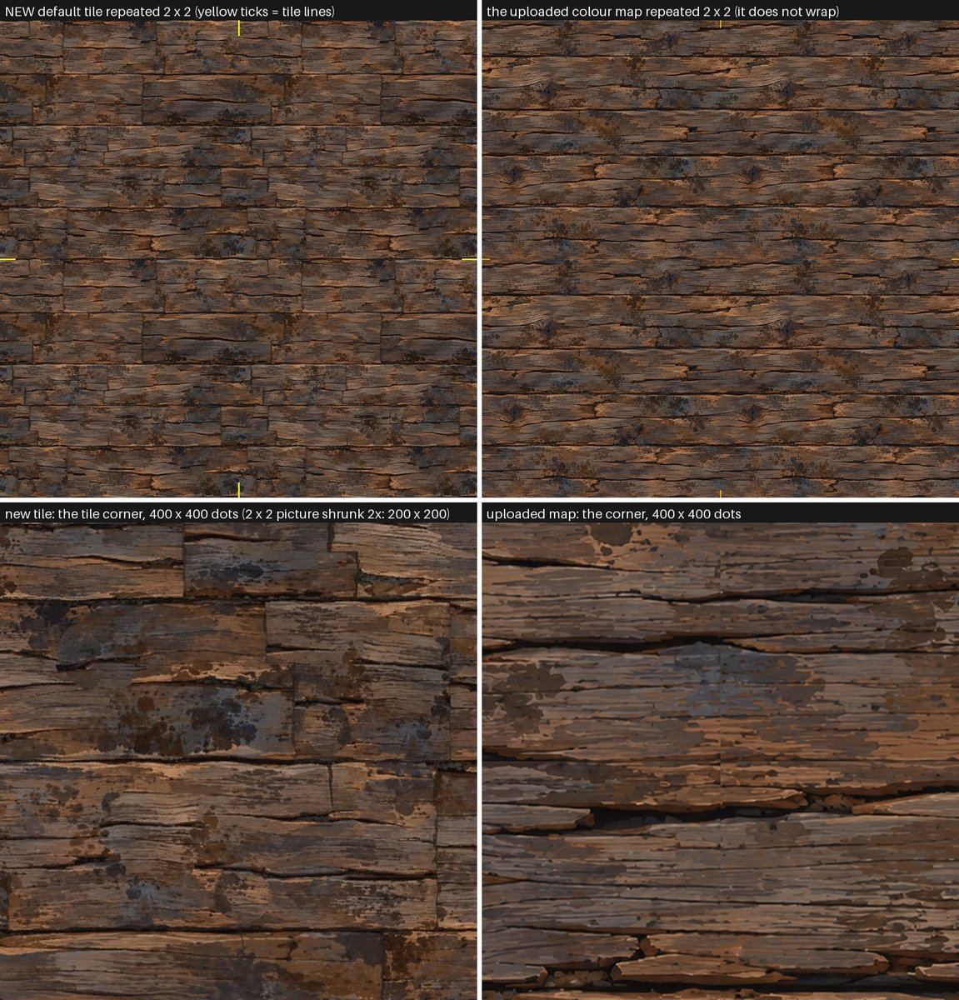

The 2 x 2 picture on the left is four copies of one default tile: I see no step at the yellow tick marks, only the tile's own row gap at the horizontal line. The uploaded map repeated the same way (right) shows a straight seam.

| Picture (default tile repeated 2 x 2) | jump across the vertical tile line / a typical jump | jump across the horizontal tile line / a typical jump | largest ordinary row boundary jump / a typical jump | mean difference between the four tiles (0 to 1) |
|---|---|---|---|---|
| colour | 1.13 | 1.46 | 2.1 | 0.0081 |
| height | 1.13 | 1.38 | 2.4 | 0.0138 |

(A jump of about 1 is no seam. Row boundaries jump more than a typical dot line because every row boundary is a dark band with pebbles; the horizontal tile line is itself a row boundary and jumps less than the largest of the others. The "mean difference between the four tiles" is the render noise of the 4-sample shrink: the picture is baked at 2 dots per picture dot; the shift test below scores the same picture 0.997 at one tile.)

### 7.3 Does a big area repeat? (the REPEAT test)

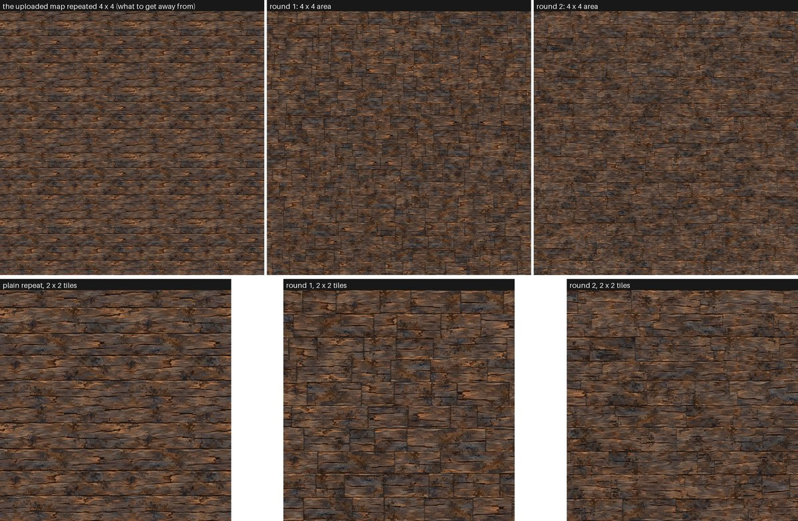

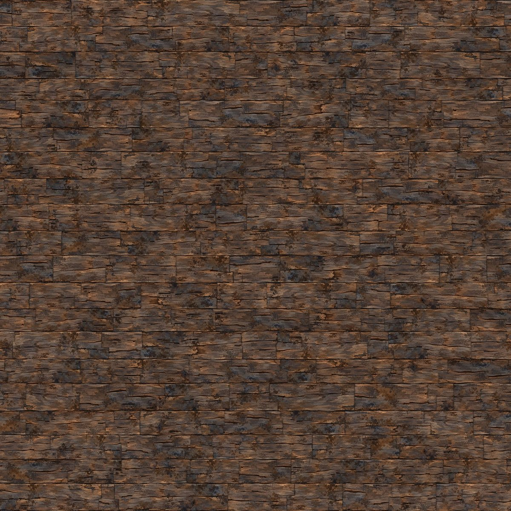

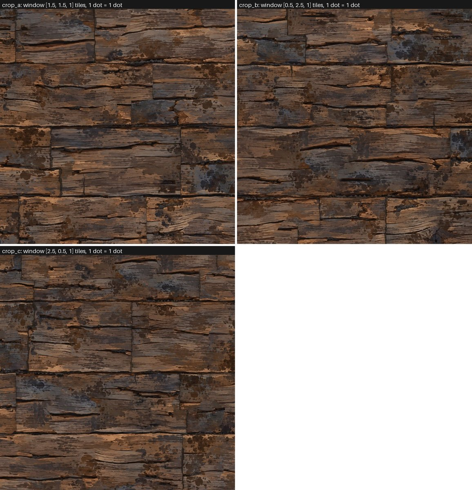

**(a) Shift test** (how much the picture looks like itself slid sideways; 1 = identical, 0 = nothing alike). The control, the uploaded map repeated 4 x 4, is made with a whole number of dots per tile (313), so an exact repeat scores 1.0; round 1 reported 0.972 because its control was half a dot out.

| Picture | shifted one tile across | one tile down | one tile diagonally | half a tile across | background: highest of 300 random shifts | background: highest of the sideways-only shifts |
|---|---|---|---|---|---|---|
| the uploaded height map repeated 4 x 4 (313 dots per tile, exact) | 1.0 | 1.0 | 1.0 | 0.107 | 0.079 | 0.201 |
| new 4 x 4 area, height | 0.066 | 0.017 | 0.043 | 0.078 | 0.047 | 0.117 |
| new 4 x 4 area, colour brightness | 0.054 | 0.004 | 0.034 | 0.069 | 0.039 | 0.114 |
| new 2 x 2 area, height | 0.071 | -0.0 | 0.01 | 0.077 | 0.055 | 0.081 |
| the default tile repeated on purpose | 0.997 | 0.997 | 0.997 | 0.062 | 0.077 | 0.19 |

**(b) How much of the source map is used, and how the neighbours are chosen** (from the exact "which source dot" and "which board" pictures of the 4 x 4 area, baked at 1254 dots across with one exact dot per picture dot; round 1 baked these at 2508 dots across, so "used at least once" is NOT comparable: with fewer samples fewer source dots are hit. The average cannot be below 19 anyway: 16 tiles of dots from the 1.34 million dots of the four usable rows):

| What | round 2 | round 1 |
|---|---|---|
| source dots used at least once (the map has 1,572,516 dots; row 1 is not used by design) | 0.521 | 0.72 |
| times a used source dot appears in the 4 x 4 area: mean / median / 90th percent | 30.7 / 32.0 / 48.0 | 22.2 / 20.0 / 44.0 |
| boards counted in 16 tiles | 175 | 227 |
| board length in tiles: median / 90th percent | 0.48 / 0.75 | about 0.33 (3 per row, half of the pairs joined) |
| touching board pairs (side by side, above and below) | 467 |  |
| share of touching pairs that take the SAME source row | 0.011 | 0.19 (the honesty checker measured it; the round 1 guide claimed 0) |
| touching pairs with the same source row AND half or more of the same stretch of it | 4 | about 14 mirrored + 10 repeated of 387 (honesty checker) |

**(c) Near copies.** Two tests on the same pictures. The research test (the one of round 1): 40 board-sized patches (36 x 80 at 1024 dots) are searched for in the other rows, also flipped; a best match above 0.8 = "has a near copy". The look checker's test: 50 pieces of 200 x 380 dots are searched everywhere in the area, in all four ways round (as is, left-right, upside down, both); unrelated pieces of wood score a median 0.25 to 0.3 and a plain repeat 1.0. Both tests were run on the round 1 area (kept in `round1/area_4x4`) and on the round 2 area, by the same code, so the numbers compare. Two draws of 50 pieces show the noise of the test (a few points).

| Picture (research test: pieces searched for in the other rows, also flipped) | median best match | share with a near copy (over 0.8) |
|---|---|---|
| research test 36x80 plain source repeated height | 1.0 | 100 % |
| research test 36x80 new area height | 0.48 | 0 % |
| research test 36x80 new area colour brightness | 0.51 | 0 % |
| research test 24x40 new area height | 0.65 | 15 % |
| research test 36x80 ROUND 1 area height | 0.68 | 20 % |

| Picture (the look checker's test: pieces of 200 x 380 dots searched everywhere, all four ways round) | pieces | median best match | share over 0.6 | share over 0.7 | share over 0.8 |
|---|---|---|---|---|---|
| new area height 50 pieces | 50 | 0.403 | 2 % | 2 % | 0 % |
| new area height other draw | 50 | 0.451 | 0 % | 0 % | 0 % |
| new area colour brightness | 50 | 0.392 | 2 % | 0 % | 0 % |
| ROUND 1 area height | 50 | 0.501 | 28 % | 14 % | 2 % |
| ROUND 1 area height other draw | 50 | 0.563 | 36 % | 18 % | 8 % |
| plain source repeated height | 30 | 1.0 | 100 % | 100 % | 100 % |

**(d) Landmarks.** How often each of the twelve landmarks is shown in the 4 x 4 area (16 tiles); a landmark in a window is shown with chance 0.15 (knots) or 0.12 (others), otherwise painted out. Round 1 had no such list: every window that contained a knot showed it (24 knot boards in 16 tiles).

| Landmark | times it is shown in the 4 x 4 area (16 tiles) | pairs of showings less than one tile apart |
|---|---|---|
| knot K2 | 5 | 1 |
| knot K3 | 2 | 0 |
| knot K4 | 6 | 3 |
| zigzag crack R2 | 7 | 0 |
| hook splinter R2 | 8 | 7 |
| rust cloud R3 | 10 | 6 |
| hole R3 | 1 | 0 |
| notch R3 | 2 | 0 |
| splinter R4 | 5 | 2 |
| splinter R5 | 5 | 1 |
| stain cluster R5 | 7 | 1 |
| rubble R5 | 6 | 2 |
| **all twelve landmarks together** | 64 |  |

**(e) What each part buys** (4 x 4 areas of height at 1024 dots, 2 samples, seed 1, with parts switched off; the same two tests):

| 4 x 4 area of height (1024 dots) | research test: median | research test: share over 0.8 | checker test: median | checker test: share over 0.6 | checker test: share over 0.7 |
|---|---|---|---|---|---|
| default settings | 0.39 | 0 % | 0.396 | 0 % | 0 % |
| landmarks all shown (nothing painted out) | 0.44 | 0 % | 0.417 | 0 % | 0 % |
| no bending, tilt or stretch of the windows | 0.51 | 0 % | 0.5 | 22 % | 2 % |
| windows only (no bending, stretch, flips, stains, patches; landmarks shown) | 0.66 | 10 % | 0.573 | 40 % | 15 % |
| three boards per row | 0.33 | 0 % | 0.376 | 0 % | 0 % |

Reading it (honestly): in the look checker's test, "windows only" (every board shows a plain, unbent window, nothing else) leaves 40 % of the pieces with a twin over 0.6; bending, tilting and stretching the windows alone brings that down to 0 % (default) from 22 % (everything on except the bending, tilt and stretch). **So the bending of the windows is what the test rewards.** Painting out the landmarks does NOT show in this test (0 % with the landmarks all shown against 0 %): a knot or a zigzag is a small part of a 200 x 380 piece, so the test hardly notices it. I painted the landmarks out anyway because the look checker's own twins were "plainly the same knot, same hole, same rust cluster", and the landmark counts in (d) show how rarely they come back; but I cannot show from these numbers that the painting out matters. Three boards per row (0 %) repeats no more than two, in this test; I kept two because it reads less like a brick wall. With 40 pieces per test, differences of a few points are noise.

### 7.4 Joints and the lit look

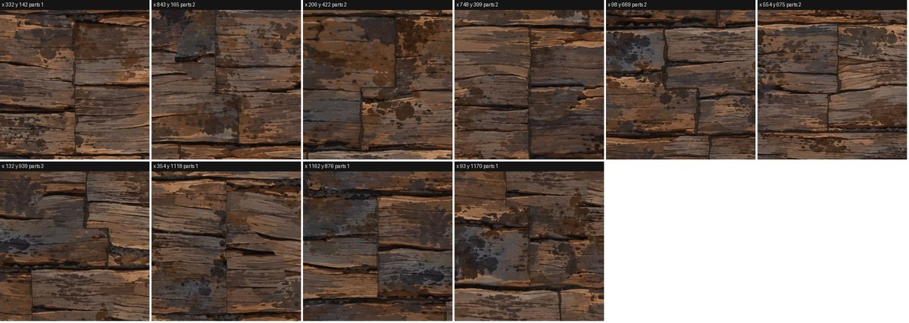

`sheets/joints_seed1.jpg`, `joints_seed2.jpg` and `joints_seed3.jpg` hold one full-size crop (one dot = one dot, 300 x 300) of every joint. Round 1 found joints by looking for dark runs, which can miss faint joints; round 2 finds them **exactly** from the board numbers that the recipe writes (a joint is a place where the board number changes from one dot to the next one to the right, over at least 25 dots; the stepped parts of one joint share a crop): 17 / 17 / 14 joint parts in the three tiles, on 10 / 12 / 11 crops. I looked at every crop. What I see: every joint is a stepped joint or a straight joint with a ragged dark crack; no crop shows a plain wood-against-wood cut without some crack; the sideways part of a step reads as a crack along the grain. A few joints are faint (that is on purpose: `joints.darkness_variation`): there the cut shows as an abrupt change of grain with a thin dark hairline, and I did not count how many. Beside one joint of seed 3 (x 912, y 265) a darker block with a soft edge is a stain stamp that ends there. The vertical parts of some joints are still very straight over 60 to 90 dots.

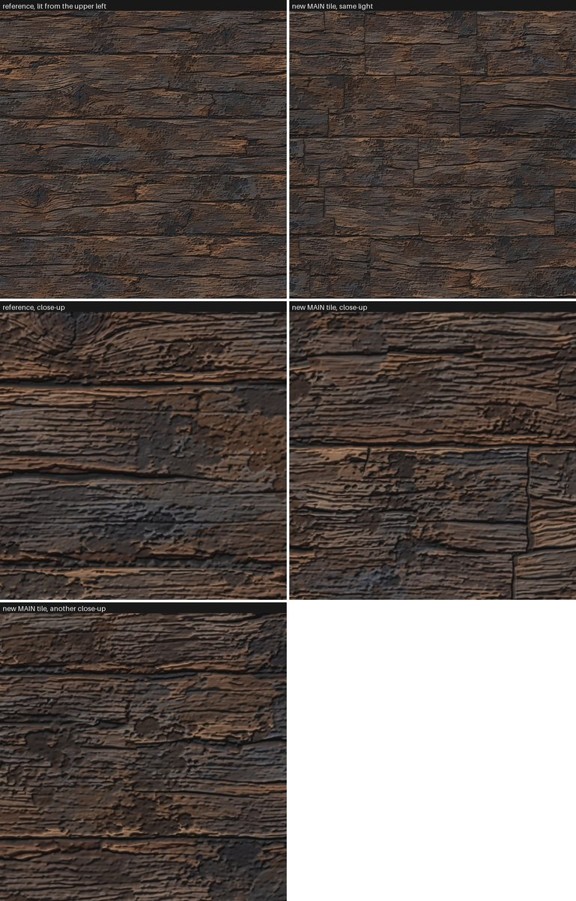

The same raking light on the reference and on the new tile: the relief of the new tile has the same character as the reference (cracked grain, raised splinters, pitted stains), and the joints show as clefts. What differs: the reference's rows run the whole width with only a few cuts, the new tile shows a joint every few hundred dots (stepped, and in the lit picture the vertical parts of some joints look like straight slits over 60 to 90 dots); the stepped joints look like cleft butt joints, as intended. The row gaps are dark and uneven in both. (This is a Blender render with the same light, constant roughness and the same normal strength for both; the new tile's normal map is made from its height, the reference's is the uploaded one.)

### 7.5 MAIN colour against COMPARISON colour

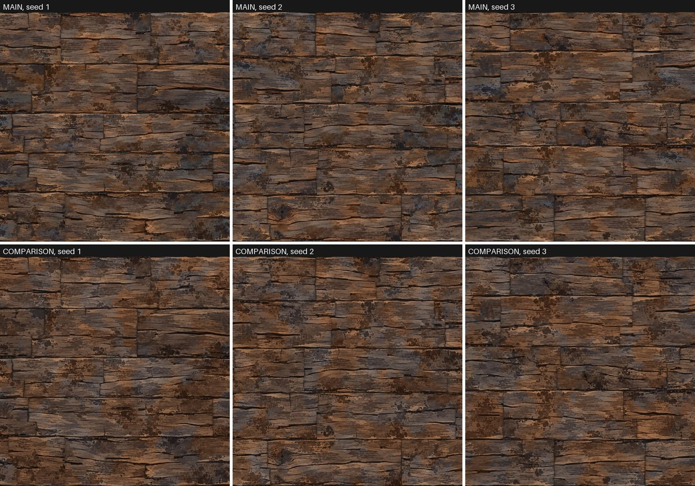

Both versions use exactly the same arrangement, the same tone per board and the same patches. The COMPARISON colour is made from the height with three palettes (blue-grey, brown, orange; measured from the colour map itself, so only fair as a comparison) and two slow cloud patterns that choose where the orange and the blue-grey patches lie; the height alone cannot tell them apart. It differs from the colour map by Delta E 5.88 on average for seed 1 (13.79 at the 95th percent point; about 1 is just visible, 2 to 5 small, over 10 clearly another colour); round 1's single palette gave 4.7 and 11.0, so the new palettes are not closer dot for dot (the patches are random, not the map's own) but they bring back a good part of the orange and grey-brown variety (colour score of the same-kind tool 0.653 against 0.587 before). The blue-grey is still missing in one sense: in the table below no dot of COMPARISON is bluer than red, against 0.7 percent of the dots of MAIN (the uploaded map: 0.6 percent), because even the cool palette stays warm. In my eyes it is still plainer than MAIN: no crisp painted edges between colours, no small orange highlights.

|  | mean Delta E MAIN vs COMPARISON | 95th percent Delta E | mean colour MAIN (red / green / blue, 0 to 255) | mean colour COMPARISON | share of dots more blue than red (MAIN / COMPARISON) |
|---|---|---|---|---|---|
| seed 1 | 5.88 | 13.79 | 83.6 / 63.8 / 52.1 | 84.5 / 63.1 / 50.5 | 0.007 / 0.0 |
| seed 2 | 5.88 | 13.95 | 85.8 / 65.9 / 54.1 | 86.9 / 65.2 / 52.5 | 0.007 / 0.0 |
| seed 3 | 5.87 | 13.57 | 85.0 / 64.6 / 52.5 | 85.5 / 64.0 / 51.5 | 0.006 / 0.0 |
| uploaded colour map |  |  | 86.1 / 65.3 / 53.1 |  | 0.006 |

### 7.6 All maps of the default tile

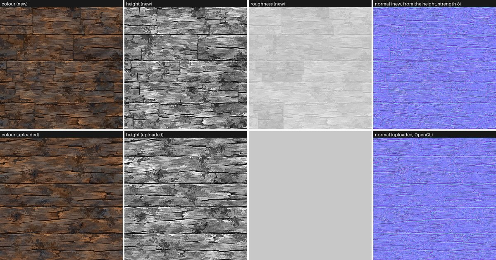

The roughness map shows the tone of every board as a faint block (roughness = a base + a part of the height + a small change per board; `roughness.board_variation`); there is no uploaded roughness map to compare with.

### 7.7 How it looks, in plain words (my reading; no other person has looked)

* **Default tile (full size).** A weathered, painted-looking log wall: five rows of different heights, two boards per row of very different lengths, stepped butt joints, the dark ragged gaps with the source's own pebbles, orange splinters, dark stain splotches, blue-grey and rust areas. It reads as the same wood as the reference. Compared with the reference it has fewer long unbroken rows (the reference's rows run the whole tile width) and more cuts: it reads as stacked logs rather than as one log wall.
* **Areas at full size** (`sheets/area_crops.jpg`): the same impression, over many boards, with no visible repeat of a big feature in the crops I looked at; small dark slits and orange splinters that are not on the landmark list do come back.
* **Areas seen small** (`sheets/before_after.jpg`, the whole 4 x 4 area): a masonry-like wall of boards with staggered joints, clearly less regular than round 1, but not as calm as the plain repeat of the uploaded map (which reads as horizontal logs). Whether that is acceptable depends on the distance a person will look from.
* **The big dark stain splotches** now end with a harder edge; a few still end softly.
* **Knots** are rare (about 0.8 per tile) and a little oval; the default tile of seed 1 has none; seeds 2 and 3 each show one or two knots or knot-like dark rings (I looked at the pictures, I did not count them by script).

---

## 8. Files in this folder

| Path | What it is |
|---|---|
| `recipe/wood_from_maps_recipe.py`, `recipe/wood_node_kit.py`, `recipe/settings.json` | the recipe, its helper and its settings (audited with `lib/description_audit.py`: passes). `recipe/round1/` holds the round 1 recipe for comparison |
| `outputs/main_seed1..3` | the default tile, all maps (colour, height 16-bit, roughness, metallic, normal) |
| `outputs/comparison_seed1..3` | the COMPARISON colour only (colour.png and job.json); use the height, normal and roughness of `outputs/main_seed1..3` of the same seed |
| `area/` | the 2 x 2 and 4 x 4 areas, the repeated tile, the crops, the exact debug pictures, the switched-off areas |
| `round1/` | the few round 1 results needed for before and after (the 4 x 4 area, the tile pictures, the round 1 score files) |
| `variations/` | the sweep pictures |
| `sheets/` | all the sheets shown in this guide (and `development/`, small pictures of the steps of round 2) |
| `scores/` | `final_scores_round2.json`, `checks_round2.json`, `repeat_tests_round2.json`, `joints_found_round2.json`, `landmarks_replacements.json`, `job_numbers_round2.json`, `neighbour_count_default_tile_seed1.json`, `discarded_first_chain_numbers.json`; the round 1 files keep their names |
| `tools/` | the job driver, the scoring, repeat and check scripts, the sheet makers, the guide filler (each starts with a plain note); `tools/measure_repeats.py`, `analyse_final.py`, `make_sheets.py` and `joint_contact_sheet.py` are the round 1 versions |
| `tests/` | job lists, logs, the earlier recipe's tile baked again for scoring |
| `research/` | the research that came first |
| `build_result_round_1.json`, `build_result_round_2.json` | the structured results of the two rounds |
| `check_look_round_1/`, `check_honesty/` | the two checkers' own folders (not mine) |

---

## 9. Dead ends, failures and weak points (in the order they happened)

**Round 1**

1. **First joints were flat black bars** (they looked drawn). Replaced by a ragged crack with dirt, pebbles and a worn lip.
2. **Rows cut from gap-top to gap-top** put wood against wood at the row boundary; the project's seam measure gave the tile a tiling score of 0.19 and then 0.0, although the half-tile slide test passed. Cutting from gap-middle to gap-middle and laying a dark band over every row boundary hid the cut: tiling score 1.0.
3. **Stain stamps from the map contained knots** (two of the first eight stamps held a knot): the knot came back as a smaller second knot in the same board. The two stamp centres were replaced.
4. **The same-kind score dropped when everything was on** (0.76 with every part against 0.85 with none, seed 1). I lowered the amounts and made the patches colour-only.
5. **Two boards per row scored lower** in round 1 (mean 0.763 against 0.800 for three boards) and repeated more (33 percent near copies against 12). Round 2 went back to two boards per row on purpose, because the look checker judged the three-board layout a brick wall (section 11 says what the numbers do now).
6. **"At most one knot per row" in a bigger area** meant one knot per 4 tiles of row, four times too few per dot.
7. **The "never the same source row as the neighbour" rule was wrong in round 1**: the fallback rows and the knot boards broke it for 19 percent of touching pairs. Round 2 removed the fallback (section 11).
8. **My first board counting in the repeat test was wrong** (dithered colour numbers); now read from the exact 16-bit picture.
9. **A rule in the research notes was mislabelled:** the uploaded normal map equals the two-neighbour slope of the uploaded height at strength 8 (0.004 against 0.03), not a 3 x 3 Sobel filter.

**Round 2**

1. **First arrangement: 2 boards per row, rows of different heights, straight joints with a small sideways step (6 dots).** Still read as a brick wall (the first preview picture, `sheets/development/step1_first_try.jpg`). The joint must be a real step of tens of dots with a crack along the grain (`sheets/development/step2_stepped_joints.jpg`), and it must be crossed by the cut itself: the first idea (a noise that moves the cut) only wobbled it.
2. **An automatic search for the most recognisable places** ("which patch of the map has no look-alike elsewhere, also flipped") did not help: every place of this painted map is about equally unlike every other (distance 0.12 median, 0.14 at the 90th percent, 0.19 at most, and a coarser version 0.10, 0.11, 0.15). I chose the twelve landmarks by eye from crops of the four rows.
3. **First search for clean grain to paint a landmark out picked one plain patch for five landmarks** (the plain stretch of row 5) and, for the big rust cloud, no valid place (it fell back to the corner of the map and painted a brown block). Fixed by marking every chosen patch as used and requiring a valid place.
4. **A soft cross-fade for the painted-out places** left blurred ghosts (the source is crisply painted). A hard ragged edge with a ring that matches best looks like the map's own patches. (`tools/find_landmark_replacements.py` draws the painted-out source map in `sheets/landmarks.jpg` with numpy, to show the idea; the recipe itself does it with nodes.)
5. **A row edge that follows the real gap centre line of the source** (the look checker's idea) was measured first: the four gap centre lines wander only 2 to 3 dots over the whole width (the larger jumps in my first measurement were dark cracks near the gap), so a table of the path would have added nothing.
6. **The paint-out lowers "landmarks shown" strongly but the near-copy tests hardly notice it** (section 7.3, e). Do not expect a number to prove it.
7. **Tile edge fault (found by the project's seam measure, not by the slide test).** When the waving edge at the top of the tile was pushed up, the dots at the bottom edge still read the last row below its gap middle: a thin strip of the wrong source row. Top-bottom wrap jump of the first round 2 tiles: 1.3 (seed 1), 1.8 (seeds 2 and 3) times a typical jump (`tests/r2/analyse_partial.log`; tiling score 0.85, 0.66, 0.67). Fixed (both directions of the wave) together with a wider dark band under the bare bottom of the last source row; the first chain of bakes was thrown away. After the fix the tile still scores below 1.0 in the tiling part (section 7.1), for the reason given there.
8. **Smeared strips near row edges.** The tilt of the windows (up to 27 source dots) that faded to nothing at the row edge squeezed the picture there: 1.6 percent of the 15-dot blocks showed the source magnified more than 1.7 times across the grain; the strips are visible in the first round 2 crops as soft, blurry blocks. Fixed by capping the tilt shift at 8 dots (now 0.0009 of the blocks) and a wider fade (a fifth of the row).
9. **The second 4 x 4 area of the first chain was also thrown away** (the landmark chances were lowered from 30 and 20 percent to 15 and 12 after counting 98 showings in 16 tiles, 25 of them knots, which was as many knots as round 1; numbers in `scores/discarded_first_chain_numbers.json`).
10. **My first "same row" count was 1.1 percent, not zero**: a long board can touch a board two places away in the next row, which takes the same row (section 11.2). I did not make the rule stricter, because every extra rule would have to be counted again.
11. **A cleanup command with relative paths ran from the wrong folder** and deleted nothing only because the paths did not exist there; I repeated it with absolute paths.
12. **Blender runs: 18 against a budget of about 15.** Seven were look and diagnostic runs, three were the discarded first chain, eight the final chain.
13. **The neighbour rule has a hole in the default tile** (found while writing the notes, after the final bakes; not fixed because it would need all tile bakes again, and the budget of Blender runs was already used up): with 5 rows per tile the last and first row follow the same rule value, so 2 of the 3 pairs of boards that touch across the tile edge of seed 1 take the same source row (section 11.2). Not visible as a butterfly in the pictures I looked at, but I did not look at those pairs one by one.

**Weak points that remain after round 2** (what I see, not all measured):

* Seen very small, the whole 4 x 4 area still has a masonry look (staggered boards with joints); the reference's rows run the whole tile width with few cuts, and a source row one tile wide cannot give boards longer than about 0.9 tile.
* The vertical parts of some joints are straight over 60 to 90 dots; the half joints are sometimes thin and straight.
* The painted-out places: in the numpy picture of the painted-out source (`sheets/landmarks.jpg`, right) the patches can be found by eye as slightly different grain; in the baked tiles the board's own bending hides most of that, but I did not look for the patches one by one.
* The very dark stain splotches are crisper than in round 1, a few still end softly.
* The tiling part of the same-kind score is 0.75 to 0.93 instead of 1.0 (section 7.1), the default tile has the neighbour hole at its edge (item 13), and a 4 x 4 area uses about 31 times each source dot (item counted in 7.3 b).
* COMPARISON is still plainer than MAIN.
* Other recognisable places than the twelve listed still come back.

---

## 10. Not tested, and where I am unsure

* **Nobody looked** at the pictures for "does it repeat?" or "does it look like a log wall?" except me and the two checkers of round 1. The near-copy numbers are measures, not a measure of what a person sees. The look checker judged round 1 only; round 2 has not been judged by anyone else.
* **Seeds 1 to 3 for the tiles, seed 1 only for the areas.** Other seeds will move the scores by a few points (round 1: up to 0.038 between seeds).
* **Sizes:** an 8 x 8 area was not baked in round 2 (the node tree is the same; the round 1 8 x 8 at 512 dots ran). Tiles at other sizes were not tried. The 4 x 4 area at 2508 dots across takes about 6 minutes per channel under load, so an 8 x 8 area at that detail would take about 25 minutes per channel.
* **Settings not swept or not baked at all:** `joints.wobble`, `joints.wobble_length`, `joints.raggedness`, `joints.notches`, `joints.edge_lip`, `joints.pebbles`, `joints.edge_shade`, `joints.half_*`, `gaps.*`, `stains.size`, `stains.zoom`, `stains.dark_limit`, `stains.dark_softness`, `stains.keep_away`, `stains.edge_hardness`, `masks.*`, `boards.*`, `roughness.*`, `landmarks.edge_ragged`, `windows.warp_size`, `windows.edge_margin` and the palettes. Their effects in the table are what the code does, not what a sweep showed. Swept in round 2: boards per row, joint steps, landmarks, bending of the windows, row height variation.
* **The landmark list** was chosen by eye; other recognisable places remain and some of them come back (small dark slits, orange splinters). A better list would need a person to look through the map once.
* **Landmark painting out:** its effect shows in the counts (12 landmarks, 64 showings in 16 tiles) and in the pictures, not in the near-copy tests.
* **Roughness** was only looked at as a picture; the lit pictures use a constant roughness for both reference and new. **The normal map** of an arranged surface cannot be compared with anything (there is no reference for it); only the pipeline check on the unchanged source was done.
* **Other Blender versions, GPU rendering, other renderers, use in a 3D scene** (as a material on a mesh): not tried (Blender 5.2.2, Cycles on the CPU).
* **The shared slate layers** were not used (the wood needs stains and patches from the map itself).
* **The test "LATER - realistic moss and damage ..."** was not started, as instructed.
* **Whether the person finds the result "good enough":** unknown. The honest summary: the tile looks like the reference wood; the big area is clearly better than round 1 and still has a masonry look when seen very small.

---

## 11. Round 2: what the checkers found and what I did

Two independent checkers judged round 1: a **look checker** (did it look like the same wood, does the big area repeat, is it better than the earlier wood) and an **honesty checker** (do the notes say what is true, does everything re-run). Both said the new wood was a big step up from the earlier pure-node wood and both found things to fix. This section lists every finding, what I did, and what the numbers or pictures say now. The order is the order the checkers gave, most noticeable first. "Round 1" is the recipe before this round (copy in `recipe/round1/`, pictures in `round1/`).

### 11.1 What the look checker found

| # | Finding (look checker) | What I did | What it says now |
|---|---|---|---|
| 1 | **The area reads as a brick or dry-stone wall**: boards a third of a tile long, a joint every 200 to 450 dots, rows almost the same height, every joint one straight full-height line | Two boards per row instead of three (cuts jitter by up to 40 percent, so boards are 0.1 to 0.9 of a tile; median 0.48 in the 4 x 4 area); row heights vary by 20 percent instead of 5; **every joint is now a stepped joint** (down, a crack along the grain, down: 7 in 10 joints have a step of up to 90 dots); some joints faint, some strong, widths 1.4 to 5.8 dots; tone changes mostly per row; half joints inside boards. I did NOT make boards 0.8 to 1.6 tiles long as suggested: the source row is exactly one tile wide, so a board longer than about 0.9 tile would have to show the same piece twice; the old "joined pairs" trick (a partial crack where two boards were merged) was removed, the half joints and the steps do its job | Looked at with my own eyes: the default tile and full-size crops of the 4 x 4 area now read as a wall of stacked logs with stepped butt joints (see `sheets/wood_sheet.jpg`, `sheets/area_crops.jpg`, `sheets/steps_round2.jpg`). Seen small (the whole 4 x 4 area in one picture, `sheets/before_after.jpg`) it still has more of a masonry look than the plain repeat of the uploaded map, which reads as horizontal logs. The brick look is reduced, not gone |
| 2 | **Landmarks come back**: 24 percent of board-size pieces of the 4 x 4 area had a twin (the same knot, hole, zigzag crack, bow-tie splinter, rust cluster) | (a) every window is bent by a slow wobble (12 dots along, 5 across), tilted (up to 3.5 degrees, the shift capped at 8 dots) and stretched along the board by up to 25 percent, so each reuse has another shape; (b) twelve landmarks (3 knots and 9 other recognisable places) are listed in `recipe/settings.json` and **painted out** of every window unless the board draws a lucky number (knots 15 percent, others 12 percent); a painted-out place shows clean grain from another place of the map that matches its edge (`tools/find_landmark_replacements.py`); (c) knots: 12 percent per board became 15 percent per board that contains a knot, which is 13 knot showings in 16 tiles (round 1: 24); knots are scaled only along the grain (0.75 to 1.25), not both ways | The look checker's own test, run the same way on the round 1 and the round 2 area (pieces of 200 x 380 dots, found anywhere, all four ways round, 50 pieces): twins over 0.7: round 1 14 % (other draw of pieces 18 %), round 2 2 % (0 %); over 0.6: round 1 28 %, round 2 2 %. The research test (36 x 80 pieces): 20 % against 0 %. Landmarks shown in 16 tiles: 64 for 12 landmarks (section 7.3). The switched-off table in 7.3 shows what each part buys |
| 3 | **Row gaps are ruled lines**: thin, straight, even | the row edges wave (up to 4 dots, two wavelengths); the band width changes along the edge (0.8 to about 5 dots); the band is only added where the source is not already dark ("darkest wins"), so the **real gap rubble of the source stays**; every row strip is shown from gap middle to gap middle; under the bottom of the last source row (bare wood, no gap) the band is 2.2 times wider. The checker's idea to follow the gap centre line of the source: I measured it first, the centre lines wander only 2 to 3 dots, so a path table would add nothing | Seen in the full-size crops: the gaps are wavy, uneven and carry the source's own pebbles. Still thin compared with the biggest gaps of the reference |
| 4a | **Partial joints look like a thin antenna with a bead** | half joints are now a wedge (widest at the row edge, a point at the bottom), with a slight slant and wobble, a short sideways run, no bead; 35 percent of boards | In the crops they read as hairline splits that taper; a few are still thin and straight |
| 4b | **Evenly spaced round or triangular pebbles** | pebbles in the cracks have random sizes (0.09 to 0.28 of a cell) and sit in small groups; the real gaps bring their own | not seen as beads in the crops I looked at |
| 4c | **Soft airbrushed dark smudges beside joints** | stain stamps paint only the very dark part (grey under 100 of 255, edge 30 wide, before 135 and 55), with a harder round edge (0.8) and stay 15 dots away from joints and row edges | not seen beside joints in the crops I looked at; stamps are still slightly soft where they end |
| 5 | **Joints all the same width and straight** | width varies from joint to joint (0.4 to 1.6 times), steps, faint and strong joints, half joints | see 1 |
| 6 | **COMPARISON is flatter and more sepia** | three palettes from the colour map (cool grey-brown, brown, orange) mixed by two slow cloud patterns | colour score (same-kind tool) 0.653 against 0.587; still plainer than MAIN (colour spectrum is its weakest number); share of dots more blue than red is shown in 7.5 |

### 11.2 What the honesty checker found

| # | Finding (honesty checker) | What I did |
|---|---|---|
| 1 | **"Never the same strip as its neighbour" is false**: 19 percent of the 387 touching board pairs of the round 1 area took the same source row (fallback rows R3 and R5, knot boards), a few showed a mirrored or repeated piece (one visible butterfly) | The fallback row and the knot boards are gone: the board's source row is (2 x row number + board number + a constant) mod 4, so neighbours in a row differ by 1, and a board touching one in the next row differs by 2 plus the difference of their board numbers (so 1, 2 or 3, and 0 only when the board numbers differ by 2, which happens when a long board touches a short one). Counted on the round 2 4 x 4 area: **1 % of the 467 touching pairs take the same source row**, 4 pairs share half or more of the same stretch. **In the default tile the rule has a known hole**: the tile has 5 rows (an odd number), so the last and the first row, which touch across the tile edge, get the same rule value; counted for seed 1: 2 of the 25 touching pairs of the tile take the same source row, 2 of the 3 pairs across the tile edge (`scores/neighbour_count_default_tile_seed1.json`). Their windows still differ in start, flip and bending, and the two rows are separated by a dark gap, but the guide must not say "never". No arrangement with 5 rows and 4 source rows can avoid it (an odd cycle cannot alternate); 6 rows per tile (`layout.rows_per_tile` 6) would, but was not baked in round 2. Every place that claimed "never" now says what is counted |
| 2 | **"Bigger areas are new boards everywhere" is overstated**: the top-left tile of an area was nearly the default tile of the same seed (correlation 0.76) | In an area every random number is salted differently from the tile. Counted: top-left tile of the area against the default tile of seed 1: correlation 0.049 (the other 15 tiles: at most 0.053) |
| 3 | **Pixel table, "height error" column** was the error after the best fit, which collapses to a flat grey and is the same for every picture (41.59) | The table in 7.1 shows both numbers, plain and after best fit, and says what the second one is |
| 4 | **The control in the shift test was wrong by half a dot** (0.972 instead of 1.000) | The control is made with a whole number of dots per tile (313): an exact repeat scores 1.0 |
| 5 | **The measuring script could not be re-run** (it wanted a PNG that the shrink script had deleted), and the analysis script would silently drop sections | `tools/measure_repeats_round2.py` reads PNG or JPEG; `tools/analyse_final_round2.py` keeps sections it cannot re-measure; the note of the shrink script is corrected (section 8); both were run on the final files before shrinking |
| 6 | **The same-kind score comparison (0.801 against 0.665) is not like for like** (the new tile is made from the reference's own dots; amounts were chosen against that score) | said next to the numbers in 7.1 |
| 7 | **"Every joint was looked at" was too strong**: the sheet showed the joints the detector found | Round 2 finds joints exactly from the board numbers the recipe writes (`tools/joint_contact_sheet_round2.py`): 17 / 17 / 14 joint parts in the three tiles, 10 / 12 / 11 crops; I looked at the sheets and say in 7.4 what I saw |
| 8 | **House rule: a plain note at the top of every file** was missing from three JSON files | notes added to `scores/joints_found.json`, `scores/job_numbers.json`, `tests/earlier_wood_seed105/score.json`; every new file has one |
| 9 | Small: "two seeds correlate 0.04" against 0.019 and 0.037 in the table; "board" and "plank" mixed | all numbers now come from the JSON files by script (`tools/fill_guides_round2.py`), the correlation is 0.028 / -0.01 / 0.034; the word is "board" |

### 11.3 What I found myself in round 2 (and fixed)

1. **A thin wrong strip at the tile edge.** When the waving row edge at the top of the tile was pushed up, the dots at the bottom edge of the tile were still counted as the last row and read the source below the gap. Found because the project's seam measure gave the first round 2 tiles a tiling score of 0.66 to 0.85 (top-bottom wrap jump 1.3 to 2.1 times a typical jump, `tests/r2/analyse_partial.log`); the slide test could not see it. Fixed (both directions); the first chain of bakes was stopped and thrown away.
2. **Smeared strips near row edges.** A tilt of up to 27 source dots that fades out over the last sixth of the row magnified the source up to 2 times there (1.6 percent of the 15-dot blocks, found by measuring the local scale of the reading from the exact position pictures). The shift is now capped at 8 dots and fades over a fifth of the row; share of blocks magnified now 0.0009.
3. **Number of Blender runs: 18** against a budget of about 15 (each Blender start counted, also the stopped chain and the small look runs). The extra runs are the two faults above.

### 11.4 What round 2 did NOT do

* It did not make boards 0.8 to 1.6 tiles long (impossible from a source row one tile wide), and it did not reach "never repeats". It reaches "recognisable places come back rarely and in other shapes".
* It did not look at 8 x 8 areas, other seeds of the areas, or any real 3D use.
* No person has looked at the pictures.

## Corrections after the round 2 honesty check (made by the coordinator, 20 October)

The round 2 honesty checker found that the claims hold, with these errors, now corrected or noted here:
1. Section 2 item 5 and the settings table gave the landmark chances as 30 and 20 percent (0.3 and 0.2). The real defaults in `recipe/settings.json` are **0.15 (knots) and 0.12 (other landmarks)**. The table is corrected; read item 5 with these numbers.
2. `outputs/comparison_seed1..3` hold the colour only (corrected in section 8).
3. The shipped area pictures are shrunk: `area/area_4x4/colour.jpg` and `area/area_2x2/colour.jpg` are JPEG (quality 92) and `area/area_4x4/height.png` is 8-bit; re-running `tools/measure_repeats_round2.py` on them gives a colour mean difference of 0.0131 between repeated tiles instead of the 0.0081 in section 7.2 (JPEG noise; every other number re-ran the same).
4. Section 11.2 says no arrangement with 5 rows and 4 source rows can avoid the neighbour hole at the tile edge. That is true only of the rule used here ((2 x row + board + constant) mod 4); another rule, or 6 rows per tile, could avoid it (untested).
5. Section 8: the checkers' folders are `check_look_round_1/`, `check_look_round_2/` and `check_honesty/` (with a `round2/` subfolder).
6. **A look problem this guide did not mention:** soft, blurry dark horizontal bars (100-150 dots long, with a halo) sit inside some boards, in colour and height (for example `area/crop_a/colour.jpg` near x 800-850, y 835-840). The round 2 look checker counted 3 to 6 per tile-sized picture and called it the most recognisable repeated mark; probable cause: the sideways run of the half joints. Not fixed.
