# 08 Research - making big non-repeating surfaces from one map

**What this file is:** a plain-words research guide for the wood-from-your-maps job. It answers one question: how do people make a big surface that does
not visibly repeat from ONE example map, and which of those ways suit the uploaded wood height map and colour map? Every way was tried here in
Blender 5.2.2 with small node setups (512 dots for tiles, 1024 dots for big areas, 1254 for one timing and one accuracy check). Written 20 October.
Where I did not run something, the text says so.

Words used in this guide (one meaning each):
* **dot** - one point of a picture (a pixel). The source map is 1254 x 1254 dots.
* **height map** - the grey picture where brighter means higher. **Colour map** - the painted colour picture of the same boards.
* **tile** - the default square (1254 dots) that is meant to repeat without a seam. **Area** - a bigger surface, such as 2 x 2 or 4 x 4 tiles.
* **row** - one long strip of boards, between two dark gaps. **Board** - one piece of a row between two joints.
* **window** - the piece of the source map that one board shows. Choosing a window means choosing where it starts, whether it is flipped, and how much it is zoomed.
* **joint** - the dark crack where one board ends and the next begins. **Gap** - the dark line between two rows.
* **stamp** - a small round cut-out of the source map (a knot or a stain) laid on top of the surface. **Mask** - a soft grey picture that says where something is strong or weak.
* **seam** - a visible line where a picture does not continue properly into its own copy.
* **near copy** - a piece of the new surface that looks almost the same as another piece of the same surface.

---

## 1. The short version

1. **The source map cannot be repeated as it is.** It does not wrap: a seam shows on every repeat (section 3). Every method below has to read it with
   windows that stay inside the map, or bounce back at its edges.
2. **The method that suits this wood is "pieces"**: build the new surface as rows of boards, give every board its own random window of the map, and read
   the colour map and the height map with exactly the same window. It keeps the thing that makes this map look like wood (rows, gaps, joints, knots), it
   is fast (3 to 30 seconds per picture), it repeats seamlessly in a default tile and never repeats on purpose in a big area.
3. **Two things must be added to pieces**, because the map is small (one example, 5 rows) and every part of it will be used many times in a big area:
   ration the knots (they are the first thing a viewer remembers) and put stains and large soft patches on top as separate layers.
   With both, the share of board-size near copies in a 4 x 4 area fell from about 50 percent to 3 to 10 percent (section 6).
4. **Hex or "stochastic" blending (Heitz and Neyret) and Voronoi patch tools do not suit this map.** They are made for noise-like textures; on this one they
   destroy the rows, gaps and joints (pictures in section 5.2).
5. **A fixed bag of tiles (Wang tiles) does not suit it either**: a bag of 16 tiles gives near copies everywhere (97 percent), and long lookup tables make
   the node setup huge (section 5.3).
6. **New in Blender 5:** a repeat zone (a loop of nodes) works in a shader in Blender 5.2.2. It makes bombing of free-placed stamps possible, but it is about
   3 to 4 times slower than the plain version here. The geometry-nodes route (real board meshes with random windows) works and is quick, but it is only worth
   it if a real floor mesh is wanted, not for the default tile (section 5.6).

---

## 2. What was measured on the source map

All numbers are in `measurements_wood_source_map.json` (written by `tests/measure_wood_source_map.py`). Coordinates: x to the right, y DOWN from the
top of the picture. The picture below marks what was found: rows (R1 to R5), gaps (yellow lines), knots (red circles), joints (blue boxes), stain clusters (green boxes).

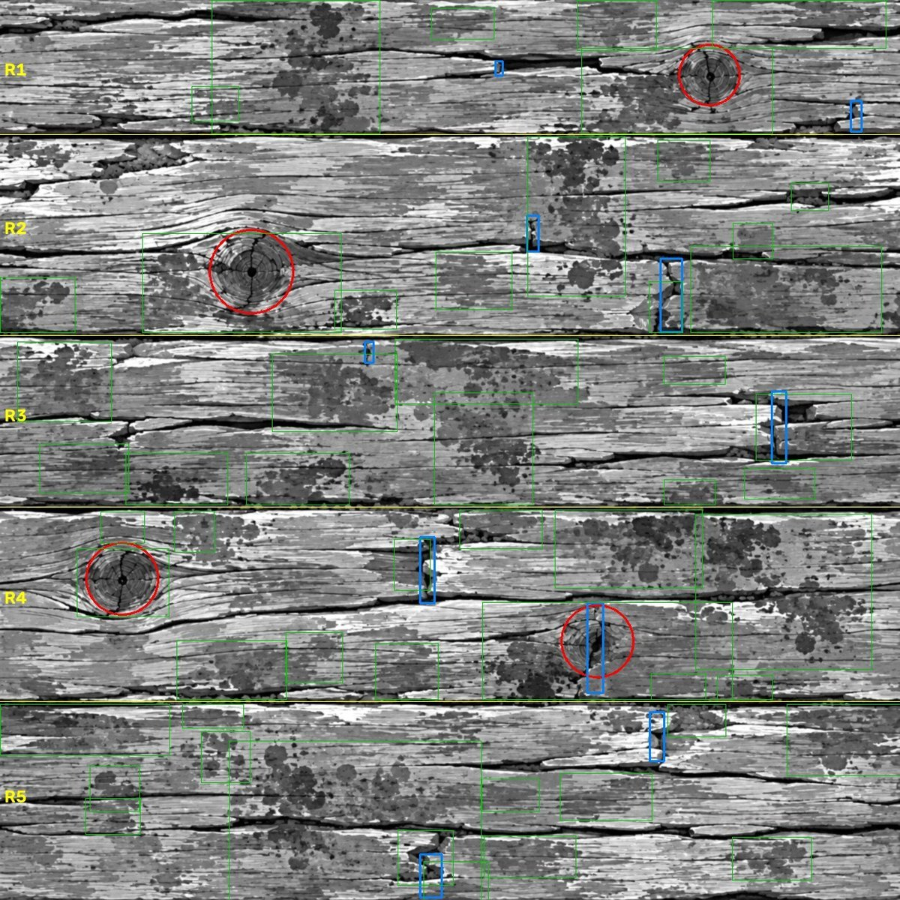

| Thing | What I measured | How sure |
|---|---|---|
| Grey levels | 3 to 250, spread almost evenly (the 1, 5, 25, 50, 75, 95 and 99 percent points are at 3, 34, 93, 128, 162, 213, 245). The map was probably contrast-equalised. | measured |
| Rows | R1 y 28-182 (155 dots high), R2 193-459 (267), R3 475-699 (225), R4 713-970 (258), R5 984-1253 (270). R1 is short because the top 28 dots hold the end of R5. | measured |
| Gaps between rows | Four clear gaps, darkest line at y = 189, 470, 709, 980. Each is 10 to 15 dots wide where over 30 percent of the line is dark (6 to 7 dots where over half is dark). Their centre lines wander by 6 to 16 dots across the map. They look filled with small dark pebbles (seen by eye). | measured, pebbles by eye |
| The fifth gap | Between R5 and R1 (the wrap) there is no clean gap: a ragged crack at y about 18 to 30 across the left 400 and right 250 dots, and an 18-dot sliver of R5 above it. | measured and seen |
| Butt joints | Two per row, partial cracks that are stepped and notched, not clean full-height lines. R2 x about 740 and 935, R3 x about 515 and 1085, R4 x about 595 and 830, R5 x about 915 and 600, R1 two small ones near x 695 and 1190. | by eye from labelled crops, checked with a dark-line finder, good to about 10 dots |
| Knots | Four: K1 (988, 104) in R1, K2 (350, 378) in R2 (the biggest, ring radius about 58), K3 (170, 806) and K4 (832, 893) in R4. K4 is partial and sits on a joint. | black centre dots found by program for K1 to K3; radii by eye |
| Stains | Dark flat round splotches, grey 30 to 110 (wood is 120 to 250), built from dots 4 to 20 across. About 11.5 percent of the map; clusters in every row. | rough: the program also catches some dark grain, so read 11.5 as an upper limit |
| Does it wrap? | **No.** The jump across the left-right edge is 4.0 times a normal jump between neighbouring dot lines; top-bottom 2.8 times. A plain 2 x 2 repeat shows a straight vertical and horizontal seam. | measured |
| Colour against height | Brightness of the colour map predicts the height with correlation **0.981** (0.993 if the colour is blurred by 0.8 dot first). Per row 0.979 to 0.980. Green 0.977, red 0.966, blue 0.900. | measured |
| Colour made from height only | The best single palette that turns height into colour is wrong by DeltaE 5.3 on average (11.3 at the 95th percent point). A palette per row is no better (5.2). | measured |
| Normal map | The uploaded normal map equals a Sobel normal of the uploaded height at strength 8 to within 0.004 average; strengths 6 and 10 are clearly worse. | measured |

DeltaE is a colour-difference number: about 1 is just noticeable, 2 to 5 is a small difference, over 10 is clearly another colour.

The seam and the ragged wrap crack, seen at full size:

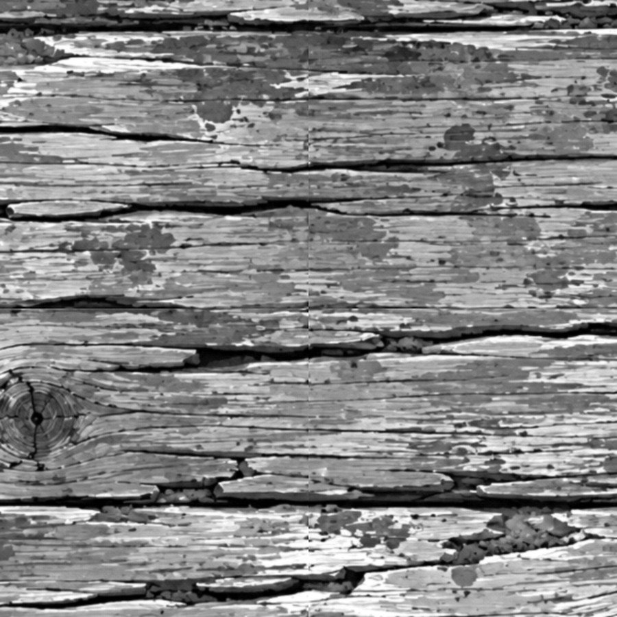
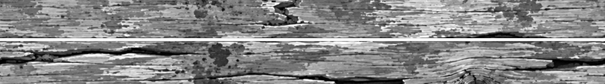

One more consequence of the measurements: each clean source row (R2 to R5; R1 is too short) is only 1254 dots long, and one board window needs 450 to 700 of those dots (less where a knot has to be avoided). Two windows from the same row therefore overlap a lot. That is why near copies cannot be avoided completely; they can only be hidden.

---

## 3. The one idea behind everything: windows that stay inside the map

Because the map does not wrap, a window must not run over its edge. Two choices worked:
* **Bounce back at the edge** with the Math node set to Ping-Pong (the position runs 0 to 1254 and then back). Used in every test here.
* **The Image Texture node's own "Mirror" extension** does the same. The three choices of that node were tried (picture below): Repeat wraps and shows the seam,
  Extend smears the last dot line into stripes, Mirror bounces. Mirror and Ping-Pong give the same picture.

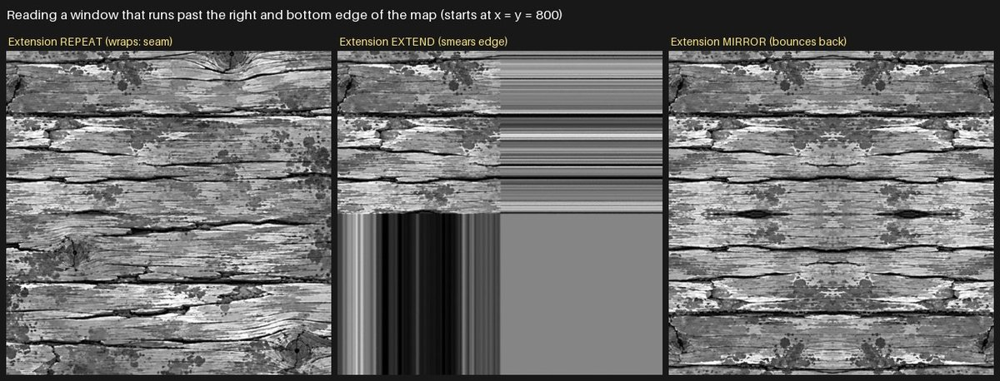

Bouncing makes a mirror-twin of whatever sits near the edge (for example K1 at x 988 would appear twice near the right edge), so the windows that contain a knot should be kept away from the map edges.

---

## 4. How the tests were made (so they can be repeated)

* `tests/nodekit.py` lets a test write sums in plain Python and builds the Blender nodes. `tests/woodtests.py` holds every test (one function per method).
  `tests/run_tests.py` renders the pictures from a job list (the `jobs_*.json` files). `tests/analyse_tests.py` measures them, `tests/make_sheets.py` makes the picture sheets.
* Run one Blender at a time: `blender -b --disable-autoexec -t 2 --python run_tests.py -- jobs_a3.json`. All results are in `tests_results.json`.
* Every picture is "photographed" flat from above with the project's own bake scene (`lib/bake_harness.py`, read only, not changed).
* Times in this guide are rough: two other helpers were baking at the same time (the machine load was about 5.9 on 4 cores).
* The big test pictures (PNG, 85 MB) were deleted at the end to save disk; the JPEG sheets in `pictures/` stay. Running `run_tests.py` with the job files (one at a time) makes a folder `tests/renders/` again, in a few minutes in all.

---

## 5. The methods, one by one

### 5.1 Pieces: every board reads its own random window (per-piece random sampling, "texture bombing by pieces")

**In one sentence:** lay the surface out as rows of boards and let every board show its own randomly chosen window of the map, flipped or zoomed or
shifted, so no two boards show the same part in the same way.

**How people do it:** in a shader, find which board each dot is on, get random numbers for that board from its number, and shift or flip the picture
coordinate with them. People use the Brick Texture node (its colour output holds one random value per brick), a White Noise Texture node fed with the
board number, or a plank mesh with a random value stored on each plank (the Adaptive Wood Siding add-on does the second: it gives each plank a random offset
attribute, Blender 4.1 or newer; not run here). Substance Designer people draw a grey plank map and warp a wood texture with it.

**How it is done here (all inside one node setup, no image editing):**
1. Row number = floor(y / 250.8). Five rows per tile.
2. Board edges along the row: every row is shifted sideways by chance, and each board edge is moved by a random jitter, so boards have different lengths. Which board a dot is on is found by looking at the neighbouring edges too (my first version forgot that: see section 8).
3. Three random numbers per board come from the **White Noise Texture node in 4D**, fed with (row number, board number, a code, a seed). That node is the hash (a repeatable random number maker) of this recipe.
4. The board picks one of four **source slices** (rows R2 to R5, each with its dark gap on top; the exact start and length are in the JSON under `numbers_for_the_builder`), a random start along the row, a random direction (left-right flip) and a zoom of plus or minus 12 percent. The slice is stretched by 0.96 to 1.14 so that it fills one row of 250.8 dots exactly. Because every row starts with a gap from the source, rows never touch each other without their dark gap.
5. A thin dark line is drawn at every board end (a joint). Colour gets a per-board tone (plus or minus 15 percent) and a small warm or cool shift. The colour map and the height map are read with the **same coordinates**.
6. **Default tile:** the row number is taken modulo 5 and the board number modulo the boards per row, so the random numbers repeat after exactly one tile. **Big area:** the random numbers come from the global row and board numbers, so nothing repeats on purpose. It is the same node setup with one switch.

**What I ran and saw:**
* Three versions at 512 dots (picture below): `rows only` (each board reads the source row at its own height, only shifted and flipped; the simplest), `full` (any of the four rows, free random start) and `curated` (knots rationed: only about 1 board in 5 may show a knot and the others start in the knot-free part of their row).
* Colour and height stayed together: the brightness of the new colour predicts the new height with correlation **0.984** (0.981 for the untouched source).
* **Seam test of the default tile** (2 x 2 copies of the tile, picture below): the jump across the vertical tile edge is 1.02 to 1.15 times a normal jump (a seam would be well above 2); the horizontal tile edge jumps 0.23, the ordinary row boundaries inside the picture jump 0.15 to 0.21 (every row starts with a gap, so a row boundary always jumps more than an average line). The four tiles are the same tile (mean difference 0.008). No seam is visible. The tile edge value is 8 to 15 percent above the largest ordinary row jump: small, not zero.
* Speed: 2 to 3 seconds per 512-dot picture, 12 to 20 seconds per 1024-dot 4 x 4 area (colour or height), with 100 to 200 nodes.

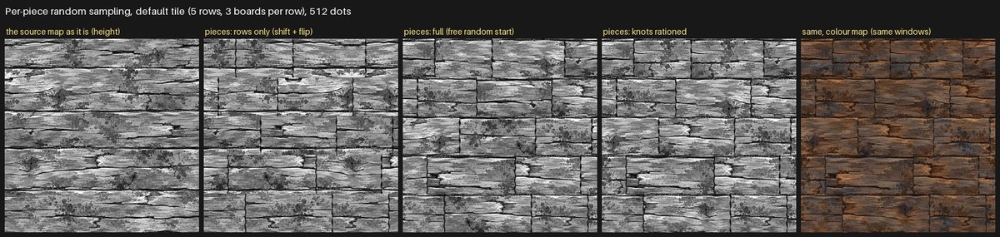

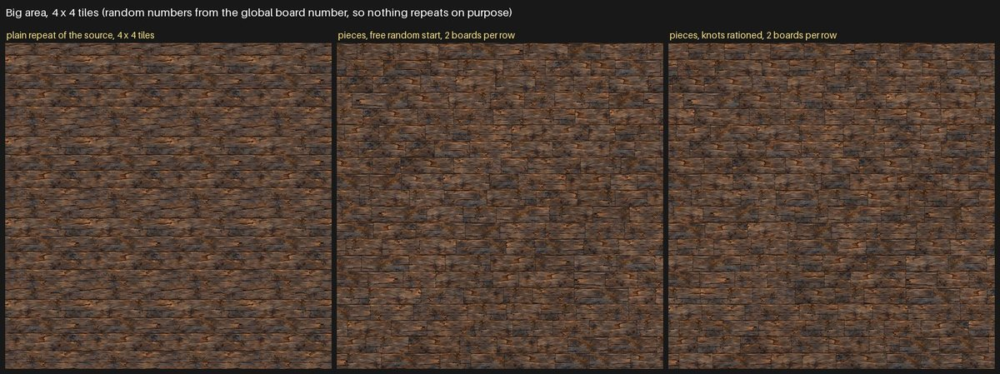

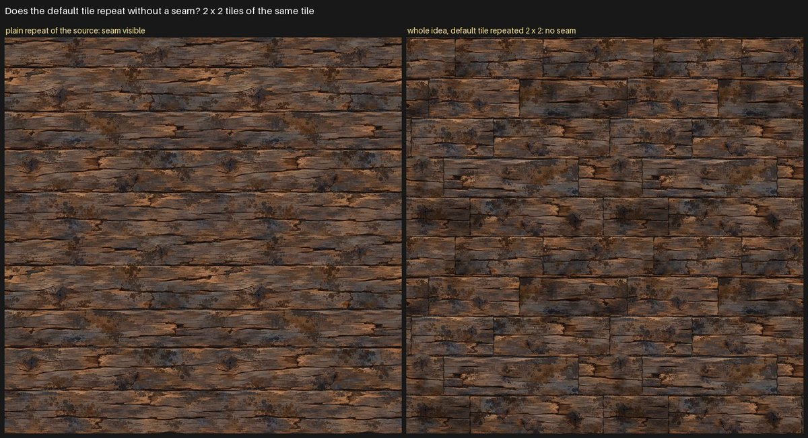

* **Free random start has a knot problem:** with windows 400 to 600 dots long and only four knots in the whole map, knots land in about one board in three and the same knot can sit twice in one row. Rationing them (the `curated` version) fixes that for the price of a small table (which part of each source row is knot-free: in the JSON).
* **What looks wrong in these pictures:** the boards look like a brick wall when they are short (3 per row = 418 dots against a row 251 dots high); all rows have the same height; the joints are plain thin lines, whereas the real joints in the map are notched and broken; the colour has no horizontal drift. These are things for the builder, not faults of the method.

**Suits this wood:** **yes, it is the main method.** It is the only one of the six that keeps the rows, gaps, joints and knots, it is exactly periodic on request, and it samples colour and height together.

### 5.2 Hex or "stochastic" blending, and Voronoi patch tools

**In one sentence:** cut the surface into triangles (or irregular Voronoi cells), give each corner a randomly shifted copy of the whole texture, and mix the copies that meet in each spot so no seam shows; Heitz and Neyret (HPG 2018) added a step that puts the lost contrast back by working on a bell-shaped version of the grey values, and Burley (JCGT 2019) simplified it and sharpened the weights.

**How people do it in Blender:** there is no built-in node. People build it from ~100 Math nodes, or buy or download a node group or add-on: Patchwork (Voronoi, Noise, Gabor, Blocks or Rings cells with random rotation and offset, Blender 5.0 and newer), KM Anti-Tile NG, UV Randomizer (it supports normal maps with an extra vector-rotate), Scattershot. None of these add-ons was installed or run here (plain Blender only). Inigo Quilez describes the older three ways (per-tile offset and mirror with 4 reads and a smooth blend, smooth Voronoi blend with 9 reads, and a virtual-pattern blend with 2 reads); he does not discuss normal or bump maps, and a Blender forum thread warns that blended offsets break bump and displacement maps.

**How I ran it:** a triangle grid of 7 x 8 cells per tile (the 8/7 ratio makes it wrap exactly after one tile; it is 1 percent off a perfect hex shape). Each of the three corners of a triangle shifts the map by its own random amount, weights are raised to the power 3 to cut ghosting, and four variants were made: hard (only the strongest copy shows), plain linear blend, blend plus the contrast put back (divide by the root of the sum of squared weights), and the Heitz-Neyret way (turn the grey values into a bell shape, blend, divide the same way, turn back). The bell shape used a logistic curve as a stand-in for the Gaussian one, so it is "Heitz-Neyret style", not exact. The Voronoi version uses the cell colour of the Voronoi Texture node as the random shift (hard cell edges).

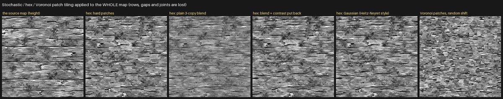

**What I saw and measured:**
* **The rows, gaps and joints are gone.** A program counted the dark gap lines: the source has 4, every hex and Voronoi picture has 0. Knots break into pieces or double up.
* The contrast part works as described: standard deviation of the grey values 0.205 for the source, **0.132** for the plain 3-copy blend (36 percent flatter), 0.186 with variance kept, 0.190 Gaussian style, 0.186 hard patches. So the contrast fix is real, but it cannot bring back structure the blend has destroyed.
* **Not seamless in tile mode (a failure):** with offsets read from a map that does not wrap, the left-right edge jump was 4.7 times normal. Hex tiling can only make a seamless tile if the source map itself wraps.
* The repeat score of these two methods in section 6 is not comparable with the others (it assumes rows at a fixed height, which these methods destroy).
* Speed: 2 to 3 seconds at 512 dots, about 100 to 160 nodes.

**Suits this wood:** **no for the whole map.** It would only make sense inside one board (the long grain between cracks is noise-like), and boards from the map already give that. The step "restore contrast with a Gaussian grey mapping" is the useful piece to remember if two windows are ever blended: because this map's grey levels are almost evenly spread, the exact Gaussian mapping would be a simple rank-to-bell conversion.

### 5.3 Wang tiles and random tile picking

**In one sentence:** make a small set of square tiles whose edges carry colours, and fill the surface by choosing, at random, a tile whose edges fit the neighbours (Cohen, Shade, Hiller and Deussen, SIGGRAPH 2003); the tiles are made once from the example by an offline step (for example image quilting), which makes their edges agree.

**How people do it in Blender:** a lookup in nodes (a hash picks the tile number, the tile number picks an offset into a tile atlas); the offline step is done outside Blender (a small tool), which is not allowed in this job. The node part is the same hash trick as in 5.1.

**What I ran:**
* A **random tile bag**: 16 fixed windows (each = one gap and one board), a tile pulled from the bag for every board position. Then 64 tiles, then 256.
* A **naive two-colour Wang set**: 16 tiles chosen by the colours of the four edges of each square cell, each tile a fixed window of the map. The windows do not match along their edges (making them match is the offline step), so this shows what goes wrong.

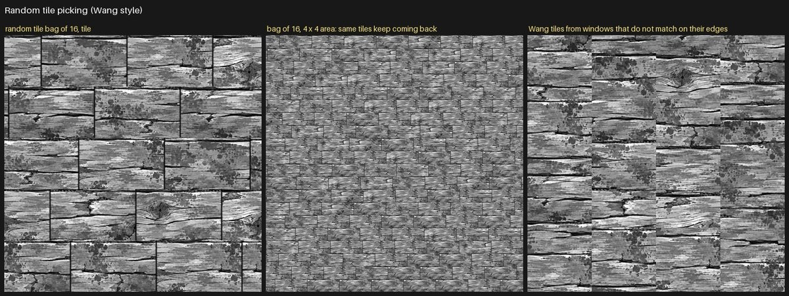

**What I saw:**
* The naive Wang tiles show hard cuts at every cell edge (right picture). For this wood the "edges" would be the gap and the joint lines, which are dark everywhere and so match by nature; that is exactly why 5.1 needs no Wang step.
* A bag is a **finite** pool. In a 4 x 4 area, 97 percent of board-size pieces had a near copy with 16 tiles and 75 percent with 64 tiles (section 6).
* **A failure to record:** a table of 256 windows made a setup of 2115 nodes (the lookup grows by one compare per entry: 197 nodes for 16, 579 for 64) and the render finished black after 148 seconds. I did not find out why. Lesson: never use a long lookup table; make the window from the hash (as 5.1 does), so the pool is unlimited.

**Suits this wood:** **no as a fixed set of tiles.** The idea behind it (random choice per piece, with edges that always fit) is already what 5.1 does with an unlimited pool.

### 5.4 Texture bombing of stamps (knots and stains)

**In one sentence:** scatter small round cut-outs of the map (stamps) over a surface, one per grid cell at a random place, with a random pick of stamp, a random flip and zoom, and a soft round edge.

**How people do it in Blender:** a Voronoi or grid cell number gives the random numbers; for stamps that reach into neighbouring cells each dot has to look at the 3 x 3 cells around it. Scattershot (a paid add-on) does this for image textures. The Blender 5.0 release notes name "blended box mapping, tiling and texture bombing with arbitrary procedural textures" as a purpose of the new shader **closures** and **repeat zones**.

**How I ran it:** on top of curated pieces with no knots of their own, two stamp layers:
* **Stains:** 8 stain-cluster windows of the map (radius 85 dots), one per cell of 250 dots, 45 percent of cells. Only the dark part of the stamp is painted (grey below 135 of 255), so the wood grain inside the circle is not copied.
* **Knots:** the 3 whole knots (K1 to K3, radius 80 dots), one per cell of 313 dots, 22 percent of cells, flipped or zoomed by chance. Stamps replace what is under them.
* Colour is painted with the same mask from the same place of the colour map.
* Version one keeps each stamp inside its own cell (cheap, but stamps stay on a loose grid). Version two uses a **repeat zone**: nine turns, one per neighbouring cell, so the stamp centre can be anywhere and stamps can cross cell borders.

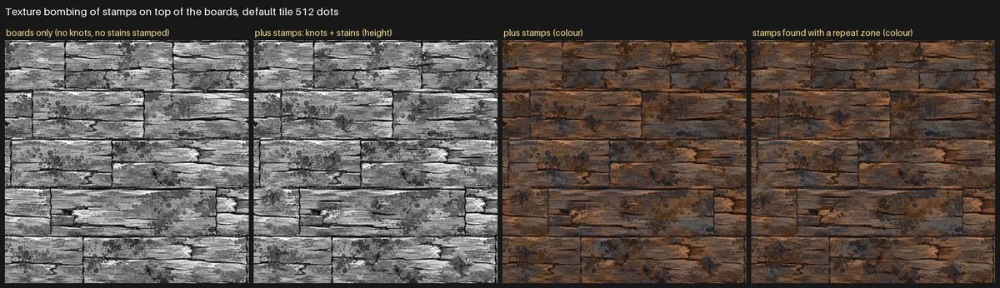

**What I saw:**
* Stains look natural as stamps (they are flat dark cut-outs in the map as well). Knots as stamps look like round discs without the flowing grain around the knot (the wavy grain extends 100 to 200 dots from a knot). At the small scale of these pictures it is acceptable; at full size I expect it to show. Knots are better kept as whole knot boards (the `curated` mode in 5.1). **Not checked at full size.**
* In the 4 x 4 area, stamps cut board-size near copies from 53 percent to 15 percent (2 boards per row; the base boards differ a little, because the knot boards of the curated version are left out under the stamps). Stains are the loudest, most recognisable detail, so putting them on as separate stamps matters more than any other change.
* **The repeat zone works** (it is new in Blender 5 shaders). It was made from Python with the same two node types the geometry-nodes zone uses (`GeometryNodeRepeatInput` and `GeometryNodeRepeatOutput`, joined with `pair_with_output`, state items added with `repeat_items.new('FLOAT', name)`); Cycles on the CPU renders it. It copies the loop body nine times, so it is slower: colour at 512 dots 27 seconds against 7 for the one-cell version, at 1254 dots 99 seconds against about 30 (rough, the machine was loaded). A small test (soft dots across cell borders) is the left picture in section 5.6.
* **Closures and bundles in shaders (Blender 5.0)** were **not tested**: image stamps do not need them. They would matter only if the stamp itself were a procedural texture passed into a reusable bombing group.

**Suits this wood:** **yes for stains and for adding variety; use whole knot boards for knots.** The one-cell version is enough; the repeat zone is not needed unless stamps must cross cell borders.

### 5.5 Large-scale masks (per-board tone, drift, big stains, wear)

**In one sentence:** multiply or darken the whole surface with soft, very large patterns that are not copied from the map, so the large look changes from place to place even where the small detail is reused.

**How it is done:** per-board tone and warmth were already in 5.1. On top: a soft light/dark drift (about 2 patches per tile, plus or minus 25 percent) and a few big dark blotches per tile (45 percent darker). In the default tile the noise is made seamless with the donut trick (4D noise on two circles); in an area it is plain noise. The shared slate layers (`reuse_trials/shared_layers_snapshot/layers`) were **not used** in this research: my own two masks were enough to see the effect, and the slate layers need their inputs wired in a recipe.

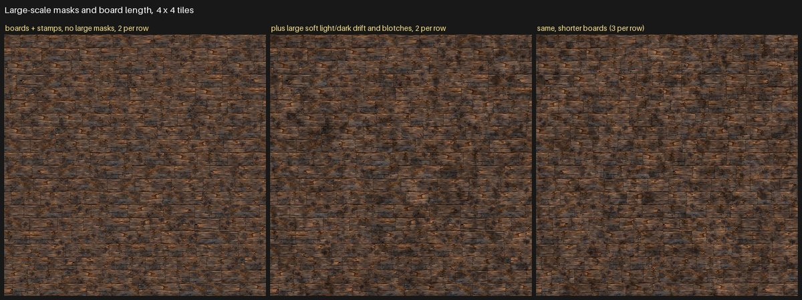

**What I saw:**
* The masks add a drift of tone that no longer follows the board grid, and the repeat score improves a little more (10 percent against 15 percent board-size near copies at 2 boards per row, section 6). At this picture size the effect on repetition is modest; the stamps did more.
* The masks also lower the match between colour brightness and height slightly (0.984 to 0.976), because the blotches darken the height too. Decide whether masks should touch the height.
* The **board length matters more than any mask**: at 3 boards per row (418 dots) the whole idea gives only 3 percent board-size near copies; at 2 per row (627 dots) 10 percent. Short boards look like bricks, long boards repeat more. With 40 test patches, differences smaller than about 10 percentage points are noise.

**Suits this wood:** **yes, cheap and useful**, but as a finishing layer, not the main way.

### 5.6 What is new in Blender 4.x and 5.x, and the geometry-nodes route

| Feature | What it is | What I did | Useful here? |
|---|---|---|---|
| Repeat zone in shaders (5.0) | a loop of nodes | tested, works in 5.2.2 Cycles CPU, Cycles copies the body for a fixed count | only for free-placed stamps (5.4); 3 to 4 times slower |
| Closures and bundles in shaders (5.0) | pass a texture into a node group | **not tested** | not needed for image stamps |
| Image Texture node extension | Repeat, Extend, Clip, **Mirror** exist in 5.2 | tested Repeat, Extend, Mirror (section 3) | Mirror (or Ping-Pong in Math) is how to keep windows inside this map |
| Image Texture interpolation | Linear, Closest, Cubic, Smart | tested Linear, Closest and Cubic on the arranged tile, see below | Linear is fine |
| Math nodes Ping-Pong, Wrap, Snap, Floored Modulo | coordinate tricks | Ping-Pong and Floored Modulo used | yes |
| White Noise Texture 4D | a hash | used for every random number | yes |
| Radial Tiling node (5.0), faster Voronoi (5.0, pattern changed), Raycast node (5.1), Normal Map OpenGL/DirectX option (5.1) | other new shader nodes | **not tested** (read in the release notes only) | not for this job |
| Geometry nodes route | real board meshes, each with a random UV window | **tested** (below) | optional |

**Picture reading modes.** Reading the arranged tile at full size (1254 dots, narrow pixel filter) with the three modes: the sharpness, measured as the average jump between neighbouring dots and set against Closest = 1.00, is Linear 0.92 and Cubic 0.85 (Blender's Cubic is a smoothing curve, so it blurs more than Linear). Closest keeps painted edges hardest but shows staircase edges when a window is zoomed. I judge Linear good enough and Closest an option for whole-dot windows; the three crops look alike at a glance:

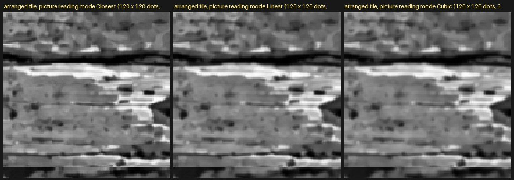

**The geometry-nodes route (real board meshes with random UV windows).** Built: a grid of board centres, each row shifted by chance; a unit quad with its own 0 to 1 UV map instanced on every point (scaled slightly smaller than its cell, so a real gap shows); the instances realized; then a new UV map stored per board corner (Store Named Attribute) that holds that board's window (start, flip, which source row) computed from a random value of the board number. The material is then a plain Image Texture that reads the UV map. Result: 200 boards, a 4 x 4 area, colour and height both rendered in 4.5 seconds in total.

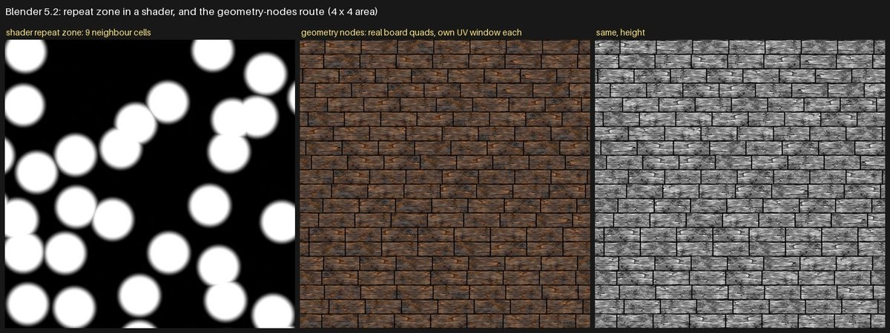

* **Works, and it is fast.** The shader stays simple, and real geometry has real gaps and could have bevels, steps between boards or true displacement.
* **Why it does not fit the default tile:** a staggered row must be cut at the tile edge, which needs a boolean cut or hidden overhang; the project's bake harness photographs a shader recipe, not a mesh (`lib/contrib/gn_tools.py` can photograph geometry, I did not try it). Board lengths were all equal in my test (variable lengths need an Accumulate Field step I did not build), so it looks like a brick wall.
* **Verdict:** worth it later **only if a real floor or wall mesh is wanted**; not worth it for the texture recipe.

**Normal map made from the arranged height** (as decided; the uploaded normal map is not sampled): the plain source rendered through the nodes at 1254 dots, turned into a normal map at strength 8 and compared with the uploaded normal map:

| Way of rendering | Height differs from uploaded by | Normal differs from uploaded by (x, y, z, average of absolute values) |
|---|---|---|
| bake harness default (4 samples, pixel filter width 1.0) | 0.0088 | 0.027, 0.035, 0.019 |
| narrow pixel filter (1 sample, width 0.01) | 0.0006 | 0.007, 0.006, 0.004 |

So the node route reproduces the uploaded normal almost exactly when each dot is read at its own centre; the default bake blurs by about a dot and so adds about 0.03 of difference. This is for the identity arrangement only; for a re-arranged surface there is nothing to compare with except the picture itself. Whether the extra blur matters for looks was not judged. (The harness settings are in `lib/`, which I did not change.)

---

## 6. The repeat check: numbers for a 4 x 4 area

**What the number is:** 40 random templates are cut from inside a board row of a 4 x 4 picture (20 rows, 1024 dots wide) and searched for in all other rows (same height within the row, plus or minus 3 dots, also left-right flipped). The score is the best match (1.0 = identical copy). A 36 x 80 template is about 175 x 390 source dots (most of a board); a 24 x 40 template is about 120 x 195 source dots (a knot, a crack pattern). The share is the part of templates whose best match is over 0.8. This is **my own measure, not a measure of what a person sees**; it checks only copies at the same height within the row and the same zoom within about 10 percent. Seed 1 only.

| Surface (height pictures) | Board-size: median best match | Board-size: share with a near copy | Feature-size: median | Feature-size: share |
|---|---|---|---|---|
| plain source repeated | 0.99 | 100% | 0.99 | 100% |
| pieces, rows only (shift + flip) | 0.96 | 72% | 0.99 | 80% |
| pieces, free random start (2 boards per row) | 0.78 | 47% | 0.92 | 72% |
| pieces, knots rationed (2 per row) | 0.81 | 53% | 0.92 | 78% |
| pieces, free start, 3 per row | 0.69 | 15% | 0.81 | 57% |
| pieces, knots rationed, 3 per row | 0.68 | 20% | 0.82 | 55% |
| pieces + stamps (2 per row) | 0.71 | 15% | 0.79 | 47% |
| **whole idea: pieces + stamps + large masks (2 per row)** | 0.69 | **10%** | 0.77 | 45% |
| **whole idea, 3 per row** | 0.57 | **3%** | 0.69 | 20% |
| whole idea, 4 per row | 0.50 | 0% | 0.72 | 30% |
| random tile bag of 16 | 0.98 | 97% | 0.99 | 97% |
| random tile bag of 64 | 0.95 | 75% | 0.98 | 82% |
| hex Gaussian blend of the whole map | 0.30 | 0% | 0.49 | 0% (**not comparable**, rows destroyed) |
| Voronoi patches with random shift | 0.14 | 0% | 0.24 | 0% (**not comparable**, rows destroyed) |

Reading it: a plain repeat has a copy of everything. Pieces alone still leave about half of the board-size pieces with a near copy, because a window of 600 dots out of a row of 1254 overlaps many other windows from the same row. Stamps, large masks and shorter boards each take it down. The feature-size check stays higher (20 to 60 percent), meaning that small details such as a short crack pattern do come back; hiding that needs zoom, flip, stamps and masks together, and a person to look at it.

---

## 7. Colour map against colour made from height (the two versions to keep)

Both versions use exactly the same arrangement, the same per-board tone and the same masks. The MAIN version samples the colour map with the same windows as the height; the COMPARISON version builds colour from the sampled height with a palette (12 control points taken from the measured palette in the JSON).

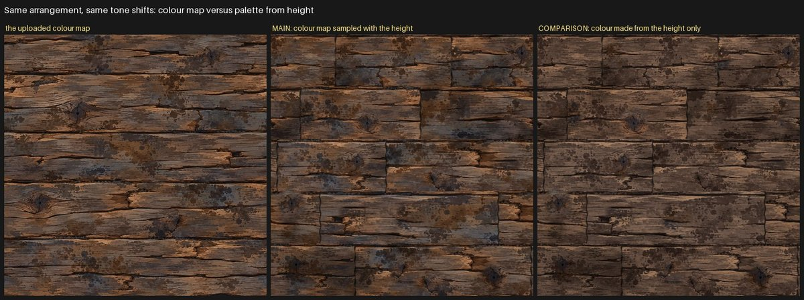

* The mean colour difference between the two versions is DeltaE **4.3** (10.3 at the 95th percent point); the mean colours are nearly equal (79, 60, 49 against 79, 60, 49 in 0 to 255 values).
* In the picture the comparison version is plainer: fewer orange highlights and fewer blue-grey patches, because a palette cannot tell an orange area from a blue-grey one when both have the same brightness. The colour map adds exactly that.
* The palette is not a separate invention: it is measured from this map, so it is only fair as a comparison, not as a procedural wood palette made from scratch.

---

## 8. What went wrong while testing (so nobody repeats it)

1. **Wide black bars in the first pieces pictures:** my board finder only looked at the board before and the board itself; a board whose jittered edge moved into the next cell was lost. Fixed by also checking the board after. The first "rows only" picture was made before the fix and was redone.
2. **The same knot twice in one row** in free random mode, and about three knots per tile: led to the `curated` mode.
3. **Hex tile mode was not seamless** (4.7 times a normal jump at the edge): the source map does not wrap.
4. **The 256-tile bag rendered black** (2115 nodes, 148 seconds). Not diagnosed.
5. **My first stain finder joined everything into one huge cluster** (closing radius too large); retuned, and still rough.
6. **My first repeat check was misleading:** it counted any patch that contained a dark gap as a near copy, because gaps sit at the same height in every row. Replaced by the row-based check above.
7. **A setting leaked from one of my tests into the next** (the picture reading mode): the first normal check and the first sharpness numbers were wrong and were redone after the fix. The numbers in this guide come from the corrected runs.
8. A single stray set of 8-bit rounding differences (0.9 percent of dots differ by more than 0.05 between tiles) comes from the renderer's random sampling, not from the layout.

---

## 9. Not tested, and where I am unsure

* **No person looked at the pictures for "visible repetition"**; the near-copy table is my own measure, and I only judged the pictures by eye myself. The brick-wall look of short boards, the flat joint lines and the round knot stamps are the weak points I can see.
* The **add-ons** (Patchwork, KM Anti-Tile NG, UV Randomizer, Scattershot, Adaptive Wood Siding) were read about, **not run** (plain Blender only).
* **Closures/bundles in shaders**, the Radial Tiling node, the Raycast node and the Normal Map convention switch: not tested.
* **Seeds:** only seed 1 was used for every number; other seeds will move the repeat table by some points.
* **Joints:** a board end at a natural joint of the map (x about 740, 935, 515, 1085, 595, 830, 915, 600) would give real broken ends. Not tried.
* **Row height variation and vertical flips** were not built (a flipped board puts its gap at the bottom; row heights that differ need running sums). R1 (the short top row) was not used.
* **Stamp positions** (8 stain clusters, 3 knots) are taken by hand from the measurement list; a better pick is possible.
* **Speed** numbers are rough because other helpers were baking (load about 5.9 on 4 cores).
* **The default tile with 2 boards per row** was seam-checked only for the whole idea and for curated pieces; free and rows-only tile mode were looked at, not measured.
* The Heitz-Neyret test used a logistic stand-in for the Gaussian curve, so it is "in the style of" the method.

---

## 10. Recommendation for the builder

Build **one recipe** with this structure. Everything inside Blender nodes, no outside image work:

1. **Layout:** 5 rows per tile, row pitch 250.8 dots, each row starting with a gap. Boards per row: **2 to 3** (627 or 418 dots) with random board lengths (jitter about plus or minus 25 percent of the length), every row shifted sideways by chance. Try both and look: 2 per row looks more like long planks, 3 per row repeats less.
2. **Windows:** per board, from the White Noise Texture 4D hash: one of the four source slices (R2 to R5, numbers in `measurements_wood_source_map.json` under `numbers_for_the_builder`), a random start, a random left-right flip, a zoom of plus or minus 12 percent. Keep windows inside the map with Ping-Pong; **do not use R1**.
3. **Colour and height read with the same coordinates**, built once and fed to both Image Texture nodes. Per-board tone (about plus or minus 15 percent) and a small warm/cool shift go on the colour. Keep a switch for the COMPARISON version (colour from the sampled height with the 12-point palette; keep the same tone).
4. **Knots rationed:** about 1 board in 5 is a knot board (a window that contains K2, or K3/K4), and all others start in the knot-free part of their source row (table in the JSON). Treat K4 as a partial knot.
5. **Stains and wear as separate layers:** stain stamps (dark part only), one per 250-dot cell at 45 percent, plus two large soft masks (drift and blotches). Use the one-cell version, not the repeat zone, unless stamps really must cross cell borders. Decide on purpose whether the masks darken the height.
6. **Joints:** a thin dark line at board ends is a start; making board ends coincide with the source's own broken joints, or adding a small notch and a pebble row, would remove the cleanest-looking weakness.
7. **Default tile and area from the same nodes:** a switch picks "modulo 5 rows and modulo boards-per-row" (tile that wraps exactly) or "global row and board numbers" (area that never repeats on purpose). Seamless noise in the default tile needs the donut trick; in an area plain noise is fine. Do not use any lookup table longer than about 10 entries (the four-entry slice table is fine).
8. **Normal:** make it from the sampled height at strength 8 (as decided); compare with the uploaded normal map only for the identity arrangement; bake the height with a narrow pixel filter (0.01 width, 1 sample) if the check should match to 0.007 (the default bake gives about 0.03).
9. **Checks to run before calling it done:** the half-tile-shift test, a 2 x 2 and a 4 x 4 look, `tests/analyse_tests.py` (seam jumps, repeat score), and a person's look at the 4 x 4.
10. **What not to spend time on:** hex or Voronoi blending of the whole map, fixed tile bags and Wang sets, closures. **Optional later:** a geometry-nodes floor mesh if a real floor is ever needed.

Expected cost: about 450 to 500 nodes and 30 seconds per channel at 1254 dots (machine under load), about 100 seconds with a repeat zone.

---

## 11. Sources

* Inigo Quilez, "Texture repetition": <https://iquilezles.org/articles/texturerepetition/>
* Heitz and Neyret, "High-Performance By-Example Noise using a Histogram-Preserving Blending Operator" (HPG 2018), as described in Unity's write-up: <https://unity.com/vn/blog/engine-platform/procedural-stochastic-texturing-in-unity>
* Brent Burley, "On Histogram-preserving Blending for Randomized Texture Tiling", JCGT vol. 8 no. 4 (2019): <https://www.jcgt.org/published/0008/04/02/paper.pdf>
* Cohen, Shade, Hiller, Deussen, "Wang Tiles for Image and Texture Generation" (SIGGRAPH 2003): <https://graphics.uni-konstanz.de/publikationen/Cohen2003WangTilesImage/index.html>
* Blender 5.0 release notes (rendering: closures, repeat zones in shaders, Radial Tiling, faster Voronoi): <https://developer.blender.org/docs/release_notes/5.0/rendering/>
* Blender code blog, "Bundles and Closures": <https://code.blender.org/2025/08/bundles-and-closures/>
* Patchwork (Blender 5.0 and newer): <https://superhivemarket.com/products/patchwork/docs>; Adaptive Wood Siding (geometry nodes, per-plank random attributes, 4.1 and newer): <https://superhivemarket.com/products/adaptive-wood-siding/docs>
* Blender Artists thread "How to avoid noticeable texture tiling": <https://blenderartists.org/t/how-to-avoid-noticeable-texture-tiling/1297564>; Substance 3D Designer community thread on tile sampler and plank grids: <https://community.adobe.com/t5/substance-3d-designer-discussions/preventing-bitmap-from-tiling-stretching-with-tile-sampler-color/td-p/14537610>

---

## 12. Files in this research folder

* `08 Research - making big non-repeating surfaces from one map.md` - this guide.
* `measurements_wood_source_map.json` - rows, gaps, joints, knots, stains, wrap test, colour against height, palette, normal check, numbers for the builder.
* `tests_results.json` - every number from the test pictures (seam checks, repeat checks, grey spread, colour match, palette difference, normal check, reading modes).
* `pictures/` - the picture sheets used here (A1, A2, B1, C1, D1, E1, F1, G1, G2, H1, I1) and the source map pictures.
* `tests/` - the scripts (`nodekit.py`, `woodtests.py`, `run_tests.py`, `analyse_tests.py`, `make_sheets.py`, `measure_wood_source_map.py`, `gn_boards.py`, the probe scripts), the job files `jobs_*.json`, and the labelled row crops `probe_R1.png` to `probe_R5.png` used to read joints.
