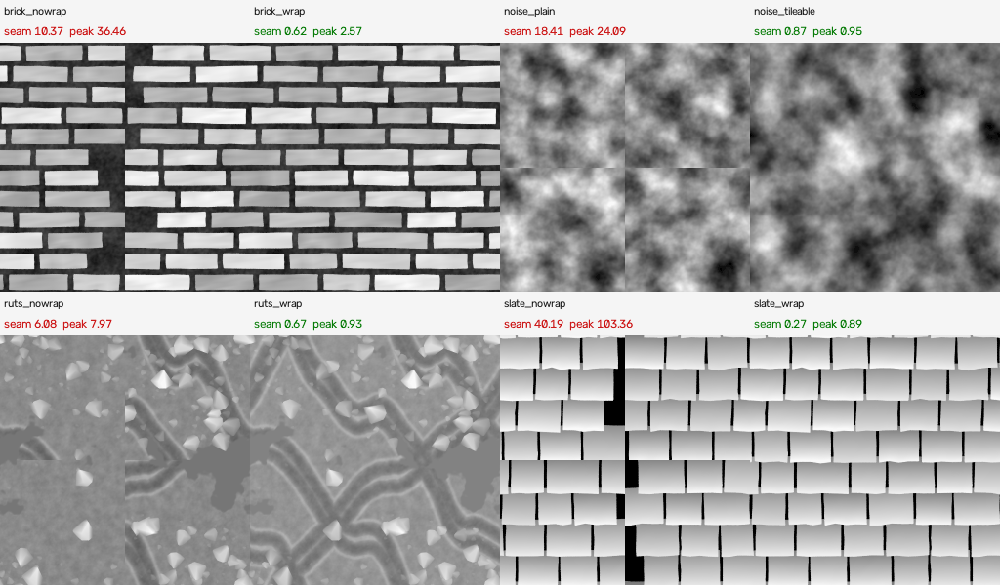
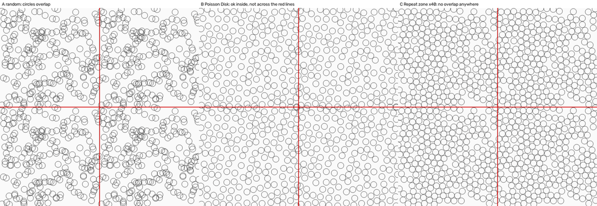
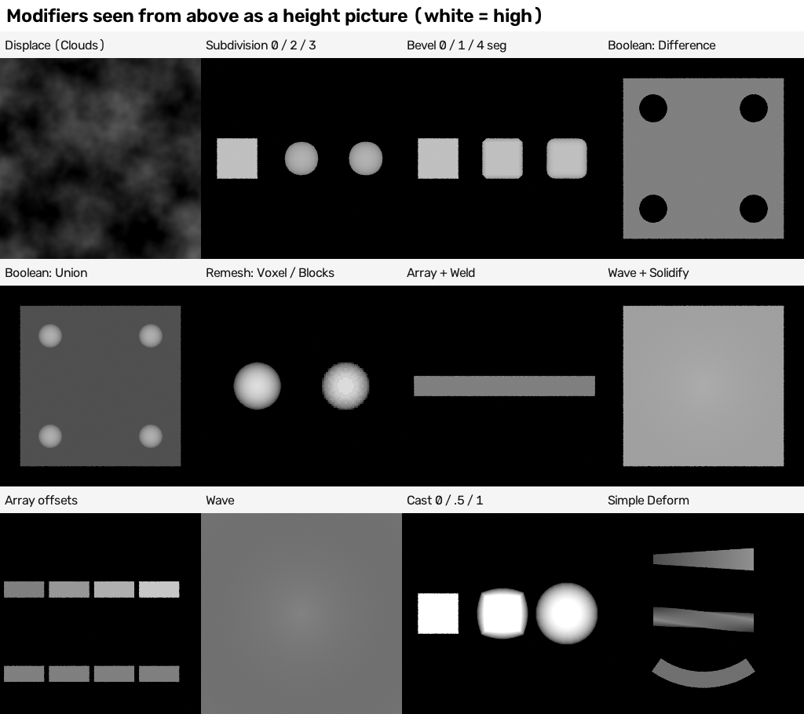
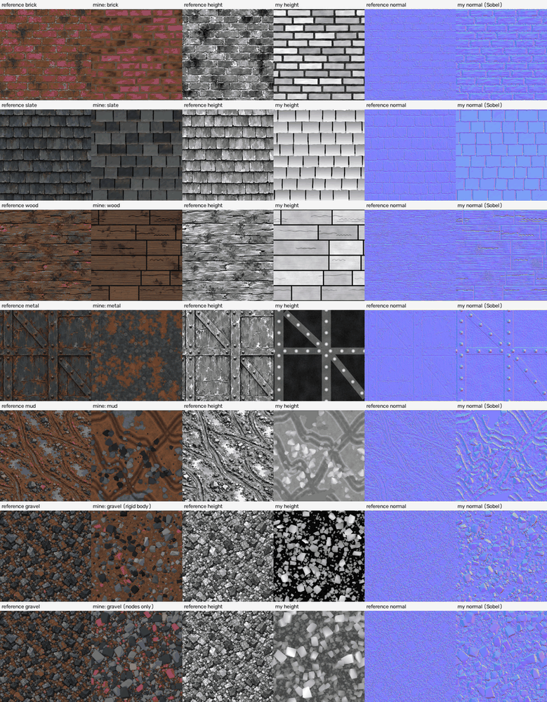

# 02 Research - geometry nodes, curves, modifiers and physics for surface detail (Blender 5.2)

What this is: a plain-language guide to making a texture set (colour, height, normal) by BUILDING the surface out of real 3D geometry - bricks, slates, planks, rivets, stones, ruts - and then
"photographing" it from straight above. Everything marked TESTED was run in Blender 5.2.2 on this machine (CPU only, 2 threads, shared with other jobs). Anything marked NOT TESTED
or WEB ONLY was read or seen but not run here. The scripts, pictures and raw numbers are in `experiments_geometry_nodes_curves_modifiers_physics/` next to this file.

Labels used everywhere
- **TESTED** = I ran it and looked at the picture or the numbers.  **NOT TESTED** = read only.  **WEB ONLY** = a web page says so; I did not check it.
- "Tile" = the flat 1 x 1 square we photograph (x = across, y = up the picture). "Height" = how high the surface is at each point. "Wrap" or "seamless" = the right edge continues into the left edge and the top into the bottom.
- "Node group" = a saved bundle of nodes. "Point" = a position with no size. "Instance" = a cheap copy of a shape placed at a point. "Realize" = turn the cheap copies into real geometry.

---

## 1. The short version (read this first)

The idea in one sentence: **build the surface as geometry, put a flat camera above it that looks straight down, and let the camera "draw" the height (how high), the colour and the slope of every spot.**

An example before the rules. A brick wall tile in this guide is made like this: one row-layout group places 48 bricks (12 rows of 4) (each a box with a random length), a mortar sheet goes underneath, noise roughens both, and one overhead camera takes three pictures: height (white = high), colour, normal. The whole job took 111 seconds at 1254 x 1254 pixels. Nothing in it is a picture.

The facts that would have saved me the most time (each is proved further down):

1. **The photo booth works and is exact.** An orthographic (no perspective) camera over a 1 x 1 square, with an Emission shader that shows the surface point's Z (height), gives the true height. With a 16-bit PNG the error is 0.0000076 of the full range; with an 8-bit PNG it is one grey step in 255. (TESTED, section 2.)
2. **A material put on the object does NOT reach geometry built by Geometry Nodes.** The picture comes out completely black. Put a Set Material node as the last node of the group and swap its material for each picture. (TESTED, section 2.)
3. **Geometry does not wrap by itself, and Blender's Noise node does not repeat.** To wrap: make copies of the pieces shifted by one tile in every direction (9 copies in all), keep only the copies that touch the tile, use noise that repeats (the "donut" trick), and keep every curve a closed loop on the tile. Seam measure, plain vs wrapped: brick 10.4 -> 0.62, slate 40.2 -> 0.27, mud ruts 6.1 -> 0.67, noise plane 18.4 (plain Noise) -> 0.87 (repeating noise). About 1.0 or less = no seam. (TESTED, section 3.)
4. **Distribute Points on Faces with Poisson Disk keeps points apart inside the tile but knows nothing about the other side of the edge.** Two points 0.005 apart across the seam, when 0.064 was asked for. A Repeat zone that pushes overlapping points apart, measuring distance the wrap-around way, fixes it: after 40 steps no point had a neighbour closer than 0.9 of the asked distance. It takes 0.13 seconds for 220 points. (TESTED, section 6.)
5. **Rigid Body physics (drop-and-settle) works from Python, step by step, and gives real piles - but it cannot wrap by itself.** Without any trick, 69 pairs of stones pushed into each other across the seam. Moving the pile half a tile and settling again (twice more) brought it down to 29, then 14 pairs. The "ghost copies" trick I expected to work made 5 of 834 stones fall through the floor and left others hanging 4-5 units above it. (TESTED, section 7.)
6. **Accumulate Field: "Leading" INCLUDES the current element; "Trailing" is the total before it (starts at 0).** The names suggest the opposite. This is what makes pieces in a row add up to exactly 1.0. (TESTED, matches the manual.)
7. **Mesh Bevel in Blender 5.x: for edges you must set the four "Start/End Left/Right Offset" inputs.** The single "Offset" input only works for vertex bevels. The four default to 0.1 (10 cm), so a first try explodes the height range to 0.1 m. (TESTED; in the manual.)
8. **A Geometry Nodes modifier's inputs are now set like this:** `modifier.properties.inputs.Socket_1.value = 5` followed by `object.update_tag()`. The old `modifier["Socket_1"] = 5` now fails ("this type doesn't support IDProperties"). (TESTED; the 5.2 Python release notes say the same.)
9. **EXR files in 5.2:** set `image_settings.media_type = 'MULTI_LAYER_IMAGE'` first, then `file_format = 'OPEN_EXR_MULTILAYER'`. The file is "multipart" (every pass its own sub-picture); read it part by part. (TESTED.)
10. **Real geometry gives the TRUE height, and the reference pictures are not true heights.** The references' height maps follow the brightness of the colour picture (correlation 0.94-0.99): mortar is light, soot is dark. A photographed height has mortar LOW (dark). So geometry-only height scores low against these references (brick 0.00, slate 0.02-0.05) and a hybrid (half geometry, half colour brightness) or colour-only height scores better. Geometry is best used for STRUCTURE (layout, overlap, rivets, ruts, stones), colour brightness for GRIT. (TESTED, section 9.)
11. **Dark outlines and crevices come free from the Ambient Occlusion node in the colour picture** - it needs real geometry - but it makes the colour picture about 13 times slower to render (6.8 s -> 87 s for brick at 1254 px). Edge wear (lighter sharp edges) comes from Pointiness. (TESTED.)
12. **Boolean: cut ALL holes with one cutter, not one modifier per hole.** 144 holes: 12.7 s with 144 Boolean modifiers (Exact), 2.5 s with one cutter (Exact), 0.47 s with the Float solver or the Geometry Nodes Mesh Boolean node (solver Float), 0.19 s with the Manifold solver. (TESTED twice, section 8.3.)

---

## 2. The photo booth: how to get height, colour and normal from geometry

### 2.1 The setup (TESTED)
`lib/bake_harness.py` already builds the booth: a camera at (0.5, 0.5, 5) looking straight down, **orthographic** (`camera.type = 'ORTHO'`, `ortho_scale = 1.0`) so the camera sees exactly x 0..1, y 0..1 with no perspective, Cycles with 4 samples, a **box** pixel filter of width 1, black world, and the "Standard" (or "Raw" for data) view transform. My helper `gn_tools.photograph_geometry()` adds the geometry object and writes three pictures.

Why Cycles and not EEVEE here: this machine has no graphics card, so EEVEE cannot run (NOT TESTED). The emission-only look needs no lights, so Cycles with 4 samples is quick: height 1254 x 1254 took 6-7 seconds for a 270,000-vertex brick wall.

### 2.2 Six ways to get height, measured (TESTED, `t01_zdepth_routes.py`)
I built a staircase of four flat steps (heights 0, 0.02, 0.05, 0.10) and drew its height six ways, then compared with the truth (heights rescaled to 0..1):

| Route | How | Biggest error (0..1 scale) |
|---|---|---|
| A. Emission of **Geometry > Position > Z**, 8-bit PNG | the classic forum answer | 0.0039 (= one step of 255) |
| B. Same, **16-bit PNG** | same material, `color_depth = '16'` | 0.0000076 |
| C. **Camera Data > View Z Depth** into the Emission, 16-bit PNG | distance from the camera plane; height = 5 - depth | 0.0000076 |
| D. Cycles **Depth pass** (`view_layer.use_pass_z`), 32-bit EXR | height = 5 - Depth.Z | 0.0000019 |
| E. Cycles **Position pass** (`use_pass_position`), 32-bit EXR | read `Position.Z` directly | 0.000000015 (exact) |
| F. Emission of Position Z saved as a 32-bit float EXR | the "Combined" pass | 0.000000015 (exact) |

What this means in plain words: a 16-bit PNG is as good as you will ever need (one step is 1/65535 of the height range). An 8-bit PNG shows visible steps on smooth slopes, so use 8 bit only for colour. The Position pass is the cleanest way to get exact numbers, but a normal 16-bit PNG is easier to carry around.

The two numbers to set: **Map Range** From Min / From Max = the lowest and highest Z of the geometry, To Min 0, To Max 1, Clamp on. `gn_tools.z_range()` reads the lowest and highest vertex height from the evaluated mesh, so this is automatic. A web post (Blender Artists, 2019) says values outside 0..1 are clipped when saved as a PNG and recommends scaling Z first - TRUE, and the reason the Map Range exists.

If one stray point is far away (a stone still falling), use percentiles: `photograph_geometry(..., z_percentiles=(0.0, 99.99))`.

Writing a float EXR in Blender 5.2 (TESTED): 
```
settings = scene.render.image_settings
settings.media_type = 'MULTI_LAYER_IMAGE'          # first this ...
settings.file_format = 'OPEN_EXR_MULTILAYER'       # ... then this (setting 'OPEN_EXR' while media_type is IMAGE is what the old scripts did)
settings.color_depth = '32'
```
The file has 4 parts (Combined, Depth, Position, Normal) and Python must read all parts (`image_input.seek_subimage(i, 0)` with OpenImageIO). Reading only the first part shows only "Combined" and looks as if the passes were missing (I fell into this first).

### 2.3 The material trap (TESTED, important)
A material put on the object itself (`obj.data.materials.append(...)`) does NOT appear on geometry that a Geometry Nodes group produced: the evaluated mesh has one empty material slot and Cycles shows black (my first brick picture was pure black for exactly this reason). The fix is to end every recipe group with a **Set Material** node (`GeometryNodeSetMaterial`, named `show material`) and change that node's Material input before each picture. `gn_tools.finish_with_material_slot()` and `render_with()` do this.

### 2.4 Colour (TESTED)
Store the colour on the geometry as a named attribute (Store Named Attribute, data type Color, domain Point, name `piece_colour`), then show it with an **Attribute** node (name `piece_colour`) into the Emission. Per-piece colours (every brick different) come from a Random Value seeded by the piece's ID, through a Color Ramp. The Attribute node reads the colour without any lighting, so the colour picture is flat colour exactly.

Two shape-aware extras, both only possible with real geometry (TESTED, strips in section 10):
- **Ambient Occlusion** node (AO) multiplied into the colour: darkens crevices (mortar next to a brick, the shadow under a slate). Settings: Distance 0.02-0.03 (in tile units), Samples 16. Cost: 13 times slower colour render (brick, 1254 px: 6.8 s without, 87 s with).
- **Pointiness** (Geometry node, Cycles only) through Map Range 0.5..0.62 -> a mask that mixes in a light colour on sharp convex edges ("worn paint" or "bare metal on the rivet edges"). Needs dense geometry; it reads mesh curvature.

### 2.5 Normal map from geometry (TESTED)
Two routes: (a) the usual one - take the 16-bit height picture and run a Sobel filter (`lib/bake_harness.sobel_normal`), strength fitted to a reference's slope spread; (b) new with geometry - photograph the TRUE surface normal: Emission of `Geometry > Normal * 0.5 + 0.5`. The tile looks down -Z with +y up the picture, so this is already an OpenGL (Blender) normal map. Make the mesh Shade Smooth first (Set Shade Smooth node) or the normals are flat per facet.

Which is better depends on the surface (TESTED, section 9): slate 0.49 (true normals) vs 0.29 (Sobel); brick 0.00 (true normals) vs 0.27 (Sobel). The references' normals are a Sobel of a gritty painted height; clean smooth geometry gives clean normals that are too calm for brick and fine for slate.

### 2.6 What the photo booth cannot do (NOT TESTED / limits)
- Anything hidden below an overhang (the underside of a slate) is invisible: the camera sees only the top surface. That is correct for a height map.
- Lighting effects, true roughness, metallic: not photographed; build them as attributes (e.g. rust amount -> roughness) and show them with the same Emission trick. Not tested here beyond colour.

---

## 3. Making geometry WRAP (seamless)

One sentence: a tile is seamless when the picture at the right edge is exactly what comes next to the left edge - for geometry this means "the pieces that cross an edge must exist on BOTH sides".

Example first. A brick that crosses the right edge at x = 1.02 must also appear at x = 0.02, completing the picture on the left. The recipe makes 9 copies of every piece (shifted by -1, 0, +1 in x and in y), deletes the copies that cannot touch the 0..1 square, and lets the camera crop to 0..1.

### 3.1 The rules (rows 1-4 measured with `t07_wrap_tests.py`, 512 px height pictures; rows 5-6 are design rules I followed in every recipe and did not A/B test)

| Rule | What happens if you ignore it | Measured seam ratio (about 1.0 or less = seamless) |
|---|---|---|
| Make wrap-around copies of pieces that cross an edge (x and y) | bricks cut off at the edge | brick: 10.37 without, **0.62** with; slate: 40.19 without, **0.27** with |
| Use noise that repeats (4D donut trick, `gn_tools.tileable_noise_geo_group`) | a visible cross where the noise does not meet | noise plane: 18.41 with plain Noise, **0.87** with the repeating one |
| Curves must close on the tile: whole-number slope (-1, 0, +1) and whole numbers of sine waves | the path leaves the right edge at one height and enters the left edge at another | mud ruts: 6.08 without copies, **0.67** with copies (slope -1 or +1, whole waves) |
| Copy the curves too, so "distance to the nearest rut" sees ruts across the edge | the groove stops at the edge | same ruts test |
| Per-piece random values from a number that the copy shares (`piece_id`) | the copy looks different from the original | not separately tested |
| Look up heights at the WRAPPED place (`Wrap` math node, 0..1) for anything dropped on the ground (stones in the mud recipe) | stones in the copy float or sink | checked by eye |



The contact sheet `out/t07_wrap_sheet.png` shows every picture shifted by half a tile: a seam would appear as a cross in the middle. The three wrapped versions and the repeating-noise plane show no cross; the unwrapped ones do.

Caution about the measure: the seam ratio of the wrapped brick wall in x is 1.63 (peak 2.57) because brick edges happen to sit near the seam; the shifted picture shows no seam. Always look as well as measure.

### 3.2 The "donut" noise (TESTED)
Blender's Noise, Voronoi and the rest are NOT periodic (the shader-node-toolbox guide by the other helper proves it; I re-proved it on geometry: plain noise gave seam ratio 18.4). The trick, from `lib/recipe_tools.py` and rebuilt in Geometry Nodes in `gn_tools.tileable_noise_geo_group()`: turn x and y into angles (x * 2 pi, y * 2 pi), build a 4-number position (cos x, sin x, cos y, sin y) scaled by radius = Scale / (2 pi), and sample a **4D** Noise Texture. Going once around either circle brings you back to the same number, so the noise repeats every 1.0.
- `Scale` = how many noise features fit across one tile.
- `Seed` = added to the 4th coordinate; a different Seed gives a different pattern, and giving every brick its own Seed (7.3 x piece id) gives every brick its own surface while its wrap copy matches.
- Stretched version (`tileable_noise_stretched_group`, TESTED in the wood recipe): give the x circle and the y circle different radii (Scale X 3, Scale Y 60) to get fibres that run along x and still repeat.

### 3.3 Spacing points on a wrapping tile: Repeat zone relaxation (TESTED)
See section 6; this is the clean way to scatter stones with spacing.

### 3.4 Physics that wraps (TESTED)
See section 7: three attempts, one works.

---

## 4. The row layout: one recipe for bricks, slates and planks (TESTED)

One sentence: a reusable node group (`layout_tools.row_layout_group`) that outputs one point per piece - brick, slate or plank - with its width, height, row and a number that its wrap-around copies share.

Example: Rows 12, Per row 4, Width jitter 0.2, Gap 0.022 makes 12 rows of 4 bricks. Every row adds up to exactly 1.0 in width, so every row repeats perfectly.

The node chain (in the order the nodes sit):
1. **Mesh Line** (Count = rows x per row, mode Offset) -> **Mesh to Points** = one point per piece. 
2. **Index** -> row = **Floor**(index / per row).
3. **Random Value** (Float, Min 1 - jitter, Max 1 + jitter, ID = index) = a weight per piece (a bigger weight = a longer brick).
4. **Accumulate Field** (Value = weight, Group ID = row): `Trailing` = total weight of the pieces BEFORE this one, `Total` = the sum for the row, `Leading` includes this piece. TESTED on weights 1,2,3,4,5: Leading 1,3,6,10,15; Trailing 0,1,3,6,10; Total 15. So `start = Trailing / Total`, `width = weight / Total`, and the row's pieces add up to 1.000000 (TESTED: six rows, every sum 1.0).
5. **Row shift**: half-brick bond `0.5 x (row mod 2)` blended with a random shift per row by `Row shift randomness` (0 = tidy brick bond, 1 = every row shifted at random).
6. **Wrap** math node (min 0, max 1) puts the centre back inside the tile; x centre = start + width/2 + shift; y centre = (row + 0.5) / rows.
7. **Set Position** places the points; **Store Named Attribute** writes `piece_id` (Int), `piece_w`, `piece_h` (Float, already minus the gap) and `row`.
8. **Duplicate Elements** (domain Point, Amount 9) -> copy number d is shifted by (d mod 3 - 1, floor(d / 3) - 1) in x and y; **Set Position** with Offset does the shift; `piece_centre` stores each copy's centre.
9. A **Compare** chain keeps only copies whose box (centre +- 0.55 x size) touches the 0..1 square; **Delete Geometry** removes the rest. On a 6 x 4 layout this left 6 useful copies out of 192.
10. `Wrap` input (Bool) off = no copies at all (this is how the seam test turned the wrap off).

Plain-word settings: **Width jitter** (0 = every brick equal, 0.5 = lengths vary from half to one and a half), **Gap** (the mortar width in tile units), **Height factor** (1 = pieces fill their row; 1.32 for slates so they overlap the row below), **Seed**.

Pitfalls found: Duplicate Elements with Amount 9 gives 9 copies in total (no extra original), and it keeps the point attributes, which is what lets copies share `piece_id`. An attribute stored AFTER the copies would give every copy its own number and the wrap copy would look different from its original.


---

## 5. The recipes (each is a working script in `experiments_geometry_nodes_curves_modifiers_physics/`)

How to run any of them (plain command line, no add-on): 
`/home/user/work/blender-app/blender-5.2.2-linux-x64/blender -b --disable-autoexec -t 2 --python recipe_NAME.py -- OUT_FOLDER --size 1254 --ao 0.8`
Each writes `colour.png`, `height.png` (16 bit), `normal.png` (Sobel from the height, strength fitted to the reference), `normal_geometry.png` (true surface normal), `photo.json` (settings, vertex count, timings). Score with `python3 -I lib/texture_compare.py brick OUT_FOLDER`. Every recipe has a plain note at the top of its file saying what it does. Shared files: `gn_tools.py` (node-writing helpers, the photo booth, the repeating noise groups), `layout_tools.py` (row layout), `relax_tools.py` (relaxation).

Settings are in tile units (the tile is 1 x 1). A brick 0.22 wide is 22 % of the tile.

### 5.1 RECIPE 1 - brick layout (`recipe_brick_layout.py`) - TESTED, 111 s at 1254 x 1254
Chain: **Row layout** (12 rows, 4 per row, Width jitter 0.2, Gap 0.022, Row shift randomness 0.8, wrap copies) -> **Instance on Points** (a cube, scaled to width x height x brick thickness 0.035 with a random 0.75-1.1; a tiny random twist about Z) -> **Store Named Attribute** `brick_tone` (Float, Instance domain, random per brick) -> **Realize Instances** -> **Mesh Bevel** on the sharp edges (Start/End Left/Right Offset 0.0035, 2 segments; selection = Edge Angle > 0.6) -> **Subdivide Mesh** level 3 -> **Set Position** twice: every vertex above the brick base moves sideways by up to 0.0026 (ragged outline, tileable noise whose Seed = 7.3 x piece id, so wrap copies match), faces that point up are lifted by fine noise (0.002) plus a hard-edged "patch" noise (0.004; Map Range 0.40..0.60 makes painted-looking blobs) -> **Transform** down by 0.014 -> **Set Shade Smooth** -> **Store Named Attribute** `piece_colour` = Color Ramp of (0.45 x brick tone + 0.55 x the SAME patch value + 0.12 x fine noise) -> **Join Geometry** with a mortar sheet (256 x 256 grid, two tileable noises 0.004 and 0.0025 high, a beige-grey ramp) -> Set Material.
Why the patch value drives both height and colour: the reference's height follows the colour's brightness (0.94), so a lighter patch is also a higher patch. Result: correlation of my height with my colour went from -0.52 (random colour per brick, first try) to 0.20.
Settings strips: `out/strips/` (bevel offset, subdivide level, width jitter, row shift randomness, AO, edge wear), see section 10.

### 5.2 RECIPE 2 - slate layout with overlap (`recipe_slate_layout.py`) - TESTED, 94 s
Same row layout with **Height factor 1.32** (each slate is 32 % taller than its row, so it overlaps the one below) and **tilted slates**: Rotation X = -atan2(lift, height) where lift = 0.02 x a random 0.7-1.3, so the LOWER edge of each slate is lifted and lies on top of the upper part of the slate below. The overhead camera then sees the true overlap, the step at every lower edge and the dark crevice under it, with no height trick - the geometry does the depth sorting. Wrap needs copies in y as well as x (the top row spills over the top edge): the shared layout does 3 x 3 copies. 
Other nodes: bevel 0.0022, Subdivide 3; **ragged lower edge**: vertices whose height relative to the slate centre (`local y` = vertex y - `piece_centre` y, divided by `piece_h`) is below -0.30 are pushed up the slate by chip noise x 0.012; **colour**: tone ramp (blue-grey to grey-green) + moss (patch noise 0.50..0.58 x a weight that is 1 near the top of each slate) + a pale chipped lower edge; a dark underlay sheet shows through the joints (Gap 0.010).
Pitfall: the sign. A positive tilt puts the OTHER edge up and the picture looks like a roof seen upside down.

### 5.3 RECIPE 3 - gravel by dropping stones (`recipe_gravel_rigidbody.py`) - TESTED, 263 s, 834 stones
Section 7 has the full recipe and the three wrap attempts.

### 5.4 RECIPE 4 - mud with wheel ruts from curves (`recipe_curve_ruts.py`) - TESTED, 132 s
One sentence: wheel tracks are curves; every ground vertex is pushed down or up by its distance to the nearest track; puddles flatten the ground to a water level; stones are scattered with spacing and rested on the ground with a ray.
1. **Rut curves**: for each of 3 tracks, **Mesh Line** (200 points along x) -> **Set Position** (y = y0 + slope x + a1 sin(2 pi k1 x + p1) + a2 sin(2 pi k2 x + p2)) -> **Mesh to Curve** -> **Resample Curve** (Count 240) -> **Set Position** with tileable noise of x only (the wheel wobbles 0.012) -> **Curve to Mesh** (no profile: edges). A track is a PAIR: the same curve moved +- 0.0375 (half the wheel gauge 0.075) in y. Slope -1 / -1 / +1 and whole numbers of waves keep every curve closed on the donut. 9 shifted copies (Transform x 9 + Join).
2. **Ground**: **Grid** 400 x 400 -> **Geometry Proximity** (Target Edges, Sample Position = the grid vertex) -> Distance / 0.05 -> **Float Curve** (the rut profile: points (0, 0.02), (0.18, 0.05), (0.40, 0.30), (0.52, 0.52), (0.68, 0.92), (0.85, 0.62), (1.0, 0.5); `extend = 'HORIZONTAL'`) -> **Map Range** 0.02..0.92 to -0.014..+0.007 (groove depth 14 mm, berm 7 mm) -> + clump noise (0.005) + fine noise -> **Mix** with the puddle level where a big slow noise passes a sharp threshold (Map Range 0.575..0.585): puddles are flat, with a sharp shore.
3. **Stones**: **Distribute Points on Faces** (Poisson Disk, Distance Min 0.028, Density Factor = cluster noise x not-in-puddle) -> 9 copies (Transform + Join) -> **Delete Geometry** outside -0.12..1.12 -> **Raycast** straight down from z = 1 at the WRAPPED x and y onto the ground sheet -> **Set Position** (x, y unchanged, z = hit z) -> **Instance on Points** (an Ico Sphere, Subdivisions 1, each vertex jittered +-0.16, Shade Flat; size = 0.016 + 0.085 x random^2.6; height factor 0.55-0.9; random turn) -> Realize -> colour from tone x facet light (Normal.z).
4. Colours: mud ramp from height and noise, blue-grey puddles, a dark wet band inside the groove (Map Range of the profile value 0.30..0.05), stones dark.
Known limit: Poisson Disk spacing is NOT enforced across the tile edge in this recipe (see section 6.1), so a stone near an edge can touch its wrap-around neighbour; use the relax group of section 6.2 if that matters.
Pitfalls found: (a) forgetting to multiply the stone height by the stone size gave 0.9 m tall stones; (b) the stone copies were first kept at x = -1..2 - deleting those that cannot reach the tile cut time; (c) `Resample Curve` has Mode as an input socket in 5.x (`'Mode': 'Count'`), not a Python property.

### 5.5 RECIPE 5 - riveted steel (`recipe_riveted_metal.py`) - TESTED, 157 s
Plate: 320 x 320 grid with fine tileable noise (rust pits 0.0012, dents 0.0018). Straps: two full-height vertical straps (x = 0.06, 0.58; 0.10 wide), one full-width horizontal strap (y = 0.55; 0.075 wide), two diagonal braces (angles -43.5 and -51.3 degrees): one **Mesh Cube** each (Vertices X/Y about every 0.012, Z 2), **Transform Geometry** (Translation, Rotation), **Join**, **Mesh Bevel** (0.0025, 2 segments, sharp edges), **Subdivide** level 1. Rivets: for each strap a **Curve Line** along its centre -> **Resample Curve** (Count 9 on a full-length strap, 4 on a brace) -> **Curve to Points** -> **Instance on Points** (an 8-sided **Mesh Cone**, Radius Bottom 0.021, Top 0.004, Depth 0.016). A rivet on the seam appears as two halves that meet when tiled (a 9-point resample of a full-length strap puts one at each end). Colour: steel ramp x rust (two noises, Map Range 0.50..0.56 for a hard rust edge), mixed with **edge wear** (Pointiness 0.5..0.62 -> a light grey at the sharp edges) and AO.

### 5.6 RECIPE 6 - weathered planks with curve-made grain, cracks and knots (`recipe_wood_planks.py`) - TESTED, 114 s
Layout: 6 rows, 2 planks per row, Width jitter 0.55, Row shift randomness 1.0, Gap 0.012. Plank surface = a **Grid** (36 x 12) instanced per plank and scaled to its width and height, then Subdivide 2. 
- **Grain**: 3 bundles of 9 wiggly curves (Mesh Line -> Mesh to Points -> jitter -> Instance on Points of a **Curve Line** resampled to 64 points -> Realize -> Set Position with tileable noise 0.06) made as Instances; **Instance on Points** with **Pick Instance** (random 0..2 by piece id) puts a bundle on every plank, scaled to the plank; **Realize**; **Curve to Mesh** with a **Curve Circle** profile of Resolution 3 (a triangle, radius 0.0016) = fine raised ridges. Order matters: sweep AFTER scaling or the ridge profile gets stretched.
- **Cracks**: 14 random curves (Mesh Line with a start point and length; y = y0 + slope t + a sin(2 pi waves t / length + phase)) -> 9 copies -> **Geometry Proximity** (Edges) from each plank vertex (flat sample z = 0) -> **Map Range** distance 0..0.0045 -> -0.014..0 = a V-shaped groove; the same distance makes the colour dark.
- **Knots**: 3 points -> Proximity (Points) -> `cos(2 pi d / 0.0075) x exp(-(d / 0.06)^2) x 0.0028` = rings fading outward; dark rings.
- Plank surface relief: stretched tileable noise (7 features along x, 150 across, 0.0012) for fibres + a wear noise 0.0025.
- Colour: tone per plank + stretched streaks + a dark "rot" patch (Map Range 0.56..0.60) + cracks + knots; ridge colour light (150, 112, 82); the dark underlay in the gaps.
Weakness (honest): the reference wood is much more broken - long splits, lifted splinters, black blotches. My planks are tidy; more cracks (hundreds) and chips would be the way.

### 5.7 RECIPE 7 - gravel by scatter and relaxation, no physics (`recipe_gravel_scatter_gn.py`) - TESTED, 140 s at 1254 px (the geometry itself 1-3 s)
Four classes of points with a `radius` each (big 22 at 0.045-0.066, medium 110 at 0.022-0.040, small 520 at 0.011-0.020, tiny 1500 at 0.0055-0.0095) -> **Join** -> the **Repeat zone relaxation** (60 iterations, Tightness 0.95; section 6.2) -> 9 copies, keep those within the radius of the tile -> **Instance on Points**: Pick Instance among 8 convex-hull shapes, size = 1.7 x radius, a random flatness 0.7-1.1 and thickness 0.8-1.3, tilt +-0.4 rad, any turn about Z, lifted by 0.28 x thickness -> store `stone_tone` on the Instance domain -> Realize -> **Split Edges** (every facet gets its own vertices) -> colour = a Color Ramp with CONSTANT interpolation (blue-grey 40 %, black 40 %, rust 14 %, tan 6 %) x facet light (a pretend light from the upper left on the facet normal) -> Join with the earth sheet. Geometry evaluates in about a second; nearly all the 100+ seconds are the AO colour render.

---

## 6. Scattering stones and keeping them apart: Distribute, Poisson, Relax (Repeat zone), Simulation zone, Bake node

### 6.1 The standard scatter chain (what people do; the nodes exist and are used in my recipes)
One sentence: scatter points on a flat sheet, put a stone shape on each point, give every stone a random size, turn and tilt, then turn the instances into real geometry.

Chain: **Distribute Points on Faces** (on a flat Grid) -> **Instance on Points** (Instance = a stone shape; Pick Instance on + Instance Index = random number picks one of several shapes; Rotation and Scale = random) -> **Realize Instances** -> colours and displacement.
- Distribute Points on Faces: `Random` is fastest; `Poisson Disk` adds **Distance Min** (points never closer than this) and **Density Max** (points per square metre, capped by Distance Min). Manual (5.2): "If the density is greater than what the minimal distance allows, no new points will be added." Output `Rotation` is arbitrary around Z.
- Instance on Points: manual says every point attribute is available on the instance domain; **Pick Instance** uses the point `ID`, or the index if there is no ID, to choose among the instances in the Instance input. TESTED in the gravel recipe (8 stone shapes, `Instance Index` = Random Value Int).
- Realize Instances: manual: "Named and anonymous attributes are propagated from the instance domain to the realized geometry." TESTED: a `brick_tone` attribute stored on the instance domain arrived as a vertex attribute after realizing, and `piece_id` as well. Realizing is the expensive step: it is where memory and time go.
- A stone shape from Geometry Nodes alone (TESTED, `recipe_gravel_scatter_gn.stone_variant`): **Mesh Cube** with Vertices 3 x 3 x 3 (26 surface points), **Set Position** with a random vector Offset (+-0.13), **Convex Hull** (outputs `Convex Hull`), **Set Shade Smooth** off. Eight variants joined with **Geometry to Instance**. The convex hull gives straight edges and flat faces like the reference stones.

Weakness of "Poisson Disk" for tiles (TESTED, `t06_relax_repeat_zone.py`, 220 points, 2r = 0.064):

| Method | Smallest distance between any two points (wrap-around) | Points with a neighbour closer than 0.9 x 2r |
|---|---|---|
| A. random | 0.0067 | 92 % |
| B. Poisson Disk, Distance Min 0.064 | **0.0048** (across the seam); measured WITHOUT the wrap-around it is 0.0640, i.e. perfect inside the tile | 17 % - every one of them only because of the wrap (0 % without it) |
| C. Repeat zone relaxation, 5 steps | 0.0315 | 74 % |
| C. 15 steps | 0.0482 | 35 % |
| C. **40 steps** | **0.0604** | **0 %** |
| D. Simulation zone, 40 frames | 0.0596 | 0 % |



The picture `out/fig_relax_points.png` draws the three sets as circles repeated 2 x 2 with the tile edges in red: Poisson Disk circles overlap across the red lines; the relaxed set does not.

### 6.2 Relax in a Repeat zone (TESTED) - the recipe (`relax_tools.py`, `t06_relax_repeat_zone.py`)
One sentence: every point finds its nearest neighbour and the pair is pushed apart a little; do it 40 times; measure distances the wrap-around way so the result repeats.

One step, in node order:
1. **Store Named Attribute** `central = True` on the points.
2. Nine **Transform Geometry** copies (translation (dx, dy, 0) for dx, dy in -1, 0, 1); the eight shifted copies get `central = False` (a second Store Named Attribute) - this is more robust than counting on the order of **Join Geometry**.
3. **Index of Nearest** (Position = Position field) = the index of the nearest OTHER point in the joined set (it can be a ghost on the other side of the seam). Has Neighbor tells you if there is one.
4. **Sample Index** (Geometry = the joined copies, Value = Position, Index = that index; Data Type Vector, Domain Point) = the neighbour's position; a second Sample Index reads the neighbour's `radius` attribute.
5. `away = position - neighbour position`; `gap = Length(away)`; `overlap = (own radius + neighbour radius) x Tightness - gap`; `push = max(0, 0.45 x overlap)`; move = `Normalize(away) x push`. **Set Position** (Offset = move).
6. **Delete Geometry** where `central` is false; **Set Position** with `Wrap` (min 0, max 1) on x and y so a point that was pushed over the edge re-enters on the other side.

The whole step sits inside a **Repeat Zone** (Repeat Input `Iterations` = 40). Python (TESTED API): `repeat_in.pair_with_output(repeat_out)`; the zone's default item is `Geometry`; link into `repeat_in` AFTER pairing. A Simulation zone is built the same way with `GeometryNodeSimulationInput/Output` (pair first, then link) and one step per frame.
- **Tightness** (my input; 1.0 = circles may just touch; 0.95 in the gravel recipe, because angular stones fill their bounding circle poorly).
- 40-60 iterations is plenty for 220-1100 points. Time: 0.13 s for 220 points x 40 iterations (Repeat zone) and 0.13 s (Simulation zone, stepping 41 frames).
- Simulation zone result equals the Repeat zone result to within 0.0016 (one step of the settling; not a bug). The Repeat zone has no sense of time and is evaluated completely in the current frame (Blender developer commit notes for the Repeat zone, WEB ONLY); the Simulation zone needs frame stepping and keeps state between frames.
- Known weakness: it uses only the single nearest neighbour per step, so crowded points need more iterations. A web post (BlenderNation, Jan 2023, a video by Entagma) describes relaxing with a simulation as the better alternative to Poisson Disk for this reason - TRUE here (their node setup not seen; mine is my own).

### 6.3 Bake node (TESTED headless)
One sentence: it freezes the result of a part of the node tree so it is not recomputed on every update.
- Create: `bake = tree.nodes.new('GeometryNodeBake')`; `bake.bake_items.new('GEOMETRY', 'Geometry')`; link the geometry in and out.
- Bake from Python: save the .blend FIRST (the manual: "Blend-files must be saved to a disk before data can be baked"), select the object and make it active, then `bpy.ops.object.geometry_node_bake_single(session_uid=obj.session_uid, modifier_name=mod.name, bake_id=mod.bakes[0].bake_id)` (FINISHED). Without an active object it fails (`poll() Context missing active object`).
- Result: before baking, changing Iterations 40 -> 2 moved the points by up to 0.0316; after baking, the same change moved them by **0.0** (frozen); after `geometry_node_bake_delete_single` they moved again. Default bake mode "Still", target "Inherit from modifier".
- After saving the file, old Python handles go stale: fetch `bpy.data.objects[name].modifiers[name]` again. (TESTED: the first attempt failed because of this.)
- For our pipeline: the three photographs (height, colour, normal) re-use the same evaluated geometry, so the Bake node adds nothing there. It would help when many variants share an expensive early stage (for example a physics-settled layout in Geometry Nodes). NOT TESTED beyond the check above. The 4.1 release notes: the Bake node was added in 4.1 so that "any part of the graph" can be baked, with a Bake Animation and a Bake Still mode (WEB ONLY, release notes + CG Channel/BlenderNation summaries).

---

## 7. Physics for natural piles (Rigid Body) - what works, what failed

### 7.1 Drop and settle (TESTED, `recipe_gravel_rigidbody.py`)
One sentence: let Blender's physics drop real stones onto a floor so they come to rest on each other, then read their final positions and turn them into one mesh.

Example numbers: 834 stones (34 big, 140 medium, 360 small, 300 tiny), 190 frames of dropping, then two more rounds of 90 frames: 19-21 s of physics per round on this machine.

Recipe, with the settings that mattered:
1. Stone shapes: **bmesh**: points on the surface of a box with random proportions, `bmesh.ops.convex_hull`, delete unused vertices, `bmesh.ops.dissolve_limit` (9 degrees) to merge flat faces. Largest distance from the centre = 0.5, so object scale = stone width.
2. **Scale the world 10 times bigger than the tile** (tile = 10 x 10 units, big stones 0.9-1.35). The manual's tips: "It is best to avoid small objects, as they are currently unstable. Ideally, objects should be at least 20 cm in diameter" (Blender 5.2 manual, bundled). I followed this; running at 1 x scale is NOT TESTED.
3. Floor: Passive, box shape, friction 1.0. Stones: Active, **Convex Hull** shape (manual: "Mesh based shapes ... better representation ... good performance and stability"), uniform object scale only (the manual says the margin is embedded for convex hulls and "only allows for uniform scale when embedded"), **Margin 0.002** with `use_margin` on, friction 0.9, bounciness 0.05, mass = size^3 x 2.5, angular damping 0.4, **linear damping 0.7** (see 7.3).
4. Rigid Body World: Solver Iterations 30, Substeps Per Frame 10 (manual: "Increasing the number of solver iterations ... improves object stacking stability"; "if you need more than 1000 steps, look at other ways").
5. Add the bodies with `bpy.ops.rigidbody.objects_add(type='ACTIVE')` on the selected objects (one call for hundreds of objects) and set the per-object settings in Python.
6. **Step the physics from Python:** `scene.frame_set(1)`, then `for f in range(2, 191): scene.frame_set(f)`. TESTED: a single falling cube reached z = 0.306 at frame 10 against the free-fall formula 0.31, so Python stepping is physically right. After the loop `obj.matrix_world` holds the settled transform (an older manual page seen in a search result says the system "will override the position and orientation of dynamic rigid body objects" during the simulation while the stored location/rotation stay unchanged; reading `matrix_world` after `frame_set` is how I got the final values - TESTED).
7. Copy every stone into ONE mesh (numpy: apply each stone's matrix to its vertices; one flat colour per triangle: stone-type palette x a pretend light on the facet's normal; wrap-around copies that touch the tile included). Add the earth sheet. Photograph. Total for 834 stones at 1254 px: 263 seconds wall clock, of which about 60 s physics, 85 s colour render with AO.

### 7.2 Making the pile wrap (TESTED - three ideas, one works)
Rigid Body has no wrap-around. What I tried:

| Idea | Result |
|---|---|
| **None** (just render the central tile; stones near the edge ignore their wrap-around neighbours) | **69 stone pairs** pushing into each other across the seam (45 of them deeply: two or more corners inside). Stone coverage was fine and uniform. |
| **Ghost copies**: every stone gets 8 kinematic ghosts (one tile away in every direction) that the script moves to follow it after every step (`ghost.location = real.location + offset`, `rigid_body.kinematic = True` = the Animated checkbox) | Works with a few stones: updating a ghost from Python each step does NOT reset the simulation (TESTED: identical free-fall trajectory with and without ghost updates) and only 4 overlaps remained at 834 stones (1 deep) - **but** stones squeezed between a kinematic ghost and the floor tunnelled through the floor (final z down to -45 in a 10 + 50 + 120 stone test; in the full 834-stone run 5 stones ended below the floor), and the highest stone centres were 5.5, 5.1, 4.9, 4.0 and 3.9 units above the floor against 0.9 without ghosts (several stones came to rest on ghosts that were not on the floor), and the physics took 79-85 s instead of 20 s for the round. Lowering the drop speed fixed the small case: Linear Damping 0.7 (or a max drop height of 4 units) gave no tunnelling; at 834 stones it still lost stones. I do NOT recommend it. |
| **Move the pile and settle again** (the pile is moved half a tile in x and y, wrapping round, so the old seam is in the middle of the physics area, then settled for 90 more frames; repeat) | **69 -> 29 -> 14 overlapping pairs** (deep ones 45 -> 15 -> 7) after rounds 1, 2, 3. About 20 s per round. This is what the recipe uses (`rounds=3`). A 4th round was not tried. |

Why the third works: stones that overlap across the old seam now sit in the middle where physics pushes them apart for real; stones along the new seam (the old middle) had already settled against each other. A small pile of leftovers remains, so check the count.

### 7.3 Fragile things (TESTED unless noted)
- **Tunnelling and exploding**: fast stones, tiny stones, a kinematic body squeezing a stone against the floor. Remedies that worked: scale the world up; Linear Damping 0.7 (caps the fall speed); lower start height; substeps up did NOT help in the ghost version (substeps 30 + solver iterations 60: still stones at z = -75).
- Stones start at random heights without overlapping (distances measured wrap-around); if the placement loop cannot find room it raises the height, which makes the fall longer - so check the highest and lowest final z (the recipe logs the five highest).
- `bpy.ops.rigidbody.world_remove()` plus deleting the objects resets between rounds; the stone shape meshes survive.
- The Blender 5.2 "XPBD" physics (Hair Dynamics, Cloth Dynamics in the bundled `geometry_nodes_dynamics_assets.blend`) is described by the manual as "for hair, cloth, and particles"; it is a separate experimental system and NOT TESTED here. **Particles, Cloth, Dynamic Paint, Fluids: NOT TESTED** (not needed for these surfaces).
- WEB ONLY: add-ons such as GravityDrop Generator, Stable Dropper and Physics Dropper (Superhive Market search results) wrap exactly this idea (settle with rigid body, keep ordinary meshes); I did not open them.

### 7.4 The Geometry-Nodes-only alternative (TESTED, `recipe_gravel_scatter_gn.py`)
One sentence: relax the stone positions in a Repeat zone instead of dropping them - a few seconds instead of minutes, but stones never overlap or lean on each other.
Result and time in section 9.

---

## 8. Tool cheat sheet: what each tool does to the picture

Each entry: one plain sentence, the exact settings, what it does to the height/colour/normal pictures, and the trap. Everything here was used in a recipe or a small test (TESTED) unless it says otherwise.

### 8.1 Geometry Nodes (Blender 5.2 names)

| Node | One sentence | Settings that matter | Trap |
|---|---|---|---|
| **Mesh Line** | a row of points (or a polyline) | Count, Offset (mode Offset: step per point), Start Location | with mode Offset the Resolution socket is off; use Count. |
| **Mesh to Points / Points to Vertices** | turns vertices into points / points into vertices | - | a mesh object can only SHOW mesh data: a point cloud output is invisible to `evaluated_get().to_mesh()`; add Points to Vertices when debugging. |
| **Duplicate Elements** | copies elements N times, keeps their attributes, gives `Duplicate Index` | domain Point, Amount | Amount = copies in total; the original is not extra. |
| **Instance on Points** | places a shape on every point | Instance, Pick Instance, Instance Index, Rotation, Scale | Scale is multiplied into the shape; a thin plate instanced with a non-uniform scale makes a bevel of unequal width later, so bevel AFTER realizing. |
| **Realize Instances** | makes the copies real geometry | - | instance attributes become vertex attributes; heavy on memory. |
| **Store Named Attribute / Named Attribute / Capture Attribute** | write/read a value on points, faces or instances by name (Capture keeps a field alive across later nodes) | Data Type, Domain (Point, Instance...); Capture: `capture_items.new('INT', 'name')`, Domain | **TESTED (`t09_capture_attribute.py`)**: 5 cubes instanced on 5 points; the instance index captured with Capture Attribute (domain Instance) AND stored with Store Named Attribute (Instance) before Realize Instances: after realizing, every vertex of cube k held k in both (40 vertices, values [0],[1],[2],[3],[4]). A plain Index read AFTER realizing is the VERTEX number (0-7 for cube 0, 8-15 for cube 1...), which is useless for per-piece values - so capture or store per-piece values BEFORE Realize. My recipes use Store Named Attribute (`piece_id`, `brick_tone`, `slate_tone`, `stone_tone`); Capture Attribute (5.2: now has a Selection input) is the same idea without a name. |
| **Random Value** | a random number per element | Min, Max, ID (default: the index), Seed | give it a stored `piece_id` as ID so wrap copies match. 5.2 note: socket identifiers of Random Value and Compare changed; 5.0 note: output values differ from older versions. |
| **Accumulate Field** | running total per group | Value, Group ID; outputs Leading (including this one), Trailing (before this one), Total | see section 4. |
| **Index of Nearest / Sample Index / Sample Nearest** | find another element, read its value | Position, Group ID | Index of Nearest returns the nearest OTHER element; it is what makes relaxation possible. |
| **Geometry Proximity** | distance from each sample position to the nearest face, edge or point of a target | Target Element Faces / Edges / Points; Sample Position | target Points is the fastest; Edges needs a mesh (curves: Curve to Mesh without a profile gives edges). Distance is 3D: feed a flat (z = 0) sample position when the target is flat. |
| **Raycast** | shoots rays and reads where they hit | Target Geometry, Source Position, Ray Direction, Ray Length | no hit gives position (0,0,0): look up at the wrapped place or delete missing points. Used to rest stones on displaced ground. |
| **Subdivide Mesh** | adds vertices without smoothing | Level (each level multiplies faces by 4) | level 5 on bevelled bricks gave 3.5 million vertices (first brick test: 98 s); level 3 gave 270,000. |
| **Mesh Bevel** | rounds edges | for edges: Start Left / Start Right / End Left / End Right Offset (default 0.1 each!), Segments, Shape; `Affect Kind` Edges or Vertices; Selection = which edges | the single Offset is for vertex bevels only. Select sharp edges with **Edge Angle** (Unsigned Angle > 0.6) so the grid edges of a subdivided face are not bevelled. |
| **Set Position** | moves points | Position (new place) or Offset (move by) | Selection limits which points move; offsets with tileable noise make roughness. |
| **Convex Hull** | wraps a skin round points | - | needs more than 3 points; output socket is `Convex Hull`. |
| **Curve primitives: Curve Line, Curve Circle** | straight line, circle | Curve Line Start/End; Curve Circle Resolution 3 = triangle profile | |
| **Resample Curve** | evenly spaced points on a curve | Mode (now an input socket: set `inputs['Mode'] = 'Count'`), Count or Length | 5.x: `mode=` as a Python property no longer exists. |
| **Curve to Mesh** | sweeps a profile along a curve | Curve, Profile Curve, Fill Caps | with no profile the output is plain edges (good for Proximity). |
| **Curve to Points** | points along a curve | mode Evaluated / Count / Length | |
| **Mesh to Curve / Set Position on curves** | mesh edges to curve; wobble a curve | - | |
| **Float Curve** | a hand-drawn function of a value | `node.mapping.curves[0].points`, `mapping.extend = 'HORIZONTAL'`, `mapping.update()` | the box is 0..1; keep "flat ground" at 0.5. Without `extend` it extrapolates (the other helper measured -2.99). |
| **Map Range** | rescales a value | From Min/Max, To Min/Max, Clamp | Noise sits in the middle (0.3-0.7): stretch it. |
| **Join Geometry / Transform Geometry / Delete Geometry / Geometry to Instance** | combine, move, remove, wrap geometry as an instance | Transform: Translation, Rotation (Euler input), Scale; Delete: Selection, Domain | Transform 'Mode' is now a menu input. |
| **Set Material** | assigns a material | Material | **required** at the end (section 2.3). |
| **Repeat Zone / Simulation Zone / Bake** | loop N times / step per frame / freeze | see section 6 | pair the Input and Output nodes first, then link. |
| **XPBD Solver and the Cloth/Hair Dynamics assets** | experimental physics for hair and cloth (5.2) | - | NOT TESTED. |
| **Mesh Boolean (Geometry Nodes)** | cut or add shapes | Mesh 1, Mesh 2, operation (Intersect / Union / Difference), solver (Exact, Float - the default, Manifold) | NOT used in a recipe; timed in section 8.3 where its default (Float) matched the Boolean modifier's Float solver. |

### 8.2 Modifiers seen from above (TESTED, `t05_modifier_gallery.py`, picture `out/t05_modifiers_sheet.png`)


Each cell is a height picture (white = high) of a small shape. The point of the table: what the modifier does to a HEIGHT map.

| Modifier | Settings used | What it does to the height picture | Time (evaluate) |
|---|---|---|---|
| **Displace** (Clouds texture) | texture Clouds noise_scale 0.22 depth 3, Strength 0.10, Mid Level 0.5, Texture Coordinates Local | cloudy relief over a plane: mid-grey = unchanged; texture above 0.5 raises, below lowers | 0.017 s for 16,641 vertices (needs a dense grid) |
| **Subdivision Surface** | Levels 0 / 2 / 3 | a box becomes a rounded pebble; level 2 and 3 look alike here | 0.004 s |
| **Bevel** | width 0 / 0.02 (1 segment) / 0.04 (4 segments), limit method Angle | sharp corners become chamfers, then round shoulders; shows in the normal picture more than the height | small |
| **Boolean** Difference | Exact solver, 4 cylinder cutters | clean round holes in a plate (dark discs) | see 8.3 |
| **Boolean** Union | Exact, 4 spheres | domed bolts on a plate | see 8.3 |
| **Remesh** | Voxel 0.02 / Blocks (octree depth 5) | Voxel rebuilds the surface evenly (smooth); Blocks makes a stepped, Minecraft-like surface | fast |
| **Array + Weld** | Array count 5, relative offset 1.0; Weld distance 0.001 | the row of boxes looks the same; Weld merged the shared vertices: **40 -> 24 vertices** | tiny |
| **Wave** | height 0.12 at frame 8, other settings default | a ring of ripples spreading from the middle; it moves with the scene clock; with width 0.12 and narrowness 1.5 the ripple was only 0.002 high (almost invisible) | tiny |
| **Solidify** | thickness 0.04, offset -1 | gives a sheet thickness: on a 441-vertex sheet 882 vertices; the lowest point moved from z 0.08 to 0.04; the picture from above barely changes (edges only) | tiny |
| **Array** | count 4, relative offset 1.12 (gaps); + constant offset z 0.015 | a row of bricks; with the z offset a staircase | tiny |
| **Cast** | Sphere, factor 0 / 0.5 / 1.0 | a block turns into a pebble | 0.004 s |
| **Simple Deform** | Bend 70 deg (axis Z), Twist 80 deg (axis X), Taper factor 0.8 | an arched plank, a twisted plank, a tapered plank | 0.004 s |

Plain advice: use Displace for rough surfaces on dense grids, Bevel for edges, Array for rows, Boolean for holes, Simple Deform to bend planks and slates; in my recipes the Geometry Nodes versions did the same jobs: Mesh Bevel (Bevel), Subdivide Mesh (Subdivision), Set Position with tileable noise (Displace), Duplicate Elements (Array), Simple-Deform-like tilt by Rotation. I did not use Boolean, Weld, Wave, Remesh, Cast or Solidify in a texture recipe: NOT TESTED beyond the gallery.

### 8.3 Boolean timing (TESTED twice, `t08_boolean_speed.py`, 1 thread; the two runs agreed within 25 %; the table is the second run, raw numbers in `out/t08_boolean_speed.json`)
Cutting N round holes (24-sided cylinders) in a plate:

| N holes | N Boolean modifiers (Exact) | ONE cutter object holding all N, Exact | one cutter, Float solver | one cutter, Manifold solver | Geometry Nodes Mesh Boolean (Float) |
|---|---|---|---|---|---|
| 4 | 0.09 s | 0.05 s | 0.003 s | 0.26 s (first call) | 0.003 s |
| 16 | 0.38 s | 0.23 s | 0.012 s | 0.013 s | 0.012 s |
| 64 | 3.1 s | 0.97 s | 0.09 s | 0.05 s | 0.09 s |
| 144 | **12.7 s** | 2.5 s | 0.47 s | **0.19 s** | 0.44 s |

All methods give the same vertex count (200, 776, 3,080, 6,920). Rule: one cutter, and the Manifold or Float solver (Float when the cutters do not overlap each other; Manifold needs closed, well-formed meshes - mine were); use Exact only when you need it. The 0.26 s for the first Manifold call looks like set-up cost.

---|---|---|---|---|
| 4 | 0.09 s | 0.05 s | 0.003 s | 0.003 s |
| 16 | 0.40 s | 0.26 s | 0.013 s | 0.013 s |
| 64 | 4.1 s | 1.4 s | 0.14 s | 0.17 s |
| 144 | **15.0 s** | 2.5 s | 0.45 s | 0.43 s |

All four give the same vertex count. Rule: one cutter, and the Float solver when the cutters do not overlap each other.

---

## 9. How close to the references? (TESTED: all seven recipes at 1254 x 1254, scored with `lib/texture_compare.py`)



Overview picture: `experiments_geometry_nodes_curves_modifiers_physics/out/overview_all_recipes.png` (reference colour | mine | reference height | mine | reference normal | mine, one row per recipe). Per-recipe sheets with the 2 x 2 tiling check: `out/full/<recipe>/sheet.png`; the sets themselves: `out/full/<recipe>/colour.png`, `height.png`, `normal.png`, `normal_geometry.png`.

How to read the scores (from the project notes): 0 = as different as a different surface, 1 = the same by that measure; a re-shuffled copy of the reference itself scores about 0.99, a blurred copy about 0.17, another surface about 0.1.

| recipe | total s | vertices | geometry s | height render s | colour render s (AO) | normal render s | OVERALL | colour | height | normal | tiling |
|---|---|---|---|---|---|---|---|---|---|---|---|
| brick | 110.5 | 269,558 | 1.35 | 7.47 | 87.28 | 8.6 | **0.171** | 0.251 | 0.0 | 0.265 | 0.101 |
| slate | 93.1 | 111,756 | 0.68 | 4.38 | 76.92 | 5.57 | **0.262** | 0.263 | 0.02 | 0.334 | 1.0 |
| wood | 112.5 | 194,776 | 1.34 | 8.37 | 88.1 | 7.69 | **0.268** | 0.297 | 0.057 | 0.233 | 1.0 |
| metal | 156.5 | 445,097 | 3.57 | 13.67 | 113.36 | 20.04 | **0.254** | 0.219 | 0.064 | 0.618 | 0.514 |
| mud | 130.5 | 162,532 | 3.07 | 10.29 | 99.39 | 11.55 | **0.25** | 0.227 | 0.0 | 0.56 | 0.778 |
| gravel (rigid body, 834 stones) | 262.5 | 101,242 | 0.24 | 3.17 | 84.7 | 4.5 | **0.145** | 0.065 | 0.035 | 0.314 | 0.757 |
| gravel (nodes only, 2,150 stones) | 139.8 | 248,404 | 3.33 | 9.69 | 109.9 | 11.03 | **0.184** | 0.121 | 0.042 | 0.455 | 0.613 |

Notes on the table: "total s" = wall clock for the whole script including the scene build; the Rigid Body gravel's total includes about 60 s of physics. "tiling" is the compare tool's seam score (1.0 = the seam looks like the reference's); the brick wall's 0.101 comes from a seam ratio of 2.8 against the reference's own 2.22 on grey colour, not from a visible seam (the 2 x 2 sheet shows none, and the shifted height picture in section 3 shows none); I did not investigate why gravel, mud and metal score below 1 on tiling; the 2 x 2 previews in their sheets show no visible seam. One seed per recipe, one run each.

What the numbers say, in plain words:
1. **The structure is recognisable but the grit is not there.** Overall 0.15-0.27 is about the score of a blurred copy of the reference: layout and big shapes (bricks, overlapping slates, straps, ruts) are right, the small painted detail (patches 10-15 pixels across, chips, drips) is missing. Correlation length of the colour: 56 x 26 px mine against 13 x 5 px in the reference (brick).
2. **Height from real geometry scores about 0.0-0.06 against these references.** Reason: the references' height maps are the colour's brightness (correlation 0.94-0.99), mortar and chips are LIGHT, soot is DARK. True geometry has mortar low (dark). Both are correct for what they are; they are different things.
3. **Normal maps do better** (0.23-0.62): metal 0.62 and mud 0.56 (large steps and ruts give big slopes, which the reference normals also have).
4. **Colour 0.07-0.30:** my palettes are taken from the references but are smoother; gravel is lowest because the stones are bigger and there are far fewer small grains.

The experiment `hybrid_height_experiment.py` re-scores the same bakes with four different height/normal choices (heights rescaled to the reference's mean and spread):

| recipe | A geometry height + Sobel normal | B true surface normal (photographed) | C hybrid: half geometry height + half colour brightness | D colour brightness only (the references' own recipe) | height-colour correlation A / C / D |
|---|---|---|---|---|---|
| brick | 0.171 (n 0.265, h 0.0) | 0.13 (n 0.0) | 0.211 (h 0.074) | 0.252 (h 0.199, n 0.427) | 0.199 / 0.813 / 0.981 |
| slate | 0.263 (n 0.291, h 0.046) | 0.293 (n 0.487) | 0.293 (h 0.043) | 0.379 (h 0.329, n 0.53) | 0.661 / 0.933 / 0.993 |
| wood | 0.27 (n 0.233, h 0.061) | 0.235 (n 0.0) | 0.256 (h 0.066) | 0.342 (h 0.357, n 0.127) | 0.708 / 0.915 / 0.986 |
| metal | 0.258 (n 0.63, h 0.072) | 0.195 (n 0.21) | 0.255 (h 0.049) | 0.339 (h 0.297, n 0.714) | 0.251 / 0.779 / 0.99 |
| mud | 0.271 (n 0.559, h 0.071) | 0.252 (n 0.433) | 0.255 (h 0.043) | 0.368 (h 0.429, n 0.49) | 0.164 / 0.742 / 0.994 |
| gravel (rigid body) | 0.159 (n 0.314, h 0.082) | 0.193 (n 0.541) | 0.165 (h 0.036) | 0.264 (h 0.362, n 0.454) | -0.011 / 0.678 / 0.988 |
| gravel (nodes only) | 0.194 (n 0.447, h 0.08) | 0.178 (n 0.335) | 0.226 (h 0.2) | 0.258 (h 0.354, n 0.323) | 0.267 / 0.786 / 0.993 |

(A is slightly different from the main table because the heights are rescaled to the reference's brightness spread here.)

What this shows:
- **Using colour brightness as the height beats geometry height against these references in every recipe (overall 0.25-0.38 against 0.15-0.27).** That is how the references were made. It is not a failure of geometry; it means these reference height maps are not true depth maps.
- **A 50/50 hybrid helps brick (0.171 -> 0.211), slate (0.263 -> 0.293) and the nodes-only gravel (0.194 -> 0.226); it changes the rigid-body gravel hardly at all (0.159 -> 0.165) and makes wood, metal and mud slightly worse (0.27 -> 0.256, 0.258 -> 0.255, 0.271 -> 0.255)**: the colour brightness dulls the strong geometric slopes that gave those recipes their normal scores.
- **The photographed true surface normal beats the Sobel normal for slate (0.49 vs 0.29) and the rigid-body gravel (0.54 vs 0.31); it loses clearly for brick (0.0 vs 0.27), wood (0.0 vs 0.23), metal (0.21 vs 0.63), mud (0.43 vs 0.56) and the nodes-only gravel (0.34 vs 0.45).** No rule: try both and score.
- My recommendation for the final texture set (to the builders): use geometry for LAYOUT, OVERLAP, RIVETS, RUTS and STONES, then take the height as a blend of geometry and colour brightness for the grit, and score normal from both routes.

What would move the score most (not done; ideas):
- Many more, smaller pieces (gravel: the reference has thousands of grains of 5-15 pixels; mine 2,150 stones, tiny ones 7-12 pixels, still too few).
- Colour blotches an order of magnitude smaller than my noise (patches of 10-20 px with hard edges), made by the same Map Range trick at higher Scale.
- Edge chips: Boolean or noise displacement along the brick/slate outline at 2-4 px scale.
- Darker and more varied palettes; the references are dark with little saturated colour.

---

## 10. What a setting does: strips for the brick wall recipe (TESTED, `fig_settings_strips.py`, 384 px)

Pictures in `out/strips/` (one PNG per strip, three settings each). In plain words:

| Strip | What I see |
|---|---|
| `bevel_offset_normals.png` - Mesh Bevel offset 0.0003 / 0.0035 / 0.008 (normal map) | 0.0003: edges are a hairline (almost no bevel in the normal map); 0.0035: a clear thin highlight round every brick; 0.008: a wide soft band, bricks look pillowy. In this recipe 0.0035 looked right. |
| `subdivide_level_normals.png` - Subdivide Mesh level 0 / 2 / 4 | 0: the noise only moves the few corner points, so surfaces are smooth and slightly wavy; 2: gentle roughness; 4: fine grain across every face (and 16 times more vertices than level 2 - time and memory). |
| `width_jitter_colour.png` - Row layout Width jitter 0 / 0.2 / 0.5 | 0: every brick in a row has the same length; 0.5: lengths range from half to one and a half times the average (some bricks nearly square). |
| `row_shift_colour.png` - Row shift randomness 0 / 0.8 / 1.0 | 0: the tidy half-brick stretcher bond; 0.8 and 1.0: every row starts at a different place (like the reference's rows). |
| `ambient_occlusion_colour.png` - AO strength 0 / 0.5 / 1.0 (distance 0.03) | the mortar and the foot of every brick get darker; at 1.0 the mortar lines are nearly black. Costs 13 times the render time (6.8 s -> 87 s at 1254 px, TESTED). |
| `edge_wear_colour.png` - edge wear 0 / 0.5 / 1.0 | on bricks the effect is faint (the bevels are small); on the riveted metal (recipe 5, wear 0.55) it clearly lightens rivet and strap edges. |
| `out/t05_modifiers_sheet.png` | the twelve modifier pictures of section 8.2. |
| `out/t07_wrap_sheet.png` | the wrap test sheets (section 3.1), shifted by half a tile. |
| `out/fig_relax_points.png` | random / Poisson / relaxed points drawn as circles (section 6.1). |

---

## 11. What is slow or fragile here (CPU only, 2 threads shared with other jobs) - honest list

Time budget at 1254 x 1254 (all TESTED; see the table in section 9):
- **The Ambient Occlusion colour picture is the slowest step of every recipe**: 77-113 s at 1254 px, against 3-14 s for the height picture. The same brick colour picture without AO: 6.8 s (whole script 31 s instead of 111 s). AO is worth it for the dark outlines, but use `--ao 0` while exploring.
- **Geometry evaluation is cheap for layouts (0.7-1.4 s) and moderate for dense grids with Proximity/Raycast (3 s)**: the rut recipe (400 x 400 grid + 13,000 curve edges) 3.1 s; the riveted metal (445,000 vertices) 3.6 s.
- **Rigid Body is by far the slowest geometry step**: 834 stones, 3 rounds = about 60 s of physics (21 + 19 + 20 s), and with ghost copies 84 s for ONE round. The node-only gravel with 2,150 stones needs about 1 s to evaluate.
- **Vertex counts are the hidden cost**: Subdivide Mesh at level 5 on bevelled bricks gave 3.5 million vertices and a 98 s run at only 512 px; level 3 gave 270,000 and 9 s at 512 px. Realize Instances of thousands of instances of a 40-face shape is fine; thousands of finely subdivided shapes is not.
- **Boolean modifiers stacked one per hole are slow** (12.7 s for 144 holes); one cutter and the Manifold or Float solver 0.2-0.5 s (section 8.3).

Fragile things I hit (each cost time; all TESTED):
1. Black picture: material not reaching Geometry Nodes output (section 2.3).
2. Mesh Bevel offsets (default 0.1) exploding the geometry (section 1, item 7).
3. Accumulate Field Leading/Trailing meaning (item 6): bricks overlapped or left gaps until I used Trailing for the start.
4. `modifier["Socket_n"]` no longer works; `.value` is needed AND `update_tag()` (otherwise headless Blender silently showed the old result: change of 0.0).
5. `Resample Curve` Mode, Transform Geometry Mode, Mesh Bevel Affect Kind, Merge by Distance Mode: several nodes now take menu INPUT sockets, not Python properties; passing `mode='COUNT'` raises "has neither a setting nor an input". (Some others, like Mesh Line mode, Distribute Points distribute_method and Mesh Boolean solver, are still properties.)
6. Python handles go stale after `save_as_mainfile`; fetch the object and modifier again.
7. EXR multilayer format names changed in 5.x (section 2.2); multipart files must be read part by part.
8. `Mix` and `Compare` node sockets have several variants with the same name; the name lookup returns the enabled one, which was correct in every case I used; I set `data_type` first, then the inputs.
9. In Geometry Nodes the colour-splitting node is `FunctionNodeCombineColor`, not `ShaderNodeCombineColor` (error: "Not a shader node tree").
10. A Geometry Nodes object cannot show a point cloud as a mesh, and a Repeat or Simulation zone must be paired BEFORE you link into it.
11. Float Curve: the box is 0..1 and by default extrapolates outside.
12. Python `modifier.execution_time` exists but read 0.0 in headless runs; I timed with my own clock instead.
13. Rigid Body: tunnelling, damping, scale (section 7.3).
14. Seam ratio can say "1.63" on a seamless brick tile because brick edges sit near the seam; always look at the half-shifted picture.

What I did NOT get working: matching the references' painted grit. My geometry scores about 0.15-0.27 overall against the references; a re-shuffled copy of a reference would score about 0.99 and a blurred copy about 0.17. See section 9.

---

## 12. Claims checked: what the web and manual say versus what I measured

| Claim (source) | Verdict | Evidence |
|---|---|---|
| "Render a top-down orthographic camera with Position > Separate XYZ > Z into an Emission, raw colour output, to get a height map" (Blender Artists, 20 Aug 2019) | **TRUE in Blender 5.2** (Cycles) | error 0.0000076 with a 16-bit PNG (section 2.2). Their warning that values outside 0..1 are clipped when saved as a PNG: TRUE. |
| "Generated texture coordinates run 0..1 across the bounding box so the lowest point is Z = 0 and the highest 1" (same thread) | NOT TESTED | I used Position Z with a Map Range from the measured min and max instead (`gn_tools.z_range`). |
| "The camera route 'may not be as precise as a true bake'" (Blender Artists, 15 Oct 2023) | **FALSE for this setup** | the camera route is exact to 16-bit (or exact to float with EXR). I did not test Cycles' own Bake from a Geometry Nodes object; the thread says baking needs the modifier applied: NOT TESTED. |
| "Camera Data > View Z Depth into Emission looks uniform and needs remapping to 0..1" (Blender Artists, 2019) | TRUE | needs a Map Range; 5 - depth = height when the camera is 5 above the tile (error 0.0000076). |
| "Distribute Points on Faces Poisson Disk guarantees spacing" (implied by the manual and many tutorials; the BlenderNation post of 11 Jan 2023 says it is not always the ideal solution) | **PARTLY FALSE for tiles** | spacing is kept inside the tile but not across the seam: 0.0048 where 0.064 was asked (section 6.1). |
| "Accumulate Field Leading = the running total before this element" (my own first assumption) | FALSE | Leading includes the current element; Trailing starts at zero (matches the manual). |
| "Blend-files must be saved before baking" (5.2 manual, Baking page) | TRUE (I saved before every bake) | not tested without saving. |
| "During a simulation the rigid body system overrides the position of dynamic objects, but their location values do not change" (manual, found via search on the 2.81 page) | TRUE in 5.2 | I read `matrix_world` after `frame_set` to get the settled position (section 7.1). |
| "Avoid small rigid bodies; keep objects at least 20 cm; set margin to 0 if you must" (5.2 manual, Tips) | followed (world scaled 10x, margin 0.002); the 1x case NOT TESTED | |
| "Convex Hull collision shape allows only uniform scale when the margin is embedded" (5.2 manual) | followed (all stones uniform scale); non-uniform NOT TESTED | |
| "In 5.2 the Python API for accessing Geometry Nodes modifier properties has changed" (5.2 release notes) | TRUE | `modifier.properties.inputs.Socket_n.value` (section 1, item 8). |
| "5.2: Capture Attribute supports a selection; Mesh Bevel has detailed control over which edges to bevel; Lists, Merge Points, Cluster nodes are new" (5.2 release notes) | Bevel TRUE (tested); others NOT TESTED | |
| "The 5.2 XPBD physics is for hair and cloth" (5.2 manual) | NOT TESTED | |
| A 2025 article (80.lv, 16 Sep 2025) shows tileable destruction with "premade instances looping" in Geometry Nodes | NOT VERIFIED | the page does not explain the method; my copies-in-all-directions method is the same idea, but I cannot say it is theirs. |
| "A rigid body pile can be made tileable by simulating it as it is" (nobody says this; it is what I expected) | **FALSE** | 69 overlapping pairs across the seam (section 7.2). |
| The kinematic "ghost" trick (my own idea) | **FAILS when crowded** | tunnelling; see 7.2. |
| "Shader to RGB / toon tricks work in Cycles" | not my topic | the other helper found it gives plain white. |

---

## 13. Recipe cards (the short version)

**Card 1 - Photograph geometry from above.** Camera orthographic, ortho_scale 1, at (0.5, 0.5, 5); Cycles 4 samples, box filter; material = Emission of (Position Z - low) / (high - low) with Clamp; Raw view transform; 16-bit PNG. End your Geometry Nodes group with Set Material and swap the material per picture. Colour = Attribute node `piece_colour` into Emission (+ AO 0.8, distance 0.03; + Pointiness wear). Normal = Sobel of the height or Emission of Normal x 0.5 + 0.5 on a Shade Smooth mesh.

**Card 2 - Make anything wrap.** 9 copies (x, y shifts -1, 0, 1); delete copies that cannot reach the tile; one shared `piece_id` for random values; repeating (donut) noise; curves with whole-number slope and waves; look heights up at WRAPPED positions. Check with the half-tile-shifted picture and the seam ratio.

**Card 3 - Rows of bricks, slates or planks.** Mesh Line -> index -> row = floor(index / per row) -> Random Value weights -> Accumulate Field (Trailing / Total) -> row shift -> Wrap -> Duplicate Elements x 9 -> Instance on Points (Cube) -> Realize -> Bevel (4 offsets, sharp edges) -> Subdivide -> Set Position with noise. Slates: Height factor 1.3 and tilt = -atan2(lift, height).

**Card 4 - Stones without overlap.** Points with a `radius` attribute -> Repeat zone: 9 copies, Index of Nearest, push apart by 0.45 x overlap, delete copies, Wrap -> 40-60 iterations -> Instance on Points with Pick Instance (convex-hull shapes) -> Realize -> Split Edges -> facet colours.

**Card 5 - Stones that pile up.** Rigid Body: world 10x bigger, Convex Hull, margin 0.002, friction 0.9, linear damping 0.7, 30 solver iterations; step with scene.frame_set; read matrix_world; then move the pile half a tile and settle again, twice.

**Card 6 - Grooves along curves.** Curves -> Curve to Mesh (no profile) -> 9 copies -> Geometry Proximity (Edges) from every vertex of a dense Grid -> Float Curve profile -> Set Position z. Same trick for cracks, ruts, mortar lines. Rivets: Curve Line -> Resample Curve (Count) -> Instance on Points.

**Card 7 - Cut holes.** One cutter object holding all cylinders; Boolean Difference with the Manifold or Float solver (or Mesh Boolean in Geometry Nodes). Not one modifier per hole.

**Card 8 - Freeze a slow stage.** Save the .blend; Bake node; make the object active; `bpy.ops.object.geometry_node_bake_single(...)`.

---

## 14. Not tested (and why)
- EEVEE (no graphics card). GPU Cycles. Blender versions other than 5.2.2 (so the 4.x release-note claims are WEB ONLY).
- Cycles' own Bake from a Geometry Nodes object; the "Generated coordinates" height trick; baking the Z pass through the compositor.
- XPBD hair/cloth dynamics, Particles, Cloth, Dynamic Paint, Fluids, Wave/Weld/Remesh inside a texture recipe.
- Rigid body at 1x scale (tiny objects), non-uniform scaled convex hulls, and the Bake node without saving first.
- A 4th settling round; more than 834 stones in physics; any of the recipes at sizes other than 512 and 1254.
- Roughness and metallic maps from geometry (only colour, height and normal were made).
- Whether the guides' numbers hold on a different seed: every result is one seed.

---

## 15. Tested here: what I ran and what happened (failures included)

All scripts are in `experiments_geometry_nodes_curves_modifiers_physics/`; pictures and raw numbers in its `out/` folder. Times are wall clock on this CPU-only machine.

| # | Script | What it did | What happened |
|---|---|---|---|
| 1 | `t01_zdepth_routes.py` (1.4 s) | six ways to draw the height of a staircase of known heights | table in section 2.2. First two attempts FAILED: `file_format = 'OPEN_EXR_MULTILAYER'` is rejected while `media_type` is IMAGE (set `media_type = 'MULTI_LAYER_IMAGE'` first); and reading a multipart EXR showed only "Combined" until I read every part. |
| 2 | `probe_gn_api.py` | creates Repeat, Simulation, Capture Attribute, Bake nodes and prints their sockets | `pair_with_output()` then link; `capture_items.new('FLOAT', 'name')`; `bake_items.new('GEOMETRY', 'Geometry')`; Transform Geometry's Mode is a menu input; Mix picks the enabled socket by name. |
| 3 | `t02_layout_check.py`, `t02b_accumulate_semantics.py` | numeric check of the row layout and of Accumulate Field | row widths sum to 1.0 (six rows); 6 useful wrap copies out of 192; Leading 1,3,6,10,15 / Trailing 0,1,3,6,10 / Total 15. |
| 4 | `recipe_brick_layout.py`, first runs | build the wall | FAILED three ways before it worked: pure black picture (material trap, section 2.3); height range -0.09..0.09 (Mesh Bevel offsets, section 1); bricks overlapping or leaving gaps (used Leading instead of Trailing). 98 s for a 3.5-million-vertex first try at 512 px (Subdivide level 5). |
| 5 | `t03_rigidbody_ghost_probe.py` | does Python-stepped Rigid Body work, and does moving a ghost every step reset it? | works; z = 0.306 at frame 10 vs 0.31 formula; ghost updates do not reset (identical trajectories). |
| 6 | `recipe_gravel_rigidbody.py` (many runs) | gravel by dropping stones | 118 stones: 12 s (too sparse). 946 stones with ghosts: some stones fell to z = -45 and one stayed at z = 16; boxy shapes; debugging with `dbg_gravel.py`: ghosts off = no tunnelling; ghost scale 0.96 and substeps 30 + solver 60 did not help; lower start height (4) or Linear Damping 0.7 did. With 834 stones and ghosts, 5 stones ended below the floor and several hung 4-5.5 units above it. No ghosts, 3 rounds with a half-tile shift: overlaps 69 -> 29 -> 14. |
| 7 | `t05_modifier_gallery.py` (3.7 s) | 12 modifier pictures | section 8.2. The Wave modifier first came out flat (width 0.12 and narrowness 1.5 make a ripple only 0.002 high); fixed by using defaults and height 0.12 at frame 8. |
| 8 | `t06_relax_repeat_zone.py` (1.5 s) | random vs Poisson vs Repeat-zone vs Simulation-zone spacing | section 6.1 table. |
| 9 | `t06b_bake_node.py` | Bake node headless | needs a saved file and an active object; frozen after bake; `update_tag()` needed after setting inputs; stale handles after saving. |
| 10 | `recipe_slate_layout.py`, `recipe_curve_ruts.py`, `recipe_riveted_metal.py`, `recipe_wood_planks.py`, `recipe_gravel_scatter_gn.py` | the other recipes | each needed 1-4 fixes (a missing link before a node existed, stone height not scaled by size so stones were 0.9 m tall, ShaderNodeCombineColor not allowed in Geometry Nodes, `Mode` of Resample Curve is an input, rust covering the whole metal plate because the two noises were added instead of averaged). |
| 11 | `t07_wrap_tests.py` + `measure_wrap.py` (23 s) | height pictures with wrap on/off, plain vs repeating noise | section 3.1 table. |
| 12 | `t08_boolean_speed.py` (about 30 s each time, 1 thread, run twice) | holes with 5 methods, 4 sizes | section 8.3. |
| 13 | `run_all_full_bakes.sh` + `collect_results.py` | six recipes at 1254 x 1254 (then the seventh, the nodes-only gravel, by `run_extras.sh`), scored with `lib/texture_compare.py` | section 9. |
| 14 | `hybrid_height_experiment.py` | geometry-only vs hybrid vs colour-only height | section 9. |
| 15 | `fig_settings_strips.py`, `fig_relax_points.py`, `make_overview_sheet.py` | the pictures in sections 3, 6, 10 | |
| 16 | `t09_capture_attribute.py` (1 s) | Capture Attribute vs Store Named Attribute before Realize Instances | both carry the cube number to every vertex; a plain Index after realizing is the vertex number (section 8.1). |

Also read: `analyse_reference_palettes.py` (colours picked from the references for ANALYSIS only; nothing in a recipe reads a reference picture), and the other helper's `measure_seams.py`, which I reused for the seam sheet.

---

## 16. Sources (what I actually opened; accessed 19 Oct 2026)

Web pages opened:
1. **Need height map tutorial using Eevee** - Blender Artists, posts of 20-21 Aug 2019 - https://blenderartists.org/t/need-height-map-tutorial-using-eevee/1175899 - the orthographic camera + Position Z + Emission + raw colour route, the "Fresnel is a slope, not a height" remark and the PNG-clipping warning.
2. **Texture baking from geometry nodes** - Blender Artists, 14-15 Oct 2023 - https://blenderartists.org/t/texture-baking-from-geometry-nodes/1487646 - the question "how do I bake a height from an unapplied Geometry Nodes modifier", the overhead-camera idea and the doubt about its precision (my test says the doubt is unfounded).
3. **Tilable destruction achieved in Blender with Geometry Nodes** - 80.lv, 16 Sep 2025 - https://80.lv/articles/tilable-destruction-achieved-in-blender-with-geometry-nodes - tileable geometry in Geometry Nodes is possible ("premade instances looping"); the page does not explain the method.
4. **Geometry Nodes Simulation: Relaxing Points** - BlenderNation, 11 Jan 2023 (tnsor, about an Entagma video) - https://www.blendernation.com/2023/01/11/geometry-nodes-simulation-relaxing-points/ - relaxing points is better than Poisson disc in some cases. Method not in the text.
5. **Creating a Satisfying Rigid Body Popping Effect in Blender** - BlenderNation, 30 Aug 2025 - https://www.blendernation.com/2025/08/30/creating-a-satisfying-rigid-body-popping-effect-in-blender/ - opened; gave no settings; not used.
6. **Blender 4.1: Geometry Nodes (Nodes & Physics release notes)** - developer.blender.org - https://developer.blender.org/docs/release_notes/4.1/nodes_physics/ - the Bake node works inside node groups, keeps materials, smaller files (4.1 released March 2024; the page itself has no date).
7. **Blender 5.0: Geometry Nodes** - https://developer.blender.org/docs/release_notes/5.0/geometry_nodes/ - Bundles, Closures, Random Value output changed (5.0 released Nov 2025).
8. **Blender 5.1: Geometry Nodes** - https://developer.blender.org/docs/release_notes/5.1/geometry_nodes/ - grid nodes, bundle nodes; nothing needed.
9. **Blender 5.2: Geometry Nodes** - https://developer.blender.org/docs/release_notes/5.2/geometry_nodes/ - Lists, Merge Points, Capture selection, Mesh Bevel control, new experimental physics for hair and cloth, Python API note (5.2 LTS released 14 July 2026 according to a release feed seen in search results).
10. **Blender 5.2: Python API** - https://developer.blender.org/docs/release_notes/5.2/python_api/ - the `modifier.properties.inputs.identifier.value` change with a before/after example; matches my test.
11. **Blender 5.2 manual** (the copy bundled with the Blender tool server, matching Blender build 2026-09-15; read through `search_manual_docs` and the RST files): Distribute Points on Faces, Instance on Points, Realize Instances, Geometry Proximity, Accumulate Field, Mesh Bevel, Bake node, Baking, Repeat Zone, XPBD Solver, Rigid Body (Collisions, World, Tips). Blender's online manual pages for the same topics returned only the menu when fetched, so I used the bundled copy.

Seen only in search-result snippets (NOT opened, so only "WEB ONLY" hints): Superhive Market add-ons GravityDrop Generator, Stable Dropper, Physics Dropper (rigid body settle as an add-on); "Procedural Brick Wall Generator" (Superhive; bakes maps to named UV layers); "Customizable Brick Wall - Geometry Nodes" (curve-driven wall); "Procedural 3D Modeling Using Geometry Nodes in Blender" 2nd ed., Packt 2025, a chapter on a brick wall generator (O'Reilly excerpt); a Gumroad panel-texture node setup; a Blender developer commit note on the Repeat zone (gitea mirror) saying repeat zones have no concept of time.

Searches that found NOTHING useful (so no claim rests on them): a tutorial for overlapping slate rows in Geometry Nodes; a complete "settle rocks then bake a height map" tutorial; a wrap-around scatter tutorial; a Repeat-zone + Index of Nearest relaxation tutorial (I built my own and tested it).
